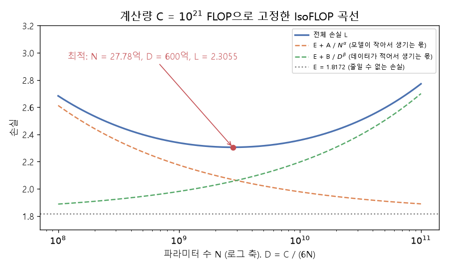

# 계산 예산과 계산 최적 배분 (Compute budget, Compute-optimal allocation)

[목차로 돌아가기](../../00_MIT%EB%94%A5%EB%9F%AC%EB%8B%9D_%EB%AA%A9%EC%B0%A8.md) · 먼저 볼 것: [MM72_거듭제곱_법칙과_로그_로그_그래프](../../%EC%88%98%ED%95%99%EA%B0%9C%EB%85%90/01_%EC%88%98%EC%99%80_%ED%95%A8%EC%88%98/MM72_%EA%B1%B0%EB%93%AD%EC%A0%9C%EA%B3%B1_%EB%B2%95%EC%B9%99%EA%B3%BC_%EB%A1%9C%EA%B7%B8_%EB%A1%9C%EA%B7%B8_%EA%B7%B8%EB%9E%98%ED%94%84.md), [MM01_argmin과_argmax](../../%EC%88%98%ED%95%99%EA%B0%9C%EB%85%90/02_%EB%AF%B8%EB%B6%84/MM01_argmin%EA%B3%BC_argmax.md), [M03_미분_기울기](../../%EC%88%98%ED%95%99%EA%B0%9C%EB%85%90/02_%EB%AF%B8%EB%B6%84/M03_%EB%AF%B8%EB%B6%84_%EA%B8%B0%EC%9A%B8%EA%B8%B0.md), [M09_최솟값과_볼록함수](../../%EC%88%98%ED%95%99%EA%B0%9C%EB%85%90/02_%EB%AF%B8%EB%B6%84/M09_%EC%B5%9C%EC%86%9F%EA%B0%92%EA%B3%BC_%EB%B3%BC%EB%A1%9D%ED%95%A8%EC%88%98.md) · 쓰는 곳: [Lec20 2.3](../../Lec20_%EC%8A%A4%EC%BC%80%EC%9D%BC%EB%A7%81_%EB%B2%95%EC%B9%99.md#23-%EC%B5%9C%EC%A0%81%ED%99%94-%EB%AC%B8%EC%A0%9C%EB%A1%9C-%EC%93%B0%EA%B8%B0), [Lec20 5.4](../../Lec20_%EC%8A%A4%EC%BC%80%EC%9D%BC%EB%A7%81_%EB%B2%95%EC%B9%99.md#54-%EA%B3%84%EC%82%B0%EB%9F%89%EC%9D%84-%EC%96%B4%EB%96%BB%EA%B2%8C-%EB%82%98%EB%88%8C%EA%B9%8C)

📚 학습 순서 69/99 (9. 최적화의 기하): ← 이전: [MM79_뉴턴_슐츠_반복과_직교화](../../%EC%88%98%ED%95%99%EA%B0%9C%EB%85%90/09_%EC%B5%9C%EC%A0%81%ED%99%94%EC%9D%98_%EA%B8%B0%ED%95%98/MM79_%EB%89%B4%ED%84%B4_%EC%8A%90%EC%B8%A0_%EB%B0%98%EB%B3%B5%EA%B3%BC_%EC%A7%81%EA%B5%90%ED%99%94.md) · 다음: [MM40_PCA와_선형_오토인코더](../../%EC%88%98%ED%95%99%EA%B0%9C%EB%85%90/10_%ED%91%9C%ED%98%84_%ED%95%99%EC%8A%B5/MM40_PCA%EC%99%80_%EC%84%A0%ED%98%95_%EC%98%A4%ED%86%A0%EC%9D%B8%EC%BD%94%EB%8D%94.md) →

> [!NOTE]
> **3줄 요약**
> - [학습](../../00_%EB%94%A5%EB%9F%AC%EB%8B%9D_%EC%9A%A9%EC%96%B4%EC%82%AC%EC%A0%84.md#training-%ED%95%99%EC%8A%B5) 계산량은 $C \approx 6ND$ ([파라미터](../../00_%EB%94%A5%EB%9F%AC%EB%8B%9D_%EC%9A%A9%EC%96%B4%EC%82%AC%EC%A0%84.md#parameter-%ED%8C%8C%EB%9D%BC%EB%AF%B8%ED%84%B0) $N$, [토큰](../../00_%EB%94%A5%EB%9F%AC%EB%8B%9D_%EC%9A%A9%EC%96%B4%EC%82%AC%EC%A0%84.md#token-%ED%86%A0%ED%81%B0) $D$). 예산 $C$가 정해지면 $N$을 키운 만큼 $D$를 줄여야 한다. Chinchilla(700억 [파라미터](../../00_%EB%94%A5%EB%9F%AC%EB%8B%9D_%EC%9A%A9%EC%96%B4%EC%82%AC%EC%A0%84.md#parameter-%ED%8C%8C%EB%9D%BC%EB%AF%B8%ED%84%B0), 1.4조 [토큰](../../00_%EB%94%A5%EB%9F%AC%EB%8B%9D_%EC%9A%A9%EC%96%B4%EC%82%AC%EC%A0%84.md#token-%ED%86%A0%ED%81%B0))는 $C = 5.88 \times 10^{23}$ FLOP.
> - [손실](../../00_%EB%94%A5%EB%9F%AC%EB%8B%9D_%EC%9A%A9%EC%96%B4%EC%82%AC%EC%A0%84.md#loss-function-%EC%86%90%EC%8B%A4-%ED%95%A8%EC%88%98)을 $L = E + A / N^{\alpha} + B / D^{\beta}$로 두면 "모델이 작아서 생기는 몫"과 "데이터가 적어서 생기는 몫"이 서로 당긴다. 최적점에서는 $\alpha \cdot (A/N^{\alpha}) = \beta \cdot (B/D^{\beta})$로 균형이 맞고, $N_{opt} \propto C^{\beta/(\alpha+\beta)}$, $D_{opt} \propto C^{\alpha/(\alpha+\beta)}$가 된다.
> - 친칠라 법칙을 다시 맞춘 값($\alpha = 0.3478$, $\beta = 0.3658$)으로 $C = 10^{21}$이면 $N_{opt} = 2.778 \times 10^9$, $D_{opt} = 6.0 \times 10^{10}$, [토큰](../../00_%EB%94%A5%EB%9F%AC%EB%8B%9D_%EC%9A%A9%EC%96%B4%EC%82%AC%EC%A0%84.md#token-%ED%86%A0%ED%81%B0)/[파라미터](../../00_%EB%94%A5%EB%9F%AC%EB%8B%9D_%EC%9A%A9%EC%96%B4%EC%82%AC%EC%A0%84.md#parameter-%ED%8C%8C%EB%9D%BC%EB%AF%B8%ED%84%B0) 21.59, [손실](../../00_%EB%94%A5%EB%9F%AC%EB%8B%9D_%EC%9A%A9%EC%96%B4%EC%82%AC%EC%A0%84.md#loss-function-%EC%86%90%EC%8B%A4-%ED%95%A8%EC%88%98) 2.3055. [지수](../../00_%EB%94%A5%EB%9F%AC%EB%8B%9D_%EC%9A%A9%EC%96%B4%EC%82%AC%EC%A0%84.md#e-exponent-e%EC%99%80-%EC%A7%80%EC%88%98) 0.5126 : 0.4874로 거의 반반이다(Kaplan은 0.73 : 0.27).

## 1. 개념 설명

비유: **정해진 예산으로 식당을 차리는 일**. 주방(모델 크기 $N$)을 넓히면 요리를 더 잘할 수 있지만 재료(데이터 $D$)를 살 돈이 준다. 재료를 많이 사면 주방이 좁아진다. 주방이 너무 좁으면 재료가 남아돌고, 재료가 너무 적으면 큰 주방이 놀린다. 둘 사이에 손님 만족([손실](../../00_%EB%94%A5%EB%9F%AC%EB%8B%9D_%EC%9A%A9%EC%96%B4%EC%82%AC%EC%A0%84.md#loss-function-%EC%86%90%EC%8B%A4-%ED%95%A8%EC%88%98))이 가장 좋은 지점이 있다.

- **계산 예산**: [토큰](../../00_%EB%94%A5%EB%9F%AC%EB%8B%9D_%EC%9A%A9%EC%96%B4%EC%82%AC%EC%A0%84.md#token-%ED%86%A0%ED%81%B0) 하나를 처리할 때 [파라미터](../../00_%EB%94%A5%EB%9F%AC%EB%8B%9D_%EC%9A%A9%EC%96%B4%EC%82%AC%EC%A0%84.md#parameter-%ED%8C%8C%EB%9D%BC%EB%AF%B8%ED%84%B0) 하나당 [순전파](../../00_%EB%94%A5%EB%9F%AC%EB%8B%9D_%EC%9A%A9%EC%96%B4%EC%82%AC%EC%A0%84.md#feed-forward-%EC%88%9C%EC%A0%84%ED%8C%8C)에 약 2번, [역전파](../../00_%EB%94%A5%EB%9F%AC%EB%8B%9D_%EC%9A%A9%EC%96%B4%EC%82%AC%EC%A0%84.md#backpropagation-%EC%97%AD%EC%A0%84%ED%8C%8C)에 약 4번 연산하므로 $C \approx 6ND$다. $C$가 고정이면 $D = C / (6N)$으로 $D$가 $N$에 묶인다.
- **두 몫의 [손실](../../00_%EB%94%A5%EB%9F%AC%EB%8B%9D_%EC%9A%A9%EC%96%B4%EC%82%AC%EC%A0%84.md#loss-function-%EC%86%90%EC%8B%A4-%ED%95%A8%EC%88%98)**: $A / N^{\alpha}$는 모델이 유한해서 생기는 [손실](../../00_%EB%94%A5%EB%9F%AC%EB%8B%9D_%EC%9A%A9%EC%96%B4%EC%82%AC%EC%A0%84.md#loss-function-%EC%86%90%EC%8B%A4-%ED%95%A8%EC%88%98), $B / D^{\beta}$는 데이터가 유한해서 생기는 [손실](../../00_%EB%94%A5%EB%9F%AC%EB%8B%9D_%EC%9A%A9%EC%96%B4%EC%82%AC%EC%A0%84.md#loss-function-%EC%86%90%EC%8B%A4-%ED%95%A8%EC%88%98), $E$는 아무리 키워도 남는 [줄일 수 없는 손실](../../00_%EB%94%A5%EB%9F%AC%EB%8B%9D_%EC%9A%A9%EC%96%B4%EC%82%AC%EC%A0%84.md#irreducible-loss-%EC%A4%84%EC%9D%BC-%EC%88%98-%EC%97%86%EB%8A%94-%EC%86%90%EC%8B%A4)이다. $N$을 키우면 첫 몫은 줄지만 $D$가 줄어 둘째 몫이 는다.
- **최적점 찾기**: $D = C/(6N)$을 넣으면 [손실](../../00_%EB%94%A5%EB%9F%AC%EB%8B%9D_%EC%9A%A9%EC%96%B4%EC%82%AC%EC%A0%84.md#loss-function-%EC%86%90%EC%8B%A4-%ED%95%A8%EC%88%98)이 $N$ 하나의 함수가 된다. [미분](../../%EC%88%98%ED%95%99%EA%B0%9C%EB%85%90/02_%EB%AF%B8%EB%B6%84/M03_%EB%AF%B8%EB%B6%84_%EA%B8%B0%EC%9A%B8%EA%B8%B0.md)해서 0이 되는 곳을 찾으면 $\alpha A / N^{\alpha} = \beta B / D^{\beta}$가 나온다. 말로 하면 "$N$을 1% 늘려 줄어드는 [손실](../../00_%EB%94%A5%EB%9F%AC%EB%8B%9D_%EC%9A%A9%EC%96%B4%EC%82%AC%EC%A0%84.md#loss-function-%EC%86%90%EC%8B%A4-%ED%95%A8%EC%88%98) = $D$가 1% 줄어 늘어나는 [손실](../../00_%EB%94%A5%EB%9F%AC%EB%8B%9D_%EC%9A%A9%EC%96%B4%EC%82%AC%EC%A0%84.md#loss-function-%EC%86%90%EC%8B%A4-%ED%95%A8%EC%88%98)"인 곳이다.
- **IsoFLOP 곡선**: 계산량을 하나로 고정하고 $N$을 바꿔 가며 [손실](../../00_%EB%94%A5%EB%9F%AC%EB%8B%9D_%EC%9A%A9%EC%96%B4%EC%82%AC%EC%A0%84.md#loss-function-%EC%86%90%EC%8B%A4-%ED%95%A8%EC%88%98)을 그린 U자 곡선이다. 친칠라 논문의 방법 2가 이것이다. 바닥이 최적점이다(아래 그림).


*▲ 직접 그린 그림: $C = 10^{21}$ FLOP으로 고정했을 때 $N$에 따른 [손실](../../00_%EB%94%A5%EB%9F%AC%EB%8B%9D_%EC%9A%A9%EC%96%B4%EC%82%AC%EC%A0%84.md#loss-function-%EC%86%90%EC%8B%A4-%ED%95%A8%EC%88%98)(Besiroglu 등 2024의 다시 맞춘 친칠라 식). 주황은 모델 몫, 초록은 데이터 몫, 파랑은 합. 바닥은 $N = 27.78$억, $D = 600$억에서 [손실](../../00_%EB%94%A5%EB%9F%AC%EB%8B%9D_%EC%9A%A9%EC%96%B4%EC%82%AC%EC%A0%84.md#loss-function-%EC%86%90%EC%8B%A4-%ED%95%A8%EC%88%98) 2.3055*

## 2. 필요한 이유

[Lec20 2.3](../../Lec20_%EC%8A%A4%EC%BC%80%EC%9D%BC%EB%A7%81_%EB%B2%95%EC%B9%99.md#23-%EC%B5%9C%EC%A0%81%ED%99%94-%EB%AC%B8%EC%A0%9C%EB%A1%9C-%EC%93%B0%EA%B8%B0)에서 강사는 [스케일링 법칙](../../00_%EB%94%A5%EB%9F%AC%EB%8B%9D_%EC%9A%A9%EC%96%B4%EC%82%AC%EC%A0%84.md#scaling-laws-%EC%8A%A4%EC%BC%80%EC%9D%BC%EB%A7%81-%EB%B2%95%EC%B9%99)의 근본 질문을 "$\text{FLOPs}(N, D) = C$라는 조건 아래 $L(N, D)$를 최소로 하는 $N$, $D$"로 썼고, [Lec20 5.4](../../Lec20_%EC%8A%A4%EC%BC%80%EC%9D%BC%EB%A7%81_%EB%B2%95%EC%B9%99.md#54-%EA%B3%84%EC%82%B0%EB%9F%89%EC%9D%84-%EC%96%B4%EB%96%BB%EA%B2%8C-%EB%82%98%EB%88%8C%EA%B9%8C)에서 Kaplan 등의 답 $N \propto C^{0.73}$, $D \propto C^{0.27}$을 소개했다. 이 [지수](../../00_%EB%94%A5%EB%9F%AC%EB%8B%9D_%EC%9A%A9%EC%96%B4%EC%82%AC%EC%A0%84.md#e-exponent-e%EC%99%80-%EC%A7%80%EC%88%98)가 [손실](../../00_%EB%94%A5%EB%9F%AC%EB%8B%9D_%EC%9A%A9%EC%96%B4%EC%82%AC%EC%A0%84.md#loss-function-%EC%86%90%EC%8B%A4-%ED%95%A8%EC%88%98) 식의 [지수](../../00_%EB%94%A5%EB%9F%AC%EB%8B%9D_%EC%9A%A9%EC%96%B4%EC%82%AC%EC%A0%84.md#e-exponent-e%EC%99%80-%EC%A7%80%EC%88%98)에서 어떻게 나오는지, 그리고 친칠라 법칙의 "[토큰](../../00_%EB%94%A5%EB%9F%AC%EB%8B%9D_%EC%9A%A9%EC%96%B4%EC%82%AC%EC%A0%84.md#token-%ED%86%A0%ED%81%B0)/[파라미터](../../00_%EB%94%A5%EB%9F%AC%EB%8B%9D_%EC%9A%A9%EC%96%B4%EC%82%AC%EC%A0%84.md#parameter-%ED%8C%8C%EB%9D%BC%EB%AF%B8%ED%84%B0) 약 20"이 어디서 오는지를 숫자로 따라간다.

## 3. 숫자로 보기

Besiroglu 등(2024)이 다시 맞춘 친칠라 식: $E = 1.8172$, $A = 482.01$, $B = 2085.43$, $\alpha = 0.3478$, $\beta = 0.3658$. 계산 예산 $C = 10^{21}$ FLOP, $D = C / (6N)$.

| $N$ | $D$ | 모델 몫 $A/N^{\alpha}$ | 데이터 몫 $B/D^{\beta}$ | [손실](../../00_%EB%94%A5%EB%9F%AC%EB%8B%9D_%EC%9A%A9%EC%96%B4%EC%82%AC%EC%A0%84.md#loss-function-%EC%86%90%EC%8B%A4-%ED%95%A8%EC%88%98) $L$ |
|---|---|---|---|---|
| $10^8$ | $1.667 \times 10^{12}$ | 0.7955 | 0.0705 | 2.6833 |
| $10^9$ | $1.667 \times 10^{11}$ | 0.3572 | 0.1638 | 2.3381 |
| $3 \times 10^9$ | $5.556 \times 10^{10}$ | 0.2437 | 0.2448 | 2.3057 |
| $10^{10}$ | $1.667 \times 10^{10}$ | 0.1603 | 0.3802 | 2.3578 |
| $10^{11}$ | $1.667 \times 10^9$ | 0.0720 | 0.8828 | 2.7719 |

- 모델이 너무 작으면($10^8$) 모델 몫이, 너무 크면($10^{11}$) 데이터 몫이 [손실](../../00_%EB%94%A5%EB%9F%AC%EB%8B%9D_%EC%9A%A9%EC%96%B4%EC%82%AC%EC%A0%84.md#loss-function-%EC%86%90%EC%8B%A4-%ED%95%A8%EC%88%98)을 키운다. 둘이 비슷해지는 $3 \times 10^9$ 근처가 바닥이다.
- 정확한 최적은 $N = 2.778 \times 10^9$, $D = 6.0 \times 10^{10}$, [손실](../../00_%EB%94%A5%EB%9F%AC%EB%8B%9D_%EC%9A%A9%EC%96%B4%EC%82%AC%EC%A0%84.md#loss-function-%EC%86%90%EC%8B%A4-%ED%95%A8%EC%88%98) 2.3055. [토큰](../../00_%EB%94%A5%EB%9F%AC%EB%8B%9D_%EC%9A%A9%EC%96%B4%EC%82%AC%EC%A0%84.md#token-%ED%86%A0%ED%81%B0)/[파라미터](../../00_%EB%94%A5%EB%9F%AC%EB%8B%9D_%EC%9A%A9%EC%96%B4%EC%82%AC%EC%A0%84.md#parameter-%ED%8C%8C%EB%9D%BC%EB%AF%B8%ED%84%B0) $= 6.0 \times 10^{10} / 2.778 \times 10^9 = 21.59$.

[학습](../../00_%EB%94%A5%EB%9F%AC%EB%8B%9D_%EC%9A%A9%EC%96%B4%EC%82%AC%EC%A0%84.md#training-%ED%95%99%EC%8A%B5) 계산량은 다음과 같다.

$$
C \approx 6\,N D
$$

<details><summary>기호 풀이</summary>

| 기호 | 읽는 법 | 뜻 | 예제 값 |
| --- | --- | --- | --- |
| $C$ | 씨 | [학습](../../00_%EB%94%A5%EB%9F%AC%EB%8B%9D_%EC%9A%A9%EC%96%B4%EC%82%AC%EC%A0%84.md#training-%ED%95%99%EC%8A%B5) 계산량 (FLOP) | $5.88 \times 10^{23}$ |
| $N$ | 엔 | [파라미터](../../00_%EB%94%A5%EB%9F%AC%EB%8B%9D_%EC%9A%A9%EC%96%B4%EC%82%AC%EC%A0%84.md#parameter-%ED%8C%8C%EB%9D%BC%EB%AF%B8%ED%84%B0) 수 | $7 \times 10^{10}$ |
| $D$ | 디 | [학습](../../00_%EB%94%A5%EB%9F%AC%EB%8B%9D_%EC%9A%A9%EC%96%B4%EC%82%AC%EC%A0%84.md#training-%ED%95%99%EC%8A%B5) [토큰](../../00_%EB%94%A5%EB%9F%AC%EB%8B%9D_%EC%9A%A9%EC%96%B4%EC%82%AC%EC%A0%84.md#token-%ED%86%A0%ED%81%B0) 수 | $1.4 \times 10^{12}$ |
| $6$ | 육 | [토큰](../../00_%EB%94%A5%EB%9F%AC%EB%8B%9D_%EC%9A%A9%EC%96%B4%EC%82%AC%EC%A0%84.md#token-%ED%86%A0%ED%81%B0)·파라미터당 연산 수 ([순전파](../../00_%EB%94%A5%EB%9F%AC%EB%8B%9D_%EC%9A%A9%EC%96%B4%EC%82%AC%EC%A0%84.md#feed-forward-%EC%88%9C%EC%A0%84%ED%8C%8C) 2 + [역전파](../../00_%EB%94%A5%EB%9F%AC%EB%8B%9D_%EC%9A%A9%EC%96%B4%EC%82%AC%EC%A0%84.md#backpropagation-%EC%97%AD%EC%A0%84%ED%8C%8C) 4) | 6 |

</details>

<details><summary>예제와 풀이</summary>

**문제**: Chinchilla는 [파라미터](../../00_%EB%94%A5%EB%9F%AC%EB%8B%9D_%EC%9A%A9%EC%96%B4%EC%82%AC%EC%A0%84.md#parameter-%ED%8C%8C%EB%9D%BC%EB%AF%B8%ED%84%B0) 700억 개를 1.4조 [토큰](../../00_%EB%94%A5%EB%9F%AC%EB%8B%9D_%EC%9A%A9%EC%96%B4%EC%82%AC%EC%A0%84.md#token-%ED%86%A0%ED%81%B0)으로 학습했다. 계산량은 몇 FLOP인가?

**주어진 값**
- $N = 7 \times 10^{10}$ ([파라미터](../../00_%EB%94%A5%EB%9F%AC%EB%8B%9D_%EC%9A%A9%EC%96%B4%EC%82%AC%EC%A0%84.md#parameter-%ED%8C%8C%EB%9D%BC%EB%AF%B8%ED%84%B0) 700억 개)
- $D = 1.4 \times 10^{12}$ ([토큰](../../00_%EB%94%A5%EB%9F%AC%EB%8B%9D_%EC%9A%A9%EC%96%B4%EC%82%AC%EC%A0%84.md#token-%ED%86%A0%ED%81%B0) 1.4조 개)

**풀이**
1. 식을 그대로 쓴다: $C \approx 6\,N D$
2. 값을 대입한다: $C \approx 6 \times (7 \times 10^{10}) \times (1.4 \times 10^{12})$
3. 앞의 수끼리 곱한다: $6 \times 7 = 42$, $42 \times 1.4 = 58.8$
4. 10의 거듭제곱끼리 곱한다([지수](../../00_%EB%94%A5%EB%9F%AC%EB%8B%9D_%EC%9A%A9%EC%96%B4%EC%82%AC%EC%A0%84.md#e-exponent-e%EC%99%80-%EC%A7%80%EC%88%98)를 더한다): $10^{10} \times 10^{12} = 10^{22}$ 이므로 $C \approx 58.8 \times 10^{22}$
5. 자릿수를 맞춘다: $58.8 \times 10^{22} = 5.88 \times 10^{23}$

**답**: 약 **$5.88 \times 10^{23}$ FLOP**. [토큰](../../00_%EB%94%A5%EB%9F%AC%EB%8B%9D_%EC%9A%A9%EC%96%B4%EC%82%AC%EC%A0%84.md#token-%ED%86%A0%ED%81%B0)/[파라미터](../../00_%EB%94%A5%EB%9F%AC%EB%8B%9D_%EC%9A%A9%EC%96%B4%EC%82%AC%EC%A0%84.md#parameter-%ED%8C%8C%EB%9D%BC%EB%AF%B8%ED%84%B0)는 $1.4 \times 10^{12} / 7 \times 10^{10} = 20$이다.

</details>

<details><summary>내 이해</summary>


</details>

[손실](../../00_%EB%94%A5%EB%9F%AC%EB%8B%9D_%EC%9A%A9%EC%96%B4%EC%82%AC%EC%A0%84.md#loss-function-%EC%86%90%EC%8B%A4-%ED%95%A8%EC%88%98)을 모델 몫과 데이터 몫의 합으로 둔다(친칠라 꼴).

$$
L(N, D) = E + \frac{A}{N^{\alpha}} + \frac{B}{D^{\beta}}
$$

<details><summary>기호 풀이</summary>

| 기호 | 읽는 법 | 뜻 | 예제 값 |
| --- | --- | --- | --- |
| $E$ | 이 | [줄일 수 없는 손실](../../00_%EB%94%A5%EB%9F%AC%EB%8B%9D_%EC%9A%A9%EC%96%B4%EC%82%AC%EC%A0%84.md#irreducible-loss-%EC%A4%84%EC%9D%BC-%EC%88%98-%EC%97%86%EB%8A%94-%EC%86%90%EC%8B%A4) (자연 언어 자체의 불확실성) | 1.8172 |
| $A$, $\alpha$ | 에이, 알파 | 모델 몫의 계수와 [지수](../../00_%EB%94%A5%EB%9F%AC%EB%8B%9D_%EC%9A%A9%EC%96%B4%EC%82%AC%EC%A0%84.md#e-exponent-e%EC%99%80-%EC%A7%80%EC%88%98) | 482.01, 0.3478 |
| $B$, $\beta$ | 비, 베타 | 데이터 몫의 계수와 [지수](../../00_%EB%94%A5%EB%9F%AC%EB%8B%9D_%EC%9A%A9%EC%96%B4%EC%82%AC%EC%A0%84.md#e-exponent-e%EC%99%80-%EC%A7%80%EC%88%98) | 2085.43, 0.3658 |
| $N$ | 엔 | [파라미터](../../00_%EB%94%A5%EB%9F%AC%EB%8B%9D_%EC%9A%A9%EC%96%B4%EC%82%AC%EC%A0%84.md#parameter-%ED%8C%8C%EB%9D%BC%EB%AF%B8%ED%84%B0) 수 | $2.778 \times 10^9$ |
| $D$ | 디 | [학습](../../00_%EB%94%A5%EB%9F%AC%EB%8B%9D_%EC%9A%A9%EC%96%B4%EC%82%AC%EC%A0%84.md#training-%ED%95%99%EC%8A%B5) [토큰](../../00_%EB%94%A5%EB%9F%AC%EB%8B%9D_%EC%9A%A9%EC%96%B4%EC%82%AC%EC%A0%84.md#token-%ED%86%A0%ED%81%B0) 수 | $6 \times 10^{10}$ |
| $L(N, D)$ | 엘 | 예측한 [손실](../../00_%EB%94%A5%EB%9F%AC%EB%8B%9D_%EC%9A%A9%EC%96%B4%EC%82%AC%EC%A0%84.md#loss-function-%EC%86%90%EC%8B%A4-%ED%95%A8%EC%88%98) | 2.3055 |

</details>

<details><summary>예제와 풀이</summary>

**문제**: [파라미터](../../00_%EB%94%A5%EB%9F%AC%EB%8B%9D_%EC%9A%A9%EC%96%B4%EC%82%AC%EC%A0%84.md#parameter-%ED%8C%8C%EB%9D%BC%EB%AF%B8%ED%84%B0) 27.78억 개($2.778 \times 10^9$) 모델을 [토큰](../../00_%EB%94%A5%EB%9F%AC%EB%8B%9D_%EC%9A%A9%EC%96%B4%EC%82%AC%EC%A0%84.md#token-%ED%86%A0%ED%81%B0) 600억 개($6 \times 10^{10}$)로 학습하면 [손실](../../00_%EB%94%A5%EB%9F%AC%EB%8B%9D_%EC%9A%A9%EC%96%B4%EC%82%AC%EC%A0%84.md#loss-function-%EC%86%90%EC%8B%A4-%ED%95%A8%EC%88%98)은?

**주어진 값**
- $N = 2.778 \times 10^9$, $D = 6 \times 10^{10}$ (모델 크기, [토큰](../../00_%EB%94%A5%EB%9F%AC%EB%8B%9D_%EC%9A%A9%EC%96%B4%EC%82%AC%EC%A0%84.md#token-%ED%86%A0%ED%81%B0) 수)
- $E = 1.8172$, $A = 482.01$, $B = 2085.43$, $\alpha = 0.3478$, $\beta = 0.3658$ (맞춤 값)

**풀이**
1. 식을 그대로 쓴다: $L = E + \dfrac{A}{N^{\alpha}} + \dfrac{B}{D^{\beta}}$
2. 값을 대입한다: $L = 1.8172 + \dfrac{482.01}{(2.778 \times 10^9)^{0.3478}} + \dfrac{2085.43}{(6 \times 10^{10})^{0.3658}}$
3. 소수 [지수](../../00_%EB%94%A5%EB%9F%AC%EB%8B%9D_%EC%9A%A9%EC%96%B4%EC%82%AC%EC%A0%84.md#e-exponent-e%EC%99%80-%EC%A7%80%EC%88%98)는 $a^b = e^{b \ln a}$로 계산한다($\ln$은 자연로그). 첫 분모의 [로그](../../00_%EB%94%A5%EB%9F%AC%EB%8B%9D_%EC%9A%A9%EC%96%B4%EC%82%AC%EC%A0%84.md#log-ln-%EB%A1%9C%EA%B7%B8): $\ln(2.778 \times 10^9) = 21.745$
4. [지수](../../00_%EB%94%A5%EB%9F%AC%EB%8B%9D_%EC%9A%A9%EC%96%B4%EC%82%AC%EC%A0%84.md#e-exponent-e%EC%99%80-%EC%A7%80%EC%88%98)를 곱한다: $0.3478 \times 21.745 = 7.56291$
5. $e$의 거듭제곱을 계산한다: $e^{7.56291} = 1925.44$
6. 나눈다: $482.01 / 1925.44 = 0.250338$
7. 둘째 분모의 [로그](../../00_%EB%94%A5%EB%9F%AC%EB%8B%9D_%EC%9A%A9%EC%96%B4%EC%82%AC%EC%A0%84.md#log-ln-%EB%A1%9C%EA%B7%B8): $\ln(6 \times 10^{10}) = 24.8176$
8. [지수](../../00_%EB%94%A5%EB%9F%AC%EB%8B%9D_%EC%9A%A9%EC%96%B4%EC%82%AC%EC%A0%84.md#e-exponent-e%EC%99%80-%EC%A7%80%EC%88%98)를 곱한다: $0.3658 \times 24.8176 = 9.07828$
9. $e$의 거듭제곱을 계산한다: $e^{9.07828} = 8762.9$
10. 나눈다: $2085.43 / 8762.9 = 0.237984$ 이므로 $L = 1.8172 + 0.250338 + 0.237984$
11. 앞의 둘을 더한다: $1.8172 + 0.250338 = 2.067538$
12. 마저 더한다: $2.067538 + 0.237984 = 2.305522$

**답**: $L \approx$ **2.3055**. 모델 몫(0.2503)과 데이터 몫(0.2380)이 거의 같다. 이 예산($10^{21}$ FLOP)의 최적점이기 때문이다.

</details>

<details><summary>내 이해</summary>


</details>

$D = C/(6N)$을 넣고 $N$으로 미분해 0으로 두면 계산 최적 배분이 나온다.

$$
N_{opt} = G \left(\frac{C}{6}\right)^{a}, \quad D_{opt} = \frac{C}{6\,N_{opt}}, \qquad a = \frac{\beta}{\alpha + \beta}, \quad G = \left(\frac{\alpha A}{\beta B}\right)^{\frac{1}{\alpha + \beta}}
$$

<details><summary>기호 풀이</summary>

| 기호 | 읽는 법 | 뜻 | 예제 값 |
| --- | --- | --- | --- |
| $C$ | 씨 | 계산 예산 (FLOP) | $10^{21}$ |
| $a$ | 에이 | $N_{opt}$가 $C$와 함께 커지는 [지수](../../00_%EB%94%A5%EB%9F%AC%EB%8B%9D_%EC%9A%A9%EC%96%B4%EC%82%AC%EC%A0%84.md#e-exponent-e%EC%99%80-%EC%A7%80%EC%88%98). $D_{opt}$의 [지수](../../00_%EB%94%A5%EB%9F%AC%EB%8B%9D_%EC%9A%A9%EC%96%B4%EC%82%AC%EC%A0%84.md#e-exponent-e%EC%99%80-%EC%A7%80%EC%88%98)는 $1 - a$ | 0.512612 |
| $G$ | 지 | 상수배 (계수와 [지수](../../00_%EB%94%A5%EB%9F%AC%EB%8B%9D_%EC%9A%A9%EC%96%B4%EC%82%AC%EC%A0%84.md#e-exponent-e%EC%99%80-%EC%A7%80%EC%88%98)로 정해진다) | 0.11963 |
| $\alpha A$, $\beta B$ | | 두 몫의 "민감도" | 167.643, 762.85 |
| $N_{opt}$, $D_{opt}$ | 엔 옵트, 디 옵트 | 계산 최적 모델 크기와 [토큰](../../00_%EB%94%A5%EB%9F%AC%EB%8B%9D_%EC%9A%A9%EC%96%B4%EC%82%AC%EC%A0%84.md#token-%ED%86%A0%ED%81%B0) 수 | $2.778 \times 10^9$, $6.0 \times 10^{10}$ |

</details>

<details><summary>예제와 풀이</summary>

**문제**: 계산 예산이 $C = 10^{21}$ FLOP일 때 계산 최적 [파라미터](../../00_%EB%94%A5%EB%9F%AC%EB%8B%9D_%EC%9A%A9%EC%96%B4%EC%82%AC%EC%A0%84.md#parameter-%ED%8C%8C%EB%9D%BC%EB%AF%B8%ED%84%B0) 수와 [토큰](../../00_%EB%94%A5%EB%9F%AC%EB%8B%9D_%EC%9A%A9%EC%96%B4%EC%82%AC%EC%A0%84.md#token-%ED%86%A0%ED%81%B0) 수는?

**주어진 값**
- $C = 10^{21}$ (계산 예산)
- $A = 482.01$, $B = 2085.43$, $\alpha = 0.3478$, $\beta = 0.3658$ (맞춤 값)

**풀이**
1. 식을 그대로 쓴다: $a = \dfrac{\beta}{\alpha + \beta}$, $G = \left(\dfrac{\alpha A}{\beta B}\right)^{1/(\alpha + \beta)}$, $N_{opt} = G (C/6)^{a}$, $D_{opt} = \dfrac{C}{6 N_{opt}}$
2. 값을 대입한다: $a = \dfrac{0.3658}{0.3478 + 0.3658}$, $G = \left(\dfrac{0.3478 \times 482.01}{0.3658 \times 2085.43}\right)^{1/(0.3478 + 0.3658)}$, $N_{opt} = G \times (10^{21} / 6)^{a}$
3. [지수](../../00_%EB%94%A5%EB%9F%AC%EB%8B%9D_%EC%9A%A9%EC%96%B4%EC%82%AC%EC%A0%84.md#e-exponent-e%EC%99%80-%EC%A7%80%EC%88%98)의 분모를 더한다: $0.3478 + 0.3658 = 0.7136$
4. $a$를 나눈다: $0.3658 / 0.7136 = 0.512612$
5. $G$의 분자를 곱한다: $0.3478 \times 482.01 = 167.643$
6. $G$의 분모를 곱한다: $0.3658 \times 2085.43 = 762.85$
7. 나눈다: $167.643 / 762.85 = 0.219759$
8. $G$의 [지수](../../00_%EB%94%A5%EB%9F%AC%EB%8B%9D_%EC%9A%A9%EC%96%B4%EC%82%AC%EC%A0%84.md#e-exponent-e%EC%99%80-%EC%A7%80%EC%88%98)를 나눈다: $1 / 0.7136 = 1.40135$ 이므로 $G = 0.219759^{1.40135}$
9. 자연로그를 구한다($a^b = e^{b \ln a}$): $\ln 0.219759 = -1.51522$
10. [지수](../../00_%EB%94%A5%EB%9F%AC%EB%8B%9D_%EC%9A%A9%EC%96%B4%EC%82%AC%EC%A0%84.md#e-exponent-e%EC%99%80-%EC%A7%80%EC%88%98)를 곱한다: $1.40135 \times (-1.51522) = -2.12335$
11. $e$의 거듭제곱을 계산한다: $G = e^{-2.12335} = 0.11963$
12. 예산을 6으로 나눈다: $10^{21} / 6 = 1.66667 \times 10^{20}$
13. 자연로그를 구한다: $\ln(1.66667 \times 10^{20}) = 46.5625$
14. [지수](../../00_%EB%94%A5%EB%9F%AC%EB%8B%9D_%EC%9A%A9%EC%96%B4%EC%82%AC%EC%A0%84.md#e-exponent-e%EC%99%80-%EC%A7%80%EC%88%98) $a$를 곱한다: $0.512612 \times 46.5625 = 23.8685$
15. $e$의 거듭제곱을 계산한다: $e^{23.8685} = 2.32255 \times 10^{10}$
16. $G$를 곱한다: $N_{opt} = 0.11963 \times 2.32255 \times 10^{10} = 2.77846 \times 10^9$
17. [토큰](../../00_%EB%94%A5%EB%9F%AC%EB%8B%9D_%EC%9A%A9%EC%96%B4%EC%82%AC%EC%A0%84.md#token-%ED%86%A0%ED%81%B0) 수를 나눈다: $D_{opt} = 1.66667 \times 10^{20} / 2.77846 \times 10^9 = 5.99853 \times 10^{10}$
18. 비를 나눈다: $5.99853 \times 10^{10} / 2.77846 \times 10^9 = 21.5894$

**답**: $N_{opt} \approx$ **27.78억**, $D_{opt} \approx$ **600억 [토큰](../../00_%EB%94%A5%EB%9F%AC%EB%8B%9D_%EC%9A%A9%EC%96%B4%EC%82%AC%EC%A0%84.md#token-%ED%86%A0%ED%81%B0)**, [토큰](../../00_%EB%94%A5%EB%9F%AC%EB%8B%9D_%EC%9A%A9%EC%96%B4%EC%82%AC%EC%A0%84.md#token-%ED%86%A0%ED%81%B0)/[파라미터](../../00_%EB%94%A5%EB%9F%AC%EB%8B%9D_%EC%9A%A9%EC%96%B4%EC%82%AC%EC%A0%84.md#parameter-%ED%8C%8C%EB%9D%BC%EB%AF%B8%ED%84%B0) **약 21.6**. 3절 표를 촘촘히 훑은 바닥과 같다.

</details>

<details><summary>내 이해</summary>


</details>

최적점에서는 두 몫이 [지수](../../00_%EB%94%A5%EB%9F%AC%EB%8B%9D_%EC%9A%A9%EC%96%B4%EC%82%AC%EC%A0%84.md#e-exponent-e%EC%99%80-%EC%A7%80%EC%88%98)의 비율로 균형을 이룬다.

$$
\alpha \cdot \frac{A}{N_{opt}^{\alpha}} = \beta \cdot \frac{B}{D_{opt}^{\beta}}
$$

<details><summary>기호 풀이</summary>

| 기호 | 읽는 법 | 뜻 | 예제 값 |
| --- | --- | --- | --- |
| $A / N_{opt}^{\alpha}$ | | 최적점의 모델 몫 [손실](../../00_%EB%94%A5%EB%9F%AC%EB%8B%9D_%EC%9A%A9%EC%96%B4%EC%82%AC%EC%A0%84.md#loss-function-%EC%86%90%EC%8B%A4-%ED%95%A8%EC%88%98) | 0.250323 |
| $B / D_{opt}^{\beta}$ | | 최적점의 데이터 몫 [손실](../../00_%EB%94%A5%EB%9F%AC%EB%8B%9D_%EC%9A%A9%EC%96%B4%EC%82%AC%EC%A0%84.md#loss-function-%EC%86%90%EC%8B%A4-%ED%95%A8%EC%88%98) | 0.238005 |
| $\alpha$, $\beta$ | 알파, 베타 | 두 몫의 [지수](../../00_%EB%94%A5%EB%9F%AC%EB%8B%9D_%EC%9A%A9%EC%96%B4%EC%82%AC%EC%A0%84.md#e-exponent-e%EC%99%80-%EC%A7%80%EC%88%98) | 0.3478, 0.3658 |
| 양변 | | $N$을 1% 늘릴 때 줄어드는 [손실](../../00_%EB%94%A5%EB%9F%AC%EB%8B%9D_%EC%9A%A9%EC%96%B4%EC%82%AC%EC%A0%84.md#loss-function-%EC%86%90%EC%8B%A4-%ED%95%A8%EC%88%98) = $D$를 1% 줄일 때 느는 [손실](../../00_%EB%94%A5%EB%9F%AC%EB%8B%9D_%EC%9A%A9%EC%96%B4%EC%82%AC%EC%A0%84.md#loss-function-%EC%86%90%EC%8B%A4-%ED%95%A8%EC%88%98) (×100) | 0.0870624 |

</details>

<details><summary>예제와 풀이</summary>

**문제**: 바로 앞 예제의 최적점($C = 10^{21}$)에서 모델 몫은 0.250323, 데이터 몫은 0.238005였다. 균형 조건이 맞는지 확인하라.

**주어진 값**
- $A / N_{opt}^{\alpha} = 0.250323$ (모델 몫)
- $B / D_{opt}^{\beta} = 0.238005$ (데이터 몫)
- $\alpha = 0.3478$, $\beta = 0.3658$ ([지수](../../00_%EB%94%A5%EB%9F%AC%EB%8B%9D_%EC%9A%A9%EC%96%B4%EC%82%AC%EC%A0%84.md#e-exponent-e%EC%99%80-%EC%A7%80%EC%88%98))

**풀이**
1. 식을 그대로 쓴다: $\alpha \cdot \dfrac{A}{N_{opt}^{\alpha}} = \beta \cdot \dfrac{B}{D_{opt}^{\beta}}$
2. 값을 대입한다: $0.3478 \times 0.250323 \ \overset{?}{=}\ 0.3658 \times 0.238005$
3. 왼쪽을 곱한다: $0.3478 \times 0.250323 = 0.0870624$
4. 오른쪽을 곱한다: $0.3658 \times 0.238005 = 0.0870624$
5. 비교한다: 두 값이 같다

**답**: 양변 모두 **0.0870624**로 같다. $\beta$가 $\alpha$보다 조금 커서 최적점의 데이터 몫이 모델 몫보다 조금 작다.

</details>

<details><summary>내 이해</summary>


</details>

## 4. 코드로 확인

```python
# [변수] E, A, B, al, be: Besiroglu 등(2024)이 다시 맞춘 친칠라 손실 식의 값
E, A, B, al, be = 1.8172, 482.01, 2085.43, 0.3478, 0.3658
# [변수] C: 계산 예산 10^21 FLOP
C = 1e21
# [변수] G = 0.1196: 상수배 (al*A / (be*B))^(1/(al+be))
G = (al * A / (be * B)) ** (1 / (al + be))
# [변수] a = 0.5126: N_opt가 C와 함께 커지는 지수 be / (al + be)
a = be / (al + be)
# [변수] N: 계산 최적 파라미터 수 G (C/6)^a
N = G * (C / 6) ** a
# [변수] D: 남은 예산으로 볼 토큰 수 C / (6N)
D = C / (6 * N)
# [연결] 3절 셋째 식 예제: 0.5126 0.1196 2.778e+09 5.999e+10 21.59
print(round(a, 4), round(G, 4), f"{N:.4g}", f"{D:.4g}", round(D / N, 2))
# [연결] 3절 둘째 식: 모델 몫, 데이터 몫, 손실
print(round(A / N ** al, 4), round(B / D ** be, 4), round(E + A / N ** al + B / D ** be, 4))
# [연결] 3절 넷째 식: 균형 조건 al * 모델 몫 = be * 데이터 몫
print(round(al * A / N ** al, 4), round(be * B / D ** be, 4))
# [함수] np.logspace(8, 11, 3001): 10^8 ~ 10^11을 로그 간격 3001개로 나눈 후보 N
# [변수] Ns, Ls: IsoFLOP 곡선 (그림의 파란 곡선)
Ns = np.logspace(8, 11, 3001)
Ls = E + A / Ns ** al + B / (C / (6 * Ns)) ** be
# [함수] argmin: 손실이 가장 작은 위치 (MM01)
# [쓸모] 식 없이 훑어서 찾아도 같은 최적점이 나오는지 확인한다
print(f"{Ns[Ls.argmin()]:.4g}", round(Ls.min(), 4))
```

**실행 결과**:

```text
0.5126 0.1196 2.778e+09 5.999e+10 21.59
0.2503 0.238 2.3055
0.0871 0.0871
2.78e+09 2.3055
```

> [!WARNING]
> **⚠ 주의**
> - 맞춤 값($E$, $A$, $B$, $\alpha$, $\beta$)은 데이터셋, 토크나이저, 구조, [학습률](../../00_%EB%94%A5%EB%9F%AC%EB%8B%9D_%EC%9A%A9%EC%96%B4%EC%82%AC%EC%A0%84.md#learning-rate-%ED%95%99%EC%8A%B5%EB%A5%A0) 스케줄에 따라 바뀐다. 친칠라 원 논문의 방법 3 값($E = 1.69$, $A = 406.4$, $B = 410.7$, $\alpha = 0.34$, $\beta = 0.28$)을 그대로 쓰면 같은 $C = 10^{21}$에서도 [지수](../../00_%EB%94%A5%EB%9F%AC%EB%8B%9D_%EC%9A%A9%EC%96%B4%EC%82%AC%EC%A0%84.md#e-exponent-e%EC%99%80-%EC%A7%80%EC%88%98) $a = 0.4516$, [토큰](../../00_%EB%94%A5%EB%9F%AC%EB%8B%9D_%EC%9A%A9%EC%96%B4%EC%82%AC%EC%A0%84.md#token-%ED%86%A0%ED%81%B0)/[파라미터](../../00_%EB%94%A5%EB%9F%AC%EB%8B%9D_%EC%9A%A9%EC%96%B4%EC%82%AC%EC%A0%84.md#parameter-%ED%8C%8C%EB%9D%BC%EB%AF%B8%ED%84%B0) 약 50이 나와, 친칠라가 실제로 쓴 20과 어긋난다. Besiroglu 등(2024)이 이 어긋남을 지적하고 다시 맞췄다.
> - Kaplan 등(2020)은 [임베딩](../../00_%EB%94%A5%EB%9F%AC%EB%8B%9D_%EC%9A%A9%EC%96%B4%EC%82%AC%EC%A0%84.md#embedding-%EC%9E%84%EB%B2%A0%EB%94%A9)을 뺀 [파라미터](../../00_%EB%94%A5%EB%9F%AC%EB%8B%9D_%EC%9A%A9%EC%96%B4%EC%82%AC%EC%A0%84.md#parameter-%ED%8C%8C%EB%9D%BC%EB%AF%B8%ED%84%B0)를 세고 다른 [손실](../../00_%EB%94%A5%EB%9F%AC%EB%8B%9D_%EC%9A%A9%EC%96%B4%EC%82%AC%EC%A0%84.md#loss-function-%EC%86%90%EC%8B%A4-%ED%95%A8%EC%88%98) 식을 써서 $N \propto C^{0.73}$을 얻었다. 셈법과 [학습](../../00_%EB%94%A5%EB%9F%AC%EB%8B%9D_%EC%9A%A9%EC%96%B4%EC%82%AC%EC%A0%84.md#training-%ED%95%99%EC%8A%B5) 설정이 다르면 [지수](../../00_%EB%94%A5%EB%9F%AC%EB%8B%9D_%EC%9A%A9%EC%96%B4%EC%82%AC%EC%A0%84.md#e-exponent-e%EC%99%80-%EC%A7%80%EC%88%98)가 크게 달라진다([Lec03 11](../../Lec03_%EA%B7%BC%EC%82%AC_%EC%9D%B4%EB%A1%A0.md#11-%EC%8B%A4%EC%A0%9C%EB%A1%9C%EB%8A%94-%EC%8A%A4%EC%BC%80%EC%9D%BC%EB%A7%81-%EB%B2%95%EC%B9%99%EA%B3%BC-%EA%B5%90%EB%9E%80-%EB%B3%80%EC%88%98)).
> - "계산 최적"은 [학습](../../00_%EB%94%A5%EB%9F%AC%EB%8B%9D_%EC%9A%A9%EC%96%B4%EC%82%AC%EC%A0%84.md#training-%ED%95%99%EC%8A%B5) 비용만 본 것이다. 모델을 많이 쓸 예정이면 추론 비용 때문에 더 작은 모델을 훨씬 많은 [토큰](../../00_%EB%94%A5%EB%9F%AC%EB%8B%9D_%EC%9A%A9%EC%96%B4%EC%82%AC%EC%A0%84.md#token-%ED%86%A0%ED%81%B0)으로 학습하는 편이 낫다([Lec20 5.4](../../Lec20_%EC%8A%A4%EC%BC%80%EC%9D%BC%EB%A7%81_%EB%B2%95%EC%B9%99.md#54-%EA%B3%84%EC%82%B0%EB%9F%89%EC%9D%84-%EC%96%B4%EB%96%BB%EA%B2%8C-%EB%82%98%EB%88%8C%EA%B9%8C)의 업데이트).
> - 데이터를 여러 번 반복하면 $D$ 하나하나의 가치가 떨어져 이 식이 맞지 않는다. 식은 데이터를 한 번씩 보는 경우를 가정한다.

## 5. 개념 재확인

<details><summary>1. 계산 예산 $C = 6 \times 10^{20}$ FLOP에서 "토큰/파라미터 = 20" 규칙을 따르면 파라미터 수와 토큰 수는?</summary>

| 단계 | 하는 일 | 계산 | 결과 |
|---|---|---|---|
| 1 | $D = 20N$을 넣기 | $C = 6N \times 20N = 120 N^2$ | |
| 2 | 6으로 나누기 | $6 \times 10^{20} / 6$ | $10^{20}$ |
| 3 | 20으로 나누기 | $10^{20} / 20$ | $5 \times 10^{18}$ |
| 4 | 제곱근 | $\sqrt{5 \times 10^{18}}$ | $2.236 \times 10^9$ |
| 5 | [토큰](../../00_%EB%94%A5%EB%9F%AC%EB%8B%9D_%EC%9A%A9%EC%96%B4%EC%82%AC%EC%A0%84.md#token-%ED%86%A0%ED%81%B0) 수 | $20 \times 2.236 \times 10^9$ | $4.472 \times 10^{10}$ |

**① 쓰는 식**
$$C = 6 N D, \quad D = 20 N \;\Longrightarrow\; N = \sqrt{\frac{C}{6 \times 20}}$$
- 위 식 ← ② (6으로 나누기), ③ (20으로 나누기), ④ (제곱근), ⑤ ([토큰](../../00_%EB%94%A5%EB%9F%AC%EB%8B%9D_%EC%9A%A9%EC%96%B4%EC%82%AC%EC%A0%84.md#token-%ED%86%A0%ED%81%B0) 수)에서 쓴다.
```python
# [변수] C: 계산 예산, r: 토큰/파라미터 비
C, r = 6e20, 20                                    # ①
# [변수] q = 1e20: C / 6 = N * D
q = C / 6                                          # ②
# [변수] n2 = 5e18: N^2
n2 = q / r                                         # ③
# [변수] N = 2.236e9
N = np.sqrt(n2)                                    # ④
# [연결] 1e+20 5e+18 2.236e+09 4.472e+10
print(f"{q:.4g}", f"{n2:.4g}", f"{N:.4g}", f"{r * N:.4g}")   # ⑤
```

**주어진 값**
- $C = 6 \times 10^{20}$ (계산 예산)
- $D = 20N$ (친칠라 규칙: [파라미터](../../00_%EB%94%A5%EB%9F%AC%EB%8B%9D_%EC%9A%A9%EC%96%B4%EC%82%AC%EC%A0%84.md#parameter-%ED%8C%8C%EB%9D%BC%EB%AF%B8%ED%84%B0) 하나에 [토큰](../../00_%EB%94%A5%EB%9F%AC%EB%8B%9D_%EC%9A%A9%EC%96%B4%EC%82%AC%EC%A0%84.md#token-%ED%86%A0%ED%81%B0) 20개)

**풀이**
1. 식을 그대로 쓴다: $C = 6 N D$
2. 값을 대입한다: $6 \times 10^{20} = 6 \times N \times 20N$
3. (②) 양변을 6으로 나눈다: $10^{20} = N \times 20N = 20 N^2$
4. (③) 양변을 20으로 나눈다: $N^2 = 10^{20} / 20 = 5 \times 10^{18}$
5. (④) 제곱근을 구한다($\sqrt{x}$는 제곱해서 $x$가 되는 양수): $N = \sqrt{5 \times 10^{18}} = 2.236 \times 10^9$
6. (⑤) [토큰](../../00_%EB%94%A5%EB%9F%AC%EB%8B%9D_%EC%9A%A9%EC%96%B4%EC%82%AC%EC%A0%84.md#token-%ED%86%A0%ED%81%B0) 수를 곱한다: $D = 20 \times 2.236 \times 10^9 = 4.472 \times 10^{10}$

**답**: [파라미터](../../00_%EB%94%A5%EB%9F%AC%EB%8B%9D_%EC%9A%A9%EC%96%B4%EC%82%AC%EC%A0%84.md#parameter-%ED%8C%8C%EB%9D%BC%EB%AF%B8%ED%84%B0) **약 22.4억 개**, [토큰](../../00_%EB%94%A5%EB%9F%AC%EB%8B%9D_%EC%9A%A9%EC%96%B4%EC%82%AC%EC%A0%84.md#token-%ED%86%A0%ED%81%B0) **약 447억 개**.

</details>

<details><summary>2. 계산 예산을 100배로 늘리면 Kaplan 규칙($N \propto C^{0.73}$, $D \propto C^{0.27}$)과 친칠라 규칙(둘 다 $C^{0.5}$)에서 모델과 데이터는 각각 몇 배가 되나?</summary>

| 단계 | 하는 일 | 계산 | 결과 |
|---|---|---|---|
| 1 | Kaplan 모델 | $100^{0.73} = 10^{1.46}$ | 28.84 |
| 2 | Kaplan 데이터 | $100^{0.27} = 10^{0.54}$ | 3.47 |
| 3 | 친칠라 둘 다 | $100^{0.5} = \sqrt{100}$ | 10 |

**① 쓰는 식**
$$N \to k^{a} N, \quad D \to k^{1-a} D \qquad (k = \text{계산량 배수})$$
- 위 식 ← ② (Kaplan 모델), ③ (Kaplan 데이터), ④ (친칠라)에서 쓴다.
```python
# [변수] k: 계산량 배수
k = 100                                            # ①
# [연결] 28.84
print(round(k ** 0.73, 2))                         # ②
# [연결] 3.47
print(round(k ** 0.27, 2))                         # ③
# [연결] 10.0
print(round(k ** 0.5, 2))                          # ④
```

**주어진 값**
- $k = 100$ (계산량 배수)
- Kaplan: $a = 0.73$, $1 - a = 0.27$
- 친칠라: $a = 1 - a = 0.5$

**풀이**
1. 식을 그대로 쓴다: 모델 배수 $= k^{a}$, 데이터 배수 $= k^{1-a}$
2. Kaplan 값을 대입한다: 모델 $= 100^{0.73}$, 데이터 $= 100^{0.27}$
3. (②) $100 = 10^2$이므로 [지수](../../00_%EB%94%A5%EB%9F%AC%EB%8B%9D_%EC%9A%A9%EC%96%B4%EC%82%AC%EC%A0%84.md#e-exponent-e%EC%99%80-%EC%A7%80%EC%88%98)를 곱한다: $100^{0.73} = 10^{2 \times 0.73} = 10^{1.46} = 28.84$
4. (③) 같은 방법: $100^{0.27} = 10^{0.54} = 3.47$
5. 친칠라 값을 대입한다: $100^{0.5}$
6. (④) 0.5제곱은 제곱근이다: $\sqrt{100} = 10$

**답**: Kaplan은 모델 **28.84배**, 데이터 **3.47배**(곱은 약 100). 친칠라는 둘 다 **10배**. 같은 예산이라도 Kaplan 규칙은 훨씬 큰 모델을 적은 데이터로 학습하게 한다.

</details>

## 예제 풀기

[예제 10문제 풀기](../../%EC%98%88%EC%A0%9C/09_%EC%B5%9C%EC%A0%81%ED%99%94%EC%9D%98_%EA%B8%B0%ED%95%98/%EC%98%88%EC%A0%9C_MM73_%EA%B3%84%EC%82%B0_%EC%98%88%EC%82%B0%EA%B3%BC_%EA%B3%84%EC%82%B0_%EC%B5%9C%EC%A0%81_%EB%B0%B0%EB%B6%84.md)

<details><summary>내 이해</summary>


</details>
