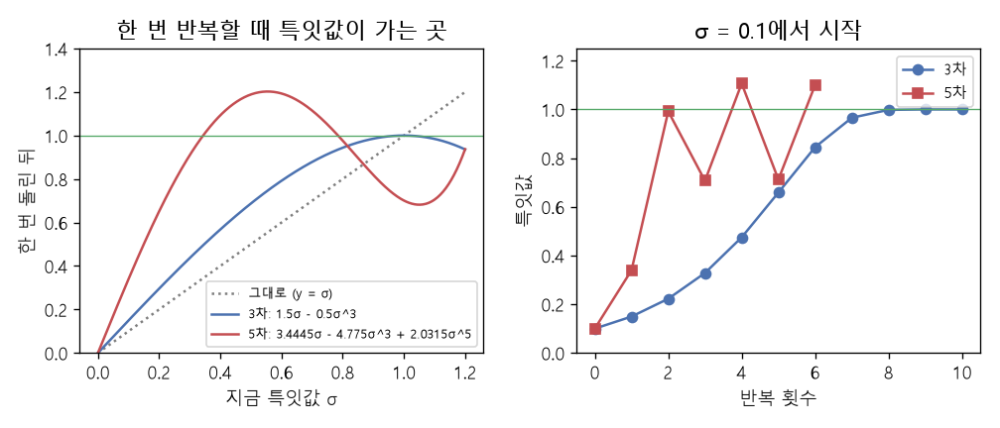

# 뉴턴-슐츠 반복과 직교화 (Newton-Schulz iteration, Orthogonalization, Duality map)

[목차로 돌아가기](../../00_MIT%EB%94%A5%EB%9F%AC%EB%8B%9D_%EB%AA%A9%EC%B0%A8.md) · 먼저 볼 것: [MM27_노름에_따른_최급강하법](../../%EC%88%98%ED%95%99%EA%B0%9C%EB%85%90/09_%EC%B5%9C%EC%A0%81%ED%99%94%EC%9D%98_%EA%B8%B0%ED%95%98/MM27_%EB%85%B8%EB%A6%84%EC%97%90_%EB%94%B0%EB%A5%B8_%EC%B5%9C%EA%B8%89%EA%B0%95%ED%95%98%EB%B2%95.md), [MM28_스펙트럼_노름과_RMS_연산자_노름](../../%EC%88%98%ED%95%99%EA%B0%9C%EB%85%90/09_%EC%B5%9C%EC%A0%81%ED%99%94%EC%9D%98_%EA%B8%B0%ED%95%98/MM28_%EC%8A%A4%ED%8E%99%ED%8A%B8%EB%9F%BC_%EB%85%B8%EB%A6%84%EA%B3%BC_RMS_%EC%97%B0%EC%82%B0%EC%9E%90_%EB%85%B8%EB%A6%84.md), [MM25_랭크와_유효_랭크](../../%EC%88%98%ED%95%99%EA%B0%9C%EB%85%90/04_%ED%99%95%EB%A5%A0%EA%B3%BC_%EC%A0%95%EB%B3%B4/MM25_%EB%9E%AD%ED%81%AC%EC%99%80_%EC%9C%A0%ED%9A%A8_%EB%9E%AD%ED%81%AC.md), [MM88_고윳값과_특잇값_분해](../../%EC%88%98%ED%95%99%EA%B0%9C%EB%85%90/03_%EC%84%A0%ED%98%95%EB%8C%80%EC%88%98/MM88_%EA%B3%A0%EC%9C%B3%EA%B0%92%EA%B3%BC_%ED%8A%B9%EC%9E%87%EA%B0%92_%EB%B6%84%ED%95%B4.md) · 쓰는 곳: [Lec23 9.1](../../Lec23_%EA%B3%84%EB%9F%89_%EB%94%A5%EB%9F%AC%EB%8B%9D.md#91-%EA%B1%B8%EC%9D%8C-%ED%81%AC%EA%B8%B0%EC%99%80-%EC%8C%8D%EB%8C%80-%EC%82%AC%EC%83%81), [Lec23 10.1](../../Lec23_%EA%B3%84%EB%9F%89_%EB%94%A5%EB%9F%AC%EB%8B%9D.md#101-shampoo%EC%9D%98-%ED%95%B5%EC%8B%AC-%EC%97%B0%EC%82%B0), [Lec23 10.2](../../Lec23_%EA%B3%84%EB%9F%89_%EB%94%A5%EB%9F%AC%EB%8B%9D.md#102-%EB%89%B4%ED%84%B4-%EC%8A%90%EC%B8%A0-%EB%B0%98%EB%B3%B5), [Lec13 1](../../Lec13_%ED%91%9C%ED%98%84_%ED%95%99%EC%8A%B5_%EC%9D%B4%EB%A1%A0.md#1-%EB%93%A4%EB%A8%B8%EB%A6%AC-%EC%8A%A4%ED%8E%99%ED%8A%B8%EB%9F%BC-%EB%85%B8%EB%A6%84-%EC%95%84%EB%9E%98%EC%9D%98-%EC%B5%9C%EA%B8%89%EA%B0%95%ED%95%98%EB%B2%95)

📚 학습 순서 68/99 (9. 최적화의 기하): ← 이전: [MM78_모듈러_노름의_조합_규칙](../../%EC%88%98%ED%95%99%EA%B0%9C%EB%85%90/09_%EC%B5%9C%EC%A0%81%ED%99%94%EC%9D%98_%EA%B8%B0%ED%95%98/MM78_%EB%AA%A8%EB%93%88%EB%9F%AC_%EB%85%B8%EB%A6%84%EC%9D%98_%EC%A1%B0%ED%95%A9_%EA%B7%9C%EC%B9%99.md) · 다음: [MM73_계산_예산과_계산_최적_배분](../../%EC%88%98%ED%95%99%EA%B0%9C%EB%85%90/09_%EC%B5%9C%EC%A0%81%ED%99%94%EC%9D%98_%EA%B8%B0%ED%95%98/MM73_%EA%B3%84%EC%82%B0_%EC%98%88%EC%82%B0%EA%B3%BC_%EA%B3%84%EC%82%B0_%EC%B5%9C%EC%A0%81_%EB%B0%B0%EB%B6%84.md) →

> [!NOTE]
> **3줄 요약**
> - [스펙트럼 노름](../../00_%EB%94%A5%EB%9F%AC%EB%8B%9D_%EC%9A%A9%EC%96%B4%EC%82%AC%EC%A0%84.md#spectral-norm-%EC%8A%A4%ED%8E%99%ED%8A%B8%EB%9F%BC-%EB%85%B8%EB%A6%84) 아래의 [최급강하법](../../00_%EB%94%A5%EB%9F%AC%EB%8B%9D_%EC%9A%A9%EC%96%B4%EC%82%AC%EC%A0%84.md#steepest-descent-%EC%B5%9C%EA%B8%89%EA%B0%95%ED%95%98%EB%B2%95)에서 방향을 정하는 **[쌍대 사상](../../00_%EB%94%A5%EB%9F%AC%EB%8B%9D_%EC%9A%A9%EC%96%B4%EC%82%AC%EC%A0%84.md#duality-map-modular-dualization-%EC%8C%8D%EB%8C%80-%EC%82%AC%EC%83%81%EA%B3%BC-%EB%AA%A8%EB%93%88%EB%9F%AC-%EC%8C%8D%EB%8C%80%ED%99%94)**(duality map)은 [기울기](../../00_%EB%94%A5%EB%9F%AC%EB%8B%9D_%EC%9A%A9%EC%96%B4%EC%82%AC%EC%A0%84.md#gradient-%EA%B8%B0%EC%9A%B8%EA%B8%B0) $G = U\Sigma V^\top$의 **특잇값을 모두 1로 바꾼** 행렬 $UV^\top$이다. $G = \begin{pmatrix}0&2\\1&0\end{pmatrix}$이면 $UV^\top = \begin{pmatrix}0&1\\1&0\end{pmatrix}$, $\langle G, UV^\top \rangle = 3$ = 특잇값의 합.
> - [Shampoo](../../00_%EB%94%A5%EB%9F%AC%EB%8B%9D_%EC%9A%A9%EC%96%B4%EC%82%AC%EC%A0%84.md#shampoo-%EC%83%B4%ED%91%B8-%EC%98%B5%ED%8B%B0%EB%A7%88%EC%9D%B4%EC%A0%80)의 핵심 연산 $(GG^\top)^{-1/4}\, G\, (G^\top G)^{-1/4}$도 정확히 $UV^\top$이다. 그런데 SVD나 행렬의 $-\frac14$ 제곱은 [GPU](../../00_%EB%94%A5%EB%9F%AC%EB%8B%9D_%EC%9A%A9%EC%96%B4%EC%82%AC%EC%A0%84.md#device-gpu-%EC%9E%A5%EC%B9%98%EC%99%80-gpu)에서 비싸다.
> - **[뉴턴-슐츠 반복](../../00_%EB%94%A5%EB%9F%AC%EB%8B%9D_%EC%9A%A9%EC%96%B4%EC%82%AC%EC%A0%84.md#newton-schulz-iteration-%EB%89%B4%ED%84%B4-%EC%8A%90%EC%B8%A0-%EB%B0%98%EB%B3%B5)**은 행렬 곱만으로 같은 일을 한다. $X \leftarrow 1.5X - 0.5XX^\top X$는 특잇값마다 $\sigma \leftarrow 1.5\sigma - 0.5\sigma^3$으로 작용해 0.1 → 0.1495 → … → 1로 간다. [Muon](../../00_%EB%94%A5%EB%9F%AC%EB%8B%9D_%EC%9A%A9%EC%96%B4%EC%82%AC%EC%A0%84.md#muon-%EB%AE%A4%EC%98%A8-%EC%98%B5%ED%8B%B0%EB%A7%88%EC%9D%B4%EC%A0%80)의 5차 계수(3.4445, 4.775, 2.0315)는 2번 만에 0.1 → 0.9921로 빨리 가는 대신 0.7~1.1 사이를 오간다.

## 1. 개념 설명

비유: [기울기](../../00_%EB%94%A5%EB%9F%AC%EB%8B%9D_%EC%9A%A9%EC%96%B4%EC%82%AC%EC%A0%84.md#gradient-%EA%B8%B0%EC%9A%B8%EA%B8%B0) 행렬은 "방향마다 세기가 다른 바람"이다. 어떤 방향(큰 특잇값)은 세게 불고 어떤 방향은 약하게 분다. 그냥 기울기대로 걸으면 센 방향으로만 성큼 가고 약한 방향은 거의 안 간다. [스펙트럼 노름](../../00_%EB%94%A5%EB%9F%AC%EB%8B%9D_%EC%9A%A9%EC%96%B4%EC%82%AC%EC%A0%84.md#spectral-norm-%EC%8A%A4%ED%8E%99%ED%8A%B8%EB%9F%BC-%EB%85%B8%EB%A6%84)으로 걸음을 재면, 걸음의 "가장 긴 방향"이 1로 제한되므로 **모든 방향을 똑같이 길이 1로** 가는 것이 가장 이득이다. 방향(회전 $U$, $V$)은 그대로 두고 세기(특잇값)만 모두 1로 바꾸는 것, 이것이 **직교화**(orthogonalization)다.

- 결과 $UV^\top$는 **[반직교 행렬](../../00_%EB%94%A5%EB%9F%AC%EB%8B%9D_%EC%9A%A9%EC%96%B4%EC%82%AC%EC%A0%84.md#semi-orthogonal-matrix-%EB%B0%98%EC%A7%81%EA%B5%90-%ED%96%89%EB%A0%AC)**이다. 특잇값이 모두 1이라 [스펙트럼 노름](../../00_%EB%94%A5%EB%9F%AC%EB%8B%9D_%EC%9A%A9%EC%96%B4%EC%82%AC%EC%A0%84.md#spectral-norm-%EC%8A%A4%ED%8E%99%ED%8A%B8%EB%9F%BC-%EB%85%B8%EB%A6%84)이 정확히 1이다.
- [MM27_노름에_따른_최급강하법](../../%EC%88%98%ED%95%99%EA%B0%9C%EB%85%90/09_%EC%B5%9C%EC%A0%81%ED%99%94%EC%9D%98_%EA%B8%B0%ED%95%98/MM27_%EB%85%B8%EB%A6%84%EC%97%90_%EB%94%B0%EB%A5%B8_%EC%B5%9C%EA%B8%89%EA%B0%95%ED%95%98%EB%B2%95.md)의 공식 "걸음 = $-\frac{\lVert g \rVert_\ast}{\lambda} \times \arg\max_{\lVert t \rVert = 1} \langle g, t \rangle$"에서 뒤쪽 [argmax](../../00_%EB%94%A5%EB%9F%AC%EB%8B%9D_%EC%9A%A9%EC%96%B4%EC%82%AC%EC%A0%84.md#argmax-%EC%B5%9C%EB%8C%93%EA%B0%92-%EC%9C%84%EC%B9%98)가 쌍대 사상이고, 스펙트럼 노름일 때 그 답이 $UV^\top$, 앞쪽 [쌍대 노름](../../00_%EB%94%A5%EB%9F%AC%EB%8B%9D_%EC%9A%A9%EC%96%B4%EC%82%AC%EC%A0%84.md#dual-norm-%EC%8C%8D%EB%8C%80-%EB%85%B8%EB%A6%84)이 특잇값의 합(핵 [노름](../../00_%EB%94%A5%EB%9F%AC%EB%8B%9D_%EC%9A%A9%EC%96%B4%EC%82%AC%EC%A0%84.md#norm-%EB%85%B8%EB%A6%84))이다.
- **[뉴턴-슐츠 반복](../../00_%EB%94%A5%EB%9F%AC%EB%8B%9D_%EC%9A%A9%EC%96%B4%EC%82%AC%EC%A0%84.md#newton-schulz-iteration-%EB%89%B4%ED%84%B4-%EC%8A%90%EC%B8%A0-%EB%B0%98%EB%B3%B5)**: 1보다 작은 수 $\sigma$에 $1.5\sigma - 0.5\sigma^3$을 되풀이하면 1로 간다(1에서 멈추는 고정점). 행렬 $X$에 $1.5X - 0.5XX^\top X$를 하면 $X = U\Sigma V^\top$의 특잇값 하나하나에 이 일이 따로 일어나고, $U$, $V$는 바뀌지 않는다. 그래서 곱셈 몇 번으로 $UV^\top$에 다가간다.

$$
\operatorname{dualize}(G) = \underset{\lVert A \rVert_{\mathrm{spec}} \le 1}{\arg\max}\ \langle G, A \rangle = U V^\top, \qquad \langle G, UV^\top \rangle = \sum_i \sigma_i
$$

<details><summary>기호 풀이</summary>

| 기호 | 읽는 법 | 뜻 | 예제 값 |
| --- | --- | --- | --- |
| $G$ | 지 | [가중치](../../00_%EB%94%A5%EB%9F%AC%EB%8B%9D_%EC%9A%A9%EC%96%B4%EC%82%AC%EC%A0%84.md#weight-%EA%B0%80%EC%A4%91%EC%B9%98) 행렬의 [기울기](../../00_%EB%94%A5%EB%9F%AC%EB%8B%9D_%EC%9A%A9%EC%96%B4%EC%82%AC%EC%A0%84.md#gradient-%EA%B8%B0%EC%9A%B8%EA%B8%B0) | `[[0, 2], [1, 0]]` |
| $U\Sigma V^\top$ | [특잇값 분해](../../00_%EB%94%A5%EB%9F%AC%EB%8B%9D_%EC%9A%A9%EC%96%B4%EC%82%AC%EC%A0%84.md#singular-value-decomposition-%ED%8A%B9%EC%9E%87%EA%B0%92-%EB%B6%84%ED%95%B4) | 회전 · 축별 늘이기 · 회전 ([SVD](../../00_%EB%94%A5%EB%9F%AC%EB%8B%9D_%EC%9A%A9%EC%96%B4%EC%82%AC%EC%A0%84.md#singular-value-decomposition-%ED%8A%B9%EC%9E%87%EA%B0%92-%EB%B6%84%ED%95%B4)) | $\Sigma$ = diag(2, 1) |
| $A$ | 에이 | [스펙트럼 노름](../../00_%EB%94%A5%EB%9F%AC%EB%8B%9D_%EC%9A%A9%EC%96%B4%EC%82%AC%EC%A0%84.md#spectral-norm-%EC%8A%A4%ED%8E%99%ED%8A%B8%EB%9F%BC-%EB%85%B8%EB%A6%84) 1 이하인 후보 행렬 | |
| $\langle G, A \rangle$ | 행렬 [내적](../../00_%EB%94%A5%EB%9F%AC%EB%8B%9D_%EC%9A%A9%EC%96%B4%EC%82%AC%EC%A0%84.md#dot-product-%EB%82%B4%EC%A0%81) | 성분끼리 곱해 모두 더한 값 | 3 |
| $\operatorname{dualize}(G)$ | 쌍대화 | 그 [내적](../../00_%EB%94%A5%EB%9F%AC%EB%8B%9D_%EC%9A%A9%EC%96%B4%EC%82%AC%EC%A0%84.md#dot-product-%EB%82%B4%EC%A0%81)을 가장 크게 하는 $A$ | `[[0, 1], [1, 0]]` |
| $\sum_i \sigma_i$ | 특잇값 합 | 핵 [노름](../../00_%EB%94%A5%EB%9F%AC%EB%8B%9D_%EC%9A%A9%EC%96%B4%EC%82%AC%EC%A0%84.md#norm-%EB%85%B8%EB%A6%84) = [스펙트럼 노름](../../00_%EB%94%A5%EB%9F%AC%EB%8B%9D_%EC%9A%A9%EC%96%B4%EC%82%AC%EC%A0%84.md#spectral-norm-%EC%8A%A4%ED%8E%99%ED%8A%B8%EB%9F%BC-%EB%85%B8%EB%A6%84)의 [쌍대 노름](../../00_%EB%94%A5%EB%9F%AC%EB%8B%9D_%EC%9A%A9%EC%96%B4%EC%82%AC%EC%A0%84.md#dual-norm-%EC%8C%8D%EB%8C%80-%EB%85%B8%EB%A6%84) | 2 + 1 = 3 |

</details>

<details><summary>예제와 풀이</summary>

**문제**: [기울기](../../00_%EB%94%A5%EB%9F%AC%EB%8B%9D_%EC%9A%A9%EC%96%B4%EC%82%AC%EC%A0%84.md#gradient-%EA%B8%B0%EC%9A%B8%EA%B8%B0) $G = \begin{pmatrix}0&2\\1&0\end{pmatrix}$(특잇값 2, 1)의 쌍대 사상이 $UV^\top = \begin{pmatrix}0&1\\1&0\end{pmatrix}$일 때, 행렬 [내적](../../00_%EB%94%A5%EB%9F%AC%EB%8B%9D_%EC%9A%A9%EC%96%B4%EC%82%AC%EC%A0%84.md#dot-product-%EB%82%B4%EC%A0%81) $\langle G, UV^\top \rangle$이 특잇값의 합과 같은지 확인하라.

**주어진 값**
- $G = \begin{pmatrix}0&2\\1&0\end{pmatrix}$ ([기울기](../../00_%EB%94%A5%EB%9F%AC%EB%8B%9D_%EC%9A%A9%EC%96%B4%EC%82%AC%EC%A0%84.md#gradient-%EA%B8%B0%EC%9A%B8%EA%B8%B0), 특잇값 2와 1)
- $UV^\top = \begin{pmatrix}0&1\\1&0\end{pmatrix}$ (특잇값을 1로 바꾼 행렬, `np.linalg.svd`로 구함)

**풀이**
1. 식을 그대로 쓴다: $\langle G, UV^\top \rangle = \sum_{i,j} G_{ij}\,(UV^\top)_{ij}$
2. 값을 대입한다: $0 \times 0 + 2 \times 1 + 1 \times 1 + 0 \times 0$
3. 곱셈을 한다: $0 + 2 + 1 + 0$
4. 더한다: $0 + 2 + 1 + 0 = 3$
5. 특잇값을 더한다: $2 + 1 = 3$

**답**: 둘 다 **3**. 쌍대 사상은 기울기와의 [내적](../../00_%EB%94%A5%EB%9F%AC%EB%8B%9D_%EC%9A%A9%EC%96%B4%EC%82%AC%EC%A0%84.md#dot-product-%EB%82%B4%EC%A0%81)(1차 이득)을 특잇값 합만큼 가장 크게 만든다.

</details>

<details><summary>내 이해</summary>


</details>

## 2. 필요한 이유

[Lec23 9절](../../Lec23_%EA%B3%84%EB%9F%89_%EB%94%A5%EB%9F%AC%EB%8B%9D.md#9-%EB%AA%A8%EB%93%88%EB%9F%AC-%EC%8C%8D%EB%8C%80%EC%84%B1)에서 강사는 "[기울기](../../00_%EB%94%A5%EB%9F%AC%EB%8B%9D_%EC%9A%A9%EC%96%B4%EC%82%AC%EC%A0%84.md#gradient-%EA%B8%B0%EC%9A%B8%EA%B8%B0)를 그대로 [가중치](../../00_%EB%94%A5%EB%9F%AC%EB%8B%9D_%EC%9A%A9%EC%96%B4%EC%82%AC%EC%A0%84.md#weight-%EA%B0%80%EC%A4%91%EC%B9%98)에서 빼는 것은 **타입이 맞지 않는다**"고 말합니다. [기울기](../../00_%EB%94%A5%EB%9F%AC%EB%8B%9D_%EC%9A%A9%EC%96%B4%EC%82%AC%EC%A0%84.md#gradient-%EA%B8%B0%EC%9A%B8%EA%B8%B0)는 쌍대 벡터라 먼저 쌍대 사상으로 [가중치](../../00_%EB%94%A5%EB%9F%AC%EB%8B%9D_%EC%9A%A9%EC%96%B4%EC%82%AC%EC%A0%84.md#weight-%EA%B0%80%EC%A4%91%EC%B9%98) 공간에 옮겨야 합니다. [선형층](../../00_%EB%94%A5%EB%9F%AC%EB%8B%9D_%EC%9A%A9%EC%96%B4%EC%82%AC%EC%A0%84.md#linear-layer-%EC%84%A0%ED%98%95%EC%B8%B5)에 [스펙트럼 노름](../../00_%EB%94%A5%EB%9F%AC%EB%8B%9D_%EC%9A%A9%EC%96%B4%EC%82%AC%EC%A0%84.md#spectral-norm-%EC%8A%A4%ED%8E%99%ED%8A%B8%EB%9F%BC-%EB%85%B8%EB%A6%84)을 주면 그 쌍대 사상이 $UV^\top$입니다.

[10절](../../Lec23_%EA%B3%84%EB%9F%89_%EB%94%A5%EB%9F%AC%EB%8B%9D.md#101-shampoo%EC%9D%98-%ED%95%B5%EC%8B%AC-%EC%97%B0%EC%82%B0)에서 강사는 Google의 [Shampoo](../../00_%EB%94%A5%EB%9F%AC%EB%8B%9D_%EC%9A%A9%EC%96%B4%EC%82%AC%EC%A0%84.md#shampoo-%EC%83%B4%ED%91%B8-%EC%98%B5%ED%8B%B0%EB%A7%88%EC%9D%B4%EC%A0%80) [옵티마이저](../../00_%EB%94%A5%EB%9F%AC%EB%8B%9D_%EC%9A%A9%EC%96%B4%EC%82%AC%EC%A0%84.md#optimizer-%EC%98%B5%ED%8B%B0%EB%A7%88%EC%9D%B4%EC%A0%80)에서 군더더기를 걷어 내면 남는 핵심 연산이 바로 이것이라고 보입니다. 문제는 속도입니다. 정확한 SVD는 느려서 쓸모가 없을 것 같았지만, Keller Jordan이 **[뉴턴-슐츠 반복](../../00_%EB%94%A5%EB%9F%AC%EB%8B%9D_%EC%9A%A9%EC%96%B4%EC%82%AC%EC%A0%84.md#newton-schulz-iteration-%EB%89%B4%ED%84%B4-%EC%8A%90%EC%B8%A0-%EB%B0%98%EB%B3%B5)**으로 빠르게 구현해 NanoGPT [학습](../../00_%EB%94%A5%EB%9F%AC%EB%8B%9D_%EC%9A%A9%EC%96%B4%EC%82%AC%EC%A0%84.md#training-%ED%95%99%EC%8A%B5) 속도 기록을 세웠습니다.

$$
(GG^\top)^{-1/4}\; G\; (G^\top G)^{-1/4} = U V^\top
$$

<details><summary>기호 풀이</summary>

| 기호 | 읽는 법 | 뜻 | 예제 값 |
| --- | --- | --- | --- |
| $GG^\top$ | 지 지 [전치](../../00_%EB%94%A5%EB%9F%AC%EB%8B%9D_%EC%9A%A9%EC%96%B4%EC%82%AC%EC%A0%84.md#transpose-%EC%A0%84%EC%B9%98) | 왼쪽 [전처리](../../00_%EB%94%A5%EB%9F%AC%EB%8B%9D_%EC%9A%A9%EC%96%B4%EC%82%AC%EC%A0%84.md#preconditioning-%EC%A0%84%EC%B2%98%EB%A6%AC) 행렬 $= U\Sigma^2 U^\top$ | diag(4, 1) |
| $G^\top G$ | 지 [전치](../../00_%EB%94%A5%EB%9F%AC%EB%8B%9D_%EC%9A%A9%EC%96%B4%EC%82%AC%EC%A0%84.md#transpose-%EC%A0%84%EC%B9%98) 지 | 오른쪽 [전처리](../../00_%EB%94%A5%EB%9F%AC%EB%8B%9D_%EC%9A%A9%EC%96%B4%EC%82%AC%EC%A0%84.md#preconditioning-%EC%A0%84%EC%B2%98%EB%A6%AC) 행렬 $= V\Sigma^2 V^\top$ | diag(1, 4) |
| $(\cdot)^{-1/4}$ | 마이너스 4분의 1 제곱 | [고윳값](../../00_%EB%94%A5%EB%9F%AC%EB%8B%9D_%EC%9A%A9%EC%96%B4%EC%82%AC%EC%A0%84.md#eigenvector-eigenvalue-%EA%B3%A0%EC%9C%A0%EB%B2%A1%ED%84%B0%EC%99%80-%EA%B3%A0%EC%9C%B3%EA%B0%92)마다 $-\frac14$ 제곱 (4제곱근의 역수) | diag(0.7071, 1) |
| $UV^\top$ | 유 브이 [전치](../../00_%EB%94%A5%EB%9F%AC%EB%8B%9D_%EC%9A%A9%EC%96%B4%EC%82%AC%EC%A0%84.md#transpose-%EC%A0%84%EC%B9%98) | 특잇값을 1로 바꾼 $G$ | `[[0, 1], [1, 0]]` |

</details>

<details><summary>예제와 풀이</summary>

**문제**: $G = \begin{pmatrix}0&2\\1&0\end{pmatrix}$에 [Shampoo](../../00_%EB%94%A5%EB%9F%AC%EB%8B%9D_%EC%9A%A9%EC%96%B4%EC%82%AC%EC%A0%84.md#shampoo-%EC%83%B4%ED%91%B8-%EC%98%B5%ED%8B%B0%EB%A7%88%EC%9D%B4%EC%A0%80)의 핵심 연산을 하면 $UV^\top = \begin{pmatrix}0&1\\1&0\end{pmatrix}$가 나오는지 확인하라.

**주어진 값**
- $G = \begin{pmatrix}0&2\\1&0\end{pmatrix}$ ([기울기](../../00_%EB%94%A5%EB%9F%AC%EB%8B%9D_%EC%9A%A9%EC%96%B4%EC%82%AC%EC%A0%84.md#gradient-%EA%B8%B0%EC%9A%B8%EA%B8%B0))
- $GG^\top = \begin{pmatrix}4&0\\0&1\end{pmatrix}$, $G^\top G = \begin{pmatrix}1&0\\0&4\end{pmatrix}$ (대각 행렬이 되도록 고른 예)
- 대각 행렬의 $-\frac14$ 제곱은 대각 성분마다 한다: $4^{-1/4} = 1/\sqrt{\sqrt4} = 1/\sqrt2 = 0.7071$, $1^{-1/4} = 1$

**풀이**
1. 식을 그대로 쓴다: $(GG^\top)^{-1/4}\, G\, (G^\top G)^{-1/4}$
2. 값을 대입한다: $\begin{pmatrix}0.7071&0\\0&1\end{pmatrix}\begin{pmatrix}0&2\\1&0\end{pmatrix}\begin{pmatrix}1&0\\0&0.7071\end{pmatrix}$
3. 왼쪽 두 행렬을 곱한다(대각 행렬이 왼쪽이면 줄마다 곱한다): 첫 줄 $0.7071 \times (0, 2) = (0, 1.4142)$, 둘째 줄 $1 \times (1, 0) = (1, 0)$
4. 오른쪽 대각 행렬을 곱한다(오른쪽이면 열마다 곱한다): 첫 열 $\times 1$ → $(0, 1)$, 둘째 열 $\times 0.7071$ → $(1.4142 \times 0.7071, 0) = (1, 0)$
5. 모은다: $\begin{pmatrix}0&1\\1&0\end{pmatrix}$

**답**: $\begin{pmatrix}0&1\\1&0\end{pmatrix}$ = $UV^\top$. [Shampoo](../../00_%EB%94%A5%EB%9F%AC%EB%8B%9D_%EC%9A%A9%EC%96%B4%EC%82%AC%EC%A0%84.md#shampoo-%EC%83%B4%ED%91%B8-%EC%98%B5%ED%8B%B0%EB%A7%88%EC%9D%B4%EC%A0%80)의 핵심은 "특잇값을 모두 1로" 바꾸는 연산이다.

</details>

<details><summary>내 이해</summary>


</details>

## 3. 숫자로 보기

### 3.1 쌍대 사상과 쌍대 노름 ($G = \begin{pmatrix}0&2\\1&0\end{pmatrix}$)

| 양 | 값 |
|---|---|
| 특잇값 | 2, 1 |
| $UV^\top$ | `[[0, 1], [1, 0]]` |
| $\langle G, UV^\top \rangle$ | 3 |
| 특잇값 합(핵 [노름](../../00_%EB%94%A5%EB%9F%AC%EB%8B%9D_%EC%9A%A9%EC%96%B4%EC%82%AC%EC%A0%84.md#norm-%EB%85%B8%EB%A6%84)) | 3 |

### 3.2 특잇값 하나에 반복을 걸면 (시작 0.1)

| 반복 | 0 | 1 | 2 | 3 | 4 | 5 | 6 | 7 | 8 | 9 |
|---|---|---|---|---|---|---|---|---|---|---|
| 3차 $1.5\sigma - 0.5\sigma^3$ | 0.1 | 0.1495 | 0.2226 | 0.3284 | 0.4748 | 0.6587 | 0.8452 | 0.9659 | 0.9983 | 1.0 |
| 5차 (Keller Jordan 계수) | 0.1 | 0.3397 | 0.9921 | 0.7071 | 1.1066 | 0.7121 | 1.1006 | | | |

- 3차는 작은 값에서 한 번에 1.5배밖에 못 키워 느리지만 1에 정확히 수렴합니다.
- 5차는 0 근처 [기울기](../../00_%EB%94%A5%EB%9F%AC%EB%8B%9D_%EC%9A%A9%EC%96%B4%EC%82%AC%EC%A0%84.md#gradient-%EA%B8%B0%EC%9A%B8%EA%B8%B0)가 3.4445라 작은 특잇값을 빨리 키웁니다. 대신 1에 수렴하지 않고 0.7~1.1 사이를 오갑니다. [학습](../../00_%EB%94%A5%EB%9F%AC%EB%8B%9D_%EC%9A%A9%EC%96%B4%EC%82%AC%EC%A0%84.md#training-%ED%95%99%EC%8A%B5)에는 "대략 1"이면 충분해서 속도를 택한 것입니다.


*▲ 직접 그린 그림: 왼쪽은 한 번 반복할 때 특잇값이 가는 곳, 오른쪽은 0.1에서 시작한 기록. 3차(파랑)는 1로 수렴하고 5차(빨강)는 빨리 올라가 0.7~1.1을 오간다*

### 3.3 직사각 행렬 $H = \begin{pmatrix}3&1\\1&1\\0&2\end{pmatrix}$

| 양 | 값 |
|---|---|
| [프로베니우스 노름](../../00_%EB%94%A5%EB%9F%AC%EB%8B%9D_%EC%9A%A9%EC%96%B4%EC%82%AC%EC%A0%84.md#frobenius-norm-%ED%94%84%EB%A1%9C%EB%B2%A0%EB%8B%88%EC%9A%B0%EC%8A%A4-%EB%85%B8%EB%A6%84)으로 나눈 시작 특잇값 | 0.8829, 0.4696 |
| 3차 반복 12번 뒤 특잇값 | 1, 1 |
| SVD로 구한 $UV^\top$와의 최대 차이 | 0.0 (소수 여섯째 자리까지) |

$$
\sigma_{t+1} = 1.5\,\sigma_t - 0.5\,\sigma_t^3 \quad \Longleftrightarrow \quad X_{t+1} = 1.5\,X_t - 0.5\,X_t X_t^\top X_t
$$

<details><summary>기호 풀이</summary>

| 기호 | 읽는 법 | 뜻 | 예제 값 |
| --- | --- | --- | --- |
| $X_t$ | 엑스 티 | $t$번 반복한 행렬 (시작은 $G / \lVert G \rVert_F$) | |
| $X_t X_t^\top X_t$ | | 특잇값을 세제곱하는 [행렬 곱](../../00_%EB%94%A5%EB%9F%AC%EB%8B%9D_%EC%9A%A9%EC%96%B4%EC%82%AC%EC%A0%84.md#matrix-multiplication-%ED%96%89%EB%A0%AC-%EA%B3%B1) ($U\Sigma^3V^\top$) | |
| $\sigma_t$ | 시그마 티 | $X_t$의 특잇값 하나 | 0.5 |
| $\sigma_{t+1}$ | | 한 번 돌린 뒤 특잇값 | 0.6875 |
| $\lVert G \rVert_F$ | [프로베니우스 노름](../../00_%EB%94%A5%EB%9F%AC%EB%8B%9D_%EC%9A%A9%EC%96%B4%EC%82%AC%EC%A0%84.md#frobenius-norm-%ED%94%84%EB%A1%9C%EB%B2%A0%EB%8B%88%EC%9A%B0%EC%8A%A4-%EB%85%B8%EB%A6%84) | 나누면 특잇값이 모두 1 이하가 된다 | |

</details>

<details><summary>예제와 풀이</summary>

**문제**: 특잇값 0.5에 3차 [뉴턴-슐츠 반복](../../00_%EB%94%A5%EB%9F%AC%EB%8B%9D_%EC%9A%A9%EC%96%B4%EC%82%AC%EC%A0%84.md#newton-schulz-iteration-%EB%89%B4%ED%84%B4-%EC%8A%90%EC%B8%A0-%EB%B0%98%EB%B3%B5)을 한 번 하면 얼마가 되나?

**주어진 값**
- $\sigma_t = 0.5$ (지금 특잇값)

**풀이**
1. 식을 그대로 쓴다: $\sigma_{t+1} = 1.5\,\sigma_t - 0.5\,\sigma_t^3$
2. 값을 대입한다: $\sigma_{t+1} = 1.5 \times 0.5 - 0.5 \times 0.5^3$
3. 세제곱을 한다: $0.5^3 = 0.5 \times 0.5 \times 0.5 = 0.125$ 이므로 $1.5 \times 0.5 - 0.5 \times 0.125$
4. 앞 곱셈을 한다: $1.5 \times 0.5 = 0.75$ 이므로 $0.75 - 0.5 \times 0.125$
5. 뒤 곱셈을 한다: $0.5 \times 0.125 = 0.0625$ 이므로 $0.75 - 0.0625$
6. 뺀다: $0.75 - 0.0625 = 0.6875$

**답**: **0.6875**. 0.5보다 1에 가까워졌다.

</details>

<details><summary>내 이해</summary>


</details>

$$
X_{t+1} = a\,X_t - b\,X_t X_t^\top X_t + c\,X_t X_t^\top X_t X_t^\top X_t, \qquad (a, b, c) = (3.4445,\ 4.7750,\ 2.0315)
$$

<details><summary>기호 풀이</summary>

| 기호 | 읽는 법 | 뜻 | 예제 값 |
| --- | --- | --- | --- |
| $a$ | 에이 | 1차 항 계수 (0 근처 [기울기](../../00_%EB%94%A5%EB%9F%AC%EB%8B%9D_%EC%9A%A9%EC%96%B4%EC%82%AC%EC%A0%84.md#gradient-%EA%B8%B0%EC%9A%B8%EA%B8%B0)) | 3.4445 |
| $b$ | 비 | 3차 항 계수 (빼는 항) | 4.775 |
| $c$ | 씨 | 5차 항 계수 | 2.0315 |
| $X_t X_t^\top X_t X_t^\top X_t$ | | 특잇값을 다섯제곱하는 곱 | |
| 특잇값으로 보면 | | $\sigma \leftarrow a\sigma - b\sigma^3 + c\sigma^5$ | 0.1 → 0.3397 |

</details>

<details><summary>예제와 풀이</summary>

**문제**: 특잇값 0.1에 [Muon](../../00_%EB%94%A5%EB%9F%AC%EB%8B%9D_%EC%9A%A9%EC%96%B4%EC%82%AC%EC%A0%84.md#muon-%EB%AE%A4%EC%98%A8-%EC%98%B5%ED%8B%B0%EB%A7%88%EC%9D%B4%EC%A0%80)의 5차 반복을 한 번 하면 얼마가 되나?

**주어진 값**
- $\sigma_t = 0.1$ (지금 특잇값)
- $a = 3.4445$, $b = 4.775$, $c = 2.0315$ (계수)

**풀이**
1. 식을 그대로 쓴다(특잇값 하나로): $\sigma_{t+1} = a\,\sigma_t - b\,\sigma_t^3 + c\,\sigma_t^5$
2. 값을 대입한다: $\sigma_{t+1} = 3.4445 \times 0.1 - 4.775 \times 0.1^3 + 2.0315 \times 0.1^5$
3. 거듭제곱을 한다: $0.1^3 = 0.001$, $0.1^5 = 0.00001$
4. 첫 곱셈을 한다: $3.4445 \times 0.1 = 0.34445$
5. 둘째 곱셈을 한다: $4.775 \times 0.001 = 0.004775$
6. 셋째 곱셈을 한다: $2.0315 \times 0.00001 = 0.0000203$
7. 앞의 뺄셈을 한다: $0.34445 - 0.004775 = 0.339675$
8. 더한다: $0.339675 + 0.0000203 = 0.3397$

**답**: **0.3397**. 3차 반복(0.1495)보다 한 번에 훨씬 크게 올라간다.

</details>

<details><summary>내 이해</summary>


</details>

## 4. 코드로 확인

```python
# [함수] import: NumPy를 np로 불러온다. linalg.svd, linalg.norm이 여기서 온다
import numpy as np
# [변수] G: 강의 슬라이드 크기의 작은 기울기 행렬 [[0, 2], [1, 0]]. 특잇값 2, 1
G = np.array([[0.0, 2.0], [1.0, 0.0]])
# [함수] np.linalg.svd(G): G = U diag(S) Vt로 쪼갠다
# [변수] U, S, Vt: 회전, 특잇값 [2, 1], 회전
U, S, Vt = np.linalg.svd(G)
# [변수] O: 특잇값을 모두 1로 바꾼 행렬 U Vt = [[0, 1], [1, 0]] (스펙트럼 노름의 쌍대 사상)
O = U @ Vt
# [함수] np.sum(G * O): 행렬 내적 ⟨G, O⟩ = 성분끼리 곱해 더하기
# [연결] 3.1 표: ⟨G, U Vt⟩ = 3 = 특잇값 합 (핵 노름 = 스펙트럼 노름의 쌍대 노름)
print(O.round(4).tolist(), np.sum(G * O), S.sum())
# [변수] a, b, c: Keller Jordan의 5차 뉴턴-슐츠 계수 (슬라이드 식의 부호대로 b는 빼는 항)
a, b, c = 3.4445, 4.7750, 2.0315
# [변수] s3, s5: 특잇값 0.1에서 시작한 3차, 5차 반복의 기록
s3, s5 = [0.1], [0.1]
# [함수] for: 3차 반복 σ ← 1.5σ - 0.5σ³를 10번
for _ in range(10):
    # [연결] 3.2 표 3차 줄
    s3.append(1.5 * s3[-1] - 0.5 * s3[-1] ** 3)
# [함수] for: 5차 반복 σ ← aσ - bσ³ + cσ⁵를 6번
for _ in range(6):
    # [연결] 3.2 표 5차 줄
    s5.append(a * s5[-1] - b * s5[-1] ** 3 + c * s5[-1] ** 5)
# [연결] → 3차는 1로 수렴, 5차는 0.7~1.1 사이를 오간다 (MM79_fig_newton_schulz)
print([round(v, 4) for v in s3])
print([round(v, 4) for v in s5])
# [변수] H: 3×2 기울기 행렬 (직사각). 특잇값이 서로 다르다
H = np.array([[3.0, 1.0], [1.0, 1.0], [0.0, 2.0]])
# [함수] np.linalg.norm(H): 프로베니우스 노름. 나누면 모든 특잇값이 1 이하가 된다
# [변수] X: 반복의 시작점
X = H / np.linalg.norm(H)
# [변수] X0: 정규화한 시작 행렬의 특잇값 (반복이 이 값들을 1로 민다)
X0 = np.linalg.svd(X, compute_uv=False)
# [함수] for: 3차 반복 X ← 1.5X - 0.5 X Xᵀ X를 12번 (행렬로 해도 특잇값마다 따로 일어난다)
for _ in range(12):
    # [변수] X: 한 번 돌 때마다 특잇값이 1에 가까워진 행렬
    X = 1.5 * X - 0.5 * X @ X.T @ X
# [변수] Uh, Sh, Vht: H의 축소 SVD. 정답 Uh Vht와 비교한다
Uh, Sh, Vht = np.linalg.svd(H, full_matrices=False)
# [연결] 3.3 표: 시작 특잇값, 12번 뒤 특잇값, SVD 답과의 최대 차이
print(X0.round(4), np.linalg.svd(X, compute_uv=False).round(4), round(np.abs(X - Uh @ Vht).max(), 6))
```

**실행 결과**:

```text
[[0.0, 1.0], [1.0, 0.0]] 3.0 3.0
[0.1, 0.1495, 0.2226, 0.3284, 0.4748, 0.6587, 0.8452, 0.9659, 0.9983, 1.0, 1.0]
[0.1, 0.3397, 0.9921, 0.7071, 1.1066, 0.7121, 1.1006]
[0.8829 0.4696] [1. 1.] 0.0
```

> [!WARNING]
> **⚠ 주의**
> - 반복하기 전에 반드시 $G$를 [프로베니우스 노름](../../00_%EB%94%A5%EB%9F%AC%EB%8B%9D_%EC%9A%A9%EC%96%B4%EC%82%AC%EC%A0%84.md#frobenius-norm-%ED%94%84%EB%A1%9C%EB%B2%A0%EB%8B%88%EC%9A%B0%EC%8A%A4-%EB%85%B8%EB%A6%84)으로 나눈다. 3차 반복은 특잇값이 $\sqrt3$보다 크면 오히려 발산한다. [프로베니우스 노름](../../00_%EB%94%A5%EB%9F%AC%EB%8B%9D_%EC%9A%A9%EC%96%B4%EC%82%AC%EC%A0%84.md#frobenius-norm-%ED%94%84%EB%A1%9C%EB%B2%A0%EB%8B%88%EC%9A%B0%EC%8A%A4-%EB%85%B8%EB%A6%84)은 가장 큰 특잇값 이상이라 나누면 모든 특잇값이 1 이하가 된다. 방향은 $UV^\top$이 크기와 상관없으므로 나눠도 답이 같다.
> - 특잇값이 0인 방향은 반복해도 0이다($1.5 \times 0 - 0 = 0$). 그래서 결과는 "0이 아닌 특잇값만 1로" 바꾼 행렬이다. 아주 작은 특잇값은 오래 걸린다(3차는 한 번에 1.5배).
> - 5차 계수는 수렴하지 않도록 일부러 고른 것이다. 결과의 특잇값은 대략 0.7~1.1이고 정확한 $UV^\top$가 아니다. 이 노트의 계수와 부호는 슬라이드 식 $aX - bXX^\top X + cXX^\top XX^\top X$에 맞춰 $b$를 양수로 적었다(코드에서는 흔히 $b = -4.775$로 두고 더한다).
> - 강의의 표기 $G^0$은 "특잇값에 0제곱을 한다", 곧 0이 아닌 특잇값을 모두 1로 바꾼다는 뜻이다.

## 5. 개념 재확인

<details><summary>1. $G = \begin{pmatrix}0&-3\\2&0\end{pmatrix}$, $\lambda = 5$일 때 스펙트럼 노름 최급강하의 걸음 $\Delta W$는?</summary>

| 단계 | 하는 일 | 식 | 계산 | 결과 |
|---|---|---|---|---|
| 1 | 특잇값 | SVD | | 3, 2 |
| 2 | 쌍대 사상 | $UV^\top$ | 특잇값 → 1 | [[0, −1], [1, 0]] |
| 3 | [쌍대 노름](../../00_%EB%94%A5%EB%9F%AC%EB%8B%9D_%EC%9A%A9%EC%96%B4%EC%82%AC%EC%A0%84.md#dual-norm-%EC%8C%8D%EB%8C%80-%EB%85%B8%EB%A6%84) | $\sum \sigma_i$ | $3 + 2$ | 5 |
| 4 | 걸음 | $-\frac{5}{5} UV^\top$ | $-1 \times UV^\top$ | [[0, 1], [−1, 0]] |

**① 쓰는 식**
$$\Delta W = -\frac{\sum_i \sigma_i}{\lambda}\, UV^\top$$
- 위 식 ← ②에서 특잇값과 $UV^\top$, ③에서 [쌍대 노름](../../00_%EB%94%A5%EB%9F%AC%EB%8B%9D_%EC%9A%A9%EC%96%B4%EC%82%AC%EC%A0%84.md#dual-norm-%EC%8C%8D%EB%8C%80-%EB%85%B8%EB%A6%84), ④에서 걸음을 구한다.
```python
# [변수] G: 문제의 기울기 행렬
G = np.array([[0.0, -3.0], [2.0, 0.0]])                 # ①
# [함수] np.linalg.svd: U, 특잇값 [3, 2], Vt
U, S, Vt = np.linalg.svd(G)                             # ②
# [변수] nuc: 쌍대 노름 = 특잇값 합 5
nuc = S.sum()                                           # ③
# [변수] dW: 걸음 -(5/5) U Vt
dW = -(nuc / 5) * (U @ Vt)                              # ④
# [연결] → [3. 2.] 5.0 [[0.0, 1.0], [-1.0, 0.0]]
print(S, nuc, (dW + 0.0).round(4).tolist())
```

**문제**: [기울기](../../00_%EB%94%A5%EB%9F%AC%EB%8B%9D_%EC%9A%A9%EC%96%B4%EC%82%AC%EC%A0%84.md#gradient-%EA%B8%B0%EC%9A%B8%EA%B8%B0) $G = \begin{pmatrix}0&-3\\2&0\end{pmatrix}$, [날카로움](../../00_%EB%94%A5%EB%9F%AC%EB%8B%9D_%EC%9A%A9%EC%96%B4%EC%82%AC%EC%A0%84.md#sharpness-%EB%82%A0%EC%B9%B4%EB%A1%9C%EC%9B%80) $\lambda = 5$일 때 [스펙트럼 노름](../../00_%EB%94%A5%EB%9F%AC%EB%8B%9D_%EC%9A%A9%EC%96%B4%EC%82%AC%EC%A0%84.md#spectral-norm-%EC%8A%A4%ED%8E%99%ED%8A%B8%EB%9F%BC-%EB%85%B8%EB%A6%84) 아래 [최급강하법](../../00_%EB%94%A5%EB%9F%AC%EB%8B%9D_%EC%9A%A9%EC%96%B4%EC%82%AC%EC%A0%84.md#steepest-descent-%EC%B5%9C%EA%B8%89%EA%B0%95%ED%95%98%EB%B2%95)의 걸음은?

**주어진 값**
- $G = \begin{pmatrix}0&-3\\2&0\end{pmatrix}$ ([기울기](../../00_%EB%94%A5%EB%9F%AC%EB%8B%9D_%EC%9A%A9%EC%96%B4%EC%82%AC%EC%A0%84.md#gradient-%EA%B8%B0%EC%9A%B8%EA%B8%B0), 특잇값 3과 2)
- $UV^\top = \begin{pmatrix}0&-1\\1&0\end{pmatrix}$ (특잇값을 1로 바꾼 행렬, 부호와 위치는 $G$를 따른다)
- $\lambda = 5$ ([날카로움](../../00_%EB%94%A5%EB%9F%AC%EB%8B%9D_%EC%9A%A9%EC%96%B4%EC%82%AC%EC%A0%84.md#sharpness-%EB%82%A0%EC%B9%B4%EB%A1%9C%EC%9B%80))

**풀이**
1. 식을 그대로 쓴다: $\Delta W = -\dfrac{\sum_i \sigma_i}{\lambda}\, UV^\top$
2. 값을 대입한다: $\Delta W = -\dfrac{3 + 2}{5} \begin{pmatrix}0&-1\\1&0\end{pmatrix}$
3. (③) 특잇값을 더한다: $3 + 2 = 5$ 이므로 $-\frac{5}{5}\begin{pmatrix}0&-1\\1&0\end{pmatrix}$
4. 나눗셈을 한다: $5 \div 5 = 1$ 이므로 $-1 \times \begin{pmatrix}0&-1\\1&0\end{pmatrix}$
5. (④) 성분마다 −1을 곱한다: $\begin{pmatrix}0&1\\-1&0\end{pmatrix}$

**답**: $\Delta W = \begin{pmatrix}0&1\\-1&0\end{pmatrix}$. 두 방향 모두 길이 1만큼 움직인다([기울기](../../00_%EB%94%A5%EB%9F%AC%EB%8B%9D_%EC%9A%A9%EC%96%B4%EC%82%AC%EC%A0%84.md#gradient-%EA%B8%B0%EC%9A%B8%EA%B8%B0) 그대로였다면 3과 2로 달랐을 것).

</details>

<details><summary>2. 특잇값 0.3에 3차 뉴턴-슐츠 반복을 두 번 하면?</summary>

| 단계 | 하는 일 | 식 | 계산 | 결과 |
|---|---|---|---|---|
| 1 | 첫 반복 | $1.5 \times 0.3 - 0.5 \times 0.3^3$ | $0.45 - 0.0135$ | 0.4365 |
| 2 | 둘째 반복 | $1.5 \times 0.4365 - 0.5 \times 0.4365^3$ | $0.65475 - 0.04158$ | 0.6132 |

**① 쓰는 식**
$$\sigma_{t+1} = 1.5\,\sigma_t - 0.5\,\sigma_t^3$$
- 위 식 ← ②에서 첫 반복, ③에서 둘째 반복을 한다.
```python
# [변수] s: 시작 특잇값 0.3
s = 0.3                                                 # ①
# [변수] s1: 첫 반복 → 0.4365
s1 = 1.5 * s - 0.5 * s ** 3                             # ②
# [변수] s2: 둘째 반복 → 0.6132
s2 = 1.5 * s1 - 0.5 * s1 ** 3                           # ③
# [연결] → 0.4365 0.6132
print(round(s1, 4), round(s2, 4))
```

**문제**: 정규화한 [기울기](../../00_%EB%94%A5%EB%9F%AC%EB%8B%9D_%EC%9A%A9%EC%96%B4%EC%82%AC%EC%A0%84.md#gradient-%EA%B8%B0%EC%9A%B8%EA%B8%B0) 행렬의 특잇값 하나가 0.3이다. 3차 [뉴턴-슐츠 반복](../../00_%EB%94%A5%EB%9F%AC%EB%8B%9D_%EC%9A%A9%EC%96%B4%EC%82%AC%EC%A0%84.md#newton-schulz-iteration-%EB%89%B4%ED%84%B4-%EC%8A%90%EC%B8%A0-%EB%B0%98%EB%B3%B5)을 두 번 하면 얼마가 되나?

**주어진 값**
- $\sigma_0 = 0.3$ (시작 특잇값)

**풀이**
1. 식을 그대로 쓴다: $\sigma_{t+1} = 1.5\,\sigma_t - 0.5\,\sigma_t^3$
2. (②) 첫 반복에 대입한다: $\sigma_1 = 1.5 \times 0.3 - 0.5 \times 0.3^3$
3. 세제곱을 한다: $0.3^3 = 0.027$ 이므로 $1.5 \times 0.3 - 0.5 \times 0.027$
4. 곱셈을 한다: $1.5 \times 0.3 = 0.45$, $0.5 \times 0.027 = 0.0135$ 이므로 $0.45 - 0.0135$
5. 뺀다: $0.45 - 0.0135 = 0.4365$
6. (③) 둘째 반복에 대입한다: $\sigma_2 = 1.5 \times 0.4365 - 0.5 \times 0.4365^3$
7. 세제곱을 한다: $0.4365^3 = 0.0832$ 이므로 $1.5 \times 0.4365 - 0.5 \times 0.0832$
8. 곱셈을 한다: $1.5 \times 0.4365 = 0.6547$, $0.5 \times 0.0832 = 0.0416$ 이므로 $0.6547 - 0.0416$
9. 뺀다: $0.6547 - 0.0416 = 0.6132$ (반올림 전 값으로 계산)

**답**: **0.6132**. 두 번 만에 0.3 → 0.4365 → 0.6132로 1에 다가간다.

</details>

## 예제 풀기

[예제 10문제 풀기](../../%EC%98%88%EC%A0%9C/09_%EC%B5%9C%EC%A0%81%ED%99%94%EC%9D%98_%EA%B8%B0%ED%95%98/%EC%98%88%EC%A0%9C_MM79_%EB%89%B4%ED%84%B4_%EC%8A%90%EC%B8%A0_%EB%B0%98%EB%B3%B5%EA%B3%BC_%EC%A7%81%EA%B5%90%ED%99%94.md)

<details><summary>내 이해</summary>


</details>
