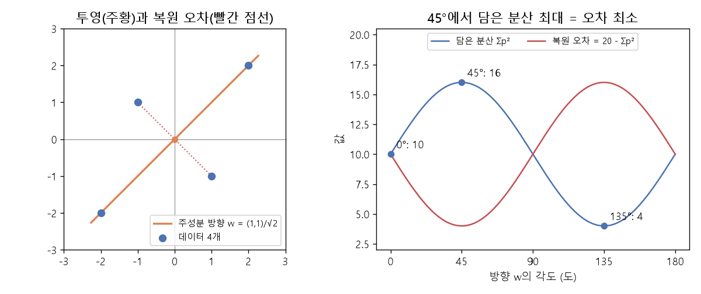

# PCA와 선형 오토인코더 (Principal component analysis, Projection, Linear autoencoder)

[목차로 돌아가기](../../00_MIT%EB%94%A5%EB%9F%AC%EB%8B%9D_%EB%AA%A9%EC%B0%A8.md) · 먼저 볼 것: [M05_벡터와_행렬](../../%EC%88%98%ED%95%99%EA%B0%9C%EB%85%90/03_%EC%84%A0%ED%98%95%EB%8C%80%EC%88%98/M05_%EB%B2%A1%ED%84%B0%EC%99%80_%ED%96%89%EB%A0%AC.md), [MM03_벡터_표기와_전치](../../%EC%88%98%ED%95%99%EA%B0%9C%EB%85%90/03_%EC%84%A0%ED%98%95%EB%8C%80%EC%88%98/MM03_%EB%B2%A1%ED%84%B0_%ED%91%9C%EA%B8%B0%EC%99%80_%EC%A0%84%EC%B9%98.md), [MM11_립시츠_연속과_노름](../../%EC%88%98%ED%95%99%EA%B0%9C%EB%85%90/03_%EC%84%A0%ED%98%95%EB%8C%80%EC%88%98/MM11_%EB%A6%BD%EC%8B%9C%EC%B8%A0_%EC%97%B0%EC%86%8D%EA%B3%BC_%EB%85%B8%EB%A6%84.md), [MM25_랭크와_유효_랭크](../../%EC%88%98%ED%95%99%EA%B0%9C%EB%85%90/04_%ED%99%95%EB%A5%A0%EA%B3%BC_%EC%A0%95%EB%B3%B4/MM25_%EB%9E%AD%ED%81%AC%EC%99%80_%EC%9C%A0%ED%9A%A8_%EB%9E%AD%ED%81%AC.md), [MM85_분산과_표준편차와_공분산](../../%EC%88%98%ED%95%99%EA%B0%9C%EB%85%90/01_%EC%88%98%EC%99%80_%ED%95%A8%EC%88%98/MM85_%EB%B6%84%EC%82%B0%EA%B3%BC_%ED%91%9C%EC%A4%80%ED%8E%B8%EC%B0%A8%EC%99%80_%EA%B3%B5%EB%B6%84%EC%82%B0.md), [MM88_고윳값과_특잇값_분해](../../%EC%88%98%ED%95%99%EA%B0%9C%EB%85%90/03_%EC%84%A0%ED%98%95%EB%8C%80%EC%88%98/MM88_%EA%B3%A0%EC%9C%B3%EA%B0%92%EA%B3%BC_%ED%8A%B9%EC%9E%87%EA%B0%92_%EB%B6%84%ED%95%B4.md) · 쓰는 곳: [Lec11 8.2](../../Lec11_%ED%91%9C%ED%98%84_%ED%95%99%EC%8A%B5_%EC%9E%AC%EA%B5%AC%EC%84%B1.md#82-%EC%84%A0%ED%98%95-%EC%98%A4%ED%86%A0%EC%9D%B8%EC%BD%94%EB%8D%94%EC%99%80-pca)

📚 학습 순서 70/99 (10. 표현 학습): ← 이전: [MM73_계산_예산과_계산_최적_배분](../../%EC%88%98%ED%95%99%EA%B0%9C%EB%85%90/09_%EC%B5%9C%EC%A0%81%ED%99%94%EC%9D%98_%EA%B8%B0%ED%95%98/MM73_%EA%B3%84%EC%82%B0_%EC%98%88%EC%82%B0%EA%B3%BC_%EA%B3%84%EC%82%B0_%EC%B5%9C%EC%A0%81_%EB%B0%B0%EB%B6%84.md) · 다음: [MM41_k평균과_평균](../../%EC%88%98%ED%95%99%EA%B0%9C%EB%85%90/10_%ED%91%9C%ED%98%84_%ED%95%99%EC%8A%B5/MM41_k%ED%8F%89%EA%B7%A0%EA%B3%BC_%ED%8F%89%EA%B7%A0.md) →

> [!NOTE]
> **3줄 요약**
> - 단위 방향 $\mathbf{w}$에 점을 **[투영](../../00_%EB%94%A5%EB%9F%AC%EB%8B%9D_%EC%9A%A9%EC%96%B4%EC%82%AC%EC%A0%84.md#projection-%ED%88%AC%EC%98%81)**하면 $\|\mathbf{x}\|^2$ = (담은 부분)² + (복원 [오차](../../00_%EB%94%A5%EB%9F%AC%EB%8B%9D_%EC%9A%A9%EC%96%B4%EC%82%AC%EC%A0%84.md#error-%EC%98%A4%EC%B0%A8))²로 갈린다. 피타고라스 정리다.
> - 그래서 "복원 [오차](../../00_%EB%94%A5%EB%9F%AC%EB%8B%9D_%EC%9A%A9%EC%96%B4%EC%82%AC%EC%A0%84.md#error-%EC%98%A4%EC%B0%A8) 최소"와 "담은 [분산](../../00_%EB%94%A5%EB%9F%AC%EB%8B%9D_%EC%9A%A9%EC%96%B4%EC%82%AC%EC%A0%84.md#variance-%EB%B6%84%EC%82%B0) 최대"는 같은 문제다. 점 4개 예에서 45° 방향이 [분산](../../00_%EB%94%A5%EB%9F%AC%EB%8B%9D_%EC%9A%A9%EC%96%B4%EC%82%AC%EC%A0%84.md#variance-%EB%B6%84%EC%82%B0) 16을 담고 [오차](../../00_%EB%94%A5%EB%9F%AC%EB%8B%9D_%EC%9A%A9%EC%96%B4%EC%82%AC%EC%A0%84.md#error-%EC%98%A4%EC%B0%A8) 4를 남겨 가장 좋다(전체 20).
> - 그 최적 방향이 [공분산 행렬](../../00_%EB%94%A5%EB%9F%AC%EB%8B%9D_%EC%9A%A9%EC%96%B4%EC%82%AC%EC%A0%84.md#covariance-matrix-%EA%B3%B5%EB%B6%84%EC%82%B0-%ED%96%89%EB%A0%AC)의 가장 큰 [고유벡터](../../00_%EB%94%A5%EB%9F%AC%EB%8B%9D_%EC%9A%A9%EC%96%B4%EC%82%AC%EC%A0%84.md#eigenvector-eigenvalue-%EA%B3%A0%EC%9C%A0%EB%B2%A1%ED%84%B0%EC%99%80-%EA%B3%A0%EC%9C%B3%EA%B0%92), 곧 **주성분**이다. [경사하강법](../../00_%EB%94%A5%EB%9F%AC%EB%8B%9D_%EC%9A%A9%EC%96%B4%EC%82%AC%EC%A0%84.md#gradient-descent-%EA%B2%BD%EC%82%AC%ED%95%98%EA%B0%95%EB%B2%95)으로 학습한 선형 [오토인코더](../../00_%EB%94%A5%EB%9F%AC%EB%8B%9D_%EC%9A%A9%EC%96%B4%EC%82%AC%EC%A0%84.md#autoencoder-%EC%98%A4%ED%86%A0%EC%9D%B8%EC%BD%94%EB%8D%94)도 같은 방향(코사인 1.0)과 같은 [오차](../../00_%EB%94%A5%EB%9F%AC%EB%8B%9D_%EC%9A%A9%EC%96%B4%EC%82%AC%EC%A0%84.md#error-%EC%98%A4%EC%B0%A8)(4.0)에 도착한다.

## 1. 개념 설명

비유: 막대기에 손전등을 비추면 바닥에 그림자가 생긴다. 막대기를 바닥과 나란히 두면 그림자가 길고(정보를 많이 담음), 세우면 짧다(정보를 잃음). [PCA](../../00_%EB%94%A5%EB%9F%AC%EB%8B%9D_%EC%9A%A9%EC%96%B4%EC%82%AC%EC%A0%84.md#pca-principal-component-analysis-%EC%A3%BC%EC%84%B1%EB%B6%84-%EB%B6%84%EC%84%9D)는 데이터 구름의 "그림자가 가장 길게 생기는 방향"을 찾는다. 그 방향 하나만 남겨도 원래 데이터를 가장 잘 되살릴 수 있다.

- **[투영](../../00_%EB%94%A5%EB%9F%AC%EB%8B%9D_%EC%9A%A9%EC%96%B4%EC%82%AC%EC%A0%84.md#projection-%ED%88%AC%EC%98%81)([Projection](../../00_%EB%94%A5%EB%9F%AC%EB%8B%9D_%EC%9A%A9%EC%96%B4%EC%82%AC%EC%A0%84.md#projection-%ED%88%AC%EC%98%81))**: 단위 벡터 $\mathbf{w}$($\|\mathbf{w}\| = 1$) 방향으로 $\mathbf{x}$의 그림자 길이는 $p = \mathbf{w}^\top \mathbf{x}$, 그림자 자체(복원)는 $\hat{\mathbf{x}} = p\,\mathbf{w}$다.
- **복원 [오차](../../00_%EB%94%A5%EB%9F%AC%EB%8B%9D_%EC%9A%A9%EC%96%B4%EC%82%AC%EC%A0%84.md#error-%EC%98%A4%EC%B0%A8)**: $\|\mathbf{x} - \hat{\mathbf{x}}\|^2$. 그림자에서 원래 점까지 수직으로 잰 거리의 제곱이다.
- 두 조각은 직각이라 피타고라스 정리가 성립한다.

$$
\|\mathbf{x}\|^2 = (\mathbf{w}^\top \mathbf{x})^2 + \big\|\mathbf{x} - (\mathbf{w}^\top \mathbf{x})\,\mathbf{w}\big\|^2 \qquad (\|\mathbf{w}\| = 1)
$$

<details><summary>기호 풀이</summary>

| 기호 | 읽는 법 | 뜻 | 예제 값 |
| --- | --- | --- | --- |
| $\mathbf{x}$ | 엑스 | 데이터 점 하나 (중심을 0으로 옮긴 것) | (3, 1) |
| $\mathbf{w}$ | 더블유 | 길이 1인 방향 벡터 | (1, 1)/√2 = (0.7071, 0.7071) |
| $\mathbf{w}^\top \mathbf{x}$ | 더블유 [전치](../../00_%EB%94%A5%EB%9F%AC%EB%8B%9D_%EC%9A%A9%EC%96%B4%EC%82%AC%EC%A0%84.md#transpose-%EC%A0%84%EC%B9%98) 엑스 | [투영](../../00_%EB%94%A5%EB%9F%AC%EB%8B%9D_%EC%9A%A9%EC%96%B4%EC%82%AC%EC%A0%84.md#projection-%ED%88%AC%EC%98%81) 길이 $p$ ([내적](../../%EC%88%98%ED%95%99%EA%B0%9C%EB%85%90/03_%EC%84%A0%ED%98%95%EB%8C%80%EC%88%98/MM03_%EB%B2%A1%ED%84%B0_%ED%91%9C%EA%B8%B0%EC%99%80_%EC%A0%84%EC%B9%98.md)) | 2.8284 |
| $(\mathbf{w}^\top \mathbf{x})\mathbf{w}$ | 피 더블유 | 투영된 점 = 복원 $\hat{\mathbf{x}}$ | (2, 2) |
| $\Vert \cdot\Vert ^2$ | [노름](../../00_%EB%94%A5%EB%9F%AC%EB%8B%9D_%EC%9A%A9%EC%96%B4%EC%82%AC%EC%A0%84.md#norm-%EB%85%B8%EB%A6%84) 제곱 | 원소 제곱의 합 ([노름](../../%EC%88%98%ED%95%99%EA%B0%9C%EB%85%90/03_%EC%84%A0%ED%98%95%EB%8C%80%EC%88%98/MM11_%EB%A6%BD%EC%8B%9C%EC%B8%A0_%EC%97%B0%EC%86%8D%EA%B3%BC_%EB%85%B8%EB%A6%84.md)) | 10 |

</details>

<details><summary>예제와 풀이</summary>

**문제**: 점 $\mathbf{x}$를 길이 1인 방향 $\mathbf{w}$에 투영할 때, 식의 왼쪽(전체)과 오른쪽(담은 부분 + 복원 [오차](../../00_%EB%94%A5%EB%9F%AC%EB%8B%9D_%EC%9A%A9%EC%96%B4%EC%82%AC%EC%A0%84.md#error-%EC%98%A4%EC%B0%A8))이 같은지 확인하라.

**주어진 값**:
- $\mathbf{x} = (3, 1)$ (데이터 점)
- $\mathbf{w} = (1, 1)/\sqrt{2}$ (방향)

**풀이**
1. 식을 그대로 쓴다: $\|\mathbf{x}\|^2 = (\mathbf{w}^\top\mathbf{x})^2 + \|\mathbf{x} - (\mathbf{w}^\top\mathbf{x})\mathbf{w}\|^2$
2. $\sqrt{2}$는 제곱해서 2가 되는 수로 1.4142다. 그래서 $\mathbf{w} = (1/1.4142,\ 1/1.4142) = (0.7071, 0.7071)$
3. 값을 대입한다: $3^2 + 1^2 = (0.7071 \times 3 + 0.7071 \times 1)^2 + \|(3, 1) - (0.7071 \times 3 + 0.7071 \times 1)(0.7071, 0.7071)\|^2$
4. 왼쪽 제곱을 더한다: $9 + 1 = 10$
5. [투영](../../00_%EB%94%A5%EB%9F%AC%EB%8B%9D_%EC%9A%A9%EC%96%B4%EC%82%AC%EC%A0%84.md#projection-%ED%88%AC%EC%98%81) 길이의 곱셈을 한다: $2.1213 + 0.7071 = 2.8284$
6. [투영](../../00_%EB%94%A5%EB%9F%AC%EB%8B%9D_%EC%9A%A9%EC%96%B4%EC%82%AC%EC%A0%84.md#projection-%ED%88%AC%EC%98%81) 길이를 제곱한다: $2.8284^2 = 8$
7. 복원을 구한다: $2.8284 \times (0.7071, 0.7071) = (2, 2)$
8. 칸별로 뺀다: $(3 - 2,\ 1 - 2) = (1, -1)$
9. 제곱합을 구한다: $1^2 + (-1)^2 = 1 + 1 = 2$
10. 오른쪽을 더한다: $8 + 2 = 10$

**답**: 왼쪽 **10** = 오른쪽 **8 + 2**. 담은 부분 8, 복원 [오차](../../00_%EB%94%A5%EB%9F%AC%EB%8B%9D_%EC%9A%A9%EC%96%B4%EC%82%AC%EC%A0%84.md#error-%EC%98%A4%EC%B0%A8) 2.

</details>

<details><summary>내 이해</summary>


</details>

- 데이터 $N$개 전체로 더하면 $\sum\|\mathbf{x}_i\|^2$(전체 [분산](../../00_%EB%94%A5%EB%9F%AC%EB%8B%9D_%EC%9A%A9%EC%96%B4%EC%82%AC%EC%A0%84.md#variance-%EB%B6%84%EC%82%B0), 고정) = $\sum p_i^2$(담은 [분산](../../00_%EB%94%A5%EB%9F%AC%EB%8B%9D_%EC%9A%A9%EC%96%B4%EC%82%AC%EC%A0%84.md#variance-%EB%B6%84%EC%82%B0)) + $\sum$(복원 [오차](../../00_%EB%94%A5%EB%9F%AC%EB%8B%9D_%EC%9A%A9%EC%96%B4%EC%82%AC%EC%A0%84.md#error-%EC%98%A4%EC%B0%A8))다. 왼쪽이 $\mathbf{w}$와 상관없이 고정이므로 **[오차](../../00_%EB%94%A5%EB%9F%AC%EB%8B%9D_%EC%9A%A9%EC%96%B4%EC%82%AC%EC%A0%84.md#error-%EC%98%A4%EC%B0%A8)를 줄이는 것 = 담은 [분산](../../00_%EB%94%A5%EB%9F%AC%EB%8B%9D_%EC%9A%A9%EC%96%B4%EC%82%AC%EC%A0%84.md#variance-%EB%B6%84%EC%82%B0)을 키우는 것**이다.
- **주성분(Principal component)**: 담은 [분산](../../00_%EB%94%A5%EB%9F%AC%EB%8B%9D_%EC%9A%A9%EC%96%B4%EC%82%AC%EC%A0%84.md#variance-%EB%B6%84%EC%82%B0)을 최대로 하는 $\mathbf{w}$. [공분산 행렬](../../00_%EB%94%A5%EB%9F%AC%EB%8B%9D_%EC%9A%A9%EC%96%B4%EC%82%AC%EC%A0%84.md#covariance-matrix-%EA%B3%B5%EB%B6%84%EC%82%B0-%ED%96%89%EB%A0%AC) $\Sigma$의 [고유벡터](../../00_%EB%94%A5%EB%9F%AC%EB%8B%9D_%EC%9A%A9%EC%96%B4%EC%82%AC%EC%A0%84.md#eigenvector-eigenvalue-%EA%B3%A0%EC%9C%A0%EB%B2%A1%ED%84%B0%EC%99%80-%EA%B3%A0%EC%9C%B3%EA%B0%92) 가운데 [고윳값](../../00_%EB%94%A5%EB%9F%AC%EB%8B%9D_%EC%9A%A9%EC%96%B4%EC%82%AC%EC%A0%84.md#eigenvector-eigenvalue-%EA%B3%A0%EC%9C%A0%EB%B2%A1%ED%84%B0%EC%99%80-%EA%B3%A0%EC%9C%B3%EA%B0%92)이 가장 큰 것이다. **[고유벡터](../../00_%EB%94%A5%EB%9F%AC%EB%8B%9D_%EC%9A%A9%EC%96%B4%EC%82%AC%EC%A0%84.md#eigenvector-eigenvalue-%EA%B3%A0%EC%9C%A0%EB%B2%A1%ED%84%B0%EC%99%80-%EA%B3%A0%EC%9C%B3%EA%B0%92)**는 행렬을 곱해도 방향이 안 바뀌고 길이만 $\lambda$배([고윳값](../../00_%EB%94%A5%EB%9F%AC%EB%8B%9D_%EC%9A%A9%EC%96%B4%EC%82%AC%EC%A0%84.md#eigenvector-eigenvalue-%EA%B3%A0%EC%9C%A0%EB%B2%A1%ED%84%B0%EC%99%80-%EA%B3%A0%EC%9C%B3%EA%B0%92)) 되는 벡터다.

$$
\Sigma = \frac{1}{N}\sum_{i=1}^{N} \mathbf{x}_i \mathbf{x}_i^\top, \qquad \Sigma\,\mathbf{w} = \lambda\,\mathbf{w}
$$

<details><summary>기호 풀이</summary>

| 기호 | 읽는 법 | 뜻 | 예제 값 |
| --- | --- | --- | --- |
| $\Sigma$ | 시그마 (대문자) | [공분산 행렬](../../00_%EB%94%A5%EB%9F%AC%EB%8B%9D_%EC%9A%A9%EC%96%B4%EC%82%AC%EC%A0%84.md#covariance-matrix-%EA%B3%B5%EB%B6%84%EC%82%B0-%ED%96%89%EB%A0%AC): 축끼리 함께 변하는 정도 | $\begin{pmatrix}2.5&1.5\\1.5&2.5\end{pmatrix}$ |
| $N$ | 엔 | 데이터 수 | 4 |
| $\mathbf{x}_i \mathbf{x}_i^\top$ | 엑스 아이 엑스 아이 [전치](../../00_%EB%94%A5%EB%9F%AC%EB%8B%9D_%EC%9A%A9%EC%96%B4%EC%82%AC%EC%A0%84.md#transpose-%EC%A0%84%EC%B9%98) | 한 점의 바깥곱 (2×2 행렬) | (2,2)이면 $\begin{pmatrix}4&4\\4&4\end{pmatrix}$ |
| $\mathbf{w}$ | 더블유 | [고유벡터](../../00_%EB%94%A5%EB%9F%AC%EB%8B%9D_%EC%9A%A9%EC%96%B4%EC%82%AC%EC%A0%84.md#eigenvector-eigenvalue-%EA%B3%A0%EC%9C%A0%EB%B2%A1%ED%84%B0%EC%99%80-%EA%B3%A0%EC%9C%B3%EA%B0%92) (방향) | (0.7071, 0.7071) |
| $\lambda$ | 람다 | [고윳값](../../00_%EB%94%A5%EB%9F%AC%EB%8B%9D_%EC%9A%A9%EC%96%B4%EC%82%AC%EC%A0%84.md#eigenvector-eigenvalue-%EA%B3%A0%EC%9C%A0%EB%B2%A1%ED%84%B0%EC%99%80-%EA%B3%A0%EC%9C%B3%EA%B0%92): 그 방향의 점 하나당 [분산](../../00_%EB%94%A5%EB%9F%AC%EB%8B%9D_%EC%9A%A9%EC%96%B4%EC%82%AC%EC%A0%84.md#variance-%EB%B6%84%EC%82%B0) | 4 |

</details>

<details><summary>예제와 풀이</summary>

**문제**: 점 4개의 [공분산 행렬](../../00_%EB%94%A5%EB%9F%AC%EB%8B%9D_%EC%9A%A9%EC%96%B4%EC%82%AC%EC%A0%84.md#covariance-matrix-%EA%B3%B5%EB%B6%84%EC%82%B0-%ED%96%89%EB%A0%AC) $\Sigma$를 구하고, 방향 $\mathbf{w}$가 고유벡터인지, 그 [고윳값](../../00_%EB%94%A5%EB%9F%AC%EB%8B%9D_%EC%9A%A9%EC%96%B4%EC%82%AC%EC%A0%84.md#eigenvector-eigenvalue-%EA%B3%A0%EC%9C%A0%EB%B2%A1%ED%84%B0%EC%99%80-%EA%B3%A0%EC%9C%B3%EA%B0%92)(그 방향의 점 하나당 [분산](../../00_%EB%94%A5%EB%9F%AC%EB%8B%9D_%EC%9A%A9%EC%96%B4%EC%82%AC%EC%A0%84.md#variance-%EB%B6%84%EC%82%B0))은 얼마인지 구하라.

**주어진 값**:
- 점 (2, 2), (-2, -2), (1, -1), (-1, 1) (평균이 0인 데이터, $N = 4$)
- $\mathbf{w} = (0.7071, 0.7071)$ (확인할 방향, $(1,1)/\sqrt2$)

**풀이**
1. 식을 그대로 쓴다: $\Sigma = \frac{1}{N}\sum_i \mathbf{x}_i\mathbf{x}_i^\top$, $\Sigma\mathbf{w} = \lambda\mathbf{w}$
2. 값을 대입한다: $\Sigma = \frac14\big[(2,2)(2,2)^\top + (-2,-2)(-2,-2)^\top + (1,-1)(1,-1)^\top + (-1,1)(-1,1)^\top\big]$
3. 바깥곱은 칸끼리 곱한 2×2 표다: $(2,2)(2,2)^\top = \begin{pmatrix}2\times2&2\times2\\2\times2&2\times2\end{pmatrix} = \begin{pmatrix}4&4\\4&4\end{pmatrix}$, $(-2,-2)$도 같다
4. 나머지 바깥곱: $(1,-1)(1,-1)^\top = \begin{pmatrix}1\times1&1\times(-1)\\(-1)\times1&(-1)\times(-1)\end{pmatrix} = \begin{pmatrix}1&-1\\-1&1\end{pmatrix}$, $(-1,1)$도 같다
5. 칸별로 더한다: $\begin{pmatrix}4+4+1+1&4+4-1-1\\4+4-1-1&4+4+1+1\end{pmatrix} = \begin{pmatrix}10&6\\6&10\end{pmatrix}$
6. 4로 나눈다: $\Sigma = \begin{pmatrix}2.5&1.5\\1.5&2.5\end{pmatrix}$
7. $\Sigma\mathbf{w}$에 대입한다: $\begin{pmatrix}2.5&1.5\\1.5&2.5\end{pmatrix}\begin{pmatrix}0.7071\\0.7071\end{pmatrix}$
8. 행마다 펼친다: $2.5 \times 0.7071 + 1.5 \times 0.7071 = 1.7678 + 1.0607 = 2.8284$, 둘째 행도 $2.8284$
9. 원래 $\mathbf{w}$와 견주어 배율을 구한다: $2.8284 / 0.7071 = 4$ 이므로 $\Sigma\mathbf{w} = 4\mathbf{w}$
10. 담은 [분산](../../00_%EB%94%A5%EB%9F%AC%EB%8B%9D_%EC%9A%A9%EC%96%B4%EC%82%AC%EC%A0%84.md#variance-%EB%B6%84%EC%82%B0)은 점 수 × [고윳값](../../00_%EB%94%A5%EB%9F%AC%EB%8B%9D_%EC%9A%A9%EC%96%B4%EC%82%AC%EC%A0%84.md#eigenvector-eigenvalue-%EA%B3%A0%EC%9C%A0%EB%B2%A1%ED%84%B0%EC%99%80-%EA%B3%A0%EC%9C%B3%EA%B0%92): $4 \times 4 = 16$

**답**: [고유벡터](../../00_%EB%94%A5%EB%9F%AC%EB%8B%9D_%EC%9A%A9%EC%96%B4%EC%82%AC%EC%A0%84.md#eigenvector-eigenvalue-%EA%B3%A0%EC%9C%A0%EB%B2%A1%ED%84%B0%EC%99%80-%EA%B3%A0%EC%9C%B3%EA%B0%92)가 맞고 $\lambda =$ **4**. 담은 [분산](../../00_%EB%94%A5%EB%9F%AC%EB%8B%9D_%EC%9A%A9%EC%96%B4%EC%82%AC%EC%A0%84.md#variance-%EB%B6%84%EC%82%B0)은 **16**.

</details>

<details><summary>내 이해</summary>


</details>

- **선형 [오토인코더](../../00_%EB%94%A5%EB%9F%AC%EB%8B%9D_%EC%9A%A9%EC%96%B4%EC%82%AC%EC%A0%84.md#autoencoder-%EC%98%A4%ED%86%A0%EC%9D%B8%EC%BD%94%EB%8D%94)**: 인코더 $W_f$(2→1)와 디코더 $W_g$(1→2)가 모두 행렬인 [오토인코더](../../00_%EB%94%A5%EB%9F%AC%EB%8B%9D_%EC%9A%A9%EC%96%B4%EC%82%AC%EC%A0%84.md#autoencoder-%EC%98%A4%ED%86%A0%EC%9D%B8%EC%BD%94%EB%8D%94). 복원 [오차](../../00_%EB%94%A5%EB%9F%AC%EB%8B%9D_%EC%9A%A9%EC%96%B4%EC%82%AC%EC%A0%84.md#error-%EC%98%A4%EC%B0%A8)를 최소로 학습하면 $W_g$의 방향이 주성분과 같아진다. $W_f, W_g$는 길이가 1이거나 서로 전치일 필요는 없지만, 펼치는 공간(부분공간)은 [PCA](../../00_%EB%94%A5%EB%9F%AC%EB%8B%9D_%EC%9A%A9%EC%96%B4%EC%82%AC%EC%A0%84.md#pca-principal-component-analysis-%EC%A3%BC%EC%84%B1%EB%B6%84-%EB%B6%84%EC%84%9D)와 같다.

## 2. 필요한 이유

[Lec11 8.2](../../Lec11_%ED%91%9C%ED%98%84_%ED%95%99%EC%8A%B5_%EC%9E%AC%EA%B5%AC%EC%84%B1.md#82-%EC%84%A0%ED%98%95-%EC%98%A4%ED%86%A0%EC%9D%B8%EC%BD%94%EB%8D%94%EC%99%80-pca)에서 강사는 "인코더와 디코더가 모두 선형이면 [오토인코더](../../00_%EB%94%A5%EB%9F%AC%EB%8B%9D_%EC%9A%A9%EC%96%B4%EC%82%AC%EC%A0%84.md#autoencoder-%EC%98%A4%ED%86%A0%EC%9D%B8%EC%BD%94%EB%8D%94)는 [PCA](../../00_%EB%94%A5%EB%9F%AC%EB%8B%9D_%EC%9A%A9%EC%96%B4%EC%82%AC%EC%A0%84.md#pca-principal-component-analysis-%EC%A3%BC%EC%84%B1%EB%B6%84-%EB%B6%84%EC%84%9D)와 같은 부분공간을 배운다"고 하고, 그래서 [오토인코더](../../00_%EB%94%A5%EB%9F%AC%EB%8B%9D_%EC%9A%A9%EC%96%B4%EC%82%AC%EC%A0%84.md#autoencoder-%EC%98%A4%ED%86%A0%EC%9D%B8%EC%BD%94%EB%8D%94)를 **비선형 [PCA](../../00_%EB%94%A5%EB%9F%AC%EB%8B%9D_%EC%9A%A9%EC%96%B4%EC%82%AC%EC%A0%84.md#pca-principal-component-analysis-%EC%A3%BC%EC%84%B1%EB%B6%84-%EB%B6%84%EC%84%9D)**라고 부른다. 식 전개는 $\min\|X - XWW^\top\|^2 = \min(\|X\|^2 - \|XWW^\top\|^2) = \max\|XW\|^2$로 이어지는데, 이 노트의 피타고라스 식이 바로 그 둘째 등호다. 그리고 [9.2](../../Lec11_%ED%91%9C%ED%98%84_%ED%95%99%EC%8A%B5_%EC%9E%AC%EA%B5%AC%EC%84%B1.md#92-k-%ED%8F%89%EA%B7%A0%EC%9D%80-%EC%98%A4%ED%86%A0%EC%9D%B8%EC%BD%94%EB%8D%94%EB%8B%A4)의 [k-평균](../../00_%EB%94%A5%EB%9F%AC%EB%8B%9D_%EC%9A%A9%EC%96%B4%EC%82%AC%EC%A0%84.md#k-means-k-%ED%8F%89%EA%B7%A0)과 함께 "모든 [표현 학습](../../00_%EB%94%A5%EB%9F%AC%EB%8B%9D_%EC%9A%A9%EC%96%B4%EC%82%AC%EC%A0%84.md#representation-learning-%ED%91%9C%ED%98%84-%ED%95%99%EC%8A%B5)은 이 두 모델의 [일반화](../../00_%EB%94%A5%EB%9F%AC%EB%8B%9D_%EC%9A%A9%EC%96%B4%EC%82%AC%EC%A0%84.md#generalization-%EC%9D%BC%EB%B0%98%ED%99%94)"라는 강사의 주장을 읽으려면 [PCA](../../00_%EB%94%A5%EB%9F%AC%EB%8B%9D_%EC%9A%A9%EC%96%B4%EC%82%AC%EC%A0%84.md#pca-principal-component-analysis-%EC%A3%BC%EC%84%B1%EB%B6%84-%EB%B6%84%EC%84%9D)를 알아야 한다.

## 3. 숫자로 보기

점 4개 (2,2), (-2,-2), (1,-1), (-1,1). 전체 제곱합 = 8 + 8 + 2 + 2 = **20**.

| 방향 각도 | $\mathbf{w}$ | [투영](../../00_%EB%94%A5%EB%9F%AC%EB%8B%9D_%EC%9A%A9%EC%96%B4%EC%82%AC%EC%A0%84.md#projection-%ED%88%AC%EC%98%81) $p$ 4개 | 담은 [분산](../../00_%EB%94%A5%EB%9F%AC%EB%8B%9D_%EC%9A%A9%EC%96%B4%EC%82%AC%EC%A0%84.md#variance-%EB%B6%84%EC%82%B0) $\sum p^2$ | 복원 [오차](../../00_%EB%94%A5%EB%9F%AC%EB%8B%9D_%EC%9A%A9%EC%96%B4%EC%82%AC%EC%A0%84.md#error-%EC%98%A4%EC%B0%A8) = 20 − 담은 [분산](../../00_%EB%94%A5%EB%9F%AC%EB%8B%9D_%EC%9A%A9%EC%96%B4%EC%82%AC%EC%A0%84.md#variance-%EB%B6%84%EC%82%B0) |
|---|---|---|---|---|
| 0° | (1, 0) | 2, -2, 1, -1 | 4+4+1+1 = 10 | 10 |
| 45° | (0.7071, 0.7071) | 2.8284, -2.8284, 0, 0 | 8+8+0+0 = 16 | **4** |
| 90° | (0, 1) | 2, -2, -1, 1 | 10 | 10 |
| 135° | (-0.7071, 0.7071) | 0, 0, -1.4142, 1.4142 | 0+0+2+2 = 4 | 16 |

- 45°가 가장 많이(16) 담고 가장 적게(4) 잃는다. 이 방향이 주성분이고 공분산의 [고윳값](../../00_%EB%94%A5%EB%9F%AC%EB%8B%9D_%EC%9A%A9%EC%96%B4%EC%82%AC%EC%A0%84.md#eigenvector-eigenvalue-%EA%B3%A0%EC%9C%A0%EB%B2%A1%ED%84%B0%EC%99%80-%EA%B3%A0%EC%9C%B3%EA%B0%92) 4(×4점 = 16)와 맞는다.
- 남은 [오차](../../00_%EB%94%A5%EB%9F%AC%EB%8B%9D_%EC%9A%A9%EC%96%B4%EC%82%AC%EC%A0%84.md#error-%EC%98%A4%EC%B0%A8) 4는 둘째 [고윳값](../../00_%EB%94%A5%EB%9F%AC%EB%8B%9D_%EC%9A%A9%EC%96%B4%EC%82%AC%EC%A0%84.md#eigenvector-eigenvalue-%EA%B3%A0%EC%9C%A0%EB%B2%A1%ED%84%B0%EC%99%80-%EA%B3%A0%EC%9C%B3%EA%B0%92) 1 × 4점이다. 135° 방향이 담는 몫이다.


*▲ 직접 그린 그림: 왼쪽은 주성분 방향(주황 선)으로의 [투영](../../00_%EB%94%A5%EB%9F%AC%EB%8B%9D_%EC%9A%A9%EC%96%B4%EC%82%AC%EC%A0%84.md#projection-%ED%88%AC%EC%98%81)과 복원 [오차](../../00_%EB%94%A5%EB%9F%AC%EB%8B%9D_%EC%9A%A9%EC%96%B4%EC%82%AC%EC%A0%84.md#error-%EC%98%A4%EC%B0%A8)(빨간 점선). 오른쪽은 방향 각도에 따른 담은 [분산](../../00_%EB%94%A5%EB%9F%AC%EB%8B%9D_%EC%9A%A9%EC%96%B4%EC%82%AC%EC%A0%84.md#variance-%EB%B6%84%EC%82%B0)(파랑)과 복원 [오차](../../00_%EB%94%A5%EB%9F%AC%EB%8B%9D_%EC%9A%A9%EC%96%B4%EC%82%AC%EC%A0%84.md#error-%EC%98%A4%EC%B0%A8)(빨강). 두 값의 합은 늘 20이다.*

<details><summary>기호 풀이</summary>

| 기호 | 읽는 법 | 뜻 | 예제 값 |
| --- | --- | --- | --- |
| $\mathbf{w}$ | 더블유 | 길이 1인 방향 | (0.7071, 0.7071) |
| $p = \mathbf{w}^\top\mathbf{x}$ | 피 | [투영](../../00_%EB%94%A5%EB%9F%AC%EB%8B%9D_%EC%9A%A9%EC%96%B4%EC%82%AC%EC%A0%84.md#projection-%ED%88%AC%EC%98%81) 길이 | 2.8284 |
| $\hat{\mathbf{x}}$ | 엑스 햇 | 복원한 점 | (2, 2) |
| $\Sigma$ | 시그마 | [공분산 행렬](../../00_%EB%94%A5%EB%9F%AC%EB%8B%9D_%EC%9A%A9%EC%96%B4%EC%82%AC%EC%A0%84.md#covariance-matrix-%EA%B3%B5%EB%B6%84%EC%82%B0-%ED%96%89%EB%A0%AC) | $\begin{pmatrix}2.5&1.5\\1.5&2.5\end{pmatrix}$ |
| $\lambda$ | 람다 | [고윳값](../../00_%EB%94%A5%EB%9F%AC%EB%8B%9D_%EC%9A%A9%EC%96%B4%EC%82%AC%EC%A0%84.md#eigenvector-eigenvalue-%EA%B3%A0%EC%9C%A0%EB%B2%A1%ED%84%B0%EC%99%80-%EA%B3%A0%EC%9C%B3%EA%B0%92) (방향별 [분산](../../00_%EB%94%A5%EB%9F%AC%EB%8B%9D_%EC%9A%A9%EC%96%B4%EC%82%AC%EC%A0%84.md#variance-%EB%B6%84%EC%82%B0)) | 4, 1 |
| $W_f, W_g$ | 더블유 에프, 지 | 선형 인코더·디코더 행렬 | 1×2, 2×1 |

</details>

## 4. 코드로 확인

```python
# [변수] X: 점 4개를 행으로 쌓은 4×2 행렬. 평균이 이미 (0, 0)이라 그대로 쓴다
# [연결] 본문 3절 표의 데이터
X = np.array([[2, 2], [-2, -2], [1, -1], [-1, 1.0]])
# [함수] for deg in ...: 방향 각도를 바꿔 가며 담은 분산과 오차를 잰다
for deg in [0, 45, 90, 135]:
    # [함수] np.deg2rad: 도를 라디안으로 바꾼다 (cos, sin은 라디안을 받는다)
    # [변수] w: 각도 deg 방향의 길이 1 벡터
    w = np.array([np.cos(np.deg2rad(deg)), np.sin(np.deg2rad(deg))])
    # [함수] X @ w: 네 점을 한꺼번에 투영 → 투영 길이 p 4개
    p = X @ w
    # [함수] np.outer(p, w): 각 점의 복원 p·w를 행으로 쌓는다
    # [변수] err: 복원 오차의 합. 담은 분산과 더하면 20
    err = ((X - np.outer(p, w)) ** 2).sum()
    # [연결] 출력 한 줄 = 본문 3절 표의 한 행
    print(deg, round((p ** 2).sum(), 4), round(err, 4))
# [함수] X.T @ X / 4: 공분산 행렬 Σ (평균이 0이므로 바로 계산)
# [변수] S: [[2.5, 1.5], [1.5, 2.5]]
S = X.T @ X / len(X)
# [함수] np.linalg.eigh: 대칭 행렬의 고윳값(작은 것부터)과 고유벡터
# [변수] lam: [1, 4], V: 열이 고유벡터
lam, V = np.linalg.eigh(S)
# [연결] 가장 큰 고윳값 4와 그 방향 (0.7071, 0.7071) = 45° = 주성분
print(lam.round(4), V[:, -1].round(4))
# [함수] np.random.default_rng(0): 시드를 고정해 결과를 재현한다
# [변수] rng: 난수 생성기
rng = np.random.default_rng(0)
# [변수] Wf: 인코더 1×2, Wg: 디코더 2×1. 작은 무작위 값에서 시작한다
Wf, Wg = rng.standard_normal((1, 2)) * 0.5, rng.standard_normal((2, 1)) * 0.5
# [함수] range(2000): 경사하강법 2000번
for step in range(2000):
    # [변수] Z: 4점의 1차원 코드 (인코딩), E: 복원 − 원본
    Z = X @ Wf.T
    E = Z @ Wg.T - X
    # [함수] 평균 제곱 오차의 기울기로 두 행렬을 갱신 (학습률 0.05)
    # [연결] 기울기 계산은 MM10_선형층과_ReLU의_역전파의 선형층 공식
    Wg, Wf = Wg - 0.05 * 2 * E.T @ Z / 4, Wf - 0.05 * 2 * (E @ Wg).T @ X / 4
# [변수] d: 디코더 방향을 길이 1로 맞춘 것
d = Wg[:, 0] / np.linalg.norm(Wg)
# [연결] 오차 4.0 = PCA의 최소 오차, |cos| 1.0 = 주성분과 같은 방향
print(round(((X - X @ Wf.T @ Wg.T) ** 2).sum(), 4), round(abs(d @ V[:, -1]), 4))
```

**실행 결과**:

```text
0 10.0 10.0
45 16.0 4.0
90 10.0 10.0
135 4.0 16.0
[1. 4.] [0.7071 0.7071]
4.0 1.0
```

> [!WARNING]
> **⚠ 주의**
> - [PCA](../../00_%EB%94%A5%EB%9F%AC%EB%8B%9D_%EC%9A%A9%EC%96%B4%EC%82%AC%EC%A0%84.md#pca-principal-component-analysis-%EC%A3%BC%EC%84%B1%EB%B6%84-%EB%B6%84%EC%84%9D)는 **평균을 0으로 옮긴 뒤** 한다. 이 노트의 점들은 평균이 이미 (0, 0)이라 그 단계를 생략했다. 평균을 빼지 않으면 첫 주성분이 "평균 쪽 방향"으로 끌려간다.
> - 선형 [오토인코더](../../00_%EB%94%A5%EB%9F%AC%EB%8B%9D_%EC%9A%A9%EC%96%B4%EC%82%AC%EC%A0%84.md#autoencoder-%EC%98%A4%ED%86%A0%EC%9D%B8%EC%BD%94%EB%8D%94)가 찾는 것은 주성분이 펼치는 **부분공간**이다. $W_f$, $W_g$ 하나하나가 주성분 벡터와 같거나 서로 직교한다는 보장은 없다(2차원 이상 코드에서는 회전된 축이 나올 수 있다).
> - 인코더와 디코더에 비선형 함수를 넣으면 더 이상 [PCA](../../00_%EB%94%A5%EB%9F%AC%EB%8B%9D_%EC%9A%A9%EC%96%B4%EC%82%AC%EC%A0%84.md#pca-principal-component-analysis-%EC%A3%BC%EC%84%B1%EB%B6%84-%EB%B6%84%EC%84%9D)가 아니다. 강의가 말하는 "비선형 [PCA](../../00_%EB%94%A5%EB%9F%AC%EB%8B%9D_%EC%9A%A9%EC%96%B4%EC%82%AC%EC%A0%84.md#pca-principal-component-analysis-%EC%A3%BC%EC%84%B1%EB%B6%84-%EB%B6%84%EC%84%9D)"가 일반 [오토인코더](../../00_%EB%94%A5%EB%9F%AC%EB%8B%9D_%EC%9A%A9%EC%96%B4%EC%82%AC%EC%A0%84.md#autoencoder-%EC%98%A4%ED%86%A0%EC%9D%B8%EC%BD%94%EB%8D%94)다.

## 5. 개념 재확인

<details><summary>1. $\mathbf{x} = (4, 2)$를 $\mathbf{w} = (0.6, 0.8)$ 방향으로 투영할 때 담은 부분과 복원 오차는?</summary>

| 단계 | 하는 일 | 식 | 계산 | 결과 |
|---|---|---|---|---|
| 1 | [투영](../../00_%EB%94%A5%EB%9F%AC%EB%8B%9D_%EC%9A%A9%EC%96%B4%EC%82%AC%EC%A0%84.md#projection-%ED%88%AC%EC%98%81) 길이 | $p = \mathbf{w}^\top\mathbf{x}$ | 4×0.6 + 2×0.8 | 4.0 |
| 2 | 복원 | $\hat{\mathbf{x}} = p\mathbf{w}$ | 4 × (0.6, 0.8) | (2.4, 3.2) |
| 3 | [오차](../../00_%EB%94%A5%EB%9F%AC%EB%8B%9D_%EC%9A%A9%EC%96%B4%EC%82%AC%EC%A0%84.md#error-%EC%98%A4%EC%B0%A8) | $\Vert \mathbf{x}-\hat{\mathbf{x}}\Vert ^2$ | (1.6, -1.2)의 제곱합 | 4.0 |
| 4 | 확인 | $p^2 + \text{오차}$ | 16 + 4 | 20 = $\Vert \mathbf{x}\Vert ^2$ |

**① 쓰는 식**
$$\|\mathbf{x}\|^2 = (\mathbf{w}^\top\mathbf{x})^2 + \|\mathbf{x} - (\mathbf{w}^\top\mathbf{x})\mathbf{w}\|^2$$
- 위 식 ← 오른쪽 첫 항은 ② ([투영](../../00_%EB%94%A5%EB%9F%AC%EB%8B%9D_%EC%9A%A9%EC%96%B4%EC%82%AC%EC%A0%84.md#projection-%ED%88%AC%EC%98%81)), 둘째 항은 ③ (복원)과 ④ ([오차](../../00_%EB%94%A5%EB%9F%AC%EB%8B%9D_%EC%9A%A9%EC%96%B4%EC%82%AC%EC%A0%84.md#error-%EC%98%A4%EC%B0%A8)), 등호는 ⑤ (확인)에서 쓴다.
```python
# [변수] x: 문제의 점, w: 길이 1인 방향 (0.36 + 0.64 = 1)
x, w = np.array([4, 2.0]), np.array([0.6, 0.8])       # ①
# [변수] p = 4.0: 투영 길이
p = x @ w                                             # ②
# [변수] xh = (2.4, 3.2): 복원한 점
xh = p * w                                            # ③
# [변수] err = 4.0: 복원 오차
err = ((x - xh) ** 2).sum()                           # ④
# [연결] 4.0 4.0 20.0 → 16 + 4 = 20
print(round(p, 4), round(err, 4), round(p * p + err, 4))   # ⑤
```

**주어진 값**:
- $\mathbf{x} = (4, 2)$ (데이터 점)
- $\mathbf{w} = (0.6, 0.8)$ (방향. $0.6^2 + 0.8^2 = 0.36 + 0.64 = 1$ 이라 길이 1)

**② [투영](../../00_%EB%94%A5%EB%9F%AC%EB%8B%9D_%EC%9A%A9%EC%96%B4%EC%82%AC%EC%A0%84.md#projection-%ED%88%AC%EC%98%81)**
1. 식을 그대로 쓴다: $p = \mathbf{w}^\top\mathbf{x}$
2. 값을 대입한다: $p = 0.6 \times 4 + 0.8 \times 2$
3. 곱셈을 한다: $2.4 + 1.6$
4. 더한다: $p = 4.0$

**③ 복원**
1. 식을 그대로 쓴다: $\hat{\mathbf{x}} = p\,\mathbf{w}$
2. 값을 대입한다: $\hat{\mathbf{x}} = 4.0 \times (0.6, 0.8)$
3. 칸마다 곱한다: $(2.4, 3.2)$

**④ [오차](../../00_%EB%94%A5%EB%9F%AC%EB%8B%9D_%EC%9A%A9%EC%96%B4%EC%82%AC%EC%A0%84.md#error-%EC%98%A4%EC%B0%A8)**
1. 식을 그대로 쓴다: $\|\mathbf{x} - \hat{\mathbf{x}}\|^2$
2. 값을 대입한다: $\|(4, 2) - (2.4, 3.2)\|^2$
3. 칸별로 뺀다: $(1.6, -1.2)$
4. 제곱을 한다: $1.6^2 + (-1.2)^2 = 2.56 + 1.44$
5. 더한다: $4.0$

**⑤ 확인**
1. 식을 그대로 쓴다: $\|\mathbf{x}\|^2 = p^2 + \text{오차}$
2. 값을 대입한다: $4^2 + 2^2 = 4.0^2 + 4.0$
3. 제곱을 한다: $16 + 4 = 16 + 4$
4. 더한다: $20 = 20$
**답**: 담은 부분 $p^2 =$ **16**, 복원 [오차](../../00_%EB%94%A5%EB%9F%AC%EB%8B%9D_%EC%9A%A9%EC%96%B4%EC%82%AC%EC%A0%84.md#error-%EC%98%A4%EC%B0%A8) **4**. 합은 $\|\mathbf{x}\|^2 = 20$.

</details>

<details><summary>2. 점 (3,3), (-3,-3), (1,-1), (-1,1)을 1차원으로 줄일 때 주성분 방향, 고윳값, 최소 복원 오차는?</summary>

| 단계 | 하는 일 | 계산 | 결과 |
|---|---|---|---|
| 1 | 공분산 | $\frac14(2·\begin{pmatrix}9&9\\9&9\end{pmatrix} + 2·\begin{pmatrix}1&-1\\-1&1\end{pmatrix})$ | $\begin{pmatrix}5&4\\4&5\end{pmatrix}$ |
| 2 | [고윳값](../../00_%EB%94%A5%EB%9F%AC%EB%8B%9D_%EC%9A%A9%EC%96%B4%EC%82%AC%EC%A0%84.md#eigenvector-eigenvalue-%EA%B3%A0%EC%9C%A0%EB%B2%A1%ED%84%B0%EC%99%80-%EA%B3%A0%EC%9C%B3%EA%B0%92) | (1,1) 방향: 5+4, (1,-1) 방향: 5-4 | 9, 1 |
| 3 | 담은 [분산](../../00_%EB%94%A5%EB%9F%AC%EB%8B%9D_%EC%9A%A9%EC%96%B4%EC%82%AC%EC%A0%84.md#variance-%EB%B6%84%EC%82%B0) | $N\lambda_1 = 4 × 9$ | 36 |
| 4 | 최소 [오차](../../00_%EB%94%A5%EB%9F%AC%EB%8B%9D_%EC%9A%A9%EC%96%B4%EC%82%AC%EC%A0%84.md#error-%EC%98%A4%EC%B0%A8) | 전체 40 − 36 | 4 |

**① 쓰는 식**
$$\Sigma = \frac1N\sum_i \mathbf{x}_i\mathbf{x}_i^\top, \qquad \Sigma\mathbf{w} = \lambda\mathbf{w}$$
- 위 식 ← 왼쪽은 ② (공분산), 오른쪽은 ③ ([고윳값](../../00_%EB%94%A5%EB%9F%AC%EB%8B%9D_%EC%9A%A9%EC%96%B4%EC%82%AC%EC%A0%84.md#eigenvector-eigenvalue-%EA%B3%A0%EC%9C%A0%EB%B2%A1%ED%84%B0%EC%99%80-%EA%B3%A0%EC%9C%B3%EA%B0%92)), 결과를 ④ (담은 [분산](../../00_%EB%94%A5%EB%9F%AC%EB%8B%9D_%EC%9A%A9%EC%96%B4%EC%82%AC%EC%A0%84.md#variance-%EB%B6%84%EC%82%B0))와 ⑤ ([오차](../../00_%EB%94%A5%EB%9F%AC%EB%8B%9D_%EC%9A%A9%EC%96%B4%EC%82%AC%EC%A0%84.md#error-%EC%98%A4%EC%B0%A8))에 쓴다.
```python
# [변수] X: 문제의 점 4개
X = np.array([[3, 3], [-3, -3], [1, -1], [-1, 1.0]])   # ①
# [변수] S = [[5, 4], [4, 5]]: 공분산
S = X.T @ X / 4                                        # ②
# [함수] eigh: 고윳값 [1, 9], 마지막 열이 주성분
lam, V = np.linalg.eigh(S)                             # ③
# [변수] cap = 36: 주성분 하나가 담은 분산
cap = 4 * lam[-1]                                      # ④
# [연결] [1. 9.] [0.7071 0.7071] 36.0 4.0
print(lam.round(4), V[:, -1].round(4), round(cap, 4), round((X ** 2).sum() - cap, 4))   # ⑤
```

**주어진 값**:
- 점 (3, 3), (-3, -3), (1, -1), (-1, 1) (평균이 0인 데이터, $N = 4$)

**② 공분산**
1. 식을 그대로 쓴다: $\Sigma = \frac1N\sum_i \mathbf{x}_i\mathbf{x}_i^\top$
2. 값을 대입한다: $\Sigma = \frac14\big[(3,3)(3,3)^\top + (-3,-3)(-3,-3)^\top + (1,-1)(1,-1)^\top + (-1,1)(-1,1)^\top\big]$
3. 바깥곱을 칸끼리 곱해 만든다: $(3,3)$과 $(-3,-3)$은 $\begin{pmatrix}9&9\\9&9\end{pmatrix}$, $(1,-1)$과 $(-1,1)$은 $\begin{pmatrix}1&-1\\-1&1\end{pmatrix}$
4. 칸별로 더한다: $\begin{pmatrix}9+9+1+1&9+9-1-1\\9+9-1-1&9+9+1+1\end{pmatrix} = \begin{pmatrix}20&16\\16&20\end{pmatrix}$
5. 4로 나눈다: $\Sigma = \begin{pmatrix}5&4\\4&5\end{pmatrix}$

**③ [고윳값](../../00_%EB%94%A5%EB%9F%AC%EB%8B%9D_%EC%9A%A9%EC%96%B4%EC%82%AC%EC%A0%84.md#eigenvector-eigenvalue-%EA%B3%A0%EC%9C%A0%EB%B2%A1%ED%84%B0%EC%99%80-%EA%B3%A0%EC%9C%B3%EA%B0%92)**
1. 식을 그대로 쓴다: $\Sigma\mathbf{w} = \lambda\mathbf{w}$
2. $\mathbf{w} = (1, 1)$을 대입한다: $\begin{pmatrix}5&4\\4&5\end{pmatrix}\begin{pmatrix}1\\1\end{pmatrix}$
3. 행마다 펼친다: $(5 \times 1 + 4 \times 1,\ 4 \times 1 + 5 \times 1) = (9, 9) = 9 \times (1, 1)$ → $\lambda_1 = 9$
4. $\mathbf{w} = (1, -1)$도 같은 방법: $(5 \times 1 + 4 \times (-1),\ 4 \times 1 + 5 \times (-1)) = (1, -1)$ → $\lambda_2 = 1$

**④ 담은 [분산](../../00_%EB%94%A5%EB%9F%AC%EB%8B%9D_%EC%9A%A9%EC%96%B4%EC%82%AC%EC%A0%84.md#variance-%EB%B6%84%EC%82%B0)**
1. 식: 담은 [분산](../../00_%EB%94%A5%EB%9F%AC%EB%8B%9D_%EC%9A%A9%EC%96%B4%EC%82%AC%EC%A0%84.md#variance-%EB%B6%84%EC%82%B0) $= N\lambda_1$
2. 대입한다: $4 \times 9$
3. 곱한다: $36$

**⑤ [오차](../../00_%EB%94%A5%EB%9F%AC%EB%8B%9D_%EC%9A%A9%EC%96%B4%EC%82%AC%EC%A0%84.md#error-%EC%98%A4%EC%B0%A8)**
1. 식: [오차](../../00_%EB%94%A5%EB%9F%AC%EB%8B%9D_%EC%9A%A9%EC%96%B4%EC%82%AC%EC%A0%84.md#error-%EC%98%A4%EC%B0%A8) = 전체 − 담은 [분산](../../00_%EB%94%A5%EB%9F%AC%EB%8B%9D_%EC%9A%A9%EC%96%B4%EC%82%AC%EC%A0%84.md#variance-%EB%B6%84%EC%82%B0)
2. 전체를 펼친다: $(9 + 9) + (9 + 9) + (1 + 1) + (1 + 1) = 40$
3. 대입해 뺀다: $40 - 36 = 4$ (= 둘째 [고윳값](../../00_%EB%94%A5%EB%9F%AC%EB%8B%9D_%EC%9A%A9%EC%96%B4%EC%82%AC%EC%A0%84.md#eigenvector-eigenvalue-%EA%B3%A0%EC%9C%A0%EB%B2%A1%ED%84%B0%EC%99%80-%EA%B3%A0%EC%9C%B3%EA%B0%92) 1 × 점 4개)
**답**: 주성분 **(1,1)/√2**, [고윳값](../../00_%EB%94%A5%EB%9F%AC%EB%8B%9D_%EC%9A%A9%EC%96%B4%EC%82%AC%EC%A0%84.md#eigenvector-eigenvalue-%EA%B3%A0%EC%9C%A0%EB%B2%A1%ED%84%B0%EC%99%80-%EA%B3%A0%EC%9C%B3%EA%B0%92) **9**, 최소 복원 [오차](../../00_%EB%94%A5%EB%9F%AC%EB%8B%9D_%EC%9A%A9%EC%96%B4%EC%82%AC%EC%A0%84.md#error-%EC%98%A4%EC%B0%A8) **4**.

</details>

## 예제 풀기

[예제 10문제 풀기](../../%EC%98%88%EC%A0%9C/10_%ED%91%9C%ED%98%84_%ED%95%99%EC%8A%B5/%EC%98%88%EC%A0%9C_MM40_PCA%EC%99%80_%EC%84%A0%ED%98%95_%EC%98%A4%ED%86%A0%EC%9D%B8%EC%BD%94%EB%8D%94.md)

<details><summary>내 이해</summary>


</details>
