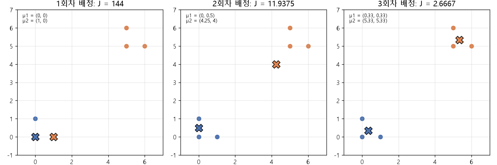

# k-평균과 평균 (k-means, Mean as the L2 minimizer, Lloyd's algorithm)

[목차로 돌아가기](../../00_MIT%EB%94%A5%EB%9F%AC%EB%8B%9D_%EB%AA%A9%EC%B0%A8.md) · 먼저 볼 것: [M02_시그마와_평균](../../%EC%88%98%ED%95%99%EA%B0%9C%EB%85%90/01_%EC%88%98%EC%99%80_%ED%95%A8%EC%88%98/M02_%EC%8B%9C%EA%B7%B8%EB%A7%88%EC%99%80_%ED%8F%89%EA%B7%A0.md), [M03_미분_기울기](../../%EC%88%98%ED%95%99%EA%B0%9C%EB%85%90/02_%EB%AF%B8%EB%B6%84/M03_%EB%AF%B8%EB%B6%84_%EA%B8%B0%EC%9A%B8%EA%B8%B0.md), [MM01_argmin과_argmax](../../%EC%88%98%ED%95%99%EA%B0%9C%EB%85%90/02_%EB%AF%B8%EB%B6%84/MM01_argmin%EA%B3%BC_argmax.md), [MM40_PCA와_선형_오토인코더](../../%EC%88%98%ED%95%99%EA%B0%9C%EB%85%90/10_%ED%91%9C%ED%98%84_%ED%95%99%EC%8A%B5/MM40_PCA%EC%99%80_%EC%84%A0%ED%98%95_%EC%98%A4%ED%86%A0%EC%9D%B8%EC%BD%94%EB%8D%94.md) · 쓰는 곳: [Lec11 9.2](../../Lec11_%ED%91%9C%ED%98%84_%ED%95%99%EC%8A%B5_%EC%9E%AC%EA%B5%AC%EC%84%B1.md#92-k-%ED%8F%89%EA%B7%A0%EC%9D%80-%EC%98%A4%ED%86%A0%EC%9D%B8%EC%BD%94%EB%8D%94%EB%8B%A4)

📚 학습 순서 71/99 (10. 표현 학습): ← 이전: [MM40_PCA와_선형_오토인코더](../../%EC%88%98%ED%95%99%EA%B0%9C%EB%85%90/10_%ED%91%9C%ED%98%84_%ED%95%99%EC%8A%B5/MM40_PCA%EC%99%80_%EC%84%A0%ED%98%95_%EC%98%A4%ED%86%A0%EC%9D%B8%EC%BD%94%EB%8D%94.md) · 다음: [MM42_최근접_이웃과_탐침](../../%EC%88%98%ED%95%99%EA%B0%9C%EB%85%90/10_%ED%91%9C%ED%98%84_%ED%95%99%EC%8A%B5/MM42_%EC%B5%9C%EA%B7%BC%EC%A0%91_%EC%9D%B4%EC%9B%83%EA%B3%BC_%ED%83%90%EC%B9%A8.md) →

> [!NOTE]
> **3줄 요약**
> - 점들까지의 **제곱 거리 합을 가장 작게 하는 한 점은 평균**이다. {1, 2, 6}에서 평균 3은 합 14, 2나 4는 17이다.
> - [k-평균](../../00_%EB%94%A5%EB%9F%AC%EB%8B%9D_%EC%9A%A9%EC%96%B4%EC%82%AC%EC%A0%84.md#k-means-k-%ED%8F%89%EA%B7%A0)은 "점마다 가장 가까운 중심 고르기"와 "중심을 무리의 평균으로 옮기기"를 번갈아 한다(로이드 알고리즘). 점 6개 예에서 [오차](../../00_%EB%94%A5%EB%9F%AC%EB%8B%9D_%EC%9A%A9%EC%96%B4%EC%82%AC%EC%A0%84.md#error-%EC%98%A4%EC%B0%A8) 합 J가 144 → 11.9375 → 2.6667로 줄고 멈춘다.
> - 이것은 **[원-핫](../../00_%EB%94%A5%EB%9F%AC%EB%8B%9D_%EC%9A%A9%EC%96%B4%EC%82%AC%EC%A0%84.md#one-hot-encoding-%EC%9B%90-%ED%95%AB-%EC%9D%B8%EC%BD%94%EB%94%A9) 코드를 [병목](../../00_%EB%94%A5%EB%9F%AC%EB%8B%9D_%EC%9A%A9%EC%96%B4%EC%82%AC%EC%A0%84.md#bottleneck-%EB%B3%91%EB%AA%A9)으로 쓰는 L2 [오토인코더](../../00_%EB%94%A5%EB%9F%AC%EB%8B%9D_%EC%9A%A9%EC%96%B4%EC%82%AC%EC%A0%84.md#autoencoder-%EC%98%A4%ED%86%A0%EC%9D%B8%EC%BD%94%EB%8D%94)**다. 인코더는 가장 가까운 중심의 번호를, 디코더는 그 번호의 중심(평균)을 내놓는다.

## 1. 개념 설명

비유: 마을 세 곳에 우물 하나를 판다면, 각 집에서 우물까지 거리의 **제곱** 합을 가장 작게 하는 자리는 집들의 무게중심(평균)이다. 우물을 k개 판다면 집마다 가까운 우물을 정하고, 우물은 자기 손님 집들의 평균 자리로 옮기기를 되풀이하면 된다. 이것이 [k-평균](../../00_%EB%94%A5%EB%9F%AC%EB%8B%9D_%EC%9A%A9%EC%96%B4%EC%82%AC%EC%A0%84.md#k-means-k-%ED%8F%89%EA%B7%A0)이다.

- **평균이 최적인 이유**: $\sum(x_i - c)^2$을 $c$로 [미분](../../%EC%88%98%ED%95%99%EA%B0%9C%EB%85%90/02_%EB%AF%B8%EB%B6%84/M03_%EB%AF%B8%EB%B6%84_%EA%B8%B0%EC%9A%B8%EA%B8%B0.md)하면 $-2\sum(x_i - c)$. 0으로 두면 $c = \frac1n\sum x_i$, 곧 평균이다. 벡터도 칸마다 똑같다.

$$
\arg\min_{\mathbf{c}} \sum_{i=1}^{n} \|\mathbf{x}_i - \mathbf{c}\|^2 = \bar{\mathbf{x}} = \frac{1}{n}\sum_{i=1}^{n} \mathbf{x}_i
$$

<details><summary>기호 풀이</summary>

| 기호 | 읽는 법 | 뜻 | 예제 값 |
| --- | --- | --- | --- |
| $\mathbf{x}_i$ | 엑스 아이 | i번째 데이터 점 | 2, 4, 9 (1차원) |
| $\mathbf{c}$ | 씨 | 후보 대표점 | 4 또는 5 |
| $n$ | 엔 | 점의 수 | 3 |
| $\Vert \cdot\Vert ^2$ | [노름](../../00_%EB%94%A5%EB%9F%AC%EB%8B%9D_%EC%9A%A9%EC%96%B4%EC%82%AC%EC%A0%84.md#norm-%EB%85%B8%EB%A6%84) 제곱 | 제곱 거리 | $(2-5)^2 = 9$ |
| $\arg\min_{\mathbf{c}}$ | 아그민 | 값을 가장 작게 만드는 $\mathbf{c}$ ([argmin](../../%EC%88%98%ED%95%99%EA%B0%9C%EB%85%90/02_%EB%AF%B8%EB%B6%84/MM01_argmin%EA%B3%BC_argmax.md)) | 5 |
| $\bar{\mathbf{x}}$ | 엑스 바 | 평균 ([평균](../../%EC%88%98%ED%95%99%EA%B0%9C%EB%85%90/01_%EC%88%98%EC%99%80_%ED%95%A8%EC%88%98/M02_%EC%8B%9C%EA%B7%B8%EB%A7%88%EC%99%80_%ED%8F%89%EA%B7%A0.md)) | 5 |

</details>

<details><summary>예제와 풀이</summary>

**문제**: 점 세 개를 한 점 $c$로 대표할 때, 평균을 쓰면 다른 후보(4)보다 제곱 거리 합이 정말 작은지 확인하라.

**주어진 값**:
- $x_1 = 2$, $x_2 = 4$, $x_3 = 9$ (1차원 데이터 점, $n = 3$)
- 비교할 후보 $c = 4$

**풀이**
1. 평균 식을 그대로 쓴다: $\bar{x} = \frac{1}{n}(x_1 + x_2 + x_3)$
2. 값을 대입한다: $\bar{x} = \frac13(2 + 4 + 9)$
3. 괄호 안을 더한다: $2 + 4 + 9 = 15$ 이므로 $\bar x = 15 / 3$
4. 나눈다: $\bar{x} = 5$
5. 제곱 거리 합 식을 쓴다: $S(c) = (x_1 - c)^2 + (x_2 - c)^2 + (x_3 - c)^2$
6. $c = 5$를 대입한다: $S(5) = (2 - 5)^2 + (4 - 5)^2 + (9 - 5)^2$
7. 뺄셈을 한다: $(-3)^2 + (-1)^2 + 4^2$
8. 제곱을 한다: $9 + 1 + 16$
9. 더한다: $S(5) = 26$
10. $c = 4$를 대입한다: $S(4) = (2 - 4)^2 + (4 - 4)^2 + (9 - 4)^2$
11. 뺄셈과 제곱을 한다: $(-2)^2 + 0^2 + 5^2 = 4 + 0 + 25$
12. 더한다: $S(4) = 29$
13. 비교한다: $26 < 29$

**답**: 평균 **5**의 합이 **26**으로 더 작다(4는 29).

</details>

<details><summary>내 이해</summary>


</details>

- **[k-평균](../../00_%EB%94%A5%EB%9F%AC%EB%8B%9D_%EC%9A%A9%EC%96%B4%EC%82%AC%EC%A0%84.md#k-means-k-%ED%8F%89%EA%B7%A0)의 목표**: 중심 $\boldsymbol\mu_1, \dots, \boldsymbol\mu_K$를 두고, 점마다 가장 가까운 중심까지의 제곱 거리를 더한 $J$를 최소로 한다.
- **로이드 알고리즘(Lloyd's algorithm)**: ① 배정: 점마다 가장 가까운 중심 번호를 고른다. ② 갱신: 각 중심을 자기 무리의 평균으로 옮긴다(위 성질 때문에 이 단계가 $J$를 최소로 줄인다). 두 단계 모두 $J$를 늘리지 않으므로 반드시 멈춘다. 강의 슬라이드의 "블록 좌표 하강(Block coordinate descent)"이 이것이다.
- **[오토인코더](../../00_%EB%94%A5%EB%9F%AC%EB%8B%9D_%EC%9A%A9%EC%96%B4%EC%82%AC%EC%A0%84.md#autoencoder-%EC%98%A4%ED%86%A0%EC%9D%B8%EC%BD%94%EB%8D%94)로 보기**: 인코더 $f$는 번호 $k^*$를 [원-핫](../../00_%EB%94%A5%EB%9F%AC%EB%8B%9D_%EC%9A%A9%EC%96%B4%EC%82%AC%EC%A0%84.md#one-hot-encoding-%EC%9B%90-%ED%95%AB-%EC%9D%B8%EC%BD%94%EB%94%A9) 벡터 $\mathbf{e}_{k^*}$로 내놓고, 디코더는 중심들을 열로 세운 행렬 $M$을 곱한다. $M\mathbf{e}_k$는 $M$의 k번째 열, 곧 $\boldsymbol\mu_k$를 골라낸다(조회표).

$$
J = \sum_{i=1}^{n} \big\|\mathbf{x}_i - M f(\mathbf{x}_i)\big\|^2, \qquad f(\mathbf{x}) = \mathbf{e}_{k^*},\ \ k^* = \arg\min_k \|\mathbf{x} - \boldsymbol\mu_k\|^2, \qquad M = [\boldsymbol\mu_1 \cdots \boldsymbol\mu_K]
$$

<details><summary>기호 풀이</summary>

| 기호 | 읽는 법 | 뜻 | 예제 값 |
| --- | --- | --- | --- |
| $J$ | 제이 | 전체 복원 [오차](../../00_%EB%94%A5%EB%9F%AC%EB%8B%9D_%EC%9A%A9%EC%96%B4%EC%82%AC%EC%A0%84.md#error-%EC%98%A4%EC%B0%A8) (제곱 거리 합) | 5 (점 하나) |
| $f(\mathbf{x})$ | 에프 엑스 | 인코더: 가장 가까운 중심의 [원-핫](../../00_%EB%94%A5%EB%9F%AC%EB%8B%9D_%EC%9A%A9%EC%96%B4%EC%82%AC%EC%A0%84.md#one-hot-encoding-%EC%9B%90-%ED%95%AB-%EC%9D%B8%EC%BD%94%EB%94%A9) 코드 | (1, 0) |
| $k^*$ | 케이 스타 | 가장 가까운 중심 번호 | 1 |
| $\boldsymbol\mu_k$ | 뮤 케이 | k번째 중심 (무리 평균) | (0,0), (4,4) |
| $M$ | 엠 | 중심을 열로 세운 디코더 행렬 | $\begin{pmatrix}0&4\\0&4\end{pmatrix}$ |
| $\mathbf{e}_k$ | 이 케이 | k번째 칸만 1인 [원-핫](../../00_%EB%94%A5%EB%9F%AC%EB%8B%9D_%EC%9A%A9%EC%96%B4%EC%82%AC%EC%A0%84.md#one-hot-encoding-%EC%9B%90-%ED%95%AB-%EC%9D%B8%EC%BD%94%EB%94%A9) 벡터 | $\mathbf{e}_1 = (1, 0)$ |
| $K$ | 케이 | 무리 수 (사람이 정하는 [하이퍼파라미터](../../00_%EB%94%A5%EB%9F%AC%EB%8B%9D_%EC%9A%A9%EC%96%B4%EC%82%AC%EC%A0%84.md#hyperparameter-%ED%95%98%EC%9D%B4%ED%8D%BC%ED%8C%8C%EB%9D%BC%EB%AF%B8%ED%84%B0)) | 2 |

</details>

<details><summary>예제와 풀이</summary>

**문제**: 무리 중심이 둘 있을 때 점 $\mathbf{x}$의 코드(어느 무리인가), 복원, 복원 [오차](../../00_%EB%94%A5%EB%9F%AC%EB%8B%9D_%EC%9A%A9%EC%96%B4%EC%82%AC%EC%A0%84.md#error-%EC%98%A4%EC%B0%A8)는?

**주어진 값**:
- $\boldsymbol\mu_1 = (0, 0)$ (1번 중심), $\boldsymbol\mu_2 = (4, 4)$ (2번 중심)
- $M = \begin{pmatrix}0&4\\0&4\end{pmatrix}$ (중심을 열로 세운 디코더)
- $\mathbf{x} = (1, 2)$ (데이터 점)

**풀이**
1. 식을 그대로 쓴다: $k^* = \arg\min_k \|\mathbf{x} - \boldsymbol\mu_k\|^2$
2. 값을 대입한다: $\|(1, 2) - (0, 0)\|^2$ 과 $\|(1, 2) - (4, 4)\|^2$ 중 작은 쪽
3. 칸별로 뺀다: $(1, 2)$ 와 $(-3, -2)$
4. 제곱합을 펼친다: $1^2 + 2^2$ 와 $(-3)^2 + (-2)^2$
5. 제곱을 한다: $1 + 4$ 와 $9 + 4$
6. 더한다: 5 와 13
7. 작은 쪽을 고른다: $k^* = 1$, 코드 $f(\mathbf{x}) = \mathbf{e}_1 = (1, 0)$
8. 디코더에 대입한다: $M\mathbf{e}_1 = \begin{pmatrix}0&4\\0&4\end{pmatrix}\begin{pmatrix}1\\0\end{pmatrix}$
9. 행마다 펼친다: $(0 \times 1 + 4 \times 0,\ 0 \times 1 + 4 \times 0) = (0, 0)$
10. [오차](../../00_%EB%94%A5%EB%9F%AC%EB%8B%9D_%EC%9A%A9%EC%96%B4%EC%82%AC%EC%A0%84.md#error-%EC%98%A4%EC%B0%A8) 식 $J = \|\mathbf{x} - Mf(\mathbf{x})\|^2$에 대입한다: $\|(1, 2) - (0, 0)\|^2 = 1 + 4 = 5$

**답**: 코드 **(1, 0)**, 복원 **(0, 0)**, [오차](../../00_%EB%94%A5%EB%9F%AC%EB%8B%9D_%EC%9A%A9%EC%96%B4%EC%82%AC%EC%A0%84.md#error-%EC%98%A4%EC%B0%A8) **5**.

</details>

<details><summary>내 이해</summary>


</details>

## 2. 필요한 이유

[Lec11 9.2](../../Lec11_%ED%91%9C%ED%98%84_%ED%95%99%EC%8A%B5_%EC%9E%AC%EA%B5%AC%EC%84%B1.md#92-k-%ED%8F%89%EA%B7%A0%EC%9D%80-%EC%98%A4%ED%86%A0%EC%9D%B8%EC%BD%94%EB%8D%94%EB%8B%A4)에서 강사는 "[k-평균](../../00_%EB%94%A5%EB%9F%AC%EB%8B%9D_%EC%9A%A9%EC%96%B4%EC%82%AC%EC%A0%84.md#k-means-k-%ED%8F%89%EA%B7%A0)은 L2 [오토인코더](../../00_%EB%94%A5%EB%9F%AC%EB%8B%9D_%EC%9A%A9%EC%96%B4%EC%82%AC%EC%A0%84.md#autoencoder-%EC%98%A4%ED%86%A0%EC%9D%B8%EC%BD%94%EB%8D%94)"라고 말한다. 차이는 [병목](../../00_%EB%94%A5%EB%9F%AC%EB%8B%9D_%EC%9A%A9%EC%96%B4%EC%82%AC%EC%A0%84.md#bottleneck-%EB%B3%91%EB%AA%A9)이 저차원 벡터가 아니라 **정수([원-핫](../../00_%EB%94%A5%EB%9F%AC%EB%8B%9D_%EC%9A%A9%EC%96%B4%EC%82%AC%EC%A0%84.md#one-hot-encoding-%EC%9B%90-%ED%95%AB-%EC%9D%B8%EC%BD%94%EB%94%A9) 코드)**라는 것뿐이다. 이 말을 이해하려면 (1) 디코더가 내놓을 최선의 벡터가 왜 평균인지, (2) 정수 [병목](../../00_%EB%94%A5%EB%9F%AC%EB%8B%9D_%EC%9A%A9%EC%96%B4%EC%82%AC%EC%A0%84.md#bottleneck-%EB%B3%91%EB%AA%A9)은 미분할 수 없어 [경사하강법](../../00_%EB%94%A5%EB%9F%AC%EB%8B%9D_%EC%9A%A9%EC%96%B4%EC%82%AC%EC%A0%84.md#gradient-descent-%EA%B2%BD%EC%82%AC%ED%95%98%EA%B0%95%EB%B2%95) 대신 배정·갱신을 번갈아 하는 이유를 알아야 한다. 이어지는 [9.3 벡터 양자화](../../Lec11_%ED%91%9C%ED%98%84_%ED%95%99%EC%8A%B5_%EC%9E%AC%EA%B5%AC%EC%84%B1.md#93-%EB%B2%A1%ED%84%B0-%EC%96%91%EC%9E%90%ED%99%94-%EC%98%A4%ED%86%A0%EC%9D%B8%EC%BD%94%EB%8D%94)는 이 인코더를 깊은 망으로 바꾼 것이다.

## 3. 숫자로 보기

**평균이 최선** (1차원 점 1, 2, 6, 평균 3)

| 후보 c | 제곱 거리 | 합 |
|---|---|---|
| 2 | 1 + 0 + 16 | 17 |
| **3 (평균)** | 4 + 1 + 9 | **14** |
| 4 | 9 + 4 + 4 | 17 |

**로이드 알고리즘** (점 (0,0), (1,0), (0,1), (5,5), (6,5), (5,6), K = 2, 처음 중심 (0,0), (1,0))

| 회차 | 중심 μ1, μ2 | 배정 (점 6개) | J |
|---|---|---|---|
| 1 | (0, 0), (1, 0) | 1, 2, 1, 2, 2, 2 | 0+0+1+41+50+52 = 144 |
| 2 | (0, 0.5), (4.25, 4) | 1, 1, 1, 2, 2, 2 | 11.9375 |
| 3 | (0.3333, 0.3333), (5.3333, 5.3333) | 1, 1, 1, 2, 2, 2 | 2.6667 |

- 1회차에는 처음 중심이 둘 다 왼쪽 아래에 있어 (1,0)이 오른쪽 위 세 점까지 맡는다. 평균으로 옮기자 μ2가 (4.25, 4)로 끌려가고, 2회차에 (1,0)이 μ1 쪽으로 넘어간다.
- 3회차에는 배정이 바뀌지 않으므로 중심도 그대로다. [수렴](../../00_%EB%94%A5%EB%9F%AC%EB%8B%9D_%EC%9A%A9%EC%96%B4%EC%82%AC%EC%A0%84.md#convergence-%EC%88%98%EB%A0%B4).


*▲ 직접 그린 그림: 로이드 알고리즘의 세 회차. X는 그 회차의 중심, 점 색은 배정된 무리. J가 144 → 11.9375 → 2.6667로 준다.*

<details><summary>기호 풀이</summary>

| 기호 | 읽는 법 | 뜻 | 예제 값 |
| --- | --- | --- | --- |
| $\bar{\mathbf{x}}$ | 엑스 바 | 평균 = 제곱 거리 합을 최소로 하는 점 | 3 |
| $\boldsymbol\mu_k$ | 뮤 케이 | k번째 무리의 중심 | (0.3333, 0.3333) |
| $k^*$ | 케이 스타 | 가장 가까운 중심 번호 (배정) | 1 또는 2 |
| $J$ | 제이 | 제곱 거리 합 | 144 → 2.6667 |
| $\mathbf{e}_k$ | 이 케이 | [원-핫](../../00_%EB%94%A5%EB%9F%AC%EB%8B%9D_%EC%9A%A9%EC%96%B4%EC%82%AC%EC%A0%84.md#one-hot-encoding-%EC%9B%90-%ED%95%AB-%EC%9D%B8%EC%BD%94%EB%94%A9) 코드 | (1, 0) |
| $M$ | 엠 | 중심을 열로 세운 조회표 | 2×2 |

</details>

## 4. 코드로 확인

```python
# [변수] v: 1차원 점 1, 2, 6 (평균 3)
v = np.array([1, 2, 6.0])
# [함수] for c in ...: 후보 대표점마다 제곱 거리 합을 잰다
for c in [2, 3, 4]:
    # [연결] 본문 3절 첫 표: 17, 14, 17
    print(c, ((v - c) ** 2).sum())
# [변수] P: 2차원 점 6개 (왼쪽 아래 셋, 오른쪽 위 셋)
P = np.array([[0, 0], [1, 0], [0, 1], [5, 5], [6, 5], [5, 6.0]])
# [변수] mu: 처음 중심 두 개. 일부러 둘 다 왼쪽 아래에 둬서 고쳐 가는 과정을 보인다
mu = np.array([[0, 0], [1, 0.0]])
# [함수] range(3): 배정과 갱신을 세 번 되풀이
for it in range(3):
    # [함수] 브로드캐스팅으로 모든 (점, 중심) 쌍의 제곱 거리 6×2 표를 만든다
    # [변수] d2: 행 = 점, 열 = 중심
    d2 = ((P[:, None, :] - mu[None, :, :]) ** 2).sum(-1)
    # [함수] argmin(1): 점마다 가장 가까운 중심 번호 (0부터) → 배정 단계
    a = d2.argmin(1)
    # [변수] J: 배정된 중심까지 제곱 거리의 합
    # [연결] 본문 3절 둘째 표의 J 열
    print(it + 1, mu.round(4).ravel(), a + 1, round(d2.min(1).sum(), 4))
    # [함수] P[a == k].mean(0): k번 무리 점들의 평균 → 갱신 단계 (평균이 최선이므로)
    mu = np.array([P[a == k].mean(0) for k in range(2)])
# [변수] M: 최종 중심을 열로 세운 디코더 행렬 (2×2)
M = mu.T
# [변수] code: 점 (5, 6)의 원-핫 코드. 둘째 무리이므로 (0, 1)
code = np.array([0, 1.0])
# [함수] M @ code: 원-핫이 M의 둘째 열을 골라낸다 = 조회표
# [연결] 디코더 출력 = 무리 평균 (5.3333, 5.3333)
print((M @ code).round(4))
```

**실행 결과**:

```text
2 17.0
3 14.0
4 17.0
1 [0. 0. 1. 0.] [1 2 1 2 2 2] 144.0
2 [0.   0.5  4.25 4.  ] [1 1 1 2 2 2] 11.9375
3 [0.3333 0.3333 5.3333 5.3333] [1 1 1 2 2 2] 2.6667
[5.3333 5.3333]
```

> [!WARNING]
> **⚠ 주의**
> - [k-평균](../../00_%EB%94%A5%EB%9F%AC%EB%8B%9D_%EC%9A%A9%EC%96%B4%EC%82%AC%EC%A0%84.md#k-means-k-%ED%8F%89%EA%B7%A0)의 답은 **처음 중심**에 따라 달라질 수 있다([지역 최솟값](../../00_%EB%94%A5%EB%9F%AC%EB%8B%9D_%EC%9A%A9%EC%96%B4%EC%82%AC%EC%A0%84.md#local-minimum-%EC%A7%80%EC%97%AD-%EC%B5%9C%EC%86%9F%EA%B0%92)). 실무에서는 처음 중심을 여러 번 바꿔 돌리거나 [k-means](../../00_%EB%94%A5%EB%9F%AC%EB%8B%9D_%EC%9A%A9%EC%96%B4%EC%82%AC%EC%A0%84.md#k-means-k-%ED%8F%89%EA%B7%A0)++ 방식으로 고른다.
> - $K$는 알고리즘이 정하지 않는다. 사람이 정하는 [하이퍼파라미터](../../00_%EB%94%A5%EB%9F%AC%EB%8B%9D_%EC%9A%A9%EC%96%B4%EC%82%AC%EC%A0%84.md#hyperparameter-%ED%95%98%EC%9D%B4%ED%8D%BC%ED%8C%8C%EB%9D%BC%EB%AF%B8%ED%84%B0)다. 강의 질문에서도 "[오토인코더](../../00_%EB%94%A5%EB%9F%AC%EB%8B%9D_%EC%9A%A9%EC%96%B4%EC%82%AC%EC%A0%84.md#autoencoder-%EC%98%A4%ED%86%A0%EC%9D%B8%EC%BD%94%EB%8D%94)가 가장 좋은 k를 찾느냐"에 강사는 "아니다"라고 답했다.
> - "평균이 최선"은 **제곱 거리(L2)** 일 때만이다. 거리 그대로(L1)의 합을 최소로 하는 점은 중앙값이다. {1, 2, 6}의 중앙값 2는 L1 합 1+0+4 = 5로, 평균 3의 2+1+3 = 6보다 작다.

## 5. 개념 재확인

<details><summary>1. 점 1, 2, 6을 한 점으로 대표할 때 가장 좋은 점과 그 제곱 거리 합은? 2와 4보다 얼마나 좋은가?</summary>

| 단계 | 하는 일 | 식 | 계산 | 결과 |
|---|---|---|---|---|
| 1 | 평균 | $\bar x = \frac1n\sum x_i$ | 9/3 | 3 |
| 2 | 평균의 합 | $\sum(x_i - 3)^2$ | 4+1+9 | 14 |
| 3 | 다른 후보 | $c = 2, 4$ | 1+0+16, 9+4+4 | 17, 17 |
| 4 | 차이 | 17 − 14 | | 3 |

**① 쓰는 식**
$$\arg\min_{c}\sum_i (x_i - c)^2 = \bar x$$
- 위 식 ← 오른쪽은 ② (평균), 왼쪽 합은 ③ (평균의 합)과 ④ (다른 후보)에서 계산하고 ⑤ (차이)에서 비교한다.
```python
# [변수] v: 문제의 점
v = np.array([1, 2, 6.0])                                   # ①
# [변수] m = 3: 평균
m = v.mean()                                                # ②
# [변수] best = 14: 평균에서의 제곱 거리 합
best = ((v - m) ** 2).sum()                                 # ③
# [변수] others = [17, 17]: c = 2, 4의 합
others = [((v - c) ** 2).sum() for c in (2, 4)]             # ④
# [연결] 3.0 14.0 [17.0, 17.0] 3.0
print(m, best, [float(o) for o in others], others[0] - best)   # ⑤
```

**주어진 값**:
- $x_1 = 1$, $x_2 = 2$, $x_3 = 6$ (1차원 점, $n = 3$)

**② 평균**
1. 식을 그대로 쓴다: $\bar x = \frac1n(x_1 + x_2 + x_3)$
2. 값을 대입한다: $\bar x = \frac13(1 + 2 + 6)$
3. 더한다: $9$ 이므로 $\bar x = 9/3$
4. 나눈다: $\bar x = 3$

**③ 평균의 합**
1. 식을 그대로 쓴다: $S(c) = (x_1 - c)^2 + (x_2 - c)^2 + (x_3 - c)^2$
2. $c = 3$을 대입한다: $(1 - 3)^2 + (2 - 3)^2 + (6 - 3)^2$
3. 뺄셈을 한다: $(-2)^2 + (-1)^2 + 3^2$
4. 제곱을 한다: $4 + 1 + 9$
5. 더한다: $14$

**④ 다른 후보**
1. $c = 2$를 대입한다: $(1 - 2)^2 + (2 - 2)^2 + (6 - 2)^2 = 1 + 0 + 16 = 17$
2. $c = 4$를 대입한다: $(1 - 4)^2 + (2 - 4)^2 + (6 - 4)^2 = 9 + 4 + 4 = 17$

**⑤ 차이**
1. 뺀다: $17 - 14 = 3$만큼 평균이 낫다.
**답**: 평균 **3**, 합 **14**. 2와 4(둘 다 17)보다 **3** 작다.

</details>

<details><summary>2. 1차원 점 0, 2, 10, 12에 K = 2, 처음 중심 0과 2로 로이드 알고리즘을 돌리면 J는 어떻게 변하고 어디서 멈추나?</summary>

| 단계 | 중심 | 배정 | J |
|---|---|---|---|
| 1 | 0, 2 | 1, 2, 2, 2 | 0+0+64+100 = 164 |
| 2 | 0, 8 | 1, 1, 2, 2 | 0+4+4+16 = 24 |
| 3 | 1, 11 | 1, 1, 2, 2 | 1+1+1+1 = 4 |

**① 쓰는 식**
$$J = \sum_i \|\mathbf{x}_i - M f(\mathbf{x}_i)\|^2$$
- 위 식 ← $f$(배정)는 ②, ④, ⑥에서, $M$의 열(평균 갱신)은 ③, ⑤에서 바뀐다.
```python
# [변수] x: 문제의 점, mu: 처음 중심
x, mu = np.array([0, 2, 10, 12.0]), np.array([0, 2.0])     # ①
# [함수] range(3): 배정 → 출력 → 갱신을 세 번
for it in range(3):
    # [변수] a: 점마다 가까운 중심 번호 (②④⑥)
    a = np.abs(x[:, None] - mu[None]).argmin(1)
    # [연결] 164 → 24 → 4
    print(mu.tolist(), (a + 1).tolist(), ((x - mu[a]) ** 2).sum())
    # [변수] mu: 무리 평균으로 갱신 (③⑤)
    mu = np.array([x[a == k].mean() for k in range(2)])
```

**주어진 값**:
- 점 $x = 0, 2, 10, 12$ (1차원 데이터)
- 처음 중심 $\mu_1 = 0$, $\mu_2 = 2$, $K = 2$

**② 1회차 배정**
1. 식을 그대로 쓴다: 점마다 $|x - \mu_1|$ 과 $|x - \mu_2|$ 중 작은 쪽 번호
2. 대입한다: 2는 $|2 - 0| = 2$ 대 $|2 - 2| = 0$ → 2번, 10은 10 대 8 → 2번, 12는 12 대 10 → 2번, 0은 1번
3. $J$ 식에 대입한다: $J = (0 - 0)^2 + (2 - 2)^2 + (10 - 2)^2 + (12 - 2)^2$
4. 뺄셈과 제곱을 한다: $0 + 0 + 64 + 100$
5. 더한다: $J = 164$

**③ 1회차 갱신**
1. 식: 중심 = 자기 무리의 평균
2. 대입한다: $\mu_1 = 0 / 1$, $\mu_2 = (2 + 10 + 12)/3$
3. 계산한다: $\mu_1 = 0$, $\mu_2 = 24/3 = 8$

**④ 2회차 배정**
1. 대입한다: 2는 $|2 - 0| = 2$ 대 $|2 - 8| = 6$ → 1번, 10은 10 대 2 → 2번, 12는 12 대 4 → 2번
2. $J$에 대입한다: $(0 - 0)^2 + (2 - 0)^2 + (10 - 8)^2 + (12 - 8)^2$
3. 제곱을 한다: $0 + 4 + 4 + 16$
4. 더한다: $J = 24$

**⑤ 2회차 갱신**
1. 대입한다: $\mu_1 = (0 + 2)/2$, $\mu_2 = (10 + 12)/2$
2. 계산한다: $\mu_1 = 1$, $\mu_2 = 11$

**⑥ 3회차 배정**
1. 배정은 그대로(1, 1, 2, 2)다. $J$에 대입한다: $(0 - 1)^2 + (2 - 1)^2 + (10 - 11)^2 + (12 - 11)^2$
2. 제곱을 한다: $1 + 1 + 1 + 1$
3. 더한다: $J = 4$. 배정이 바뀌지 않으므로 멈춘다
**답**: J는 **164 → 24 → 4**로 줄고, 중심 **1과 11**에서 멈춘다.

</details>

## 예제 풀기

[예제 10문제 풀기](../../%EC%98%88%EC%A0%9C/10_%ED%91%9C%ED%98%84_%ED%95%99%EC%8A%B5/%EC%98%88%EC%A0%9C_MM41_k%ED%8F%89%EA%B7%A0%EA%B3%BC_%ED%8F%89%EA%B7%A0.md)

<details><summary>내 이해</summary>


</details>
