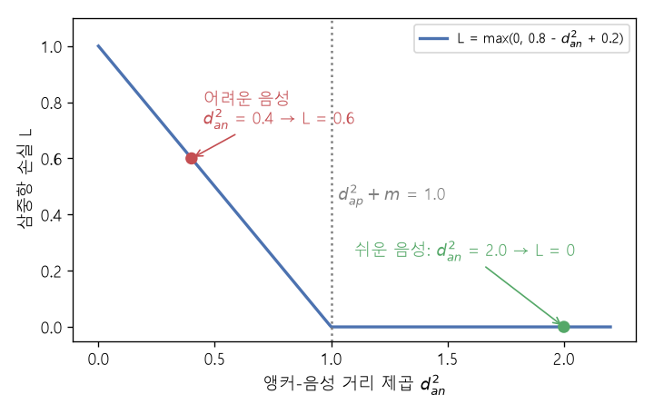

# 삼중항 손실과 InfoNCE (Triplet loss, InfoNCE loss)

[목차로 돌아가기](../../00_MIT%EB%94%A5%EB%9F%AC%EB%8B%9D_%EB%AA%A9%EC%B0%A8.md) · 먼저 볼 것: [MM44_단위_구와_코사인_유사도](../../%EC%88%98%ED%95%99%EA%B0%9C%EB%85%90/03_%EC%84%A0%ED%98%95%EB%8C%80%EC%88%98/MM44_%EB%8B%A8%EC%9C%84_%EA%B5%AC%EC%99%80_%EC%BD%94%EC%82%AC%EC%9D%B8_%EC%9C%A0%EC%82%AC%EB%8F%84.md), [M06_지수와_e](../../%EC%88%98%ED%95%99%EA%B0%9C%EB%85%90/01_%EC%88%98%EC%99%80_%ED%95%A8%EC%88%98/M06_%EC%A7%80%EC%88%98%EC%99%80_e.md), [M07_로그](../../%EC%88%98%ED%95%99%EA%B0%9C%EB%85%90/01_%EC%88%98%EC%99%80_%ED%95%A8%EC%88%98/M07_%EB%A1%9C%EA%B7%B8.md), [M10_엔트로피](../../%EC%88%98%ED%95%99%EA%B0%9C%EB%85%90/04_%ED%99%95%EB%A5%A0%EA%B3%BC_%EC%A0%95%EB%B3%B4/M10_%EC%97%94%ED%8A%B8%EB%A1%9C%ED%94%BC.md) · 쓰는 곳: [Lec12 5.1](../../Lec12_%EC%9C%A0%EC%82%AC%EB%8F%84_%EA%B8%B0%EB%B0%98_%ED%91%9C%ED%98%84_%ED%95%99%EC%8A%B5.md#51-%EC%82%BC%EC%A4%91%ED%95%AD-%EC%86%90%EC%8B%A4), [Lec12 6.1](../../Lec12_%EC%9C%A0%EC%82%AC%EB%8F%84_%EA%B8%B0%EB%B0%98_%ED%91%9C%ED%98%84_%ED%95%99%EC%8A%B5.md#61-infonce-%EC%86%90%EC%8B%A4)

📚 학습 순서 73/99 (10. 표현 학습): ← 이전: [MM42_최근접_이웃과_탐침](../../%EC%88%98%ED%95%99%EA%B0%9C%EB%85%90/10_%ED%91%9C%ED%98%84_%ED%95%99%EC%8A%B5/MM42_%EC%B5%9C%EA%B7%BC%EC%A0%91_%EC%9D%B4%EC%9B%83%EA%B3%BC_%ED%83%90%EC%B9%A8.md) · 다음: [MM46_정렬과_균일성](../../%EC%88%98%ED%95%99%EA%B0%9C%EB%85%90/10_%ED%91%9C%ED%98%84_%ED%95%99%EC%8A%B5/MM46_%EC%A0%95%EB%A0%AC%EA%B3%BC_%EA%B7%A0%EC%9D%BC%EC%84%B1.md) →

> [!NOTE]
> **3줄 요약**
> - **[삼중항 손실](../../00_%EB%94%A5%EB%9F%AC%EB%8B%9D_%EC%9A%A9%EC%96%B4%EC%82%AC%EC%A0%84.md#triplet-loss-%EC%82%BC%EC%A4%91%ED%95%AD-%EC%86%90%EC%8B%A4)**은 앵커-음성 거리가 앵커-양성 거리보다 여유(margin) $m$ 이상 크지 않으면 벌을 준다: $\max(0,\ d_{ap}^2 - d_{an}^2 + m)$. $d_{ap}^2 = 0.8$, $d_{an}^2 = 0.4$, $m = 0.2$이면 0.6.
> - **[InfoNCE](../../00_%EB%94%A5%EB%9F%AC%EB%8B%9D_%EC%9A%A9%EC%96%B4%EC%82%AC%EC%A0%84.md#infonce-infonce-%EC%86%90%EC%8B%A4)**는 "음성 여럿 중에서 양성 하나를 골라내는" [소프트맥스](../../00_%EB%94%A5%EB%9F%AC%EB%8B%9D_%EC%9A%A9%EC%96%B4%EC%82%AC%EC%A0%84.md#softmax-%EC%86%8C%ED%94%84%ED%8A%B8%EB%A7%A5%EC%8A%A4) [분류](../../00_%EB%94%A5%EB%9F%AC%EB%8B%9D_%EC%9A%A9%EC%96%B4%EC%82%AC%EC%A0%84.md#regression-classification-%ED%9A%8C%EA%B7%80%EC%99%80-%EB%B6%84%EB%A5%98)의 [교차 엔트로피](../../00_%EB%94%A5%EB%9F%AC%EB%8B%9D_%EC%9A%A9%EC%96%B4%EC%82%AC%EC%A0%84.md#cross-entropy-%EA%B5%90%EC%B0%A8-%EC%97%94%ED%8A%B8%EB%A1%9C%ED%94%BC)다. 유사도 (0.8, 0.2, -0.1), 온도 0.5면 양성 [확률](../../00_%EB%94%A5%EB%9F%AC%EB%8B%9D_%EC%9A%A9%EC%96%B4%EC%82%AC%EC%A0%84.md#probability-%ED%99%95%EB%A5%A0) 0.6819, [손실](../../00_%EB%94%A5%EB%9F%AC%EB%8B%9D_%EC%9A%A9%EC%96%B4%EC%82%AC%EC%A0%84.md#loss-function-%EC%86%90%EC%8B%A4-%ED%95%A8%EC%88%98) 0.3829.
> - 온도 $\tau$가 작을수록 유사도 차이를 크게 부풀린다. 같은 유사도에서 $\tau = 1$이면 [손실](../../00_%EB%94%A5%EB%9F%AC%EB%8B%9D_%EC%9A%A9%EC%96%B4%EC%82%AC%EC%A0%84.md#loss-function-%EC%86%90%EC%8B%A4-%ED%95%A8%EC%88%98) 0.6706, $\tau = 0.1$이면 0.0026.

## 1. 개념 설명

비유: [삼중항 손실](../../00_%EB%94%A5%EB%9F%AC%EB%8B%9D_%EC%9A%A9%EC%96%B4%EC%82%AC%EC%A0%84.md#triplet-loss-%EC%82%BC%EC%A4%91%ED%95%AD-%EC%86%90%EC%8B%A4)은 "이 둘(앵커와 양성)이 저것(음성)보다 확실히 더 닮았다"를 한 문제씩 채점하는 OX 시험이다. [InfoNCE](../../00_%EB%94%A5%EB%9F%AC%EB%8B%9D_%EC%9A%A9%EC%96%B4%EC%82%AC%EC%A0%84.md#infonce-infonce-%EC%86%90%EC%8B%A4)는 "보기 N+1개 중 짝을 고르라"는 객관식 시험이다. 보기가 많을수록 문제가 어려워지고 더 많이 배운다.

- **앵커(anchor) $\mathbf{x}$**: 기준이 되는 표본.
- **양성(positive) $\mathbf{x}^+$**: 앵커와 같다고 정한 표본 (같은 종류, 또는 같은 사진의 다른 증강).
- **음성(negative) $\mathbf{x}^-$**: 앵커와 다르다고 정한 표본.
- **[삼중항 손실](../../00_%EB%94%A5%EB%9F%AC%EB%8B%9D_%EC%9A%A9%EC%96%B4%EC%82%AC%EC%A0%84.md#triplet-loss-%EC%82%BC%EC%A4%91%ED%95%AD-%EC%86%90%EC%8B%A4)**: $\mathcal{L} = \max(0,\ \|f(\mathbf{x}) - f(\mathbf{x}^+)\|^2 - \|f(\mathbf{x}) - f(\mathbf{x}^-)\|^2 + m)$. 음성이 이미 충분히 멀면 0이어서 [기울기](../../00_%EB%94%A5%EB%9F%AC%EB%8B%9D_%EC%9A%A9%EC%96%B4%EC%82%AC%EC%A0%84.md#gradient-%EA%B8%B0%EC%9A%B8%EA%B8%B0)도 0이다. 그래서 "어려운 음성"이 필요하다.
- **[InfoNCE](../../00_%EB%94%A5%EB%9F%AC%EB%8B%9D_%EC%9A%A9%EC%96%B4%EC%82%AC%EC%A0%84.md#infonce-infonce-%EC%86%90%EC%8B%A4)**: 구 위의 표현끼리 [내적](../../00_%EB%94%A5%EB%9F%AC%EB%8B%9D_%EC%9A%A9%EC%96%B4%EC%82%AC%EC%A0%84.md#dot-product-%EB%82%B4%EC%A0%81) $s = f(\mathbf{x})^\top f(\cdot)$을 구해 온도 $\tau$로 나누고 [소프트맥스](../../00_%EB%94%A5%EB%9F%AC%EB%8B%9D_%EC%9A%A9%EC%96%B4%EC%82%AC%EC%A0%84.md#softmax-%EC%86%8C%ED%94%84%ED%8A%B8%EB%A7%A5%EC%8A%A4)를 씌운 뒤, 양성 칸 [확률](../../00_%EB%94%A5%EB%9F%AC%EB%8B%9D_%EC%9A%A9%EC%96%B4%EC%82%AC%EC%A0%84.md#probability-%ED%99%95%EB%A5%A0)의 $-\log$를 [손실](../../00_%EB%94%A5%EB%9F%AC%EB%8B%9D_%EC%9A%A9%EC%96%B4%EC%82%AC%EC%A0%84.md#loss-function-%EC%86%90%EC%8B%A4-%ED%95%A8%EC%88%98)로 쓴다. 분자(양성)를 키우면 "당기기", 분모의 음성 항을 줄이면 "밀기"다.
- **온도(temperature) $\tau$**: 유사도를 $\tau$로 나눈다. $\tau$가 작으면 작은 유사도 차이도 [확률](../../00_%EB%94%A5%EB%9F%AC%EB%8B%9D_%EC%9A%A9%EC%96%B4%EC%82%AC%EC%A0%84.md#probability-%ED%99%95%EB%A5%A0)에서는 큰 차이가 된다.

## 2. 필요한 이유

[Lec12 5.1](../../Lec12_%EC%9C%A0%EC%82%AC%EB%8F%84_%EA%B8%B0%EB%B0%98_%ED%91%9C%ED%98%84_%ED%95%99%EC%8A%B5.md#51-%EC%82%BC%EC%A4%91%ED%95%AD-%EC%86%90%EC%8B%A4)은 Schroff 등(2015)의 [삼중항 손실](../../00_%EB%94%A5%EB%9F%AC%EB%8B%9D_%EC%9A%A9%EC%96%B4%EC%82%AC%EC%A0%84.md#triplet-loss-%EC%82%BC%EC%A4%91%ED%95%AD-%EC%86%90%EC%8B%A4)로 "다른 쌍의 거리 ≫ 같은 쌍의 거리"를 가르치고, [5.2](../../Lec12_%EC%9C%A0%EC%82%AC%EB%8F%84_%EA%B8%B0%EB%B0%98_%ED%91%9C%ED%98%84_%ED%95%99%EC%8A%B5.md#52-%ED%95%98%EB%93%9C-%EB%84%A4%EA%B1%B0%ED%8B%B0%EB%B8%8C-%EB%A7%88%EC%9D%B4%EB%8B%9D)는 [손실](../../00_%EB%94%A5%EB%9F%AC%EB%8B%9D_%EC%9A%A9%EC%96%B4%EC%82%AC%EC%A0%84.md#loss-function-%EC%86%90%EC%8B%A4-%ED%95%A8%EC%88%98)이 0인 쉬운 음성으로는 배울 것이 없다고 말한다. [Lec12 6.1](../../Lec12_%EC%9C%A0%EC%82%AC%EB%8F%84_%EA%B8%B0%EB%B0%98_%ED%91%9C%ED%98%84_%ED%95%99%EC%8A%B5.md#61-infonce-%EC%86%90%EC%8B%A4)의 자기 [지도 대조 학습](../../00_%EB%94%A5%EB%9F%AC%EB%8B%9D_%EC%9A%A9%EC%96%B4%EC%82%AC%EC%A0%84.md#supervised-contrastive-learning-%EC%A7%80%EB%8F%84-%EB%8C%80%EC%A1%B0-%ED%95%99%EC%8A%B5)([SimCLR](../../00_%EB%94%A5%EB%9F%AC%EB%8B%9D_%EC%9A%A9%EC%96%B4%EC%82%AC%EC%A0%84.md#simclr-simclr-%EB%8C%80%EC%A1%B0-%ED%95%99%EC%8A%B5) 등)은 [InfoNCE](../../00_%EB%94%A5%EB%9F%AC%EB%8B%9D_%EC%9A%A9%EC%96%B4%EC%82%AC%EC%A0%84.md#infonce-infonce-%EC%86%90%EC%8B%A4)를 쓴다. 두 식의 계산을 손으로 해 보면 "왜 음성이 많을수록, 어려울수록 좋은가"가 보인다.

## 3. 숫자로 보기

**[삼중항 손실](../../00_%EB%94%A5%EB%9F%AC%EB%8B%9D_%EC%9A%A9%EC%96%B4%EC%82%AC%EC%A0%84.md#triplet-loss-%EC%82%BC%EC%A4%91%ED%95%AD-%EC%86%90%EC%8B%A4)** ($d_{ap}^2 = 0.8$, $m = 0.2$)

| 음성 | $d_{an}^2$ | $d_{ap}^2 - d_{an}^2 + m$ | [손실](../../00_%EB%94%A5%EB%9F%AC%EB%8B%9D_%EC%9A%A9%EC%96%B4%EC%82%AC%EC%A0%84.md#loss-function-%EC%86%90%EC%8B%A4-%ED%95%A8%EC%88%98) | 뜻 |
|---|---|---|---|---|
| 쉬운 음성 | 2.0 | 0.8 - 2.0 + 0.2 = -1.0 | 0 | 이미 충분히 멀다 → 배울 것 없음 |
| 어려운 음성 | 0.4 | 0.8 - 0.4 + 0.2 = 0.6 | 0.6 | 양성보다 가깝다 → 밀어내야 함 |


*▲ 직접 그린 그림: $d_{ap}^2 = 0.8$, $m = 0.2$일 때 [삼중항 손실](../../00_%EB%94%A5%EB%9F%AC%EB%8B%9D_%EC%9A%A9%EC%96%B4%EC%82%AC%EC%A0%84.md#triplet-loss-%EC%82%BC%EC%A4%91%ED%95%AD-%EC%86%90%EC%8B%A4). $d_{an}^2$가 1.0을 넘으면 [손실](../../00_%EB%94%A5%EB%9F%AC%EB%8B%9D_%EC%9A%A9%EC%96%B4%EC%82%AC%EC%A0%84.md#loss-function-%EC%86%90%EC%8B%A4-%ED%95%A8%EC%88%98)과 [기울기](../../00_%EB%94%A5%EB%9F%AC%EB%8B%9D_%EC%9A%A9%EC%96%B4%EC%82%AC%EC%A0%84.md#gradient-%EA%B8%B0%EC%9A%B8%EA%B8%B0)가 모두 0이다*

**[InfoNCE](../../00_%EB%94%A5%EB%9F%AC%EB%8B%9D_%EC%9A%A9%EC%96%B4%EC%82%AC%EC%A0%84.md#infonce-infonce-%EC%86%90%EC%8B%A4)** (양성 유사도 0.8, 음성 유사도 0.2와 -0.1, $\tau = 0.5$, 한 줄에 한 동작)
- 온도로 나누기: $0.8/0.5 = 1.6$, $0.2/0.5 = 0.4$, $-0.1/0.5 = -0.2$
- [지수](../../00_%EB%94%A5%EB%9F%AC%EB%8B%9D_%EC%9A%A9%EC%96%B4%EC%82%AC%EC%A0%84.md#e-exponent-e%EC%99%80-%EC%A7%80%EC%88%98): $e^{1.6} = 4.9530$, $e^{0.4} = 1.4918$, $e^{-0.2} = 0.8187$
- 합: $4.9530 + 1.4918 + 0.8187 = 7.2636$
- 양성 [확률](../../00_%EB%94%A5%EB%9F%AC%EB%8B%9D_%EC%9A%A9%EC%96%B4%EC%82%AC%EC%A0%84.md#probability-%ED%99%95%EB%A5%A0): $4.9530 / 7.2636 = 0.6819$
- [손실](../../00_%EB%94%A5%EB%9F%AC%EB%8B%9D_%EC%9A%A9%EC%96%B4%EC%82%AC%EC%A0%84.md#loss-function-%EC%86%90%EC%8B%A4-%ED%95%A8%EC%88%98): $-\ln 0.6819 = 0.3829$

**온도를 바꾸면** (같은 유사도)

| $\tau$ | 양성 [확률](../../00_%EB%94%A5%EB%9F%AC%EB%8B%9D_%EC%9A%A9%EC%96%B4%EC%82%AC%EC%A0%84.md#probability-%ED%99%95%EB%A5%A0) | [손실](../../00_%EB%94%A5%EB%9F%AC%EB%8B%9D_%EC%9A%A9%EC%96%B4%EC%82%AC%EC%A0%84.md#loss-function-%EC%86%90%EC%8B%A4-%ED%95%A8%EC%88%98) |
|---|---|---|
| 1.0 | 0.5114 | 0.6706 |
| 0.5 | 0.6819 | 0.3829 |
| 0.1 | 0.9974 | 0.0026 |

이 내용을 식으로 쓰면 다음과 같다 (음성 $N$개).

$$
\mathcal{L}_{\text{InfoNCE}} = -\log \frac{e^{f(\mathbf{x})^\top f(\mathbf{x}^+)/\tau}}{e^{f(\mathbf{x})^\top f(\mathbf{x}^+)/\tau} + \sum_{i=1}^{N} e^{f(\mathbf{x})^\top f(\mathbf{x}_i^-)/\tau}}
$$

<details><summary>기호 풀이</summary>

| 기호 | 읽는 법 | 뜻 | 예제 값 |
| --- | --- | --- | --- |
| $f$ | 에프 | 입력을 단위 구 위로 보내는 인코더 | |
| $\mathbf{x}, \mathbf{x}^+$ | 엑스, 엑스 플러스 | 앵커와 양성 | |
| $\mathbf{x}_i^-$ | 엑스 아이 마이너스 | $i$번째 음성 | 2개 |
| $f(\mathbf{x})^\top f(\mathbf{x}^+)$ | [내적](../../00_%EB%94%A5%EB%9F%AC%EB%8B%9D_%EC%9A%A9%EC%96%B4%EC%82%AC%EC%A0%84.md#dot-product-%EB%82%B4%EC%A0%81) | 앵커-양성 [코사인 유사도](../../00_%EB%94%A5%EB%9F%AC%EB%8B%9D_%EC%9A%A9%EC%96%B4%EC%82%AC%EC%A0%84.md#cosine-similarity-%EC%BD%94%EC%82%AC%EC%9D%B8-%EC%9C%A0%EC%82%AC%EB%8F%84) | 0.8 |
| $f(\mathbf{x})^\top f(\mathbf{x}_i^-)$ | [내적](../../00_%EB%94%A5%EB%9F%AC%EB%8B%9D_%EC%9A%A9%EC%96%B4%EC%82%AC%EC%A0%84.md#dot-product-%EB%82%B4%EC%A0%81) | 앵커-음성 유사도 | 0.2, -0.1 |
| $\tau$ | 타우 | 온도 | 0.5 |
| $N$ | 엔 | 음성 개수 | 2 |
| 분수 전체 | | 양성 칸의 [소프트맥스](../../00_%EB%94%A5%EB%9F%AC%EB%8B%9D_%EC%9A%A9%EC%96%B4%EC%82%AC%EC%A0%84.md#softmax-%EC%86%8C%ED%94%84%ED%8A%B8%EB%A7%A5%EC%8A%A4) [확률](../../00_%EB%94%A5%EB%9F%AC%EB%8B%9D_%EC%9A%A9%EC%96%B4%EC%82%AC%EC%A0%84.md#probability-%ED%99%95%EB%A5%A0) | 0.6819 |
| $\mathcal{L}_{\text{InfoNCE}}$ | 인포 엔씨이 | [손실](../../00_%EB%94%A5%EB%9F%AC%EB%8B%9D_%EC%9A%A9%EC%96%B4%EC%82%AC%EC%A0%84.md#loss-function-%EC%86%90%EC%8B%A4-%ED%95%A8%EC%88%98) | 0.3829 |

</details>

<details><summary>예제와 풀이</summary>

**문제**: 앵커와 양성의 유사도가 0.8, 음성 두 개와의 유사도가 0.2와 -0.1일 때 온도 $\tau = 1$이면 [InfoNCE 손실](../../00_%EB%94%A5%EB%9F%AC%EB%8B%9D_%EC%9A%A9%EC%96%B4%EC%82%AC%EC%A0%84.md#infonce-infonce-%EC%86%90%EC%8B%A4)은?

**주어진 값**
- $f(\mathbf{x})^\top f(\mathbf{x}^+) = 0.8$: 양성과의 유사도
- $s_1^- = 0.2$, $s_2^- = -0.1$: 음성 두 개와의 유사도
- $N = 2$: 음성 개수
- $\tau = 1$: 온도

**풀이**
1. 식을 그대로 쓴다: $\mathcal{L} = -\log \dfrac{e^{f(\mathbf{x})^\top f(\mathbf{x}^+)/\tau}}{e^{f(\mathbf{x})^\top f(\mathbf{x}^+)/\tau} + \sum_{i=1}^{N} e^{s_i^-/\tau}}$
2. 값을 대입한다: $\mathcal{L} = -\log \dfrac{e^{0.8/1}}{e^{0.8/1} + \sum_{i=1}^{2} e^{s_i^-/1}}$
3. Σ를 풀어 쓴다 (i = 1, 2를 차례로 더함): $\sum_{i=1}^{2} e^{s_i^-/1} = e^{0.2/1} + e^{-0.1/1}$
4. 온도로 나눈다: $0.8/1 = 0.8$, $0.2/1 = 0.2$, $-0.1/1 = -0.1$
5. [지수](../../00_%EB%94%A5%EB%9F%AC%EB%8B%9D_%EC%9A%A9%EC%96%B4%EC%82%AC%EC%A0%84.md#e-exponent-e%EC%99%80-%EC%A7%80%EC%88%98)를 계산한다. $e^{a}$는 약 2.718인 수 $e$를 $a$제곱한 값: $e^{0.8} = 2.2255$, $e^{0.2} = 1.2214$, $e^{-0.1} = 0.9048$
6. 분모를 더한다: $2.2255 + 1.2214 + 0.9048 = 4.3518$
7. 분자를 분모로 나눈다: $2.2255 / 4.3518 = 0.5114$
8. [로그](../../00_%EB%94%A5%EB%9F%AC%EB%8B%9D_%EC%9A%A9%EC%96%B4%EC%82%AC%EC%A0%84.md#log-ln-%EB%A1%9C%EA%B7%B8)를 계산한다. $\ln y$는 $e$를 몇 제곱해야 $y$가 되는지: $\ln 0.5114 = -0.6706$
9. 부호를 바꾼다: $-(-0.6706) = 0.6706$

**답**: **0.6706**. $\tau = 0.5$(0.3829)보다 크다. 온도가 높으면 양성과 음성의 차이가 덜 부풀려진다.

</details>

<details><summary>내 이해</summary>


</details>

## 4. 코드로 확인

```python
# [변수] dap, m: 앵커-양성 거리 제곱 0.8, 여유 0.2 (본문 3절 표)
dap, m = 0.8, 0.2
# [함수] for dan in ...: 쉬운 음성(2.0)과 어려운 음성(0.4)을 차례로
for dan in [2.0, 0.4]:
    # [함수] max(0, ...): 조건을 이미 만족하면 0으로 잘라 내는 힌지
    # [연결] 본문 3절 삼중항 표 → 0, 0.6
    print(dan, round(max(0.0, dap - dan + m), 4))
# [변수] s: 앵커와 양성·음성 2개의 유사도 (내적)
s = np.array([0.8, 0.2, -0.1])
# [함수] for tau in ...: 온도 세 가지
for tau in [1.0, 0.5, 0.1]:
    # [변수] e: 유사도/온도의 지수 (소프트맥스의 분자들)
    e = np.exp(s / tau)
    # [변수] p: 양성 칸(0번)의 소프트맥스 확률
    p = e[0] / e.sum()
    # [함수] -np.log(p): 교차 엔트로피 = InfoNCE 손실
    # [연결] 본문 3절 온도 표의 한 행
    print(tau, round(p, 4), round(-np.log(p), 4))
```

**실행 결과**:

```text
2.0 0.0
0.4 0.6
1.0 0.5114 0.6706
0.5 0.6819 0.3829
0.1 0.9974 0.0026
```

> [!WARNING]
> **⚠ 주의**
> - [InfoNCE](../../00_%EB%94%A5%EB%9F%AC%EB%8B%9D_%EC%9A%A9%EC%96%B4%EC%82%AC%EC%A0%84.md#infonce-infonce-%EC%86%90%EC%8B%A4)의 분모에는 **양성도 들어 있다**. 그래서 [소프트맥스](../../00_%EB%94%A5%EB%9F%AC%EB%8B%9D_%EC%9A%A9%EC%96%B4%EC%82%AC%EC%A0%84.md#softmax-%EC%86%8C%ED%94%84%ED%8A%B8%EB%A7%A5%EC%8A%A4) [확률](../../00_%EB%94%A5%EB%9F%AC%EB%8B%9D_%EC%9A%A9%EC%96%B4%EC%82%AC%EC%A0%84.md#probability-%ED%99%95%EB%A5%A0)은 1을 넘지 않고 [손실](../../00_%EB%94%A5%EB%9F%AC%EB%8B%9D_%EC%9A%A9%EC%96%B4%EC%82%AC%EC%A0%84.md#loss-function-%EC%86%90%EC%8B%A4-%ED%95%A8%EC%88%98)은 0 이상이다.
> - 온도가 너무 작으면 가장 가까운 음성 하나에만 신경 쓰게 되어 [학습](../../00_%EB%94%A5%EB%9F%AC%EB%8B%9D_%EC%9A%A9%EC%96%B4%EC%82%AC%EC%A0%84.md#training-%ED%95%99%EC%8A%B5)이 불안정해질 수 있고, 너무 크면 모든 음성을 똑같이 밀어 구분이 흐려진다. 보통 0.05~0.5 사이를 실험으로 고른다.
> - [InfoNCE](../../00_%EB%94%A5%EB%9F%AC%EB%8B%9D_%EC%9A%A9%EC%96%B4%EC%82%AC%EC%A0%84.md#infonce-infonce-%EC%86%90%EC%8B%A4)는 두 "보기" 사이의 [상호 정보량](../../00_%EB%94%A5%EB%9F%AC%EB%8B%9D_%EC%9A%A9%EC%96%B4%EC%82%AC%EC%A0%84.md#mutual-information-%EC%83%81%ED%98%B8-%EC%A0%95%EB%B3%B4%EB%9F%89)의 하한 $I \ge \log N - \mathcal{L}$을 키운다고 해석할 수 있다(강의의 Poole 등 2019 인용. 슬라이드의 $N$은 분모 항의 개수다). 하지만 [Lec12 7.1](../../Lec12_%EC%9C%A0%EC%82%AC%EB%8F%84_%EA%B8%B0%EB%B0%98_%ED%91%9C%ED%98%84_%ED%95%99%EC%8A%B5.md#71-%EC%83%81%ED%98%B8-%EC%A0%95%EB%B3%B4%EB%9F%89%EC%9D%98-%ED%95%98%ED%95%9C)처럼 그 해석만으로는 왜 표현이 좋아지는지 설명되지 않는다.

## 5. 개념 재확인

<details><summary>1. 단위 원 위의 앵커 (0, 1), 양성 (0.6, 0.8), 음성 (0.8, 0.6), 여유 $m = 0.5$일 때 삼중항 손실은? 이 음성은 쉬운가, 어려운가?</summary>

| 단계 | 하는 일 | 식 | 계산 | 결과 |
|---|---|---|---|---|
| 1 | 앵커-양성 거리 제곱 | $\|a - p\|^2$ | $0.36 + 0.04$ | 0.4 |
| 2 | 앵커-음성 거리 제곱 | $\|a - n\|^2$ | $0.64 + 0.16$ | 0.8 |
| 3 | 힌지 | $\max(0, d_{ap}^2 - d_{an}^2 + m)$ | $0.4 - 0.8 + 0.5$ | 0.1 |
| 4 | 판정 | 음성이 양성보다 멀지만 여유 안 | | 중간 난이도 |

**① 쓰는 식**
$$\mathcal{L} = \max(0,\ \|a - p\|^2 - \|a - n\|^2 + m)$$
- 위 식 ← ② (앵커-양성), ③ (앵커-음성), ④ (힌지)에서 쓴다.
```python
# [변수] 앵커, 양성, 음성, 여유
a, p, n, m = np.array([0, 1.0]), np.array([0.6, 0.8]), np.array([0.8, 0.6]), 0.5   # ①
# [변수] dap = 0.4
dap = round(((a - p) ** 2).sum(), 4)                                                # ②
# [변수] dan = 0.8
dan = round(((a - n) ** 2).sum(), 4)                                                # ③
# [연결] 0.4 0.8 0.1 → 손실이 0보다 크므로 아직 기울기가 있다
print(dap, dan, round(max(0.0, dap - dan + m), 4))                                  # ④⑤
```

**주어진 값**
- $a = (0, 1)$: 앵커의 [임베딩](../../00_%EB%94%A5%EB%9F%AC%EB%8B%9D_%EC%9A%A9%EC%96%B4%EC%82%AC%EC%A0%84.md#embedding-%EC%9E%84%EB%B2%A0%EB%94%A9)
- $p = (0.6, 0.8)$: 양성의 [임베딩](../../00_%EB%94%A5%EB%9F%AC%EB%8B%9D_%EC%9A%A9%EC%96%B4%EC%82%AC%EC%A0%84.md#embedding-%EC%9E%84%EB%B2%A0%EB%94%A9)
- $n = (0.8, 0.6)$: 음성의 [임베딩](../../00_%EB%94%A5%EB%9F%AC%EB%8B%9D_%EC%9A%A9%EC%96%B4%EC%82%AC%EC%A0%84.md#embedding-%EC%9E%84%EB%B2%A0%EB%94%A9)
- $m = 0.5$: 여유

**풀이**
1. 식을 그대로 쓴다: $\mathcal{L} = \max(0,\ \|a - p\|^2 - \|a - n\|^2 + m)$
2. 값을 대입한다: $\mathcal{L} = \max(0,\ \|(0, 1) - (0.6, 0.8)\|^2 - \|(0, 1) - (0.8, 0.6)\|^2 + 0.5)$
3. (②) 앵커와 양성을 칸별로 뺀다: $(0 - 0.6,\ 1 - 0.8) = (-0.6, 0.2)$
4. (②) 칸별로 제곱해 더한다: $(-0.6)^2 + 0.2^2 = 0.36 + 0.04 = 0.4$
5. (③) 앵커와 음성을 칸별로 뺀다: $(0 - 0.8,\ 1 - 0.6) = (-0.8, 0.4)$
6. (③) 칸별로 제곱해 더한다: $(-0.8)^2 + 0.4^2 = 0.64 + 0.16 = 0.8$
7. (④) 양성 거리에서 음성 거리를 뺀다: $0.4 - 0.8 = -0.4$
8. (④) 여유를 더한다: $-0.4 + 0.5 = 0.1$
9. (④) max(0, ·)는 둘 중 큰 값: $\max(0, 0.1) = 0.1$
10. (⑤) 판정한다: 음성이 양성보다 멀긴 하지만(0.8 > 0.4) 여유 0.5를 채우지 못했다. 이런 음성을 "준어려운(semi-hard) 음성"이라 부른다

**답**: [손실](../../00_%EB%94%A5%EB%9F%AC%EB%8B%9D_%EC%9A%A9%EC%96%B4%EC%82%AC%EC%A0%84.md#loss-function-%EC%86%90%EC%8B%A4-%ED%95%A8%EC%88%98) **0.1**. 준어려운 음성이라 아직 배울 것이 남아 있다.

</details>

<details><summary>2. 양성 유사도 0.8, 음성 유사도가 모두 0, $\tau = 0.5$다. 음성이 1개일 때와 4개일 때 InfoNCE 손실은?</summary>

| 단계 | 하는 일 | 계산 | 결과 |
|---|---|---|---|
| 1 | 양성 항 | $e^{0.8/0.5} = e^{1.6}$ | 4.953 |
| 2 | 음성 항 하나 | $e^{0/0.5}$ | 1 |
| 3 | 음성 1개 | $-\ln\frac{4.953}{4.953 + 1}$ | 0.1839 |
| 4 | 음성 4개 | $-\ln\frac{4.953}{4.953 + 4}$ | 0.592 |

**① 쓰는 식**
$$\mathcal{L} = -\ln\frac{e^{s^+/\tau}}{e^{s^+/\tau} + \sum_{i=1}^{N} e^{s_i^-/\tau}}$$
- 위 식 ← ③, ④에서 $N = 1$과 $N = 4$로 쓴다.
```python
# [변수] pos = e^1.6 = 4.953: 양성 항
pos = np.exp(0.8 / 0.5)                                   # ①②
# [함수] for N in ...: 음성 개수 1, 4. 음성 항은 e^0 = 1씩
for N in [1, 4]:
    # [연결] 1 0.1839 / 4 0.592 → 음성이 많을수록 같은 표현에서도 손실이 크다
    print(N, round(-np.log(pos / (pos + N)), 4))          # ③④
```

**주어진 값**
- $s^+ = 0.8$: 양성과의 유사도
- $s_i^- = 0$: 음성과의 유사도 (모두 0)
- $\tau = 0.5$: 온도
- $N = 1$ 또는 $4$: 음성 개수

**풀이**
1. 식을 그대로 쓴다: $\mathcal{L} = -\ln\dfrac{e^{s^+/\tau}}{e^{s^+/\tau} + \sum_{i=1}^{N} e^{s_i^-/\tau}}$
2. 값을 대입한다 ($N = 1$): $\mathcal{L} = -\ln\dfrac{e^{0.8/0.5}}{e^{0.8/0.5} + \sum_{i=1}^{1} e^{0/0.5}}$
3. (②) 온도로 나눈다: $0.8 / 0.5 = 1.6$
4. (②) [지수](../../00_%EB%94%A5%EB%9F%AC%EB%8B%9D_%EC%9A%A9%EC%96%B4%EC%82%AC%EC%A0%84.md#e-exponent-e%EC%99%80-%EC%A7%80%EC%88%98)를 계산한다($e^{a}$는 약 2.718인 $e$의 $a$제곱): $e^{1.6} = 4.953$
5. (②) 음성 항: $0 / 0.5 = 0$ → $e^{0} = 1$ (어떤 수든 0제곱은 1)
6. (③) Σ를 풀어 쓴다 ($N = 1$, 항 하나): $1$
7. (③) 분모를 더한다: $4.953 + 1 = 5.953$
8. (③) 나눈다: $4.953 / 5.953 = 0.832$
9. (③) [로그](../../00_%EB%94%A5%EB%9F%AC%EB%8B%9D_%EC%9A%A9%EC%96%B4%EC%82%AC%EC%A0%84.md#log-ln-%EB%A1%9C%EA%B7%B8)를 계산한다($\ln y$는 $e$를 몇 제곱해야 $y$가 되는지): $\ln 0.832 = -0.1839$ → 부호를 바꿔 $0.1839$
10. (④) $N = 4$로 Σ를 풀어 쓴다: $1 + 1 + 1 + 1 = 4$
11. (④) 분모를 더한다: $4.953 + 4 = 8.953$
12. (④) 나눈다: $4.953 / 8.953 = 0.5532$
13. (④) [로그](../../00_%EB%94%A5%EB%9F%AC%EB%8B%9D_%EC%9A%A9%EC%96%B4%EC%82%AC%EC%A0%84.md#log-ln-%EB%A1%9C%EA%B7%B8)를 계산하고 부호를 바꾼다: $\ln 0.5532 = -0.592$ → $0.592$

**답**: 1개 **0.1839**, 4개 **0.592**. 음성이 많으면 같은 표현으로는 문제가 더 어려워지고 신호가 커진다. [SimCLR](../../00_%EB%94%A5%EB%9F%AC%EB%8B%9D_%EC%9A%A9%EC%96%B4%EC%82%AC%EC%A0%84.md#simclr-simclr-%EB%8C%80%EC%A1%B0-%ED%95%99%EC%8A%B5)가 큰 배치를 쓰는 이유다([Lec12 8.3](../../Lec12_%EC%9C%A0%EC%82%AC%EB%8F%84_%EA%B8%B0%EB%B0%98_%ED%91%9C%ED%98%84_%ED%95%99%EC%8A%B5.md#83-%EB%B0%B0%EC%B9%98-%ED%81%AC%EA%B8%B0%EC%99%80-%EA%B1%B0%EC%A7%93-%EC%9D%8C%EC%84%B1)).

</details>

## 예제 풀기

[예제 10문제 풀기](../../%EC%98%88%EC%A0%9C/10_%ED%91%9C%ED%98%84_%ED%95%99%EC%8A%B5/%EC%98%88%EC%A0%9C_MM45_%EC%82%BC%EC%A4%91%ED%95%AD_%EC%86%90%EC%8B%A4%EA%B3%BC_InfoNCE.md)

<details><summary>내 이해</summary>


</details>
