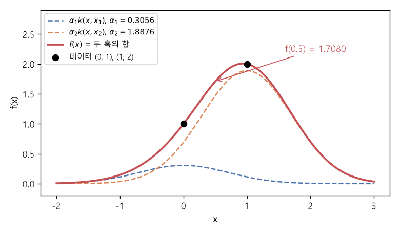

# 커널 보간과 RBF 커널 (Kernel interpolation, Squared exponential kernel)

[목차로 돌아가기](../../00_MIT%EB%94%A5%EB%9F%AC%EB%8B%9D_%EB%AA%A9%EC%B0%A8.md) · 먼저 볼 것: [M06_지수와_e](../../%EC%88%98%ED%95%99%EA%B0%9C%EB%85%90/01_%EC%88%98%EC%99%80_%ED%95%A8%EC%88%98/M06_%EC%A7%80%EC%88%98%EC%99%80_e.md), [M02_시그마와_평균](../../%EC%88%98%ED%95%99%EA%B0%9C%EB%85%90/01_%EC%88%98%EC%99%80_%ED%95%A8%EC%88%98/M02_%EC%8B%9C%EA%B7%B8%EB%A7%88%EC%99%80_%ED%8F%89%EA%B7%A0.md), [M05_벡터와_행렬](../../%EC%88%98%ED%95%99%EA%B0%9C%EB%85%90/03_%EC%84%A0%ED%98%95%EB%8C%80%EC%88%98/M05_%EB%B2%A1%ED%84%B0%EC%99%80_%ED%96%89%EB%A0%AC.md) · 쓰는 곳: [Lec13 3.2](../../Lec13_%ED%91%9C%ED%98%84_%ED%95%99%EC%8A%B5_%EC%9D%B4%EB%A1%A0.md#32-%EC%B2%AB%EC%A7%B8-%EB%B0%A9%EB%B2%95-%EC%BB%A4%EB%84%90-%EB%B0%A9%EB%B2%95), [Lec13 4.4](../../Lec13_%ED%91%9C%ED%98%84_%ED%95%99%EC%8A%B5_%EC%9D%B4%EB%A1%A0.md#44-%EA%B3%B5%EB%B6%84%EC%82%B0-%ED%95%A8%EC%88%98), [Lec13 5.4](../../Lec13_%ED%91%9C%ED%98%84_%ED%95%99%EC%8A%B5_%EC%9D%B4%EB%A1%A0.md#54-%EB%84%93%EC%9C%BC%EB%A9%B4-%EA%B3%BC%EC%A0%81%ED%95%A9%ED%95%98%EC%A7%80-%EC%95%8A%EB%82%98-%EC%99%9C-%EC%BB%A4%EB%84%90%EC%9D%84-%EC%93%B0%EC%A7%80-%EC%95%8A%EB%82%98)

📚 학습 순서 75/99 (10. 표현 학습): ← 이전: [MM46_정렬과_균일성](../../%EC%88%98%ED%95%99%EA%B0%9C%EB%85%90/10_%ED%91%9C%ED%98%84_%ED%95%99%EC%8A%B5/MM46_%EC%A0%95%EB%A0%AC%EA%B3%BC_%EA%B7%A0%EC%9D%BC%EC%84%B1.md) · 다음: [MM48_가우스_과정과_조건부_예측](../../%EC%88%98%ED%95%99%EA%B0%9C%EB%85%90/10_%ED%91%9C%ED%98%84_%ED%95%99%EC%8A%B5/MM48_%EA%B0%80%EC%9A%B0%EC%8A%A4_%EA%B3%BC%EC%A0%95%EA%B3%BC_%EC%A1%B0%EA%B1%B4%EB%B6%80_%EC%98%88%EC%B8%A1.md) →

> [!NOTE]
> **3줄 요약**
> - **[커널 방법](../../00_%EB%94%A5%EB%9F%AC%EB%8B%9D_%EC%9A%A9%EC%96%B4%EC%82%AC%EC%A0%84.md#kernel-method-%EC%BB%A4%EB%84%90-%EB%B0%A9%EB%B2%95)**은 데이터 점마다 혹 $k(x, x_i)$를 하나씩 놓고 높이 $\alpha_i$를 곱해 더한 $f(x) = \sum_i \alpha_i k(x, x_i)$로 데이터를 맞춘다.
> - 높이는 "모든 데이터 위에서 $f(x_j) = y_j$"라는 연립방정식 $K\boldsymbol{\alpha} = \mathbf{y}$를 풀어 구한다. 점 (0, 1), (1, 2)와 혹 $e^{-(x-x')^2}$이면 $\boldsymbol{\alpha} = (0.3056, 1.8876)$이고 $f(0.5) = 1.7080$.
> - **[제곱 지수 커널](../../00_%EB%94%A5%EB%9F%AC%EB%8B%9D_%EC%9A%A9%EC%96%B4%EC%82%AC%EC%A0%84.md#squared-exponential-kernel-%EC%A0%9C%EA%B3%B1-%EC%A7%80%EC%88%98-%EC%BB%A4%EB%84%90)**(RBF 커널)의 폭 $\ell$이 "가깝다"의 범위를 정한다. 거리 1에서 $\ell = 0.5$이면 0.1353, $\ell = 2$이면 0.8825. 풀이 비용은 데이터 수의 세제곱이다.

## 1. 개념 설명

비유: 모래판 위 몇 군데에 깃발이 꽂혀 있고(데이터), 깃발 높이에 맞춰 모래를 쌓아 언덕을 만든다. 깃발마다 같은 모양의 모래 더미(혹)를 하나씩 붓되, 더미마다 양을 조절해 언덕이 모든 깃발 끝에 딱 닿게 한다. 더미끼리 겹치는 곳은 모래가 더해지므로, 한 더미의 양을 정할 때 이웃 더미도 함께 고려해야 한다.

- **커널(혹)** $k(x, x')$: 두 입력이 가까우면 크고 멀면 0에 가까운 함수. 대표가 [제곱 지수 커널](../../00_%EB%94%A5%EB%9F%AC%EB%8B%9D_%EC%9A%A9%EC%96%B4%EC%82%AC%EC%A0%84.md#squared-exponential-kernel-%EC%A0%9C%EA%B3%B1-%EC%A7%80%EC%88%98-%EC%BB%A4%EB%84%90) $k(x, x') = e^{-(x - x')^2 / (2\ell^2)}$이다. 이 노트의 강의 예처럼 $2\ell^2 = 1$로 두면 $e^{-(x - x')^2}$이다.
- **[보간](../../00_%EB%94%A5%EB%9F%AC%EB%8B%9D_%EC%9A%A9%EC%96%B4%EC%82%AC%EC%A0%84.md#interpolation-%EB%B3%B4%EA%B0%84) 조건**: 데이터 $(x_j, y_j)$마다 $f(x_j) = \sum_i \alpha_i k(x_j, x_i) = y_j$. 이를 모으면 행렬식 $K\boldsymbol{\alpha} = \mathbf{y}$가 되고, $K_{ji} = k(x_j, x_i)$는 [커널 행렬](../../00_%EB%94%A5%EB%9F%AC%EB%8B%9D_%EC%9A%A9%EC%96%B4%EC%82%AC%EC%A0%84.md#kernel-matrix-%EC%BB%A4%EB%84%90-%ED%96%89%EB%A0%AC)이다.
- **풀이**: $\boldsymbol{\alpha} = K^{-1}\mathbf{y}$. 혹이 서로 멀리 떨어져 있으면 $K$가 단위 행렬에 가까워 $\alpha_i \approx y_i$이고, 가까이 겹치면 서로 몫을 나눠 갖는다.
- 혹을 무한히, 아무 데나 놓을 수 있게 넓힌 함수 공간이 **[재생 커널 힐베르트 공간](../../00_%EB%94%A5%EB%9F%AC%EB%8B%9D_%EC%9A%A9%EC%96%B4%EC%82%AC%EC%A0%84.md#reproducing-kernel-hilbert-space-rkhs-%EC%9E%AC%EC%83%9D-%EC%BB%A4%EB%84%90-%ED%9E%90%EB%B2%A0%EB%A5%B4%ED%8A%B8-%EA%B3%B5%EA%B0%84)**([RKHS](../../00_%EB%94%A5%EB%9F%AC%EB%8B%9D_%EC%9A%A9%EC%96%B4%EC%82%AC%EC%A0%84.md#reproducing-kernel-hilbert-space-rkhs-%EC%9E%AC%EC%83%9D-%EC%BB%A4%EB%84%90-%ED%9E%90%EB%B2%A0%EB%A5%B4%ED%8A%B8-%EA%B3%B5%EA%B0%84))이다. 그 안에서 데이터를 지나는 함수 중 "[노름](../../00_%EB%94%A5%EB%9F%AC%EB%8B%9D_%EC%9A%A9%EC%96%B4%EC%82%AC%EC%A0%84.md#norm-%EB%85%B8%EB%A6%84)이 가장 작은" 것이 바로 위의 $\sum_i \alpha_i k(x, x_i)$이다.

## 2. 필요한 이유

[Lec13 3.2](../../Lec13_%ED%91%9C%ED%98%84_%ED%95%99%EC%8A%B5_%EC%9D%B4%EB%A1%A0.md#32-%EC%B2%AB%EC%A7%B8-%EB%B0%A9%EB%B2%95-%EC%BB%A4%EB%84%90-%EB%B0%A9%EB%B2%95)에서 강사는 딥러닝 이전의 대표적 함수 공간으로 [커널 방법](../../00_%EB%94%A5%EB%9F%AC%EB%8B%9D_%EC%9A%A9%EC%96%B4%EC%82%AC%EC%A0%84.md#kernel-method-%EC%BB%A4%EB%84%90-%EB%B0%A9%EB%B2%95)을 소개하고, 이것이 [가우스 과정](../../00_%EB%94%A5%EB%9F%AC%EB%8B%9D_%EC%9A%A9%EC%96%B4%EC%82%AC%EC%A0%84.md#gaussian-process-%EA%B0%80%EC%9A%B0%EC%8A%A4-%EA%B3%BC%EC%A0%95)의 사후 평균과 같다고 말한다([MM48_가우스_과정과_조건부_예측](../../%EC%88%98%ED%95%99%EA%B0%9C%EB%85%90/10_%ED%91%9C%ED%98%84_%ED%95%99%EC%8A%B5/MM48_%EA%B0%80%EC%9A%B0%EC%8A%A4_%EA%B3%BC%EC%A0%95%EA%B3%BC_%EC%A1%B0%EA%B1%B4%EB%B6%80_%EC%98%88%EC%B8%A1.md)). [5.3](../../Lec13_%ED%91%9C%ED%98%84_%ED%95%99%EC%8A%B5_%EC%9D%B4%EB%A1%A0.md#53-%EB%8C%80%EC%9D%91-%EC%A0%95%EB%A6%AC)의 [신경망-가우스 과정 대응](../../00_%EB%94%A5%EB%9F%AC%EB%8B%9D_%EC%9A%A9%EC%96%B4%EC%82%AC%EC%A0%84.md#nngp-correspondence-%EC%8B%A0%EA%B2%BD%EB%A7%9D-%EA%B0%80%EC%9A%B0%EC%8A%A4-%EA%B3%BC%EC%A0%95-%EB%8C%80%EC%9D%91)에서는 아키텍처가 정하는 [공분산 함수](../../00_%EB%94%A5%EB%9F%AC%EB%8B%9D_%EC%9A%A9%EC%96%B4%EC%82%AC%EC%A0%84.md#covariance-function-%EA%B3%B5%EB%B6%84%EC%82%B0-%ED%95%A8%EC%88%98)가 곧 커널이다. [5.4](../../Lec13_%ED%91%9C%ED%98%84_%ED%95%99%EC%8A%B5_%EC%9D%B4%EB%A1%A0.md#54-%EB%84%93%EC%9C%BC%EB%A9%B4-%EA%B3%BC%EC%A0%81%ED%95%A9%ED%95%98%EC%A7%80-%EC%95%8A%EB%82%98-%EC%99%9C-%EC%BB%A4%EB%84%90%EC%9D%84-%EC%93%B0%EC%A7%80-%EC%95%8A%EB%82%98)는 신경망 대신 커널을 쓰지 않는 이유로 **세제곱 비용**을 든다. 그 비용은 $K\boldsymbol{\alpha} = \mathbf{y}$를 푸는 데서 나온다.

## 3. 숫자로 보기

데이터 두 개: $(x_1, y_1) = (0, 1)$, $(x_2, y_2) = (1, 2)$, 커널 $k(x, x') = e^{-(x - x')^2}$.

**[커널 행렬](../../00_%EB%94%A5%EB%9F%AC%EB%8B%9D_%EC%9A%A9%EC%96%B4%EC%82%AC%EC%A0%84.md#kernel-matrix-%EC%BB%A4%EB%84%90-%ED%96%89%EB%A0%AC)**
- $k(0, 0) = k(1, 1) = e^{0} = 1$
- $k(0, 1) = e^{-1} = 0.3679$
- $K = \begin{pmatrix}1 & 0.3679\\ 0.3679 & 1\end{pmatrix}$

**높이 구하기** (2×2 연립방정식)
- 행렬식: $1 \times 1 - 0.3679^2 = 1 - 0.1353 = 0.8647$
- $\alpha_1 = (1 \times 1 - 0.3679 \times 2) / 0.8647 = (1 - 0.7358) / 0.8647 = 0.2642 / 0.8647 = 0.3056$
- $\alpha_2 = (1 \times 2 - 0.3679 \times 1) / 0.8647 = 1.6321 / 0.8647 = 1.8876$

**사이의 값** $f(0.5)$
- 두 혹 모두 거리 0.5: $e^{-0.25} = 0.7788$
- $f(0.5) = 0.3056 \times 0.7788 + 1.8876 \times 0.7788 = 2.1932 \times 0.7788 = 1.7080$

**폭 $\ell$의 효과** (거리 1에서 $e^{-1/(2\ell^2)}$)

| $\ell$ | 거리 1에서 커널 값 | 뜻 |
|---|---|---|
| 0.5 | 0.1353 | 좁은 혹. 이웃끼리 거의 [독립](../../00_%EB%94%A5%EB%9F%AC%EB%8B%9D_%EC%9A%A9%EC%96%B4%EC%82%AC%EC%A0%84.md#independence-%EB%8F%85%EB%A6%BD) |
| 1 | 0.6065 | 중간 |
| 2 | 0.8825 | 넓은 혹. 멀리까지 비슷하다고 본다 |


*▲ 직접 그린 그림: 높이 $\alpha_1 = 0.3056$, $\alpha_2 = 1.8876$인 두 혹(점선)을 더하면 두 데이터 (0, 1), (1, 2)를 정확히 지나는 함수(빨강)가 된다. $f(0.5) = 1.7080$*

식으로 쓰면 다음과 같다.

$$
f(x) = \sum_{i=1}^{n} \alpha_i\, k(x, x_i), \qquad K\boldsymbol{\alpha} = \mathbf{y}\ \ (K_{ji} = k(x_j, x_i)), \qquad k(x, x') = e^{-(x - x')^2 / (2\ell^2)}
$$

<details><summary>기호 풀이</summary>

| 기호 | 읽는 법 | 뜻 | 예제 값 |
| --- | --- | --- | --- |
| $x_i, y_i$ | 엑스 아이, 와이 아이 | $i$번째 데이터의 입력과 목표값 | (0, 1), (1, 2) |
| $\alpha_i$ | 알파 아이 | $i$번째 혹의 높이 | 0.3056, 1.8876 |
| $k(x, x')$ | 케이 | 커널. 두 입력의 유사도 | $e^{-1} = 0.3679$ |
| $K$ | 케이 | [커널 행렬](../../00_%EB%94%A5%EB%9F%AC%EB%8B%9D_%EC%9A%A9%EC%96%B4%EC%82%AC%EC%A0%84.md#kernel-matrix-%EC%BB%A4%EB%84%90-%ED%96%89%EB%A0%AC). 데이터끼리의 커널 값 표 | $\begin{pmatrix}1&0.3679\\0.3679&1\end{pmatrix}$ |
| $\boldsymbol{\alpha}, \mathbf{y}$ | 알파, 와이 | 높이 벡터, 목표값 벡터 | (0.3056, 1.8876), (1, 2) |
| $\ell$ | 엘 | 혹의 폭 (길이 척도) | $2\ell^2 = 1$ |
| $f(x)$ | 에프 | 맞춘 함수 | $f(0.5) = 1.7080$ |

</details>

<details><summary>예제와 풀이</summary>

**문제**: 데이터가 하나, $x_1 = 0$에서 $y_1 = 3$이다. 커널 $e^{-(x - x')^2}$로 보간하면 $f(0.5)$와 $f(2)$는?

**주어진 값**
- $x_1 = 0$, $y_1 = 3$ (데이터 하나)
- $k(x, x') = e^{-(x - x')^2}$ (커널, $2\ell^2 = 1$)
- $n = 1$ (데이터 수)

**풀이**
1. 식을 그대로 쓴다: $K\boldsymbol{\alpha} = \mathbf{y}$, $f(x) = \sum_{i=1}^{n} \alpha_i k(x, x_i)$
2. 값을 대입한다: $k(0, 0)\,\alpha_1 = 3$, $f(x) = \sum_{i=1}^{1} \alpha_1\, e^{-(x - 0)^2}$
3. $k(0, 0)$을 계산한다: $e^{-(0-0)^2} = e^0 = 1$ (0제곱은 1)
4. 높이를 구한다: $1 \times \alpha_1 = 3$ 이므로 $\alpha_1 = 3$
5. Σ를 풀어 쓴다 (항이 하나): $f(x) = 3\, e^{-x^2}$
6. $x = 0.5$를 넣는다: 제곱 $0.5^2 = 0.25$, $e^{-0.25} = 0.7788$ ($e$는 약 2.718)
7. 곱한다: $3 \times 0.7788 = 2.3364$
8. $x = 2$를 넣는다: 제곱 $2^2 = 4$, $e^{-4} = 0.0183$
9. 곱한다: $3 \times 0.0183 = 0.0549$

**답**: $f(0.5) = $ **2.3364**, $f(2) = $ **0.0549**. 데이터에서 멀어지면 혹이 사라져 함수가 0으로 돌아간다.

</details>

<details><summary>내 이해</summary>


</details>

## 4. 코드로 확인

```python
# [함수] k(a, b): 제곱 지수 커널 e^-(a-b)^2. 넘파이 배열에도 칸별로 동작한다
# [연결] 본문 식의 k(x, x'), 2ℓ² = 1
k = lambda a, b: np.exp(-(a - b) ** 2)
# [변수] x, y: 데이터 입력 (0, 1)과 목표값 (1, 2). 본문 3절의 두 점
x, y = np.array([0.0, 1.0]), np.array([1.0, 2.0])
# [함수] x[:, None], x[None, :]: 세로·가로로 세워 모든 쌍의 커널 값을 한 번에 만든다
# [변수] K: 2×2 커널 행렬 [[1, 0.3679], [0.3679, 1]]
K = k(x[:, None], x[None, :])
# [함수] np.linalg.solve(K, y): K α = y를 푼다 (역행렬을 직접 구하지 않아 더 정확하다)
# [변수] alpha: 혹 높이 (0.3056, 1.8876)
# [쓸모] 이 높이로 아무 x에서나 f(x)를 계산할 수 있다
alpha = np.linalg.solve(K, y)
# [함수] alpha @ k(0.5, x): 높이와 커널 값을 칸끼리 곱해 더한다 = Σ α_i k(0.5, x_i)
# [변수] f05: 사이의 값 f(0.5)
f05 = alpha @ k(0.5, x)
# [연결] 본문 3절 → [[1. 0.3679] [0.3679 1.]]
print(K.round(4))
# [연결] 본문 3절 → [0.3056 1.8876] 1.708
print(alpha.round(4), round(f05, 4))
# [연결] 보간 확인: 데이터 위에서 f가 목표값 (1, 2)와 같아야 한다
print((K @ alpha).round(4))
# [연결] 본문 3절 표 → 폭 0.5, 1, 2에서 거리 1의 커널 값
print([round(np.exp(-1 / (2 * l * l)), 4) for l in [0.5, 1, 2]])
```

**실행 결과**:

```text
[[1.     0.3679]
 [0.3679 1.    ]]
[0.3056 1.8876] 1.708
[1. 2.]
[np.float64(0.1353), np.float64(0.6065), np.float64(0.8825)]
```

> [!WARNING]
> **⚠ 주의**
> - **비용**: $K\boldsymbol{\alpha} = \mathbf{y}$를 푸는 데 데이터 수 $n$의 세제곱 정도 연산이 든다. $n = 1000$이면 $10^9$, $n = 10$만이면 $10^{15}$이다. 신경망 [학습](../../00_%EB%94%A5%EB%9F%AC%EB%8B%9D_%EC%9A%A9%EC%96%B4%EC%82%AC%EC%A0%84.md#training-%ED%95%99%EC%8A%B5)은 데이터 수에 선형이라 큰 데이터에서 유리하다([Lec13 5.4](../../Lec13_%ED%91%9C%ED%98%84_%ED%95%99%EC%8A%B5_%EC%9D%B4%EB%A1%A0.md#54-%EB%84%93%EC%9C%BC%EB%A9%B4-%EA%B3%BC%EC%A0%81%ED%95%A9%ED%95%98%EC%A7%80-%EC%95%8A%EB%82%98-%EC%99%9C-%EC%BB%A4%EB%84%90%EC%9D%84-%EC%93%B0%EC%A7%80-%EC%95%8A%EB%82%98)).
> - **수치 불안정**: 두 데이터가 아주 가까우면 $K$의 두 행이 거의 같아져 풀이가 불안정하다(높이가 큰 양수와 큰 음수로 튄다). 실무에서는 대각에 작은 값을 더해 푼다.
> - 폭 $\ell$은 [하이퍼파라미터](../../00_%EB%94%A5%EB%9F%AC%EB%8B%9D_%EC%9A%A9%EC%96%B4%EC%82%AC%EC%A0%84.md#hyperparameter-%ED%95%98%EC%9D%B4%ED%8D%BC%ED%8C%8C%EB%9D%BC%EB%AF%B8%ED%84%B0)다. 너무 좁으면 데이터 사이에서 함수가 0으로 꺼지고, 너무 넓으면 $K$가 불안정해진다.

## 5. 개념 재확인

<details><summary>1. 데이터 (0, 1), (2, 1)을 커널 $e^{-(x-x')^2}$로 보간하면 높이와 $f(1)$은?</summary>

| 단계 | 하는 일 | 계산 | 결과 |
|---|---|---|---|
| 1 | 거리 2인 커널 값 | $e^{-4}$ | 0.0183 |
| 2 | 높이 (대칭이라 같다) | $1 / (1 + 0.0183)$ | 0.9820 |
| 3 | $x = 1$에서 커널 값 | $e^{-1}$ | 0.3679 |
| 4 | $f(1)$ | $2 \times 0.9820 \times 0.3679$ | 0.7225 |

**① 쓰는 식**
$$K\boldsymbol{\alpha} = \mathbf{y}, \qquad f(x) = \sum_{i=1}^{2} \alpha_i\, e^{-(x - x_i)^2}$$
- 위 식 ← ② ([커널 행렬](../../00_%EB%94%A5%EB%9F%AC%EB%8B%9D_%EC%9A%A9%EC%96%B4%EC%82%AC%EC%A0%84.md#kernel-matrix-%EC%BB%A4%EB%84%90-%ED%96%89%EB%A0%AC)), ③ (높이), ④ ($f(1)$)에서 쓴다.
```python
# [변수] x, y: 데이터 입력 (0, 2)와 목표값 (1, 1)
x, y = np.array([0.0, 2.0]), np.array([1.0, 1.0])                # ①
# [변수] K: 커널 행렬, 비대각 e^-4 = 0.0183
K = np.exp(-(x[:, None] - x[None, :]) ** 2)                      # ②
# [변수] a: 높이 (0.982, 0.982)
a = np.linalg.solve(K, y)                                        # ③
# [연결] 0.0183 [0.982 0.982] 0.7225
print(round(K[0, 1], 4), a.round(4), round(a @ np.exp(-(1 - x) ** 2), 4))   # ④
```

**주어진 값**
- $x_1 = 0$, $y_1 = 1$; $x_2 = 2$, $y_2 = 1$ (데이터 두 개)
- 커널 $e^{-(x - x')^2}$
- $x = 1$ (가운데 점)

**풀이**
1. 식을 그대로 쓴다: $K\boldsymbol{\alpha} = \mathbf{y}$, $f(x) = \sum_{i=1}^{2} \alpha_i e^{-(x - x_i)^2}$
2. 값을 대입한다: $\begin{pmatrix}e^{-(0-0)^2} & e^{-(0-2)^2}\\ e^{-(2-0)^2} & e^{-(2-2)^2}\end{pmatrix}\begin{pmatrix}\alpha_1\\ \alpha_2\end{pmatrix} = \begin{pmatrix}1\\ 1\end{pmatrix}$
3. (②) 대각 칸을 계산한다: $e^0 = 1$
4. (②) 비대각 칸을 계산한다: $(0 - 2)^2 = 4$, $e^{-4} = 0.0183$
5. (③) 두 식이 대칭이라 $\alpha_1 = \alpha_2 = a$로 둔다: $1 \times a + 0.0183 \times a = 1$
6. (③) 묶는다: $(1 + 0.0183)\,a = 1.0183\,a = 1$
7. (③) 나눈다: $a = 1 / 1.0183 = 0.9820$
8. (④) Σ를 풀어 쓴다: $f(1) = 0.9820\, e^{-(1-0)^2} + 0.9820\, e^{-(1-2)^2}$
9. (④) 괄호를 계산한다: $(1 - 0)^2 = 1$, $(1 - 2)^2 = 1$ → 두 항 모두 $e^{-1} = 0.3679$
10. (④) 곱한다: $0.9820 \times 0.3679 = 0.3613$
11. (④) 더한다: $0.3613 + 0.3613 = 0.7225$ (반올림 전 값으로 더함)

**답**: 높이 **0.9820**씩, $f(1) = $ **0.7225**. 두 데이터 모두 1인데 가운데가 0.72로 꺼진다. 혹 사이가 넓어 데이터 사이를 채우지 못하기 때문이다.

</details>

<details><summary>2. 커널 $e^{-(x - x')^2/(2\ell^2)}$에서 거리 1의 값이 0.5가 되는 폭 $\ell$은?</summary>

| 단계 | 하는 일 | 계산 | 결과 |
|---|---|---|---|
| 1 | 식 세우기 | $e^{-1/(2\ell^2)} = 0.5$ | |
| 2 | 양변에 ln | $-1/(2\ell^2) = \ln 0.5$ | $-0.6931$ |
| 3 | $2\ell^2$ 구하기 | $1 / 0.6931$ | 1.4427 |
| 4 | $\ell$ | $\sqrt{1.4427 / 2}$ | 0.8493 |

**① 쓰는 식**
$$k(x, x') = e^{-(x - x')^2 / (2\ell^2)}$$
- 위 식 ← ② ([로그](../../00_%EB%94%A5%EB%9F%AC%EB%8B%9D_%EC%9A%A9%EC%96%B4%EC%82%AC%EC%A0%84.md#log-ln-%EB%A1%9C%EA%B7%B8)), ③ ($2\ell^2$), ④ ($\ell$, 확인)에서 쓴다.
```python
# [함수] np.log(0.5): 자연로그 ln 0.5 = -0.6931
L = np.log(0.5)                                                  # ①②
# [변수] two_l2: 2ℓ² = -1 / ln 0.5 = 1.4427
two_l2 = -1 / L                                                  # ③
# [변수] l: 폭 ℓ = 0.8493
l = np.sqrt(two_l2 / 2)                                          # ④
# [연결] -0.6931 1.4427 0.8493 0.5
print(round(L, 4), round(two_l2, 4), round(l, 4), round(np.exp(-1 / (2 * l * l)), 4))
```

**주어진 값**
- 거리 $x - x' = 1$
- 원하는 커널 값 $0.5$

**풀이**
1. 식을 그대로 쓴다: $k(x, x') = e^{-(x - x')^2 / (2\ell^2)}$
2. 값을 대입한다: $0.5 = e^{-1^2 / (2\ell^2)}$
3. 제곱한다: $1^2 = 1$ 이므로 $0.5 = e^{-1/(2\ell^2)}$
4. (②) 양변에 $\ln$을 씌운다. $\ln$은 "$e$를 몇 제곱해야 그 수가 되나"이고 $\ln e^a = a$: $\ln 0.5 = -1/(2\ell^2)$
5. (②) $\ln 0.5$를 계산한다: $-0.6931$
6. (③) 부호를 맞춰 뒤집는다: $2\ell^2 = 1 / 0.6931 = 1.4427$
7. (④) 2로 나눈다: $\ell^2 = 1.4427 / 2 = 0.7213$
8. (④) 제곱근을 구한다: $\ell = \sqrt{0.7213} = 0.8493$

**답**: $\ell = $ **0.8493**. 폭이 이보다 크면 거리 1 떨어진 두 점을 "반 이상 비슷하다"고 본다.

</details>

## 예제 풀기

[예제 10문제 풀기](../../%EC%98%88%EC%A0%9C/10_%ED%91%9C%ED%98%84_%ED%95%99%EC%8A%B5/%EC%98%88%EC%A0%9C_MM47_%EC%BB%A4%EB%84%90_%EB%B3%B4%EA%B0%84.md)

<details><summary>내 이해</summary>


</details>
