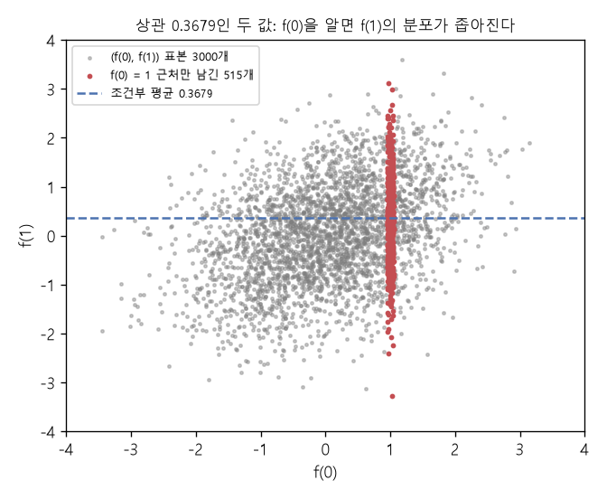

# 가우스 과정과 조건부 예측 (Gaussian process, Multivariate normal conditioning)

[목차로 돌아가기](../../00_MIT%EB%94%A5%EB%9F%AC%EB%8B%9D_%EB%AA%A9%EC%B0%A8.md) · 먼저 볼 것: [MM50_확률_밀도와_정규분포](../../%EC%88%98%ED%95%99%EA%B0%9C%EB%85%90/04_%ED%99%95%EB%A5%A0%EA%B3%BC_%EC%A0%95%EB%B3%B4/MM50_%ED%99%95%EB%A5%A0_%EB%B0%80%EB%8F%84%EC%99%80_%EC%A0%95%EA%B7%9C%EB%B6%84%ED%8F%AC.md), [MM58_조건부_확률과_독립](../../%EC%88%98%ED%95%99%EA%B0%9C%EB%85%90/04_%ED%99%95%EB%A5%A0%EA%B3%BC_%EC%A0%95%EB%B3%B4/MM58_%EC%A1%B0%EA%B1%B4%EB%B6%80_%ED%99%95%EB%A5%A0%EA%B3%BC_%EB%8F%85%EB%A6%BD.md), [MM40_PCA와_선형_오토인코더](../../%EC%88%98%ED%95%99%EA%B0%9C%EB%85%90/10_%ED%91%9C%ED%98%84_%ED%95%99%EC%8A%B5/MM40_PCA%EC%99%80_%EC%84%A0%ED%98%95_%EC%98%A4%ED%86%A0%EC%9D%B8%EC%BD%94%EB%8D%94.md), [MM47_커널_보간](../../%EC%88%98%ED%95%99%EA%B0%9C%EB%85%90/10_%ED%91%9C%ED%98%84_%ED%95%99%EC%8A%B5/MM47_%EC%BB%A4%EB%84%90_%EB%B3%B4%EA%B0%84.md), [MM87_역행렬과_연립일차방정식](../../%EC%88%98%ED%95%99%EA%B0%9C%EB%85%90/03_%EC%84%A0%ED%98%95%EB%8C%80%EC%88%98/MM87_%EC%97%AD%ED%96%89%EB%A0%AC%EA%B3%BC_%EC%97%B0%EB%A6%BD%EC%9D%BC%EC%B0%A8%EB%B0%A9%EC%A0%95%EC%8B%9D.md) · 쓰는 곳: [Lec13 4.2](../../Lec13_%ED%91%9C%ED%98%84_%ED%95%99%EC%8A%B5_%EC%9D%B4%EB%A1%A0.md#42-%EB%AC%B4%EC%9E%91%EC%9C%84-%EB%B2%A1%ED%84%B0%EB%A1%9C-%EB%B3%B4%EB%8A%94-%EA%B0%80%EC%9A%B0%EC%8A%A4-%EA%B3%BC%EC%A0%95), [Lec13 4.3](../../Lec13_%ED%91%9C%ED%98%84_%ED%95%99%EC%8A%B5_%EC%9D%B4%EB%A1%A0.md#43-%EC%A0%95%EC%8B%9D-%EC%A0%95%EC%9D%98), [Lec13 4.5](../../Lec13_%ED%91%9C%ED%98%84_%ED%95%99%EC%8A%B5_%EC%9D%B4%EB%A1%A0.md#45-%EB%8D%B0%EC%9D%B4%ED%84%B0%EB%A1%9C-%EC%A1%B0%EA%B1%B4-%EA%B1%B8%EA%B8%B0-%EC%98%88%EC%B8%A1)

📚 학습 순서 76/99 (10. 표현 학습): ← 이전: [MM47_커널_보간](../../%EC%88%98%ED%95%99%EA%B0%9C%EB%85%90/10_%ED%91%9C%ED%98%84_%ED%95%99%EC%8A%B5/MM47_%EC%BB%A4%EB%84%90_%EB%B3%B4%EA%B0%84.md) · 다음: [MM49_중심극한정리와_아크코사인_커널](../../%EC%88%98%ED%95%99%EA%B0%9C%EB%85%90/10_%ED%91%9C%ED%98%84_%ED%95%99%EC%8A%B5/MM49_%EC%A4%91%EC%8B%AC%EA%B7%B9%ED%95%9C%EC%A0%95%EB%A6%AC%EC%99%80_%EC%95%84%ED%81%AC%EC%BD%94%EC%82%AC%EC%9D%B8_%EC%BB%A4%EB%84%90.md) →

> [!NOTE]
> **3줄 요약**
> - **[가우스 과정](../../00_%EB%94%A5%EB%9F%AC%EB%8B%9D_%EC%9A%A9%EC%96%B4%EC%82%AC%EC%A0%84.md#gaussian-process-%EA%B0%80%EC%9A%B0%EC%8A%A4-%EA%B3%BC%EC%A0%95)**은 아무 유한 개 입력 $x_1, \dots, x_n$에서 뽑은 값 $(f(x_1), \dots, f(x_n))$이 늘 [다변량 정규분포](../../00_%EB%94%A5%EB%9F%AC%EB%8B%9D_%EC%9A%A9%EC%96%B4%EC%82%AC%EC%A0%84.md#multivariate-normal-distribution-%EB%8B%A4%EB%B3%80%EB%9F%89-%EC%A0%95%EA%B7%9C%EB%B6%84%ED%8F%AC) $\mathcal{N}(\mathbf{0}, K)$를 따르는 무작위 함수다. $K_{ij} = \Sigma(x_i, x_j)$는 [공분산 함수](../../00_%EB%94%A5%EB%9F%AC%EB%8B%9D_%EC%9A%A9%EC%96%B4%EC%82%AC%EC%A0%84.md#covariance-function-%EA%B3%B5%EB%B6%84%EC%82%B0-%ED%95%A8%EC%88%98)가 정한다.
> - 정규 벡터의 일부를 알면 나머지의 조건부 분포도 정규다. 상관이 $\rho$인 두 표준 정규 값에서 첫째가 $a$이면 둘째는 $\mathcal{N}(\rho a,\ 1 - \rho^2)$. 일반식은 $\mu = \mathbf{k}_*^\top K^{-1}\mathbf{f}$, $\sigma^2 = \Sigma(x_*, x_*) - \mathbf{k}_*^\top K^{-1}\mathbf{k}_*$.
> - 데이터 (0, 1), (1, 2)에서 $x_* = 0.5$를 예측하면 평균 1.7080(커널 [보간](../../00_%EB%94%A5%EB%9F%AC%EB%8B%9D_%EC%9A%A9%EC%96%B4%EC%82%AC%EC%A0%84.md#interpolation-%EB%B3%B4%EA%B0%84)과 같은 값), 표준편차 0.3364이다.

## 1. 개념 설명

비유: 키와 몸무게처럼 함께 움직이는 두 값이 있다. 아무것도 모르면 몸무게는 넓게 퍼져 있지만, 키를 알려 주면 몸무게의 예상 범위가 좁아지고 평균도 키 쪽으로 옮겨 간다. [가우스 과정](../../00_%EB%94%A5%EB%9F%AC%EB%8B%9D_%EC%9A%A9%EC%96%B4%EC%82%AC%EC%A0%84.md#gaussian-process-%EA%B0%80%EC%9A%B0%EC%8A%A4-%EA%B3%BC%EC%A0%95)은 "$x$축의 모든 자리마다 값이 하나씩 있고, 가까운 자리끼리 키와 몸무게처럼 함께 움직이는" 무작위 함수다. 몇 자리의 값(데이터)을 알려 주면, 다른 자리의 값도 그만큼 좁혀진다.

- **[다변량 정규분포](../../00_%EB%94%A5%EB%9F%AC%EB%8B%9D_%EC%9A%A9%EC%96%B4%EC%82%AC%EC%A0%84.md#multivariate-normal-distribution-%EB%8B%A4%EB%B3%80%EB%9F%89-%EC%A0%95%EA%B7%9C%EB%B6%84%ED%8F%AC)** $\mathcal{N}(\mathbf{0}, K)$: 평균 0, [공분산 행렬](../../00_%EB%94%A5%EB%9F%AC%EB%8B%9D_%EC%9A%A9%EC%96%B4%EC%82%AC%EC%A0%84.md#covariance-matrix-%EA%B3%B5%EB%B6%84%EC%82%B0-%ED%96%89%EB%A0%AC) $K$인 정규 벡터. 대각 $K_{ii}$는 각 값의 [분산](../../00_%EB%94%A5%EB%9F%AC%EB%8B%9D_%EC%9A%A9%EC%96%B4%EC%82%AC%EC%A0%84.md#variance-%EB%B6%84%EC%82%B0), 비대각 $K_{ij}$는 두 값이 함께 움직이는 정도다. [분산](../../00_%EB%94%A5%EB%9F%AC%EB%8B%9D_%EC%9A%A9%EC%96%B4%EC%82%AC%EC%A0%84.md#variance-%EB%B6%84%EC%82%B0)이 1이면 $K_{ij}$가 곧 상관계수다.
- **[가우스 과정](../../00_%EB%94%A5%EB%9F%AC%EB%8B%9D_%EC%9A%A9%EC%96%B4%EC%82%AC%EC%A0%84.md#gaussian-process-%EA%B0%80%EC%9A%B0%EC%8A%A4-%EA%B3%BC%EC%A0%95)**: [공분산 행렬](../../00_%EB%94%A5%EB%9F%AC%EB%8B%9D_%EC%9A%A9%EC%96%B4%EC%82%AC%EC%A0%84.md#covariance-matrix-%EA%B3%B5%EB%B6%84%EC%82%B0-%ED%96%89%EB%A0%AC) 대신 공분산 **함수** $\Sigma(x, x')$를 준다. 어떤 입력을 고르든 그 입력들에서의 [공분산 행렬](../../00_%EB%94%A5%EB%9F%AC%EB%8B%9D_%EC%9A%A9%EC%96%B4%EC%82%AC%EC%A0%84.md#covariance-matrix-%EA%B3%B5%EB%B6%84%EC%82%B0-%ED%96%89%EB%A0%AC)을 $\Sigma$로 만들 수 있다.
- **조건부 분포**: 정규 벡터를 (아는 부분, 모르는 부분)으로 나누면, 아는 부분이 주어졌을 때 모르는 부분도 [정규분포](../../00_%EB%94%A5%EB%9F%AC%EB%8B%9D_%EC%9A%A9%EC%96%B4%EC%82%AC%EC%A0%84.md#normal-distribution-%EC%A0%95%EA%B7%9C%EB%B6%84%ED%8F%AC)이고 평균과 [분산](../../00_%EB%94%A5%EB%9F%AC%EB%8B%9D_%EC%9A%A9%EC%96%B4%EC%82%AC%EC%A0%84.md#variance-%EB%B6%84%EC%82%B0)이 닫힌 식으로 나온다. 강의가 말한 "데이터와 안 맞는 함수는 버리고 맞는 것만 남긴다"를 정확히 계산한 결과가 이것이다(아래 그림).
- **커널 보간과의 관계**: 조건부 평균 $\mathbf{k}_*^\top K^{-1}\mathbf{f}$에서 $K^{-1}\mathbf{f}$가 바로 [커널 보간](../../%EC%88%98%ED%95%99%EA%B0%9C%EB%85%90/10_%ED%91%9C%ED%98%84_%ED%95%99%EC%8A%B5/MM47_%EC%BB%A4%EB%84%90_%EB%B3%B4%EA%B0%84.md)의 높이 $\boldsymbol{\alpha}$다. 그래서 [가우스 과정](../../00_%EB%94%A5%EB%9F%AC%EB%8B%9D_%EC%9A%A9%EC%96%B4%EC%82%AC%EC%A0%84.md#gaussian-process-%EA%B0%80%EC%9A%B0%EC%8A%A4-%EA%B3%BC%EC%A0%95)의 사후 평균은 커널 [보간](../../00_%EB%94%A5%EB%9F%AC%EB%8B%9D_%EC%9A%A9%EC%96%B4%EC%82%AC%EC%A0%84.md#interpolation-%EB%B3%B4%EA%B0%84) 함수와 같다.

## 2. 필요한 이유

[Lec13 4.5](../../Lec13_%ED%91%9C%ED%98%84_%ED%95%99%EC%8A%B5_%EC%9D%B4%EB%A1%A0.md#45-%EB%8D%B0%EC%9D%B4%ED%84%B0%EB%A1%9C-%EC%A1%B0%EA%B1%B4-%EA%B1%B8%EA%B8%B0-%EC%98%88%EC%B8%A1)에서 강사는 [가우스 과정](../../00_%EB%94%A5%EB%9F%AC%EB%8B%9D_%EC%9A%A9%EC%96%B4%EC%82%AC%EC%A0%84.md#gaussian-process-%EA%B0%80%EC%9A%B0%EC%8A%A4-%EA%B3%BC%EC%A0%95)의 예측이 "아는 값과 모르는 값을 한 정규 벡터로 쌓고 조건부 분포를 구하는 것"이라고 설명하고 공식은 찾아보라고 한다. 이 노트가 그 공식이다. [5.3](../../Lec13_%ED%91%9C%ED%98%84_%ED%95%99%EC%8A%B5_%EC%9D%B4%EB%A1%A0.md#53-%EB%8C%80%EC%9D%91-%EC%A0%95%EB%A6%AC)의 [신경망-가우스 과정 대응](../../00_%EB%94%A5%EB%9F%AC%EB%8B%9D_%EC%9A%A9%EC%96%B4%EC%82%AC%EC%A0%84.md#nngp-correspondence-%EC%8B%A0%EA%B2%BD%EB%A7%9D-%EA%B0%80%EC%9A%B0%EC%8A%A4-%EA%B3%BC%EC%A0%95-%EB%8C%80%EC%9D%91)을 이해하려면 "유한 개 출력이 정규 벡터"라는 정의를 알아야 한다.

## 3. 숫자로 보기

**두 값의 조건부 분포** (공분산 $e^{-(x - x')^2}$, 입력 0과 1)
- 상관: $\rho = e^{-1} = 0.3679$
- $f(0) = 1$을 알면 $f(1)$의 평균: $\rho \times 1 = 0.3679$
- [분산](../../00_%EB%94%A5%EB%9F%AC%EB%8B%9D_%EC%9A%A9%EC%96%B4%EC%82%AC%EC%A0%84.md#variance-%EB%B6%84%EC%82%B0): $1 - \rho^2 = 1 - 0.1353 = 0.8647$, 표준편차 $\sqrt{0.8647} = 0.9299$
- 모를 때([분산](../../00_%EB%94%A5%EB%9F%AC%EB%8B%9D_%EC%9A%A9%EC%96%B4%EC%82%AC%EC%A0%84.md#variance-%EB%B6%84%EC%82%B0) 1)보다 조금 좁아졌다. 상관이 작아서 많이 좁아지지는 않는다.

**데이터 두 개로 사이 예측** (데이터 (0, 1), (1, 2), 예측 $x_* = 0.5$)
- $K = \begin{pmatrix}1 & 0.3679\\ 0.3679 & 1\end{pmatrix}$, $\mathbf{k}_* = (e^{-0.25}, e^{-0.25}) = (0.7788, 0.7788)$
- $K^{-1}\mathbf{f} = (0.3056, 1.8876)$ ([MM47_커널_보간](../../%EC%88%98%ED%95%99%EA%B0%9C%EB%85%90/10_%ED%91%9C%ED%98%84_%ED%95%99%EC%8A%B5/MM47_%EC%BB%A4%EB%84%90_%EB%B3%B4%EA%B0%84.md)의 높이)
- 평균: $0.7788 \times 0.3056 + 0.7788 \times 1.8876 = 1.7080$
- $K^{-1}\mathbf{k}_* = (0.5693, 0.5693)$ (대칭이라 같고, $0.7788 / (1 + 0.3679) = 0.5693$)
- $\mathbf{k}_*^\top K^{-1}\mathbf{k}_* = 0.7788 \times 0.5693 + 0.7788 \times 0.5693 = 0.4434 + 0.4434 = 0.8868$
- [분산](../../00_%EB%94%A5%EB%9F%AC%EB%8B%9D_%EC%9A%A9%EC%96%B4%EC%82%AC%EC%A0%84.md#variance-%EB%B6%84%EC%82%B0): $1 - 0.8868 = 0.1132$, 표준편차 $\sqrt{0.1132} = 0.3364$

| 상황 | 평균 | 표준편차 |
|---|---|---|
| 데이터 없음 | 0 | 1 |
| 데이터 (0, 1)만, $x_* = 1$ | 0.3679 | 0.9299 |
| 데이터 (0, 1), (1, 2), $x_* = 0.5$ | 1.7080 | 0.3364 |


*▲ 직접 그린 그림: 상관 0.3679인 $(f(0), f(1))$ 표본. $f(0)$이 1 근처인 표본(빨강)만 남기면 $f(1)$이 조건부 평균 0.3679 둘레에 모인다. "맞지 않는 함수는 버린다"를 표본으로 한 것*

식으로 쓰면 다음과 같다.

$$
\begin{pmatrix}\mathbf{f}\\ f(x_*)\end{pmatrix} \sim \mathcal{N}\!\left(\mathbf{0},\ \begin{pmatrix}K & \mathbf{k}_*\\ \mathbf{k}_*^\top & \Sigma(x_*, x_*)\end{pmatrix}\right) \ \Rightarrow\ f(x_*) \mid \mathbf{f} \sim \mathcal{N}\!\Big(\mathbf{k}_*^\top K^{-1}\mathbf{f},\ \ \Sigma(x_*, x_*) - \mathbf{k}_*^\top K^{-1}\mathbf{k}_*\Big)
$$

<details><summary>기호 풀이</summary>

| 기호 | 읽는 법 | 뜻 | 예제 값 |
| --- | --- | --- | --- |
| $\mathbf{f}$ | 에프 (굵은) | 데이터 위 함수 값들 | (1, 2) |
| $f(x_*)$ | 에프 엑스 스타 | 예측할 값 | |
| $K$ | 케이 | 데이터끼리의 [공분산 행렬](../../00_%EB%94%A5%EB%9F%AC%EB%8B%9D_%EC%9A%A9%EC%96%B4%EC%82%AC%EC%A0%84.md#covariance-matrix-%EA%B3%B5%EB%B6%84%EC%82%B0-%ED%96%89%EB%A0%AC) | $\begin{pmatrix}1&0.3679\\0.3679&1\end{pmatrix}$ |
| $\mathbf{k}_*$ | 케이 스타 | 새 입력과 데이터들 사이 공분산 | (0.7788, 0.7788) |
| $\Sigma(x_*, x_*)$ | 시그마 | 새 입력 자신의 [분산](../../00_%EB%94%A5%EB%9F%AC%EB%8B%9D_%EC%9A%A9%EC%96%B4%EC%82%AC%EC%A0%84.md#variance-%EB%B6%84%EC%82%B0) | 1 |
| $\mid$ | 바, 조건 | "오른쪽을 알 때" | |
| $K^{-1}$ | 케이 역행렬 | $K$의 역행렬 | |
| $\mathbf{k}_*^\top K^{-1}\mathbf{f}$ | 조건부 평균 | 예측값 | 1.7080 |
| $\Sigma(x_*, x_*) - \mathbf{k}_*^\top K^{-1}\mathbf{k}_*$ | 조건부 [분산](../../00_%EB%94%A5%EB%9F%AC%EB%8B%9D_%EC%9A%A9%EC%96%B4%EC%82%AC%EC%A0%84.md#variance-%EB%B6%84%EC%82%B0) | 남은 불확실성 | 0.1132 |

</details>

<details><summary>예제와 풀이</summary>

**문제**: [공분산 함수](../../00_%EB%94%A5%EB%9F%AC%EB%8B%9D_%EC%9A%A9%EC%96%B4%EC%82%AC%EC%A0%84.md#covariance-function-%EA%B3%B5%EB%B6%84%EC%82%B0-%ED%95%A8%EC%88%98) $e^{-(x - x')^2}$인 [가우스 과정](../../00_%EB%94%A5%EB%9F%AC%EB%8B%9D_%EC%9A%A9%EC%96%B4%EC%82%AC%EC%A0%84.md#gaussian-process-%EA%B0%80%EC%9A%B0%EC%8A%A4-%EA%B3%BC%EC%A0%95)에서 데이터가 $x_1 = 0$에서 $f(0) = 1$ 하나다. $x_* = 0.5$에서 예측 평균과 표준편차는?

**주어진 값**
- $x_1 = 0$, $\mathbf{f} = (1)$ (데이터 하나)
- $x_* = 0.5$ (예측할 입력)
- $\Sigma(x, x') = e^{-(x - x')^2}$ ([공분산 함수](../../00_%EB%94%A5%EB%9F%AC%EB%8B%9D_%EC%9A%A9%EC%96%B4%EC%82%AC%EC%A0%84.md#covariance-function-%EA%B3%B5%EB%B6%84%EC%82%B0-%ED%95%A8%EC%88%98))

**풀이**
1. 식을 그대로 쓴다: 평균 $\mathbf{k}_*^\top K^{-1}\mathbf{f}$, [분산](../../00_%EB%94%A5%EB%9F%AC%EB%8B%9D_%EC%9A%A9%EC%96%B4%EC%82%AC%EC%A0%84.md#variance-%EB%B6%84%EC%82%B0) $\Sigma(x_*, x_*) - \mathbf{k}_*^\top K^{-1}\mathbf{k}_*$
2. 값을 대입한다: 평균 $\Sigma(0.5, 0)\, \Sigma(0, 0)^{-1}\, 1$, [분산](../../00_%EB%94%A5%EB%9F%AC%EB%8B%9D_%EC%9A%A9%EC%96%B4%EC%82%AC%EC%A0%84.md#variance-%EB%B6%84%EC%82%B0) $\Sigma(0.5, 0.5) - \Sigma(0.5, 0)\, \Sigma(0, 0)^{-1}\, \Sigma(0.5, 0)$
3. $K$를 계산한다: $\Sigma(0, 0) = e^{0} = 1$, 역수 $1$
4. $\mathbf{k}_*$를 계산한다: $(0.5 - 0)^2 = 0.25$, $e^{-0.25} = 0.7788$ ($e$는 약 2.718)
5. 평균을 곱한다: $0.7788 \times 1 \times 1 = 0.7788$
6. [분산](../../00_%EB%94%A5%EB%9F%AC%EB%8B%9D_%EC%9A%A9%EC%96%B4%EC%82%AC%EC%A0%84.md#variance-%EB%B6%84%EC%82%B0)의 곱 부분: $0.7788 \times 1 \times 0.7788 = 0.6065$
7. 뺀다: $\Sigma(0.5, 0.5) = 1$ 이므로 $1 - 0.6065 = 0.3935$
8. 제곱근을 구한다($\sqrt{a}$는 제곱해서 $a$가 되는 양수): $\sqrt{0.3935} = 0.6273$

**답**: 평균 **0.7788**, 표준편차 **0.6273**. 데이터에 가까울수록 평균은 데이터 값 쪽으로, 표준편차는 0 쪽으로 간다($x_* = 1$일 때의 0.3679, 0.9299와 비교).

</details>

<details><summary>내 이해</summary>


</details>

## 4. 코드로 확인

```python
# [함수] S(a, b): 공분산 함수 e^-(a-b)^2
# [연결] 본문 식의 Σ(x, x')
S = lambda a, b: np.exp(-(a - b) ** 2)
# [변수] x, f: 데이터 입력 (0, 1)과 값 (1, 2). 본문 3절
x, f = np.array([0.0, 1.0]), np.array([1.0, 2.0])
# [변수] K: 데이터끼리 공분산 2×2, ks: 새 입력 0.5와의 공분산 (0.7788, 0.7788)
K, ks = S(x[:, None], x[None, :]), S(0.5, x)
# [함수] np.linalg.solve(K, f): K⁻¹f. 커널 보간의 높이 α와 같다
# [변수] mu: 조건부 평균 = ks · K⁻¹f
# [연결] MM47의 f(0.5) = 1.7080과 같아야 한다
mu = ks @ np.linalg.solve(K, f)
# [변수] var: 조건부 분산 = 1 - ks · K⁻¹ks
var = 1 - ks @ np.linalg.solve(K, ks)
# [연결] 본문 3절 표 → 1.708 0.1132 0.3364
print(round(mu, 4), round(var, 4), round(np.sqrt(var), 4))
# [함수] default_rng(0).multivariate_normal: 상관 e^-1인 (f(0), f(1)) 표본 40만 개
# [변수] smp: 표본, keep: f(0)이 1 근처(±0.02)인 표본만 고른 표시
# [쓸모] "맞지 않는 함수는 버린다"를 직접 해서 공식과 비교한다
smp = np.random.default_rng(0).multivariate_normal([0, 0], [[1, np.exp(-1)], [np.exp(-1), 1]], 400000)
keep = np.abs(smp[:, 0] - 1) < 0.02
# [연결] 남긴 표본의 f(1) 평균·표준편차 → 공식 0.3679, 0.9299 근처
print(keep.sum(), round(smp[keep, 1].mean(), 2), round(smp[keep, 1].std(), 2))
```

**실행 결과**:

```text
1.708 0.1132 0.3364
3886 0.38 0.94
```

> [!WARNING]
> **⚠ 주의**
> - 남긴 표본으로 구한 평균 0.38은 공식 0.3679와 조금 다르다. 표본 수가 유한하고 "1 근처"를 ±0.02 폭으로 잡았기 때문이다. 공식이 정확한 값이다.
> - "가우스"는 종 모양 곡선 하나가 아니라 **입력을 정했을 때의 값 벡터**가 [정규분포](../../00_%EB%94%A5%EB%9F%AC%EB%8B%9D_%EC%9A%A9%EC%96%B4%EC%82%AC%EC%A0%84.md#normal-distribution-%EC%A0%95%EA%B7%9C%EB%B6%84%ED%8F%AC)라는 뜻이다. 함수 자체는 매우 들쭉날쭉할 수 있다.
> - $K^{-1}$을 직접 구하지 말고 연립방정식을 푼다(`solve`). 데이터가 $n$개면 비용이 $n^3$에 비례한다([MM47_커널_보간](../../%EC%88%98%ED%95%99%EA%B0%9C%EB%85%90/10_%ED%91%9C%ED%98%84_%ED%95%99%EC%8A%B5/MM47_%EC%BB%A4%EB%84%90_%EB%B3%B4%EA%B0%84.md)).
> - 실제 데이터에는 잡음이 있으므로 $K$ 대각에 잡음 [분산](../../00_%EB%94%A5%EB%9F%AC%EB%8B%9D_%EC%9A%A9%EC%96%B4%EC%82%AC%EC%A0%84.md#variance-%EB%B6%84%EC%82%B0)을 더한다. 그러면 평균이 데이터를 정확히 지나지 않는다.

## 5. 개념 재확인

<details><summary>1. 상관 0.8인 두 표준 정규 값에서 첫째가 2이다. 둘째의 조건부 평균과 표준편차는?</summary>

| 단계 | 하는 일 | 계산 | 결과 |
|---|---|---|---|
| 1 | 평균 | $0.8 \times 2$ | 1.6 |
| 2 | [분산](../../00_%EB%94%A5%EB%9F%AC%EB%8B%9D_%EC%9A%A9%EC%96%B4%EC%82%AC%EC%A0%84.md#variance-%EB%B6%84%EC%82%B0) | $1 - 0.8^2$ | 0.36 |
| 3 | 표준편차 | $\sqrt{0.36}$ | 0.6 |

**① 쓰는 식**
$$f_2 \mid f_1 = a \ \sim\ \mathcal{N}(\rho a,\ 1 - \rho^2)$$
- 위 식 ← ② (평균), ③ ([분산](../../00_%EB%94%A5%EB%9F%AC%EB%8B%9D_%EC%9A%A9%EC%96%B4%EC%82%AC%EC%A0%84.md#variance-%EB%B6%84%EC%82%B0)), ④ (표준편차)에서 쓴다. 일반식에서 $K = (1)$, $\mathbf{k}_* = \rho$, $\Sigma(x_*, x_*) = 1$로 둔 것이다.
```python
# [변수] rho: 상관 0.8, a: 첫째 값 2
rho, a = 0.8, 2.0                                                # ①
# [변수] mu = 1.6, var = 0.36
mu, var = rho * a, 1 - rho ** 2                                  # ②③
# [연결] 1.6 0.36 0.6
print(round(mu, 4), round(var, 4), round(np.sqrt(var), 4))       # ④
```

**주어진 값**
- $\rho = 0.8$ (두 값의 상관)
- $a = 2$ (알게 된 첫째 값)
- 두 값 모두 평균 0, [분산](../../00_%EB%94%A5%EB%9F%AC%EB%8B%9D_%EC%9A%A9%EC%96%B4%EC%82%AC%EC%A0%84.md#variance-%EB%B6%84%EC%82%B0) 1

**풀이**
1. 식을 그대로 쓴다: $f_2 \mid f_1 = a \sim \mathcal{N}(\rho a,\ 1 - \rho^2)$
2. 값을 대입한다: $\mathcal{N}(0.8 \times 2,\ 1 - 0.8^2)$
3. (②) 평균을 곱한다: $0.8 \times 2 = 1.6$
4. (③) 제곱한다: $0.8^2 = 0.64$
5. (③) 뺀다: $1 - 0.64 = 0.36$
6. (④) 제곱근을 구한다: $\sqrt{0.36} = 0.6$

**답**: 평균 **1.6**, 표준편차 **0.6**. 상관이 크면 첫째 값을 많이 따라가고 불확실성도 크게 준다.

</details>

<details><summary>2. 공분산 $e^{-(x-x')^2}$, 데이터 $x = (0, 1)$, $\mathbf{f} = (1, 2)$일 때 $x_* = 0.5$의 조건부 분산은?</summary>

| 단계 | 하는 일 | 계산 | 결과 |
|---|---|---|---|
| 1 | $\mathbf{k}_*$ | $(e^{-0.25}, e^{-0.25})$ | (0.7788, 0.7788) |
| 2 | $K^{-1}\mathbf{k}_*$ (대칭) | $0.7788 / (1 + 0.3679)$ | 0.5693씩 |
| 3 | $\mathbf{k}_*^\top K^{-1}\mathbf{k}_*$ | $0.4434 + 0.4434$ | 0.8868 |
| 4 | [분산](../../00_%EB%94%A5%EB%9F%AC%EB%8B%9D_%EC%9A%A9%EC%96%B4%EC%82%AC%EC%A0%84.md#variance-%EB%B6%84%EC%82%B0) | $1 - 0.8868$ | 0.1132 |

**① 쓰는 식**
$$\sigma^2(x_*) = \Sigma(x_*, x_*) - \mathbf{k}_*^\top K^{-1}\mathbf{k}_*$$
- 위 식 ← ② ($\mathbf{k}_*$), ③ ($K^{-1}\mathbf{k}_*$), ④ (이차식), ⑤ ([분산](../../00_%EB%94%A5%EB%9F%AC%EB%8B%9D_%EC%9A%A9%EC%96%B4%EC%82%AC%EC%A0%84.md#variance-%EB%B6%84%EC%82%B0))에서 쓴다.
```python
# [변수] K: [[1, e^-1], [e^-1, 1]]
K = np.array([[1, np.exp(-1)], [np.exp(-1), 1]])                # ①
# [변수] ks: (e^-0.25, e^-0.25) = (0.7788, 0.7788)
ks = np.exp(-0.25) * np.ones(2)                                  # ②
# [변수] z: K⁻¹ks = (0.5693, 0.5693)
z = np.linalg.solve(K, ks)                                       # ③
# [연결] [0.5693 0.5693] 0.8868 0.1132
print(z.round(4), round(ks @ z, 4), round(1 - ks @ z, 4))        # ④⑤
```

**주어진 값**
- 데이터 입력 $x_1 = 0$, $x_2 = 1$
- $x_* = 0.5$ (예측할 입력)
- $\Sigma(x, x') = e^{-(x - x')^2}$, $\Sigma(x_*, x_*) = 1$

**풀이**
1. 식을 그대로 쓴다: $\sigma^2(x_*) = \Sigma(x_*, x_*) - \mathbf{k}_*^\top K^{-1}\mathbf{k}_*$
2. 값을 대입한다: $\sigma^2(0.5) = 1 - \big(e^{-0.25}, e^{-0.25}\big)\begin{pmatrix}1 & e^{-1}\\ e^{-1} & 1\end{pmatrix}^{-1}\begin{pmatrix}e^{-0.25}\\ e^{-0.25}\end{pmatrix}$
3. (②) [지수](../../00_%EB%94%A5%EB%9F%AC%EB%8B%9D_%EC%9A%A9%EC%96%B4%EC%82%AC%EC%A0%84.md#e-exponent-e%EC%99%80-%EC%A7%80%EC%88%98)를 계산한다: $e^{-0.25} = 0.7788$, $e^{-1} = 0.3679$
4. (③) $K\mathbf{z} = \mathbf{k}_*$를 푼다. 대칭이라 $z_1 = z_2 = z$: $1 \times z + 0.3679 \times z = 0.7788$
5. (③) 묶는다: $1.3679\, z = 0.7788$
6. (③) 나눈다: $z = 0.7788 / 1.3679 = 0.5693$
7. (④) [내적](../../00_%EB%94%A5%EB%9F%AC%EB%8B%9D_%EC%9A%A9%EC%96%B4%EC%82%AC%EC%A0%84.md#dot-product-%EB%82%B4%EC%A0%81)을 칸별로 펼친다: $0.7788 \times 0.5693 + 0.7788 \times 0.5693$
8. (④) 곱한다: $0.4434 + 0.4434$
9. (④) 더한다: $0.8868$
10. (⑤) 뺀다: $1 - 0.8868 = 0.1132$

**답**: 조건부 [분산](../../00_%EB%94%A5%EB%9F%AC%EB%8B%9D_%EC%9A%A9%EC%96%B4%EC%82%AC%EC%A0%84.md#variance-%EB%B6%84%EC%82%B0) **0.1132** (표준편차 0.3364). 양쪽 데이터 사이라 데이터 하나일 때(0.3935)보다 훨씬 작다.

</details>

## 예제 풀기

[예제 10문제 풀기](../../%EC%98%88%EC%A0%9C/10_%ED%91%9C%ED%98%84_%ED%95%99%EC%8A%B5/%EC%98%88%EC%A0%9C_MM48_%EA%B0%80%EC%9A%B0%EC%8A%A4_%EA%B3%BC%EC%A0%95%EA%B3%BC_%EC%A1%B0%EA%B1%B4%EB%B6%80_%EC%98%88%EC%B8%A1.md)

<details><summary>내 이해</summary>


</details>
