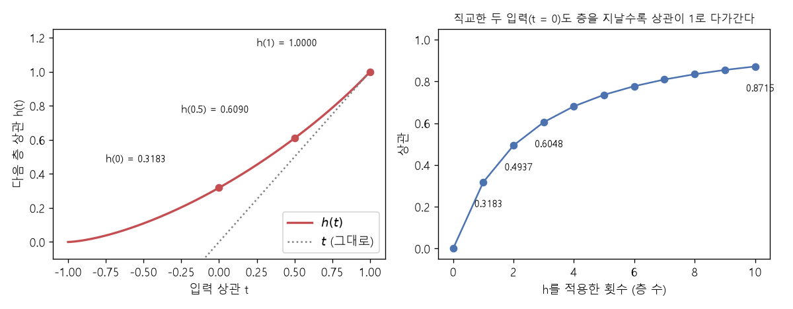

# 중심극한정리와 아크코사인 커널 (Central limit theorem, Arc-cosine kernel)

[목차로 돌아가기](../../00_MIT%EB%94%A5%EB%9F%AC%EB%8B%9D_%EB%AA%A9%EC%B0%A8.md) · 먼저 볼 것: [MM50_확률_밀도와_정규분포](../../%EC%88%98%ED%95%99%EA%B0%9C%EB%85%90/04_%ED%99%95%EB%A5%A0%EA%B3%BC_%EC%A0%95%EB%B3%B4/MM50_%ED%99%95%EB%A5%A0_%EB%B0%80%EB%8F%84%EC%99%80_%EC%A0%95%EA%B7%9C%EB%B6%84%ED%8F%AC.md), [MM22_기댓값과_일반화_간극](../../%EC%88%98%ED%95%99%EA%B0%9C%EB%85%90/04_%ED%99%95%EB%A5%A0%EA%B3%BC_%EC%A0%95%EB%B3%B4/MM22_%EA%B8%B0%EB%8C%93%EA%B0%92%EA%B3%BC_%EC%9D%BC%EB%B0%98%ED%99%94_%EA%B0%84%EA%B7%B9.md), [MM44_단위_구와_코사인_유사도](../../%EC%88%98%ED%95%99%EA%B0%9C%EB%85%90/03_%EC%84%A0%ED%98%95%EB%8C%80%EC%88%98/MM44_%EB%8B%A8%EC%9C%84_%EA%B5%AC%EC%99%80_%EC%BD%94%EC%82%AC%EC%9D%B8_%EC%9C%A0%EC%82%AC%EB%8F%84.md), [MM48_가우스_과정과_조건부_예측](../../%EC%88%98%ED%95%99%EA%B0%9C%EB%85%90/10_%ED%91%9C%ED%98%84_%ED%95%99%EC%8A%B5/MM48_%EA%B0%80%EC%9A%B0%EC%8A%A4_%EA%B3%BC%EC%A0%95%EA%B3%BC_%EC%A1%B0%EA%B1%B4%EB%B6%80_%EC%98%88%EC%B8%A1.md) · 쓰는 곳: [Lec13 5.3](../../Lec13_%ED%91%9C%ED%98%84_%ED%95%99%EC%8A%B5_%EC%9D%B4%EB%A1%A0.md#53-%EB%8C%80%EC%9D%91-%EC%A0%95%EB%A6%AC), [Lec13 6](../../Lec13_%ED%91%9C%ED%98%84_%ED%95%99%EC%8A%B5_%EC%9D%B4%EB%A1%A0.md#6-%EC%A6%9D%EB%AA%85-%EC%8A%A4%EC%BC%80%EC%B9%98-%EB%8B%A4%EB%B3%80%EB%9F%89-%EC%A4%91%EC%8B%AC%EA%B7%B9%ED%95%9C%EC%A0%95%EB%A6%AC), [Lec13 7](../../Lec13_%ED%91%9C%ED%98%84_%ED%95%99%EC%8A%B5_%EC%9D%B4%EB%A1%A0.md#7-%EC%98%88-relu-mlp%EC%99%80-%EC%95%84%ED%81%AC%EC%BD%94%EC%82%AC%EC%9D%B8-%EC%BB%A4%EB%84%90), [Lec13 9](../../Lec13_%ED%91%9C%ED%98%84_%ED%95%99%EC%8A%B5_%EC%9D%B4%EB%A1%A0.md#9-%ED%8C%AC%EC%9D%B8-%EC%B4%88%EA%B8%B0%ED%99%94%EC%99%80-%EC%98%81%EA%B3%B5%EA%B0%84)

📚 학습 순서 77/99 (10. 표현 학습): ← 이전: [MM48_가우스_과정과_조건부_예측](../../%EC%88%98%ED%95%99%EA%B0%9C%EB%85%90/10_%ED%91%9C%ED%98%84_%ED%95%99%EC%8A%B5/MM48_%EA%B0%80%EC%9A%B0%EC%8A%A4_%EA%B3%BC%EC%A0%95%EA%B3%BC_%EC%A1%B0%EA%B1%B4%EB%B6%80_%EC%98%88%EC%B8%A1.md) · 다음: [MM52_에너지_함수와_볼츠만_분포](../../%EC%88%98%ED%95%99%EA%B0%9C%EB%85%90/11_%EC%83%9D%EC%84%B1_%EB%AA%A8%EB%8D%B8/MM52_%EC%97%90%EB%84%88%EC%A7%80_%ED%95%A8%EC%88%98%EC%99%80_%EB%B3%BC%EC%B8%A0%EB%A7%8C_%EB%B6%84%ED%8F%AC.md) →

> [!NOTE]
> **3줄 요약**
> - **[중심극한정리](../../00_%EB%94%A5%EB%9F%AC%EB%8B%9D_%EC%9A%A9%EC%96%B4%EC%82%AC%EC%A0%84.md#central-limit-theorem-%EC%A4%91%EC%8B%AC%EA%B7%B9%ED%95%9C%EC%A0%95%EB%A6%AC)**: 독립인 작은 값을 많이 더하면(크기를 $1/\sqrt{n}$로 맞추면) 합은 [정규분포](../../00_%EB%94%A5%EB%9F%AC%EB%8B%9D_%EC%9A%A9%EC%96%B4%EC%82%AC%EC%A0%84.md#normal-distribution-%EC%A0%95%EA%B7%9C%EB%B6%84%ED%8F%AC)에 가까워진다. 동전 ±1을 1000번 더해 $\sqrt{1000}$으로 나누면 [분산](../../00_%EB%94%A5%EB%9F%AC%EB%8B%9D_%EC%9A%A9%EC%96%B4%EC%82%AC%EC%A0%84.md#variance-%EB%B6%84%EC%82%B0) 0.9947, $|z| < 1$인 비율 0.6737로 [정규분포](../../00_%EB%94%A5%EB%9F%AC%EB%8B%9D_%EC%9A%A9%EC%96%B4%EC%82%AC%EC%A0%84.md#normal-distribution-%EC%A0%95%EA%B7%9C%EB%B6%84%ED%8F%AC)(0.6827)와 비슷하다.
> - 넓은 [층](../../00_%EB%94%A5%EB%9F%AC%EB%8B%9D_%EC%9A%A9%EC%96%B4%EC%82%AC%EC%A0%84.md#layer-%EC%B8%B5)의 뉴런 하나는 "[가중치](../../00_%EB%94%A5%EB%9F%AC%EB%8B%9D_%EC%9A%A9%EC%96%B4%EC%82%AC%EC%A0%84.md#weight-%EA%B0%80%EC%A4%91%EC%B9%98) × 앞 [층](../../00_%EB%94%A5%EB%9F%AC%EB%8B%9D_%EC%9A%A9%EC%96%B4%EC%82%AC%EC%A0%84.md#layer-%EC%B8%B5) 활성값"을 너비만큼 더한 값이라 [중심극한정리](../../00_%EB%94%A5%EB%9F%AC%EB%8B%9D_%EC%9A%A9%EC%96%B4%EC%82%AC%EC%A0%84.md#central-limit-theorem-%EC%A4%91%EC%8B%AC%EA%B7%B9%ED%95%9C%EC%A0%95%EB%A6%AC)로 정규가 된다. 이것이 **[신경망-가우스 과정 대응](../../00_%EB%94%A5%EB%9F%AC%EB%8B%9D_%EC%9A%A9%EC%96%B4%EC%82%AC%EC%A0%84.md#nngp-correspondence-%EC%8B%A0%EA%B2%BD%EB%A7%9D-%EA%B0%80%EC%9A%B0%EC%8A%A4-%EA%B3%BC%EC%A0%95-%EB%8C%80%EC%9D%91)**의 근거다. [가중치](../../00_%EB%94%A5%EB%9F%AC%EB%8B%9D_%EC%9A%A9%EC%96%B4%EC%82%AC%EC%A0%84.md#weight-%EA%B0%80%EC%A4%91%EC%B9%98) [분산](../../00_%EB%94%A5%EB%9F%AC%EB%8B%9D_%EC%9A%A9%EC%96%B4%EC%82%AC%EC%A0%84.md#variance-%EB%B6%84%EC%82%B0) $1/\text{fan-in}$과 $\sqrt2\,\mathrm{relu}$는 [층](../../00_%EB%94%A5%EB%9F%AC%EB%8B%9D_%EC%9A%A9%EC%96%B4%EC%82%AC%EC%A0%84.md#layer-%EC%B8%B5)마다 [분산](../../00_%EB%94%A5%EB%9F%AC%EB%8B%9D_%EC%9A%A9%EC%96%B4%EC%82%AC%EC%A0%84.md#variance-%EB%B6%84%EC%82%B0)을 1로 지킨다.
> - 무한히 넓은 $\sqrt2\,\mathrm{relu}$ [층](../../00_%EB%94%A5%EB%9F%AC%EB%8B%9D_%EC%9A%A9%EC%96%B4%EC%82%AC%EC%A0%84.md#layer-%EC%B8%B5)은 입력 상관 $t$를 **[아크코사인 커널](../../00_%EB%94%A5%EB%9F%AC%EB%8B%9D_%EC%9A%A9%EC%96%B4%EC%82%AC%EC%A0%84.md#arc-cosine-kernel-%EC%95%84%ED%81%AC%EC%BD%94%EC%82%AC%EC%9D%B8-%EC%BB%A4%EB%84%90)** $h(t) = \frac1\pi[\sqrt{1-t^2} + t(\pi - \arccos t)]$로 바꾼다. $h(0) = 0.3183$, $h(0.5) = 0.6090$, $h(1) = 1$. [층](../../00_%EB%94%A5%EB%9F%AC%EB%8B%9D_%EC%9A%A9%EC%96%B4%EC%82%AC%EC%A0%84.md#layer-%EC%B8%B5)을 쌓을수록 상관이 1로 다가간다.

## 1. 개념 설명

비유: 한 사람의 키는 들쭉날쭉하지만, 1000명의 평균 키는 거의 늘 비슷한 값 둘레에 종 모양으로 모인다. 원래 분포가 무엇이든(동전, 주사위, [ReLU](../../00_%EB%94%A5%EB%9F%AC%EB%8B%9D_%EC%9A%A9%EC%96%B4%EC%82%AC%EC%A0%84.md#relu-%EB%A0%90%EB%A3%A8) 출력) 독립인 것을 많이 더하면 종 모양이 된다. 이것이 [중심극한정리](../../00_%EB%94%A5%EB%9F%AC%EB%8B%9D_%EC%9A%A9%EC%96%B4%EC%82%AC%EC%A0%84.md#central-limit-theorem-%EC%A4%91%EC%8B%AC%EA%B7%B9%ED%95%9C%EC%A0%95%EB%A6%AC)다.

- **[중심극한정리](../../00_%EB%94%A5%EB%9F%AC%EB%8B%9D_%EC%9A%A9%EC%96%B4%EC%82%AC%EC%A0%84.md#central-limit-theorem-%EC%A4%91%EC%8B%AC%EA%B7%B9%ED%95%9C%EC%A0%95%EB%A6%AC)**: 평균 0, [분산](../../00_%EB%94%A5%EB%9F%AC%EB%8B%9D_%EC%9A%A9%EC%96%B4%EC%82%AC%EC%A0%84.md#variance-%EB%B6%84%EC%82%B0) $\sigma^2$인 [독립](../../00_%EB%94%A5%EB%9F%AC%EB%8B%9D_%EC%9A%A9%EC%96%B4%EC%82%AC%EC%A0%84.md#independence-%EB%8F%85%EB%A6%BD) [확률 변수](../../00_%EB%94%A5%EB%9F%AC%EB%8B%9D_%EC%9A%A9%EC%96%B4%EC%82%AC%EC%A0%84.md#random-variable-%ED%99%95%EB%A5%A0-%EB%B3%80%EC%88%98) $s_1, \dots, s_n$에 대해 $\frac{1}{\sqrt{n}}\sum_j s_j$는 $n$이 커질수록 $\mathcal{N}(0, \sigma^2)$에 가까워진다. **다변량** 판은 벡터를 더할 때 같은 일이 일어난다는 것이다.
- **신경망에 적용**: [층](../../00_%EB%94%A5%EB%9F%AC%EB%8B%9D_%EC%9A%A9%EC%96%B4%EC%82%AC%EC%A0%84.md#layer-%EC%B8%B5)의 출력 한 칸 $z_i = \sum_{j=1}^{\text{fan-in}} W_{ij}\, \phi(x_j)$는 독립인 [가중치](../../00_%EB%94%A5%EB%9F%AC%EB%8B%9D_%EC%9A%A9%EC%96%B4%EC%82%AC%EC%A0%84.md#weight-%EA%B0%80%EC%A4%91%EC%B9%98) $W_{ij}$가 곱해진 항을 fan-in 개 더한 것이다. [가중치](../../00_%EB%94%A5%EB%9F%AC%EB%8B%9D_%EC%9A%A9%EC%96%B4%EC%82%AC%EC%A0%84.md#weight-%EA%B0%80%EC%A4%91%EC%B9%98) [분산](../../00_%EB%94%A5%EB%9F%AC%EB%8B%9D_%EC%9A%A9%EC%96%B4%EC%82%AC%EC%A0%84.md#variance-%EB%B6%84%EC%82%B0)을 $1/\text{fan-in}$으로 두면 "$1/\sqrt{n}$로 맞춘 합"이 되어, 너비가 클수록 $z_i$가 [정규분포](../../00_%EB%94%A5%EB%9F%AC%EB%8B%9D_%EC%9A%A9%EC%96%B4%EC%82%AC%EC%A0%84.md#normal-distribution-%EC%A0%95%EA%B7%9C%EB%B6%84%ED%8F%AC)를 따른다. 여러 입력에서의 $z_i$를 모은 벡터도 다변량 [중심극한정리](../../00_%EB%94%A5%EB%9F%AC%EB%8B%9D_%EC%9A%A9%EC%96%B4%EC%82%AC%EC%A0%84.md#central-limit-theorem-%EC%A4%91%EC%8B%AC%EA%B7%B9%ED%95%9C%EC%A0%95%EB%A6%AC)로 정규 벡터가 된다.
- **[분산](../../00_%EB%94%A5%EB%9F%AC%EB%8B%9D_%EC%9A%A9%EC%96%B4%EC%82%AC%EC%A0%84.md#variance-%EB%B6%84%EC%82%B0) 보존**: $u \sim \mathcal{N}(0, 1)$이면 $\mathrm{relu}(u)^2$의 평균은 $1/2$이다(절반은 0이므로). $\sqrt2$를 곱하면 $\mathbb{E}[\phi(u)^2] = 2 \times 1/2 = 1$로 [분산](../../00_%EB%94%A5%EB%9F%AC%EB%8B%9D_%EC%9A%A9%EC%96%B4%EC%82%AC%EC%A0%84.md#variance-%EB%B6%84%EC%82%B0)이 [층](../../00_%EB%94%A5%EB%9F%AC%EB%8B%9D_%EC%9A%A9%EC%96%B4%EC%82%AC%EC%A0%84.md#layer-%EC%B8%B5)을 지나도 1로 유지된다.
- **[아크코사인 커널](../../00_%EB%94%A5%EB%9F%AC%EB%8B%9D_%EC%9A%A9%EC%96%B4%EC%82%AC%EC%A0%84.md#arc-cosine-kernel-%EC%95%84%ED%81%AC%EC%BD%94%EC%82%AC%EC%9D%B8-%EC%BB%A4%EB%84%90)**: 두 입력의 앞 [층](../../00_%EB%94%A5%EB%9F%AC%EB%8B%9D_%EC%9A%A9%EC%96%B4%EC%82%AC%EC%A0%84.md#layer-%EC%B8%B5) 값 $(u, v)$가 상관 $t$인 표준 정규 쌍이면, 다음 층에서의 상관은 $\mathbb{E}[\phi(u)\phi(v)] = h(t)$이다. $L$[층](../../00_%EB%94%A5%EB%9F%AC%EB%8B%9D_%EC%9A%A9%EC%96%B4%EC%82%AC%EC%A0%84.md#layer-%EC%B8%B5) 망은 $h$를 $L - 1$번 합성한 것이 출력의 공분산이다.

## 2. 필요한 이유

[Lec13 5.4](../../Lec13_%ED%91%9C%ED%98%84_%ED%95%99%EC%8A%B5_%EC%9D%B4%EB%A1%A0.md#54-%EB%84%93%EC%9C%BC%EB%A9%B4-%EA%B3%BC%EC%A0%81%ED%95%A9%ED%95%98%EC%A7%80-%EC%95%8A%EB%82%98-%EC%99%9C-%EC%BB%A4%EB%84%90%EC%9D%84-%EC%93%B0%EC%A7%80-%EC%95%8A%EB%82%98)에서 강사는 "왜 너비가 무한해야 하나"에 "너비에 대한 [중심극한정리](../../00_%EB%94%A5%EB%9F%AC%EB%8B%9D_%EC%9A%A9%EC%96%B4%EC%82%AC%EC%A0%84.md#central-limit-theorem-%EC%A4%91%EC%8B%AC%EA%B7%B9%ED%95%9C%EC%A0%95%EB%A6%AC) 때문"이라고 답하고, [6절](../../Lec13_%ED%91%9C%ED%98%84_%ED%95%99%EC%8A%B5_%EC%9D%B4%EB%A1%A0.md#6-%EC%A6%9D%EB%AA%85-%EC%8A%A4%EC%BC%80%EC%B9%98-%EB%8B%A4%EB%B3%80%EB%9F%89-%EC%A4%91%EC%8B%AC%EA%B7%B9%ED%95%9C%EC%A0%95%EB%A6%AC)에서 증명의 주된 도구가 다변량 [중심극한정리](../../00_%EB%94%A5%EB%9F%AC%EB%8B%9D_%EC%9A%A9%EC%96%B4%EC%82%AC%EC%A0%84.md#central-limit-theorem-%EC%A4%91%EC%8B%AC%EA%B7%B9%ED%95%9C%EC%A0%95%EB%A6%AC)라고 말한다. [7절](../../Lec13_%ED%91%9C%ED%98%84_%ED%95%99%EC%8A%B5_%EC%9D%B4%EB%A1%A0.md#7-%EC%98%88-relu-mlp%EC%99%80-%EC%95%84%ED%81%AC%EC%BD%94%EC%82%AC%EC%9D%B8-%EC%BB%A4%EB%84%90)의 [ReLU](../../00_%EB%94%A5%EB%9F%AC%EB%8B%9D_%EC%9A%A9%EC%96%B4%EC%82%AC%EC%A0%84.md#relu-%EB%A0%90%EB%A3%A8) MLP 예는 그 결과 나오는 공분산을 [아크코사인 커널](../../00_%EB%94%A5%EB%9F%AC%EB%8B%9D_%EC%9A%A9%EC%96%B4%EC%82%AC%EC%A0%84.md#arc-cosine-kernel-%EC%95%84%ED%81%AC%EC%BD%94%EC%82%AC%EC%9D%B8-%EC%BB%A4%EB%84%90)로 정확히 준다. [9절](../../Lec13_%ED%91%9C%ED%98%84_%ED%95%99%EC%8A%B5_%EC%9D%B4%EB%A1%A0.md#9-%ED%8C%AC%EC%9D%B8-%EC%B4%88%EA%B8%B0%ED%99%94%EC%99%80-%EC%98%81%EA%B3%B5%EA%B0%84)의 $1/\text{fan-in}$ 초기화도 같은 [분산](../../00_%EB%94%A5%EB%9F%AC%EB%8B%9D_%EC%9A%A9%EC%96%B4%EC%82%AC%EC%A0%84.md#variance-%EB%B6%84%EC%82%B0) 보존 계산이다.

## 3. 숫자로 보기

**동전 4개** (±1, 각 [가중치](../../00_%EB%94%A5%EB%9F%AC%EB%8B%9D_%EC%9A%A9%EC%96%B4%EC%82%AC%EC%A0%84.md#weight-%EA%B0%80%EC%A4%91%EC%B9%98) $1/\sqrt4 = 0.5$)
- 동전 합 $-4, -2, 0, 2, 4$ → 0.5배 하면 $z = -2, -1, 0, 1, 2$
- [확률](../../00_%EB%94%A5%EB%9F%AC%EB%8B%9D_%EC%9A%A9%EC%96%B4%EC%82%AC%EC%A0%84.md#probability-%ED%99%95%EB%A5%A0): $1/16, 4/16, 6/16, 4/16, 1/16$
- [분산](../../00_%EB%94%A5%EB%9F%AC%EB%8B%9D_%EC%9A%A9%EC%96%B4%EC%82%AC%EC%A0%84.md#variance-%EB%B6%84%EC%82%B0): $2 \times (4 \times 1/16) + 2 \times (1 \times 4/16) = 0.5 + 0.5 = 1$
- 아직 다섯 값뿐이라 종 모양과는 거리가 있다. 동전을 1000개로 늘리면 $|z| < 1$인 비율이 0.6737로 [정규분포](../../00_%EB%94%A5%EB%9F%AC%EB%8B%9D_%EC%9A%A9%EC%96%B4%EC%82%AC%EC%A0%84.md#normal-distribution-%EC%A0%95%EA%B7%9C%EB%B6%84%ED%8F%AC)의 0.6827에 가까워진다(4절 코드).

**$\sqrt2\,\mathrm{relu}$의 [분산](../../00_%EB%94%A5%EB%9F%AC%EB%8B%9D_%EC%9A%A9%EC%96%B4%EC%82%AC%EC%A0%84.md#variance-%EB%B6%84%EC%82%B0) 보존**
- $\mathbb{E}[\mathrm{relu}(u)^2] = 1/2$ → $\mathbb{E}[(\sqrt2\,\mathrm{relu}(u))^2] = 2 \times 1/2 = 1$

**[아크코사인 커널](../../00_%EB%94%A5%EB%9F%AC%EB%8B%9D_%EC%9A%A9%EC%96%B4%EC%82%AC%EC%A0%84.md#arc-cosine-kernel-%EC%95%84%ED%81%AC%EC%BD%94%EC%82%AC%EC%9D%B8-%EC%BB%A4%EB%84%90) $h$**

| 입력 상관 $t$ | $h(t)$ | 뜻 |
|---|---|---|
| 0 (직교) | 0.3183 ($=1/\pi$) | 직교한 입력도 [ReLU](../../00_%EB%94%A5%EB%9F%AC%EB%8B%9D_%EC%9A%A9%EC%96%B4%EC%82%AC%EC%A0%84.md#relu-%EB%A0%90%EB%A3%A8)를 지나면 양의 상관 |
| 0.5 | 0.6090 | 상관이 커진다 |
| 1 (같은 입력) | 1 | [분산](../../00_%EB%94%A5%EB%9F%AC%EB%8B%9D_%EC%9A%A9%EC%96%B4%EC%82%AC%EC%A0%84.md#variance-%EB%B6%84%EC%82%B0) 1 유지 |

**[층](../../00_%EB%94%A5%EB%9F%AC%EB%8B%9D_%EC%9A%A9%EC%96%B4%EC%82%AC%EC%A0%84.md#layer-%EC%B8%B5)을 쌓으면** (직교한 두 입력, $t = 0$에서 시작)
- 1층: 0.3183 → 2층: 0.4937 → 3층: 0.6048 → ... → 10층: 0.8715


*▲ 직접 그린 그림: 왼쪽은 $h(t)$와 $t$(점선). $h(t) \ge t$라서 [층](../../00_%EB%94%A5%EB%9F%AC%EB%8B%9D_%EC%9A%A9%EC%96%B4%EC%82%AC%EC%A0%84.md#layer-%EC%B8%B5)마다 상관이 커진다. 오른쪽은 직교한 두 입력의 상관이 $h$를 거듭 적용할 때 0.3183, 0.4937, 0.6048, ..., 0.8715로 1에 다가가는 모습*

식으로 쓰면 다음과 같다.

$$
\frac{1}{\sqrt{n}}\sum_{j=1}^{n} s_j \ \xrightarrow{\ n \to \infty\ }\ \mathcal{N}(0, \sigma^2), \qquad \mathbb{E}\big[\phi(u)\,\phi(v)\big] = h(t) = \frac{1}{\pi}\Big[\sqrt{1 - t^2} + t\,(\pi - \arccos t)\Big]
$$

<details><summary>기호 풀이</summary>

| 기호 | 읽는 법 | 뜻 | 예제 값 |
| --- | --- | --- | --- |
| $s_j$ | 에스 제이 | 독립인 작은 값 (동전, [가중치](../../00_%EB%94%A5%EB%9F%AC%EB%8B%9D_%EC%9A%A9%EC%96%B4%EC%82%AC%EC%A0%84.md#weight-%EA%B0%80%EC%A4%91%EC%B9%98) × 활성값) | ±1 |
| $n$ | 엔 | 더하는 개수 ([층](../../00_%EB%94%A5%EB%9F%AC%EB%8B%9D_%EC%9A%A9%EC%96%B4%EC%82%AC%EC%A0%84.md#layer-%EC%B8%B5)의 너비) | 4, 1000 |
| $\frac{1}{\sqrt{n}}$ | 루트 엔 분의 일 | 합의 크기를 맞추는 배율 | 0.5 |
| $\sigma^2$ | 시그마 제곱 | $s_j$의 [분산](../../00_%EB%94%A5%EB%9F%AC%EB%8B%9D_%EC%9A%A9%EC%96%B4%EC%82%AC%EC%A0%84.md#variance-%EB%B6%84%EC%82%B0) | 1 |
| $\xrightarrow{n \to \infty}$ | [수렴](../../00_%EB%94%A5%EB%9F%AC%EB%8B%9D_%EC%9A%A9%EC%96%B4%EC%82%AC%EC%A0%84.md#convergence-%EC%88%98%EB%A0%B4) | $n$이 커질수록 그 분포에 가까워짐 | |
| $\phi$ | 파이 | $\sqrt2\,\mathrm{relu}$ | |
| $u, v$ | 유, 브이 | 두 입력에서의 앞 [층](../../00_%EB%94%A5%EB%9F%AC%EB%8B%9D_%EC%9A%A9%EC%96%B4%EC%82%AC%EC%A0%84.md#layer-%EC%B8%B5) 값. 상관 $t$인 표준 정규 쌍 | |
| $t$ | 티 | 입력 상관 ([코사인 유사도](../../00_%EB%94%A5%EB%9F%AC%EB%8B%9D_%EC%9A%A9%EC%96%B4%EC%82%AC%EC%A0%84.md#cosine-similarity-%EC%BD%94%EC%82%AC%EC%9D%B8-%EC%9C%A0%EC%82%AC%EB%8F%84)) | 0.5 |
| $h(t)$ | 에이치 | 다음 [층](../../00_%EB%94%A5%EB%9F%AC%EB%8B%9D_%EC%9A%A9%EC%96%B4%EC%82%AC%EC%A0%84.md#layer-%EC%B8%B5)의 상관 | 0.6090 |
| $\arccos t$ | 아크코사인 | 코사인이 $t$인 각도 (라디안) | 1.0472 |

</details>

<details><summary>예제와 풀이</summary>

**문제**: 직교한 두 입력($t = 0$)이 무한히 넓은 $\sqrt2\,\mathrm{relu}$ [층](../../00_%EB%94%A5%EB%9F%AC%EB%8B%9D_%EC%9A%A9%EC%96%B4%EC%82%AC%EC%A0%84.md#layer-%EC%B8%B5)을 하나 지나면 상관은 얼마가 되는가?

**주어진 값**
- $t = 0$ (입력 상관. 두 입력이 직교)
- $\pi = 3.1416$ (원주율)

**풀이**
1. 식을 그대로 쓴다: $h(t) = \dfrac{1}{\pi}\Big[\sqrt{1 - t^2} + t\,(\pi - \arccos t)\Big]$
2. 값을 대입한다: $h(0) = \dfrac{1}{\pi}\Big[\sqrt{1 - 0^2} + 0 \times (\pi - \arccos 0)\Big]$
3. 제곱한다: $0^2 = 0$ 이므로 $\sqrt{1 - 0} = \sqrt{1} = 1$ ($\sqrt{a}$는 제곱해서 $a$가 되는 양수)
4. 둘째 항: 0을 곱하므로 괄호 값과 상관없이 $0$
5. 대괄호 안을 더한다: $1 + 0 = 1$
6. $\pi$로 나눈다: $1 / 3.1416 = 0.3183$

**답**: **0.3183** ($= 1/\pi$). 입력은 상관이 없었는데 출력은 양의 상관을 갖는다. [ReLU](../../00_%EB%94%A5%EB%9F%AC%EB%8B%9D_%EC%9A%A9%EC%96%B4%EC%82%AC%EC%A0%84.md#relu-%EB%A0%90%EB%A3%A8) 출력은 늘 0 이상이라 두 출력이 함께 양수인 경우가 많기 때문이다.

</details>

<details><summary>내 이해</summary>


</details>

## 4. 코드로 확인

```python
# [함수] default_rng(0): 재현 가능한 난수 생성기
rng = np.random.default_rng(0)
# [함수] rng.choice([-1, 1], (100000, 1000)): 동전 1000개 던지기를 10만 번
# [변수] z: 합을 √1000으로 나눈 값 10만 개. 중심극한정리로 표준 정규에 가까워야 한다
z = rng.choice([-1.0, 1.0], size=(100000, 1000)).sum(1) / np.sqrt(1000)
# [연결] 본문 3절 → 분산 1 근처, |z| < 1 비율 0.68 근처 (정규분포 0.6827)
print(round(z.var(), 4), round((np.abs(z) < 1).mean(), 4))
# [함수] h(t): 아크코사인 커널. 본문 식
h = lambda t: (np.sqrt(1 - t ** 2) + t * (np.pi - np.arccos(t))) / np.pi
# [변수] u: 표준 정규 100만 개
u = rng.standard_normal(1000000)
# [연결] √2 relu의 제곱 평균 → 1 근처 (분산 보존)
print(round((2 * np.maximum(u, 0) ** 2).mean(), 2))
# [함수] for: 상관 0, 0.5, 0.9마다 표본 평균과 공식을 비교한다
for t in [0.0, 0.5, 0.9]:
    # [변수] v: u와 상관이 t인 표준 정규 (t u + √(1-t²) × 새 잡음)
    v = t * u + np.sqrt(1 - t * t) * rng.standard_normal(1000000)
    # [연결] 표본 E[φ(u)φ(v)] (소수 둘째 자리)와 h(t) (넷째 자리)
    print(t, round((2 * np.maximum(u, 0) * np.maximum(v, 0)).mean(), 2), round(h(t), 4))
# [변수] c: 직교한 입력의 상관 0에서 시작
c = 0.0
# [함수] for: h를 10번 거듭 적용한다 (10층)
for _ in range(10):
    c = h(c)
# [연결] 본문 3절 → 10층 뒤 0.8715
print(round(c, 4))
```

**실행 결과**:

```text
0.9947 0.6737
1.0
0.0 0.32 0.3183
0.5 0.61 0.609
0.9 0.91 0.9095
0.8715
```

> [!WARNING]
> **⚠ 주의**
> - [중심극한정리](../../00_%EB%94%A5%EB%9F%AC%EB%8B%9D_%EC%9A%A9%EC%96%B4%EC%82%AC%EC%A0%84.md#central-limit-theorem-%EC%A4%91%EC%8B%AC%EA%B7%B9%ED%95%9C%EC%A0%95%EB%A6%AC)는 **극한**의 결과다. 너비가 유한하면 [정규분포](../../00_%EB%94%A5%EB%9F%AC%EB%8B%9D_%EC%9A%A9%EC%96%B4%EC%82%AC%EC%A0%84.md#normal-distribution-%EC%A0%95%EA%B7%9C%EB%B6%84%ED%8F%AC)와 차이가 있고, 그 차이의 크기는 베리-에센 정리(Berry-Esseen theorem)가 다룬다([Lec13 5.4](../../Lec13_%ED%91%9C%ED%98%84_%ED%95%99%EC%8A%B5_%EC%9D%B4%EB%A1%A0.md#54-%EB%84%93%EC%9C%BC%EB%A9%B4-%EA%B3%BC%EC%A0%81%ED%95%A9%ED%95%98%EC%A7%80-%EC%95%8A%EB%82%98-%EC%99%9C-%EC%BB%A4%EB%84%90%EC%9D%84-%EC%93%B0%EC%A7%80-%EC%95%8A%EB%82%98) 질의응답).
> - $h$ 식은 입력 크기를 $\|x\|^2 = d$로 맞추고 $\sqrt2\,\mathrm{relu}$, [분산](../../00_%EB%94%A5%EB%9F%AC%EB%8B%9D_%EC%9A%A9%EC%96%B4%EC%82%AC%EC%A0%84.md#variance-%EB%B6%84%EC%82%B0) $1/\text{fan-in}$을 썼을 때의 것이다. [비선형성](../../00_%EB%94%A5%EB%9F%AC%EB%8B%9D_%EC%9A%A9%EC%96%B4%EC%82%AC%EC%A0%84.md#nonlinearity-%EB%B9%84%EC%84%A0%ED%98%95%EC%84%B1)이나 [분산](../../00_%EB%94%A5%EB%9F%AC%EB%8B%9D_%EC%9A%A9%EC%96%B4%EC%82%AC%EC%A0%84.md#variance-%EB%B6%84%EC%82%B0)을 바꾸면 커널도 바뀐다.
> - [층](../../00_%EB%94%A5%EB%9F%AC%EB%8B%9D_%EC%9A%A9%EC%96%B4%EC%82%AC%EC%A0%84.md#layer-%EC%B8%B5)을 깊게 쌓으면 모든 입력 쌍의 상관이 1로 몰린다(오른쪽 그림). 무한 너비 극한에서는 깊은 망이 입력을 점점 구별하지 못한다는 뜻이고, 이는 이 극한이 실제 학습된 망을 잘 설명하지 못하는 이유 중 하나로 거론된다.

## 5. 개념 재확인

<details><summary>1. 상관 $t = 0.5$인 두 입력이 $\sqrt2\,\mathrm{relu}$ 층을 하나 지나면 상관은?</summary>

| 단계 | 하는 일 | 계산 | 결과 |
|---|---|---|---|
| 1 | $\sqrt{1 - t^2}$ | $\sqrt{0.75}$ | 0.8660 |
| 2 | $\pi - \arccos t$ | $3.1416 - 1.0472$ | 2.0944 |
| 3 | $t$ 곱 | $0.5 \times 2.0944$ | 1.0472 |
| 4 | 더하고 $\pi$로 나눔 | $1.9132 / 3.1416$ | 0.6090 |

**① 쓰는 식**
$$h(t) = \frac{1}{\pi}\Big[\sqrt{1 - t^2} + t\,(\pi - \arccos t)\Big]$$
- 위 식 ← ② (제곱근 항), ③ (아크코사인 항), ④ (합과 나눗셈)에서 쓴다.
```python
# [변수] t: 입력 상관 0.5
t = 0.5                                                          # ①
# [변수] a: √(1 - 0.25) = 0.866
a = np.sqrt(1 - t ** 2)                                          # ②
# [변수] b: 0.5 × (π - arccos 0.5) = 1.0472
b = t * (np.pi - np.arccos(t))                                   # ③
# [연결] 0.866 1.0472 0.609
print(round(a, 4), round(b, 4), round((a + b) / np.pi, 4))       # ④
```

**주어진 값**
- $t = 0.5$ (입력 상관)
- $\pi = 3.1416$

**풀이**
1. 식을 그대로 쓴다: $h(t) = \dfrac{1}{\pi}\Big[\sqrt{1 - t^2} + t\,(\pi - \arccos t)\Big]$
2. 값을 대입한다: $h(0.5) = \dfrac{1}{3.1416}\Big[\sqrt{1 - 0.5^2} + 0.5 \times (3.1416 - \arccos 0.5)\Big]$
3. (②) 제곱한다: $0.5^2 = 0.25$
4. (②) 뺀다: $1 - 0.25 = 0.75$
5. (②) 제곱근을 구한다: $\sqrt{0.75} = 0.8660$
6. (③) 아크코사인을 구한다(코사인 값이 0.5인 각도, 60°를 라디안으로): $\arccos 0.5 = 1.0472$
7. (③) 뺀다: $3.1416 - 1.0472 = 2.0944$
8. (③) 곱한다: $0.5 \times 2.0944 = 1.0472$
9. (④) 대괄호 안을 더한다: $0.8660 + 1.0472 = 1.9132$
10. (④) 나눈다: $1.9132 / 3.1416 = 0.6090$

**답**: **0.6090**. 코사인 0.5였던 두 입력이 [ReLU](../../00_%EB%94%A5%EB%9F%AC%EB%8B%9D_%EC%9A%A9%EC%96%B4%EC%82%AC%EC%A0%84.md#relu-%EB%A0%90%EB%A3%A8) [층](../../00_%EB%94%A5%EB%9F%AC%EB%8B%9D_%EC%9A%A9%EC%96%B4%EC%82%AC%EC%A0%84.md#layer-%EC%B8%B5)을 지나 상관 0.6090으로 더 비슷해졌다.

</details>

<details><summary>2. 직교한 두 입력($t = 0$)이 이런 층을 두 개 지나면 상관은? ($h(h(0))$)</summary>

| 단계 | 하는 일 | 계산 | 결과 |
|---|---|---|---|
| 1 | 첫 [층](../../00_%EB%94%A5%EB%9F%AC%EB%8B%9D_%EC%9A%A9%EC%96%B4%EC%82%AC%EC%A0%84.md#layer-%EC%B8%B5) | $h(0) = 1/\pi$ | 0.3183 |
| 2 | $\sqrt{1 - a^2}$ | $\sqrt{1 - 0.1013}$ | 0.9480 |
| 3 | $a(\pi - \arccos a)$ | $0.3183 \times 1.8947$ | 0.6031 |
| 4 | 둘째 [층](../../00_%EB%94%A5%EB%9F%AC%EB%8B%9D_%EC%9A%A9%EC%96%B4%EC%82%AC%EC%A0%84.md#layer-%EC%B8%B5) | $1.5511 / \pi$ | 0.4937 |

**① 쓰는 식**
$$h(h(0)), \qquad h(a) = \frac{1}{\pi}\Big[\sqrt{1 - a^2} + a\,(\pi - \arccos a)\Big]$$
- 위 식 ← ② (첫 [층](../../00_%EB%94%A5%EB%9F%AC%EB%8B%9D_%EC%9A%A9%EC%96%B4%EC%82%AC%EC%A0%84.md#layer-%EC%B8%B5)), ③④ (둘째 [층](../../00_%EB%94%A5%EB%9F%AC%EB%8B%9D_%EC%9A%A9%EC%96%B4%EC%82%AC%EC%A0%84.md#layer-%EC%B8%B5)의 두 항), ⑤ (둘째 [층](../../00_%EB%94%A5%EB%9F%AC%EB%8B%9D_%EC%9A%A9%EC%96%B4%EC%82%AC%EC%A0%84.md#layer-%EC%B8%B5) 결과)에서 쓴다.
```python
# [함수] h: 아크코사인 커널
h = lambda t: (np.sqrt(1 - t ** 2) + t * (np.pi - np.arccos(t))) / np.pi   # ①
# [변수] a: 첫 층 뒤 상관 1/π = 0.3183
a = h(0.0)                                                       # ②
# [연결] 0.948 0.6031 0.4937
print(round(np.sqrt(1 - a * a), 4), round(a * (np.pi - np.arccos(a)), 4), round(h(a), 4))   # ③④⑤
```

**주어진 값**
- 처음 상관 $t = 0$ (직교)
- [층](../../00_%EB%94%A5%EB%9F%AC%EB%8B%9D_%EC%9A%A9%EC%96%B4%EC%82%AC%EC%A0%84.md#layer-%EC%B8%B5) 2개 → $h$를 두 번 적용
- $\pi = 3.1416$

**풀이**
1. 식을 그대로 쓴다: $h(h(0))$, $h(a) = \dfrac{1}{\pi}\Big[\sqrt{1 - a^2} + a\,(\pi - \arccos a)\Big]$
2. 값을 대입한다(첫 [층](../../00_%EB%94%A5%EB%9F%AC%EB%8B%9D_%EC%9A%A9%EC%96%B4%EC%82%AC%EC%A0%84.md#layer-%EC%B8%B5), 3절 예제): $a = h(0) = 1/\pi = 0.3183$
3. 둘째 [층](../../00_%EB%94%A5%EB%9F%AC%EB%8B%9D_%EC%9A%A9%EC%96%B4%EC%82%AC%EC%A0%84.md#layer-%EC%B8%B5)에 대입한다: $h(0.3183) = \dfrac{1}{3.1416}\Big[\sqrt{1 - 0.3183^2} + 0.3183 \times (3.1416 - \arccos 0.3183)\Big]$
4. (③) 제곱한다: $0.3183^2 = 0.1013$
5. (③) 뺀다: $1 - 0.1013 = 0.8987$
6. (③) 제곱근을 구한다: $\sqrt{0.8987} = 0.9480$
7. (④) 아크코사인을 구한다(코사인이 0.3183인 각도, 약 71.4°): $\arccos 0.3183 = 1.2469$
8. (④) 뺀다: $3.1416 - 1.2469 = 1.8947$
9. (④) 곱한다: $0.3183 \times 1.8947 = 0.6031$
10. (⑤) 더한다: $0.9480 + 0.6031 = 1.5511$
11. (⑤) 나눈다: $1.5511 / 3.1416 = 0.4937$

**답**: **0.4937**. [층](../../00_%EB%94%A5%EB%9F%AC%EB%8B%9D_%EC%9A%A9%EC%96%B4%EC%82%AC%EC%A0%84.md#layer-%EC%B8%B5) 하나 뒤 0.3183에서 둘 뒤 0.4937로 더 커졌다. [층](../../00_%EB%94%A5%EB%9F%AC%EB%8B%9D_%EC%9A%A9%EC%96%B4%EC%82%AC%EC%A0%84.md#layer-%EC%B8%B5)을 쌓을수록 상관이 1로 다가간다(3절 그림).

</details>

## 예제 풀기

[예제 10문제 풀기](../../%EC%98%88%EC%A0%9C/10_%ED%91%9C%ED%98%84_%ED%95%99%EC%8A%B5/%EC%98%88%EC%A0%9C_MM49_%EC%A4%91%EC%8B%AC%EA%B7%B9%ED%95%9C%EC%A0%95%EB%A6%AC%EC%99%80_%EC%95%84%ED%81%AC%EC%BD%94%EC%82%AC%EC%9D%B8_%EC%BB%A4%EB%84%90.md)

<details><summary>내 이해</summary>


</details>
