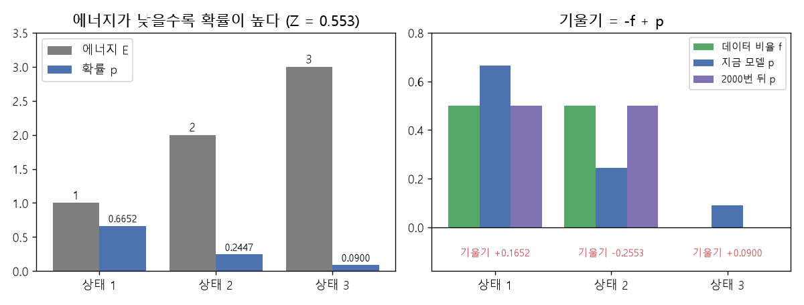

# 에너지 함수와 볼츠만 분포 (Energy function, Boltzmann distribution, Contrastive divergence)

[목차로 돌아가기](../../00_MIT%EB%94%A5%EB%9F%AC%EB%8B%9D_%EB%AA%A9%EC%B0%A8.md) · 먼저 볼 것: [M06_지수와_e](../../%EC%88%98%ED%95%99%EA%B0%9C%EB%85%90/01_%EC%88%98%EC%99%80_%ED%95%A8%EC%88%98/M06_%EC%A7%80%EC%88%98%EC%99%80_e.md), [MM51_KL_발산과_최대_우도](../../%EC%88%98%ED%95%99%EA%B0%9C%EB%85%90/04_%ED%99%95%EB%A5%A0%EA%B3%BC_%EC%A0%95%EB%B3%B4/MM51_KL_%EB%B0%9C%EC%82%B0%EA%B3%BC_%EC%B5%9C%EB%8C%80_%EC%9A%B0%EB%8F%84.md), [MM09_야코비안과_연쇄법칙](../../%EC%88%98%ED%95%99%EA%B0%9C%EB%85%90/05_%EC%8B%A0%EA%B2%BD%EB%A7%9D%EC%9D%98_%EA%B3%84%EC%82%B0/MM09_%EC%95%BC%EC%BD%94%EB%B9%84%EC%95%88%EA%B3%BC_%EC%97%B0%EC%87%84%EB%B2%95%EC%B9%99.md), [MM22_기댓값과_일반화_간극](../../%EC%88%98%ED%95%99%EA%B0%9C%EB%85%90/04_%ED%99%95%EB%A5%A0%EA%B3%BC_%EC%A0%95%EB%B3%B4/MM22_%EA%B8%B0%EB%8C%93%EA%B0%92%EA%B3%BC_%EC%9D%BC%EB%B0%98%ED%99%94_%EA%B0%84%EA%B7%B9.md) · 쓰는 곳: [Lec14 6.1](../../Lec14_%EC%83%9D%EC%84%B1_%EB%AA%A8%EB%8D%B8_%EA%B8%B0%EC%B4%88.md#61-%EB%B3%BC%EC%B8%A0%EB%A7%8C-%EB%B6%84%ED%8F%AC%EC%99%80-%EC%97%90%EB%84%88%EC%A7%80-%EB%B9%84%EC%9C%A8), [Lec14 6.2](../../Lec14_%EC%83%9D%EC%84%B1_%EB%AA%A8%EB%8D%B8_%EA%B8%B0%EC%B4%88.md#62-%EB%8C%80%EC%A1%B0-%EB%B0%9C%EC%82%B0)

📚 학습 순서 78/99 (11. 생성 모델): ← 이전: [MM49_중심극한정리와_아크코사인_커널](../../%EC%88%98%ED%95%99%EA%B0%9C%EB%85%90/10_%ED%91%9C%ED%98%84_%ED%95%99%EC%8A%B5/MM49_%EC%A4%91%EC%8B%AC%EA%B7%B9%ED%95%9C%EC%A0%95%EB%A6%AC%EC%99%80_%EC%95%84%ED%81%AC%EC%BD%94%EC%82%AC%EC%9D%B8_%EC%BB%A4%EB%84%90.md) · 다음: [MM53_가우시안_확산의_순방향_과정](../../%EC%88%98%ED%95%99%EA%B0%9C%EB%85%90/11_%EC%83%9D%EC%84%B1_%EB%AA%A8%EB%8D%B8/MM53_%EA%B0%80%EC%9A%B0%EC%8B%9C%EC%95%88_%ED%99%95%EC%82%B0%EC%9D%98_%EC%88%9C%EB%B0%A9%ED%96%A5_%EA%B3%BC%EC%A0%95.md) →

> [!NOTE]
> **3줄 요약**
> - **에너지** $E(x)$는 아무 실수나 되는 점수다(낮을수록 그럴듯함). **[볼츠만 분포](../../00_%EB%94%A5%EB%9F%AC%EB%8B%9D_%EC%9A%A9%EC%96%B4%EC%82%AC%EC%A0%84.md#boltzmann-distribution-%EB%B3%BC%EC%B8%A0%EB%A7%8C-%EB%B6%84%ED%8F%AC)** $p(x) = e^{-E(x)}/Z$는 이를 [확률](../../00_%EB%94%A5%EB%9F%AC%EB%8B%9D_%EC%9A%A9%EC%96%B4%EC%82%AC%EC%A0%84.md#probability-%ED%99%95%EB%A5%A0)로 바꾼다. $Z$(**[분할 함수](../../00_%EB%94%A5%EB%9F%AC%EB%8B%9D_%EC%9A%A9%EC%96%B4%EC%82%AC%EC%A0%84.md#partition-function-%EB%B6%84%ED%95%A0-%ED%95%A8%EC%88%98)**)는 모든 $x$의 $e^{-E}$를 더한 값이다. 에너지 (1, 2, 3)이면 $Z = 0.553$, [확률](../../00_%EB%94%A5%EB%9F%AC%EB%8B%9D_%EC%9A%A9%EC%96%B4%EC%82%AC%EC%A0%84.md#probability-%ED%99%95%EB%A5%A0) (0.6652, 0.2447, 0.09).
> - 두 [확률](../../00_%EB%94%A5%EB%9F%AC%EB%8B%9D_%EC%9A%A9%EC%96%B4%EC%82%AC%EC%A0%84.md#probability-%ED%99%95%EB%A5%A0)의 **비율**에서는 $Z$가 지워진다: $p(x_1)/p(x_2) = e^{E(x_2) - E(x_1)}$. 에너지 차이가 1이면 비율은 $e = 2.7183$. 그래서 $Z$를 몰라도 "어느 쪽이 더 그럴듯한가"와 [MCMC](../../00_%EB%94%A5%EB%9F%AC%EB%8B%9D_%EC%9A%A9%EC%96%B4%EC%82%AC%EC%A0%84.md#mcmc-markov-chain-monte-carlo-%EB%A7%88%EB%A5%B4%EC%BD%94%ED%94%84-%EC%97%B0%EC%87%84-%EB%AA%AC%ED%85%8C%EC%B9%B4%EB%A5%BC%EB%A1%9C) [샘플링](../../00_%EB%94%A5%EB%9F%AC%EB%8B%9D_%EC%9A%A9%EC%96%B4%EC%82%AC%EC%A0%84.md#sampling-%EC%83%98%ED%94%8C%EB%A7%81)은 할 수 있다. [소프트맥스](../../00_%EB%94%A5%EB%9F%AC%EB%8B%9D_%EC%9A%A9%EC%96%B4%EC%82%AC%EC%A0%84.md#softmax-%EC%86%8C%ED%94%84%ED%8A%B8%EB%A7%A5%EC%8A%A4)의 [로짓](../../00_%EB%94%A5%EB%9F%AC%EB%8B%9D_%EC%9A%A9%EC%96%B4%EC%82%AC%EC%A0%84.md#logit-%EB%A1%9C%EC%A7%93)이 바로 "마이너스 에너지"다.
> - [최대 우도](../../00_%EB%94%A5%EB%9F%AC%EB%8B%9D_%EC%9A%A9%EC%96%B4%EC%82%AC%EC%A0%84.md#maximum-likelihood-%EC%B5%9C%EB%8C%80-%EC%9A%B0%EB%8F%84)의 [기울기](../../00_%EB%94%A5%EB%9F%AC%EB%8B%9D_%EC%9A%A9%EC%96%B4%EC%82%AC%EC%A0%84.md#gradient-%EA%B8%B0%EC%9A%B8%EA%B8%B0)는 **(데이터에서의 에너지 [기울기](../../00_%EB%94%A5%EB%9F%AC%EB%8B%9D_%EC%9A%A9%EC%96%B4%EC%82%AC%EC%A0%84.md#gradient-%EA%B8%B0%EC%9A%B8%EA%B8%B0)를 내림) + (모델 표본에서의 에너지 [기울기](../../00_%EB%94%A5%EB%9F%AC%EB%8B%9D_%EC%9A%A9%EC%96%B4%EC%82%AC%EC%A0%84.md#gradient-%EA%B8%B0%EC%9A%B8%EA%B8%B0)를 올림)**이다(**[대조 발산](../../00_%EB%94%A5%EB%9F%AC%EB%8B%9D_%EC%9A%A9%EC%96%B4%EC%82%AC%EC%A0%84.md#contrastive-divergence-%EB%8C%80%EC%A1%B0-%EB%B0%9C%EC%82%B0)**). 상태마다 에너지를 하나씩 두면 [기울기](../../00_%EB%94%A5%EB%9F%AC%EB%8B%9D_%EC%9A%A9%EC%96%B4%EC%82%AC%EC%A0%84.md#gradient-%EA%B8%B0%EC%9A%B8%EA%B8%B0)는 "모델 [확률](../../00_%EB%94%A5%EB%9F%AC%EB%8B%9D_%EC%9A%A9%EC%96%B4%EC%82%AC%EC%A0%84.md#probability-%ED%99%95%EB%A5%A0) − 데이터 비율"이 되고, 데이터 비율 (0.5, 0.5, 0)에서 (0.1652, -0.2553, 0.09)다. 둘이 같아지면 멈춘다.

## 1. 개념 설명

비유: 공이 굴러다니는 울퉁불퉁한 땅을 생각한다. 높이가 **에너지**다. 공은 낮은 곳(골짜기)에 오래 머문다. [볼츠만 분포](../../00_%EB%94%A5%EB%9F%AC%EB%8B%9D_%EC%9A%A9%EC%96%B4%EC%82%AC%EC%A0%84.md#boltzmann-distribution-%EB%B3%BC%EC%B8%A0%EB%A7%8C-%EB%B6%84%ED%8F%AC)는 "공이 그 자리에 있을 [확률](../../00_%EB%94%A5%EB%9F%AC%EB%8B%9D_%EC%9A%A9%EC%96%B4%EC%82%AC%EC%A0%84.md#probability-%ED%99%95%EB%A5%A0)은 $e^{-\text{높이}}$에 비례한다"는 규칙이다. 땅 전체를 한꺼번에 올리거나 내려도 공이 머무는 비율은 그대로다. 높이의 **차이**만 중요하다.

- **에너지 함수** $E_\theta(x)$: 데이터를 실수 하나로 보내는 함수(신경망). $-\infty \sim \infty$ 어떤 값도 된다. [정규화](../../00_%EB%94%A5%EB%9F%AC%EB%8B%9D_%EC%9A%A9%EC%96%B4%EC%82%AC%EC%A0%84.md#normalization-%EC%A0%95%EA%B7%9C%ED%99%94)(합이 1)를 지킬 필요가 없어 모델을 자유롭게 고를 수 있다.
- **[분할 함수](../../00_%EB%94%A5%EB%9F%AC%EB%8B%9D_%EC%9A%A9%EC%96%B4%EC%82%AC%EC%A0%84.md#partition-function-%EB%B6%84%ED%95%A0-%ED%95%A8%EC%88%98)**(partition function) $Z_\theta = \sum_x e^{-E_\theta(x)}$ (연속이면 적분). 가능한 모든 $x$를 훑어야 해서 고차원 데이터에서는 계산할 수 없다.
- **[에너지 기반 모델](../../00_%EB%94%A5%EB%9F%AC%EB%8B%9D_%EC%9A%A9%EC%96%B4%EC%82%AC%EC%A0%84.md#energy-based-model-%EC%97%90%EB%84%88%EC%A7%80-%EA%B8%B0%EB%B0%98-%EB%AA%A8%EB%8D%B8)**(EBM): [확률](../../00_%EB%94%A5%EB%9F%AC%EB%8B%9D_%EC%9A%A9%EC%96%B4%EC%82%AC%EC%A0%84.md#probability-%ED%99%95%EB%A5%A0) 대신 에너지만 배우는 [생성 모델](../../00_%EB%94%A5%EB%9F%AC%EB%8B%9D_%EC%9A%A9%EC%96%B4%EC%82%AC%EC%A0%84.md#generative-model-%EC%83%9D%EC%84%B1-%EB%AA%A8%EB%8D%B8). [확률](../../00_%EB%94%A5%EB%9F%AC%EB%8B%9D_%EC%9A%A9%EC%96%B4%EC%82%AC%EC%A0%84.md#probability-%ED%99%95%EB%A5%A0) 비율, [샘플링](../../00_%EB%94%A5%EB%9F%AC%EB%8B%9D_%EC%9A%A9%EC%96%B4%EC%82%AC%EC%A0%84.md#sampling-%EC%83%98%ED%94%8C%EB%A7%81)([MCMC](../../00_%EB%94%A5%EB%9F%AC%EB%8B%9D_%EC%9A%A9%EC%96%B4%EC%82%AC%EC%A0%84.md#mcmc-markov-chain-monte-carlo-%EB%A7%88%EB%A5%B4%EC%BD%94%ED%94%84-%EC%97%B0%EC%87%84-%EB%AA%AC%ED%85%8C%EC%B9%B4%EB%A5%BC%EB%A1%9C))에는 에너지만으로 충분하다.
- **[대조 발산](../../00_%EB%94%A5%EB%9F%AC%EB%8B%9D_%EC%9A%A9%EC%96%B4%EC%82%AC%EC%A0%84.md#contrastive-divergence-%EB%8C%80%EC%A1%B0-%EB%B0%9C%EC%82%B0)**(contrastive divergence): EBM을 [최대 우도](../../00_%EB%94%A5%EB%9F%AC%EB%8B%9D_%EC%9A%A9%EC%96%B4%EC%82%AC%EC%A0%84.md#maximum-likelihood-%EC%B5%9C%EB%8C%80-%EC%9A%B0%EB%8F%84)로 배울 때의 [기울기](../../00_%EB%94%A5%EB%9F%AC%EB%8B%9D_%EC%9A%A9%EC%96%B4%EC%82%AC%EC%A0%84.md#gradient-%EA%B8%B0%EC%9A%B8%EA%B8%B0). 데이터가 있는 곳은 에너지를 낮추고(양의 항), 모델이 지금 [확률](../../00_%EB%94%A5%EB%9F%AC%EB%8B%9D_%EC%9A%A9%EC%96%B4%EC%82%AC%EC%A0%84.md#probability-%ED%99%95%EB%A5%A0)을 많이 주는 곳은 에너지를 높인다(음의 항). 두 힘이 맞서다 같아지면 모델 = 데이터 분포다.

## 2. 필요한 이유

[Lec14 6.1](../../Lec14_%EC%83%9D%EC%84%B1_%EB%AA%A8%EB%8D%B8_%EA%B8%B0%EC%B4%88.md#61-%EB%B3%BC%EC%B8%A0%EB%A7%8C-%EB%B6%84%ED%8F%AC%EC%99%80-%EC%97%90%EB%84%88%EC%A7%80-%EB%B9%84%EC%9C%A8)에서 강사는 "[확률](../../00_%EB%94%A5%EB%9F%AC%EB%8B%9D_%EC%9A%A9%EC%96%B4%EC%82%AC%EC%A0%84.md#probability-%ED%99%95%EB%A5%A0)은 정규화해야 해서 고를 수 있는 함수가 좁다. 에너지는 [정규화](../../00_%EB%94%A5%EB%9F%AC%EB%8B%9D_%EC%9A%A9%EC%96%B4%EC%82%AC%EC%A0%84.md#normalization-%EC%A0%95%EA%B7%9C%ED%99%94)가 필요 없고, 비율만으로 충분한 경우가 많다"고 설명한다. [Lec14 6.2](../../Lec14_%EC%83%9D%EC%84%B1_%EB%AA%A8%EB%8D%B8_%EA%B8%B0%EC%B4%88.md#62-%EB%8C%80%EC%A1%B0-%EB%B0%9C%EC%82%B0)는 $\nabla_\theta \log Z$를 [기댓값](../../00_%EB%94%A5%EB%9F%AC%EB%8B%9D_%EC%9A%A9%EC%96%B4%EC%82%AC%EC%A0%84.md#expectation-%EA%B8%B0%EB%8C%93%EA%B0%92) 꼴로 바꾸는 유도를 한 줄씩 보여 주는데, 이 노트의 (다)가 그 유도를 숫자로 따라간다.

## 3. 숫자로 보기

**(가) [볼츠만 분포](../../00_%EB%94%A5%EB%9F%AC%EB%8B%9D_%EC%9A%A9%EC%96%B4%EC%82%AC%EC%A0%84.md#boltzmann-distribution-%EB%B3%BC%EC%B8%A0%EB%A7%8C-%EB%B6%84%ED%8F%AC)**

$$
p_\theta(x) = \frac{e^{-E_\theta(x)}}{Z_\theta}, \qquad Z_\theta = \sum_{x} e^{-E_\theta(x)} \ \ \Big(\text{연속이면 } \int e^{-E_\theta(x)}\,dx\Big)
$$

<details><summary>기호 풀이</summary>

| 기호 | 읽는 법 | 뜻 | 예제 값 |
| --- | --- | --- | --- |
| $E_\theta(x)$ | 이 세타 오브 엑스 | 에너지. 낮을수록 그럴듯함 | 1, 2, 3 |
| $e^{-E}$ | 이의 마이너스 이 제곱 | [정규화](../../00_%EB%94%A5%EB%9F%AC%EB%8B%9D_%EC%9A%A9%EC%96%B4%EC%82%AC%EC%A0%84.md#normalization-%EC%A0%95%EA%B7%9C%ED%99%94) 전 [확률](../../00_%EB%94%A5%EB%9F%AC%EB%8B%9D_%EC%9A%A9%EC%96%B4%EC%82%AC%EC%A0%84.md#probability-%ED%99%95%EB%A5%A0) (양수) | 0.3679, 0.1353, 0.0498 |
| $Z_\theta$ | 제트 | [분할 함수](../../00_%EB%94%A5%EB%9F%AC%EB%8B%9D_%EC%9A%A9%EC%96%B4%EC%82%AC%EC%A0%84.md#partition-function-%EB%B6%84%ED%95%A0-%ED%95%A8%EC%88%98) = $e^{-E}$의 총합 | 0.553 |
| $p_\theta(x)$ | 피 세타 | 정규화한 [확률](../../00_%EB%94%A5%EB%9F%AC%EB%8B%9D_%EC%9A%A9%EC%96%B4%EC%82%AC%EC%A0%84.md#probability-%ED%99%95%EB%A5%A0) | 0.6652, 0.2447, 0.09 |
| $\theta$ | 세타 | 에너지 함수(신경망)의 매개변수 | |

</details>

<details><summary>예제와 풀이</summary>

**문제**: 상태가 세 개이고 에너지가 $E = (1, 2, 3)$이다. 각 상태의 [확률](../../00_%EB%94%A5%EB%9F%AC%EB%8B%9D_%EC%9A%A9%EC%96%B4%EC%82%AC%EC%A0%84.md#probability-%ED%99%95%EB%A5%A0)을 구하라.

**주어진 값**
- $E(x_1) = 1, E(x_2) = 2, E(x_3) = 3$ (세 상태의 에너지)

**풀이**
1. 식을 그대로 쓴다: $p(x) = \dfrac{e^{-E(x)}}{Z}$, $Z = \sum_x e^{-E(x)}$
2. 값을 대입한다: $p(x_1) = \dfrac{e^{-1}}{e^{-1} + e^{-2} + e^{-3}}$ (Σ를 세 항으로 풀어 썼다. $x_2$, $x_3$도 분자만 바뀐다)
3. [지수](../../00_%EB%94%A5%EB%9F%AC%EB%8B%9D_%EC%9A%A9%EC%96%B4%EC%82%AC%EC%A0%84.md#e-exponent-e%EC%99%80-%EC%A7%80%EC%88%98)를 계산한다. $e$는 약 2.718이고 $e^{-a} = 1/e^{a}$이다: $e^{-1} = 0.3679$
4. $e^{-2} = 0.1353$
5. $e^{-3} = 0.0498$
6. 더해서 $Z$를 구한다: $0.3679 + 0.1353 + 0.0498 = 0.553$
7. 첫 상태를 나눈다: $0.3679 / 0.553 = 0.6652$
8. 둘째 상태를 나눈다: $0.1353 / 0.553 = 0.2447$
9. 셋째 상태를 나눈다: $0.0498 / 0.553 = 0.09$

**답**: $p = $ **(0.6652, 0.2447, 0.09)**. 에너지가 가장 낮은 상태가 가장 그럴듯하다. 세 값을 더하면 1이다.

</details>

<details><summary>내 이해</summary>


</details>

에너지에 모두 5를 더해 (6, 7, 8)로 바꿔도 [확률](../../00_%EB%94%A5%EB%9F%AC%EB%8B%9D_%EC%9A%A9%EC%96%B4%EC%82%AC%EC%A0%84.md#probability-%ED%99%95%EB%A5%A0)은 (0.6652, 0.2447, 0.09) 그대로다. $e^{-5}$가 분자와 $Z$에 똑같이 곱해져 지워지기 때문이다.

**(나) [확률](../../00_%EB%94%A5%EB%9F%AC%EB%8B%9D_%EC%9A%A9%EC%96%B4%EC%82%AC%EC%A0%84.md#probability-%ED%99%95%EB%A5%A0) 비율에서는 $Z$가 지워진다**

$$
\frac{p_\theta(x_1)}{p_\theta(x_2)} = \frac{e^{-E_\theta(x_1)}/Z_\theta}{e^{-E_\theta(x_2)}/Z_\theta} = e^{E_\theta(x_2) - E_\theta(x_1)}
$$

<details><summary>기호 풀이</summary>

| 기호 | 읽는 법 | 뜻 | 예제 값 |
| --- | --- | --- | --- |
| $x_1, x_2$ | 엑스 일, 엑스 이 | 비교할 두 데이터 | 눈, 태풍 |
| $p_\theta(x_1)/p_\theta(x_2)$ | [확률](../../00_%EB%94%A5%EB%9F%AC%EB%8B%9D_%EC%9A%A9%EC%96%B4%EC%82%AC%EC%A0%84.md#probability-%ED%99%95%EB%A5%A0) 비율 | $x_1$이 $x_2$보다 몇 배 그럴듯한가 | 2.7183 |
| $E_\theta(x_2) - E_\theta(x_1)$ | 에너지 차이 | 두 에너지의 차 | 1 |

</details>

<details><summary>예제와 풀이</summary>

**문제**: "내일 눈이 온다"의 에너지는 0.5, "내일 태풍이 온다"의 에너지는 2.5다. $Z$를 모를 때 눈이 태풍보다 몇 배 그럴듯한가?

**주어진 값**
- $E(x_1) = 0.5$ (눈의 에너지)
- $E(x_2) = 2.5$ (태풍의 에너지)

**풀이**
1. 식을 그대로 쓴다: $\dfrac{p(x_1)}{p(x_2)} = e^{E(x_2) - E(x_1)}$
2. 값을 대입한다: $\dfrac{p(x_1)}{p(x_2)} = e^{2.5 - 0.5}$
3. [지수](../../00_%EB%94%A5%EB%9F%AC%EB%8B%9D_%EC%9A%A9%EC%96%B4%EC%82%AC%EC%A0%84.md#e-exponent-e%EC%99%80-%EC%A7%80%EC%88%98) 안을 뺀다: $2.5 - 0.5 = 2$
4. [지수](../../00_%EB%94%A5%EB%9F%AC%EB%8B%9D_%EC%9A%A9%EC%96%B4%EC%82%AC%EC%A0%84.md#e-exponent-e%EC%99%80-%EC%A7%80%EC%88%98)를 계산한다($e^2 = 2.718 \times 2.718$): $e^{2} = 7.3891$

**답**: 눈이 태풍보다 **7.3891배** 그럴듯하다. $Z$는 한 번도 쓰지 않았다.

</details>

<details><summary>내 이해</summary>


</details>

**(다) [대조 발산](../../00_%EB%94%A5%EB%9F%AC%EB%8B%9D_%EC%9A%A9%EC%96%B4%EC%82%AC%EC%A0%84.md#contrastive-divergence-%EB%8C%80%EC%A1%B0-%EB%B0%9C%EC%82%B0): [최대 우도](../../00_%EB%94%A5%EB%9F%AC%EB%8B%9D_%EC%9A%A9%EC%96%B4%EC%82%AC%EC%A0%84.md#maximum-likelihood-%EC%B5%9C%EB%8C%80-%EC%9A%B0%EB%8F%84)의 [기울기](../../00_%EB%94%A5%EB%9F%AC%EB%8B%9D_%EC%9A%A9%EC%96%B4%EC%82%AC%EC%A0%84.md#gradient-%EA%B8%B0%EC%9A%B8%EA%B8%B0)**

$$
\nabla_\theta \log p_\theta(x) = \underbrace{-\nabla_\theta E_\theta(x)}_{\text{양의 항: 데이터}} + \underbrace{\mathbb{E}_{x' \sim p_\theta}\big[\nabla_\theta E_\theta(x')\big]}_{\text{음의 항: 모델 표본}}
$$

<details><summary>기호 풀이</summary>

| 기호 | 읽는 법 | 뜻 | 예제 값 |
| --- | --- | --- | --- |
| $\nabla_\theta$ | 나블라 세타 | $\theta$에 대한 [기울기](../../00_%EB%94%A5%EB%9F%AC%EB%8B%9D_%EC%9A%A9%EC%96%B4%EC%82%AC%EC%A0%84.md#gradient-%EA%B8%B0%EC%9A%B8%EA%B8%B0) | |
| $\log p_\theta(x)$ | [로그](../../00_%EB%94%A5%EB%9F%AC%EB%8B%9D_%EC%9A%A9%EC%96%B4%EC%82%AC%EC%A0%84.md#log-ln-%EB%A1%9C%EA%B7%B8) [우도](../../00_%EB%94%A5%EB%9F%AC%EB%8B%9D_%EC%9A%A9%EC%96%B4%EC%82%AC%EC%A0%84.md#likelihood-%EC%9A%B0%EB%8F%84) | 데이터 $x$의 [로그](../../00_%EB%94%A5%EB%9F%AC%EB%8B%9D_%EC%9A%A9%EC%96%B4%EC%82%AC%EC%A0%84.md#log-ln-%EB%A1%9C%EA%B7%B8) [확률](../../00_%EB%94%A5%EB%9F%AC%EB%8B%9D_%EC%9A%A9%EC%96%B4%EC%82%AC%EC%A0%84.md#probability-%ED%99%95%EB%A5%A0) = $-E_\theta(x) - \log Z_\theta$ | |
| $-\nabla_\theta E_\theta(x)$ | 양의 항 | 데이터 자리의 에너지를 낮추는 방향 | -0.5 (상태 1) |
| $x' \sim p_\theta$ | 엑스 프라임 | 지금 모델에서 뽑은 표본 | |
| $\mathbb{E}_{x' \sim p_\theta}[\nabla_\theta E_\theta(x')]$ | 음의 항 | 모델이 [확률](../../00_%EB%94%A5%EB%9F%AC%EB%8B%9D_%EC%9A%A9%EC%96%B4%EC%82%AC%EC%A0%84.md#probability-%ED%99%95%EB%A5%A0)을 주는 곳의 에너지를 높이는 방향 ($= \nabla_\theta \log Z_\theta$) | 0.6652 (상태 1) |

</details>

<details><summary>예제와 풀이</summary>

**문제**: 상태 1, 2, 3마다 에너지 매개변수를 하나씩 둔다($E(x_k) = \theta_k$). 지금 $\theta = (1, 2, 3)$이라 모델 [확률](../../00_%EB%94%A5%EB%9F%AC%EB%8B%9D_%EC%9A%A9%EC%96%B4%EC%82%AC%EC%A0%84.md#probability-%ED%99%95%EB%A5%A0)은 (0.6652, 0.2447, 0.09)이고, [학습 데이터](../../00_%EB%94%A5%EB%9F%AC%EB%8B%9D_%EC%9A%A9%EC%96%B4%EC%82%AC%EC%A0%84.md#training-data-test-data-%ED%95%99%EC%8A%B5-%EB%8D%B0%EC%9D%B4%ED%84%B0%EC%99%80-%EC%8B%9C%ED%97%98-%EB%8D%B0%EC%9D%B4%ED%84%B0)는 절반이 상태 1, 절반이 상태 2다. 평균 [로그](../../00_%EB%94%A5%EB%9F%AC%EB%8B%9D_%EC%9A%A9%EC%96%B4%EC%82%AC%EC%A0%84.md#log-ln-%EB%A1%9C%EA%B7%B8) [우도](../../00_%EB%94%A5%EB%9F%AC%EB%8B%9D_%EC%9A%A9%EC%96%B4%EC%82%AC%EC%A0%84.md#likelihood-%EC%9A%B0%EB%8F%84)의 [기울기](../../00_%EB%94%A5%EB%9F%AC%EB%8B%9D_%EC%9A%A9%EC%96%B4%EC%82%AC%EC%A0%84.md#gradient-%EA%B8%B0%EC%9A%B8%EA%B8%B0)를 구하라.

**주어진 값**
- $p_\theta = (0.6652, 0.2447, 0.09)$ (지금 모델 [확률](../../00_%EB%94%A5%EB%9F%AC%EB%8B%9D_%EC%9A%A9%EC%96%B4%EC%82%AC%EC%A0%84.md#probability-%ED%99%95%EB%A5%A0), (가)에서 구함)
- $f = (0.5, 0.5, 0)$ ([학습 데이터](../../00_%EB%94%A5%EB%9F%AC%EB%8B%9D_%EC%9A%A9%EC%96%B4%EC%82%AC%EC%A0%84.md#training-data-test-data-%ED%95%99%EC%8A%B5-%EB%8D%B0%EC%9D%B4%ED%84%B0%EC%99%80-%EC%8B%9C%ED%97%98-%EB%8D%B0%EC%9D%B4%ED%84%B0)에서 각 상태의 비율)
- $\nabla_{\theta_k} E(x) = 1$ ($x$가 상태 $k$일 때), 아니면 0

**풀이**
1. 식을 그대로 쓴다: $\nabla_\theta \log p_\theta(x) = -\nabla_\theta E_\theta(x) + \mathbb{E}_{x' \sim p_\theta}[\nabla_\theta E_\theta(x')]$
2. 데이터에 대해 평균하고 $\theta_k$ 칸 하나를 대입한다: $\dfrac{\partial}{\partial \theta_k} = -f_k \times 1 + p_\theta(x_k) \times 1$ (양의 항은 데이터 중 상태 $k$의 비율, 음의 항의 [기댓값](../../00_%EB%94%A5%EB%9F%AC%EB%8B%9D_%EC%9A%A9%EC%96%B4%EC%82%AC%EC%A0%84.md#expectation-%EA%B8%B0%EB%8C%93%EA%B0%92)은 모델이 상태 $k$를 뽑을 [확률](../../00_%EB%94%A5%EB%9F%AC%EB%8B%9D_%EC%9A%A9%EC%96%B4%EC%82%AC%EC%A0%84.md#probability-%ED%99%95%EB%A5%A0))
3. 상태 1을 계산한다: $-0.5 + 0.6652 = 0.1652$
4. 상태 2를 계산한다: $-0.5 + 0.2447 = -0.2553$
5. 상태 3을 계산한다: $-0 + 0.09 = 0.09$

**답**: [기울기](../../00_%EB%94%A5%EB%9F%AC%EB%8B%9D_%EC%9A%A9%EC%96%B4%EC%82%AC%EC%A0%84.md#gradient-%EA%B8%B0%EC%9A%B8%EA%B8%B0)는 **(0.1652, -0.2553, 0.09)**. 경사 상승은 이 방향으로 $\theta$를 움직인다. 상태 2(데이터는 많은데 모델이 덜 줌)의 에너지는 내려가고, 상태 1·3(모델이 너무 많이 줌)의 에너지는 올라간다. 모델 [확률](../../00_%EB%94%A5%EB%9F%AC%EB%8B%9D_%EC%9A%A9%EC%96%B4%EC%82%AC%EC%A0%84.md#probability-%ED%99%95%EB%A5%A0)이 데이터 비율과 같아지면 [기울기](../../00_%EB%94%A5%EB%9F%AC%EB%8B%9D_%EC%9A%A9%EC%96%B4%EC%82%AC%EC%A0%84.md#gradient-%EA%B8%B0%EC%9A%B8%EA%B8%B0)가 0이 된다.

</details>

<details><summary>내 이해</summary>


</details>


*▲ 직접 그린 그림: 왼쪽은 에너지 (1, 2, 3)과 볼츠만 [확률](../../00_%EB%94%A5%EB%9F%AC%EB%8B%9D_%EC%9A%A9%EC%96%B4%EC%82%AC%EC%A0%84.md#probability-%ED%99%95%EB%A5%A0) (0.6652, 0.2447, 0.09). 오른쪽은 데이터 비율 (0.5, 0.5, 0)과 비교한 [기울기](../../00_%EB%94%A5%EB%9F%AC%EB%8B%9D_%EC%9A%A9%EC%96%B4%EC%82%AC%EC%A0%84.md#gradient-%EA%B8%B0%EC%9A%B8%EA%B8%B0) (0.1652, -0.2553, 0.09). 경사 상승을 2000번 하면 모델 [확률](../../00_%EB%94%A5%EB%9F%AC%EB%8B%9D_%EC%9A%A9%EC%96%B4%EC%82%AC%EC%A0%84.md#probability-%ED%99%95%EB%A5%A0)이 (0.4997, 0.4997, 0.0007)로 데이터 비율에 다가간다*

## 4. 코드로 확인

```python
# [변수] E: 세 상태의 에너지 1, 2, 3
E = np.array([1.0, 2.0, 3.0])
# [함수] np.exp(-E): 각 에너지의 e^-E. sum으로 분할 함수 Z
# [변수] w = [0.3679 0.1353 0.0498], Z = 0.553
w = np.exp(-E); Z = w.sum()
# [변수] p: 볼츠만 확률
# [연결] 본문 3절 (가) → [0.6652 0.2447 0.09], 비율 p1/p2 = e = 2.7183
p = w / Z
print(w.round(4), round(Z, 4), p.round(4), round(p[0] / p[1], 4))
# [함수] 에너지에 5를 더해도 확률이 같다
# [연결] 본문 3절 (가) 아래 문단
print((np.exp(-(E + 5)) / np.exp(-(E + 5)).sum()).round(4))
# [연결] 본문 3절 (나)의 예제 → e^(2.5 - 0.5) = 7.3891
print(round(np.exp(2.5 - 0.5), 4))
# [변수] f: 학습 데이터에서 상태별 비율
f = np.array([0.5, 0.5, 0.0])
# [변수] g: 평균 로그 우도의 기울기 = -f + p (양의 항 + 음의 항)
# [연결] 본문 3절 (다) → [ 0.1652 -0.2553  0.09  ]
g = -f + p
print(g.round(4))
# [변수] th: 에너지 매개변수. 처음엔 E와 같다
th = E.copy()
# [함수] for: 학습률 0.5로 경사 상승 2000번. 매번 p를 다시 계산한다
for _ in range(2000):
    q = np.exp(-th) / np.exp(-th).sum()
    th = th + 0.5 * (-f + q)
# [연결] 본문 그림 → 모델 확률이 데이터 비율 (0.5, 0.5, 0)에 다가간다
print((np.exp(-th) / np.exp(-th).sum()).round(4))
```

**실행 결과**:

```text
[0.3679 0.1353 0.0498] 0.553 [0.6652 0.2447 0.09  ] 2.7183
[0.6652 0.2447 0.09  ]
7.3891
[ 0.1652 -0.2553  0.09  ]
[0.4997 0.4997 0.0007]
```

> [!WARNING]
> **⚠ 주의**
> - 에너지는 **낮을수록** [확률](../../00_%EB%94%A5%EB%9F%AC%EB%8B%9D_%EC%9A%A9%EC%96%B4%EC%82%AC%EC%A0%84.md#probability-%ED%99%95%EB%A5%A0)이 높다(앞의 마이너스 부호). [로짓](../../00_%EB%94%A5%EB%9F%AC%EB%8B%9D_%EC%9A%A9%EC%96%B4%EC%82%AC%EC%A0%84.md#logit-%EB%A1%9C%EC%A7%93)은 높을수록 [확률](../../00_%EB%94%A5%EB%9F%AC%EB%8B%9D_%EC%9A%A9%EC%96%B4%EC%82%AC%EC%A0%84.md#probability-%ED%99%95%EB%A5%A0)이 높으니 [로짓](../../00_%EB%94%A5%EB%9F%AC%EB%8B%9D_%EC%9A%A9%EC%96%B4%EC%82%AC%EC%A0%84.md#logit-%EB%A1%9C%EC%A7%93) = $-E$다. 부호는 관례일 뿐이다.
> - 데이터 자리의 에너지만 낮추면 모든 곳의 에너지를 $-\infty$로 보내는 쓸모없는 해가 나온다. 음의 항(모델 표본의 에너지를 올림)이 꼭 있어야 한다.
> - 음의 항을 계산하려면 지금 모델에서 표본을 뽑아야 한다([MCMC](../../00_%EB%94%A5%EB%9F%AC%EB%8B%9D_%EC%9A%A9%EC%96%B4%EC%82%AC%EC%A0%84.md#mcmc-markov-chain-monte-carlo-%EB%A7%88%EB%A5%B4%EC%BD%94%ED%94%84-%EC%97%B0%EC%87%84-%EB%AA%AC%ED%85%8C%EC%B9%B4%EB%A5%BC%EB%A1%9C)). 실제로는 표본을 조금만 뽑아 근사하므로 [기울기](../../00_%EB%94%A5%EB%9F%AC%EB%8B%9D_%EC%9A%A9%EC%96%B4%EC%82%AC%EC%A0%84.md#gradient-%EA%B8%B0%EC%9A%B8%EA%B8%B0)에 잡음이 많고 [학습](../../00_%EB%94%A5%EB%9F%AC%EB%8B%9D_%EC%9A%A9%EC%96%B4%EC%82%AC%EC%A0%84.md#training-%ED%95%99%EC%8A%B5)이 느리다.
> - 상태 3처럼 데이터가 하나도 없는 곳은 에너지가 끝없이 올라간다([확률](../../00_%EB%94%A5%EB%9F%AC%EB%8B%9D_%EC%9A%A9%EC%96%B4%EC%82%AC%EC%A0%84.md#probability-%ED%99%95%EB%A5%A0) 0으로 [수렴](../../00_%EB%94%A5%EB%9F%AC%EB%8B%9D_%EC%9A%A9%EC%96%B4%EC%82%AC%EC%A0%84.md#convergence-%EC%88%98%EB%A0%B4)). [학습 데이터](../../00_%EB%94%A5%EB%9F%AC%EB%8B%9D_%EC%9A%A9%EC%96%B4%EC%82%AC%EC%A0%84.md#training-data-test-data-%ED%95%99%EC%8A%B5-%EB%8D%B0%EC%9D%B4%ED%84%B0%EC%99%80-%EC%8B%9C%ED%97%98-%EB%8D%B0%EC%9D%B4%ED%84%B0)만 외우는 [과적합](../../00_%EB%94%A5%EB%9F%AC%EB%8B%9D_%EC%9A%A9%EC%96%B4%EC%82%AC%EC%A0%84.md#overfitting-%EA%B3%BC%EC%A0%81%ED%95%A9)과 같은 현상이라 [조기 종료](../../00_%EB%94%A5%EB%9F%AC%EB%8B%9D_%EC%9A%A9%EC%96%B4%EC%82%AC%EC%A0%84.md#early-stopping-%EC%A1%B0%EA%B8%B0-%EC%A2%85%EB%A3%8C)나 [규제](../../00_%EB%94%A5%EB%9F%AC%EB%8B%9D_%EC%9A%A9%EC%96%B4%EC%82%AC%EC%A0%84.md#regularization-%EA%B7%9C%EC%A0%9C)가 필요하다.

## 5. 개념 재확인

<details><summary>1. 상태 두 개의 에너지가 $E = (0, 1)$이다. 분할 함수와 각 확률은?</summary>

| 단계 | 하는 일 | 계산 | 결과 |
|---|---|---|---|
| 1 | [정규화](../../00_%EB%94%A5%EB%9F%AC%EB%8B%9D_%EC%9A%A9%EC%96%B4%EC%82%AC%EC%A0%84.md#normalization-%EC%A0%95%EA%B7%9C%ED%99%94) 전 값 | $e^{0}, e^{-1}$ | 1, 0.3679 |
| 2 | [분할 함수](../../00_%EB%94%A5%EB%9F%AC%EB%8B%9D_%EC%9A%A9%EC%96%B4%EC%82%AC%EC%A0%84.md#partition-function-%EB%B6%84%ED%95%A0-%ED%95%A8%EC%88%98) | $1 + 0.3679$ | 1.3679 |
| 3 | [확률](../../00_%EB%94%A5%EB%9F%AC%EB%8B%9D_%EC%9A%A9%EC%96%B4%EC%82%AC%EC%A0%84.md#probability-%ED%99%95%EB%A5%A0) | $1/1.3679,\ 0.3679/1.3679$ | 0.7311, 0.2689 |

**① 쓰는 식**
$$p(x) = \frac{e^{-E(x)}}{Z}, \qquad Z = \sum_x e^{-E(x)}$$
- 위 식 ← ② ([지수](../../00_%EB%94%A5%EB%9F%AC%EB%8B%9D_%EC%9A%A9%EC%96%B4%EC%82%AC%EC%A0%84.md#e-exponent-e%EC%99%80-%EC%A7%80%EC%88%98)), ③ ([분할 함수](../../00_%EB%94%A5%EB%9F%AC%EB%8B%9D_%EC%9A%A9%EC%96%B4%EC%82%AC%EC%A0%84.md#partition-function-%EB%B6%84%ED%95%A0-%ED%95%A8%EC%88%98)), ④ (나누기)에서 쓴다.
```python
# [변수] E: 두 상태의 에너지 0, 1
E = np.array([0.0, 1.0])                                  # ①
# [변수] w = [1. 0.3679]: 정규화 전 값
w = np.exp(-E)                                            # ②
# [변수] Z = 1.3679: 분할 함수
Z = w.sum()                                               # ③
# [연결] [1.     0.3679] 1.3679 [0.7311 0.2689]
print(w.round(4), round(Z, 4), (w / Z).round(4))          # ④
```

**주어진 값**
- $E(x_1) = 0$, $E(x_2) = 1$ (두 상태의 에너지)

**풀이**
1. 식을 그대로 쓴다: $p(x) = \dfrac{e^{-E(x)}}{Z}$, $Z = \sum_x e^{-E(x)}$
2. 값을 대입한다: $p(x_1) = \dfrac{e^{-0}}{e^{-0} + e^{-1}}$, $p(x_2) = \dfrac{e^{-1}}{e^{-0} + e^{-1}}$
3. (②) [지수](../../00_%EB%94%A5%EB%9F%AC%EB%8B%9D_%EC%9A%A9%EC%96%B4%EC%82%AC%EC%A0%84.md#e-exponent-e%EC%99%80-%EC%A7%80%EC%88%98)를 계산한다(0제곱은 1): $e^{0} = 1$
4. (②) $e^{-1} = 1/2.718 = 0.3679$
5. (③) 더한다: $Z = 1 + 0.3679 = 1.3679$
6. (④) 첫 상태를 나눈다: $1 / 1.3679 = 0.7311$
7. (④) 둘째 상태를 나눈다: $0.3679 / 1.3679 = 0.2689$

**답**: $Z = $ **1.3679**, $p = $ **(0.7311, 0.2689)**. [시그모이드](../../00_%EB%94%A5%EB%9F%AC%EB%8B%9D_%EC%9A%A9%EC%96%B4%EC%82%AC%EC%A0%84.md#sigmoid-%EC%8B%9C%EA%B7%B8%EB%AA%A8%EC%9D%B4%EB%93%9C) $\sigma(1) = 0.7311$과 같다. [로짓](../../00_%EB%94%A5%EB%9F%AC%EB%8B%9D_%EC%9A%A9%EC%96%B4%EC%82%AC%EC%A0%84.md#logit-%EB%A1%9C%EC%A7%93) 차이가 1인 [이진 분류](../../00_%EB%94%A5%EB%9F%AC%EB%8B%9D_%EC%9A%A9%EC%96%B4%EC%82%AC%EC%A0%84.md#binary-classification-%EC%9D%B4%EC%A7%84-%EB%B6%84%EB%A5%98)와 같은 계산이다.

</details>

<details><summary>2. 같은 모델 $E = (0, 1)$에서 학습 데이터가 모두 상태 2라면, 평균 로그 우도의 기울기($E(x_k) = \theta_k$)는?</summary>

| 단계 | 하는 일 | 계산 | 결과 |
|---|---|---|---|
| 1 | 데이터 비율 | 상태 2만 | (0, 1) |
| 2 | 상태 1 | $-0 + 0.7311$ | 0.7311 |
| 3 | 상태 2 | $-1 + 0.2689$ | -0.7311 |

**① 쓰는 식**
$$\frac{\partial}{\partial \theta_k}\, \frac{1}{N}\sum_i \log p_\theta(x^{(i)}) = -f_k + p_\theta(x_k)$$
- 위 식 ← ② (데이터 비율), ③ (모델 [확률](../../00_%EB%94%A5%EB%9F%AC%EB%8B%9D_%EC%9A%A9%EC%96%B4%EC%82%AC%EC%A0%84.md#probability-%ED%99%95%EB%A5%A0)), ④ (빼기)에서 쓴다.
```python
# [변수] th: 에너지 매개변수 (0, 1)
th = np.array([0.0, 1.0])                                 # ①
# [변수] f = [0, 1]: 학습 데이터가 모두 상태 2
f = np.array([0.0, 1.0])                                  # ②
# [변수] p = [0.7311 0.2689]: 지금 모델 확률
p = np.exp(-th) / np.exp(-th).sum()                       # ③
# [연결] [ 0.7311 -0.7311]
print((-f + p).round(4))                                  # ④
```

**주어진 값**
- $f = (0, 1)$ ([학습 데이터](../../00_%EB%94%A5%EB%9F%AC%EB%8B%9D_%EC%9A%A9%EC%96%B4%EC%82%AC%EC%A0%84.md#training-data-test-data-%ED%95%99%EC%8A%B5-%EB%8D%B0%EC%9D%B4%ED%84%B0%EC%99%80-%EC%8B%9C%ED%97%98-%EB%8D%B0%EC%9D%B4%ED%84%B0)의 상태별 비율)
- $p_\theta = (0.7311, 0.2689)$ (재확인 1에서 구한 모델 [확률](../../00_%EB%94%A5%EB%9F%AC%EB%8B%9D_%EC%9A%A9%EC%96%B4%EC%82%AC%EC%A0%84.md#probability-%ED%99%95%EB%A5%A0))

**풀이**
1. 식을 그대로 쓴다: $\dfrac{\partial}{\partial \theta_k} = -f_k + p_\theta(x_k)$
2. 값을 대입한다: $\dfrac{\partial}{\partial \theta_1} = -0 + 0.7311$, $\dfrac{\partial}{\partial \theta_2} = -1 + 0.2689$
3. (④) 상태 1을 더한다: $-0 + 0.7311 = 0.7311$
4. (④) 상태 2를 더한다: $-1 + 0.2689 = -0.7311$

**답**: **(0.7311, -0.7311)**. 경사 상승으로 상태 1의 에너지는 올라가고(데이터가 없는데 모델이 많이 줌) 상태 2의 에너지는 내려간다.

</details>

## 예제 풀기

[예제 10문제 풀기](../../%EC%98%88%EC%A0%9C/11_%EC%83%9D%EC%84%B1_%EB%AA%A8%EB%8D%B8/%EC%98%88%EC%A0%9C_MM52_%EC%97%90%EB%84%88%EC%A7%80_%ED%95%A8%EC%88%98%EC%99%80_%EB%B3%BC%EC%B8%A0%EB%A7%8C_%EB%B6%84%ED%8F%AC.md)

<details><summary>내 이해</summary>


</details>
