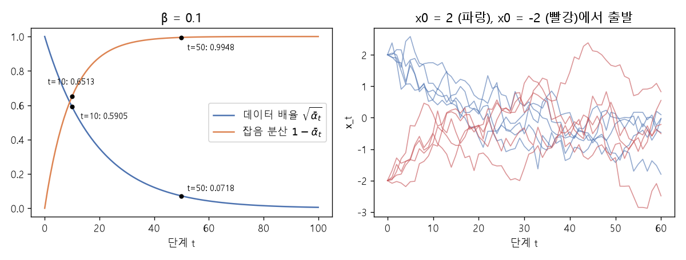

# 가우시안 확산의 순방향 과정 (Forward process of Gaussian diffusion)

[목차로 돌아가기](../../00_MIT%EB%94%A5%EB%9F%AC%EB%8B%9D_%EB%AA%A9%EC%B0%A8.md) · 먼저 볼 것: [MM50_확률_밀도와_정규분포](../../%EC%88%98%ED%95%99%EA%B0%9C%EB%85%90/04_%ED%99%95%EB%A5%A0%EA%B3%BC_%EC%A0%95%EB%B3%B4/MM50_%ED%99%95%EB%A5%A0_%EB%B0%80%EB%8F%84%EC%99%80_%EC%A0%95%EA%B7%9C%EB%B6%84%ED%8F%AC.md), [MM37_순환식_펼치기와_거듭제곱](../../%EC%88%98%ED%95%99%EA%B0%9C%EB%85%90/07_%EA%B5%AC%EC%A1%B0_%EC%95%84%ED%82%A4%ED%85%8D%EC%B2%98/MM37_%EC%88%9C%ED%99%98%EC%8B%9D_%ED%8E%BC%EC%B9%98%EA%B8%B0%EC%99%80_%EA%B1%B0%EB%93%AD%EC%A0%9C%EA%B3%B1.md), [MM36_지수_이동_평균](../../%EC%88%98%ED%95%99%EA%B0%9C%EB%85%90/05_%EC%8B%A0%EA%B2%BD%EB%A7%9D%EC%9D%98_%EA%B3%84%EC%82%B0/MM36_%EC%A7%80%EC%88%98_%EC%9D%B4%EB%8F%99_%ED%8F%89%EA%B7%A0.md) · 쓰는 곳: [Lec14 8.2](../../Lec14_%EC%83%9D%EC%84%B1_%EB%AA%A8%EB%8D%B8_%EA%B8%B0%EC%B4%88.md#82-%EA%B0%80%EC%9A%B0%EC%8B%9C%EC%95%88-%ED%99%95%EC%82%B0%EC%9D%98-%EC%88%98%EC%8B%9D), [Lec14 8.1](../../Lec14_%EC%83%9D%EC%84%B1_%EB%AA%A8%EB%8D%B8_%EA%B8%B0%EC%B4%88.md#81-%EB%8D%B0%EC%9D%B4%ED%84%B0%EB%A5%BC-%EC%9E%A1%EC%9D%8C%EC%9C%BC%EB%A1%9C-%EC%9E%A1%EC%9D%8C%EC%9D%84-%EB%8D%B0%EC%9D%B4%ED%84%B0%EB%A1%9C)

📚 학습 순서 79/99 (11. 생성 모델): ← 이전: [MM52_에너지_함수와_볼츠만_분포](../../%EC%88%98%ED%95%99%EA%B0%9C%EB%85%90/11_%EC%83%9D%EC%84%B1_%EB%AA%A8%EB%8D%B8/MM52_%EC%97%90%EB%84%88%EC%A7%80_%ED%95%A8%EC%88%98%EC%99%80_%EB%B3%BC%EC%B8%A0%EB%A7%8C_%EB%B6%84%ED%8F%AC.md) · 다음: [MM54_가우스_혼합과_주변_우도](../../%EC%88%98%ED%95%99%EA%B0%9C%EB%85%90/11_%EC%83%9D%EC%84%B1_%EB%AA%A8%EB%8D%B8/MM54_%EA%B0%80%EC%9A%B0%EC%8A%A4_%ED%98%BC%ED%95%A9%EA%B3%BC_%EC%A3%BC%EB%B3%80_%EC%9A%B0%EB%8F%84.md) →

> [!NOTE]
> **3줄 요약**
> - [확산 모델](../../00_%EB%94%A5%EB%9F%AC%EB%8B%9D_%EC%9A%A9%EC%96%B4%EC%82%AC%EC%A0%84.md#diffusion-model-%ED%99%95%EC%82%B0-%EB%AA%A8%EB%8D%B8)의 **순방향 과정**은 매 단계 $x_t = \sqrt{1 - \beta}\, x_{t-1} + \sqrt{\beta}\, \epsilon_t$로 데이터를 조금 줄이고 표준 정규 잡음 $\epsilon_t$를 조금 더한다. $x_0 = 2$, $\beta = 0.1$, $\epsilon = 0.5$이면 한 단계 뒤 $0.9487 \times 2 + 0.3162 \times 0.5 = 2.0555$.
> - 여러 단계를 한 번에 쓰면 $x_t = \sqrt{\bar\alpha_t}\, x_0 + \sqrt{1 - \bar\alpha_t}\, \epsilon$, $\bar\alpha_t = (1 - \beta)^t$다. $\beta = 0.1$이면 $\bar\alpha_{10} = 0.3487$, $\bar\alpha_{50} = 0.0052$. 원래 데이터의 몫은 거의 0이 되고 [분산](../../00_%EB%94%A5%EB%9F%AC%EB%8B%9D_%EC%9A%A9%EC%96%B4%EC%82%AC%EC%A0%84.md#variance-%EB%B6%84%EC%82%B0)은 1로 간다. 끝은 **데이터와 무관한 $\mathcal{N}(0, 1)$**이다.
> - $\sqrt{1-\beta}$와 $\sqrt{\beta}$를 쓰는 이유는 [분산](../../00_%EB%94%A5%EB%9F%AC%EB%8B%9D_%EC%9A%A9%EC%96%B4%EC%82%AC%EC%A0%84.md#variance-%EB%B6%84%EC%82%B0)을 1에 맞추기 위해서다. [분산](../../00_%EB%94%A5%EB%9F%AC%EB%8B%9D_%EC%9A%A9%EC%96%B4%EC%82%AC%EC%A0%84.md#variance-%EB%B6%84%EC%82%B0)은 $v_t = (1 - \beta) v_{t-1} + \beta$로 바뀌어 어디서 시작하든 1로 다가간다(4에서 시작하면 3.7, 3.43, 3.187, ...). 역방향 과정은 이 단계를 거꾸로 밟는 [정규분포](../../00_%EB%94%A5%EB%9F%AC%EB%8B%9D_%EC%9A%A9%EC%96%B4%EC%82%AC%EC%A0%84.md#normal-distribution-%EC%A0%95%EA%B7%9C%EB%B6%84%ED%8F%AC)의 평균을 신경망이 예측한다.

## 1. 개념 설명

비유: 잉크 한 방울을 물컵에 떨어뜨린다. 처음엔 모양이 또렷하지만 시간이 갈수록 퍼져서 결국 컵 전체가 고르게 옅은 색이 된다(확산). 퍼지는 과정은 쉽다. 저절로 일어난다. 어려운 건 거꾸로, 고르게 퍼진 물에서 원래 방울 모양을 되찾는 일이다. [확산 모델](../../00_%EB%94%A5%EB%9F%AC%EB%8B%9D_%EC%9A%A9%EC%96%B4%EC%82%AC%EC%A0%84.md#diffusion-model-%ED%99%95%EC%82%B0-%EB%AA%A8%EB%8D%B8)은 **쉬운 방향(퍼뜨리기)을 직접 만들어 놓고, 그 과정을 한 걸음씩 되감는 법을 배운다.**

- **순방향 과정**(forward process) $q$: 정해진 규칙으로 잡음을 더한다. 배울 것이 없다.
- **[잡음 일정](../../00_%EB%94%A5%EB%9F%AC%EB%8B%9D_%EC%9A%A9%EC%96%B4%EC%82%AC%EC%A0%84.md#noise-schedule-%EC%9E%A1%EC%9D%8C-%EC%9D%BC%EC%A0%95)** $\beta_t$: 단계마다 더하는 잡음의 크기([분산](../../00_%EB%94%A5%EB%9F%AC%EB%8B%9D_%EC%9A%A9%EC%96%B4%EC%82%AC%EC%A0%84.md#variance-%EB%B6%84%EC%82%B0)). 작은 값(예: 0.0001~0.02)을 1000단계쯤 쓰는 게 처음 방식이었다. 이 노트는 계산을 쉽게 하려고 모든 단계에 $\beta = 0.1$을 쓴다.
- **누적 계수** $\bar\alpha_t = \prod_{s=1}^{t}(1 - \beta_s)$: $t$단계 뒤 원래 데이터가 남은 몫(제곱). 0에 가까우면 거의 순수 잡음이다.
- **역방향 과정**(reverse process) $p_\theta$: 신경망 $f_\theta(x_t, t)$가 "한 단계 덜 시끄러운 $x_{t-1}$"이 따를 [정규분포](../../00_%EB%94%A5%EB%9F%AC%EB%8B%9D_%EC%9A%A9%EC%96%B4%EC%82%AC%EC%A0%84.md#normal-distribution-%EC%A0%95%EA%B7%9C%EB%B6%84%ED%8F%AC)의 평균을 예측한다. 단계 번호 $t$도 입력으로 넣는다.

## 2. 필요한 이유

[Lec14 8.1](../../Lec14_%EC%83%9D%EC%84%B1_%EB%AA%A8%EB%8D%B8_%EA%B8%B0%EC%B4%88.md#81-%EB%8D%B0%EC%9D%B4%ED%84%B0%EB%A5%BC-%EC%9E%A1%EC%9D%8C%EC%9C%BC%EB%A1%9C-%EC%9E%A1%EC%9D%8C%EC%9D%84-%EB%8D%B0%EC%9D%B4%ED%84%B0%EB%A1%9C)에서 강사는 "데이터를 잡음으로 바꾸기는 쉽고, 그 길을 거꾸로 따라가도록 [지도 학습](../../00_%EB%94%A5%EB%9F%AC%EB%8B%9D_%EC%9A%A9%EC%96%B4%EC%82%AC%EC%A0%84.md#supervised-learning-%EC%A7%80%EB%8F%84-%ED%95%99%EC%8A%B5)한다"고 설명한다. [Lec14 8.2](../../Lec14_%EC%83%9D%EC%84%B1_%EB%AA%A8%EB%8D%B8_%EA%B8%B0%EC%B4%88.md#82-%EA%B0%80%EC%9A%B0%EC%8B%9C%EC%95%88-%ED%99%95%EC%82%B0%EC%9D%98-%EC%88%98%EC%8B%9D)의 순방향 식 $q(x_t \mid x_{t-1})$와 "$t$가 커지면 단위 가우시안이 된다"는 말이 이 노트의 (가), (나)다. 끝이 $\mathcal{N}(0, 1)$이어야 표본을 만들 때 $\mathcal{N}(0, 1)$에서 출발할 수 있다.

## 3. 숫자로 보기

**(가) 한 단계: 줄이고 잡음을 더한다**

$$
x_t = \sqrt{1 - \beta_t}\; x_{t-1} + \sqrt{\beta_t}\; \epsilon_t, \quad \epsilon_t \sim \mathcal{N}(0, 1)
\qquad\Longleftrightarrow\qquad
q(x_t \mid x_{t-1}) = \mathcal{N}\big(\sqrt{1 - \beta_t}\, x_{t-1},\ \beta_t\big)
$$

<details><summary>기호 풀이</summary>

| 기호 | 읽는 법 | 뜻 | 예제 값 |
| --- | --- | --- | --- |
| $x_{t-1}$, $x_t$ | 엑스 티 빼기 일, 엑스 티 | 한 단계 전과 지금의 (잡음 섞인) 데이터 | 2, 2.0555 |
| $\beta_t$ | 베타 티 | 이번 단계에 더하는 잡음의 [분산](../../00_%EB%94%A5%EB%9F%AC%EB%8B%9D_%EC%9A%A9%EC%96%B4%EC%82%AC%EC%A0%84.md#variance-%EB%B6%84%EC%82%B0) | 0.1 |
| $\sqrt{1 - \beta_t}$ | 루트 일 빼기 베타 | 이전 값을 줄이는 배율 | 0.9487 |
| $\sqrt{\beta_t}$ | 루트 베타 | 잡음의 배율 (표준편차) | 0.3162 |
| $\epsilon_t$ | 엡실론 티 | 표준 [정규분포](../../00_%EB%94%A5%EB%9F%AC%EB%8B%9D_%EC%9A%A9%EC%96%B4%EC%82%AC%EC%A0%84.md#normal-distribution-%EC%A0%95%EA%B7%9C%EB%B6%84%ED%8F%AC)에서 뽑은 잡음 | 0.5 |
| $q(x_t \mid x_{t-1})$ | 큐 | 이전 값이 주어졌을 때 지금 값의 분포 | |

</details>

<details><summary>예제와 풀이</summary>

**문제**: 데이터 값 $x_0 = 2$에 잡음 [분산](../../00_%EB%94%A5%EB%9F%AC%EB%8B%9D_%EC%9A%A9%EC%96%B4%EC%82%AC%EC%A0%84.md#variance-%EB%B6%84%EC%82%B0) $\beta = 0.1$로 한 단계 잡음을 더한다. 뽑힌 잡음이 $\epsilon_1 = 0.5$일 때 $x_1$은?

**주어진 값**
- $x_0 = 2$ (원래 데이터 값)
- $\beta_1 = 0.1$ (잡음의 [분산](../../00_%EB%94%A5%EB%9F%AC%EB%8B%9D_%EC%9A%A9%EC%96%B4%EC%82%AC%EC%A0%84.md#variance-%EB%B6%84%EC%82%B0))
- $\epsilon_1 = 0.5$ (표준 [정규분포](../../00_%EB%94%A5%EB%9F%AC%EB%8B%9D_%EC%9A%A9%EC%96%B4%EC%82%AC%EC%A0%84.md#normal-distribution-%EC%A0%95%EA%B7%9C%EB%B6%84%ED%8F%AC)에서 뽑힌 잡음)

**풀이**
1. 식을 그대로 쓴다: $x_t = \sqrt{1 - \beta_t}\, x_{t-1} + \sqrt{\beta_t}\, \epsilon_t$
2. 값을 대입한다: $x_1 = \sqrt{1 - 0.1} \times 2 + \sqrt{0.1} \times 0.5$
3. 루트 안을 뺀다: $1 - 0.1 = 0.9$
4. 제곱근을 구한다. $\sqrt{a}$는 제곱해서 $a$가 되는 양수다: $\sqrt{0.9} = 0.9487$
5. $\sqrt{0.1} = 0.3162$
6. 앞 항을 곱한다: $0.9487 \times 2 = 1.8974$
7. 뒤 항을 곱한다: $0.3162 \times 0.5 = 0.1581$
8. 더한다: $1.8974 + 0.1581 = 2.0555$

**답**: $x_1 = $ **2.0555**. 데이터는 0.9487배로 줄고 잡음 0.1581이 더해졌다.

</details>

<details><summary>내 이해</summary>


</details>

**(나) 여러 단계를 한 번에**

$$
x_t = \sqrt{\bar\alpha_t}\; x_0 + \sqrt{1 - \bar\alpha_t}\; \epsilon, \qquad \bar\alpha_t = \prod_{s=1}^{t} (1 - \beta_s)
$$

<details><summary>기호 풀이</summary>

| 기호 | 읽는 법 | 뜻 | 예제 값 |
| --- | --- | --- | --- |
| $x_0$ | 엑스 영 | 잡음 없는 원래 데이터 | 2 |
| $\bar\alpha_t$ | 알파 바 티 | 데이터가 남은 몫. $(1 - \beta)$를 $t$번 곱함 | $0.9^{10} = 0.3487$ |
| $\prod_{s=1}^{t}$ | 파이(곱) | 1부터 $t$까지 모두 곱한다 | |
| $\sqrt{\bar\alpha_t}$ | 루트 알파 바 | 데이터의 배율 | 0.5905 |
| $\sqrt{1 - \bar\alpha_t}$ | 루트 일 빼기 알파 바 | 잡음의 배율 | 0.807 |
| $\epsilon$ | 엡실론 | 표준 정규 잡음 하나 (여러 단계 잡음을 합친 것) | 0.5 |

</details>

<details><summary>예제와 풀이</summary>

**문제**: $x_0 = 2$에 $\beta = 0.1$로 10단계 잡음을 더한 결과를 한 번에 구한다. 합친 잡음이 $\epsilon = 0.5$라면 $x_{10}$은?

**주어진 값**
- $x_0 = 2$ (원래 데이터 값)
- $\beta_s = 0.1$ (모든 단계의 잡음 [분산](../../00_%EB%94%A5%EB%9F%AC%EB%8B%9D_%EC%9A%A9%EC%96%B4%EC%82%AC%EC%A0%84.md#variance-%EB%B6%84%EC%82%B0))
- $t = 10$ (단계 수)
- $\epsilon = 0.5$ (합친 표준 정규 잡음)

**풀이**
1. 식을 그대로 쓴다: $x_t = \sqrt{\bar\alpha_t}\, x_0 + \sqrt{1 - \bar\alpha_t}\, \epsilon$, $\bar\alpha_t = \prod_{s=1}^{t}(1 - \beta_s)$
2. 값을 대입한다: $x_{10} = \sqrt{\bar\alpha_{10}} \times 2 + \sqrt{1 - \bar\alpha_{10}} \times 0.5$, $\bar\alpha_{10} = (1 - 0.1)^{10}$
3. 괄호 안을 뺀다: $1 - 0.1 = 0.9$
4. 곱을 풀어 쓴다(같은 수를 10번 곱함): $0.9 \times 0.9 \times \cdots \times 0.9 = 0.9^{10} = 0.3487$
5. 제곱근을 구한다: $\sqrt{0.3487} = 0.5905$
6. 1에서 뺀다: $1 - 0.3487 = 0.6513$
7. 제곱근을 구한다: $\sqrt{0.6513} = 0.807$
8. 앞 항을 곱한다: $0.5905 \times 2 = 1.181$
9. 뒤 항을 곱한다: $0.807 \times 0.5 = 0.4035$
10. 더한다: $1.181 + 0.4035 = 1.5845$

**답**: $x_{10} = $ **1.5845**. 10단계 뒤 원래 데이터는 0.5905배만 남는다.

</details>

<details><summary>내 이해</summary>


</details>

| 단계 $t$ | $\bar\alpha_t = 0.9^t$ | 데이터 배율 $\sqrt{\bar\alpha_t}$ | 잡음 [분산](../../00_%EB%94%A5%EB%9F%AC%EB%8B%9D_%EC%9A%A9%EC%96%B4%EC%82%AC%EC%A0%84.md#variance-%EB%B6%84%EC%82%B0) $1 - \bar\alpha_t$ |
|---|---|---|---|
| 1 | 0.9 | 0.9487 | 0.1 |
| 10 | 0.3487 | 0.5905 | 0.6513 |
| 50 | 0.0052 | 0.0718 | 0.9948 |
| 100 | 0.0000 | 0.0052 | 1.0 |

**(다) [분산](../../00_%EB%94%A5%EB%9F%AC%EB%8B%9D_%EC%9A%A9%EC%96%B4%EC%82%AC%EC%A0%84.md#variance-%EB%B6%84%EC%82%B0)이 1로 가는 이유**: 서로 독립인 두 값을 더하면 [분산](../../00_%EB%94%A5%EB%9F%AC%EB%8B%9D_%EC%9A%A9%EC%96%B4%EC%82%AC%EC%A0%84.md#variance-%EB%B6%84%EC%82%B0)도 더해지고, $a$배하면 [분산](../../00_%EB%94%A5%EB%9F%AC%EB%8B%9D_%EC%9A%A9%EC%96%B4%EC%82%AC%EC%A0%84.md#variance-%EB%B6%84%EC%82%B0)은 $a^2$배다. 그래서 $v_t = (1 - \beta) v_{t-1} + \beta$. [분산](../../00_%EB%94%A5%EB%9F%AC%EB%8B%9D_%EC%9A%A9%EC%96%B4%EC%82%AC%EC%A0%84.md#variance-%EB%B6%84%EC%82%B0) 4에서 시작하면 $0.9 \times 4 + 0.1 = 3.7$, 다음은 3.43, 3.187로 1에 다가간다. $v = 1$이면 $0.9 + 0.1 = 1$로 그대로다. 데이터가 어떤 분포든 끝은 $\mathcal{N}(0, 1)$이다.


*▲ 직접 그린 그림: $\beta = 0.1$일 때 데이터 배율 $\sqrt{\bar\alpha_t}$(파랑)는 0으로, 잡음 [분산](../../00_%EB%94%A5%EB%9F%AC%EB%8B%9D_%EC%9A%A9%EC%96%B4%EC%82%AC%EC%A0%84.md#variance-%EB%B6%84%EC%82%B0) $1 - \bar\alpha_t$(주황)는 1로 간다. 오른쪽은 $x_0 = 2$와 $x_0 = -2$에서 출발한 경로 다섯 개씩. 50단계쯤이면 출발점을 구별할 수 없다*

## 4. 코드로 확인

```python
# [함수] import math: sqrt
import math
# [변수] b: 모든 단계의 잡음 분산 0.1
b = 0.1
# [연결] 본문 3절 (가) → √0.9 = 0.9487, √0.1 = 0.3162, x1 = 2.0555
print(round(math.sqrt(1 - b), 4), round(math.sqrt(b), 4), round(math.sqrt(1 - b) * 2 + math.sqrt(b) * 0.5, 4))
# [함수] for: 단계 수별 ᾱ, √ᾱ, 1 - ᾱ
# [연결] 본문 3절 표
for t in (1, 10, 50, 100):
    ab = (1 - b) ** t
    print(t, round(ab, 4), round(math.sqrt(ab), 4), round(1 - ab, 4))
# [연결] 본문 3절 (나)의 예제 → x10 = 1.5845
ab = 0.9 ** 10
print(round(math.sqrt(ab) * 2 + math.sqrt(1 - ab) * 0.5, 4))
# [변수] v: 분산. 4에서 시작해 v = (1-β)v + β를 세 번
v, vs = 4.0, []
for _ in range(3):
    v = (1 - b) * v + b
    vs.append(round(v, 4))
# [연결] 본문 3절 (다) → [3.7, 3.43, 3.187]
print(vs)
# [함수] np.random.default_rng(0): 재현 가능한 난수 생성기
# [변수] x: x0 = 2에서 출발한 10만 개 경로를 50단계 진행
rng = np.random.default_rng(0)
x = np.full(100000, 2.0)
for _ in range(50):
    x = math.sqrt(1 - b) * x + math.sqrt(b) * rng.standard_normal(x.size)
# [연결] 평균은 2 × 0.0718 = 0.14 근처, 분산은 0.9948 근처(반올림 1.0). 거의 N(0, 1)
print(round(x.mean(), 2), round(x.var(), 2))
```

**실행 결과**:

```text
0.9487 0.3162 2.0555
1 0.9 0.9487 0.1
10 0.3487 0.5905 0.6513
50 0.0052 0.0718 0.9948
100 0.0 0.0052 1.0
1.5845
[3.7, 3.43, 3.187]
0.14 1.0
```

> [!WARNING]
> **⚠ 주의**
> - $\beta$는 **[분산](../../00_%EB%94%A5%EB%9F%AC%EB%8B%9D_%EC%9A%A9%EC%96%B4%EC%82%AC%EC%A0%84.md#variance-%EB%B6%84%EC%82%B0)**이고 잡음에 곱하는 배율은 $\sqrt{\beta}$다. 그냥 $x + \beta\epsilon$처럼 더하면 [분산](../../00_%EB%94%A5%EB%9F%AC%EB%8B%9D_%EC%9A%A9%EC%96%B4%EC%82%AC%EC%A0%84.md#variance-%EB%B6%84%EC%82%B0)이 끝없이 커져 끝이 $\mathcal{N}(0, 1)$이 되지 않는다.
> - 닫힌 식 (나)의 $\epsilon$은 단계마다 뽑은 잡음들을 합친 **하나의** 표준 정규 잡음이다. 학습할 때는 이 식으로 원하는 $t$의 $x_t$를 한 번에 만들어, 단계를 하나씩 돌릴 필요가 없다.
> - 이 노트의 $\beta = 0.1$은 계산용이다. 실제 모델은 작은 $\beta$를 많은 단계로 쓰고, 단계에 따라 $\beta_t$를 바꾼다([잡음 일정](../../00_%EB%94%A5%EB%9F%AC%EB%8B%9D_%EC%9A%A9%EC%96%B4%EC%82%AC%EC%A0%84.md#noise-schedule-%EC%9E%A1%EC%9D%8C-%EC%9D%BC%EC%A0%95)).

## 5. 개념 재확인

<details><summary>1. $x_{t-1} = 1$, $\beta = 0.19$, 뽑힌 잡음 $\epsilon = -1$이면 $x_t$는?</summary>

| 단계 | 하는 일 | 계산 | 결과 |
|---|---|---|---|
| 1 | 데이터 배율 | $\sqrt{1 - 0.19}$ | 0.9 |
| 2 | 잡음 배율 | $\sqrt{0.19}$ | 0.4359 |
| 3 | 더하기 | $0.9 \times 1 + 0.4359 \times (-1)$ | 0.4641 |

**① 쓰는 식**
$$x_t = \sqrt{1 - \beta}\; x_{t-1} + \sqrt{\beta}\; \epsilon$$
- 위 식 ← ② (데이터 배율), ③ (잡음 배율), ④ (더하기)에서 쓴다.
```python
# [함수] import math: sqrt
import math                                               # ①
# [변수] a = 0.9: √(1 - 0.19)
a = math.sqrt(1 - 0.19)                                   # ②
# [변수] s = 0.4359: √0.19
s = math.sqrt(0.19)                                       # ③
# [연결] 0.9 0.4359 0.4641
print(round(a, 4), round(s, 4), round(a * 1 + s * -1, 4))   # ④
```

**주어진 값**
- $x_{t-1} = 1$ (한 단계 전 값)
- $\beta = 0.19$ (잡음 [분산](../../00_%EB%94%A5%EB%9F%AC%EB%8B%9D_%EC%9A%A9%EC%96%B4%EC%82%AC%EC%A0%84.md#variance-%EB%B6%84%EC%82%B0))
- $\epsilon = -1$ (뽑힌 표준 정규 잡음)

**풀이**
1. 식을 그대로 쓴다: $x_t = \sqrt{1 - \beta}\, x_{t-1} + \sqrt{\beta}\, \epsilon$
2. 값을 대입한다: $x_t = \sqrt{1 - 0.19} \times 1 + \sqrt{0.19} \times (-1)$
3. (②) 루트 안을 뺀다: $1 - 0.19 = 0.81$
4. (②) 제곱근을 구한다($0.9 \times 0.9 = 0.81$이므로): $\sqrt{0.81} = 0.9$
5. (③) 제곱근을 구한다: $\sqrt{0.19} = 0.4359$
6. (④) 앞 항을 곱한다: $0.9 \times 1 = 0.9$
7. (④) 뒤 항을 곱한다: $0.4359 \times (-1) = -0.4359$
8. (④) 더한다: $0.9 + (-0.4359) = 0.4641$

**답**: $x_t = $ **0.4641**.

</details>

<details><summary>2. $\beta = 0.19$로 3단계를 가면 $\bar\alpha_3$, 데이터 배율, 잡음 배율은?</summary>

| 단계 | 하는 일 | 계산 | 결과 |
|---|---|---|---|
| 1 | 누적 곱 | $0.81^3$ | 0.5314 |
| 2 | 데이터 배율 | $\sqrt{0.5314}$ | 0.729 |
| 3 | 잡음 배율 | $\sqrt{1 - 0.5314}$ | 0.6845 |

**① 쓰는 식**
$$\bar\alpha_t = \prod_{s=1}^{t}(1 - \beta_s), \qquad x_t = \sqrt{\bar\alpha_t}\, x_0 + \sqrt{1 - \bar\alpha_t}\, \epsilon$$
- 위 식 ← ② (누적 곱), ③ (데이터 배율), ④ (잡음 배율)에서 쓴다.
```python
# [함수] import math: sqrt
import math                                               # ①
# [변수] ab = 0.5314: (1 - 0.19)를 세 번 곱한 값
ab = (1 - 0.19) ** 3                                      # ②
# [연결] 0.5314 0.729 0.6845
print(round(ab, 4), round(math.sqrt(ab), 4), round(math.sqrt(1 - ab), 4))   # ③④
```

**주어진 값**
- $\beta_1 = \beta_2 = \beta_3 = 0.19$ (단계별 잡음 [분산](../../00_%EB%94%A5%EB%9F%AC%EB%8B%9D_%EC%9A%A9%EC%96%B4%EC%82%AC%EC%A0%84.md#variance-%EB%B6%84%EC%82%B0))
- $t = 3$ (단계 수)

**풀이**
1. 식을 그대로 쓴다: $\bar\alpha_t = \prod_{s=1}^{t}(1 - \beta_s)$
2. 값을 대입한다: $\bar\alpha_3 = (1 - 0.19)(1 - 0.19)(1 - 0.19)$ (곱 기호를 세 항으로 풀어 썼다)
3. (②) 괄호 안을 뺀다: $1 - 0.19 = 0.81$
4. (②) 처음 두 개를 곱한다: $0.81 \times 0.81 = 0.6561$
5. (②) 셋째를 곱한다: $0.6561 \times 0.81 = 0.5314$
6. (③) 제곱근을 구한다($0.9^3 = 0.729$): $\sqrt{0.5314} = 0.729$
7. (④) 1에서 뺀다: $1 - 0.5314 = 0.4686$
8. (④) 제곱근을 구한다: $\sqrt{0.4686} = 0.6845$

**답**: $\bar\alpha_3 = $ **0.5314**, 데이터 배율 **0.729**, 잡음 배율 **0.6845**. 두 배율의 제곱을 더하면 $0.5314 + 0.4686 = 1$이다.

</details>

## 예제 풀기

[예제 10문제 풀기](../../%EC%98%88%EC%A0%9C/11_%EC%83%9D%EC%84%B1_%EB%AA%A8%EB%8D%B8/%EC%98%88%EC%A0%9C_MM53_%EA%B0%80%EC%9A%B0%EC%8B%9C%EC%95%88_%ED%99%95%EC%82%B0%EC%9D%98_%EC%88%9C%EB%B0%A9%ED%96%A5_%EA%B3%BC%EC%A0%95.md)

<details><summary>내 이해</summary>


</details>
