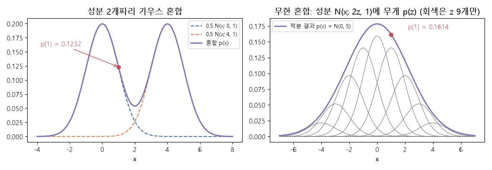

# 가우스 혼합과 주변 우도 (Gaussian mixture model, Marginal likelihood)

[목차로 돌아가기](../../00_MIT%EB%94%A5%EB%9F%AC%EB%8B%9D_%EB%AA%A9%EC%B0%A8.md) · 먼저 볼 것: [MM50_확률_밀도와_정규분포](../../%EC%88%98%ED%95%99%EA%B0%9C%EB%85%90/04_%ED%99%95%EB%A5%A0%EA%B3%BC_%EC%A0%95%EB%B3%B4/MM50_%ED%99%95%EB%A5%A0_%EB%B0%80%EB%8F%84%EC%99%80_%EC%A0%95%EA%B7%9C%EB%B6%84%ED%8F%AC.md), [M02_시그마와_평균](../../%EC%88%98%ED%95%99%EA%B0%9C%EB%85%90/01_%EC%88%98%EC%99%80_%ED%95%A8%EC%88%98/M02_%EC%8B%9C%EA%B7%B8%EB%A7%88%EC%99%80_%ED%8F%89%EA%B7%A0.md), [MM07_리만_합과_보편_근사](../../%EC%88%98%ED%95%99%EA%B0%9C%EB%85%90/06_%EA%B7%BC%EC%82%AC_%EC%9D%B4%EB%A1%A0/MM07_%EB%A6%AC%EB%A7%8C_%ED%95%A9%EA%B3%BC_%EB%B3%B4%ED%8E%B8_%EA%B7%BC%EC%82%AC.md), [M08_확률_기초](../../%EC%88%98%ED%95%99%EA%B0%9C%EB%85%90/04_%ED%99%95%EB%A5%A0%EA%B3%BC_%EC%A0%95%EB%B3%B4/M08_%ED%99%95%EB%A5%A0_%EA%B8%B0%EC%B4%88.md), [MM86_정적분과_넓이](../../%EC%88%98%ED%95%99%EA%B0%9C%EB%85%90/02_%EB%AF%B8%EB%B6%84/MM86_%EC%A0%95%EC%A0%81%EB%B6%84%EA%B3%BC_%EB%84%93%EC%9D%B4.md) · 쓰는 곳: [Lec15 3](../../Lec15_%EB%B3%80%EB%B6%84_%EC%98%A4%ED%86%A0%EC%9D%B8%EC%BD%94%EB%8D%94.md#3-%EA%B0%80%EC%9A%B0%EC%8A%A4-%ED%98%BC%ED%95%A9), [Lec15 4.1](../../Lec15_%EB%B3%80%EB%B6%84_%EC%98%A4%ED%86%A0%EC%9D%B8%EC%BD%94%EB%8D%94.md#41-%EC%8B%A0%EA%B2%BD%EB%A7%9D%EC%9C%BC%EB%A1%9C-%EB%AC%B4%ED%95%9C-%ED%98%BC%ED%95%A9-%EB%A7%8C%EB%93%A4%EA%B8%B0), [Lec15 4.2](../../Lec15_%EB%B3%80%EB%B6%84_%EC%98%A4%ED%86%A0%EC%9D%B8%EC%BD%94%EB%8D%94.md#42-%EC%9E%A0%EC%9E%AC-%EB%B3%80%EC%88%98-%EB%AA%A8%EB%8D%B8%EA%B3%BC-%EC%A3%BC%EB%B3%80-%EC%9A%B0%EB%8F%84)

📚 학습 순서 80/99 (11. 생성 모델): ← 이전: [MM53_가우시안_확산의_순방향_과정](../../%EC%88%98%ED%95%99%EA%B0%9C%EB%85%90/11_%EC%83%9D%EC%84%B1_%EB%AA%A8%EB%8D%B8/MM53_%EA%B0%80%EC%9A%B0%EC%8B%9C%EC%95%88_%ED%99%95%EC%82%B0%EC%9D%98_%EC%88%9C%EB%B0%A9%ED%96%A5_%EA%B3%BC%EC%A0%95.md) · 다음: [MM55_몬테카를로와_중요도_샘플링](../../%EC%88%98%ED%95%99%EA%B0%9C%EB%85%90/11_%EC%83%9D%EC%84%B1_%EB%AA%A8%EB%8D%B8/MM55_%EB%AA%AC%ED%85%8C%EC%B9%B4%EB%A5%BC%EB%A1%9C%EC%99%80_%EC%A4%91%EC%9A%94%EB%8F%84_%EC%83%98%ED%94%8C%EB%A7%81.md) →

> [!NOTE]
> **3줄 요약**
> - **가우스 혼합**은 가우스(종 모양) 여러 개를 [가중치](../../00_%EB%94%A5%EB%9F%AC%EB%8B%9D_%EC%9A%A9%EC%96%B4%EC%82%AC%EC%A0%84.md#weight-%EA%B0%80%EC%A4%91%EC%B9%98)를 붙여 더한 밀도다. 중심 0과 4인 가우스를 반씩 섞으면 $x = 1$의 밀도는 $0.5 \times 0.2420 + 0.5 \times 0.0044 = 0.1232$.
> - 성분이 $k$개, 차원이 $d$이면 매개변수는 $k(1 + d + d^2)$개다($k = 5$, $d = 2$면 35개). 성분을 무한히 두려면 성분 "번호"를 연속 변수 $z$로 바꾸고 신경망 $g(z)$가 성분을 내게 한다. 합은 **적분**이 된다.
> - $p(x) = \int p(x\mid z)p(z)\,dz$처럼 숨은 변수를 적분해 없앤 [우도](../../00_%EB%94%A5%EB%9F%AC%EB%8B%9D_%EC%9A%A9%EC%96%B4%EC%82%AC%EC%A0%84.md#likelihood-%EC%9A%B0%EB%8F%84)가 **[주변 우도](../../00_%EB%94%A5%EB%9F%AC%EB%8B%9D_%EC%9A%A9%EC%96%B4%EC%82%AC%EC%A0%84.md#marginal-likelihood-%EC%A3%BC%EB%B3%80-%EC%9A%B0%EB%8F%84)**다. $z \sim \mathcal{N}(0,1)$, $x \mid z \sim \mathcal{N}(2z, 1)$이면 $p(1) = \mathcal{N}(1; 0, 5) = 0.1614$이고, [리만 합](../../00_%EB%94%A5%EB%9F%AC%EB%8B%9D_%EC%9A%A9%EC%96%B4%EC%82%AC%EC%A0%84.md#riemann-sum-%EB%A6%AC%EB%A7%8C-%ED%95%A9)(간격 0.1)으로 계산해도 0.1614다.

## 1. 개념 설명

비유: 모래로 복잡한 모양의 언덕을 만들고 싶다. 삽으로 **작은 모래더미**(가우스)를 여러 곳에 쏟으면 된다. 더미마다 위치(평균), 퍼짐([분산](../../00_%EB%94%A5%EB%9F%AC%EB%8B%9D_%EC%9A%A9%EC%96%B4%EC%82%AC%EC%A0%84.md#variance-%EB%B6%84%EC%82%B0)), 모래 양([가중치](../../00_%EB%94%A5%EB%9F%AC%EB%8B%9D_%EC%9A%A9%EC%96%B4%EC%82%AC%EC%A0%84.md#weight-%EA%B0%80%EC%A4%91%EC%B9%98))을 정한다. 더미가 작고 많을수록 원하는 모양에 가까워진다.

- **유한 혼합**: 더미가 $k$개. 밀도는 $p(x) = \sum_i w_i \mathcal{N}(x; \mu_i, \Sigma_i)$이고, [가중치](../../00_%EB%94%A5%EB%9F%AC%EB%8B%9D_%EC%9A%A9%EC%96%B4%EC%82%AC%EC%A0%84.md#weight-%EA%B0%80%EC%A4%91%EC%B9%98)는 양수이며 합이 1이다(그래야 전체 넓이가 1).
- **무한 혼합**: 더미 번호를 다이얼 $z$로 바꾼다. 다이얼을 돌리면 신경망 $g$가 그 위치의 더미(평균 $g^\mu(z)$, [분산](../../00_%EB%94%A5%EB%9F%AC%EB%8B%9D_%EC%9A%A9%EC%96%B4%EC%82%AC%EC%A0%84.md#variance-%EB%B6%84%EC%82%B0) $g^\Sigma(z)$)를 알려 준다. 다이얼 눈금마다 모래 양은 $p(z)$다. 매개변수는 신경망의 가중치뿐이라 유한하다.
- **주변화**: $p(x\mid z)p(z) = p(x, z)$를 모든 $z$에 대해 더하면(적분하면) $z$가 사라지고 $p(x)$만 남는다. $z$가 이산이면 합, 연속이면 적분이다.

## 2. 필요한 이유

[Lec15 3](../../Lec15_%EB%B3%80%EB%B6%84_%EC%98%A4%ED%86%A0%EC%9D%B8%EC%BD%94%EB%8D%94.md#3-%EA%B0%80%EC%9A%B0%EC%8A%A4-%ED%98%BC%ED%95%A9)에서 강사는 [VAE](../../00_%EB%94%A5%EB%9F%AC%EB%8B%9D_%EC%9A%A9%EC%96%B4%EC%82%AC%EC%A0%84.md#variational-autoencoder-vae-%EB%B3%80%EB%B6%84-%EC%98%A4%ED%86%A0%EC%9D%B8%EC%BD%94%EB%8D%94)를 "데이터 분포에 가우스 혼합을 맞추는 모델"로 소개하고, [4.1](../../Lec15_%EB%B3%80%EB%B6%84_%EC%98%A4%ED%86%A0%EC%9D%B8%EC%BD%94%EB%8D%94.md#41-%EC%8B%A0%EA%B2%BD%EB%A7%9D%EC%9C%BC%EB%A1%9C-%EB%AC%B4%ED%95%9C-%ED%98%BC%ED%95%A9-%EB%A7%8C%EB%93%A4%EA%B8%B0)에서 신경망으로 무한 혼합을 만든다. [학습](../../00_%EB%94%A5%EB%9F%AC%EB%8B%9D_%EC%9A%A9%EC%96%B4%EC%82%AC%EC%A0%84.md#training-%ED%95%99%EC%8A%B5) 목표가 이 적분([주변 우도](../../00_%EB%94%A5%EB%9F%AC%EB%8B%9D_%EC%9A%A9%EC%96%B4%EC%82%AC%EC%A0%84.md#marginal-likelihood-%EC%A3%BC%EB%B3%80-%EC%9A%B0%EB%8F%84))의 [로그](../../00_%EB%94%A5%EB%9F%AC%EB%8B%9D_%EC%9A%A9%EC%96%B4%EC%82%AC%EC%A0%84.md#log-ln-%EB%A1%9C%EA%B7%B8)이고, 이 적분이 어렵다는 것이 [VAE](../../00_%EB%94%A5%EB%9F%AC%EB%8B%9D_%EC%9A%A9%EC%96%B4%EC%82%AC%EC%A0%84.md#variational-autoencoder-vae-%EB%B3%80%EB%B6%84-%EC%98%A4%ED%86%A0%EC%9D%B8%EC%BD%94%EB%8D%94)의 나머지 요령(몬테카를로, [중요도 샘플링](../../00_%EB%94%A5%EB%9F%AC%EB%8B%9D_%EC%9A%A9%EC%96%B4%EC%82%AC%EC%A0%84.md#importance-sampling-%EC%A4%91%EC%9A%94%EB%8F%84-%EC%83%98%ED%94%8C%EB%A7%81), 인코더)이 나오는 출발점이다([Lec15 5](../../Lec15_%EB%B3%80%EB%B6%84_%EC%98%A4%ED%86%A0%EC%9D%B8%EC%BD%94%EB%8D%94.md#5-%EB%AA%A9%EC%A0%81-%ED%95%A8%EC%88%98%EC%99%80-%EB%8B%A4%EB%A3%A8%EA%B8%B0-%ED%9E%98%EB%93%A0-%EC%A0%81%EB%B6%84)).

## 3. 숫자로 보기

**유한 혼합** (1차원, $w = (0.5, 0.5)$, $\mu = (0, 4)$, [분산](../../00_%EB%94%A5%EB%9F%AC%EB%8B%9D_%EC%9A%A9%EC%96%B4%EC%82%AC%EC%A0%84.md#variance-%EB%B6%84%EC%82%B0) 1, $x = 1$)
- 첫 성분: $\mathcal{N}(1; 0, 1) = e^{-0.5}/\sqrt{2\pi} = 0.6065 / 2.5066 = 0.2420$
- 둘째 성분: $\mathcal{N}(1; 4, 1) = e^{-4.5}/\sqrt{2\pi} = 0.0111 / 2.5066 = 0.0044$
- [가중합](../../00_%EB%94%A5%EB%9F%AC%EB%8B%9D_%EC%9A%A9%EC%96%B4%EC%82%AC%EC%A0%84.md#weighted-sum-%EA%B0%80%EC%A4%91%ED%95%A9): $0.5 \times 0.2420 + 0.5 \times 0.0044 = 0.1210 + 0.0022 = 0.1232$

**매개변수 개수** ($k = 5$, $d = 2$, 공분산 전체)
- 성분 하나: [가중치](../../00_%EB%94%A5%EB%9F%AC%EB%8B%9D_%EC%9A%A9%EC%96%B4%EC%82%AC%EC%A0%84.md#weight-%EA%B0%80%EC%A4%91%EC%B9%98) 1 + 평균 2 + 공분산 $2 \times 2 = 4$ → 7
- 전체: $5 \times 7 = 35$

**무한 혼합** ($z \sim \mathcal{N}(0, 1)$, $g^\mu(z) = 2z$, [분산](../../00_%EB%94%A5%EB%9F%AC%EB%8B%9D_%EC%9A%A9%EC%96%B4%EC%82%AC%EC%A0%84.md#variance-%EB%B6%84%EC%82%B0) 1, $x = 1$)
- $g$가 직선이면 결과도 [정규분포](../../00_%EB%94%A5%EB%9F%AC%EB%8B%9D_%EC%9A%A9%EC%96%B4%EC%82%AC%EC%A0%84.md#normal-distribution-%EC%A0%95%EA%B7%9C%EB%B6%84%ED%8F%AC)다. 평균 $0$, [분산](../../00_%EB%94%A5%EB%9F%AC%EB%8B%9D_%EC%9A%A9%EC%96%B4%EC%82%AC%EC%A0%84.md#variance-%EB%B6%84%EC%82%B0) $2^2 \times 1 + 1 = 5$
- $\mathcal{N}(1; 0, 5) = e^{-1/10}/\sqrt{2\pi \times 5} = 0.9048 / 5.6050 = 0.1614$
- 적분을 [리만 합](../../00_%EB%94%A5%EB%9F%AC%EB%8B%9D_%EC%9A%A9%EC%96%B4%EC%82%AC%EC%A0%84.md#riemann-sum-%EB%A6%AC%EB%A7%8C-%ED%95%A9)으로 직접 계산하면 (4절 코드)

| $z$ 간격 | [리만 합](../../00_%EB%94%A5%EB%9F%AC%EB%8B%9D_%EC%9A%A9%EC%96%B4%EC%82%AC%EC%A0%84.md#riemann-sum-%EB%A6%AC%EB%A7%8C-%ED%95%A9) | 참값과 차이 |
|---|---|---|
| 1 | 0.1564 | -0.0050 |
| 0.1 | 0.1614 | 0 |


*▲ 직접 그린 그림: 왼쪽은 성분 2개짜리 혼합(점선은 [가중치](../../00_%EB%94%A5%EB%9F%AC%EB%8B%9D_%EC%9A%A9%EC%96%B4%EC%82%AC%EC%A0%84.md#weight-%EA%B0%80%EC%A4%91%EC%B9%98)를 곱한 성분, 보라는 합). $x = 1$에서 0.1232. 오른쪽은 무한 혼합. 회색은 $z$ 9개의 성분 $p(z)\mathcal{N}(x; 2z, 1)$, 보라는 모든 $z$를 적분한 $\mathcal{N}(0, 5)$. $x = 1$에서 0.1614*

[주변 우도](../../00_%EB%94%A5%EB%9F%AC%EB%8B%9D_%EC%9A%A9%EC%96%B4%EC%82%AC%EC%A0%84.md#marginal-likelihood-%EC%A3%BC%EB%B3%80-%EC%9A%B0%EB%8F%84)를 식으로 쓰면 다음과 같다.

$$
p(x) = \int p(x\mid z)\, p(z)\, dz \qquad \Big(z\text{가 이산이면 } p(x) = \sum_{z} p(x\mid z)\, p(z)\Big)
$$

<details><summary>기호 풀이</summary>

| 기호 | 읽는 법 | 뜻 | 예제 값 |
| --- | --- | --- | --- |
| $p(x)$ | 피 엑스 | [주변 우도](../../00_%EB%94%A5%EB%9F%AC%EB%8B%9D_%EC%9A%A9%EC%96%B4%EC%82%AC%EC%A0%84.md#marginal-likelihood-%EC%A3%BC%EB%B3%80-%EC%9A%B0%EB%8F%84). $x$의 밀도 | 0.1232 |
| $z$ | 제트 | [잠재 변수](../../00_%EB%94%A5%EB%9F%AC%EB%8B%9D_%EC%9A%A9%EC%96%B4%EC%82%AC%EC%A0%84.md#latent-variable-%EC%9E%A0%EC%9E%AC-%EB%B3%80%EC%88%98) (성분 번호) | A, B |
| $p(z)$ | 피 제트 | [사전 분포](../../00_%EB%94%A5%EB%9F%AC%EB%8B%9D_%EC%9A%A9%EC%96%B4%EC%82%AC%EC%A0%84.md#prior-posterior-%EC%82%AC%EC%A0%84-%EB%B6%84%ED%8F%AC%EC%99%80-%EC%82%AC%ED%9B%84-%EB%B6%84%ED%8F%AC). 혼합 [가중치](../../00_%EB%94%A5%EB%9F%AC%EB%8B%9D_%EC%9A%A9%EC%96%B4%EC%82%AC%EC%A0%84.md#weight-%EA%B0%80%EC%A4%91%EC%B9%98) | 0.5, 0.5 |
| $p(x\mid z)$ | 피 엑스 바 제트 | 성분 $z$가 $x$에 주는 밀도 | 0.2420, 0.0044 |
| $\int \cdots dz$ | 적분 | 연속인 $z$ 모두에 대해 더하기 | |
| $\sum_z$ | 시그마 | 이산인 $z$ 모두에 대해 더하기 | |

</details>

<details><summary>예제와 풀이</summary>

**문제**: 동전을 던져 앞면(A)이면 $\mathcal{N}(0, 1)$, 뒷면(B)이면 $\mathcal{N}(4, 1)$에서 $x$를 뽑는다. $x = 1$의 [주변 우도](../../00_%EB%94%A5%EB%9F%AC%EB%8B%9D_%EC%9A%A9%EC%96%B4%EC%82%AC%EC%A0%84.md#marginal-likelihood-%EC%A3%BC%EB%B3%80-%EC%9A%B0%EB%8F%84)는?

**주어진 값**
- $p(z = A) = 0.5$, $p(z = B) = 0.5$ (동전 [확률](../../00_%EB%94%A5%EB%9F%AC%EB%8B%9D_%EC%9A%A9%EC%96%B4%EC%82%AC%EC%A0%84.md#probability-%ED%99%95%EB%A5%A0) = [사전 분포](../../00_%EB%94%A5%EB%9F%AC%EB%8B%9D_%EC%9A%A9%EC%96%B4%EC%82%AC%EC%A0%84.md#prior-posterior-%EC%82%AC%EC%A0%84-%EB%B6%84%ED%8F%AC%EC%99%80-%EC%82%AC%ED%9B%84-%EB%B6%84%ED%8F%AC))
- $p(x\mid A) = \mathcal{N}(x; 0, 1)$, $p(x\mid B) = \mathcal{N}(x; 4, 1)$ (성분)
- $x = 1$

**풀이**
1. 식을 그대로 쓴다: $p(x) = \sum_{z} p(x\mid z)\, p(z)$
2. 값을 대입한다: $p(1) = \sum_{z \in \{A, B\}} p(1\mid z)\, p(z)$
3. Σ를 풀어 쓴다: $p(1) = p(1\mid A) \times 0.5 + p(1\mid B) \times 0.5$
4. 첫 성분 밀도 ($e$는 약 2.718, $\sqrt{2\pi} = 2.5066$): $e^{-(1-0)^2/2} / 2.5066 = 0.6065 / 2.5066 = 0.2420$
5. 둘째 성분 밀도: $e^{-(1-4)^2/2} / 2.5066 = e^{-4.5} / 2.5066 = 0.0111 / 2.5066 = 0.0044$
6. 곱한다: $0.2420 \times 0.5 = 0.1210$, $0.0044 \times 0.5 = 0.0022$
7. 더한다: $0.1210 + 0.0022 = 0.1232$

**답**: $p(1) = $ **0.1232**. 가우스 혼합은 "숨은 동전"을 주변화한 모델이다.

</details>

<details><summary>내 이해</summary>


</details>

## 4. 코드로 확인

```python
# [함수] N(x, m, v): 평균 m, 분산 v인 정규분포의 밀도
def N(x, m, v):
    # [연결] 3절의 정규분포 밀도 공식 (MM50)
    return np.exp(-(x - m) ** 2 / (2 * v)) / np.sqrt(2 * np.pi * v)
# [변수] p_mix: 중심 0, 4인 성분을 반씩 섞은 혼합의 x = 1 밀도
p_mix = 0.5 * N(1, 0, 1) + 0.5 * N(1, 4, 1)
# [연결] 3절 유한 혼합 → 0.242 0.0044 0.1232
print(round(N(1, 0, 1), 4), round(N(1, 4, 1), 4), round(p_mix, 4))
# [변수] k, d: 성분 개수 5, 차원 2. 성분마다 가중치 1 + 평균 d + 공분산 d*d
k, d = 5, 2
# [연결] 3절 매개변수 개수 → 35
print(k * (1 + d + d * d))
# [함수] riemann(dz): z 격자 간격 dz로 ∫ N(z;0,1) N(1;2z,1) dz 를 높이 × 폭의 합으로 근사 (MM07)
def riemann(dz):
    # [변수] z: -6부터 6까지 간격 dz인 격자. 그 밖은 p(z)가 거의 0이라 뺀다
    z = np.arange(-6, 6 + dz / 2, dz)
    # [쓸모] 간격을 줄일수록 참값에 가까워진다
    return np.sum(N(z, 0, 1) * N(1, 2 * z, 1)) * dz
# [연결] 3절 표 → 간격 1: 0.1564, 간격 0.1: 0.1614, 닫힌 꼴 N(1; 0, 5): 0.1614
print(round(riemann(1.0), 4), round(riemann(0.1), 4), round(N(1, 0, 5), 4))
```

**실행 결과**:

```text
0.242 0.0044 0.1232
35
0.1564 0.1614 0.1614
```

> [!WARNING]
> **⚠ 주의**
> - 혼합 [가중치](../../00_%EB%94%A5%EB%9F%AC%EB%8B%9D_%EC%9A%A9%EC%96%B4%EC%82%AC%EC%A0%84.md#weight-%EA%B0%80%EC%A4%91%EC%B9%98)는 합이 1이어야 전체 넓이가 1인 진짜 [확률](../../00_%EB%94%A5%EB%9F%AC%EB%8B%9D_%EC%9A%A9%EC%96%B4%EC%82%AC%EC%A0%84.md#probability-%ED%99%95%EB%A5%A0) 밀도가 된다. 무한 혼합에서는 $p(z)$가 그 역할을 하므로 자동으로 지켜진다.
> - 밀도는 [확률](../../00_%EB%94%A5%EB%9F%AC%EB%8B%9D_%EC%9A%A9%EC%96%B4%EC%82%AC%EC%A0%84.md#probability-%ED%99%95%EB%A5%A0)이 아니다. 성분의 [분산](../../00_%EB%94%A5%EB%9F%AC%EB%8B%9D_%EC%9A%A9%EC%96%B4%EC%82%AC%EC%A0%84.md#variance-%EB%B6%84%EC%82%B0)이 아주 작으면 밀도가 1을 넘을 수 있다([MM50_확률_밀도와_정규분포](../../%EC%88%98%ED%95%99%EA%B0%9C%EB%85%90/04_%ED%99%95%EB%A5%A0%EA%B3%BC_%EC%A0%95%EB%B3%B4/MM50_%ED%99%95%EB%A5%A0_%EB%B0%80%EB%8F%84%EC%99%80_%EC%A0%95%EA%B7%9C%EB%B6%84%ED%8F%AC.md)).
> - 무한 혼합의 적분은 $g$가 직선일 때만 닫힌 꼴이 나온다. 신경망 $g$에서는 닫힌 꼴이 없어서 표본으로 근사해야 하고, 이것이 [MM55_몬테카를로와_중요도_샘플링](../../%EC%88%98%ED%95%99%EA%B0%9C%EB%85%90/11_%EC%83%9D%EC%84%B1_%EB%AA%A8%EB%8D%B8/MM55_%EB%AA%AC%ED%85%8C%EC%B9%B4%EB%A5%BC%EB%A1%9C%EC%99%80_%EC%A4%91%EC%9A%94%EB%8F%84_%EC%83%98%ED%94%8C%EB%A7%81.md)의 출발점이다.

## 5. 개념 재확인

<details><summary>1. 가중치 (0.2, 0.5, 0.3), 중심 (-1, 0, 2), 분산이 모두 1인 혼합에서 $x = 0$의 밀도는?</summary>

| 단계 | 하는 일 | 계산 | 결과 |
|---|---|---|---|
| 1 | 성분 밀도 | $\mathcal{N}(0; -1, 1)$, $\mathcal{N}(0; 0, 1)$, $\mathcal{N}(0; 2, 1)$ | 0.2420, 0.3989, 0.0540 |
| 2 | [가중치](../../00_%EB%94%A5%EB%9F%AC%EB%8B%9D_%EC%9A%A9%EC%96%B4%EC%82%AC%EC%A0%84.md#weight-%EA%B0%80%EC%A4%91%EC%B9%98) 곱 | $0.2, 0.5, 0.3$을 곱함 | 0.0484, 0.1995, 0.0162 |
| 3 | 합 | 세 값을 더함 | 0.2641 |

**① 쓰는 식**
$$p(x) = \sum_{i=1}^{k} w_i\, \mathcal{N}(x; \mu_i, 1)$$
- 위 식 ← ② (성분 밀도), ③ ([가중치](../../00_%EB%94%A5%EB%9F%AC%EB%8B%9D_%EC%9A%A9%EC%96%B4%EC%82%AC%EC%A0%84.md#weight-%EA%B0%80%EC%A4%91%EC%B9%98) 곱), ④ (합)에서 쓴다.
```python
# [변수] w, mu: 가중치와 중심
w, mu = np.array([0.2, 0.5, 0.3]), np.array([-1, 0, 2.0])  # ①
# [변수] dens: x = 0에서 성분별 밀도
dens = np.exp(-(0 - mu) ** 2 / 2) / np.sqrt(2 * np.pi)      # ②
# [연결] [0.242  0.3989 0.054 ] [0.0484 0.1995 0.0162] 0.2641
print(dens.round(4), (w * dens).round(4), round((w * dens).sum(), 4))   # ③④
```

**주어진 값**
- $w = (0.2, 0.5, 0.3)$ ([가중치](../../00_%EB%94%A5%EB%9F%AC%EB%8B%9D_%EC%9A%A9%EC%96%B4%EC%82%AC%EC%A0%84.md#weight-%EA%B0%80%EC%A4%91%EC%B9%98))
- $\mu = (-1, 0, 2)$ (중심)
- [분산](../../00_%EB%94%A5%EB%9F%AC%EB%8B%9D_%EC%9A%A9%EC%96%B4%EC%82%AC%EC%A0%84.md#variance-%EB%B6%84%EC%82%B0) 1, $x = 0$

**풀이**
1. 식을 그대로 쓴다: $p(x) = \sum_{i=1}^{k} w_i\, \mathcal{N}(x; \mu_i, 1)$
2. 값을 대입한다: $p(0) = \sum_{i=1}^{3} w_i\, \mathcal{N}(0; \mu_i, 1)$
3. Σ를 풀어 쓴다: $p(0) = 0.2\,\mathcal{N}(0; -1, 1) + 0.5\,\mathcal{N}(0; 0, 1) + 0.3\,\mathcal{N}(0; 2, 1)$
4. (②) 첫 성분: 거리 제곱 $1$, 반으로 $0.5$, $e^{-0.5} / 2.5066 = 0.6065 / 2.5066 = 0.2420$
5. (②) 둘째 성분: 거리 0, $e^{0} = 1$, $1 / 2.5066 = 0.3989$
6. (②) 셋째 성분: 거리 제곱 $4$, 반으로 $2$, $e^{-2} / 2.5066 = 0.1353 / 2.5066 = 0.0540$
7. (③) [가중치](../../00_%EB%94%A5%EB%9F%AC%EB%8B%9D_%EC%9A%A9%EC%96%B4%EC%82%AC%EC%A0%84.md#weight-%EA%B0%80%EC%A4%91%EC%B9%98)를 곱한다: $0.2 \times 0.2420 = 0.0484$, $0.5 \times 0.3989 = 0.1995$, $0.3 \times 0.0540 = 0.0162$
8. (④) 앞의 둘을 더한다: $0.0484 + 0.1995 = 0.2479$
9. (④) 셋째를 더한다: $0.2479 + 0.0162 = 0.2641$

**답**: $p(0) = $ **0.2641**.

</details>

<details><summary>2. 3차원 데이터에 성분 10개짜리 가우스 혼합을 맞춘다. 공분산을 전부 쓸 때와 등방(숫자 하나)으로 둘 때 매개변수는 몇 개인가?</summary>

| 단계 | 하는 일 | 계산 | 결과 |
|---|---|---|---|
| 1 | 성분 하나 (전체 공분산) | $1 + 3 + 3^2$ | 13 |
| 2 | 전체 | $10 \times 13$ | 130 |
| 3 | 성분 하나 (등방) | $1 + 3 + 1$ | 5 |
| 4 | 전체 | $10 \times 5$ | 50 |

**① 쓰는 식**
$$\#\theta = k\,(1 + d + c), \qquad c = d^2 \text{ (전체 공분산) 또는 } 1 \text{ (등방)}$$
- 위 식 ← ② (전체 공분산), ③ (등방)에서 쓴다.
```python
# [변수] k = 10 성분, d = 3 차원
k, d = 10, 3                                              # ①
# [연결] 전체 공분산 130, 등방 50
print(k * (1 + d + d * d), k * (1 + d + 1))                # ②③
```

**주어진 값**
- $k = 10$ (성분 개수)
- $d = 3$ (차원)

**풀이**
1. 식을 그대로 쓴다: $\#\theta = k\,(1 + d + c)$
2. 값을 대입한다 (전체 공분산, $c = d^2$): $\#\theta = 10\,(1 + 3 + 3^2)$
3. (②) 제곱을 먼저 한다: $3^2 = 9$ 이므로 $10\,(1 + 3 + 9)$
4. (②) 괄호 안을 더한다: $1 + 3 + 9 = 13$
5. (②) 곱한다: $10 \times 13 = 130$
6. 값을 대입한다 (등방, $c = 1$): $\#\theta = 10\,(1 + 3 + 1)$
7. (③) 괄호 안을 더한다: $1 + 3 + 1 = 5$
8. (③) 곱한다: $10 \times 5 = 50$

**답**: 전체 공분산 **130**개, 등방 **50**개. 성분이 무한하면 어느 쪽이든 무한하므로, [VAE](../../00_%EB%94%A5%EB%9F%AC%EB%8B%9D_%EC%9A%A9%EC%96%B4%EC%82%AC%EC%A0%84.md#variational-autoencoder-vae-%EB%B3%80%EB%B6%84-%EC%98%A4%ED%86%A0%EC%9D%B8%EC%BD%94%EB%8D%94)는 성분 대신 신경망 $g$의 [가중치](../../00_%EB%94%A5%EB%9F%AC%EB%8B%9D_%EC%9A%A9%EC%96%B4%EC%82%AC%EC%A0%84.md#weight-%EA%B0%80%EC%A4%91%EC%B9%98)를 매개변수로 쓴다.

</details>

## 예제 풀기

[예제 10문제 풀기](../../%EC%98%88%EC%A0%9C/11_%EC%83%9D%EC%84%B1_%EB%AA%A8%EB%8D%B8/%EC%98%88%EC%A0%9C_MM54_%EA%B0%80%EC%9A%B0%EC%8A%A4_%ED%98%BC%ED%95%A9%EA%B3%BC_%EC%A3%BC%EB%B3%80_%EC%9A%B0%EB%8F%84.md)

<details><summary>내 이해</summary>


</details>
