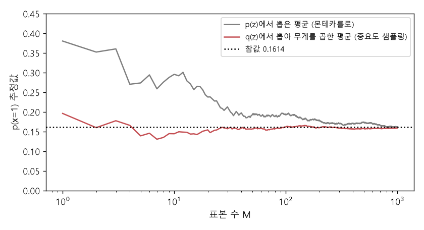

# 몬테카를로와 중요도 샘플링 (Monte Carlo estimation, Importance sampling)

[목차로 돌아가기](../../00_MIT%EB%94%A5%EB%9F%AC%EB%8B%9D_%EB%AA%A9%EC%B0%A8.md) · 먼저 볼 것: [MM22_기댓값과_일반화_간극](../../%EC%88%98%ED%95%99%EA%B0%9C%EB%85%90/04_%ED%99%95%EB%A5%A0%EA%B3%BC_%EC%A0%95%EB%B3%B4/MM22_%EA%B8%B0%EB%8C%93%EA%B0%92%EA%B3%BC_%EC%9D%BC%EB%B0%98%ED%99%94_%EA%B0%84%EA%B7%B9.md), [MM54_가우스_혼합과_주변_우도](../../%EC%88%98%ED%95%99%EA%B0%9C%EB%85%90/11_%EC%83%9D%EC%84%B1_%EB%AA%A8%EB%8D%B8/MM54_%EA%B0%80%EC%9A%B0%EC%8A%A4_%ED%98%BC%ED%95%A9%EA%B3%BC_%EC%A3%BC%EB%B3%80_%EC%9A%B0%EB%8F%84.md), [MM50_확률_밀도와_정규분포](../../%EC%88%98%ED%95%99%EA%B0%9C%EB%85%90/04_%ED%99%95%EB%A5%A0%EA%B3%BC_%EC%A0%95%EB%B3%B4/MM50_%ED%99%95%EB%A5%A0_%EB%B0%80%EB%8F%84%EC%99%80_%EC%A0%95%EA%B7%9C%EB%B6%84%ED%8F%AC.md) · 쓰는 곳: [Lec15 6](../../Lec15_%EB%B3%80%EB%B6%84_%EC%98%A4%ED%86%A0%EC%9D%B8%EC%BD%94%EB%8D%94.md#6-%EC%9A%94%EB%A0%B9-1-%EB%AA%AC%ED%85%8C%EC%B9%B4%EB%A5%BC%EB%A1%9C-%EA%B7%BC%EC%82%AC), [Lec15 6.1](../../Lec15_%EB%B3%80%EB%B6%84_%EC%98%A4%ED%86%A0%EC%9D%B8%EC%BD%94%EB%8D%94.md#61-%EA%B3%A0%EC%B0%A8%EC%9B%90%EC%97%90%EC%84%9C%EB%8A%94-%ED%91%9C%EB%B3%B8%EC%9D%B4-%EB%AA%A8%EC%9E%90%EB%9E%80%EB%8B%A4), [Lec15 7](../../Lec15_%EB%B3%80%EB%B6%84_%EC%98%A4%ED%86%A0%EC%9D%B8%EC%BD%94%EB%8D%94.md#7-%EC%9A%94%EB%A0%B9-2-%EC%A4%91%EC%9A%94%EB%8F%84-%EC%83%98%ED%94%8C%EB%A7%81)

📚 학습 순서 81/99 (11. 생성 모델): ← 이전: [MM54_가우스_혼합과_주변_우도](../../%EC%88%98%ED%95%99%EA%B0%9C%EB%85%90/11_%EC%83%9D%EC%84%B1_%EB%AA%A8%EB%8D%B8/MM54_%EA%B0%80%EC%9A%B0%EC%8A%A4_%ED%98%BC%ED%95%A9%EA%B3%BC_%EC%A3%BC%EB%B3%80_%EC%9A%B0%EB%8F%84.md) · 다음: [MM56_젠센_부등식과_ELBO](../../%EC%88%98%ED%95%99%EA%B0%9C%EB%85%90/11_%EC%83%9D%EC%84%B1_%EB%AA%A8%EB%8D%B8/MM56_%EC%A0%A0%EC%84%BC_%EB%B6%80%EB%93%B1%EC%8B%9D%EA%B3%BC_ELBO.md) →

> [!NOTE]
> **3줄 요약**
> - **[몬테카를로 추정](../../00_%EB%94%A5%EB%9F%AC%EB%8B%9D_%EC%9A%A9%EC%96%B4%EC%82%AC%EC%A0%84.md#monte-carlo-estimation-%EB%AA%AC%ED%85%8C%EC%B9%B4%EB%A5%BC%EB%A1%9C-%EC%B6%94%EC%A0%95)**: [기댓값](../../00_%EB%94%A5%EB%9F%AC%EB%8B%9D_%EC%9A%A9%EC%96%B4%EC%82%AC%EC%A0%84.md#expectation-%EA%B8%B0%EB%8C%93%EA%B0%92)(적분) $\mathbb{E}_{p}[f(z)]$를 $p$에서 뽑은 표본 $M$개의 평균 $\frac{1}{M}\sum f(z_j)$로 근사한다. 비편향이고 [오차](../../00_%EB%94%A5%EB%9F%AC%EB%8B%9D_%EC%9A%A9%EC%96%B4%EC%82%AC%EC%A0%84.md#error-%EC%98%A4%EC%B0%A8)(표준편차)는 $\sigma/\sqrt{M}$로 준다. 표본 4개로 $p(x=1)$을 추정하면 0.1748 (참값 0.1614).
> - **[중요도 샘플링](../../00_%EB%94%A5%EB%9F%AC%EB%8B%9D_%EC%9A%A9%EC%96%B4%EC%82%AC%EC%A0%84.md#importance-sampling-%EC%A4%91%EC%9A%94%EB%8F%84-%EC%83%98%ED%94%8C%EB%A7%81)**: 다른 분포 $q$에서 뽑고 무게 $\frac{p(z)}{q(z)}$를 곱해 평균한다. 값은 같지만, $q$가 $f$가 큰 곳에 몰려 있으면 퍼짐이 준다. 표본 하나의 표준편차가 0.1464에서 0.0600으로 줄었다.
> - 가장 좋은 $q$는 $p(z)f(z)$에 비례하는 분포, [VAE](../../00_%EB%94%A5%EB%9F%AC%EB%8B%9D_%EC%9A%A9%EC%96%B4%EC%82%AC%EC%A0%84.md#variational-autoencoder-vae-%EB%B3%80%EB%B6%84-%EC%98%A4%ED%86%A0%EC%9D%B8%EC%BD%94%EB%8D%94)에서는 [사후 분포](../../00_%EB%94%A5%EB%9F%AC%EB%8B%9D_%EC%9A%A9%EC%96%B4%EC%82%AC%EC%A0%84.md#prior-posterior-%EC%82%AC%EC%A0%84-%EB%B6%84%ED%8F%AC%EC%99%80-%EC%82%AC%ED%9B%84-%EB%B6%84%ED%8F%AC) $p(z\mid x)$다. 그때는 어떤 $z$를 뽑아도 같은 값(0.1614)이 나와 [분산](../../00_%EB%94%A5%EB%9F%AC%EB%8B%9D_%EC%9A%A9%EC%96%B4%EC%82%AC%EC%A0%84.md#variance-%EB%B6%84%EC%82%B0)이 0이다.

## 1. 개념 설명

비유: 넓은 호수의 평균 수심을 재려고 무작위로 막대를 꽂는다(몬테카를로). 꽂은 곳의 평균이 호수 평균의 추정값이다. 그런데 호수 대부분이 얕고 물고기는 깊은 웅덩이 몇 곳에만 산다면, "물고기 수"를 재려고 무작위로 꽂는 것은 낭비다. **웅덩이 근처를 더 자주** 재고, 대신 "너무 자주 잰 만큼 덜 쳐 주면"(무게 $p/q$) 된다. 이것이 [중요도 샘플링](../../00_%EB%94%A5%EB%9F%AC%EB%8B%9D_%EC%9A%A9%EC%96%B4%EC%82%AC%EC%A0%84.md#importance-sampling-%EC%A4%91%EC%9A%94%EB%8F%84-%EC%83%98%ED%94%8C%EB%A7%81)이다.

- **몬테카를로**: $\mathbb{E}_{z\sim p}[f(z)] = \int f(z)p(z)dz \approx \frac{1}{M}\sum_{j=1}^M f(z_j)$, $z_j \sim p$. 표본 하나의 표준편차가 $\sigma$이면 평균의 표준편차는 $\sigma/\sqrt{M}$이다([중심극한정리](../../00_%EB%94%A5%EB%9F%AC%EB%8B%9D_%EC%9A%A9%EC%96%B4%EC%82%AC%EC%A0%84.md#central-limit-theorem-%EC%A4%91%EC%8B%AC%EA%B7%B9%ED%95%9C%EC%A0%95%EB%A6%AC)).
- **[중요도 샘플링](../../00_%EB%94%A5%EB%9F%AC%EB%8B%9D_%EC%9A%A9%EC%96%B4%EC%82%AC%EC%A0%84.md#importance-sampling-%EC%A4%91%EC%9A%94%EB%8F%84-%EC%83%98%ED%94%8C%EB%A7%81)**: $\int f(z)p(z)dz = \int f(z)\frac{p(z)}{q(z)}q(z)dz = \mathbb{E}_{z\sim q}\big[\frac{p(z)}{q(z)}f(z)\big]$. $q(z)$를 곱하고 나눴을 뿐이라 정확히 같다. 단, $f(z)p(z) \ne 0$인 곳에서 $q(z) > 0$이어야 한다.
- **최적의 $q$**: $q(z) = \frac{p(z)f(z)}{\int p f}$이면 무게 × $f$가 늘 상수 $\int pf$가 되어 [분산](../../00_%EB%94%A5%EB%9F%AC%EB%8B%9D_%EC%9A%A9%EC%96%B4%EC%82%AC%EC%A0%84.md#variance-%EB%B6%84%EC%82%B0)이 0이다. $f(z) = p(x\mid z)$이면 이 $q$가 바로 [베이즈 정리](../../00_%EB%94%A5%EB%9F%AC%EB%8B%9D_%EC%9A%A9%EC%96%B4%EC%82%AC%EC%A0%84.md#bayes-rule-%EB%B2%A0%EC%9D%B4%EC%A6%88-%EC%A0%95%EB%A6%AC)로 얻는 [사후 분포](../../00_%EB%94%A5%EB%9F%AC%EB%8B%9D_%EC%9A%A9%EC%96%B4%EC%82%AC%EC%A0%84.md#prior-posterior-%EC%82%AC%EC%A0%84-%EB%B6%84%ED%8F%AC%EC%99%80-%EC%82%AC%ED%9B%84-%EB%B6%84%ED%8F%AC) $p(z\mid x)$다.

## 2. 필요한 이유

[VAE](../../00_%EB%94%A5%EB%9F%AC%EB%8B%9D_%EC%9A%A9%EC%96%B4%EC%82%AC%EC%A0%84.md#variational-autoencoder-vae-%EB%B3%80%EB%B6%84-%EC%98%A4%ED%86%A0%EC%9D%B8%EC%BD%94%EB%8D%94)의 [주변 우도](../../00_%EB%94%A5%EB%9F%AC%EB%8B%9D_%EC%9A%A9%EC%96%B4%EC%82%AC%EC%A0%84.md#marginal-likelihood-%EC%A3%BC%EB%B3%80-%EC%9A%B0%EB%8F%84) $p(x) = \mathbb{E}_{z\sim p(z)}[p(x\mid z)]$는 적분이라 직접 계산할 수 없다. [Lec15 6](../../Lec15_%EB%B3%80%EB%B6%84_%EC%98%A4%ED%86%A0%EC%9D%B8%EC%BD%94%EB%8D%94.md#6-%EC%9A%94%EB%A0%B9-1-%EB%AA%AC%ED%85%8C%EC%B9%B4%EB%A5%BC%EB%A1%9C-%EA%B7%BC%EC%82%AC)의 첫 요령이 몬테카를로이고, 고차원에서 대부분의 표본이 0을 내서 실패하는 문제([6.1](../../Lec15_%EB%B3%80%EB%B6%84_%EC%98%A4%ED%86%A0%EC%9D%B8%EC%BD%94%EB%8D%94.md#61-%EA%B3%A0%EC%B0%A8%EC%9B%90%EC%97%90%EC%84%9C%EB%8A%94-%ED%91%9C%EB%B3%B8%EC%9D%B4-%EB%AA%A8%EC%9E%90%EB%9E%80%EB%8B%A4))를 [7절](../../Lec15_%EB%B3%80%EB%B6%84_%EC%98%A4%ED%86%A0%EC%9D%B8%EC%BD%94%EB%8D%94.md#7-%EC%9A%94%EB%A0%B9-2-%EC%A4%91%EC%9A%94%EB%8F%84-%EC%83%98%ED%94%8C%EB%A7%81)의 [중요도 샘플링](../../00_%EB%94%A5%EB%9F%AC%EB%8B%9D_%EC%9A%A9%EC%96%B4%EC%82%AC%EC%A0%84.md#importance-sampling-%EC%A4%91%EC%9A%94%EB%8F%84-%EC%83%98%ED%94%8C%EB%A7%81)이 푼다. 최적의 $q$인 [사후 분포](../../00_%EB%94%A5%EB%9F%AC%EB%8B%9D_%EC%9A%A9%EC%96%B4%EC%82%AC%EC%A0%84.md#prior-posterior-%EC%82%AC%EC%A0%84-%EB%B6%84%ED%8F%AC%EC%99%80-%EC%82%AC%ED%9B%84-%EB%B6%84%ED%8F%AC)를 신경망(인코더)으로 예측하는 것이 세 번째 요령이다.

## 3. 숫자로 보기

모델: $z \sim \mathcal{N}(0, 1)$, $p(x\mid z) = \mathcal{N}(x; 2z, 1)$, $x = 1$. 참값 $p(1) = 0.1614$ ([MM54_가우스_혼합과_주변_우도](../../%EC%88%98%ED%95%99%EA%B0%9C%EB%85%90/11_%EC%83%9D%EC%84%B1_%EB%AA%A8%EB%8D%B8/MM54_%EA%B0%80%EC%9A%B0%EC%8A%A4_%ED%98%BC%ED%95%A9%EA%B3%BC_%EC%A3%BC%EB%B3%80_%EC%9A%B0%EB%8F%84.md)).

**몬테카를로** (표본 $z = -1, 0, 0.5, 1.5$)
- $p(1\mid z)$: 0.0044, 0.2420, 0.3989, 0.0540
- 평균: $(0.0044 + 0.2420 + 0.3989 + 0.0540) / 4 = 0.6993 / 4 = 0.1748$

**표준오차** (표본 10만 개로 잰 표본 하나의 표준편차 $\sigma$, 4절 코드)

| 뽑는 분포 | $\sigma$ | $M = 100$일 때 $\sigma/\sqrt{M}$ | $M = 10000$일 때 |
|---|---|---|---|
| [사전 분포](../../00_%EB%94%A5%EB%9F%AC%EB%8B%9D_%EC%9A%A9%EC%96%B4%EC%82%AC%EC%A0%84.md#prior-posterior-%EC%82%AC%EC%A0%84-%EB%B6%84%ED%8F%AC%EC%99%80-%EC%82%AC%ED%9B%84-%EB%B6%84%ED%8F%AC) $p(z) = \mathcal{N}(0, 1)$ | 0.1464 | 0.0146 | 0.0015 |
| $q = \mathcal{N}(0.5, 0.6^2)$ + 무게 | 0.0600 | 0.0060 | 0.0006 |
| [사후 분포](../../00_%EB%94%A5%EB%9F%AC%EB%8B%9D_%EC%9A%A9%EC%96%B4%EC%82%AC%EC%A0%84.md#prior-posterior-%EC%82%AC%EC%A0%84-%EB%B6%84%ED%8F%AC%EC%99%80-%EC%82%AC%ED%9B%84-%EB%B6%84%ED%8F%AC) $\mathcal{N}(0.4, 0.2)$ + 무게 | 0 | 0 | 0 |

**[사후 분포](../../00_%EB%94%A5%EB%9F%AC%EB%8B%9D_%EC%9A%A9%EC%96%B4%EC%82%AC%EC%A0%84.md#prior-posterior-%EC%82%AC%EC%A0%84-%EB%B6%84%ED%8F%AC%EC%99%80-%EC%82%AC%ED%9B%84-%EB%B6%84%ED%8F%AC)에서 뽑기** ($z = 0.5$ 하나)
- 무게: $p(z)/q(z) = 0.3521 / 0.8700 = 0.4047$
- 추정: $0.4047 \times 0.3989 = 0.1614$. 참값과 같다.


*▲ 직접 그린 그림: 표본 수 $M$을 늘리며 낸 추정값(같은 난수 씨앗, 표본 1000개까지). 회색은 [사전 분포](../../00_%EB%94%A5%EB%9F%AC%EB%8B%9D_%EC%9A%A9%EC%96%B4%EC%82%AC%EC%A0%84.md#prior-posterior-%EC%82%AC%EC%A0%84-%EB%B6%84%ED%8F%AC%EC%99%80-%EC%82%AC%ED%9B%84-%EB%B6%84%ED%8F%AC)에서 뽑은 몬테카를로, 빨강은 $q = \mathcal{N}(0.5, 0.6^2)$에서 뽑아 무게를 곱한 [중요도 샘플링](../../00_%EB%94%A5%EB%9F%AC%EB%8B%9D_%EC%9A%A9%EC%96%B4%EC%82%AC%EC%A0%84.md#importance-sampling-%EC%A4%91%EC%9A%94%EB%8F%84-%EC%83%98%ED%94%8C%EB%A7%81). 빨강이 훨씬 빨리 참값 0.1614 근처에 머문다*

[중요도 샘플링](../../00_%EB%94%A5%EB%9F%AC%EB%8B%9D_%EC%9A%A9%EC%96%B4%EC%82%AC%EC%A0%84.md#importance-sampling-%EC%A4%91%EC%9A%94%EB%8F%84-%EC%83%98%ED%94%8C%EB%A7%81)의 식은 다음과 같다.

$$
\mathbb{E}_{z\sim p}\big[f(z)\big] = \mathbb{E}_{z\sim q}\Big[\frac{p(z)}{q(z)}\, f(z)\Big] \approx \frac{1}{M}\sum_{j=1}^{M} \frac{p(z_j)}{q(z_j)}\, f(z_j), \qquad z_j \sim q
$$

<details><summary>기호 풀이</summary>

| 기호 | 읽는 법 | 뜻 | 예제 값 |
| --- | --- | --- | --- |
| $p(z)$ | 피 제트 | 원래 [기댓값](../../00_%EB%94%A5%EB%9F%AC%EB%8B%9D_%EC%9A%A9%EC%96%B4%EC%82%AC%EC%A0%84.md#expectation-%EA%B8%B0%EB%8C%93%EA%B0%92)을 잡는 분포 ([사전 분포](../../00_%EB%94%A5%EB%9F%AC%EB%8B%9D_%EC%9A%A9%EC%96%B4%EC%82%AC%EC%A0%84.md#prior-posterior-%EC%82%AC%EC%A0%84-%EB%B6%84%ED%8F%AC%EC%99%80-%EC%82%AC%ED%9B%84-%EB%B6%84%ED%8F%AC)) | 0.2897 |
| $q(z)$ | 큐 제트 | 실제로 표본을 뽑는 분포 (제안 분포) | 0.5868 |
| $f(z)$ | 에프 제트 | 평균 내려는 값. [VAE](../../00_%EB%94%A5%EB%9F%AC%EB%8B%9D_%EC%9A%A9%EC%96%B4%EC%82%AC%EC%A0%84.md#variational-autoencoder-vae-%EB%B3%80%EB%B6%84-%EC%98%A4%ED%86%A0%EC%9D%B8%EC%BD%94%EB%8D%94)에서는 $p(x\mid z)$ | 0.3332 |
| $\frac{p(z)}{q(z)}$ | 중요도 무게 | $q$가 너무 자주 뽑은 곳은 줄이고 드물게 뽑은 곳은 키운다 | 0.4937 |
| $M$ | 엠 | 표본 개수 | 1 |
| $z_j$ | 제트 제이 | $q$에서 뽑은 $j$번째 표본 | 0.8 |

</details>

<details><summary>예제와 풀이</summary>

**문제**: 3절의 모델에서 $q = \mathcal{N}(0.5, 0.6^2)$(평균 0.5, [분산](../../00_%EB%94%A5%EB%9F%AC%EB%8B%9D_%EC%9A%A9%EC%96%B4%EC%82%AC%EC%A0%84.md#variance-%EB%B6%84%EC%82%B0) 0.36)를 쓴다. $z = 0.8$ 하나를 뽑았을 때 $p(x = 1)$의 [중요도 샘플링](../../00_%EB%94%A5%EB%9F%AC%EB%8B%9D_%EC%9A%A9%EC%96%B4%EC%82%AC%EC%A0%84.md#importance-sampling-%EC%A4%91%EC%9A%94%EB%8F%84-%EC%83%98%ED%94%8C%EB%A7%81) 추정값은?

**주어진 값**
- $z_1 = 0.8$ ($q$에서 뽑은 표본), $M = 1$
- $p(z) = \mathcal{N}(z; 0, 1)$ ([사전 분포](../../00_%EB%94%A5%EB%9F%AC%EB%8B%9D_%EC%9A%A9%EC%96%B4%EC%82%AC%EC%A0%84.md#prior-posterior-%EC%82%AC%EC%A0%84-%EB%B6%84%ED%8F%AC%EC%99%80-%EC%82%AC%ED%9B%84-%EB%B6%84%ED%8F%AC))
- $q(z) = \mathcal{N}(z; 0.5, 0.36)$ (제안 분포)
- $f(z) = p(x{=}1\mid z) = \mathcal{N}(1; 2z, 1)$

**풀이**
1. 식을 그대로 쓴다: $\hat{p} = \dfrac{1}{M}\sum_{j=1}^{M} \dfrac{p(z_j)}{q(z_j)}\, f(z_j)$
2. 값을 대입한다: $\hat{p} = \dfrac{1}{1}\cdot\dfrac{\mathcal{N}(0.8; 0, 1)}{\mathcal{N}(0.8; 0.5, 0.36)}\, \mathcal{N}(1; 1.6, 1)$
3. 사전 밀도: $0.8^2 = 0.64$, 반으로 $0.32$, $e^{-0.32} = 0.7261$ ($e$는 약 2.718), $0.7261 / 2.5066 = 0.2897$
4. $f$: $(1 - 1.6)^2 = 0.36$, 반으로 $0.18$, $e^{-0.18} = 0.8353$, $0.8353 / 2.5066 = 0.3332$
5. $q$의 거리 제곱: $(0.8 - 0.5)^2 = 0.09$
6. $2 \times 0.36 = 0.72$로 나눈다: $0.09 / 0.72 = 0.125$
7. [지수](../../00_%EB%94%A5%EB%9F%AC%EB%8B%9D_%EC%9A%A9%EC%96%B4%EC%82%AC%EC%A0%84.md#e-exponent-e%EC%99%80-%EC%A7%80%EC%88%98): $e^{-0.125} = 0.8825$
8. [정규화](../../00_%EB%94%A5%EB%9F%AC%EB%8B%9D_%EC%9A%A9%EC%96%B4%EC%82%AC%EC%A0%84.md#normalization-%EC%A0%95%EA%B7%9C%ED%99%94) 상수: $2\pi \times 0.36 = 2.2619$, $\sqrt{2.2619} = 1.5040$
9. 나눈다: $0.8825 / 1.5040 = 0.5868$
10. 분자를 곱한다: $0.2897 \times 0.3332 = 0.0965$
11. $q$로 나눈다: $0.0965 / 0.5868 = 0.1645$

**답**: **0.1645** (참값 0.1614). $q$가 [사후 분포](../../00_%EB%94%A5%EB%9F%AC%EB%8B%9D_%EC%9A%A9%EC%96%B4%EC%82%AC%EC%A0%84.md#prior-posterior-%EC%82%AC%EC%A0%84-%EB%B6%84%ED%8F%AC%EC%99%80-%EC%82%AC%ED%9B%84-%EB%B6%84%ED%8F%AC)와 비슷해서 표본 하나로도 꽤 가깝다. 무게는 $0.2897 / 0.5868 = 0.4937$이다.

</details>

<details><summary>내 이해</summary>


</details>

## 4. 코드로 확인

```python
# [함수] N(x, m, v): 평균 m, 분산 v인 정규분포의 밀도
def N(x, m, v):
    # [연결] MM50의 정규분포 밀도 공식
    return np.exp(-(x - m) ** 2 / (2 * v)) / np.sqrt(2 * np.pi * v)
# [변수] zs: 사전 분포에서 뽑았다고 치는 표본 4개
zs = np.array([-1, 0, 0.5, 1.5])
# [연결] 3절 몬테카를로 → 성분 밀도 4개와 평균 0.1748
print(N(1, 2 * zs, 1).round(4), round(N(1, 2 * zs, 1).mean(), 4))
# [함수] np.random.default_rng(0): 씨앗 0으로 고정한 난수 생성기 (결과가 늘 같다)
rng = np.random.default_rng(0)
# [변수] wp: 사전 분포에서 뽑은 z 10만 개 각각이 내는 추정값 p(1|z)
wp = N(1, 2 * rng.standard_normal(100000), 1)
# [변수] zq: q = N(0.5, 0.6²)에서 뽑은 z 10만 개 (0.5 + 0.6 × 단위 가우스)
zq = 0.5 + 0.6 * rng.standard_normal(100000)
# [변수] wq: 중요도 무게 p(z)/q(z)를 곱한 추정값
wq = N(zq, 0, 1) * N(1, 2 * zq, 1) / N(zq, 0.5, 0.36)
# [연결] 3절 표 → 두 방법 모두 평균은 참값 0.1614 근처, 표준편차는 0.1464 대 0.0600
print(round(wp.mean(), 4), round(wp.std(), 4), round(wq.mean(), 4), round(wq.std(), 4))
# [연결] 3절 표 → M = 100, 10000 일 때 표준오차 σ/√M
print(round(wp.std() / 10, 4), round(wp.std() / 100, 4), round(wq.std() / 10, 4), round(wq.std() / 100, 4))
# [변수] zpost: 사후 분포 N(0.4, 0.2)에서 뽑았다고 치는 서로 다른 표본 3개
zpost = np.array([0.0, 0.5, 1.2])
# [연결] 3절 → 최적의 q에서는 어떤 z든 추정값이 0.1614로 같다 (분산 0)
print((N(zpost, 0, 1) * N(1, 2 * zpost, 1) / N(zpost, 0.4, 0.2)).round(4))
```

**실행 결과**:

```text
[0.0044 0.242  0.3989 0.054 ] 0.1748
0.1617 0.1464 0.1612 0.06
0.0146 0.0015 0.006 0.0006
[0.1614 0.1614 0.1614]
```

> [!WARNING]
> **⚠ 주의**
> - 몬테카를로 [오차](../../00_%EB%94%A5%EB%9F%AC%EB%8B%9D_%EC%9A%A9%EC%96%B4%EC%82%AC%EC%A0%84.md#error-%EC%98%A4%EC%B0%A8) $\sigma/\sqrt{M}$에 차원이 직접 들어 있지는 않다. 고차원에서 어려운 이유는 $\sigma$가 커지기 때문이다. 대부분의 표본이 0을 내고 아주 드문 표본만 큰 값을 내면, 평균에 비해 $\sigma$가 엄청나게 크다.
> - [중요도 샘플링](../../00_%EB%94%A5%EB%9F%AC%EB%8B%9D_%EC%9A%A9%EC%96%B4%EC%82%AC%EC%A0%84.md#importance-sampling-%EC%A4%91%EC%9A%94%EB%8F%84-%EC%83%98%ED%94%8C%EB%A7%81)은 $q$를 잘못 고르면 오히려 나빠진다. $q$가 $p f$보다 꼬리가 얇으면 드물게 아주 큰 무게가 나와 [분산](../../00_%EB%94%A5%EB%9F%AC%EB%8B%9D_%EC%9A%A9%EC%96%B4%EC%82%AC%EC%A0%84.md#variance-%EB%B6%84%EC%82%B0)이 폭발한다.
> - $\log$의 [몬테카를로 추정](../../00_%EB%94%A5%EB%9F%AC%EB%8B%9D_%EC%9A%A9%EC%96%B4%EC%82%AC%EC%A0%84.md#monte-carlo-estimation-%EB%AA%AC%ED%85%8C%EC%B9%B4%EB%A5%BC%EB%A1%9C-%EC%B6%94%EC%A0%95) $\log \frac{1}{M}\sum(\cdot)$은 편향된다(평균 뒤에 [로그](../../00_%EB%94%A5%EB%9F%AC%EB%8B%9D_%EC%9A%A9%EC%96%B4%EC%82%AC%EC%A0%84.md#log-ln-%EB%A1%9C%EA%B7%B8)). [VAE](../../00_%EB%94%A5%EB%9F%AC%EB%8B%9D_%EC%9A%A9%EC%96%B4%EC%82%AC%EC%A0%84.md#variational-autoencoder-vae-%EB%B3%80%EB%B6%84-%EC%98%A4%ED%86%A0%EC%9D%B8%EC%BD%94%EB%8D%94)가 [젠센 부등식](../../00_%EB%94%A5%EB%9F%AC%EB%8B%9D_%EC%9A%A9%EC%96%B4%EC%82%AC%EC%A0%84.md#jensen-inequality-%EC%A0%A0%EC%84%BC-%EB%B6%80%EB%93%B1%EC%8B%9D)으로 [로그](../../00_%EB%94%A5%EB%9F%AC%EB%8B%9D_%EC%9A%A9%EC%96%B4%EC%82%AC%EC%A0%84.md#log-ln-%EB%A1%9C%EA%B7%B8)를 안으로 넣는 이유다([MM56_젠센_부등식과_ELBO](../../%EC%88%98%ED%95%99%EA%B0%9C%EB%85%90/11_%EC%83%9D%EC%84%B1_%EB%AA%A8%EB%8D%B8/MM56_%EC%A0%A0%EC%84%BC_%EB%B6%80%EB%93%B1%EC%8B%9D%EA%B3%BC_ELBO.md)).

## 5. 개념 재확인

<details><summary>1. $z \sim \mathcal{N}(0, 1)$에서 표본 $-1, 0.5, 2, -0.5$를 뽑았다. $\mathbb{E}[z^2]$의 몬테카를로 추정값은? (참값은 분산 1)</summary>

| 단계 | 하는 일 | 계산 | 결과 |
|---|---|---|---|
| 1 | 제곱 | $(-1)^2, 0.5^2, 2^2, (-0.5)^2$ | 1, 0.25, 4, 0.25 |
| 2 | 합 | 네 값을 더함 | 5.5 |
| 3 | 평균 | $5.5 / 4$ | 1.375 |

**① 쓰는 식**
$$\mathbb{E}[f(z)] \approx \frac{1}{M}\sum_{j=1}^{M} f(z_j), \qquad f(z) = z^2$$
- 위 식 ← ② (제곱), ③ (합), ④ (평균)에서 쓴다.
```python
# [변수] z: 뽑은 표본 4개
z = np.array([-1, 0.5, 2, -0.5])                          # ①
# [연결] [1.   0.25 4.   0.25] 5.5 1.375
print(z ** 2, (z ** 2).sum(), (z ** 2).mean())            # ②③④
```

**주어진 값**
- $z_1 = -1$, $z_2 = 0.5$, $z_3 = 2$, $z_4 = -0.5$ (표본)
- $M = 4$, $f(z) = z^2$

**풀이**
1. 식을 그대로 쓴다: $\mathbb{E}[z^2] \approx \dfrac{1}{M}\sum_{j=1}^{M} z_j^2$
2. 값을 대입한다: $\mathbb{E}[z^2] \approx \dfrac{1}{4}\sum_{j=1}^{4} z_j^2$
3. Σ를 풀어 쓴다: $\dfrac{1}{4}\big((-1)^2 + 0.5^2 + 2^2 + (-0.5)^2\big)$
4. (②) 제곱한다: $1,\ 0.25,\ 4,\ 0.25$
5. (③) 더한다: $1 + 0.25 = 1.25$, $1.25 + 4 = 5.25$, $5.25 + 0.25 = 5.5$
6. (④) 4로 나눈다: $5.5 / 4 = 1.375$

**답**: **1.375** (참값 1). 표본 4개라 [오차](../../00_%EB%94%A5%EB%9F%AC%EB%8B%9D_%EC%9A%A9%EC%96%B4%EC%82%AC%EC%A0%84.md#error-%EC%98%A4%EC%B0%A8)가 크다. 표본을 늘리면 $1/\sqrt{M}$ 속도로 1에 다가간다.

</details>

<details><summary>2. 같은 모델에서 사후 분포 $q = \mathcal{N}(0.4, 0.2)$에서 $z = 0$을 뽑았다. 중요도 무게와 추정값은?</summary>

| 단계 | 하는 일 | 계산 | 결과 |
|---|---|---|---|
| 1 | 사전 밀도 | $\mathcal{N}(0; 0, 1)$ | 0.3989 |
| 2 | 성분 밀도 | $\mathcal{N}(1; 0, 1)$ | 0.2420 |
| 3 | $q$ 밀도 | $\mathcal{N}(0; 0.4, 0.2)$ | 0.5980 |
| 4 | 무게 × 성분 | $0.3989 / 0.5980 \times 0.2420$ | 0.1614 |

**① 쓰는 식**
$$\hat{p}(x) = \frac{p(z)}{q(z)}\, p(x\mid z)$$
- 위 식 ← ② (사전), ③ (성분), ④ ($q$), ⑤ (무게와 곱)에서 쓴다.
```python
# [함수] N: 정규분포 밀도 (평균 m, 분산 v)
N = lambda x, m, v: np.exp(-(x - m) ** 2 / (2 * v)) / np.sqrt(2 * np.pi * v)   # ①
# [변수] pz, f, q: 사전, 성분, 제안 분포의 밀도
pz, f, q = N(0, 0, 1), N(1, 0, 1), N(0, 0.4, 0.2)        # ②③④
# [연결] 0.3989 0.242 0.598 0.6672 0.1614
print(round(pz, 4), round(f, 4), round(q, 4), round(pz / q, 4), round(pz / q * f, 4))   # ⑤
```

**주어진 값**
- $z = 0$ ($q$에서 뽑은 표본)
- $p(z) = \mathcal{N}(0, 1)$, $q(z) = \mathcal{N}(0.4, 0.2)$
- $p(x\mid z) = \mathcal{N}(x; 2z, 1)$, $x = 1$

**풀이**
1. 식을 그대로 쓴다: $\hat{p}(x) = \dfrac{p(z)}{q(z)}\, p(x\mid z)$
2. 값을 대입한다: $\hat{p}(1) = \dfrac{\mathcal{N}(0; 0, 1)}{\mathcal{N}(0; 0.4, 0.2)}\, \mathcal{N}(1; 0, 1)$
3. (②) 사전 밀도: 거리 0, $e^0 = 1$, $1 / 2.5066 = 0.3989$
4. (③) 성분 밀도: 거리 제곱 1, $e^{-0.5} / 2.5066 = 0.2420$
5. (④) $q$의 거리 제곱: $(0 - 0.4)^2 = 0.16$
6. (④) $2 \times 0.2 = 0.4$로 나눈다: $0.16 / 0.4 = 0.4$
7. (④) [지수](../../00_%EB%94%A5%EB%9F%AC%EB%8B%9D_%EC%9A%A9%EC%96%B4%EC%82%AC%EC%A0%84.md#e-exponent-e%EC%99%80-%EC%A7%80%EC%88%98): $e^{-0.4} = 0.6703$
8. (④) [정규화](../../00_%EB%94%A5%EB%9F%AC%EB%8B%9D_%EC%9A%A9%EC%96%B4%EC%82%AC%EC%A0%84.md#normalization-%EC%A0%95%EA%B7%9C%ED%99%94) 상수 $\sqrt{2\pi \times 0.2} = 1.1210$으로 나눈다: $0.6703 / 1.1210 = 0.5980$
9. (⑤) 무게: $0.3989 / 0.5980 = 0.6672$ (반올림 전 값으로 나눔)
10. (⑤) 성분 밀도를 곱한다: $0.6672 \times 0.2420 = 0.1614$ (반올림 전 값으로 곱함)

**답**: 무게 **0.6672**, 추정값 **0.1614**. 3절의 $z = 0.5$와 다른 표본인데 같은 값이 나왔다. [사후 분포](../../00_%EB%94%A5%EB%9F%AC%EB%8B%9D_%EC%9A%A9%EC%96%B4%EC%82%AC%EC%A0%84.md#prior-posterior-%EC%82%AC%EC%A0%84-%EB%B6%84%ED%8F%AC%EC%99%80-%EC%82%AC%ED%9B%84-%EB%B6%84%ED%8F%AC)에서 뽑으면 [분산](../../00_%EB%94%A5%EB%9F%AC%EB%8B%9D_%EC%9A%A9%EC%96%B4%EC%82%AC%EC%A0%84.md#variance-%EB%B6%84%EC%82%B0)이 0이다.

</details>

## 예제 풀기

[예제 10문제 풀기](../../%EC%98%88%EC%A0%9C/11_%EC%83%9D%EC%84%B1_%EB%AA%A8%EB%8D%B8/%EC%98%88%EC%A0%9C_MM55_%EB%AA%AC%ED%85%8C%EC%B9%B4%EB%A5%BC%EB%A1%9C%EC%99%80_%EC%A4%91%EC%9A%94%EB%8F%84_%EC%83%98%ED%94%8C%EB%A7%81.md)

<details><summary>내 이해</summary>


</details>
