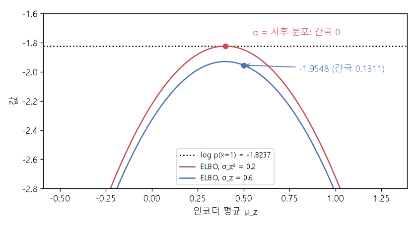

# 젠센 부등식과 ELBO (Jensen's inequality, Evidence lower bound)

[목차로 돌아가기](../../00_MIT%EB%94%A5%EB%9F%AC%EB%8B%9D_%EB%AA%A9%EC%B0%A8.md) · 먼저 볼 것: [M07_로그](../../%EC%88%98%ED%95%99%EA%B0%9C%EB%85%90/01_%EC%88%98%EC%99%80_%ED%95%A8%EC%88%98/M07_%EB%A1%9C%EA%B7%B8.md), [M09_최솟값과_볼록함수](../../%EC%88%98%ED%95%99%EA%B0%9C%EB%85%90/02_%EB%AF%B8%EB%B6%84/M09_%EC%B5%9C%EC%86%9F%EA%B0%92%EA%B3%BC_%EB%B3%BC%EB%A1%9D%ED%95%A8%EC%88%98.md), [MM51_KL_발산과_최대_우도](../../%EC%88%98%ED%95%99%EA%B0%9C%EB%85%90/04_%ED%99%95%EB%A5%A0%EA%B3%BC_%EC%A0%95%EB%B3%B4/MM51_KL_%EB%B0%9C%EC%82%B0%EA%B3%BC_%EC%B5%9C%EB%8C%80_%EC%9A%B0%EB%8F%84.md), [MM55_몬테카를로와_중요도_샘플링](../../%EC%88%98%ED%95%99%EA%B0%9C%EB%85%90/11_%EC%83%9D%EC%84%B1_%EB%AA%A8%EB%8D%B8/MM55_%EB%AA%AC%ED%85%8C%EC%B9%B4%EB%A5%BC%EB%A1%9C%EC%99%80_%EC%A4%91%EC%9A%94%EB%8F%84_%EC%83%98%ED%94%8C%EB%A7%81.md) · 쓰는 곳: [Lec15 8](../../Lec15_%EB%B3%80%EB%B6%84_%EC%98%A4%ED%86%A0%EC%9D%B8%EC%BD%94%EB%8D%94.md#8-%EC%9A%94%EB%A0%B9-3-%EC%9D%B8%EC%BD%94%EB%8D%94%EB%A1%9C-%EC%B5%9C%EC%A0%81%EC%9D%98-%ED%91%9C%EB%B3%B8-%EB%B6%84%ED%8F%AC-%EC%98%88%EC%B8%A1%ED%95%98%EA%B8%B0), [Lec15 9](../../Lec15_%EB%B3%80%EB%B6%84_%EC%98%A4%ED%86%A0%EC%9D%B8%EC%BD%94%EB%8D%94.md#9-%EB%AA%A8%EB%91%90-%ED%95%A9%EC%B9%98%EA%B8%B0-elbo)

📚 학습 순서 82/99 (11. 생성 모델): ← 이전: [MM55_몬테카를로와_중요도_샘플링](../../%EC%88%98%ED%95%99%EA%B0%9C%EB%85%90/11_%EC%83%9D%EC%84%B1_%EB%AA%A8%EB%8D%B8/MM55_%EB%AA%AC%ED%85%8C%EC%B9%B4%EB%A5%BC%EB%A1%9C%EC%99%80_%EC%A4%91%EC%9A%94%EB%8F%84_%EC%83%98%ED%94%8C%EB%A7%81.md) · 다음: [MM57_가우스_KL과_재매개변수화](../../%EC%88%98%ED%95%99%EA%B0%9C%EB%85%90/11_%EC%83%9D%EC%84%B1_%EB%AA%A8%EB%8D%B8/MM57_%EA%B0%80%EC%9A%B0%EC%8A%A4_KL%EA%B3%BC_%EC%9E%AC%EB%A7%A4%EA%B0%9C%EB%B3%80%EC%88%98%ED%99%94.md) →

> [!NOTE]
> **3줄 요약**
> - **[젠센 부등식](../../00_%EB%94%A5%EB%9F%AC%EB%8B%9D_%EC%9A%A9%EC%96%B4%EC%82%AC%EC%A0%84.md#jensen-inequality-%EC%A0%A0%EC%84%BC-%EB%B6%80%EB%93%B1%EC%8B%9D)**: $\log$처럼 위로 볼록한(오목한) 함수는 "평균의 [로그](../../00_%EB%94%A5%EB%9F%AC%EB%8B%9D_%EC%9A%A9%EC%96%B4%EC%82%AC%EC%A0%84.md#log-ln-%EB%A1%9C%EA%B7%B8) ≥ [로그](../../00_%EB%94%A5%EB%9F%AC%EB%8B%9D_%EC%9A%A9%EC%96%B4%EC%82%AC%EC%A0%84.md#log-ln-%EB%A1%9C%EA%B7%B8)의 평균"이다. $Y$가 1 또는 4이면 $\ln 2.5 = 0.9163 \ge (\ln 1 + \ln 4)/2 = 0.6931$.
> - [중요도 샘플링](../../00_%EB%94%A5%EB%9F%AC%EB%8B%9D_%EC%9A%A9%EC%96%B4%EC%82%AC%EC%A0%84.md#importance-sampling-%EC%A4%91%EC%9A%94%EB%8F%84-%EC%83%98%ED%94%8C%EB%A7%81)으로 쓴 $\log p(x) = \log \mathbb{E}_q\big[\frac{p(z)}{q(z)}p(x\mid z)\big]$에 젠센을 쓰면 하한 **[ELBO](../../00_%EB%94%A5%EB%9F%AC%EB%8B%9D_%EC%9A%A9%EC%96%B4%EC%82%AC%EC%A0%84.md#elbo-evidence-lower-bound-%EC%A6%9D%EA%B1%B0-%ED%95%98%ED%95%9C)** $= \mathbb{E}_q[\log p(x\mid z)] - \mathrm{KL}(q\,\|\,p(z))$가 나온다. 예: 인코더 $q = \mathcal{N}(0.5, 0.6^2)$이면 [ELBO](../../00_%EB%94%A5%EB%9F%AC%EB%8B%9D_%EC%9A%A9%EC%96%B4%EC%82%AC%EC%A0%84.md#elbo-evidence-lower-bound-%EC%A6%9D%EA%B1%B0-%ED%95%98%ED%95%9C) $= -1.9548$, $\log p(x) = -1.8237$.
> - 둘의 간극은 정확히 $\mathrm{KL}(q(z)\,\|\,p(z\mid x))$다(위 예에서 0.1311). 그래서 [ELBO](../../00_%EB%94%A5%EB%9F%AC%EB%8B%9D_%EC%9A%A9%EC%96%B4%EC%82%AC%EC%A0%84.md#elbo-evidence-lower-bound-%EC%A6%9D%EA%B1%B0-%ED%95%98%ED%95%9C)를 $q$에 대해 키우는 것 = $q$를 [사후 분포](../../00_%EB%94%A5%EB%9F%AC%EB%8B%9D_%EC%9A%A9%EC%96%B4%EC%82%AC%EC%A0%84.md#prior-posterior-%EC%82%AC%EC%A0%84-%EB%B6%84%ED%8F%AC%EC%99%80-%EC%82%AC%ED%9B%84-%EB%B6%84%ED%8F%AC)에 맞추는 것이고, 맞으면 간극이 0이 된다.

## 1. 개념 설명

비유: 시험 점수의 평균을 내고 "[로그](../../00_%EB%94%A5%EB%9F%AC%EB%8B%9D_%EC%9A%A9%EC%96%B4%EC%82%AC%EC%A0%84.md#log-ln-%EB%A1%9C%EA%B7%B8) 점수"로 바꾸는 것과, 점수마다 먼저 [로그](../../00_%EB%94%A5%EB%9F%AC%EB%8B%9D_%EC%9A%A9%EC%96%B4%EC%82%AC%EC%A0%84.md#log-ln-%EB%A1%9C%EA%B7%B8)로 바꾸고 평균을 내는 것은 다르다. [로그](../../00_%EB%94%A5%EB%9F%AC%EB%8B%9D_%EC%9A%A9%EC%96%B4%EC%82%AC%EC%A0%84.md#log-ln-%EB%A1%9C%EA%B7%B8)는 큰 값을 눌러 주는 함수라서 먼저 [로그](../../00_%EB%94%A5%EB%9F%AC%EB%8B%9D_%EC%9A%A9%EC%96%B4%EC%82%AC%EC%A0%84.md#log-ln-%EB%A1%9C%EA%B7%B8)를 씌우면 큰 값의 기여가 줄어 결과가 작아진다. 그래서 "[로그](../../00_%EB%94%A5%EB%9F%AC%EB%8B%9D_%EC%9A%A9%EC%96%B4%EC%82%AC%EC%A0%84.md#log-ln-%EB%A1%9C%EA%B7%B8)의 평균"은 늘 "평균의 [로그](../../00_%EB%94%A5%EB%9F%AC%EB%8B%9D_%EC%9A%A9%EC%96%B4%EC%82%AC%EC%A0%84.md#log-ln-%EB%A1%9C%EA%B7%B8)" 이하다.

- **[젠센 부등식](../../00_%EB%94%A5%EB%9F%AC%EB%8B%9D_%EC%9A%A9%EC%96%B4%EC%82%AC%EC%A0%84.md#jensen-inequality-%EC%A0%A0%EC%84%BC-%EB%B6%80%EB%93%B1%EC%8B%9D)**: 오목 함수 $\phi$에 대해 $\phi(\mathbb{E}[Y]) \ge \mathbb{E}[\phi(Y)]$. $\log$가 오목하므로 $\log\mathbb{E}[Y] \ge \mathbb{E}[\log Y]$. $Y$가 늘 같은 값일 때만 등호.
- **[ELBO](../../00_%EB%94%A5%EB%9F%AC%EB%8B%9D_%EC%9A%A9%EC%96%B4%EC%82%AC%EC%A0%84.md#elbo-evidence-lower-bound-%EC%A6%9D%EA%B1%B0-%ED%95%98%ED%95%9C) 유도**: $\log p(x) = \log \mathbb{E}_{q}\big[\tfrac{p(z)p(x\mid z)}{q(z)}\big] \ge \mathbb{E}_{q}\big[\log p(x\mid z) + \log p(z) - \log q(z)\big] = \mathbb{E}_q[\log p(x\mid z)] - \mathrm{KL}(q\,\|\,p(z))$.
- **간극**: 정리하면 $\log p(x) = \text{ELBO} + \mathrm{KL}(q(z)\,\|\,p(z\mid x))$. KL은 0 이상이므로 [ELBO](../../00_%EB%94%A5%EB%9F%AC%EB%8B%9D_%EC%9A%A9%EC%96%B4%EC%82%AC%EC%A0%84.md#elbo-evidence-lower-bound-%EC%A6%9D%EA%B1%B0-%ED%95%98%ED%95%9C)는 하한이고, $q$가 [사후 분포](../../00_%EB%94%A5%EB%9F%AC%EB%8B%9D_%EC%9A%A9%EC%96%B4%EC%82%AC%EC%A0%84.md#prior-posterior-%EC%82%AC%EC%A0%84-%EB%B6%84%ED%8F%AC%EC%99%80-%EC%82%AC%ED%9B%84-%EB%B6%84%ED%8F%AC)와 같을 때만 등호다. 강의에서 "인코더의 목표 $J_q$와 디코더의 하한이 같은 식"이라고 한 것이 이 등식이다.

## 2. 필요한 이유

[로그](../../00_%EB%94%A5%EB%9F%AC%EB%8B%9D_%EC%9A%A9%EC%96%B4%EC%82%AC%EC%A0%84.md#log-ln-%EB%A1%9C%EA%B7%B8) [우도](../../00_%EB%94%A5%EB%9F%AC%EB%8B%9D_%EC%9A%A9%EC%96%B4%EC%82%AC%EC%A0%84.md#likelihood-%EC%9A%B0%EB%8F%84)의 [몬테카를로 추정](../../00_%EB%94%A5%EB%9F%AC%EB%8B%9D_%EC%9A%A9%EC%96%B4%EC%82%AC%EC%A0%84.md#monte-carlo-estimation-%EB%AA%AC%ED%85%8C%EC%B9%B4%EB%A5%BC%EB%A1%9C-%EC%B6%94%EC%A0%95) $\log \frac{1}{M}\sum(\cdot)$은 편향되므로, [Lec15 9](../../Lec15_%EB%B3%80%EB%B6%84_%EC%98%A4%ED%86%A0%EC%9D%B8%EC%BD%94%EB%8D%94.md#9-%EB%AA%A8%EB%91%90-%ED%95%A9%EC%B9%98%EA%B8%B0-elbo)에서 강사는 [젠센 부등식](../../00_%EB%94%A5%EB%9F%AC%EB%8B%9D_%EC%9A%A9%EC%96%B4%EC%82%AC%EC%A0%84.md#jensen-inequality-%EC%A0%A0%EC%84%BC-%EB%B6%80%EB%93%B1%EC%8B%9D)으로 [로그](../../00_%EB%94%A5%EB%9F%AC%EB%8B%9D_%EC%9A%A9%EC%96%B4%EC%82%AC%EC%A0%84.md#log-ln-%EB%A1%9C%EA%B7%B8)를 [기댓값](../../00_%EB%94%A5%EB%9F%AC%EB%8B%9D_%EC%9A%A9%EC%96%B4%EC%82%AC%EC%A0%84.md#expectation-%EA%B8%B0%EB%8C%93%EA%B0%92) 안으로 넣어 비편향으로 추정할 수 있는 하한([ELBO](../../00_%EB%94%A5%EB%9F%AC%EB%8B%9D_%EC%9A%A9%EC%96%B4%EC%82%AC%EC%A0%84.md#elbo-evidence-lower-bound-%EC%A6%9D%EA%B1%B0-%ED%95%98%ED%95%9C))을 얻는다. 그리고 그 하한이 [Lec15 8](../../Lec15_%EB%B3%80%EB%B6%84_%EC%98%A4%ED%86%A0%EC%9D%B8%EC%BD%94%EB%8D%94.md#8-%EC%9A%94%EB%A0%B9-3-%EC%9D%B8%EC%BD%94%EB%8D%94%EB%A1%9C-%EC%B5%9C%EC%A0%81%EC%9D%98-%ED%91%9C%EB%B3%B8-%EB%B6%84%ED%8F%AC-%EC%98%88%EC%B8%A1%ED%95%98%EA%B8%B0)의 인코더 목표와 같다는 점 덕분에 인코더와 디코더를 [ELBO](../../00_%EB%94%A5%EB%9F%AC%EB%8B%9D_%EC%9A%A9%EC%96%B4%EC%82%AC%EC%A0%84.md#elbo-evidence-lower-bound-%EC%A6%9D%EA%B1%B0-%ED%95%98%ED%95%9C) 하나로 함께 학습한다.

## 3. 숫자로 보기

**젠센** ($Y = 1$ 또는 $4$, 반반)
- 평균의 [로그](../../00_%EB%94%A5%EB%9F%AC%EB%8B%9D_%EC%9A%A9%EC%96%B4%EC%82%AC%EC%A0%84.md#log-ln-%EB%A1%9C%EA%B7%B8): $\ln\big((1 + 4)/2\big) = \ln 2.5 = 0.9163$
- [로그](../../00_%EB%94%A5%EB%9F%AC%EB%8B%9D_%EC%9A%A9%EC%96%B4%EC%82%AC%EC%A0%84.md#log-ln-%EB%A1%9C%EA%B7%B8)의 평균: $(\ln 1 + \ln 4)/2 = (0 + 1.3863)/2 = 0.6931$

**[ELBO](../../00_%EB%94%A5%EB%9F%AC%EB%8B%9D_%EC%9A%A9%EC%96%B4%EC%82%AC%EC%A0%84.md#elbo-evidence-lower-bound-%EC%A6%9D%EA%B1%B0-%ED%95%98%ED%95%9C)와 간극** (모델 $z \sim \mathcal{N}(0,1)$, $x\mid z \sim \mathcal{N}(2z, 1)$, $x = 1$, 참값 $\log p(1) = \ln 0.1614 = -1.8237$)

| 인코더 $q$ | 재구성 항 | KL 항 | [ELBO](../../00_%EB%94%A5%EB%9F%AC%EB%8B%9D_%EC%9A%A9%EC%96%B4%EC%82%AC%EC%A0%84.md#elbo-evidence-lower-bound-%EC%A6%9D%EA%B1%B0-%ED%95%98%ED%95%9C) | 간극 = $\log p(x)$ − [ELBO](../../00_%EB%94%A5%EB%9F%AC%EB%8B%9D_%EC%9A%A9%EC%96%B4%EC%82%AC%EC%A0%84.md#elbo-evidence-lower-bound-%EC%A6%9D%EA%B1%B0-%ED%95%98%ED%95%9C) |
|---|---|---|---|---|
| $\mathcal{N}(0.5, 0.36)$ | -1.6389 | 0.3158 | -1.9548 | 0.1311 |
| $\mathcal{N}(0.4, 0.2)$ ([사후 분포](../../00_%EB%94%A5%EB%9F%AC%EB%8B%9D_%EC%9A%A9%EC%96%B4%EC%82%AC%EC%A0%84.md#prior-posterior-%EC%82%AC%EC%A0%84-%EB%B6%84%ED%8F%AC%EC%99%80-%EC%82%AC%ED%9B%84-%EB%B6%84%ED%8F%AC)) | -1.3389 | 0.4847 | -1.8237 | 0 |

- 첫 줄의 간극 0.1311은 $\mathrm{KL}\big(\mathcal{N}(0.5, 0.36)\,\|\,\mathcal{N}(0.4, 0.2)\big) = 0.1311$과 같다(4절 코드).
- [사후 분포](../../00_%EB%94%A5%EB%9F%AC%EB%8B%9D_%EC%9A%A9%EC%96%B4%EC%82%AC%EC%A0%84.md#prior-posterior-%EC%82%AC%EC%A0%84-%EB%B6%84%ED%8F%AC%EC%99%80-%EC%82%AC%ED%9B%84-%EB%B6%84%ED%8F%AC)를 쓰면 KL 항은 오히려 크지만(0.4847) 재구성 항이 훨씬 좋아져서 [ELBO](../../00_%EB%94%A5%EB%9F%AC%EB%8B%9D_%EC%9A%A9%EC%96%B4%EC%82%AC%EC%A0%84.md#elbo-evidence-lower-bound-%EC%A6%9D%EA%B1%B0-%ED%95%98%ED%95%9C)가 최대가 된다.


*▲ 직접 그린 그림: 인코더 평균 $\mu_z$를 바꾸며 그린 [ELBO](../../00_%EB%94%A5%EB%9F%AC%EB%8B%9D_%EC%9A%A9%EC%96%B4%EC%82%AC%EC%A0%84.md#elbo-evidence-lower-bound-%EC%A6%9D%EA%B1%B0-%ED%95%98%ED%95%9C). 빨강은 [분산](../../00_%EB%94%A5%EB%9F%AC%EB%8B%9D_%EC%9A%A9%EC%96%B4%EC%82%AC%EC%A0%84.md#variance-%EB%B6%84%EC%82%B0)을 [사후 분포](../../00_%EB%94%A5%EB%9F%AC%EB%8B%9D_%EC%9A%A9%EC%96%B4%EC%82%AC%EC%A0%84.md#prior-posterior-%EC%82%AC%EC%A0%84-%EB%B6%84%ED%8F%AC%EC%99%80-%EC%82%AC%ED%9B%84-%EB%B6%84%ED%8F%AC)와 같은 0.2로, 파랑은 $0.6^2$으로 둔 것. 빨강은 $\mu_z = 0.4$에서 점선 $\log p(x) = -1.8237$에 닿고(간극 0), 파랑의 $\mu_z = 0.5$ 점은 -1.9548로 0.1311 아래에 있다*

간극을 식으로 쓰면 다음과 같다.

$$
\log p(x) = \underbrace{\mathbb{E}_{z\sim q}\big[\log p(x\mid z)\big] - \mathrm{KL}\big(q(z)\,\|\,p(z)\big)}_{\text{ELBO}} + \mathrm{KL}\big(q(z)\,\|\,p(z\mid x)\big)
$$

<details><summary>기호 풀이</summary>

| 기호 | 읽는 법 | 뜻 | 예제 값 |
| --- | --- | --- | --- |
| $\log p(x)$ | [로그](../../00_%EB%94%A5%EB%9F%AC%EB%8B%9D_%EC%9A%A9%EC%96%B4%EC%82%AC%EC%A0%84.md#log-ln-%EB%A1%9C%EA%B7%B8) [우도](../../00_%EB%94%A5%EB%9F%AC%EB%8B%9D_%EC%9A%A9%EC%96%B4%EC%82%AC%EC%A0%84.md#likelihood-%EC%9A%B0%EB%8F%84) | 진짜 목표 (증거) | -1.8237 |
| $q(z)$ | 큐 | 인코더가 낸 분포 $q(z\mid x)$ | $\mathcal{N}(0.5, 0.36)$ |
| $\mathbb{E}_{z\sim q}[\log p(x\mid z)]$ | 재구성 항 | $q$에서 뽑은 $z$로 $x$를 되살리는 정도 | -1.6389 |
| $\mathrm{KL}(q(z)\,\|\,p(z))$ | KL 항 | 인코더 분포와 [사전 분포](../../00_%EB%94%A5%EB%9F%AC%EB%8B%9D_%EC%9A%A9%EC%96%B4%EC%82%AC%EC%A0%84.md#prior-posterior-%EC%82%AC%EC%A0%84-%EB%B6%84%ED%8F%AC%EC%99%80-%EC%82%AC%ED%9B%84-%EB%B6%84%ED%8F%AC)의 차이 | 0.3158 |
| $\mathrm{KL}(q(z)\,\|\,p(z\mid x))$ | 간극 | 인코더 분포와 진짜 [사후 분포](../../00_%EB%94%A5%EB%9F%AC%EB%8B%9D_%EC%9A%A9%EC%96%B4%EC%82%AC%EC%A0%84.md#prior-posterior-%EC%82%AC%EC%A0%84-%EB%B6%84%ED%8F%AC%EC%99%80-%EC%82%AC%ED%9B%84-%EB%B6%84%ED%8F%AC)의 차이 | 0.1311 |
| [ELBO](../../00_%EB%94%A5%EB%9F%AC%EB%8B%9D_%EC%9A%A9%EC%96%B4%EC%82%AC%EC%A0%84.md#elbo-evidence-lower-bound-%EC%A6%9D%EA%B1%B0-%ED%95%98%ED%95%9C) | [증거 하한](../../00_%EB%94%A5%EB%9F%AC%EB%8B%9D_%EC%9A%A9%EC%96%B4%EC%82%AC%EC%A0%84.md#elbo-evidence-lower-bound-%EC%A6%9D%EA%B1%B0-%ED%95%98%ED%95%9C) | 계산할 수 있는 하한 | -1.9548 |

</details>

<details><summary>예제와 풀이</summary>

**문제**: 표의 첫 줄에서 재구성 항 -1.6389, KL 항 0.3158, 간극 0.1311을 알았다. 세 값으로 $\log p(x)$를 되살려 참값 -1.8237과 맞는지 확인하라.

**주어진 값**
- $\mathbb{E}_q[\log p(x\mid z)] = -1.6389$ (재구성 항)
- $\mathrm{KL}(q\,\|\,p(z)) = 0.3158$ (KL 항)
- $\mathrm{KL}(q\,\|\,p(z\mid x)) = 0.1311$ (간극)

**풀이**
1. 식을 그대로 쓴다: $\log p(x) = \mathbb{E}_{q}[\log p(x\mid z)] - \mathrm{KL}(q\,\|\,p(z)) + \mathrm{KL}(q\,\|\,p(z\mid x))$
2. 값을 대입한다: $\log p(x) = -1.6389 - 0.3158 + 0.1311$
3. 앞의 두 값을 계산한다 (이것이 [ELBO](../../00_%EB%94%A5%EB%9F%AC%EB%8B%9D_%EC%9A%A9%EC%96%B4%EC%82%AC%EC%A0%84.md#elbo-evidence-lower-bound-%EC%A6%9D%EA%B1%B0-%ED%95%98%ED%95%9C)): $-1.6389 - 0.3158 = -1.9547$ (반올림 전 값으로는 $-1.9548$)
4. 간극을 더한다: $-1.9548 + 0.1311 = -1.8237$
5. 참값과 비교한다: $\ln 0.1614 = -1.8237$ ($\ln a$는 $e$를 몇 제곱해야 $a$가 되는지)

**답**: **-1.8237**로 참값과 같다. [ELBO](../../00_%EB%94%A5%EB%9F%AC%EB%8B%9D_%EC%9A%A9%EC%96%B4%EC%82%AC%EC%A0%84.md#elbo-evidence-lower-bound-%EC%A6%9D%EA%B1%B0-%ED%95%98%ED%95%9C)는 진짜 목표보다 정확히 간극(0.1311)만큼 아래에 있다.

</details>

<details><summary>내 이해</summary>


</details>

## 4. 코드로 확인

```python
# [변수] Y: 반반의 확률로 나오는 두 값
Y = np.array([1.0, 4.0])
# [연결] 3절 젠센 → 평균의 로그 0.9163 ≥ 로그의 평균 0.6931
print(round(np.log(Y.mean()), 4), round(np.log(Y).mean(), 4))
# [변수] c: 표준편차 1인 가우스의 로그 정규화 상수 ½ln(2π)
c = 0.5 * np.log(2 * np.pi)
# [함수] KL01(m, v): N(m, v)와 N(0, 1)의 KL 닫힌 꼴 (MM57)
KL01 = lambda m, v: 0.5 * (m ** 2 + v - np.log(v) - 1)
# [함수] elbo(m, v): 인코더 N(m, v)일 때 (재구성 항, KL 항, ELBO)
def elbo(m, v):
    # [변수] rec: E[log N(1; 2z, 1)] = -c - E[(1-2z)²]/2, E[(1-2z)²] = (1-2m)² + 4v
    rec = -c - ((1 - 2 * m) ** 2 + 4 * v) / 2
    # [연결] 3절 표의 한 줄
    return round(float(rec), 4), round(float(KL01(m, v)), 4), round(float(rec - KL01(m, v)), 4)
# [변수] logpx: 참값 log N(1; 0, 5)
logpx = -0.5 * np.log(2 * np.pi * 5) - 1 / (2 * 5)
# [연결] 3절 표 → 첫 줄, 사후 분포 줄, 참값
print(elbo(0.5, 0.36), elbo(0.4, 0.2), round(logpx, 4))
# [함수] KL(m1, v1, m2, v2): 두 1차원 가우스의 KL
KL = lambda m1, v1, m2, v2: 0.5 * np.log(v2 / v1) + (v1 + (m1 - m2) ** 2) / (2 * v2) - 0.5
# [연결] 3절 → 간극 log p(x) - ELBO = 0.1311 = KL(q || 사후 분포)
print(round(logpx - elbo(0.5, 0.36)[2], 4), round(KL(0.5, 0.36, 0.4, 0.2), 4))
```

**실행 결과**:

```text
0.9163 0.6931
(-1.6389, 0.3158, -1.9548) (-1.3389, 0.4847, -1.8237) -1.8237
0.1311 0.1311
```

> [!WARNING]
> **⚠ 주의**
> - [ELBO](../../00_%EB%94%A5%EB%9F%AC%EB%8B%9D_%EC%9A%A9%EC%96%B4%EC%82%AC%EC%A0%84.md#elbo-evidence-lower-bound-%EC%A6%9D%EA%B1%B0-%ED%95%98%ED%95%9C)는 **하한**이다. [ELBO](../../00_%EB%94%A5%EB%9F%AC%EB%8B%9D_%EC%9A%A9%EC%96%B4%EC%82%AC%EC%A0%84.md#elbo-evidence-lower-bound-%EC%A6%9D%EA%B1%B0-%ED%95%98%ED%95%9C)가 올라도 $\log p(x)$가 오른 것인지, 간극(KL)이 줄어든 것인지 [ELBO](../../00_%EB%94%A5%EB%9F%AC%EB%8B%9D_%EC%9A%A9%EC%96%B4%EC%82%AC%EC%A0%84.md#elbo-evidence-lower-bound-%EC%A6%9D%EA%B1%B0-%ED%95%98%ED%95%9C)만 봐서는 모른다.
> - 표본 하나로 계산한 [ELBO](../../00_%EB%94%A5%EB%9F%AC%EB%8B%9D_%EC%9A%A9%EC%96%B4%EC%82%AC%EC%A0%84.md#elbo-evidence-lower-bound-%EC%A6%9D%EA%B1%B0-%ED%95%98%ED%95%9C) 추정값은 우연히 $\log p(x)$보다 클 수도 있다. 하한이라는 성질은 [기댓값](../../00_%EB%94%A5%EB%9F%AC%EB%8B%9D_%EC%9A%A9%EC%96%B4%EC%82%AC%EC%A0%84.md#expectation-%EA%B8%B0%EB%8C%93%EA%B0%92)에 대해 성립한다.
> - 젠센의 방향은 함수 모양에 달렸다. $\log$(오목)는 $\log\mathbb{E} \ge \mathbb{E}\log$, 아래로 볼록한 함수($x^2$ 등)는 반대다([M09_최솟값과_볼록함수](../../%EC%88%98%ED%95%99%EA%B0%9C%EB%85%90/02_%EB%AF%B8%EB%B6%84/M09_%EC%B5%9C%EC%86%9F%EA%B0%92%EA%B3%BC_%EB%B3%BC%EB%A1%9D%ED%95%A8%EC%88%98.md)).

## 5. 개념 재확인

<details><summary>1. $Y$가 0.5, 2, 4.5를 같은 확률로 갖는다. $\log\mathbb{E}[Y]$와 $\mathbb{E}[\log Y]$는?</summary>

| 단계 | 하는 일 | 계산 | 결과 |
|---|---|---|---|
| 1 | 평균 | $(0.5 + 2 + 4.5)/3$ | 2.3333 |
| 2 | 평균의 [로그](../../00_%EB%94%A5%EB%9F%AC%EB%8B%9D_%EC%9A%A9%EC%96%B4%EC%82%AC%EC%A0%84.md#log-ln-%EB%A1%9C%EA%B7%B8) | $\ln 2.3333$ | 0.8473 |
| 3 | 각 [로그](../../00_%EB%94%A5%EB%9F%AC%EB%8B%9D_%EC%9A%A9%EC%96%B4%EC%82%AC%EC%A0%84.md#log-ln-%EB%A1%9C%EA%B7%B8) | $\ln 0.5, \ln 2, \ln 4.5$ | -0.6931, 0.6931, 1.5041 |
| 4 | [로그](../../00_%EB%94%A5%EB%9F%AC%EB%8B%9D_%EC%9A%A9%EC%96%B4%EC%82%AC%EC%A0%84.md#log-ln-%EB%A1%9C%EA%B7%B8)의 평균 | $1.5041 / 3$ | 0.5014 |

**① 쓰는 식**
$$\log \mathbb{E}[Y] \ \ge\ \mathbb{E}[\log Y]$$
- 위 식 ← ② (평균), ③ (평균의 [로그](../../00_%EB%94%A5%EB%9F%AC%EB%8B%9D_%EC%9A%A9%EC%96%B4%EC%82%AC%EC%A0%84.md#log-ln-%EB%A1%9C%EA%B7%B8)), ④ (각 [로그](../../00_%EB%94%A5%EB%9F%AC%EB%8B%9D_%EC%9A%A9%EC%96%B4%EC%82%AC%EC%A0%84.md#log-ln-%EB%A1%9C%EA%B7%B8)), ⑤ ([로그](../../00_%EB%94%A5%EB%9F%AC%EB%8B%9D_%EC%9A%A9%EC%96%B4%EC%82%AC%EC%A0%84.md#log-ln-%EB%A1%9C%EA%B7%B8)의 평균)에서 쓴다.
```python
# [변수] Y: 같은 확률로 나오는 세 값
Y = np.array([0.5, 2, 4.5])                               # ①
# [연결] 2.3333 0.8473
print(round(Y.mean(), 4), round(np.log(Y.mean()), 4))    # ②③
# [연결] [-0.6931  0.6931  1.5041] 0.5014
print(np.log(Y).round(4), round(np.log(Y).mean(), 4))    # ④⑤
```

**주어진 값**
- $Y = 0.5, 2, 4.5$ (각각 [확률](../../00_%EB%94%A5%EB%9F%AC%EB%8B%9D_%EC%9A%A9%EC%96%B4%EC%82%AC%EC%A0%84.md#probability-%ED%99%95%EB%A5%A0) $\tfrac{1}{3}$)

**풀이**
1. 식을 그대로 쓴다: $\log \mathbb{E}[Y] \ \ge\ \mathbb{E}[\log Y]$
2. 값을 대입한다: $\log\Big(\dfrac{0.5 + 2 + 4.5}{3}\Big) \ \ge\ \dfrac{\log 0.5 + \log 2 + \log 4.5}{3}$
3. (②) 더한다: $0.5 + 2 + 4.5 = 7$
4. (②) 3으로 나눈다: $7 / 3 = 2.3333$
5. (③) [로그](../../00_%EB%94%A5%EB%9F%AC%EB%8B%9D_%EC%9A%A9%EC%96%B4%EC%82%AC%EC%A0%84.md#log-ln-%EB%A1%9C%EA%B7%B8)를 씌운다: $\ln 2.3333 = 0.8473$
6. (④) 각 [로그](../../00_%EB%94%A5%EB%9F%AC%EB%8B%9D_%EC%9A%A9%EC%96%B4%EC%82%AC%EC%A0%84.md#log-ln-%EB%A1%9C%EA%B7%B8): $\ln 0.5 = -0.6931$, $\ln 2 = 0.6931$, $\ln 4.5 = 1.5041$
7. (⑤) 더한다: $-0.6931 + 0.6931 = 0$, $0 + 1.5041 = 1.5041$
8. (⑤) 3으로 나눈다: $1.5041 / 3 = 0.5014$
9. 비교한다: $0.8473 \ge 0.5014$

**답**: 평균의 [로그](../../00_%EB%94%A5%EB%9F%AC%EB%8B%9D_%EC%9A%A9%EC%96%B4%EC%82%AC%EC%A0%84.md#log-ln-%EB%A1%9C%EA%B7%B8) **0.8473**, [로그](../../00_%EB%94%A5%EB%9F%AC%EB%8B%9D_%EC%9A%A9%EC%96%B4%EC%82%AC%EC%A0%84.md#log-ln-%EB%A1%9C%EA%B7%B8)의 평균 **0.5014**. 값이 많이 흩어질수록 차이(간극)가 커진다.

</details>

<details><summary>2. 인코더가 사후 분포를 정확히 맞혀 $q = \mathcal{N}(0.4, 0.2)$를 냈다. ELBO는?</summary>

| 단계 | 하는 일 | 계산 | 결과 |
|---|---|---|---|
| 1 | $(1-2z)^2$의 평균 | $(1 - 0.8)^2 + 4 \times 0.2$ | 0.84 |
| 2 | 재구성 항 | $-0.9189 - 0.84/2$ | -1.3389 |
| 3 | KL 항 | $\tfrac{1}{2}(0.16 + 0.2 - \ln 0.2 - 1)$ | 0.4847 |
| 4 | [ELBO](../../00_%EB%94%A5%EB%9F%AC%EB%8B%9D_%EC%9A%A9%EC%96%B4%EC%82%AC%EC%A0%84.md#elbo-evidence-lower-bound-%EC%A6%9D%EA%B1%B0-%ED%95%98%ED%95%9C) | $-1.3389 - 0.4847$ | -1.8237 |

**① 쓰는 식**
$$\text{ELBO} = \Big(-\tfrac{1}{2}\ln 2\pi - \tfrac{(1 - 2\mu)^2 + 4\sigma^2}{2}\Big) - \tfrac{1}{2}\big(\mu^2 + \sigma^2 - \ln\sigma^2 - 1\big)$$
- 위 식 ← ② (재구성 항), ③ (KL 항), ④ ([ELBO](../../00_%EB%94%A5%EB%9F%AC%EB%8B%9D_%EC%9A%A9%EC%96%B4%EC%82%AC%EC%A0%84.md#elbo-evidence-lower-bound-%EC%A6%9D%EA%B1%B0-%ED%95%98%ED%95%9C))에서 쓴다.
```python
# [변수] m, v: 인코더 평균 0.4, 분산 0.2 (사후 분포와 같음)
m, v = 0.4, 0.2                                           # ①
# [변수] rec = -1.3389: 재구성 항
rec = -0.5 * np.log(2 * np.pi) - ((1 - 2 * m) ** 2 + 4 * v) / 2   # ②
# [변수] kl = 0.4847: KL 항
kl = 0.5 * (m ** 2 + v - np.log(v) - 1)                   # ③
# [연결] -1.3389 0.4847 -1.8237 (log p(x)와 같음)
print(round(rec, 4), round(kl, 4), round(rec - kl, 4))    # ④
```

**주어진 값**
- $\mu = 0.4$, $\sigma^2 = 0.2$ (인코더 출력 = [사후 분포](../../00_%EB%94%A5%EB%9F%AC%EB%8B%9D_%EC%9A%A9%EC%96%B4%EC%82%AC%EC%A0%84.md#prior-posterior-%EC%82%AC%EC%A0%84-%EB%B6%84%ED%8F%AC%EC%99%80-%EC%82%AC%ED%9B%84-%EB%B6%84%ED%8F%AC))
- $x = 1$, 디코더 평균 $2z$, [분산](../../00_%EB%94%A5%EB%9F%AC%EB%8B%9D_%EC%9A%A9%EC%96%B4%EC%82%AC%EC%A0%84.md#variance-%EB%B6%84%EC%82%B0) 1

**풀이**
1. 식을 그대로 쓴다: $\text{ELBO} = \Big(-\tfrac{1}{2}\ln 2\pi - \tfrac{(1 - 2\mu)^2 + 4\sigma^2}{2}\Big) - \tfrac{1}{2}\big(\mu^2 + \sigma^2 - \ln\sigma^2 - 1\big)$
2. 값을 대입한다: $\text{ELBO} = \Big(-\tfrac{1}{2}\ln 2\pi - \tfrac{(1 - 0.8)^2 + 4 \times 0.2}{2}\Big) - \tfrac{1}{2}\big(0.16 + 0.2 - \ln 0.2 - 1\big)$
3. (②) 제곱: $(1 - 0.8)^2 = 0.2^2 = 0.04$
4. (②) 곱셈: $4 \times 0.2 = 0.8$
5. (②) 더하고 반으로: $0.04 + 0.8 = 0.84$, $0.84 / 2 = 0.42$
6. (②) 상수를 빼서 재구성 항: $\tfrac{1}{2}\ln 2\pi = 0.9189$, $-0.9189 - 0.42 = -1.3389$
7. (③) [로그](../../00_%EB%94%A5%EB%9F%AC%EB%8B%9D_%EC%9A%A9%EC%96%B4%EC%82%AC%EC%A0%84.md#log-ln-%EB%A1%9C%EA%B7%B8): $\ln 0.2 = -1.6094$
8. (③) 괄호 안: $0.16 + 0.2 = 0.36$, $0.36 - (-1.6094) = 1.9694$, $1.9694 - 1 = 0.9694$
9. (③) 반으로: $0.9694 / 2 = 0.4847$
10. (④) 뺀다: $-1.3389 - 0.4847 = -1.8236$ (반올림 전 값으로는 $-1.8237$)

**답**: [ELBO](../../00_%EB%94%A5%EB%9F%AC%EB%8B%9D_%EC%9A%A9%EC%96%B4%EC%82%AC%EC%A0%84.md#elbo-evidence-lower-bound-%EC%A6%9D%EA%B1%B0-%ED%95%98%ED%95%9C) = **-1.8237** = $\log p(x)$. 인코더가 [사후 분포](../../00_%EB%94%A5%EB%9F%AC%EB%8B%9D_%EC%9A%A9%EC%96%B4%EC%82%AC%EC%A0%84.md#prior-posterior-%EC%82%AC%EC%A0%84-%EB%B6%84%ED%8F%AC%EC%99%80-%EC%82%AC%ED%9B%84-%EB%B6%84%ED%8F%AC)를 맞히면 간극이 0이 되어 하한이 진짜 목표에 닿는다.

</details>

## 예제 풀기

[예제 10문제 풀기](../../%EC%98%88%EC%A0%9C/11_%EC%83%9D%EC%84%B1_%EB%AA%A8%EB%8D%B8/%EC%98%88%EC%A0%9C_MM56_%EC%A0%A0%EC%84%BC_%EB%B6%80%EB%93%B1%EC%8B%9D%EA%B3%BC_ELBO.md)

<details><summary>내 이해</summary>


</details>
