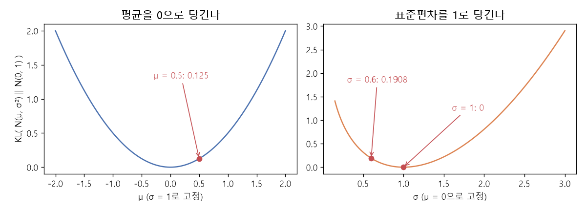

# 가우스 KL과 재매개변수화 (KL divergence between Gaussians, Reparameterization trick)

[목차로 돌아가기](../../00_MIT%EB%94%A5%EB%9F%AC%EB%8B%9D_%EB%AA%A9%EC%B0%A8.md) · 먼저 볼 것: [MM51_KL_발산과_최대_우도](../../%EC%88%98%ED%95%99%EA%B0%9C%EB%85%90/04_%ED%99%95%EB%A5%A0%EA%B3%BC_%EC%A0%95%EB%B3%B4/MM51_KL_%EB%B0%9C%EC%82%B0%EA%B3%BC_%EC%B5%9C%EB%8C%80_%EC%9A%B0%EB%8F%84.md), [MM50_확률_밀도와_정규분포](../../%EC%88%98%ED%95%99%EA%B0%9C%EB%85%90/04_%ED%99%95%EB%A5%A0%EA%B3%BC_%EC%A0%95%EB%B3%B4/MM50_%ED%99%95%EB%A5%A0_%EB%B0%80%EB%8F%84%EC%99%80_%EC%A0%95%EA%B7%9C%EB%B6%84%ED%8F%AC.md), [MM09_야코비안과_연쇄법칙](../../%EC%88%98%ED%95%99%EA%B0%9C%EB%85%90/05_%EC%8B%A0%EA%B2%BD%EB%A7%9D%EC%9D%98_%EA%B3%84%EC%82%B0/MM09_%EC%95%BC%EC%BD%94%EB%B9%84%EC%95%88%EA%B3%BC_%EC%97%B0%EC%87%84%EB%B2%95%EC%B9%99.md), [M07_로그](../../%EC%88%98%ED%95%99%EA%B0%9C%EB%85%90/01_%EC%88%98%EC%99%80_%ED%95%A8%EC%88%98/M07_%EB%A1%9C%EA%B7%B8.md) · 쓰는 곳: [Lec15 4.3](../../Lec15_%EB%B3%80%EB%B6%84_%EC%98%A4%ED%86%A0%EC%9D%B8%EC%BD%94%EB%8D%94.md#43-vae-%ED%95%9C-%EC%9E%A5-%EC%9A%94%EC%95%BD%EA%B3%BC-%ED%91%9C%EB%B3%B8-%EB%BD%91%EA%B8%B0), [Lec15 10.1](../../Lec15_%EB%B3%80%EB%B6%84_%EC%98%A4%ED%86%A0%EC%9D%B8%EC%BD%94%EB%8D%94.md#101-%EB%91%90-%ED%95%AD%EC%9D%98-%EB%9C%BB), [Lec15 11](../../Lec15_%EB%B3%80%EB%B6%84_%EC%98%A4%ED%86%A0%EC%9D%B8%EC%BD%94%EB%8D%94.md#11-%EC%84%B8-%EA%B0%80%EC%A7%80-%EC%9A%94%EB%A0%B9%EA%B3%BC-%ED%95%99%EC%8A%B5-%EB%8B%A8%EA%B3%84)

📚 학습 순서 83/99 (11. 생성 모델): ← 이전: [MM56_젠센_부등식과_ELBO](../../%EC%88%98%ED%95%99%EA%B0%9C%EB%85%90/11_%EC%83%9D%EC%84%B1_%EB%AA%A8%EB%8D%B8/MM56_%EC%A0%A0%EC%84%BC_%EB%B6%80%EB%93%B1%EC%8B%9D%EA%B3%BC_ELBO.md) · 다음: [MM59_조건부_GAN_목적_함수](../../%EC%88%98%ED%95%99%EA%B0%9C%EB%85%90/11_%EC%83%9D%EC%84%B1_%EB%AA%A8%EB%8D%B8/MM59_%EC%A1%B0%EA%B1%B4%EB%B6%80_GAN_%EB%AA%A9%EC%A0%81_%ED%95%A8%EC%88%98.md) →

> [!NOTE]
> **3줄 요약**
> - 인코더 분포 $\mathcal{N}(\mu, \sigma^2)$와 단위 가우스 $\mathcal{N}(0, 1)$의 KL은 닫힌 꼴 $\tfrac{1}{2}(\mu^2 + \sigma^2 - \ln\sigma^2 - 1)$이다. $\mu = 0.5$, $\sigma = 0.6$이면 0.3158. 여러 차원이면 차원마다 더한다.
> - 이 값은 $\mu = 0$, $\sigma = 1$에서만 0이고, [기울기](../../00_%EB%94%A5%EB%9F%AC%EB%8B%9D_%EC%9A%A9%EC%96%B4%EC%82%AC%EC%A0%84.md#gradient-%EA%B8%B0%EC%9A%B8%EA%B8%B0)는 $\partial/\partial\mu = \mu$, $\partial/\partial\sigma = \sigma - 1/\sigma$다. 곧 **평균은 0으로, 표준편차는 1로** 당긴다(0.5, -1.0667).
> - **재매개변수화**: $z = \mu + \sigma\epsilon$, $\epsilon \sim \mathcal{N}(0,1)$로 뽑으면 $\partial z/\partial\mu = 1$, $\partial z/\partial\sigma = \epsilon$이라 [연쇄법칙](../../00_%EB%94%A5%EB%9F%AC%EB%8B%9D_%EC%9A%A9%EC%96%B4%EC%82%AC%EC%A0%84.md#chain-rule-%EC%97%B0%EC%87%84%EB%B2%95%EC%B9%99)으로 역전파된다. $\epsilon = 0.5$, $\partial L/\partial z = 1.2$이면 $\partial L/\partial\mu = 1.2$, $\partial L/\partial\sigma = 0.6$.

## 1. 개념 설명

비유: 인코더는 데이터마다 "이 근처에 있을 것 같다"는 작은 구름(평균 $\mu$, 퍼짐 $\sigma$)을 그린다. KL 항은 구름마다 매달린 고무줄이다. 구름의 중심을 원점으로, 크기를 1로 끌어당긴다. 재구성 항은 반대로 "구름이 서로 겹치면 어디서 왔는지 모른다"며 구름을 작게, 떨어지게 만든다.

- **KL 닫힌 꼴**: 두 가우스의 KL은 적분을 풀면 평균과 분산만으로 나온다. [사전 분포](../../00_%EB%94%A5%EB%9F%AC%EB%8B%9D_%EC%9A%A9%EC%96%B4%EC%82%AC%EC%A0%84.md#prior-posterior-%EC%82%AC%EC%A0%84-%EB%B6%84%ED%8F%AC%EC%99%80-%EC%82%AC%ED%9B%84-%EB%B6%84%ED%8F%AC)가 $\mathcal{N}(0, 1)$일 때 $\mathrm{KL} = \tfrac{1}{2}(\mu^2 + \sigma^2 - \ln\sigma^2 - 1)$. 대각 공분산 $d$차원이면 차원별 값의 합이다.
  - $\mu^2$: 중심이 원점에서 멀수록 벌.
  - $\sigma^2 - \ln\sigma^2 - 1$: $\sigma^2 = 1$에서 0이고, 너무 작아도(점으로 쪼그라듦) 너무 커도 벌.
- **[재매개변수화 트릭](../../00_%EB%94%A5%EB%9F%AC%EB%8B%9D_%EC%9A%A9%EC%96%B4%EC%82%AC%EC%A0%84.md#reparameterization-trick-%EC%9E%AC%EB%A7%A4%EA%B0%9C%EB%B3%80%EC%88%98%ED%99%94-%ED%8A%B8%EB%A6%AD)**: "$\mathcal{N}(\mu, \sigma^2)$에서 뽑는다"는 연산은 미분할 수 없지만, "단위 가우스에서 $\epsilon$을 뽑아 $\mu + \sigma\epsilon$을 계산한다"로 바꾸면 무작위성은 입력 $\epsilon$에만 있고 $z$는 $\mu, \sigma$의 평범한 함수가 된다. 그래서 [손실](../../00_%EB%94%A5%EB%9F%AC%EB%8B%9D_%EC%9A%A9%EC%96%B4%EC%82%AC%EC%A0%84.md#loss-function-%EC%86%90%EC%8B%A4-%ED%95%A8%EC%88%98)의 [기울기](../../00_%EB%94%A5%EB%9F%AC%EB%8B%9D_%EC%9A%A9%EC%96%B4%EC%82%AC%EC%A0%84.md#gradient-%EA%B8%B0%EC%9A%B8%EA%B8%B0)가 $\mu, \sigma$를 거쳐 인코더 [가중치](../../00_%EB%94%A5%EB%9F%AC%EB%8B%9D_%EC%9A%A9%EC%96%B4%EC%82%AC%EC%A0%84.md#weight-%EA%B0%80%EC%A4%91%EC%B9%98)까지 흐른다([MM09_야코비안과_연쇄법칙](../../%EC%88%98%ED%95%99%EA%B0%9C%EB%85%90/05_%EC%8B%A0%EA%B2%BD%EB%A7%9D%EC%9D%98_%EA%B3%84%EC%82%B0/MM09_%EC%95%BC%EC%BD%94%EB%B9%84%EC%95%88%EA%B3%BC_%EC%97%B0%EC%87%84%EB%B2%95%EC%B9%99.md)).

## 2. 필요한 이유

[Lec15 10.1](../../Lec15_%EB%B3%80%EB%B6%84_%EC%98%A4%ED%86%A0%EC%9D%B8%EC%BD%94%EB%8D%94.md#101-%EB%91%90-%ED%95%AD%EC%9D%98-%EB%9C%BB)의 [ELBO](../../00_%EB%94%A5%EB%9F%AC%EB%8B%9D_%EC%9A%A9%EC%96%B4%EC%82%AC%EC%A0%84.md#elbo-evidence-lower-bound-%EC%A6%9D%EA%B1%B0-%ED%95%98%ED%95%9C)에서 KL 항은 이 닫힌 꼴로 바로 계산되고, [분산](../../00_%EB%94%A5%EB%9F%AC%EB%8B%9D_%EC%9A%A9%EC%96%B4%EC%82%AC%EC%A0%84.md#variance-%EB%B6%84%EC%82%B0)을 고정하면 "인코딩의 평균을 원점으로 짓누르기"만 남는다. [Lec15 11](../../Lec15_%EB%B3%80%EB%B6%84_%EC%98%A4%ED%86%A0%EC%9D%B8%EC%BD%94%EB%8D%94.md#11-%EC%84%B8-%EA%B0%80%EC%A7%80-%EC%9A%94%EB%A0%B9%EA%B3%BC-%ED%95%99%EC%8A%B5-%EB%8B%A8%EA%B3%84)의 질의응답 "표본 뽑기를 어떻게 역전파하나?"의 답이 재매개변수화다([4.3](../../Lec15_%EB%B3%80%EB%B6%84_%EC%98%A4%ED%86%A0%EC%9D%B8%EC%BD%94%EB%8D%94.md#43-vae-%ED%95%9C-%EC%9E%A5-%EC%9A%94%EC%95%BD%EA%B3%BC-%ED%91%9C%EB%B3%B8-%EB%BD%91%EA%B8%B0)).

## 3. 숫자로 보기

**KL 닫힌 꼴**
- $\mu = 0.5$, $\sigma = 0.6$: $\tfrac{1}{2}(0.25 + 0.36 - \ln 0.36 - 1) = \tfrac{1}{2}(0.25 + 0.36 + 1.0217 - 1) = \tfrac{1}{2} \times 0.6317 = 0.3158$
- $\mu = 0$, $\sigma = 1$: $\tfrac{1}{2}(0 + 1 - 0 - 1) = 0$
- 2차원 $\boldsymbol{\mu} = (0.5, -1)$, $\boldsymbol{\sigma} = (0.6, 1)$: 차원별 $0.3158 + \tfrac{1}{2}(1 + 1 - 0 - 1) = 0.3158 + 0.5 = 0.8158$

**KL의 [기울기](../../00_%EB%94%A5%EB%9F%AC%EB%8B%9D_%EC%9A%A9%EC%96%B4%EC%82%AC%EC%A0%84.md#gradient-%EA%B8%B0%EC%9A%B8%EA%B8%B0)** ($\mu = 0.5$, $\sigma = 0.6$)
- $\partial\mathrm{KL}/\partial\mu = \mu = 0.5$ (양수 → 경사하강이 $\mu$를 줄여 0으로)
- $\partial\mathrm{KL}/\partial\sigma = \sigma - 1/\sigma = 0.6 - 1.6667 = -1.0667$ (음수 → $\sigma$를 키워 1로)

**재매개변수화로 [역전파](../../00_%EB%94%A5%EB%9F%AC%EB%8B%9D_%EC%9A%A9%EC%96%B4%EC%82%AC%EC%A0%84.md#backpropagation-%EC%97%AD%EC%A0%84%ED%8C%8C)** ($x = 1$, 디코더 평균 $2z$, [손실](../../00_%EB%94%A5%EB%9F%AC%EB%8B%9D_%EC%9A%A9%EC%96%B4%EC%82%AC%EC%A0%84.md#loss-function-%EC%86%90%EC%8B%A4-%ED%95%A8%EC%88%98) $L = (x - 2z)^2/2$, $\epsilon = 0.5$)
- $z = 0.5 + 0.6 \times 0.5 = 0.8$
- $\partial L/\partial z = (x - 2z) \times (-2) = (1 - 1.6) \times (-2) = 1.2$
- $\partial L/\partial\mu = 1.2 \times 1 = 1.2$, $\partial L/\partial\sigma = 1.2 \times 0.5 = 0.6$ (수치 [미분](../../00_%EB%94%A5%EB%9F%AC%EB%8B%9D_%EC%9A%A9%EC%96%B4%EC%82%AC%EC%A0%84.md#derivative-%EB%AF%B8%EB%B6%84)과 같음, 4절 코드)


*▲ 직접 그린 그림: 단위 가우스와의 KL. 왼쪽은 $\sigma = 1$로 두고 $\mu$를 바꾼 것($\mu = 0.5$에서 0.125), 오른쪽은 $\mu = 0$으로 두고 $\sigma$를 바꾼 것($\sigma = 0.6$에서 0.1908, $\sigma = 1$에서 0)*

$d$차원 대각 가우스의 KL은 다음과 같다.

$$
\mathrm{KL}\big(\mathcal{N}(\boldsymbol{\mu}, \mathrm{diag}(\boldsymbol{\sigma}^2))\,\|\,\mathcal{N}(\mathbf{0}, I)\big) = \frac{1}{2}\sum_{k=1}^{d}\big(\mu_k^2 + \sigma_k^2 - \ln\sigma_k^2 - 1\big)
$$

<details><summary>기호 풀이</summary>

| 기호 | 읽는 법 | 뜻 | 예제 값 |
| --- | --- | --- | --- |
| $\boldsymbol{\mu}$ | 뮤 | 인코더가 낸 평균 벡터 | $(0.5, -1)$ |
| $\boldsymbol{\sigma}$ | 시그마 | 인코더가 낸 표준편차 벡터 | $(0.6, 1)$ |
| $\mathrm{diag}(\boldsymbol{\sigma}^2)$ | 대각 행렬 | 차원끼리 독립인 공분산 | |
| $\mathcal{N}(\mathbf{0}, I)$ | 단위 가우스 | [사전 분포](../../00_%EB%94%A5%EB%9F%AC%EB%8B%9D_%EC%9A%A9%EC%96%B4%EC%82%AC%EC%A0%84.md#prior-posterior-%EC%82%AC%EC%A0%84-%EB%B6%84%ED%8F%AC%EC%99%80-%EC%82%AC%ED%9B%84-%EB%B6%84%ED%8F%AC) | |
| $d$ | 디 | 잠재 차원 수 | 2 |
| $\ln\sigma_k^2$ | [로그](../../00_%EB%94%A5%EB%9F%AC%EB%8B%9D_%EC%9A%A9%EC%96%B4%EC%82%AC%EC%A0%84.md#log-ln-%EB%A1%9C%EA%B7%B8) [분산](../../00_%EB%94%A5%EB%9F%AC%EB%8B%9D_%EC%9A%A9%EC%96%B4%EC%82%AC%EC%A0%84.md#variance-%EB%B6%84%EC%82%B0) | $e$를 몇 제곱하면 $\sigma_k^2$인지 | $\ln 0.36 = -1.0217$ |

</details>

<details><summary>예제와 풀이</summary>

**문제**: 2차원 [잠재 공간](../../00_%EB%94%A5%EB%9F%AC%EB%8B%9D_%EC%9A%A9%EC%96%B4%EC%82%AC%EC%A0%84.md#latent-space-%EC%9E%A0%EC%9E%AC-%EA%B3%B5%EA%B0%84)에서 인코더가 평균 $(0.5, -1)$, 표준편차 $(0.6, 1)$을 냈다. 단위 가우스와의 KL은?

**주어진 값**
- $\mu_1 = 0.5$, $\mu_2 = -1$ (평균)
- $\sigma_1 = 0.6$, $\sigma_2 = 1$ (표준편차)
- $d = 2$

**풀이**
1. 식을 그대로 쓴다: $\mathrm{KL} = \dfrac{1}{2}\sum_{k=1}^{d}\big(\mu_k^2 + \sigma_k^2 - \ln\sigma_k^2 - 1\big)$
2. 값을 대입한다: $\mathrm{KL} = \dfrac{1}{2}\sum_{k=1}^{2}\big(\mu_k^2 + \sigma_k^2 - \ln\sigma_k^2 - 1\big)$
3. Σ를 풀어 쓴다: $\dfrac{1}{2}\big(0.5^2 + 0.6^2 - \ln 0.6^2 - 1\big) + \dfrac{1}{2}\big((-1)^2 + 1^2 - \ln 1^2 - 1\big)$
4. 첫 차원의 제곱: $0.5^2 = 0.25$, $0.6^2 = 0.36$
5. [로그](../../00_%EB%94%A5%EB%9F%AC%EB%8B%9D_%EC%9A%A9%EC%96%B4%EC%82%AC%EC%A0%84.md#log-ln-%EB%A1%9C%EA%B7%B8)를 계산한다 ($\ln a$는 $e$를 몇 제곱하면 $a$인지, 계산기로 구함): $\ln 0.36 = -1.0217$
6. 첫 차원 괄호 안: $0.25 + 0.36 = 0.61$, $0.61 - (-1.0217) = 1.6317$, $1.6317 - 1 = 0.6317$
7. 반으로: $0.6317 / 2 = 0.3158$
8. 둘째 차원: $(-1)^2 = 1$, $1^2 = 1$, $\ln 1 = 0$ 이므로 $1 + 1 - 0 - 1 = 1$
9. 반으로: $1 / 2 = 0.5$
10. 더한다: $0.3158 + 0.5 = 0.8158$

**답**: KL = **0.8158**. 둘째 차원은 표준편차가 이미 1이라 평균이 원점에서 떨어진 몫($\tfrac{1}{2}\mu^2 = 0.5$)만 벌을 받는다.

</details>

<details><summary>내 이해</summary>


</details>

## 4. 코드로 확인

```python
# [함수] KL(m, s): N(m, s²)와 N(0, 1)의 KL 닫힌 꼴 (배열이면 차원별 값)
KL = lambda m, s: 0.5 * (m ** 2 + s ** 2 - np.log(s ** 2) - 1)
# [연결] 3절 → 0.3158, 0, 2차원 합 0.8158
print(round(KL(0.5, 0.6), 4), KL(0.0, 1.0), round(KL(np.array([0.5, -1]), np.array([0.6, 1.0])).sum(), 4))
# [변수] h: 수치 미분에 쓰는 아주 작은 폭
h = 1e-6
# [함수] (f(a+h) - f(a-h)) / 2h: 중앙 차분으로 구한 기울기 (M03 미분)
# [연결] 3절 → ∂KL/∂μ = μ = 0.5, ∂KL/∂σ = σ - 1/σ = -1.0667
print(round((KL(0.5 + h, 0.6) - KL(0.5 - h, 0.6)) / (2 * h), 4), round((KL(0.5, 0.6 + h) - KL(0.5, 0.6 - h)) / (2 * h), 4), round(0.6 - 1 / 0.6, 4))
# [변수] x, mu, s, eps: 입력 1, 인코더 평균 0.5, 표준편차 0.6, 뽑은 잡음 0.5
x, mu, s, eps = 1.0, 0.5, 0.6, 0.5
# [함수] L(mu, s): 재매개변수화 z = mu + s*eps 를 거친 재구성 손실 (x - 2z)²/2
L = lambda mu, s: (x - 2 * (mu + s * eps)) ** 2 / 2
# [변수] z = 0.8, dLdz = (x - 2z)(-2) = 1.2
z = mu + s * eps
dLdz = (x - 2 * z) * (-2)
# [연결] 3절 → 연쇄법칙 ∂L/∂μ = dLdz×1 = 1.2, ∂L/∂σ = dLdz×ε = 0.6, 수치 미분도 같다
print(round(z, 4), round(dLdz, 4), round(dLdz * 1, 4), round(dLdz * eps, 4))
print(round((L(mu + h, s) - L(mu - h, s)) / (2 * h), 4), round((L(mu, s + h) - L(mu, s - h)) / (2 * h), 4))
```

**실행 결과**:

```text
0.3158 0.0 0.8158
0.5 -1.0667 -1.0667
0.8 1.2 1.2 0.6
1.2 0.6
```

> [!WARNING]
> **⚠ 주의**
> - 닫힌 꼴은 두 분포가 모두 가우스일 때만 쓸 수 있다. [사전 분포](../../00_%EB%94%A5%EB%9F%AC%EB%8B%9D_%EC%9A%A9%EC%96%B4%EC%82%AC%EC%A0%84.md#prior-posterior-%EC%82%AC%EC%A0%84-%EB%B6%84%ED%8F%AC%EC%99%80-%EC%82%AC%ED%9B%84-%EB%B6%84%ED%8F%AC)나 인코더를 다른 분포로 바꾸면 KL도 표본으로 추정해야 한다.
> - 실제 구현은 $\sigma$ 대신 $\log\sigma^2$를 신경망이 내게 한다. $\sigma$는 양수여야 하는데 [로그](../../00_%EB%94%A5%EB%9F%AC%EB%8B%9D_%EC%9A%A9%EC%96%B4%EC%82%AC%EC%A0%84.md#log-ln-%EB%A1%9C%EA%B7%B8)는 어떤 실수든 되기 때문이다.
> - KL 항이 너무 세면 모든 데이터의 인코딩이 $\mathcal{N}(0, 1)$과 같아져 $z$가 입력 정보를 담지 않는다(사후 붕괴, posterior collapse). 재구성 항과의 줄다리기가 깨진 경우다([Lec15 10.2](../../Lec15_%EB%B3%80%EB%B6%84_%EC%98%A4%ED%86%A0%EC%9D%B8%EC%BD%94%EB%8D%94.md#102-%EC%A7%93%EB%88%84%EB%A5%B4%EA%B8%B0%EC%99%80-%EB%B3%B5%EC%9B%90%EC%9D%98-%EC%A4%84%EB%8B%A4%EB%A6%AC%EA%B8%B0)).

## 5. 개념 재확인

<details><summary>1. 인코더가 $\mu = 1$, $\sigma = 0.5$를 냈다. 단위 가우스와의 KL은?</summary>

| 단계 | 하는 일 | 계산 | 결과 |
|---|---|---|---|
| 1 | 제곱 | $1^2$, $0.5^2$ | 1, 0.25 |
| 2 | [로그](../../00_%EB%94%A5%EB%9F%AC%EB%8B%9D_%EC%9A%A9%EC%96%B4%EC%82%AC%EC%A0%84.md#log-ln-%EB%A1%9C%EA%B7%B8) | $\ln 0.25$ | -1.3863 |
| 3 | 괄호 안 | $1 + 0.25 + 1.3863 - 1$ | 1.6363 |
| 4 | 반으로 | $1.6363 / 2$ | 0.8181 |

**① 쓰는 식**
$$\mathrm{KL} = \tfrac{1}{2}\big(\mu^2 + \sigma^2 - \ln\sigma^2 - 1\big)$$
- 위 식 ← ② (제곱), ③ ([로그](../../00_%EB%94%A5%EB%9F%AC%EB%8B%9D_%EC%9A%A9%EC%96%B4%EC%82%AC%EC%A0%84.md#log-ln-%EB%A1%9C%EA%B7%B8)), ④ (괄호 안), ⑤ (반으로)에서 쓴다.
```python
# [변수] m, s: 인코더 평균과 표준편차
m, s = 1.0, 0.5                                           # ①
# [연결] 1.0 0.25 -1.3863
print(m ** 2, s ** 2, round(np.log(s ** 2), 4))           # ②③
# [연결] 1.6363 0.8181
print(round(m ** 2 + s ** 2 - np.log(s ** 2) - 1, 4), round(0.5 * (m ** 2 + s ** 2 - np.log(s ** 2) - 1), 4))   # ④⑤
```

**주어진 값**
- $\mu = 1$ (평균)
- $\sigma = 0.5$ (표준편차)

**풀이**
1. 식을 그대로 쓴다: $\mathrm{KL} = \tfrac{1}{2}\big(\mu^2 + \sigma^2 - \ln\sigma^2 - 1\big)$
2. 값을 대입한다: $\mathrm{KL} = \tfrac{1}{2}\big(1^2 + 0.5^2 - \ln 0.5^2 - 1\big)$
3. (②) 제곱한다: $1^2 = 1$, $0.5^2 = 0.25$
4. (③) [로그](../../00_%EB%94%A5%EB%9F%AC%EB%8B%9D_%EC%9A%A9%EC%96%B4%EC%82%AC%EC%A0%84.md#log-ln-%EB%A1%9C%EA%B7%B8)를 계산한다: $\ln 0.25 = -1.3863$
5. (④) 더한다: $1 + 0.25 = 1.25$
6. (④) [로그](../../00_%EB%94%A5%EB%9F%AC%EB%8B%9D_%EC%9A%A9%EC%96%B4%EC%82%AC%EC%A0%84.md#log-ln-%EB%A1%9C%EA%B7%B8)를 뺀다: $1.25 - (-1.3863) = 2.6363$
7. (④) 1을 뺀다: $2.6363 - 1 = 1.6363$
8. (⑤) 반으로: $1.6363 / 2 = 0.8181$

**답**: KL = **0.8181**. 평균이 원점에서 1 떨어진 몫이 0.5, 표준편차가 1보다 작은 몫이 0.3181이다.

</details>

<details><summary>2. $x = 1$, 인코더 $\mu = 0.2$, $\sigma = 0.5$, 뽑은 잡음 $\epsilon = -1$, 손실 $L = (x - 2z)^2/2$일 때 $\partial L/\partial\mu$와 $\partial L/\partial\sigma$는?</summary>

| 단계 | 하는 일 | 계산 | 결과 |
|---|---|---|---|
| 1 | 표본 | $0.2 + 0.5 \times (-1)$ | -0.3 |
| 2 | [손실](../../00_%EB%94%A5%EB%9F%AC%EB%8B%9D_%EC%9A%A9%EC%96%B4%EC%82%AC%EC%A0%84.md#loss-function-%EC%86%90%EC%8B%A4-%ED%95%A8%EC%88%98)의 $z$ [기울기](../../00_%EB%94%A5%EB%9F%AC%EB%8B%9D_%EC%9A%A9%EC%96%B4%EC%82%AC%EC%A0%84.md#gradient-%EA%B8%B0%EC%9A%B8%EA%B8%B0) | $(1 - 2 \times (-0.3)) \times (-2)$ | -3.2 |
| 3 | $\mu$ [기울기](../../00_%EB%94%A5%EB%9F%AC%EB%8B%9D_%EC%9A%A9%EC%96%B4%EC%82%AC%EC%A0%84.md#gradient-%EA%B8%B0%EC%9A%B8%EA%B8%B0) | $-3.2 \times 1$ | -3.2 |
| 4 | $\sigma$ [기울기](../../00_%EB%94%A5%EB%9F%AC%EB%8B%9D_%EC%9A%A9%EC%96%B4%EC%82%AC%EC%A0%84.md#gradient-%EA%B8%B0%EC%9A%B8%EA%B8%B0) | $-3.2 \times (-1)$ | 3.2 |

**① 쓰는 식**
$$z = \mu + \sigma\epsilon, \qquad \frac{\partial L}{\partial\mu} = \frac{\partial L}{\partial z}\cdot 1, \qquad \frac{\partial L}{\partial\sigma} = \frac{\partial L}{\partial z}\cdot\epsilon$$
- 위 식 ← ② (표본), ③ ($z$ [기울기](../../00_%EB%94%A5%EB%9F%AC%EB%8B%9D_%EC%9A%A9%EC%96%B4%EC%82%AC%EC%A0%84.md#gradient-%EA%B8%B0%EC%9A%B8%EA%B8%B0)), ④ ([연쇄법칙](../../00_%EB%94%A5%EB%9F%AC%EB%8B%9D_%EC%9A%A9%EC%96%B4%EC%82%AC%EC%A0%84.md#chain-rule-%EC%97%B0%EC%87%84%EB%B2%95%EC%B9%99))에서 쓴다.
```python
# [변수] x, mu, s, eps: 입력, 평균, 표준편차, 잡음
x, mu, s, eps = 1.0, 0.2, 0.5, -1.0                       # ①
# [변수] z = -0.3: 재매개변수화한 표본
z = mu + s * eps                                          # ②
# [변수] g = -3.2: ∂L/∂z = (x - 2z)(-2)
g = (x - 2 * z) * (-2)                                    # ③
# [연결] -0.3 -3.2 -3.2 3.2
print(round(z, 4), round(g, 4), round(g * 1, 4), round(g * eps, 4))   # ④
```

**주어진 값**
- $x = 1$ (입력)
- $\mu = 0.2$, $\sigma = 0.5$ (인코더 출력)
- $\epsilon = -1$ (단위 가우스 잡음)

**풀이**
1. 식을 그대로 쓴다: $z = \mu + \sigma\epsilon$, $\dfrac{\partial L}{\partial\mu} = \dfrac{\partial L}{\partial z}\cdot 1$, $\dfrac{\partial L}{\partial\sigma} = \dfrac{\partial L}{\partial z}\cdot\epsilon$
2. 값을 대입한다: $z = 0.2 + 0.5 \times (-1)$
3. (②) 곱셈을 먼저 한다: $0.5 \times (-1) = -0.5$ 이므로 $z = 0.2 + (-0.5) = -0.3$
4. (③) $L = (x - 2z)^2/2$를 $z$로 미분하면 $(x - 2z) \times (-2)$이다. 대입: $(1 - 2 \times (-0.3)) \times (-2)$
5. (③) 곱셈: $2 \times (-0.3) = -0.6$
6. (③) 뺄셈: $1 - (-0.6) = 1.6$
7. (③) $-2$를 곱한다: $1.6 \times (-2) = -3.2$
8. (④) $\mu$ [기울기](../../00_%EB%94%A5%EB%9F%AC%EB%8B%9D_%EC%9A%A9%EC%96%B4%EC%82%AC%EC%A0%84.md#gradient-%EA%B8%B0%EC%9A%B8%EA%B8%B0): $-3.2 \times 1 = -3.2$
9. (④) $\sigma$ [기울기](../../00_%EB%94%A5%EB%9F%AC%EB%8B%9D_%EC%9A%A9%EC%96%B4%EC%82%AC%EC%A0%84.md#gradient-%EA%B8%B0%EC%9A%B8%EA%B8%B0): $-3.2 \times (-1) = 3.2$

**답**: $\partial L/\partial\mu = $ **-3.2**, $\partial L/\partial\sigma = $ **3.2**. 경사하강은 $\mu$를 키우고 $\sigma$를 줄여서, 다음 표본이 $x = 1$을 더 잘 되살리는 $z = 0.5$ 쪽으로 가게 한다.

</details>

## 예제 풀기

[예제 10문제 풀기](../../%EC%98%88%EC%A0%9C/11_%EC%83%9D%EC%84%B1_%EB%AA%A8%EB%8D%B8/%EC%98%88%EC%A0%9C_MM57_%EA%B0%80%EC%9A%B0%EC%8A%A4_KL%EA%B3%BC_%EC%9E%AC%EB%A7%A4%EA%B0%9C%EB%B3%80%EC%88%98%ED%99%94.md)

<details><summary>내 이해</summary>


</details>
