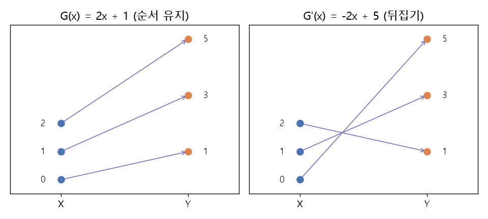

# 순환 일관성 손실 (Cycle consistency loss)

[목차로 돌아가기](../../00_MIT%EB%94%A5%EB%9F%AC%EB%8B%9D_%EB%AA%A9%EC%B0%A8.md) · 먼저 볼 것: [M01_함수와_일차함수](../../%EC%88%98%ED%95%99%EA%B0%9C%EB%85%90/01_%EC%88%98%EC%99%80_%ED%95%A8%EC%88%98/M01_%ED%95%A8%EC%88%98%EC%99%80_%EC%9D%BC%EC%B0%A8%ED%95%A8%EC%88%98.md), [MM06_합성함수와_비선형성](../../%EC%88%98%ED%95%99%EA%B0%9C%EB%85%90/05_%EC%8B%A0%EA%B2%BD%EB%A7%9D%EC%9D%98_%EA%B3%84%EC%82%B0/MM06_%ED%95%A9%EC%84%B1%ED%95%A8%EC%88%98%EC%99%80_%EB%B9%84%EC%84%A0%ED%98%95%EC%84%B1.md), [MM59_조건부_GAN_목적_함수](../../%EC%88%98%ED%95%99%EA%B0%9C%EB%85%90/11_%EC%83%9D%EC%84%B1_%EB%AA%A8%EB%8D%B8/MM59_%EC%A1%B0%EA%B1%B4%EB%B6%80_GAN_%EB%AA%A9%EC%A0%81_%ED%95%A8%EC%88%98.md) · 쓰는 곳: [Lec16 9.3](../../Lec16_%EC%A1%B0%EA%B1%B4%EB%B6%80_%EC%83%9D%EC%84%B1_%EB%AA%A8%EB%8D%B8.md#93-%EC%88%9C%ED%99%98-%EC%9D%BC%EA%B4%80%EC%84%B1), [Lec16 9.4](../../Lec16_%EC%A1%B0%EA%B1%B4%EB%B6%80_%EC%83%9D%EC%84%B1_%EB%AA%A8%EB%8D%B8.md#94-%EC%99%9C-%EC%97%89%EB%9A%B1%ED%95%9C-%EB%8C%80%EC%9D%91%EC%9D%84-%EC%B0%BE%EC%A7%80-%EC%95%8A%EB%82%98)

📚 학습 순서 85/99 (11. 생성 모델): ← 이전: [MM59_조건부_GAN_목적_함수](../../%EC%88%98%ED%95%99%EA%B0%9C%EB%85%90/11_%EC%83%9D%EC%84%B1_%EB%AA%A8%EB%8D%B8/MM59_%EC%A1%B0%EA%B1%B4%EB%B6%80_GAN_%EB%AA%A9%EC%A0%81_%ED%95%A8%EC%88%98.md) · 다음: [MM61_분류기_없는_가이던스](../../%EC%88%98%ED%95%99%EA%B0%9C%EB%85%90/11_%EC%83%9D%EC%84%B1_%EB%AA%A8%EB%8D%B8/MM61_%EB%B6%84%EB%A5%98%EA%B8%B0_%EC%97%86%EB%8A%94_%EA%B0%80%EC%9D%B4%EB%8D%98%EC%8A%A4.md) →

> [!NOTE]
> **3줄 요약**
> - 짝 없는 두 도메인 $X$, $Y$ 사이에 정방향 $G: X \to Y$와 역방향 $F: Y \to X$를 함께 배우고, **갔다가 돌아오면 제자리**여야 한다고 벌한다: $\mathcal{L}_{\text{cyc}} = \mathbb{E}_x|F(G(x)) - x| + \mathbb{E}_y|G(F(y)) - y|$.
> - $X = \{0, 1, 2\}$, $Y = \{1, 3, 5\}$, $G(x) = 2x + 1$일 때 $F(y) = 0.5y$이면 정방향 [오차](../../00_%EB%94%A5%EB%9F%AC%EB%8B%9D_%EC%9A%A9%EC%96%B4%EC%82%AC%EC%A0%84.md#error-%EC%98%A4%EC%B0%A8) 평균 0.5, 역방향 1.0, 합 1.5다. 정확한 역함수 $F(y) = 0.5y - 0.5$면 0이다.
> - [순환 일관성](../../00_%EB%94%A5%EB%9F%AC%EB%8B%9D_%EC%9A%A9%EC%96%B4%EC%82%AC%EC%A0%84.md#cycle-consistency-%EC%88%9C%ED%99%98-%EC%9D%BC%EA%B4%80%EC%84%B1)을 만족하는 대응은 하나가 아니다. 뒤집는 $G(x) = -2x + 5$도 $X$를 $Y$로 그대로 보내고 역함수와 함께 [손실](../../00_%EB%94%A5%EB%9F%AC%EB%8B%9D_%EC%9A%A9%EC%96%B4%EC%82%AC%EC%A0%84.md#loss-function-%EC%86%90%EC%8B%A4-%ED%95%A8%EC%88%98) 0이다. 어느 쪽을 찾을지는 신경망과 최적화의 **단순한 함수 선호**가 정한다.

## 1. 개념 설명

비유: 영어 문장을 프랑스어로 번역한 뒤 다른 사람이 다시 영어로 번역했을 때 원래 문장이 나오면, 두 번역이 서로 맞는다고 볼 수 있다(**[역번역](../../00_%EB%94%A5%EB%9F%AC%EB%8B%9D_%EC%9A%A9%EC%96%B4%EC%82%AC%EC%A0%84.md#back-translation-%EC%97%AD%EB%B2%88%EC%97%AD)**). [정답](../../00_%EB%94%A5%EB%9F%AC%EB%8B%9D_%EC%9A%A9%EC%96%B4%EC%82%AC%EC%A0%84.md#label-%EC%A0%95%EB%8B%B5) 번역(짝 데이터)이 없어도 "왕복해서 제자리"인지는 확인할 수 있다.

- **두 생성자**: $G$는 사진 → 세잔 그림, $F$는 세잔 그림 → 사진. 각각 [GAN](../../00_%EB%94%A5%EB%9F%AC%EB%8B%9D_%EC%9A%A9%EC%96%B4%EC%82%AC%EC%A0%84.md#gan-generative-adversarial-network-%EC%83%9D%EC%84%B1%EC%A0%81-%EC%A0%81%EB%8C%80-%EC%8B%A0%EA%B2%BD%EB%A7%9D) 판별자($D_Y$, $D_X$)가 "그 도메인답게 보이는지"를 본다([GAN 목적 함수](../../%EC%88%98%ED%95%99%EA%B0%9C%EB%85%90/11_%EC%83%9D%EC%84%B1_%EB%AA%A8%EB%8D%B8/MM59_%EC%A1%B0%EA%B1%B4%EB%B6%80_GAN_%EB%AA%A9%EC%A0%81_%ED%95%A8%EC%88%98.md)).
- **판별자만으로는 부족한 이유**: 판별자는 출력이 "세잔 그림 같은지"만 본다. 입력 사진과 상관없는 아무 세잔 그림을 내도 통과한다.
- **[순환 일관성](../../00_%EB%94%A5%EB%9F%AC%EB%8B%9D_%EC%9A%A9%EC%96%B4%EC%82%AC%EC%A0%84.md#cycle-consistency-%EC%88%9C%ED%99%98-%EC%9D%BC%EA%B4%80%EC%84%B1)**: $F(G(x)) \approx x$, $G(F(y)) \approx y$를 L1 거리로 벌한다. 입력의 정보가 출력에 남아 있어야 되돌릴 수 있으므로, 출력이 입력과 엮이게 된다. 두 함수가 서로의 역함수(전단사, bijection)에 가까워진다.
- **전체 목적**: $\mathcal{L}_{\text{GAN}}(G, D_Y) + \mathcal{L}_{\text{GAN}}(F, D_X) + \lambda\,\mathcal{L}_{\text{cyc}}(G, F)$. CycleGAN 논문은 $\lambda = 10$을 썼다.

## 2. 필요한 이유

[Lec16 9.3](../../Lec16_%EC%A1%B0%EA%B1%B4%EB%B6%80_%EC%83%9D%EC%84%B1_%EB%AA%A8%EB%8D%B8.md#93-%EC%88%9C%ED%99%98-%EC%9D%BC%EA%B4%80%EC%84%B1)은 짝 없는 사진과 세잔 그림만으로 사진을 그림으로 바꾸는 CycleGAN을 소개한다. [Lec16 9.4](../../Lec16_%EC%A1%B0%EA%B1%B4%EB%B6%80_%EC%83%9D%EC%84%B1_%EB%AA%A8%EB%8D%B8.md#94-%EC%99%9C-%EC%97%89%EB%9A%B1%ED%95%9C-%EB%8C%80%EC%9D%91%EC%9D%84-%EC%B0%BE%EC%A7%80-%EC%95%8A%EB%82%98)는 "[순환 일관성](../../00_%EB%94%A5%EB%9F%AC%EB%8B%9D_%EC%9A%A9%EC%96%B4%EC%82%AC%EC%A0%84.md#cycle-consistency-%EC%88%9C%ED%99%98-%EC%9D%BC%EA%B4%80%EC%84%B1)을 만족하는 대응은 무수히 많은데 왜 그럴듯한 것을 찾나?"라는 질문에, 2개 은닉 유닛 [ReLU](../../00_%EB%94%A5%EB%9F%AC%EB%8B%9D_%EC%9A%A9%EC%96%B4%EC%82%AC%EC%A0%84.md#relu-%EB%A0%90%EB%A3%A8) 망이 항등 사상과 뒤집기 두 가지만 찾는다는 예로 답한다. 작은 일차함수로 계산해 보면 [손실](../../00_%EB%94%A5%EB%9F%AC%EB%8B%9D_%EC%9A%A9%EC%96%B4%EC%82%AC%EC%A0%84.md#loss-function-%EC%86%90%EC%8B%A4-%ED%95%A8%EC%88%98)이 무엇을 막고 무엇을 막지 못하는지가 보인다.

## 3. 숫자로 보기

데이터 $X = \{0, 1, 2\}$, $Y = \{1, 3, 5\}$, 정방향 $G(x) = 2x + 1$

| 역방향 $F$ | $F(G(x))$ ($x = 0, 1, 2$) | 정방향 [오차](../../00_%EB%94%A5%EB%9F%AC%EB%8B%9D_%EC%9A%A9%EC%96%B4%EC%82%AC%EC%A0%84.md#error-%EC%98%A4%EC%B0%A8) 평균 | $G(F(y))$ ($y = 1, 3, 5$) | 역방향 [오차](../../00_%EB%94%A5%EB%9F%AC%EB%8B%9D_%EC%9A%A9%EC%96%B4%EC%82%AC%EC%A0%84.md#error-%EC%98%A4%EC%B0%A8) 평균 | $\mathcal{L}_{\text{cyc}}$ |
|---|---|---|---|---|---|
| $0.5y$ | 0.5, 1.5, 2.5 | 0.5 | 2, 4, 6 | 1.0 | 1.5 |
| $0.5y - 0.5$ | 0, 1, 2 | 0 | 1, 3, 5 | 0 | 0 |

- 뒤집는 대응 $G'(x) = -2x + 5$: $0 \to 5$, $1 \to 3$, $2 \to 1$. 출력 집합은 똑같이 $\{1, 3, 5\}$라 판별자도 속고, 역함수 $F'(y) = (5 - y)/2$와 함께 순환 [손실](../../00_%EB%94%A5%EB%9F%AC%EB%8B%9D_%EC%9A%A9%EC%96%B4%EC%82%AC%EC%A0%84.md#loss-function-%EC%86%90%EC%8B%A4-%ED%95%A8%EC%88%98)도 0이다.

$$
\mathcal{L}_{\text{cyc}}(G, F) = \mathbb{E}_{x}\,\big\|F(G(x)) - x\big\|_1 + \mathbb{E}_{y}\,\big\|G(F(y)) - y\big\|_1
$$

<details><summary>기호 풀이</summary>

| 기호 | 읽는 법 | 뜻 | 예제 값 |
| --- | --- | --- | --- |
| $x$, $y$ | 엑스, 와이 | 도메인 $X$(사진)와 $Y$(그림)의 데이터. 서로 짝이 없다 | $\{0, 1, 2\}$, $\{1, 3, 5\}$ |
| $G$ | 지 | $X \to Y$ 변환 | $2x + 1$ |
| $F$ | 에프 | $Y \to X$ 변환 | $0.5y$ |
| $F(G(x))$ | 에프 지 엑스 | 갔다가 돌아온 값 ([합성함수](../../00_%EB%94%A5%EB%9F%AC%EB%8B%9D_%EC%9A%A9%EC%96%B4%EC%82%AC%EC%A0%84.md#function-composition-%ED%95%A9%EC%84%B1%ED%95%A8%EC%88%98)) | 0.5, 1.5, 2.5 |
| $\|\cdot\|_1$ | 엘원 [노름](../../00_%EB%94%A5%EB%9F%AC%EB%8B%9D_%EC%9A%A9%EC%96%B4%EC%82%AC%EC%A0%84.md#norm-%EB%85%B8%EB%A6%84) | 절댓값 거리 | |
| $\mathbb{E}_x$ | [기댓값](../../00_%EB%94%A5%EB%9F%AC%EB%8B%9D_%EC%9A%A9%EC%96%B4%EC%82%AC%EC%A0%84.md#expectation-%EA%B8%B0%EB%8C%93%EA%B0%92) | 데이터에 대한 평균 | |
| $\mathcal{L}_{\text{cyc}}$ | 엘 사이클 | [순환 일관성](../../00_%EB%94%A5%EB%9F%AC%EB%8B%9D_%EC%9A%A9%EC%96%B4%EC%82%AC%EC%A0%84.md#cycle-consistency-%EC%88%9C%ED%99%98-%EC%9D%BC%EA%B4%80%EC%84%B1) [손실](../../00_%EB%94%A5%EB%9F%AC%EB%8B%9D_%EC%9A%A9%EC%96%B4%EC%82%AC%EC%A0%84.md#loss-function-%EC%86%90%EC%8B%A4-%ED%95%A8%EC%88%98) | 1.5 |

</details>

<details><summary>예제와 풀이</summary>

**문제**: 사진 도메인의 값이 $x = 0, 1, 2$, 그림 도메인의 값이 $y = 1, 3, 5$다. 정방향 $G(x) = 2x + 1$, 역방향 $F(y) = 0.5y$일 때 [순환 일관성](../../00_%EB%94%A5%EB%9F%AC%EB%8B%9D_%EC%9A%A9%EC%96%B4%EC%82%AC%EC%A0%84.md#cycle-consistency-%EC%88%9C%ED%99%98-%EC%9D%BC%EA%B4%80%EC%84%B1) [손실](../../00_%EB%94%A5%EB%9F%AC%EB%8B%9D_%EC%9A%A9%EC%96%B4%EC%82%AC%EC%A0%84.md#loss-function-%EC%86%90%EC%8B%A4-%ED%95%A8%EC%88%98)은?

**주어진 값**
- $x \in \{0, 1, 2\}$ (사진 도메인 데이터 3개)
- $y \in \{1, 3, 5\}$ (그림 도메인 데이터 3개)
- $G(x) = 2x + 1$ (사진 → 그림)
- $F(y) = 0.5y$ (그림 → 사진)

**풀이**
1. 식을 그대로 쓴다: $\mathcal{L}_{\text{cyc}} = \mathbb{E}_x |F(G(x)) - x| + \mathbb{E}_y |G(F(y)) - y|$
2. 값을 대입한다: $\mathcal{L}_{\text{cyc}} = \frac{1}{3}\sum_{x \in \{0,1,2\}} |0.5(2x + 1) - x| + \frac{1}{3}\sum_{y \in \{1,3,5\}} |2(0.5y) + 1 - y|$
3. 정방향을 하나씩 계산한다 ($x = 0$): $G(0) = 2 \times 0 + 1 = 1$, $F(1) = 0.5 \times 1 = 0.5$, [오차](../../00_%EB%94%A5%EB%9F%AC%EB%8B%9D_%EC%9A%A9%EC%96%B4%EC%82%AC%EC%A0%84.md#error-%EC%98%A4%EC%B0%A8) $|0.5 - 0| = 0.5$
4. $x = 1$: $G(1) = 3$, $F(3) = 1.5$, [오차](../../00_%EB%94%A5%EB%9F%AC%EB%8B%9D_%EC%9A%A9%EC%96%B4%EC%82%AC%EC%A0%84.md#error-%EC%98%A4%EC%B0%A8) $|1.5 - 1| = 0.5$
5. $x = 2$: $G(2) = 5$, $F(5) = 2.5$, [오차](../../00_%EB%94%A5%EB%9F%AC%EB%8B%9D_%EC%9A%A9%EC%96%B4%EC%82%AC%EC%A0%84.md#error-%EC%98%A4%EC%B0%A8) $|2.5 - 2| = 0.5$
6. 정방향 평균을 낸다 (Σ를 풀어 더하고 3으로 나눔): $(0.5 + 0.5 + 0.5) / 3 = 0.5$
7. 역방향을 하나씩 계산한다 ($y = 1$): $F(1) = 0.5$, $G(0.5) = 2 \times 0.5 + 1 = 2$, [오차](../../00_%EB%94%A5%EB%9F%AC%EB%8B%9D_%EC%9A%A9%EC%96%B4%EC%82%AC%EC%A0%84.md#error-%EC%98%A4%EC%B0%A8) $|2 - 1| = 1$
8. $y = 3$: $F(3) = 1.5$, $G(1.5) = 4$, [오차](../../00_%EB%94%A5%EB%9F%AC%EB%8B%9D_%EC%9A%A9%EC%96%B4%EC%82%AC%EC%A0%84.md#error-%EC%98%A4%EC%B0%A8) $|4 - 3| = 1$
9. $y = 5$: $F(5) = 2.5$, $G(2.5) = 6$, [오차](../../00_%EB%94%A5%EB%9F%AC%EB%8B%9D_%EC%9A%A9%EC%96%B4%EC%82%AC%EC%A0%84.md#error-%EC%98%A4%EC%B0%A8) $|6 - 5| = 1$
10. 역방향 평균을 낸다: $(1 + 1 + 1) / 3 = 1$
11. 두 방향을 더한다: $0.5 + 1 = 1.5$

**답**: **1.5**. $F$가 $G$의 "+1"을 되돌리지 못해서 생긴 [오차](../../00_%EB%94%A5%EB%9F%AC%EB%8B%9D_%EC%9A%A9%EC%96%B4%EC%82%AC%EC%A0%84.md#error-%EC%98%A4%EC%B0%A8)다. $F(y) = 0.5y - 0.5$로 고치면 0이 된다.

</details>

<details><summary>내 이해</summary>


</details>


*▲ 직접 그린 그림: $X = \{0, 1, 2\}$와 $Y = \{1, 3, 5\}$ 사이의 두 대응. 왼쪽은 순서를 지키는 $G(x) = 2x + 1$, 오른쪽은 뒤집는 $G'(x) = -2x + 5$. 둘 다 순환 [손실](../../00_%EB%94%A5%EB%9F%AC%EB%8B%9D_%EC%9A%A9%EC%96%B4%EC%82%AC%EC%A0%84.md#loss-function-%EC%86%90%EC%8B%A4-%ED%95%A8%EC%88%98)이 0이고 출력 집합도 같다*

## 4. 코드로 확인

```python
# [변수] X, Y: 짝 없는 두 도메인의 데이터 (3절 표)
X, Y = np.array([0, 1, 2.0]), np.array([1, 3, 5.0])
# [함수] lambda: 정방향 G(x) = 2x + 1
G = lambda x: 2 * x + 1
# [함수] cyc: 순환 일관성 손실. 두 방향의 L1 오차 평균을 더한다
# [연결] 3절 식 L_cyc
cyc = lambda G, F: np.abs(F(G(X)) - X).mean() + np.abs(G(F(Y)) - Y).mean()
# [변수] F1: +1을 되돌리지 못하는 역방향, F2: 정확한 역함수
F1, F2 = (lambda y: 0.5 * y), (lambda y: 0.5 * y - 0.5)
# [연결] 3절 표 → 1.5, 0.0
print(cyc(G, F1), cyc(G, F2))
# [변수] Gf, Ff: 순서를 뒤집는 대응과 그 역함수
Gf, Ff = (lambda x: -2 * x + 5), (lambda y: (5 - y) / 2)
# [쓸모] 뒤집기도 출력 집합이 Y와 같고(5, 3, 1) 순환 손실이 0임을 확인
print(Gf(X), cyc(Gf, Ff))
```

**실행 결과**:

```text
1.5 0.0
[5. 3. 1.] 0.0
```

> [!WARNING]
> **⚠ 주의**
> - [순환 일관성](../../00_%EB%94%A5%EB%9F%AC%EB%8B%9D_%EC%9A%A9%EC%96%B4%EC%82%AC%EC%A0%84.md#cycle-consistency-%EC%88%9C%ED%99%98-%EC%9D%BC%EA%B4%80%EC%84%B1)은 "되돌릴 수 있음"만 요구한다. **뜻이 맞는** 대응인지는 보장하지 않는다. 위의 뒤집기처럼 [손실](../../00_%EB%94%A5%EB%9F%AC%EB%8B%9D_%EC%9A%A9%EC%96%B4%EC%82%AC%EC%A0%84.md#loss-function-%EC%86%90%EC%8B%A4-%ED%95%A8%EC%88%98) 0인 엉뚱한 대응이 있을 수 있고, 실제로 CycleGAN은 되돌리기 위한 정보를 눈에 안 띄는 잡음처럼 출력에 숨기기도 한다고 보고되었다.
> - 두 도메인의 정보량이 다르면(예: 위성 사진 → 지도는 정보를 버림) 완벽한 왕복이 불가능하다. 이때 순환 [손실](../../00_%EB%94%A5%EB%9F%AC%EB%8B%9D_%EC%9A%A9%EC%96%B4%EC%82%AC%EC%A0%84.md#loss-function-%EC%86%90%EC%8B%A4-%ED%95%A8%EC%88%98)은 억지로 정보를 숨기게 만든다.
> - 판별자 항 없이 순환 [손실](../../00_%EB%94%A5%EB%9F%AC%EB%8B%9D_%EC%9A%A9%EC%96%B4%EC%82%AC%EC%A0%84.md#loss-function-%EC%86%90%EC%8B%A4-%ED%95%A8%EC%88%98)만 쓰면 $G$와 $F$가 둘 다 항등 함수(아무것도 안 바꿈)여도 [손실](../../00_%EB%94%A5%EB%9F%AC%EB%8B%9D_%EC%9A%A9%EC%96%B4%EC%82%AC%EC%A0%84.md#loss-function-%EC%86%90%EC%8B%A4-%ED%95%A8%EC%88%98)이 0이다. 판별자가 "다른 도메인으로 갔는지"를, 순환 [손실](../../00_%EB%94%A5%EB%9F%AC%EB%8B%9D_%EC%9A%A9%EC%96%B4%EC%82%AC%EC%A0%84.md#loss-function-%EC%86%90%EC%8B%A4-%ED%95%A8%EC%88%98)이 "입력과 엮였는지"를 맡는다.

## 5. 개념 재확인

<details><summary>1. $G(x) = 3x$, $F(y) = y / 3$일 때 $x = 2$에서 정방향 순환 오차는? $F(y) = y/3 + 1$이면?</summary>

| 단계 | 하는 일 | 식 | 계산 | 결과 |
|---|---|---|---|---|
| 1 | 정방향 | $G(2)$ | $3 \times 2$ | 6 |
| 2 | 되돌리기 (정확) | $F(6)$ | $6 / 3$ | 2 |
| 3 | [오차](../../00_%EB%94%A5%EB%9F%AC%EB%8B%9D_%EC%9A%A9%EC%96%B4%EC%82%AC%EC%A0%84.md#error-%EC%98%A4%EC%B0%A8) | $\|2 - 2\|$ | | 0 |
| 4 | 되돌리기 (+1) | $6/3 + 1$ | | 3 |
| 5 | [오차](../../00_%EB%94%A5%EB%9F%AC%EB%8B%9D_%EC%9A%A9%EC%96%B4%EC%82%AC%EC%A0%84.md#error-%EC%98%A4%EC%B0%A8) | $\|3 - 2\|$ | | 1 |

**① 쓰는 식**
$$e(x) = |F(G(x)) - x|$$
- 위 식 ← ③(정확한 역함수), ④(+1 붙은 역함수)에서 쓴다.
```python
# [변수] x: 사진 도메인의 값 하나, G: 3배 하는 정방향
x, G = 2.0, (lambda v: 3 * v)                      # ①
# [변수] Fa: 정확한 역함수, Fb: 1을 더 얹는 역함수
Fa, Fb = (lambda y: y / 3), (lambda y: y / 3 + 1)  # ②
# [연결] 0.0 → 제자리
print(abs(Fa(G(x)) - x))                           # ③
# [연결] 1.0 → 왕복하면 1만큼 어긋난다
print(abs(Fb(G(x)) - x))                           # ④
```

**주어진 값**
- $x = 2$ (사진 도메인의 값)
- $G(x) = 3x$ (정방향 변환)
- $F(y) = y/3$ 또는 $y/3 + 1$ (역방향 변환 두 후보)

**풀이**
1. 식을 그대로 쓴다: $e(x) = |F(G(x)) - x|$
2. 값을 대입한다: $e(2) = |F(3 \times 2) - 2|$
3. (②) 곱셈을 먼저 한다: $3 \times 2 = 6$ 이므로 $e(2) = |F(6) - 2|$
4. (③) 정확한 역함수로 되돌린다: $F(6) = 6 / 3 = 2$
5. (③) 빼고 절댓값을 취한다: $|2 - 2| = 0$
6. (④) +1 붙은 역함수로 되돌린다: $F(6) = 6/3 + 1 = 2 + 1 = 3$
7. (④) 빼고 절댓값을 취한다: $|3 - 2| = 1$

**답**: 정확한 역함수면 **0**, +1이 붙으면 **1**.

</details>

<details><summary>2. $X = \{0, 1, 2\}$, $Y = \{1, 3, 5\}$에서 $G(x) = 2x + 1$, $F(y) = 0.5y - 0.5$일 때 $\lambda = 10$을 곱한 순환 항은? $F$를 $0.5y$로 바꾸면?</summary>

| 단계 | 하는 일 | 계산 | 결과 |
|---|---|---|---|
| 1 | 정확한 역함수의 $\mathcal{L}_{\text{cyc}}$ | 3절 표 둘째 행 | 0 |
| 2 | $\lambda$ 곱 | $10 \times 0$ | 0 |
| 3 | $F = 0.5y$의 $\mathcal{L}_{\text{cyc}}$ | $0.5 + 1$ | 1.5 |
| 4 | $\lambda$ 곱 | $10 \times 1.5$ | 15 |

**① 쓰는 식**
$$\lambda\,\mathcal{L}_{\text{cyc}} = \lambda\big(\mathbb{E}_x|F(G(x)) - x| + \mathbb{E}_y|G(F(y)) - y|\big)$$
- 위 식 ← ③, ④에서 쓴다.
```python
# [변수] X, Y: 두 도메인 데이터, lam: 순환 항의 무게 (CycleGAN 기본값)
X, Y, lam = np.array([0, 1, 2.0]), np.array([1, 3, 5.0]), 10    # ①
# [함수] G: 정방향 2x + 1
G = lambda x: 2 * x + 1                                            # ②
# [함수] cyc: 역방향 F를 받아 두 방향의 L1 오차 평균을 더한다
cyc = lambda F: np.abs(F(G(X)) - X).mean() + np.abs(G(F(Y)) - Y).mean()   # ②
# [연결] 0.0 → 정확한 역함수
print(lam * cyc(lambda y: 0.5 * y - 0.5))                          # ③
# [연결] 15.0 → 판별자 항보다 훨씬 큰 벌점이 되어 F를 고치게 만든다
print(lam * cyc(lambda y: 0.5 * y))                                # ④
```

**주어진 값**
- $X = \{0, 1, 2\}$, $Y = \{1, 3, 5\}$ (두 도메인 데이터)
- $G(x) = 2x + 1$ (정방향)
- $F(y) = 0.5y - 0.5$ 또는 $0.5y$ (역방향 두 후보)
- $\lambda = 10$ (순환 항의 무게)

**풀이**
1. 식을 그대로 쓴다: $\lambda\,\mathcal{L}_{\text{cyc}} = \lambda\big(\mathbb{E}_x|F(G(x)) - x| + \mathbb{E}_y|G(F(y)) - y|\big)$
2. 값을 대입한다 (정확한 역함수): $10 \times \big(\frac{1}{3}\sum_x |0.5(2x + 1) - 0.5 - x| + \frac{1}{3}\sum_y |2(0.5y - 0.5) + 1 - y|\big)$
3. (③) 정방향 괄호를 정리한다: $0.5(2x + 1) - 0.5 = x + 0.5 - 0.5 = x$ 이므로 [오차](../../00_%EB%94%A5%EB%9F%AC%EB%8B%9D_%EC%9A%A9%EC%96%B4%EC%82%AC%EC%A0%84.md#error-%EC%98%A4%EC%B0%A8)는 $|x - x| = 0$
4. (③) 역방향 괄호를 정리한다: $2(0.5y - 0.5) + 1 = y - 1 + 1 = y$ 이므로 [오차](../../00_%EB%94%A5%EB%9F%AC%EB%8B%9D_%EC%9A%A9%EC%96%B4%EC%82%AC%EC%A0%84.md#error-%EC%98%A4%EC%B0%A8)는 $|y - y| = 0$
5. (③) $\lambda$를 곱한다: $10 \times (0 + 0) = 0$
6. (④) $F = 0.5y$일 때 $\mathcal{L}_{\text{cyc}}$는 위 예제와 풀이에서 구한 $0.5 + 1 = 1.5$
7. (④) $\lambda$를 곱한다: $10 \times 1.5 = 15$

**답**: 정확한 역함수면 **0**, $F = 0.5y$면 **15**.

</details>

## 예제 풀기

[예제 10문제 풀기](../../%EC%98%88%EC%A0%9C/11_%EC%83%9D%EC%84%B1_%EB%AA%A8%EB%8D%B8/%EC%98%88%EC%A0%9C_MM60_%EC%88%9C%ED%99%98_%EC%9D%BC%EA%B4%80%EC%84%B1_%EC%86%90%EC%8B%A4.md)

<details><summary>내 이해</summary>


</details>
