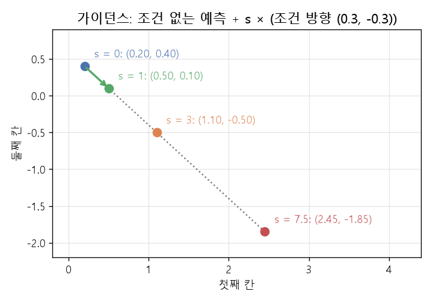

# 분류기 없는 가이던스 (Classifier-free guidance)

[목차로 돌아가기](../../00_MIT%EB%94%A5%EB%9F%AC%EB%8B%9D_%EB%AA%A9%EC%B0%A8.md) · 먼저 볼 것: [MM58_조건부_확률과_독립](../../%EC%88%98%ED%95%99%EA%B0%9C%EB%85%90/04_%ED%99%95%EB%A5%A0%EA%B3%BC_%EC%A0%95%EB%B3%B4/MM58_%EC%A1%B0%EA%B1%B4%EB%B6%80_%ED%99%95%EB%A5%A0%EA%B3%BC_%EB%8F%85%EB%A6%BD.md), [MM53_가우시안_확산의_순방향_과정](../../%EC%88%98%ED%95%99%EA%B0%9C%EB%85%90/11_%EC%83%9D%EC%84%B1_%EB%AA%A8%EB%8D%B8/MM53_%EA%B0%80%EC%9A%B0%EC%8B%9C%EC%95%88_%ED%99%95%EC%82%B0%EC%9D%98_%EC%88%9C%EB%B0%A9%ED%96%A5_%EA%B3%BC%EC%A0%95.md), [MM02_그래디언트_벡터](../../%EC%88%98%ED%95%99%EA%B0%9C%EB%85%90/02_%EB%AF%B8%EB%B6%84/MM02_%EA%B7%B8%EB%9E%98%EB%94%94%EC%96%B8%ED%8A%B8_%EB%B2%A1%ED%84%B0.md), [M05_벡터와_행렬](../../%EC%88%98%ED%95%99%EA%B0%9C%EB%85%90/03_%EC%84%A0%ED%98%95%EB%8C%80%EC%88%98/M05_%EB%B2%A1%ED%84%B0%EC%99%80_%ED%96%89%EB%A0%AC.md) · 쓰는 곳: [Lec16 8.3](../../Lec16_%EC%A1%B0%EA%B1%B4%EB%B6%80_%EC%83%9D%EC%84%B1_%EB%AA%A8%EB%8D%B8.md#83-%EC%A1%B0%EA%B1%B4%EB%B6%80-%ED%99%95%EC%82%B0-%EB%AA%A8%EB%8D%B8)

📚 학습 순서 86/99 (11. 생성 모델): ← 이전: [MM60_순환_일관성_손실](../../%EC%88%98%ED%95%99%EA%B0%9C%EB%85%90/11_%EC%83%9D%EC%84%B1_%EB%AA%A8%EB%8D%B8/MM60_%EC%88%9C%ED%99%98_%EC%9D%BC%EA%B4%80%EC%84%B1_%EC%86%90%EC%8B%A4.md) · 다음: [MM62_적대적_예제와_PGD](../../%EC%88%98%ED%95%99%EA%B0%9C%EB%85%90/12_%EA%B0%95%EA%B1%B4%EC%84%B1%EA%B3%BC_%EC%A0%84%EC%9D%B4/MM62_%EC%A0%81%EB%8C%80%EC%A0%81_%EC%98%88%EC%A0%9C%EC%99%80_PGD.md) →

> [!NOTE]
> **3줄 요약**
> - 조건부 [확산 모델](../../00_%EB%94%A5%EB%9F%AC%EB%8B%9D_%EC%9A%A9%EC%96%B4%EC%82%AC%EC%A0%84.md#diffusion-model-%ED%99%95%EC%82%B0-%EB%AA%A8%EB%8D%B8)은 잡음 제거 신경망에 글 설명 $c$를 넣어 준다. **[분류기 없는 가이던스](../../00_%EB%94%A5%EB%9F%AC%EB%8B%9D_%EC%9A%A9%EC%96%B4%EC%82%AC%EC%A0%84.md#classifier-free-guidance-%EB%B6%84%EB%A5%98%EA%B8%B0-%EC%97%86%EB%8A%94-%EA%B0%80%EC%9D%B4%EB%8D%98%EC%8A%A4)**는 같은 신경망으로 "조건 있음" 예측 $\epsilon_c$와 "조건 없음" 예측 $\epsilon_\varnothing$를 둘 다 구해, 그 차이를 $s$배로 키운다: $\tilde\epsilon = \epsilon_\varnothing + s(\epsilon_c - \epsilon_\varnothing)$.
> - $\epsilon_\varnothing = (0.2, 0.4)$, $\epsilon_c = (0.5, 0.1)$이면 $s = 0$은 조건 무시 (0.2, 0.4), $s = 1$은 그냥 조건부 (0.5, 0.1), $s = 3$은 (1.1, -0.5), $s = 7.5$는 (2.45, -1.85)로 조건 쪽으로 더 멀리 밀린다.
> - [베이즈 정리](../../00_%EB%94%A5%EB%9F%AC%EB%8B%9D_%EC%9A%A9%EC%96%B4%EC%82%AC%EC%A0%84.md#bayes-rule-%EB%B2%A0%EC%9D%B4%EC%A6%88-%EC%A0%95%EB%A6%AC)로 보면 $\nabla\log p(x \mid c) = \nabla\log p(x) + \nabla\log p(c \mid x)$이고, 가이던스는 둘째 항("이 그림이 설명에 맞는 정도"를 올리는 방향)만 $s$배 한다. $s$를 키우면 설명에는 더 잘 맞지만 다양성은 줄어든다.

## 1. 개념 설명

비유: 길 찾기 앱이 "그냥 가까운 그럴듯한 길"($\epsilon_\varnothing$)과 "목적지를 고려한 길"($\epsilon_c$)을 둘 다 알려 준다고 하자. 두 길의 차이가 곧 "목적지 쪽으로 꺾는 방향"이다. 가이던스는 이 꺾는 정도를 $s$배로 과장해서 목적지에 더 확실히 닿게 한다. 대신 갈 수 있는 길의 다양성은 줄어든다.

- **조건부 잡음 제거**: [Lec16 8.3](../../Lec16_%EC%A1%B0%EA%B1%B4%EB%B6%80_%EC%83%9D%EC%84%B1_%EB%AA%A8%EB%8D%B8.md#83-%EC%A1%B0%EA%B1%B4%EB%B6%80-%ED%99%95%EC%82%B0-%EB%AA%A8%EB%8D%B8)처럼 신경망 $\epsilon_\theta(x_t, c)$가 잡음 섞인 이미지 $x_t$와 글 $c$를 받아 섞인 잡음을 예측한다. 글이 [정답](../../00_%EB%94%A5%EB%9F%AC%EB%8B%9D_%EC%9A%A9%EC%96%B4%EC%82%AC%EC%A0%84.md#label-%EC%A0%95%EB%8B%B5) 이미지에 대한 힌트가 되므로 예측이 [정답](../../00_%EB%94%A5%EB%9F%AC%EB%8B%9D_%EC%9A%A9%EC%96%B4%EC%82%AC%EC%A0%84.md#label-%EC%A0%95%EB%8B%B5) 쪽으로 기운다.
- **조건 떨어뜨리기**: [학습](../../00_%EB%94%A5%EB%9F%AC%EB%8B%9D_%EC%9A%A9%EC%96%B4%EC%82%AC%EC%A0%84.md#training-%ED%95%99%EC%8A%B5) 때 일정 비율(예: 10%)로 글을 빈 조건 $\varnothing$으로 바꿔 넣는다. 그러면 한 신경망이 조건부 $\epsilon_\theta(x_t, c)$와 비조건부 $\epsilon_\theta(x_t, \varnothing)$를 둘 다 배운다. 따로 분류기를 둘 필요가 없어서 "분류기 없는"이다(Ho & Salimans 2022).
- **[샘플링](../../00_%EB%94%A5%EB%9F%AC%EB%8B%9D_%EC%9A%A9%EC%96%B4%EC%82%AC%EC%A0%84.md#sampling-%EC%83%98%ED%94%8C%EB%A7%81) 때 섞기**: 매 단계 두 번 예측하고 $\tilde\epsilon = \epsilon_\varnothing + s(\epsilon_c - \epsilon_\varnothing)$을 쓴다. $s = 1$이면 보통의 조건부 모델, $s > 1$이면 조건을 과장한다. 실제 텍스트-이미지 모델은 보통 $s$를 수 배(예: 3~10)로 둔다.

## 2. 필요한 이유

[Lec16 8.3](../../Lec16_%EC%A1%B0%EA%B1%B4%EB%B6%80_%EC%83%9D%EC%84%B1_%EB%AA%A8%EB%8D%B8.md#83-%EC%A1%B0%EA%B1%B4%EB%B6%80-%ED%99%95%EC%82%B0-%EB%AA%A8%EB%8D%B8)은 "[잡음 제거기](../../00_%EB%94%A5%EB%9F%AC%EB%8B%9D_%EC%9A%A9%EC%96%B4%EC%82%AC%EC%A0%84.md#denoiser-%EC%9E%A1%EC%9D%8C-%EC%A0%9C%EA%B1%B0%EA%B8%B0)에 글을 보여 주기만 하면 조건부 [확산 모델](../../00_%EB%94%A5%EB%9F%AC%EB%8B%9D_%EC%9A%A9%EC%96%B4%EC%82%AC%EC%A0%84.md#diffusion-model-%ED%99%95%EC%82%B0-%EB%AA%A8%EB%8D%B8)이 된다"고 설명한다. 실제 서비스되는 텍스트-이미지 모델(Stable Diffusion, DALL-E 2, Imagen 등)은 여기에 거의 항상 가이던스를 더해, 그림이 글 설명을 더 충실히 따르게 한다. 강의의 "글이 잡음 제거를 돕는 이유"를 [베이즈 정리](../../00_%EB%94%A5%EB%9F%AC%EB%8B%9D_%EC%9A%A9%EC%96%B4%EC%82%AC%EC%A0%84.md#bayes-rule-%EB%B2%A0%EC%9D%B4%EC%A6%88-%EC%A0%95%EB%A6%AC)로 한 걸음 더 밀고 간 것이 가이던스다.

## 3. 숫자로 보기

**2차원 잡음 예측** ($\epsilon_\varnothing = (0.2, 0.4)$, $\epsilon_c = (0.5, 0.1)$)
- 차이(조건이 꺾는 방향): $\epsilon_c - \epsilon_\varnothing = (0.5 - 0.2,\ 0.1 - 0.4) = (0.3, -0.3)$

| $s$ | 계산 | $\tilde\epsilon$ | 뜻 |
|---|---|---|---|
| 0 | $(0.2, 0.4) + 0 \times (0.3, -0.3)$ | (0.2, 0.4) | 조건 무시 |
| 1 | $(0.2, 0.4) + 1 \times (0.3, -0.3)$ | (0.5, 0.1) | 보통의 조건부 |
| 3 | $(0.2, 0.4) + 3 \times (0.3, -0.3)$ | (1.1, -0.5) | 조건 3배 과장 |
| 7.5 | $(0.2, 0.4) + 7.5 \times (0.3, -0.3)$ | (2.45, -1.85) | 강한 가이던스 |

$$
\tilde\epsilon_\theta(x_t, c) = \epsilon_\theta(x_t, \varnothing) + s\,\big(\epsilon_\theta(x_t, c) - \epsilon_\theta(x_t, \varnothing)\big)
$$

<details><summary>기호 풀이</summary>

| 기호 | 읽는 법 | 뜻 | 예제 값 |
| --- | --- | --- | --- |
| $x_t$ | 엑스 티 | $t$단계의 잡음 섞인 이미지 | |
| $c$ | 씨 | 조건 (글 설명) | "노랑 배경의 울새" |
| $\varnothing$ | 공집합 | 빈 조건 (설명 없음) | |
| $\epsilon_\theta(x_t, \varnothing)$ | 엡실론 세타 | 조건 없이 예측한 잡음 | (0.2, 0.4) |
| $\epsilon_\theta(x_t, c)$ | | 조건을 보고 예측한 잡음 | (0.5, 0.1) |
| $s$ | 에스 | 가이던스 배율 | 3 |
| $\tilde\epsilon_\theta$ | 엡실론 틸드 | 실제로 쓰는 섞은 예측 | (1.1, -0.5) |

</details>

<details><summary>예제와 풀이</summary>

**문제**: 한 픽셀 쌍에서 신경망이 조건 없이 예측한 잡음이 $(0.2, 0.4)$, 글을 보고 예측한 잡음이 $(0.5, 0.1)$이다. 가이던스 배율 $s = 3$일 때 실제로 쓰는 잡음 예측은?

**주어진 값**
- $\epsilon_\theta(x_t, \varnothing) = (0.2, 0.4)$ (조건 없는 예측)
- $\epsilon_\theta(x_t, c) = (0.5, 0.1)$ (조건 있는 예측)
- $s = 3$ (가이던스 배율)

**풀이**
1. 식을 그대로 쓴다: $\tilde\epsilon = \epsilon_\theta(x_t, \varnothing) + s\,(\epsilon_\theta(x_t, c) - \epsilon_\theta(x_t, \varnothing))$
2. 값을 대입한다: $\tilde\epsilon = (0.2, 0.4) + 3 \times \big((0.5, 0.1) - (0.2, 0.4)\big)$
3. 괄호 안을 칸별로 뺀다: $(0.5 - 0.2,\ 0.1 - 0.4) = (0.3, -0.3)$
4. $s$를 칸별로 곱한다: $(3 \times 0.3,\ 3 \times (-0.3)) = (0.9, -0.9)$
5. 칸별로 더한다: $(0.2 + 0.9,\ 0.4 + (-0.9)) = (1.1, -0.5)$

**답**: **(1.1, -0.5)**. 조건이 가리키는 방향 $(0.3, -0.3)$으로 보통 조건부 예측(0.5, 0.1)보다 두 배 더 나아갔다.

</details>

<details><summary>내 이해</summary>


</details>


*▲ 직접 그린 그림: 조건 없는 예측 (0.2, 0.4)에서 조건 방향 (0.3, -0.3)을 $s$배 한 점들. $s$ = 0, 1, 3, 7.5가 한 직선 위에 놓인다*

**[베이즈 정리](../../00_%EB%94%A5%EB%9F%AC%EB%8B%9D_%EC%9A%A9%EC%96%B4%EC%82%AC%EC%A0%84.md#bayes-rule-%EB%B2%A0%EC%9D%B4%EC%A6%88-%EC%A0%95%EB%A6%AC)로 보기** (1차원, 비조건 분포 $\mathcal{N}(0, 1)$, 조건부 분포 $\mathcal{N}(2, 1)$, 위치 $x = 0.5$)
- [로그](../../00_%EB%94%A5%EB%9F%AC%EB%8B%9D_%EC%9A%A9%EC%96%B4%EC%82%AC%EC%A0%84.md#log-ln-%EB%A1%9C%EA%B7%B8) 밀도의 [기울기](../../00_%EB%94%A5%EB%9F%AC%EB%8B%9D_%EC%9A%A9%EC%96%B4%EC%82%AC%EC%A0%84.md#gradient-%EA%B8%B0%EC%9A%B8%EA%B8%B0)("점수", [확률](../../00_%EB%94%A5%EB%9F%AC%EB%8B%9D_%EC%9A%A9%EC%96%B4%EC%82%AC%EC%A0%84.md#probability-%ED%99%95%EB%A5%A0)이 커지는 방향): 비조건 $-x = -0.5$, 조건부 $-(x - 2) = 1.5$
- 조건이 더하는 몫 $\nabla\log p(c \mid x)$: $1.5 - (-0.5) = 2.0$
- $s = 3$: $-0.5 + 3 \times 2.0 = 5.5$ (조건 쪽으로 세게 끈다)

$$
\nabla_x \log p(x \mid c) = \nabla_x \log p(x) + \nabla_x \log p(c \mid x), \qquad \text{가이던스: } \nabla_x \log p(x) + s\,\nabla_x \log p(c \mid x)
$$

<details><summary>기호 풀이</summary>

| 기호 | 읽는 법 | 뜻 | 예제 값 |
| --- | --- | --- | --- |
| $\nabla_x \log p(x)$ | 그래디언트 [로그](../../00_%EB%94%A5%EB%9F%AC%EB%8B%9D_%EC%9A%A9%EC%96%B4%EC%82%AC%EC%A0%84.md#log-ln-%EB%A1%9C%EA%B7%B8) 피 엑스 | 비조건 점수: 그럴듯한 이미지 쪽 방향 | -0.5 |
| $\nabla_x \log p(x \mid c)$ | | 조건부 점수 | 1.5 |
| $\nabla_x \log p(c \mid x)$ | | "이 이미지가 설명에 맞는 정도"가 커지는 방향 (숨은 분류기) | 2.0 |
| $s$ | 에스 | 숨은 분류기 항에 곱하는 배율 | 3 |
| $\nabla_x$ | 나블라 | $x$에 대한 [그래디언트](../../00_%EB%94%A5%EB%9F%AC%EB%8B%9D_%EC%9A%A9%EC%96%B4%EC%82%AC%EC%A0%84.md#gradient-vector-%EA%B7%B8%EB%9E%98%EB%94%94%EC%96%B8%ED%8A%B8-%EB%B2%A1%ED%84%B0) | |

</details>

<details><summary>예제와 풀이</summary>

**문제**: 1차원 위치 $x = 0.5$에서 비조건 점수가 $-0.5$, 조건부 점수가 $1.5$다. 가이던스 배율 $s = 3$일 때 가이던스 점수는?

**주어진 값**
- $\nabla_x \log p(x) = -0.5$ (비조건 점수, $\mathcal{N}(0, 1)$에서 $-x$)
- $\nabla_x \log p(x \mid c) = 1.5$ (조건부 점수, $\mathcal{N}(2, 1)$에서 $-(x - 2)$)
- $s = 3$ (가이던스 배율)

**풀이**
1. 식을 그대로 쓴다: $\nabla_x \log p(x) + s\,\nabla_x \log p(c \mid x)$, 그리고 $\nabla_x \log p(c \mid x) = \nabla_x \log p(x \mid c) - \nabla_x \log p(x)$
2. 값을 대입한다: $-0.5 + 3 \times \big(1.5 - (-0.5)\big)$
3. 괄호 안 뺄셈을 한다: $1.5 - (-0.5) = 1.5 + 0.5 = 2.0$
4. 곱셈을 한다: $3 \times 2.0 = 6.0$
5. 덧셈을 한다: $-0.5 + 6.0 = 5.5$

**답**: **5.5**. 보통의 조건부 점수(1.5)보다 훨씬 세게 조건 쪽(평균 2)으로 끈다.

</details>

<details><summary>내 이해</summary>


</details>

## 4. 코드로 확인

```python
# [변수] eu, ec: 조건 없는 잡음 예측과 조건 있는 잡음 예측 (3절 표)
eu, ec = np.array([0.2, 0.4]), np.array([0.5, 0.1])
# [함수] for s in ...: 가이던스 배율 네 가지
for s in [0, 1, 3, 7.5]:
    # [변수] eu + s * (ec - eu): 조건 방향을 s배 한 섞은 예측
    # [연결] 3절 표의 한 행
    print(s, np.round(eu + s * (ec - eu), 4))
# [변수] x: 1차원 위치 0.5
x = 0.5
# [변수] su: 비조건 N(0, 1)의 점수 -x, sc: 조건부 N(2, 1)의 점수 -(x - 2)
su, sc = -x, -(x - 2)
# [변수] sclf: 숨은 분류기 점수 = 조건부 - 비조건 = 2.0
sclf = sc - su
# [연결] 3절 "베이즈 정리로 보기" → -0.5 1.5 2.0 5.5
print(su, sc, sclf, su + 3 * sclf)
```

**실행 결과**:

```text
0 [0.2 0.4]
1 [0.5 0.1]
3 [ 1.1 -0.5]
7.5 [ 2.45 -1.85]
-0.5 1.5 2.0 5.5
```

> [!WARNING]
> **⚠ 주의**
> - $s$가 너무 크면 색이 과포화되고 그림이 단조로워진다. 설명에 대한 충실도와 다양성 사이의 맞바꿈이다. $s$는 [학습](../../00_%EB%94%A5%EB%9F%AC%EB%8B%9D_%EC%9A%A9%EC%96%B4%EC%82%AC%EC%A0%84.md#training-%ED%95%99%EC%8A%B5)이 아니라 **[샘플링](../../00_%EB%94%A5%EB%9F%AC%EB%8B%9D_%EC%9A%A9%EC%96%B4%EC%82%AC%EC%A0%84.md#sampling-%EC%83%98%ED%94%8C%EB%A7%81) 때** 고르는 값이다.
> - 매 단계 신경망을 두 번(조건 있음, 없음) 돌려야 하므로 [샘플링](../../00_%EB%94%A5%EB%9F%AC%EB%8B%9D_%EC%9A%A9%EC%96%B4%EC%82%AC%EC%A0%84.md#sampling-%EC%83%98%ED%94%8C%EB%A7%81) 계산이 약 두 배다.
> - 실제 구현마다 표기가 다르다. Ho & Salimans 논문은 $(1 + w)\,\epsilon_c - w\,\epsilon_\varnothing$로 쓰는데, $s = 1 + w$로 바꾸면 이 노트의 식과 같다.

## 5. 개념 재확인

<details><summary>1. $\epsilon_\varnothing = (0, 1)$, $\epsilon_c = (1, 1)$일 때 $s = 2$의 섞은 예측은?</summary>

| 단계 | 하는 일 | 계산 | 결과 |
|---|---|---|---|
| 1 | 조건 방향 | $(1 - 0,\ 1 - 1)$ | (1, 0) |
| 2 | $s$배 | $2 \times (1, 0)$ | (2, 0) |
| 3 | 더하기 | $(0, 1) + (2, 0)$ | (2, 1) |

**① 쓰는 식**
$$\tilde\epsilon = \epsilon_\varnothing + s\,(\epsilon_c - \epsilon_\varnothing)$$
- 위 식 ← ②~④에서 쓴다.
```python
# [변수] eu, ec: 두 예측, s: 배율
eu, ec, s = np.array([0, 1.0]), np.array([1, 1.0]), 2   # ①
# [변수] d: 조건 방향 (1, 0)
d = ec - eu                                            # ②
# [변수] sd: s배 한 방향 (2, 0)
sd = s * d                                             # ③
# [연결] [2. 1.] → 둘째 칸은 두 예측이 같아서 그대로
print(eu + sd)                                         # ④
```

**주어진 값**
- $\epsilon_\varnothing = (0, 1)$ (조건 없는 예측)
- $\epsilon_c = (1, 1)$ (조건 있는 예측)
- $s = 2$ (가이던스 배율)

**풀이**
1. 식을 그대로 쓴다: $\tilde\epsilon = \epsilon_\varnothing + s\,(\epsilon_c - \epsilon_\varnothing)$
2. 값을 대입한다: $\tilde\epsilon = (0, 1) + 2 \times \big((1, 1) - (0, 1)\big)$
3. (②) 괄호 안을 칸별로 뺀다: $(1 - 0,\ 1 - 1) = (1, 0)$
4. (③) 칸별로 2를 곱한다: $(2 \times 1,\ 2 \times 0) = (2, 0)$
5. (④) 칸별로 더한다: $(0 + 2,\ 1 + 0) = (2, 1)$

**답**: **(2, 1)**. 두 예측이 같은 칸(둘째 칸)은 가이던스가 바꾸지 않는다. 조건이 영향을 주는 방향만 키운다.

</details>

<details><summary>2. 1차원에서 비조건 분포 $\mathcal{N}(0, 1)$, 조건부 분포 $\mathcal{N}(2, 1)$이다. 위치 $x = 2$(조건부 분포의 평균)에서 $s = 3$의 가이던스 점수는?</summary>

| 단계 | 하는 일 | 식 | 계산 | 결과 |
|---|---|---|---|---|
| 1 | 비조건 점수 | $-x$ | $-2$ | -2 |
| 2 | 조건부 점수 | $-(x - 2)$ | $-(2 - 2)$ | 0 |
| 3 | 숨은 분류기 점수 | 조건부 - 비조건 | $0 - (-2)$ | 2 |
| 4 | 가이던스 | $-2 + 3 \times 2$ | | 4 |

**① 쓰는 식**
$$\nabla_x \log p(x) + s\,\big(\nabla_x \log p(x \mid c) - \nabla_x \log p(x)\big)$$
- 위 식 ← ②~④에서 쓴다.
```python
# [변수] x: 위치, s: 배율
x, s = 2.0, 3                       # ①
# [변수] su: 비조건 점수 -2, sc: 조건부 점수 0
su, sc = -x, -(x - 2)               # ②
# [변수] sclf: 숨은 분류기 점수 2
sclf = sc - su                      # ③
# [연결] 4.0 → 조건부 평균에 와 있어도 더 오른쪽으로 민다
print(su + s * sclf)                # ④
```

**주어진 값**
- $x = 2$ (지금 위치, 조건부 분포의 평균)
- $\nabla_x \log p(x) = -x$ (비조건 $\mathcal{N}(0, 1)$의 점수)
- $\nabla_x \log p(x \mid c) = -(x - 2)$ (조건부 $\mathcal{N}(2, 1)$의 점수)
- $s = 3$ (가이던스 배율)

**풀이**
1. 식을 그대로 쓴다: $\nabla_x \log p(x) + s\,\big(\nabla_x \log p(x \mid c) - \nabla_x \log p(x)\big)$
2. 값을 대입한다: $-2 + 3 \times \big(-(2 - 2) - (-2)\big)$
3. (②) 안쪽 괄호 뺄셈을 한다: $2 - 2 = 0$ 이므로 조건부 점수는 $-0 = 0$
4. (③) 괄호 안 뺄셈을 한다: $0 - (-2) = 2$
5. (④) 곱셈을 한다: $3 \times 2 = 6$
6. (④) 덧셈을 한다: $-2 + 6 = 4$

**답**: **4**. 보통의 조건부 모델이라면 평균(점수 0)에서 멈추지만, 가이던스는 "비조건 분포에서 더 멀어지는" 쪽으로 계속 민다. $s$가 크면 그림이 과장되는 이유다.

</details>

## 예제 풀기

[예제 10문제 풀기](../../%EC%98%88%EC%A0%9C/11_%EC%83%9D%EC%84%B1_%EB%AA%A8%EB%8D%B8/%EC%98%88%EC%A0%9C_MM61_%EB%B6%84%EB%A5%98%EA%B8%B0_%EC%97%86%EB%8A%94_%EA%B0%80%EC%9D%B4%EB%8D%98%EC%8A%A4.md)

<details><summary>내 이해</summary>


</details>
