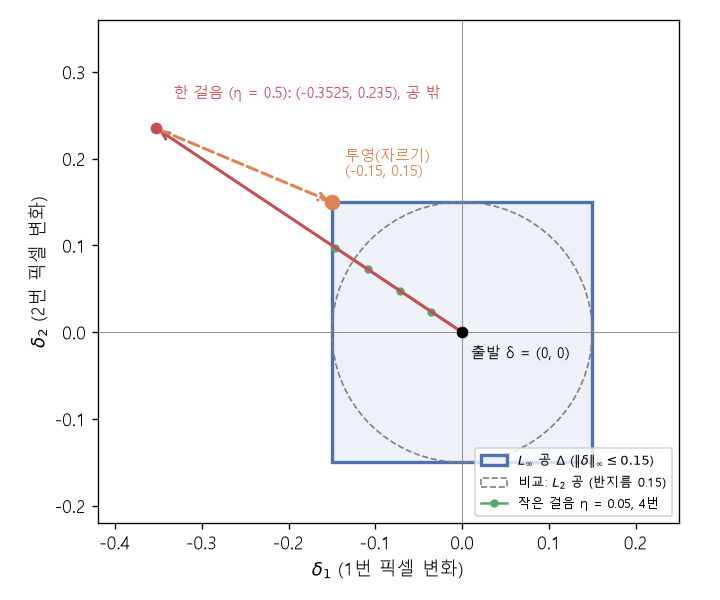

# 적대적 예제와 투영 경사 상승 (Adversarial example, Projected gradient ascent)

[목차로 돌아가기](../../00_MIT%EB%94%A5%EB%9F%AC%EB%8B%9D_%EB%AA%A9%EC%B0%A8.md) · 먼저 볼 것: [MM11_립시츠_연속과_노름](../../%EC%88%98%ED%95%99%EA%B0%9C%EB%85%90/03_%EC%84%A0%ED%98%95%EB%8C%80%EC%88%98/MM11_%EB%A6%BD%EC%8B%9C%EC%B8%A0_%EC%97%B0%EC%86%8D%EA%B3%BC_%EB%85%B8%EB%A6%84.md), [MM27_노름에_따른_최급강하법](../../%EC%88%98%ED%95%99%EA%B0%9C%EB%85%90/09_%EC%B5%9C%EC%A0%81%ED%99%94%EC%9D%98_%EA%B8%B0%ED%95%98/MM27_%EB%85%B8%EB%A6%84%EC%97%90_%EB%94%B0%EB%A5%B8_%EC%B5%9C%EA%B8%89%EA%B0%95%ED%95%98%EB%B2%95.md), [MM02_그래디언트_벡터](../../%EC%88%98%ED%95%99%EA%B0%9C%EB%85%90/02_%EB%AF%B8%EB%B6%84/MM02_%EA%B7%B8%EB%9E%98%EB%94%94%EC%96%B8%ED%8A%B8_%EB%B2%A1%ED%84%B0.md), [M06_지수와_e](../../%EC%88%98%ED%95%99%EA%B0%9C%EB%85%90/01_%EC%88%98%EC%99%80_%ED%95%A8%EC%88%98/M06_%EC%A7%80%EC%88%98%EC%99%80_e.md) · 쓰는 곳: [Lec17 5.1](../../Lec17_%EB%B6%84%ED%8F%AC_%EB%B0%96_%EC%9D%BC%EB%B0%98%ED%99%94.md#51-%EC%B5%9C%EC%A0%81%ED%99%94-%EB%AC%B8%EC%A0%9C%EB%A1%9C-%EC%93%B0%EA%B8%B0), [Lec17 5.2](../../Lec17_%EB%B6%84%ED%8F%AC_%EB%B0%96_%EC%9D%BC%EB%B0%98%ED%99%94.md#52-%ED%88%AC%EC%98%81-%EA%B2%BD%EC%82%AC-%EC%83%81%EC%8A%B9), [Lec17 6](../../Lec17_%EB%B6%84%ED%8F%AC_%EB%B0%96_%EC%9D%BC%EB%B0%98%ED%99%94.md#6-%EC%A0%81%EB%8C%80%EC%A0%81-%ED%95%99%EC%8A%B5)

📚 학습 순서 87/99 (12. 강건성과 전이): ← 이전: [MM61_분류기_없는_가이던스](../../%EC%88%98%ED%95%99%EA%B0%9C%EB%85%90/11_%EC%83%9D%EC%84%B1_%EB%AA%A8%EB%8D%B8/MM61_%EB%B6%84%EB%A5%98%EA%B8%B0_%EC%97%86%EB%8A%94_%EA%B0%80%EC%9D%B4%EB%8D%98%EC%8A%A4.md) · 다음: [MM63_최악의_경우_최적화와_그룹_DRO](../../%EC%88%98%ED%95%99%EA%B0%9C%EB%85%90/12_%EA%B0%95%EA%B1%B4%EC%84%B1%EA%B3%BC_%EC%A0%84%EC%9D%B4/MM63_%EC%B5%9C%EC%95%85%EC%9D%98_%EA%B2%BD%EC%9A%B0_%EC%B5%9C%EC%A0%81%ED%99%94%EC%99%80_%EA%B7%B8%EB%A3%B9_DRO.md) →

> [!NOTE]
> **3줄 요약**
> - **$L_\infty$ [노름](../../00_%EB%94%A5%EB%9F%AC%EB%8B%9D_%EC%9A%A9%EC%96%B4%EC%82%AC%EC%A0%84.md#norm-%EB%85%B8%EB%A6%84)**은 "가장 크게 바뀐 칸의 크기"다. $\delta = (0.02, -0.05, 0.01)$이면 0.05($L_2$ [노름](../../00_%EB%94%A5%EB%9F%AC%EB%8B%9D_%EC%9A%A9%EC%96%B4%EC%82%AC%EC%A0%84.md#norm-%EB%85%B8%EB%A6%84)은 0.0548). 허용 집합 $\Delta$(반지름 $\epsilon$인 $L_\infty$ 공)로의 **[투영](../../00_%EB%94%A5%EB%9F%AC%EB%8B%9D_%EC%9A%A9%EC%96%B4%EC%82%AC%EC%A0%84.md#projection-%ED%88%AC%EC%98%81)**은 칸마다 $[-\epsilon, \epsilon]$으로 자르는 것이다.
> - 선형 점수 $s = \mathbf{w}^\top\mathbf{x} + b$에서 $L_\infty$ 공 안의 최악 교란은 $\delta = \pm\epsilon\,\text{sign}(\mathbf{w})$이고, 점수는 정확히 $\epsilon\lVert\mathbf{w}\rVert_1$만큼 움직인다. 픽셀이 많으면 아주 작은 변화가 쌓인다: $d = 3072$, 평균 $|w_i| = 0.01$, $\epsilon = 8/255$이면 점수 변화 0.9638(한 픽셀 몫은 0.0003).
> - **[투영 경사 상승](../../00_%EB%94%A5%EB%9F%AC%EB%8B%9D_%EC%9A%A9%EC%96%B4%EC%82%AC%EC%A0%84.md#projected-gradient-ascent-%ED%88%AC%EC%98%81-%EA%B2%BD%EC%82%AC-%EC%83%81%EC%8A%B9)(PGD)**은 "[기울기](../../00_%EB%94%A5%EB%9F%AC%EB%8B%9D_%EC%9A%A9%EC%96%B4%EC%82%AC%EC%A0%84.md#gradient-%EA%B8%B0%EC%9A%B8%EA%B8%B0) 방향으로 한 걸음 → 공 밖으로 나간 칸은 잘라서 되돌리기"의 반복이다. Lec17의 돼지 분류기에서 큰 걸음 한 번이면 모서리 (-0.15, 0.15)에 닿아 P(여객기)가 0.3775 → 0.5622가 된다.

## 1. 개념 설명

비유: 사진의 픽셀마다 "0.15 이상은 못 움직인다"는 울타리를 친다. 픽셀 하나하나는 거의 안 바뀌어 사람 눈에는 같은 사진이다. 그런데 모형의 점수는 **모든 픽셀의 작은 변화를 더한 값**으로 움직이므로, 수천 개 픽셀이 모두 "모형이 싫어하는 쪽"으로 조금씩 움직이면 점수가 크게 바뀐다.

- **[적대적 예제](../../00_%EB%94%A5%EB%9F%AC%EB%8B%9D_%EC%9A%A9%EC%96%B4%EC%82%AC%EC%A0%84.md#adversarial-example-%EC%A0%81%EB%8C%80%EC%A0%81-%EC%98%88%EC%A0%9C)**: 원래 입력 $\mathbf{x}$에 허용된 작은 교란 $\delta$를 더해, 모형의 예측을 원하는 틀린 범주로 바꾼 입력 $\mathbf{x} + \delta$.
- **$L_\infty$ [노름](../../00_%EB%94%A5%EB%9F%AC%EB%8B%9D_%EC%9A%A9%EC%96%B4%EC%82%AC%EC%A0%84.md#norm-%EB%85%B8%EB%A6%84)**: $\lVert\delta\rVert_\infty = \max_i |\delta_i|$. 모든 칸 변화의 합($L_1$)이나 제곱합의 제곱근($L_2$)이 아니라 **가장 큰 한 칸**만 본다. 그래서 "어느 픽셀도 $\epsilon$보다 많이 안 바꾼다"는 제약이 된다. 2차원에서 $L_\infty$ 공은 정사각형, $L_2$ 공은 원이다.
- **[투영](../../00_%EB%94%A5%EB%9F%AC%EB%8B%9D_%EC%9A%A9%EC%96%B4%EC%82%AC%EC%A0%84.md#projection-%ED%88%AC%EC%98%81)** $\Pi_\Delta$: 집합 밖으로 나간 점을 집합 안의 가장 가까운 점으로 되돌린다. $L_\infty$ 공은 칸마다 [독립](../../00_%EB%94%A5%EB%9F%AC%EB%8B%9D_%EC%9A%A9%EC%96%B4%EC%82%AC%EC%A0%84.md#independence-%EB%8F%85%EB%A6%BD)이라 칸별 자르기(clip)로 끝난다.
- **선형 모형의 최악 교란**: 점수 변화는 $\mathbf{w}^\top\delta = \sum_i w_i\delta_i$이다. 칸마다 $|\delta_i| \le \epsilon$이므로 각 항을 가장 크게 하려면 $\delta_i = \epsilon\,\text{sign}(w_i)$(부호가 같은 쪽 끝)를 고른다. 그러면 $\sum_i \epsilon|w_i| = \epsilon\lVert\mathbf{w}\rVert_1$이다. 이것이 [MM27](../../%EC%88%98%ED%95%99%EA%B0%9C%EB%85%90/09_%EC%B5%9C%EC%A0%81%ED%99%94%EC%9D%98_%EA%B8%B0%ED%95%98/MM27_%EB%85%B8%EB%A6%84%EC%97%90_%EB%94%B0%EB%A5%B8_%EC%B5%9C%EA%B8%89%EA%B0%95%ED%95%98%EB%B2%95.md)의 "$L_\infty$의 [쌍대 노름](../../00_%EB%94%A5%EB%9F%AC%EB%8B%9D_%EC%9A%A9%EC%96%B4%EC%82%AC%EC%A0%84.md#dual-norm-%EC%8C%8D%EB%8C%80-%EB%85%B8%EB%A6%84)은 $L_1$"이고, 실무 PGD가 [기울기](../../00_%EB%94%A5%EB%9F%AC%EB%8B%9D_%EC%9A%A9%EC%96%B4%EC%82%AC%EC%A0%84.md#gradient-%EA%B8%B0%EC%9A%B8%EA%B8%B0) 대신 **[기울기](../../00_%EB%94%A5%EB%9F%AC%EB%8B%9D_%EC%9A%A9%EC%96%B4%EC%82%AC%EC%A0%84.md#gradient-%EA%B8%B0%EC%9A%B8%EA%B8%B0)의 부호**로 걷는 이유다($\delta \leftarrow \Pi_\Delta(\delta + \alpha\,\text{sign}(\nabla_\delta))$, Madry 등 2018).

## 2. 필요한 이유

[Lec17 5.1](../../Lec17_%EB%B6%84%ED%8F%AC_%EB%B0%96_%EC%9D%BC%EB%B0%98%ED%99%94.md#51-%EC%B5%9C%EC%A0%81%ED%99%94-%EB%AC%B8%EC%A0%9C%EB%A1%9C-%EC%93%B0%EA%B8%B0)은 [적대적 예제](../../00_%EB%94%A5%EB%9F%AC%EB%8B%9D_%EC%9A%A9%EC%96%B4%EC%82%AC%EC%A0%84.md#adversarial-example-%EC%A0%81%EB%8C%80%EC%A0%81-%EC%98%88%EC%A0%9C)를 "$L_\infty$ 공 $\Delta$ 안에서 목표 범주 [확률](../../00_%EB%94%A5%EB%9F%AC%EB%8B%9D_%EC%9A%A9%EC%96%B4%EC%82%AC%EC%A0%84.md#probability-%ED%99%95%EB%A5%A0)을 최대화하는 문제"로 쓰고, [5.2](../../Lec17_%EB%B6%84%ED%8F%AC_%EB%B0%96_%EC%9D%BC%EB%B0%98%ED%99%94.md#52-%ED%88%AC%EC%98%81-%EA%B2%BD%EC%82%AC-%EC%83%81%EC%8A%B9)는 그것을 [투영 경사 상승](../../00_%EB%94%A5%EB%9F%AC%EB%8B%9D_%EC%9A%A9%EC%96%B4%EC%82%AC%EC%A0%84.md#projected-gradient-ascent-%ED%88%AC%EC%98%81-%EA%B2%BD%EC%82%AC-%EC%83%81%EC%8A%B9)으로 푼다. [6절](../../Lec17_%EB%B6%84%ED%8F%AC_%EB%B0%96_%EC%9D%BC%EB%B0%98%ED%99%94.md#6-%EC%A0%81%EB%8C%80%EC%A0%81-%ED%95%99%EC%8A%B5)의 [적대적 학습](../../00_%EB%94%A5%EB%9F%AC%EB%8B%9D_%EC%9A%A9%EC%96%B4%EC%82%AC%EC%A0%84.md#adversarial-training-%EC%A0%81%EB%8C%80%EC%A0%81-%ED%95%99%EC%8A%B5)은 [학습](../../00_%EB%94%A5%EB%9F%AC%EB%8B%9D_%EC%9A%A9%EC%96%B4%EC%82%AC%EC%A0%84.md#training-%ED%95%99%EC%8A%B5) 루프 안에서 매번 이 문제를 푼다. 선형 모형의 $\epsilon\lVert\mathbf{w}\rVert_1$은 "왜 사람 눈에 안 보이는 잡음이 예측을 바꾸나"에 대한 가장 간단한 설명이다(픽셀이 많을수록 작은 변화가 쌓인다).

## 3. 숫자로 보기

**(1) [노름](../../00_%EB%94%A5%EB%9F%AC%EB%8B%9D_%EC%9A%A9%EC%96%B4%EC%82%AC%EC%A0%84.md#norm-%EB%85%B8%EB%A6%84)과 [투영](../../00_%EB%94%A5%EB%9F%AC%EB%8B%9D_%EC%9A%A9%EC%96%B4%EC%82%AC%EC%A0%84.md#projection-%ED%88%AC%EC%98%81)** ($\delta = (0.02, -0.05, 0.01)$)
- 칸별 절댓값: 0.02, 0.05, 0.01
- $L_\infty$: 가장 큰 값 $= 0.05$
- $L_2$: $0.02^2 + (-0.05)^2 + 0.01^2 = 0.0004 + 0.0025 + 0.0001 = 0.003$ → $\sqrt{0.003} = 0.0548$
- $\epsilon = 0.03$인 공으로 [투영](../../00_%EB%94%A5%EB%9F%AC%EB%8B%9D_%EC%9A%A9%EC%96%B4%EC%82%AC%EC%A0%84.md#projection-%ED%88%AC%EC%98%81): 0.02는 그대로, -0.05는 -0.03으로 자름, 0.01은 그대로 → $(0.02, -0.03, 0.01)$

**(2) 작은 변화가 쌓인다** (CIFAR-10 크기 사진: $32 \times 32 \times 3 = 3072$ 픽셀)
- $\epsilon = 8/255 = 0.0314$ (픽셀 값 0~1 기준, 255단계 중 8단계)
- 평균 $|w_i| = 0.01$이면 $\lVert\mathbf{w}\rVert_1 = 3072 \times 0.01 = 30.72$
- 최악 점수 변화: $0.0314 \times 30.72 = 0.9638$ (코드 값, $8/255$를 반올림하지 않고 곱함)
- 한 픽셀 몫: $0.0314 \times 0.01 = 0.0003$. 하나는 티도 안 나지만 3072개가 같은 쪽으로 모이면 점수가 약 1 움직인다.

**(3) PGD의 걸음** (Lec17의 돼지 분류기 $s = 3x_1 - 2x_2 - 0.5$, $\mathbf{x} = (0.6, 0.4)$, $\epsilon = 0.15$, 처음 P(여객기) = 0.3775)

| 방식 | 걸음 | $\delta$ | P(여객기) |
|---|---|---|---|
| [기울기](../../00_%EB%94%A5%EB%9F%AC%EB%8B%9D_%EC%9A%A9%EC%96%B4%EC%82%AC%EC%A0%84.md#gradient-%EA%B8%B0%EC%9A%B8%EA%B8%B0), $\eta = 0.05$ | 1 | (-0.0353, 0.0235) | 0.4141 |
| | 2 | (-0.0716, 0.0478) | 0.4528 |
| | 3 | (-0.1088, 0.0725) | 0.4929 |
| | 4 | (-0.1463, 0.0975) | 0.5334 |
| 부호, $\alpha = 0.1$ | 1 | (-0.1, 0.1) | 0.5 |
| | 2 | (-0.15, 0.15) | 0.5622 |

작은 [기울기](../../00_%EB%94%A5%EB%9F%AC%EB%8B%9D_%EC%9A%A9%EC%96%B4%EC%82%AC%EC%A0%84.md#gradient-%EA%B8%B0%EC%9A%B8%EA%B8%B0) 걸음은 여러 번 걸려 모서리 쪽으로 다가가고, 부호 걸음은 두 번 만에 모서리 (-0.15, 0.15)에 닿는다. Lec17 5.2의 예제처럼 $\eta = 0.5$로 크게 걸으면 한 번에 공 밖 (-0.3525, 0.235)로 나갔다가 [투영](../../00_%EB%94%A5%EB%9F%AC%EB%8B%9D_%EC%9A%A9%EC%96%B4%EC%82%AC%EC%A0%84.md#projection-%ED%88%AC%EC%98%81)으로 모서리에 온다.


*▲ 직접 그린 그림: $L_\infty$ 공(정사각형, $\epsilon = 0.15$)과 $L_2$ 공(점선 원). 빨강은 $\eta = 0.5$ 한 걸음(공 밖), 주황 점선은 [투영](../../00_%EB%94%A5%EB%9F%AC%EB%8B%9D_%EC%9A%A9%EC%96%B4%EC%82%AC%EC%A0%84.md#projection-%ED%88%AC%EC%98%81)(자르기)으로 모서리 (-0.15, 0.15)에 오는 길, 초록은 $\eta = 0.05$ 작은 걸음 4번*

두 개념을 식으로 쓰면 다음과 같다.

$$
\lVert \delta \rVert_\infty = \max_i |\delta_i|, \qquad \big(\Pi_\Delta(\mathbf{v})\big)_i = \min\big(\max(v_i, -\epsilon),\ \epsilon\big)
$$

<details><summary>기호 풀이</summary>

| 기호 | 읽는 법 | 뜻 | 예제 값 |
| --- | --- | --- | --- |
| $\delta_i$, $v_i$ | 델타 아이, 브이 아이 | 교란(또는 [투영](../../00_%EB%94%A5%EB%9F%AC%EB%8B%9D_%EC%9A%A9%EC%96%B4%EC%82%AC%EC%A0%84.md#projection-%ED%88%AC%EC%98%81) 전 벡터)의 $i$번째 칸 | 0.25, -0.02, -0.4 |
| $\lvert\cdot\rvert$ | 절댓값 | 부호를 떼고 크기만 | 0.4 |
| $\max_i$ | 맥스 | 모든 칸 중 가장 큰 값 | 0.4 |
| $\lVert\delta\rVert_\infty$ | 무한대 [노름](../../00_%EB%94%A5%EB%9F%AC%EB%8B%9D_%EC%9A%A9%EC%96%B4%EC%82%AC%EC%A0%84.md#norm-%EB%85%B8%EB%A6%84) | 가장 크게 바뀐 칸의 크기 | 0.4 |
| $\epsilon$ | 엡실론 | $L_\infty$ 공의 반지름 | 0.1 |
| $\Pi_\Delta(\mathbf{v})$ | 파이 델타 | $\mathbf{v}$를 공 $\Delta$로 투영한 결과 | (0.1, -0.02, -0.1) |
| $\min(\max(v_i, -\epsilon), \epsilon)$ | 자르기 | $-\epsilon$보다 작으면 $-\epsilon$, $\epsilon$보다 크면 $\epsilon$, 사이면 그대로 | |

</details>

<details><summary>예제와 풀이</summary>

**문제**: 한 걸음 간 뒤의 교란 후보가 $\mathbf{v} = (0.25, -0.02, -0.4)$이다. 허용 반지름 $\epsilon = 0.1$일 때 $\lVert\mathbf{v}\rVert_\infty$를 구하고, 공 안에 있는지 확인한 뒤 투영하라.

**주어진 값**
- $\mathbf{v} = (0.25, -0.02, -0.4)$ ([투영](../../00_%EB%94%A5%EB%9F%AC%EB%8B%9D_%EC%9A%A9%EC%96%B4%EC%82%AC%EC%A0%84.md#projection-%ED%88%AC%EC%98%81) 전 교란 후보)
- $\epsilon = 0.1$ (한 칸이 바뀔 수 있는 최대 크기)

**풀이**
1. 식을 그대로 쓴다: $\lVert\mathbf{v}\rVert_\infty = \max_i |v_i|$, $\big(\Pi_\Delta(\mathbf{v})\big)_i = \min(\max(v_i, -\epsilon), \epsilon)$
2. 값을 대입한다: $\lVert\mathbf{v}\rVert_\infty = \max(|0.25|, |-0.02|, |-0.4|)$, $\Pi_\Delta(\mathbf{v}) = \big(\min(\max(0.25, -0.1), 0.1),\ \min(\max(-0.02, -0.1), 0.1),\ \min(\max(-0.4, -0.1), 0.1)\big)$
3. 절댓값을 구한다: $0.25$, $0.02$, $0.4$
4. 가장 큰 값을 고른다: $\max(0.25, 0.02, 0.4) = 0.4$
5. 비교한다: $0.4 > 0.1$ 이므로 공 밖이다
6. 첫째 칸: $\max(0.25, -0.1) = 0.25$, 다음 $\min(0.25, 0.1) = 0.1$
7. 둘째 칸: $\max(-0.02, -0.1) = -0.02$, 다음 $\min(-0.02, 0.1) = -0.02$
8. 셋째 칸: $\max(-0.4, -0.1) = -0.1$, 다음 $\min(-0.1, 0.1) = -0.1$

**답**: $\lVert\mathbf{v}\rVert_\infty = $ **0.4**(공 밖), [투영](../../00_%EB%94%A5%EB%9F%AC%EB%8B%9D_%EC%9A%A9%EC%96%B4%EC%82%AC%EC%A0%84.md#projection-%ED%88%AC%EC%98%81) 결과는 **(0.1, -0.02, -0.1)**. 범위 안의 칸(-0.02)은 그대로 남는다.

</details>

<details><summary>내 이해</summary>


</details>

선형 모형에서 최악 교란이 점수를 얼마나 움직이는지는 다음과 같다.

$$
\max_{\lVert\delta\rVert_\infty \le \epsilon}\ \mathbf{w}^\top\delta = \epsilon\,\lVert\mathbf{w}\rVert_1, \qquad \text{이때 } \delta = \epsilon\,\text{sign}(\mathbf{w})
$$

<details><summary>기호 풀이</summary>

| 기호 | 읽는 법 | 뜻 | 예제 값 |
| --- | --- | --- | --- |
| $\mathbf{w}$ | 더블유 | 선형 모형의 [가중치](../../00_%EB%94%A5%EB%9F%AC%EB%8B%9D_%EC%9A%A9%EC%96%B4%EC%82%AC%EC%A0%84.md#weight-%EA%B0%80%EC%A4%91%EC%B9%98) | (2, -1, 0.5) |
| $\mathbf{w}^\top\delta$ | 더블유 [전치](../../00_%EB%94%A5%EB%9F%AC%EB%8B%9D_%EC%9A%A9%EC%96%B4%EC%82%AC%EC%A0%84.md#transpose-%EC%A0%84%EC%B9%98) 델타 | 교란이 만드는 점수 변화 (칸끼리 곱해 더함) | 0.35 |
| $\text{sign}(\cdot)$ | 사인 (부호) | 양수면 +1, 음수면 -1, 0이면 0 | (1, -1, 1) |
| $\lVert\mathbf{w}\rVert_1$ | 엘원 [노름](../../00_%EB%94%A5%EB%9F%AC%EB%8B%9D_%EC%9A%A9%EC%96%B4%EC%82%AC%EC%A0%84.md#norm-%EB%85%B8%EB%A6%84) | 칸별 절댓값의 합 | 3.5 |
| $\epsilon$ | 엡실론 | $L_\infty$ 공의 반지름 | 0.1 |

</details>

<details><summary>예제와 풀이</summary>

**문제**: [가중치](../../00_%EB%94%A5%EB%9F%AC%EB%8B%9D_%EC%9A%A9%EC%96%B4%EC%82%AC%EC%A0%84.md#weight-%EA%B0%80%EC%A4%91%EC%B9%98)가 $\mathbf{w} = (2, -1, 0.5)$인 선형 모형의 점수를 $\epsilon = 0.1$ 안의 교란으로 가장 크게 올리려 한다. 최악 교란 $\delta$와 점수 변화를 구하고, $\epsilon\lVert\mathbf{w}\rVert_1$과 같은지 확인하라.

**주어진 값**
- $\mathbf{w} = (2, -1, 0.5)$ ([가중치](../../00_%EB%94%A5%EB%9F%AC%EB%8B%9D_%EC%9A%A9%EC%96%B4%EC%82%AC%EC%A0%84.md#weight-%EA%B0%80%EC%A4%91%EC%B9%98))
- $\epsilon = 0.1$ (칸마다 최대 변화)

**풀이**
1. 식을 그대로 쓴다: $\delta = \epsilon\,\text{sign}(\mathbf{w})$, 점수 변화 $= \mathbf{w}^\top\delta$, 확인값 $= \epsilon\lVert\mathbf{w}\rVert_1$
2. 값을 대입한다: $\delta = 0.1 \times \text{sign}(2, -1, 0.5)$, 점수 변화 $= (2, -1, 0.5)^\top\delta$, 확인값 $= 0.1 \times \lVert(2, -1, 0.5)\rVert_1$
3. 부호를 구한다: $\text{sign}(2, -1, 0.5) = (1, -1, 1)$
4. $\epsilon$을 곱한다: $\delta = (0.1 \times 1,\ 0.1 \times (-1),\ 0.1 \times 1) = (0.1, -0.1, 0.1)$
5. 칸끼리 곱한다: $2 \times 0.1 = 0.2$, $(-1) \times (-0.1) = 0.1$, $0.5 \times 0.1 = 0.05$
6. 더한다: $0.2 + 0.1 + 0.05 = 0.35$
7. 확인한다. 절댓값을 더한다: $\lVert\mathbf{w}\rVert_1 = 2 + 1 + 0.5 = 3.5$
8. $\epsilon$을 곱한다: $0.1 \times 3.5 = 0.35$

**답**: 최악 교란 **(0.1, -0.1, 0.1)**, 점수 변화 **0.35** $= \epsilon\lVert\mathbf{w}\rVert_1$. 모든 항이 양수가 되도록 부호를 맞췄기 때문에 더 크게 만들 수 없다.

</details>

<details><summary>내 이해</summary>


</details>

## 4. 코드로 확인

```python
# [함수] sig(z): 시그모이드. 점수를 0~1 확률로 바꾼다
sig = lambda z: 1 / (1 + np.exp(-z))
# [변수] w, b: 고정된 선형 모형 (Lec17 5.1의 돼지/여객기 분류기)
w, b = np.array([3.0, -2.0]), -0.5
# [변수] x: 원래 사진의 두 픽셀 값, eps: L∞ 공의 반지름 0.15
x, eps = np.array([0.6, 0.4]), 0.15
# [변수] d: 3절 숫자로 보기 (1)의 교란
d = np.array([0.02, -0.05, 0.01])
# [함수] np.abs(d).max(): L∞ 노름 / np.linalg.norm: L2 노름
# [연결] 본문 3절 (1) → 0.05, 0.0548
print(np.abs(d).max(), round(np.linalg.norm(d), 4))
# [함수] np.clip(v, -a, a): 칸마다 [-a, a]로 자르기 = L∞ 공으로의 투영
# [연결] 본문 3절 (1) → ε = 0.03이면 (0.02, -0.03, 0.01)
print(np.clip(d, -0.03, 0.03))
# [변수] e8: 이미지에서 흔히 쓰는 ε = 8/255 (픽셀 값 0~1 기준)
e8 = 8 / 255
# [연결] 본문 3절 (2) → ε, ‖w‖₁ = 30.72, 점수 변화 0.9638, 한 픽셀 몫 0.0003
print(round(e8, 4), round(3072 * 0.01, 2), round(e8 * 3072 * 0.01, 4), round(e8 * 0.01, 4))
# [함수] p_air(dl): 교란 dl을 더했을 때 P(여객기) = 1 - σ(점수)
p_air = lambda dl: 1 - sig(w @ (x + dl) + b)
# [변수] dl: PGD의 현재 교란. (0, 0)에서 출발
dl = np.zeros(2)
# [함수] for: 작은 기울기 걸음 η = 0.05로 4번 반복
for t in range(4):
    # [변수] p: 지금 P(돼지). P(여객기)의 기울기는 -p(1-p)w (시그모이드 미분, MM05)
    p = sig(w @ (x + dl) + b)
    # [함수] 한 걸음 간 뒤 np.clip으로 투영 (Lec17 5.2의 식)
    # [변수] dl: 다음 걸음의 교란
    dl = np.clip(dl + 0.05 * (-p * (1 - p) * w), -eps, eps)
    # [연결] 본문 3절 (3) 표의 위 4줄
    print(t + 1, dl.round(4), round(p_air(dl), 4))
# [변수] dl: 부호 걸음을 위해 다시 (0, 0)에서 출발
dl = np.zeros(2)
# [함수] for: 부호 걸음 α = 0.1로 2번 (실무에서 쓰는 PGD)
for t in range(2):
    # [변수] p: 지금 P(돼지)
    p = sig(w @ (x + dl) + b)
    # [함수] np.sign: 기울기의 부호만 남긴다 (MM27의 L∞ 최급강하)
    # [변수] dl: 부호 걸음 뒤 투영한 교란
    dl = np.clip(dl + 0.1 * np.sign(-p * (1 - p) * w), -eps, eps)
    # [연결] 본문 3절 (3) 표의 아래 2줄
    print(t + 1, dl.round(4), round(p_air(dl), 4))
# [변수] v: 첫 식 예제의 후보 (0.25, -0.02, -0.4)
v = np.array([0.25, -0.02, -0.4])
# [연결] 첫 식 예제와 풀이 → 0.4, (0.1, -0.02, -0.1)
print(np.abs(v).max(), np.clip(v, -0.1, 0.1))
# [변수] w2: 둘째 식 예제의 가중치, dw: 최악 교란 ε·sign(w)
w2 = np.array([2.0, -1.0, 0.5])
dw = 0.1 * np.sign(w2)
# [연결] 둘째 식 예제와 풀이 → (0.1, -0.1, 0.1), 0.35 = 0.1 × 3.5
print(dw, round(w2 @ dw, 4), round(0.1 * np.abs(w2).sum(), 4))
```

**실행 결과**:

```text
0.05 0.0548
[ 0.02 -0.03  0.01]
0.0314 30.72 0.9638 0.0003
1 [-0.0353  0.0235] 0.4141
2 [-0.0716  0.0478] 0.4528
3 [-0.1088  0.0725] 0.4929
4 [-0.1463  0.0975] 0.5334
1 [-0.1  0.1] 0.5
2 [-0.15  0.15] 0.5622
0.4 [ 0.1  -0.02 -0.1 ]
[ 0.1 -0.1  0.1] 0.35 0.35
```

> [!WARNING]
> **⚠ 주의**
> - $\epsilon$은 픽셀 값의 범위에 맞춰 읽는다. 0~255 정수 이미지의 "8"은 0~1 이미지에서 $8/255 = 0.0314$다.
> - [투영](../../00_%EB%94%A5%EB%9F%AC%EB%8B%9D_%EC%9A%A9%EC%96%B4%EC%82%AC%EC%A0%84.md#projection-%ED%88%AC%EC%98%81)을 칸별 자르기로 끝낼 수 있는 것은 $L_\infty$ 공이라서다. $L_2$ 공이면 벡터 전체를 길이 $\epsilon$이 되도록 줄인다(칸별로 자르면 안 된다). 이미지라면 $\mathbf{x} + \delta$가 0~1 밖으로 나가지 않게 한 번 더 자른다.
> - [기울기](../../00_%EB%94%A5%EB%9F%AC%EB%8B%9D_%EC%9A%A9%EC%96%B4%EC%82%AC%EC%A0%84.md#gradient-%EA%B8%B0%EC%9A%B8%EA%B8%B0)를 쓰는 공격이 실패했다고 모형이 강건한 것은 아니다. [기울기](../../00_%EB%94%A5%EB%9F%AC%EB%8B%9D_%EC%9A%A9%EC%96%B4%EC%82%AC%EC%A0%84.md#gradient-%EA%B8%B0%EC%9A%B8%EA%B8%B0)가 0이거나 쓸모없게 가려진 모형(gradient masking)은 [기울기](../../00_%EB%94%A5%EB%9F%AC%EB%8B%9D_%EC%9A%A9%EC%96%B4%EC%82%AC%EC%A0%84.md#gradient-%EA%B8%B0%EC%9A%B8%EA%B8%B0) 없는 공격이나 다른 모형에서 만든 예제의 전이로 뚫릴 수 있다(Athalye 등 2018).
> - 선형 모형의 $\epsilon\lVert\mathbf{w}\rVert_1$은 직관을 위한 근사다. 신경망에서는 PGD를 여러 걸음 돌려 실제 최악 교란에 다가간다.

## 5. 개념 재확인

<details><summary>1. 교란 후보 $\mathbf{v} = (0.3, -0.05, 0.12)$의 $L_\infty$ 노름은? $\epsilon = 0.1$인 공으로 투영하면?</summary>

| 단계 | 하는 일 | 계산 | 결과 |
|---|---|---|---|
| 1 | 칸별 절댓값 | $\lvert 0.3\rvert, \lvert -0.05\rvert, \lvert 0.12\rvert$ | 0.3, 0.05, 0.12 |
| 2 | 가장 큰 값 | $\max$ | 0.3 |
| 3 | 첫째 칸 자르기 | $0.3 > 0.1$ | 0.1 |
| 4 | 둘째 칸 자르기 | $-0.1 \le -0.05 \le 0.1$ | -0.05 |
| 5 | 셋째 칸 자르기 | $0.12 > 0.1$ | 0.1 |

**① 쓰는 식**
$$\lVert\mathbf{v}\rVert_\infty = \max_i |v_i|, \qquad \big(\Pi_\Delta(\mathbf{v})\big)_i = \min(\max(v_i, -\epsilon), \epsilon)$$
- 위 식 ← ②([노름](../../00_%EB%94%A5%EB%9F%AC%EB%8B%9D_%EC%9A%A9%EC%96%B4%EC%82%AC%EC%A0%84.md#norm-%EB%85%B8%EB%A6%84)), ③([투영](../../00_%EB%94%A5%EB%9F%AC%EB%8B%9D_%EC%9A%A9%EC%96%B4%EC%82%AC%EC%A0%84.md#projection-%ED%88%AC%EC%98%81))에서 쓴다.
```python
# [변수] v: 교란 후보, eps: 공의 반지름
v, eps = np.array([0.3, -0.05, 0.12]), 0.1              # ①
# [함수] np.abs(v).max(): L∞ 노름 → 0.3
# [함수] np.clip: 칸별 자르기 → [0.1, -0.05, 0.1]
print(np.abs(v).max(), np.clip(v, -eps, eps))           # ②③
```

**주어진 값**
- $\mathbf{v} = (0.3, -0.05, 0.12)$ ([투영](../../00_%EB%94%A5%EB%9F%AC%EB%8B%9D_%EC%9A%A9%EC%96%B4%EC%82%AC%EC%A0%84.md#projection-%ED%88%AC%EC%98%81) 전 교란 후보)
- $\epsilon = 0.1$ (공의 반지름)

**풀이**
1. 식을 그대로 쓴다: $\lVert\mathbf{v}\rVert_\infty = \max_i |v_i|$, $\big(\Pi_\Delta(\mathbf{v})\big)_i = \min(\max(v_i, -\epsilon), \epsilon)$
2. 값을 대입한다: $\lVert\mathbf{v}\rVert_\infty = \max(|0.3|, |-0.05|, |0.12|)$, $\Pi_\Delta(\mathbf{v}) = \big(\min(\max(0.3, -0.1), 0.1),\ \min(\max(-0.05, -0.1), 0.1),\ \min(\max(0.12, -0.1), 0.1)\big)$
3. (②) 절댓값을 구한다: $0.3$, $0.05$, $0.12$
4. (②) 가장 큰 값을 고른다: $\max(0.3, 0.05, 0.12) = 0.3$
5. (③) 첫째 칸: $\max(0.3, -0.1) = 0.3$, 다음 $\min(0.3, 0.1) = 0.1$
6. (③) 둘째 칸: $\max(-0.05, -0.1) = -0.05$, 다음 $\min(-0.05, 0.1) = -0.05$
7. (③) 셋째 칸: $\max(0.12, -0.1) = 0.12$, 다음 $\min(0.12, 0.1) = 0.1$

**답**: $\lVert\mathbf{v}\rVert_\infty = $ **0.3**, [투영](../../00_%EB%94%A5%EB%9F%AC%EB%8B%9D_%EC%9A%A9%EC%96%B4%EC%82%AC%EC%A0%84.md#projection-%ED%88%AC%EC%98%81) 결과 **(0.1, -0.05, 0.1)**.

</details>

<details><summary>2. 가중치 $\mathbf{w} = (1, -4, 2)$인 선형 모형의 점수를 $\epsilon = 0.05$ 안의 교란으로 가장 크게 **낮추려면** $\delta$는? 점수는 얼마나 바뀌나?</summary>

| 단계 | 하는 일 | 계산 | 결과 |
|---|---|---|---|
| 1 | [가중치](../../00_%EB%94%A5%EB%9F%AC%EB%8B%9D_%EC%9A%A9%EC%96%B4%EC%82%AC%EC%A0%84.md#weight-%EA%B0%80%EC%A4%91%EC%B9%98) 부호 | $\text{sign}(1, -4, 2)$ | (1, -1, 1) |
| 2 | 반대 부호로 끝까지 | $-0.05 \times (1, -1, 1)$ | (-0.05, 0.05, -0.05) |
| 3 | 칸별 곱 | $1 \times (-0.05), (-4) \times 0.05, 2 \times (-0.05)$ | -0.05, -0.2, -0.1 |
| 4 | 더하기 | $-0.05 - 0.2 - 0.1$ | -0.35 |

**① 쓰는 식**
$$\delta = -\epsilon\,\text{sign}(\mathbf{w}), \qquad \Delta s = \mathbf{w}^\top\delta = -\epsilon\lVert\mathbf{w}\rVert_1$$
- 위 식 ← ②(최악 교란), ③(칸별 곱), ④(합)에서 쓴다. 낮추는 쪽이라 부호를 반대로 한다.
```python
# [변수] w: 가중치, eps: 공의 반지름
w, eps = np.array([1.0, -4.0, 2.0]), 0.05               # ①
# [변수] dd: 점수를 낮추는 최악 교란 = -ε·sign(w)
dd = -eps * np.sign(w)                                  # ②
# [연결] [-0.05 0.05 -0.05] [-0.05 -0.2 -0.1] -0.35
print(dd, w * dd, round(w @ dd, 4))                     # ③④
```

**주어진 값**
- $\mathbf{w} = (1, -4, 2)$ ([가중치](../../00_%EB%94%A5%EB%9F%AC%EB%8B%9D_%EC%9A%A9%EC%96%B4%EC%82%AC%EC%A0%84.md#weight-%EA%B0%80%EC%A4%91%EC%B9%98))
- $\epsilon = 0.05$ (칸마다 최대 변화)

**풀이**
1. 식을 그대로 쓴다: $\delta = -\epsilon\,\text{sign}(\mathbf{w})$, $\Delta s = \mathbf{w}^\top\delta$
2. 값을 대입한다: $\delta = -0.05 \times \text{sign}(1, -4, 2)$, $\Delta s = (1, -4, 2)^\top\delta$
3. (②) 부호를 구한다: $\text{sign}(1, -4, 2) = (1, -1, 1)$
4. (②) $-0.05$를 곱한다: $\delta = (-0.05 \times 1,\ -0.05 \times (-1),\ -0.05 \times 1) = (-0.05, 0.05, -0.05)$
5. (③) 칸끼리 곱한다: $1 \times (-0.05) = -0.05$, $(-4) \times 0.05 = -0.2$, $2 \times (-0.05) = -0.1$
6. (④) 더한다: $-0.05 + (-0.2) + (-0.1) = -0.35$
7. 확인한다: $-\epsilon\lVert\mathbf{w}\rVert_1 = -0.05 \times (1 + 4 + 2) = -0.05 \times 7 = -0.35$

**답**: $\delta = $ **(-0.05, 0.05, -0.05)**, 점수 변화 **-0.35**. [가중치](../../00_%EB%94%A5%EB%9F%AC%EB%8B%9D_%EC%9A%A9%EC%96%B4%EC%82%AC%EC%A0%84.md#weight-%EA%B0%80%EC%A4%91%EC%B9%98)가 가장 큰 둘째 칸(-4)이 변화의 대부분(-0.2)을 만든다.

</details>

## 예제 풀기

[예제 10문제 풀기](../../%EC%98%88%EC%A0%9C/12_%EA%B0%95%EA%B1%B4%EC%84%B1%EA%B3%BC_%EC%A0%84%EC%9D%B4/%EC%98%88%EC%A0%9C_MM62_%EC%A0%81%EB%8C%80%EC%A0%81_%EC%98%88%EC%A0%9C%EC%99%80_PGD.md)

<details><summary>내 이해</summary>


</details>
