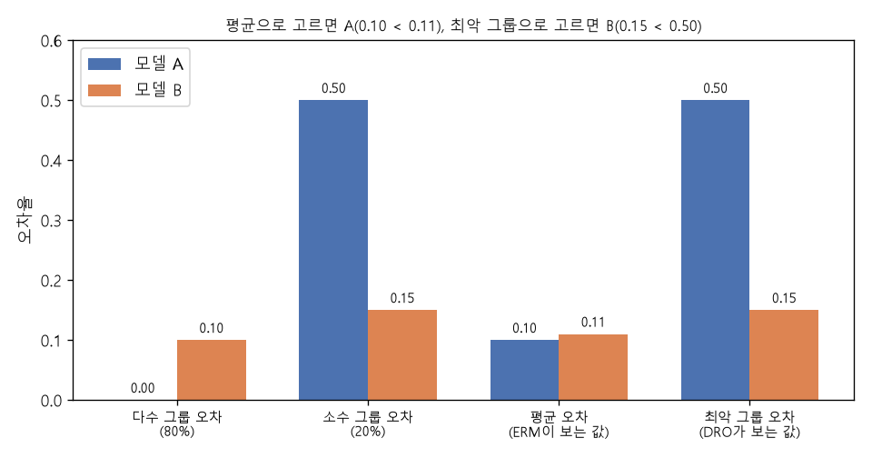

# 최악의 경우 최적화와 그룹 DRO (Worst-case optimization, Group DRO)

[목차로 돌아가기](../../00_MIT%EB%94%A5%EB%9F%AC%EB%8B%9D_%EB%AA%A9%EC%B0%A8.md) · 먼저 볼 것: [MM22_기댓값과_일반화_간극](../../%EC%88%98%ED%95%99%EA%B0%9C%EB%85%90/04_%ED%99%95%EB%A5%A0%EA%B3%BC_%EC%A0%95%EB%B3%B4/MM22_%EA%B8%B0%EB%8C%93%EA%B0%92%EA%B3%BC_%EC%9D%BC%EB%B0%98%ED%99%94_%EA%B0%84%EA%B7%B9.md), [MM01_argmin과_argmax](../../%EC%88%98%ED%95%99%EA%B0%9C%EB%85%90/02_%EB%AF%B8%EB%B6%84/MM01_argmin%EA%B3%BC_argmax.md), [M02_시그마와_평균](../../%EC%88%98%ED%95%99%EA%B0%9C%EB%85%90/01_%EC%88%98%EC%99%80_%ED%95%A8%EC%88%98/M02_%EC%8B%9C%EA%B7%B8%EB%A7%88%EC%99%80_%ED%8F%89%EA%B7%A0.md), [M06_지수와_e](../../%EC%88%98%ED%95%99%EA%B0%9C%EB%85%90/01_%EC%88%98%EC%99%80_%ED%95%A8%EC%88%98/M06_%EC%A7%80%EC%88%98%EC%99%80_e.md), [MM62_적대적_예제와_PGD](../../%EC%88%98%ED%95%99%EA%B0%9C%EB%85%90/12_%EA%B0%95%EA%B1%B4%EC%84%B1%EA%B3%BC_%EC%A0%84%EC%9D%B4/MM62_%EC%A0%81%EB%8C%80%EC%A0%81_%EC%98%88%EC%A0%9C%EC%99%80_PGD.md) · 쓰는 곳: [Lec17 6](../../Lec17_%EB%B6%84%ED%8F%AC_%EB%B0%96_%EC%9D%BC%EB%B0%98%ED%99%94.md#6-%EC%A0%81%EB%8C%80%EC%A0%81-%ED%95%99%EC%8A%B5), [Lec17 11.1](../../Lec17_%EB%B6%84%ED%8F%AC_%EB%B0%96_%EC%9D%BC%EB%B0%98%ED%99%94.md#111-%EB%B6%84%ED%8F%AC-%EC%A0%84%EC%B2%B4%EB%A5%BC-%ED%9D%94%EB%93%A4%EA%B8%B0), [Lec17 11.2](../../Lec17_%EB%B6%84%ED%8F%AC_%EB%B0%96_%EC%9D%BC%EB%B0%98%ED%99%94.md#112-%EC%86%8C%EC%88%98-%EA%B7%B8%EB%A3%B9%EA%B3%BC-%ED%81%B4%EB%9E%98%EC%8A%A4-%EB%B6%88%EA%B7%A0%ED%98%95)

📚 학습 순서 88/99 (12. 강건성과 전이): ← 이전: [MM62_적대적_예제와_PGD](../../%EC%88%98%ED%95%99%EA%B0%9C%EB%85%90/12_%EA%B0%95%EA%B1%B4%EC%84%B1%EA%B3%BC_%EC%A0%84%EC%9D%B4/MM62_%EC%A0%81%EB%8C%80%EC%A0%81_%EC%98%88%EC%A0%9C%EC%99%80_PGD.md) · 다음: [MM65_온도_소프트맥스와_지식_증류](../../%EC%88%98%ED%95%99%EA%B0%9C%EB%85%90/12_%EA%B0%95%EA%B1%B4%EC%84%B1%EA%B3%BC_%EC%A0%84%EC%9D%B4/MM65_%EC%98%A8%EB%8F%84_%EC%86%8C%ED%94%84%ED%8A%B8%EB%A7%A5%EC%8A%A4%EC%99%80_%EC%A7%80%EC%8B%9D_%EC%A6%9D%EB%A5%98.md) →

> [!NOTE]
> **3줄 요약**
> - 보통의 [학습](../../00_%EB%94%A5%EB%9F%AC%EB%8B%9D_%EC%9A%A9%EC%96%B4%EC%82%AC%EC%A0%84.md#training-%ED%95%99%EC%8A%B5)([경험적 위험](../../00_%EB%94%A5%EB%9F%AC%EB%8B%9D_%EC%9A%A9%EC%96%B4%EC%82%AC%EC%A0%84.md#empirical-risk-%EA%B2%BD%ED%97%98%EC%A0%81-%EC%9C%84%ED%97%98) 최소화, ERM)은 **평균** [손실](../../00_%EB%94%A5%EB%9F%AC%EB%8B%9D_%EC%9A%A9%EC%96%B4%EC%82%AC%EC%A0%84.md#loss-function-%EC%86%90%EC%8B%A4-%ED%95%A8%EC%88%98)을 줄인다. **최악의 경우 최적화**(min-max)는 허용된 범위에서 **가장 나쁜 경우**의 [손실](../../00_%EB%94%A5%EB%9F%AC%EB%8B%9D_%EC%9A%A9%EC%96%B4%EC%82%AC%EC%A0%84.md#loss-function-%EC%86%90%EC%8B%A4-%ED%95%A8%EC%88%98)을 줄인다. 데이터 한 점마다 최악이면 [적대적 학습](../../00_%EB%94%A5%EB%9F%AC%EB%8B%9D_%EC%9A%A9%EC%96%B4%EC%82%AC%EC%A0%84.md#adversarial-training-%EC%A0%81%EB%8C%80%EC%A0%81-%ED%95%99%EC%8A%B5), 분포 전체의 최악이면 [DRO](../../00_%EB%94%A5%EB%9F%AC%EB%8B%9D_%EC%9A%A9%EC%96%B4%EC%82%AC%EC%A0%84.md#distributionally-robust-optimization-%EB%B6%84%ED%8F%AC%EC%A0%81%EC%9C%BC%EB%A1%9C-%EA%B0%95%EA%B1%B4%ED%95%9C-%EC%B5%9C%EC%A0%81%ED%99%94), 그룹 중 최악이면 그룹 DRO다.
> - 다수 80%·소수 20%에서 모형 A(그룹 [오차](../../00_%EB%94%A5%EB%9F%AC%EB%8B%9D_%EC%9A%A9%EC%96%B4%EC%82%AC%EC%A0%84.md#error-%EC%98%A4%EC%B0%A8) 0, 0.5)는 평균 0.10, 최악 0.5이고, 모형 B(0.10, 0.15)는 평균 0.11, 최악 0.15다. ERM은 A를, 그룹 DRO는 B를 고른다.
> - 그룹 DRO는 그룹 무게 $q_g$를 [손실](../../00_%EB%94%A5%EB%9F%AC%EB%8B%9D_%EC%9A%A9%EC%96%B4%EC%82%AC%EC%A0%84.md#loss-function-%EC%86%90%EC%8B%A4-%ED%95%A8%EC%88%98)이 큰 그룹 쪽으로 [지수](../../00_%EB%94%A5%EB%9F%AC%EB%8B%9D_%EC%9A%A9%EC%96%B4%EC%82%AC%EC%A0%84.md#e-exponent-e%EC%99%80-%EC%A7%80%EC%88%98)적으로 옮긴다. (0.5, 0.5)에서 그룹 [손실](../../00_%EB%94%A5%EB%9F%AC%EB%8B%9D_%EC%9A%A9%EC%96%B4%EC%82%AC%EC%A0%84.md#loss-function-%EC%86%90%EC%8B%A4-%ED%95%A8%EC%88%98) (0, 0.5), $\eta = 2$로 한 번 갱신하면 (0.2689, 0.7311), 세 번이면 (0.0474, 0.9526)이 되고, 무게 매긴 [손실](../../00_%EB%94%A5%EB%9F%AC%EB%8B%9D_%EC%9A%A9%EC%96%B4%EC%82%AC%EC%A0%84.md#loss-function-%EC%86%90%EC%8B%A4-%ED%95%A8%EC%88%98)은 최악 그룹 [손실](../../00_%EB%94%A5%EB%9F%AC%EB%8B%9D_%EC%9A%A9%EC%96%B4%EC%82%AC%EC%A0%84.md#loss-function-%EC%86%90%EC%8B%A4-%ED%95%A8%EC%88%98) 0.5에 다가간다.

## 1. 개념 설명

비유: 반 평균 점수로 담임을 평가하면, 공부 잘하는 다수만 챙겨도 평균이 높게 나온다. "가장 못한 모둠의 점수"로 평가하면 담임은 뒤처진 모둠을 챙길 수밖에 없다. 최악의 경우 최적화는 이 두 번째 평가 방식이다.

- **ERM**: $\min_\theta \sum_i p_i \ell_i(\theta)$. 데이터 무게 $p_i$는 고정(보통 $1/n$)이다.
- **min-max**: $\min_\theta \max_{\text{허용된 변화}} (\text{손실})$. 바깥은 모형(학습자), 안쪽은 적(adversary)이다. 적이 고를 수 있는 것에 따라 이름이 다르다.

| 적이 고르는 것 | 이름 | 허용 범위 |
|---|---|---|
| 데이터 한 점마다 교란 $\delta$ | [적대적 학습](../../00_%EB%94%A5%EB%9F%AC%EB%8B%9D_%EC%9A%A9%EC%96%B4%EC%82%AC%EC%A0%84.md#adversarial-training-%EC%A0%81%EB%8C%80%EC%A0%81-%ED%95%99%EC%8A%B5) | $\lVert\delta\rVert_\infty \le \epsilon$ ([MM62](../../%EC%88%98%ED%95%99%EA%B0%9C%EB%85%90/12_%EA%B0%95%EA%B1%B4%EC%84%B1%EA%B3%BC_%EC%A0%84%EC%9D%B4/MM62_%EC%A0%81%EB%8C%80%EC%A0%81_%EC%98%88%EC%A0%9C%EC%99%80_PGD.md)) |
| 데이터 무게(분포) $Q$ | [DRO](../../00_%EB%94%A5%EB%9F%AC%EB%8B%9D_%EC%9A%A9%EC%96%B4%EC%82%AC%EC%A0%84.md#distributionally-robust-optimization-%EB%B6%84%ED%8F%AC%EC%A0%81%EC%9C%BC%EB%A1%9C-%EA%B0%95%EA%B1%B4%ED%95%9C-%EC%B5%9C%EC%A0%81%ED%99%94) | $D(Q, \hat{P}_n) \le \epsilon$ |
| 그룹 무게 $\mathbf{q}$ | 그룹 DRO | 그룹 무게는 무엇이든 (합 1) → 최악 그룹 |

- **그룹 무게로 쓰면 최악 그룹이 된다**: 무게 $q_g \ge 0$, $\sum_g q_g = 1$인 모든 섞음 가운데 $\sum_g q_g L_g$가 가장 큰 것은 [손실](../../00_%EB%94%A5%EB%9F%AC%EB%8B%9D_%EC%9A%A9%EC%96%B4%EC%82%AC%EC%A0%84.md#loss-function-%EC%86%90%EC%8B%A4-%ED%95%A8%EC%88%98)이 가장 큰 그룹에 무게를 모두 준 경우다. 그래서 $\max_{\mathbf{q}} \sum_g q_g L_g = \max_g L_g$.
- **무게를 조금만 옮길 수 있으면**: [손실](../../00_%EB%94%A5%EB%9F%AC%EB%8B%9D_%EC%9A%A9%EC%96%B4%EC%82%AC%EC%A0%84.md#loss-function-%EC%86%90%EC%8B%A4-%ED%95%A8%EC%88%98)이 작은 데이터에서 큰 데이터로, 허용된 만큼만 무게를 옮긴 분포가 최악이다(Lec17 11.1 예제).

## 2. 필요한 이유

[Lec17 6](../../Lec17_%EB%B6%84%ED%8F%AC_%EB%B0%96_%EC%9D%BC%EB%B0%98%ED%99%94.md#6-%EC%A0%81%EB%8C%80%EC%A0%81-%ED%95%99%EC%8A%B5)의 [적대적 학습](../../00_%EB%94%A5%EB%9F%AC%EB%8B%9D_%EC%9A%A9%EC%96%B4%EC%82%AC%EC%A0%84.md#adversarial-training-%EC%A0%81%EB%8C%80%EC%A0%81-%ED%95%99%EC%8A%B5), [11.1](../../Lec17_%EB%B6%84%ED%8F%AC_%EB%B0%96_%EC%9D%BC%EB%B0%98%ED%99%94.md#111-%EB%B6%84%ED%8F%AC-%EC%A0%84%EC%B2%B4%EB%A5%BC-%ED%9D%94%EB%93%A4%EA%B8%B0)의 DRO, [11.2](../../Lec17_%EB%B6%84%ED%8F%AC_%EB%B0%96_%EC%9D%BC%EB%B0%98%ED%99%94.md#112-%EC%86%8C%EC%88%98-%EA%B7%B8%EB%A3%B9%EA%B3%BC-%ED%81%B4%EB%9E%98%EC%8A%A4-%EB%B6%88%EA%B7%A0%ED%98%95)의 소수 그룹 문제는 모두 "평균 대신 최악을 줄인다"는 같은 수학이다. 강사가 말한 "소수 그룹 [오차](../../00_%EB%94%A5%EB%9F%AC%EB%8B%9D_%EC%9A%A9%EC%96%B4%EC%82%AC%EC%A0%84.md#error-%EC%98%A4%EC%B0%A8) 50%가 [평균 오차](../../00_%EB%94%A5%EB%9F%AC%EB%8B%9D_%EC%9A%A9%EC%96%B4%EC%82%AC%EC%A0%84.md#average-error-%ED%8F%89%EA%B7%A0-%EC%98%A4%EC%B0%A8) 10%로만 보인다"는 문제를, 무게를 소수 쪽으로 옮겨 해결하는 원리를 숫자로 본다.

## 3. 숫자로 보기

**두 모형 고르기** (다수 그룹 80%, 소수 그룹 20%)

| 모형 | 다수 [오차](../../00_%EB%94%A5%EB%9F%AC%EB%8B%9D_%EC%9A%A9%EC%96%B4%EC%82%AC%EC%A0%84.md#error-%EC%98%A4%EC%B0%A8) | 소수 [오차](../../00_%EB%94%A5%EB%9F%AC%EB%8B%9D_%EC%9A%A9%EC%96%B4%EC%82%AC%EC%A0%84.md#error-%EC%98%A4%EC%B0%A8) | [평균 오차](../../00_%EB%94%A5%EB%9F%AC%EB%8B%9D_%EC%9A%A9%EC%96%B4%EC%82%AC%EC%A0%84.md#average-error-%ED%8F%89%EA%B7%A0-%EC%98%A4%EC%B0%A8) | 최악 그룹 [오차](../../00_%EB%94%A5%EB%9F%AC%EB%8B%9D_%EC%9A%A9%EC%96%B4%EC%82%AC%EC%A0%84.md#error-%EC%98%A4%EC%B0%A8) | 무게 (0.5, 0.5) |
|---|---|---|---|---|---|
| A | 0 | 0.5 | $0.8 \times 0 + 0.2 \times 0.5 = 0.1$ | 0.5 | 0.25 |
| B | 0.10 | 0.15 | $0.8 \times 0.10 + 0.2 \times 0.15 = 0.11$ | 0.15 | 0.125 |

- 평균(ERM)으로 고르면 A (0.10 < 0.11)
- 최악 그룹으로 고르면 B (0.15 < 0.5)
- 소수 그룹 무게를 0.5까지만 올릴 수 있는 중간 DRO도 B (0.125 < 0.25)


*▲ 직접 그린 그림: 위 표의 두 모형. [평균 오차](../../00_%EB%94%A5%EB%9F%AC%EB%8B%9D_%EC%9A%A9%EC%96%B4%EC%82%AC%EC%A0%84.md#average-error-%ED%8F%89%EA%B7%A0-%EC%98%A4%EC%B0%A8)로는 A, 최악 그룹 [오차](../../00_%EB%94%A5%EB%9F%AC%EB%8B%9D_%EC%9A%A9%EC%96%B4%EC%82%AC%EC%A0%84.md#error-%EC%98%A4%EC%B0%A8)로는 B가 낫다*

**그룹 무게 갱신** (Sagawa 등 2020의 그룹 DRO, 그룹 [손실](../../00_%EB%94%A5%EB%9F%AC%EB%8B%9D_%EC%9A%A9%EC%96%B4%EC%82%AC%EC%A0%84.md#loss-function-%EC%86%90%EC%8B%A4-%ED%95%A8%EC%88%98) $L = (0, 0.5)$ 고정, $\eta = 2$)

| 갱신 | 곱한 값 $q_g e^{\eta L_g}$ | 나눈 뒤 $\mathbf{q}$ | 무게 매긴 [손실](../../00_%EB%94%A5%EB%9F%AC%EB%8B%9D_%EC%9A%A9%EC%96%B4%EC%82%AC%EC%A0%84.md#loss-function-%EC%86%90%EC%8B%A4-%ED%95%A8%EC%88%98) $\sum_g q_g L_g$ |
|---|---|---|---|
| 처음 | | (0.5, 0.5) | 0.25 |
| 1 | (0.5, 1.3591) | (0.2689, 0.7311) | 0.3655 |
| 2 | (0.2689, 1.9872) | (0.1192, 0.8808) | 0.4404 |
| 3 | (0.1192, 2.3943) | (0.0474, 0.9526) | 0.4763 |

갱신할수록 무게가 [손실](../../00_%EB%94%A5%EB%9F%AC%EB%8B%9D_%EC%9A%A9%EC%96%B4%EC%82%AC%EC%A0%84.md#loss-function-%EC%86%90%EC%8B%A4-%ED%95%A8%EC%88%98)이 큰 소수 그룹으로 몰리고, 무게 매긴 [손실](../../00_%EB%94%A5%EB%9F%AC%EB%8B%9D_%EC%9A%A9%EC%96%B4%EC%82%AC%EC%A0%84.md#loss-function-%EC%86%90%EC%8B%A4-%ED%95%A8%EC%88%98)은 최악 그룹 [손실](../../00_%EB%94%A5%EB%9F%AC%EB%8B%9D_%EC%9A%A9%EC%96%B4%EC%82%AC%EC%A0%84.md#loss-function-%EC%86%90%EC%8B%A4-%ED%95%A8%EC%88%98) 0.5로 다가간다. 실제 [학습](../../00_%EB%94%A5%EB%9F%AC%EB%8B%9D_%EC%9A%A9%EC%96%B4%EC%82%AC%EC%A0%84.md#training-%ED%95%99%EC%8A%B5)에서는 이 무게로 섞은 [손실](../../00_%EB%94%A5%EB%9F%AC%EB%8B%9D_%EC%9A%A9%EC%96%B4%EC%82%AC%EC%A0%84.md#loss-function-%EC%86%90%EC%8B%A4-%ED%95%A8%EC%88%98)의 [기울기](../../00_%EB%94%A5%EB%9F%AC%EB%8B%9D_%EC%9A%A9%EC%96%B4%EC%82%AC%EC%A0%84.md#gradient-%EA%B8%B0%EC%9A%B8%EA%B8%B0)로 모형도 함께 갱신하므로, 소수 그룹의 [손실](../../00_%EB%94%A5%EB%9F%AC%EB%8B%9D_%EC%9A%A9%EC%96%B4%EC%82%AC%EC%A0%84.md#loss-function-%EC%86%90%EC%8B%A4-%ED%95%A8%EC%88%98)이 줄어든다.

최악 그룹을 식으로 쓰면 다음과 같다.

$$
\min_\theta\ \max_{g \in \{1, \dots, K\}} L_g(\theta) = \min_\theta\ \max_{\mathbf{q}:\ q_g \ge 0,\ \sum_g q_g = 1}\ \sum_{g=1}^{K} q_g L_g(\theta)
$$

<details><summary>기호 풀이</summary>

| 기호 | 읽는 법 | 뜻 | 예제 값 |
| --- | --- | --- | --- |
| $K$ | 케이 | 그룹 개수 | 2 |
| $L_g(\theta)$ | 엘 지 | 그룹 $g$의 평균 [손실](../../00_%EB%94%A5%EB%9F%AC%EB%8B%9D_%EC%9A%A9%EC%96%B4%EC%82%AC%EC%A0%84.md#loss-function-%EC%86%90%EC%8B%A4-%ED%95%A8%EC%88%98)([오차](../../00_%EB%94%A5%EB%9F%AC%EB%8B%9D_%EC%9A%A9%EC%96%B4%EC%82%AC%EC%A0%84.md#error-%EC%98%A4%EC%B0%A8)) | 모형 B: (0.10, 0.15) |
| $\max_g$ | 맥스 | 그룹 중 가장 큰 [손실](../../00_%EB%94%A5%EB%9F%AC%EB%8B%9D_%EC%9A%A9%EC%96%B4%EC%82%AC%EC%A0%84.md#loss-function-%EC%86%90%EC%8B%A4-%ED%95%A8%EC%88%98) | 0.15 |
| $\mathbf{q} = (q_1, \dots, q_K)$ | 큐 | 그룹 무게. 0 이상, 합 1 | (0.8, 0.2), (0.5, 0.5), (0, 1) |
| $\sum_g q_g L_g$ | 무게 매긴 [손실](../../00_%EB%94%A5%EB%9F%AC%EB%8B%9D_%EC%9A%A9%EC%96%B4%EC%82%AC%EC%A0%84.md#loss-function-%EC%86%90%EC%8B%A4-%ED%95%A8%EC%88%98) | 그룹 [손실](../../00_%EB%94%A5%EB%9F%AC%EB%8B%9D_%EC%9A%A9%EC%96%B4%EC%82%AC%EC%A0%84.md#loss-function-%EC%86%90%EC%8B%A4-%ED%95%A8%EC%88%98)을 무게로 섞은 값 | 0.11, 0.125, 0.15 |
| $\min_\theta$ | 민 세타 | 그 최악의 값을 줄이는 모형 | |

</details>

<details><summary>예제와 풀이</summary>

**문제**: 모형 B의 그룹 [오차](../../00_%EB%94%A5%EB%9F%AC%EB%8B%9D_%EC%9A%A9%EC%96%B4%EC%82%AC%EC%A0%84.md#error-%EC%98%A4%EC%B0%A8)가 (0.10, 0.15)이다. 그룹 무게 $\mathbf{q}$를 (0.8, 0.2), (0.5, 0.5), (0, 1)로 바꿔 가며 $\sum_g q_g L_g$를 구하고, 가장 큰 값이 $\max_g L_g$와 같은지 확인하라.

**주어진 값**
- $L = (0.10, 0.15)$ (다수 그룹 [오차](../../00_%EB%94%A5%EB%9F%AC%EB%8B%9D_%EC%9A%A9%EC%96%B4%EC%82%AC%EC%A0%84.md#error-%EC%98%A4%EC%B0%A8), 소수 그룹 [오차](../../00_%EB%94%A5%EB%9F%AC%EB%8B%9D_%EC%9A%A9%EC%96%B4%EC%82%AC%EC%A0%84.md#error-%EC%98%A4%EC%B0%A8))
- $\mathbf{q}$ 후보: (0.8, 0.2) (원래 비율), (0.5, 0.5) (반반), (0, 1) (소수만)

**풀이**
1. 식을 그대로 쓴다: $\sum_{g=1}^{K} q_g L_g = q_1 L_1 + q_2 L_2$ (Σ를 두 항으로 펼침)
2. 값을 대입한다 (첫 후보): $0.8 \times 0.10 + 0.2 \times 0.15$
3. 곱셈을 한다: $0.8 \times 0.10 = 0.08$, $0.2 \times 0.15 = 0.03$
4. 더한다: $0.08 + 0.03 = 0.11$
5. 둘째 후보를 대입한다: $0.5 \times 0.10 + 0.5 \times 0.15 = 0.05 + 0.075 = 0.125$
6. 셋째 후보를 대입한다: $0 \times 0.10 + 1 \times 0.15 = 0 + 0.15 = 0.15$
7. 가장 큰 값을 고른다: $\max(0.11, 0.125, 0.15) = 0.15$
8. 그룹 [오차](../../00_%EB%94%A5%EB%9F%AC%EB%8B%9D_%EC%9A%A9%EC%96%B4%EC%82%AC%EC%A0%84.md#error-%EC%98%A4%EC%B0%A8)의 최댓값과 비교한다: $\max(0.10, 0.15) = 0.15$

**답**: 무게를 소수 그룹에 모두 준 **(0, 1)**에서 가장 큰 **0.15**가 나오고, 이는 최악 그룹 [오차](../../00_%EB%94%A5%EB%9F%AC%EB%8B%9D_%EC%9A%A9%EC%96%B4%EC%82%AC%EC%A0%84.md#error-%EC%98%A4%EC%B0%A8)와 같다.

</details>

<details><summary>내 이해</summary>


</details>

그룹 무게를 갱신하는 규칙은 다음과 같다.

$$
q_g \leftarrow \frac{q_g\, e^{\eta L_g}}{\sum_{h=1}^{K} q_h\, e^{\eta L_h}}
$$

<details><summary>기호 풀이</summary>

| 기호 | 읽는 법 | 뜻 | 예제 값 |
| --- | --- | --- | --- |
| $q_g$ | 큐 지 | 그룹 $g$의 현재 무게 | (0.5, 0.5) |
| $L_g$ | 엘 지 | 그룹 $g$의 현재 [손실](../../00_%EB%94%A5%EB%9F%AC%EB%8B%9D_%EC%9A%A9%EC%96%B4%EC%82%AC%EC%A0%84.md#loss-function-%EC%86%90%EC%8B%A4-%ED%95%A8%EC%88%98) | (0, 0.5) |
| $\eta$ | 에타 | 무게를 얼마나 빨리 옮길지 (걸음 크기) | 2 |
| $e^{\eta L_g}$ | 이의 에타 엘 지 제곱 | [손실](../../00_%EB%94%A5%EB%9F%AC%EB%8B%9D_%EC%9A%A9%EC%96%B4%EC%82%AC%EC%A0%84.md#loss-function-%EC%86%90%EC%8B%A4-%ED%95%A8%EC%88%98)이 클수록 크게 곱해지는 배율 | 1, 2.7183 |
| 분모 $\sum_h$ | 합 | 무게의 합이 다시 1이 되도록 나눌 값 | 1.8591 |
| $\leftarrow$ | 바꾼다 | 오른쪽 값으로 새 무게를 정한다 | (0.2689, 0.7311) |

</details>

<details><summary>예제와 풀이</summary>

**문제**: 두 그룹의 무게가 (0.5, 0.5)이고 [손실](../../00_%EB%94%A5%EB%9F%AC%EB%8B%9D_%EC%9A%A9%EC%96%B4%EC%82%AC%EC%A0%84.md#loss-function-%EC%86%90%EC%8B%A4-%ED%95%A8%EC%88%98)이 다수 0, 소수 0.5다. $\eta = 2$로 한 번 갱신하면 새 무게는?

**주어진 값**
- $q = (0.5, 0.5)$ (현재 무게)
- $L = (0, 0.5)$ (다수 그룹 [손실](../../00_%EB%94%A5%EB%9F%AC%EB%8B%9D_%EC%9A%A9%EC%96%B4%EC%82%AC%EC%A0%84.md#loss-function-%EC%86%90%EC%8B%A4-%ED%95%A8%EC%88%98), 소수 그룹 [손실](../../00_%EB%94%A5%EB%9F%AC%EB%8B%9D_%EC%9A%A9%EC%96%B4%EC%82%AC%EC%A0%84.md#loss-function-%EC%86%90%EC%8B%A4-%ED%95%A8%EC%88%98))
- $\eta = 2$ (걸음 크기)

**풀이**
1. 식을 그대로 쓴다: $q_g \leftarrow \dfrac{q_g e^{\eta L_g}}{q_1 e^{\eta L_1} + q_2 e^{\eta L_2}}$ (분모의 Σ를 두 항으로 펼침)
2. 값을 대입한다: $q_1 \leftarrow \dfrac{0.5\, e^{2 \times 0}}{0.5\, e^{2 \times 0} + 0.5\, e^{2 \times 0.5}}$, $q_2 \leftarrow \dfrac{0.5\, e^{2 \times 0.5}}{0.5\, e^{2 \times 0} + 0.5\, e^{2 \times 0.5}}$
3. [지수](../../00_%EB%94%A5%EB%9F%AC%EB%8B%9D_%EC%9A%A9%EC%96%B4%EC%82%AC%EC%A0%84.md#e-exponent-e%EC%99%80-%EC%A7%80%EC%88%98) 안을 곱한다: $2 \times 0 = 0$, $2 \times 0.5 = 1$
4. [지수](../../00_%EB%94%A5%EB%9F%AC%EB%8B%9D_%EC%9A%A9%EC%96%B4%EC%82%AC%EC%A0%84.md#e-exponent-e%EC%99%80-%EC%A7%80%EC%88%98)를 계산한다. $e$는 약 2.718인 수이고 $e^{a}$는 그 수의 $a$제곱이다(계산기·코드로 구한다): $e^{0} = 1$, $e^{1} = 2.7183$
5. 무게를 곱한다: $0.5 \times 1 = 0.5$, $0.5 \times 2.7183 = 1.3591$
6. 분모를 더한다: $0.5 + 1.3591 = 1.8591$
7. 다수 그룹을 나눈다: $0.5 / 1.8591 = 0.2689$
8. 소수 그룹을 나눈다: $1.3591 / 1.8591 = 0.7311$

**답**: 새 무게 **(0.2689, 0.7311)**. [손실](../../00_%EB%94%A5%EB%9F%AC%EB%8B%9D_%EC%9A%A9%EC%96%B4%EC%82%AC%EC%A0%84.md#loss-function-%EC%86%90%EC%8B%A4-%ED%95%A8%EC%88%98)이 큰 소수 그룹의 무게가 0.5에서 0.7311로 커졌다.

</details>

<details><summary>내 이해</summary>


</details>

## 4. 코드로 확인

```python
# [변수] share: 다수·소수 그룹의 데이터 비율 (Lec17 11.2의 80% / 20%)
share = np.array([0.8, 0.2])
# [변수] A, B: 두 모형의 그룹별 오차 (본문 3절 표)
A, B = np.array([0.0, 0.5]), np.array([0.10, 0.15])
# [함수] @: 비율로 무게 매긴 평균 / .max(): 최악 그룹
# [연결] 본문 3절 표 → 평균 0.1, 0.11 / 최악 0.5, 0.15
print(round(share @ A, 4), round(share @ B, 4), A.max(), B.max())
# [변수] qh: 소수 그룹 무게를 0.5까지 올린 중간 DRO
qh = np.array([0.5, 0.5])
# [연결] 본문 3절 표 마지막 열 → 0.25, 0.125
print(round(qh @ A, 4), round(qh @ B, 4))
# [변수] q: 그룹 무게 (0.5, 0.5)에서 출발, L: 그룹 손실 (0, 0.5)
q, L = np.array([0.5, 0.5]), np.array([0.0, 0.5])
# [함수] for: 그룹 DRO 무게 갱신을 3번
for t in range(3):
    # [함수] np.exp: e의 거듭제곱. 손실이 큰 그룹일수록 크게 곱한다
    # [변수] u: 나누기 전 값
    u = q * np.exp(2.0 * L)
    # [변수] q: 합이 1이 되게 나눈 새 무게
    q = u / u.sum()
    # [연결] 본문 3절 둘째 표 → 곱한 값, 새 무게, 무게 매긴 손실
    print(t + 1, u.round(4), q.round(4), round(q @ L, 4))
# [함수] for: 첫 식 예제의 세 무게 후보
for qq in ([0.8, 0.2], [0.5, 0.5], [0.0, 1.0]):
    # [연결] 첫 식 예제와 풀이 → 0.11, 0.125, 0.15
    print(round(np.array(qq) @ B, 4))
```

**실행 결과**:

```text
0.1 0.11 0.5 0.15
0.25 0.125
1 [0.5    1.3591] [0.2689 0.7311] 0.3655
2 [0.2689 1.9872] [0.1192 0.8808] 0.4404
3 [0.1192 2.3943] [0.0474 0.9526] 0.4763
0.11
0.125
0.15
```

> [!WARNING]
> **⚠ 주의**
> - 그룹 DRO는 **그룹 라벨**을 알아야 한다(예: 밤·낮). 라벨이 없을 때 쓰는 변형도 있지만(Hashimoto 등 2018), 그만큼 덜 정확하다.
> - 최악만 보면 잡음이 많거나 원래 어려운 그룹에 끌려가 평균 성능이 떨어질 수 있다. 그래서 무게를 옮길 수 있는 범위 $\epsilon$이나 걸음 크기 $\eta$로 조절한다.
> - 신경망처럼 [학습 데이터](../../00_%EB%94%A5%EB%9F%AC%EB%8B%9D_%EC%9A%A9%EC%96%B4%EC%82%AC%EC%A0%84.md#training-data-test-data-%ED%95%99%EC%8A%B5-%EB%8D%B0%EC%9D%B4%ED%84%B0%EC%99%80-%EC%8B%9C%ED%97%98-%EB%8D%B0%EC%9D%B4%ED%84%B0)를 다 외울 수 있는 모형은 [학습 데이터](../../00_%EB%94%A5%EB%9F%AC%EB%8B%9D_%EC%9A%A9%EC%96%B4%EC%82%AC%EC%A0%84.md#training-data-test-data-%ED%95%99%EC%8A%B5-%EB%8D%B0%EC%9D%B4%ED%84%B0%EC%99%80-%EC%8B%9C%ED%97%98-%EB%8D%B0%EC%9D%B4%ED%84%B0)에서 모든 그룹의 [손실](../../00_%EB%94%A5%EB%9F%AC%EB%8B%9D_%EC%9A%A9%EC%96%B4%EC%82%AC%EC%A0%84.md#loss-function-%EC%86%90%EC%8B%A4-%ED%95%A8%EC%88%98)이 0이 되어 무게가 의미를 잃는다. 그룹 DRO 논문은 강한 [규제](../../00_%EB%94%A5%EB%9F%AC%EB%8B%9D_%EC%9A%A9%EC%96%B4%EC%82%AC%EC%A0%84.md#regularization-%EA%B7%9C%EC%A0%9C)(큰 [가중치 감쇠](../../00_%EB%94%A5%EB%9F%AC%EB%8B%9D_%EC%9A%A9%EC%96%B4%EC%82%AC%EC%A0%84.md#weight-decay-%EA%B0%80%EC%A4%91%EC%B9%98-%EA%B0%90%EC%87%A0), 이른 멈춤)를 함께 써야 효과가 난다고 보고한다.
> - [적대적 학습](../../00_%EB%94%A5%EB%9F%AC%EB%8B%9D_%EC%9A%A9%EC%96%B4%EC%82%AC%EC%A0%84.md#adversarial-training-%EC%A0%81%EB%8C%80%EC%A0%81-%ED%95%99%EC%8A%B5)과 마찬가지로 안쪽 최대화와 바깥쪽 최소화가 서로 당겨 [학습](../../00_%EB%94%A5%EB%9F%AC%EB%8B%9D_%EC%9A%A9%EC%96%B4%EC%82%AC%EC%A0%84.md#training-%ED%95%99%EC%8A%B5)이 불안정할 수 있다.

## 5. 개념 재확인

<details><summary>1. 세 그룹의 데이터 비율이 (0.6, 0.3, 0.1), 그룹 오차가 (0.05, 0.10, 0.40)이다. 평균 오차와 최악 그룹 오차는?</summary>

| 단계 | 하는 일 | 계산 | 결과 |
|---|---|---|---|
| 1 | 그룹별 곱 | $0.6 \times 0.05,\ 0.3 \times 0.10,\ 0.1 \times 0.40$ | 0.03, 0.03, 0.04 |
| 2 | 더하기 ([평균 오차](../../00_%EB%94%A5%EB%9F%AC%EB%8B%9D_%EC%9A%A9%EC%96%B4%EC%82%AC%EC%A0%84.md#average-error-%ED%8F%89%EA%B7%A0-%EC%98%A4%EC%B0%A8)) | $0.03 + 0.03 + 0.04$ | 0.1 |
| 3 | 최악 그룹 | $\max(0.05, 0.10, 0.40)$ | 0.4 |

**① 쓰는 식**
$$\text{평균 오차} = \sum_{g=1}^{K} p_g L_g, \qquad \text{최악 그룹 오차} = \max_g L_g$$
- 위 식 ← ②(그룹별 곱), ③(합), ④(최댓값)에서 쓴다.
```python
# [변수] p: 그룹 비율, e: 그룹 오차
p, e = np.array([0.6, 0.3, 0.1]), np.array([0.05, 0.10, 0.40])   # ①
# [연결] [0.03 0.03 0.04] 0.1 0.4
print((p * e).round(4), round(p @ e, 4), e.max())                 # ②③④
```

**주어진 값**
- $p = (0.6, 0.3, 0.1)$ (세 그룹의 데이터 비율)
- $L = (0.05, 0.10, 0.40)$ (세 그룹의 [오차](../../00_%EB%94%A5%EB%9F%AC%EB%8B%9D_%EC%9A%A9%EC%96%B4%EC%82%AC%EC%A0%84.md#error-%EC%98%A4%EC%B0%A8))

**풀이**
1. 식을 그대로 쓴다: [평균 오차](../../00_%EB%94%A5%EB%9F%AC%EB%8B%9D_%EC%9A%A9%EC%96%B4%EC%82%AC%EC%A0%84.md#average-error-%ED%8F%89%EA%B7%A0-%EC%98%A4%EC%B0%A8) $= \sum_{g=1}^{K} p_g L_g$, 최악 그룹 [오차](../../00_%EB%94%A5%EB%9F%AC%EB%8B%9D_%EC%9A%A9%EC%96%B4%EC%82%AC%EC%A0%84.md#error-%EC%98%A4%EC%B0%A8) $= \max_g L_g$
2. 값을 대입한다 (Σ를 세 항으로 펼침): [평균 오차](../../00_%EB%94%A5%EB%9F%AC%EB%8B%9D_%EC%9A%A9%EC%96%B4%EC%82%AC%EC%A0%84.md#average-error-%ED%8F%89%EA%B7%A0-%EC%98%A4%EC%B0%A8) $= 0.6 \times 0.05 + 0.3 \times 0.10 + 0.1 \times 0.40$, 최악 $= \max(0.05, 0.10, 0.40)$
3. (②) 첫째 곱: $0.6 \times 0.05 = 0.03$
4. (②) 둘째 곱: $0.3 \times 0.10 = 0.03$
5. (②) 셋째 곱: $0.1 \times 0.40 = 0.04$
6. (③) 더한다: $0.03 + 0.03 + 0.04 = 0.1$
7. (④) 가장 큰 값을 고른다: $\max(0.05, 0.10, 0.40) = 0.4$

**답**: [평균 오차](../../00_%EB%94%A5%EB%9F%AC%EB%8B%9D_%EC%9A%A9%EC%96%B4%EC%82%AC%EC%A0%84.md#average-error-%ED%8F%89%EA%B7%A0-%EC%98%A4%EC%B0%A8) **0.1**, 최악 그룹 [오차](../../00_%EB%94%A5%EB%9F%AC%EB%8B%9D_%EC%9A%A9%EC%96%B4%EC%82%AC%EC%A0%84.md#error-%EC%98%A4%EC%B0%A8) **0.4**. 데이터의 10%인 셋째 그룹은 40%를 틀리는데 평균에는 0.04만 보탠다.

</details>

<details><summary>2. 학습 표본 4개의 손실이 (0.1, 0.3, 0.5, 0.9)이고 무게가 0.25씩이다. 무게를 최대 0.15까지 옮길 수 있을 때(총변동 거리 $\le 0.15$) 최악의 기대 손실은?</summary>

| 단계 | 하는 일 | 계산 | 결과 |
|---|---|---|---|
| 1 | 원래 기대 [손실](../../00_%EB%94%A5%EB%9F%AC%EB%8B%9D_%EC%9A%A9%EC%96%B4%EC%82%AC%EC%A0%84.md#loss-function-%EC%86%90%EC%8B%A4-%ED%95%A8%EC%88%98) | $0.25 \times (0.1 + 0.3 + 0.5 + 0.9)$ | 0.45 |
| 2 | 무게 옮기기 | [손실](../../00_%EB%94%A5%EB%9F%AC%EB%8B%9D_%EC%9A%A9%EC%96%B4%EC%82%AC%EC%A0%84.md#loss-function-%EC%86%90%EC%8B%A4-%ED%95%A8%EC%88%98) 가장 작은 표본 → 가장 큰 표본으로 0.15 | (0.1, 0.25, 0.25, 0.4) |
| 3 | 표본별 곱 | $q_i \ell_i$ | 0.01, 0.075, 0.125, 0.36 |
| 4 | 더하기 | | 0.57 |

**① 쓰는 식**
$$\mathbb{E}_Q[\ell] = \sum_{i=1}^{n} q_i \ell_i$$
- 위 식 ← ②(원래 무게), ④(옮긴 무게)에서 쓴다. ③은 무게를 옮기는 단계다.
```python
# [변수] l: 표본 손실, p: 원래 무게 0.25씩
l, p = np.array([0.1, 0.3, 0.5, 0.9]), np.full(4, 0.25)   # ①
# [연결] 원래 기대 손실 0.45
print(round(p @ l, 4))                                    # ②
# [변수] q: 첫 표본에서 0.15를 빼 마지막 표본에 더한 최악 분포
q = p + np.array([-0.15, 0, 0, 0.15])                     # ③
# [연결] [0.1 0.25 0.25 0.4] [0.01 0.075 0.125 0.36] 0.57
print(q, (q * l).round(4), round(q @ l, 4))               # ④
```

**주어진 값**
- $\ell = (0.1, 0.3, 0.5, 0.9)$ (표본별 [손실](../../00_%EB%94%A5%EB%9F%AC%EB%8B%9D_%EC%9A%A9%EC%96%B4%EC%82%AC%EC%A0%84.md#loss-function-%EC%86%90%EC%8B%A4-%ED%95%A8%EC%88%98))
- $p = (0.25, 0.25, 0.25, 0.25)$ (원래 무게, 경험 분포)
- $\epsilon = 0.15$ (옮길 수 있는 무게)

**풀이**
1. 식을 그대로 쓴다: $\mathbb{E}_Q[\ell] = \sum_{i=1}^{n} q_i \ell_i$
2. 값을 대입한다 (원래 무게, Σ를 네 항으로 펼침): $0.25 \times 0.1 + 0.25 \times 0.3 + 0.25 \times 0.5 + 0.25 \times 0.9$
3. (②) 괄호로 묶어 더한다: $0.1 + 0.3 + 0.5 + 0.9 = 1.8$
4. (②) 무게를 곱한다: $0.25 \times 1.8 = 0.45$
5. (③) [손실](../../00_%EB%94%A5%EB%9F%AC%EB%8B%9D_%EC%9A%A9%EC%96%B4%EC%82%AC%EC%A0%84.md#loss-function-%EC%86%90%EC%8B%A4-%ED%95%A8%EC%88%98)이 가장 작은 첫 표본에서 0.15를 뺀다: $0.25 - 0.15 = 0.1$
6. (③) [손실](../../00_%EB%94%A5%EB%9F%AC%EB%8B%9D_%EC%9A%A9%EC%96%B4%EC%82%AC%EC%A0%84.md#loss-function-%EC%86%90%EC%8B%A4-%ED%95%A8%EC%88%98)이 가장 큰 넷째 표본에 0.15를 더한다: $0.25 + 0.15 = 0.4$ → $q = (0.1, 0.25, 0.25, 0.4)$
7. (④) 표본별로 곱한다: $0.1 \times 0.1 = 0.01$, $0.25 \times 0.3 = 0.075$, $0.25 \times 0.5 = 0.125$, $0.4 \times 0.9 = 0.36$
8. (④) 더한다: $0.01 + 0.075 + 0.125 + 0.36 = 0.57$

**답**: 원래 **0.45**, 최악의 분포에서 **0.57**. DRO는 이 0.57을 줄이도록 학습한다.

</details>

## 예제 풀기

[예제 10문제 풀기](../../%EC%98%88%EC%A0%9C/12_%EA%B0%95%EA%B1%B4%EC%84%B1%EA%B3%BC_%EC%A0%84%EC%9D%B4/%EC%98%88%EC%A0%9C_MM63_%EC%B5%9C%EC%95%85%EC%9D%98_%EA%B2%BD%EC%9A%B0_%EC%B5%9C%EC%A0%81%ED%99%94%EC%99%80_%EA%B7%B8%EB%A3%B9_DRO.md)

<details><summary>내 이해</summary>


</details>
