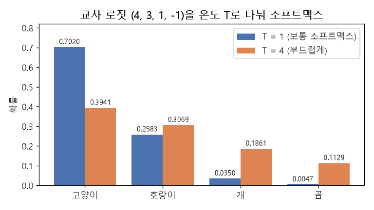

# 온도 소프트맥스와 지식 증류 (Temperature softmax, Knowledge distillation)

[목차로 돌아가기](../../00_MIT%EB%94%A5%EB%9F%AC%EB%8B%9D_%EB%AA%A9%EC%B0%A8.md) · 먼저 볼 것: [M06_지수와_e](../../%EC%88%98%ED%95%99%EA%B0%9C%EB%85%90/01_%EC%88%98%EC%99%80_%ED%95%A8%EC%88%98/M06_%EC%A7%80%EC%88%98%EC%99%80_e.md), [M10_엔트로피](../../%EC%88%98%ED%95%99%EA%B0%9C%EB%85%90/04_%ED%99%95%EB%A5%A0%EA%B3%BC_%EC%A0%95%EB%B3%B4/M10_%EC%97%94%ED%8A%B8%EB%A1%9C%ED%94%BC.md), [MM51_KL_발산과_최대_우도](../../%EC%88%98%ED%95%99%EA%B0%9C%EB%85%90/04_%ED%99%95%EB%A5%A0%EA%B3%BC_%EC%A0%95%EB%B3%B4/MM51_KL_%EB%B0%9C%EC%82%B0%EA%B3%BC_%EC%B5%9C%EB%8C%80_%EC%9A%B0%EB%8F%84.md) · 쓰는 곳: [Lec18 5.1](../../Lec18_%EC%A0%84%EC%9D%B4_%ED%95%99%EC%8A%B5_%EB%AA%A8%EB%8D%B8.md#51-%EA%B5%90%EC%82%AC%EC%99%80-%ED%95%99%EC%83%9D), [Lec18 5.2](../../Lec18_%EC%A0%84%EC%9D%B4_%ED%95%99%EC%8A%B5_%EB%AA%A8%EB%8D%B8.md#52-%EC%86%8C%ED%94%84%ED%8A%B8-%ED%83%80%EA%B9%83%EC%9D%B4-%EC%A3%BC%EB%8A%94-%EC%A0%95%EB%B3%B4), [Lec18 4.2](../../Lec18_%EC%A0%84%EC%9D%B4_%ED%95%99%EC%8A%B5_%EB%AA%A8%EB%8D%B8.md#42-%EB%B9%84%EC%A7%80%EB%8F%84-%EB%8F%84%EB%A9%94%EC%9D%B8-%EC%A0%81%EC%9D%91)

📚 학습 순서 89/99 (12. 강건성과 전이): ← 이전: [MM63_최악의_경우_최적화와_그룹_DRO](../../%EC%88%98%ED%95%99%EA%B0%9C%EB%85%90/12_%EA%B0%95%EA%B1%B4%EC%84%B1%EA%B3%BC_%EC%A0%84%EC%9D%B4/MM63_%EC%B5%9C%EC%95%85%EC%9D%98_%EA%B2%BD%EC%9A%B0_%EC%B5%9C%EC%A0%81%ED%99%94%EC%99%80_%EA%B7%B8%EB%A3%B9_DRO.md) · 다음: [MM66_그래디언트_반전과_도메인_적대_학습](../../%EC%88%98%ED%95%99%EA%B0%9C%EB%85%90/12_%EA%B0%95%EA%B1%B4%EC%84%B1%EA%B3%BC_%EC%A0%84%EC%9D%B4/MM66_%EA%B7%B8%EB%9E%98%EB%94%94%EC%96%B8%ED%8A%B8_%EB%B0%98%EC%A0%84%EA%B3%BC_%EB%8F%84%EB%A9%94%EC%9D%B8_%EC%A0%81%EB%8C%80_%ED%95%99%EC%8A%B5.md) →

> [!NOTE]
> **3줄 요약**
> - **온도 [소프트맥스](../../00_%EB%94%A5%EB%9F%AC%EB%8B%9D_%EC%9A%A9%EC%96%B4%EC%82%AC%EC%A0%84.md#softmax-%EC%86%8C%ED%94%84%ED%8A%B8%EB%A7%A5%EC%8A%A4)**는 [로짓](../../00_%EB%94%A5%EB%9F%AC%EB%8B%9D_%EC%9A%A9%EC%96%B4%EC%82%AC%EC%A0%84.md#logit-%EB%A1%9C%EC%A7%93)을 온도 $T$로 나눈 뒤 [소프트맥스](../../00_%EB%94%A5%EB%9F%AC%EB%8B%9D_%EC%9A%A9%EC%96%B4%EC%82%AC%EC%A0%84.md#softmax-%EC%86%8C%ED%94%84%ED%8A%B8%EB%A7%A5%EC%8A%A4)를 씌운다. $T$가 클수록 분포가 평평해져서 "2등, 3등이 얼마나 그럴듯한가"가 잘 보인다. 교사 [로짓](../../00_%EB%94%A5%EB%9F%AC%EB%8B%9D_%EC%9A%A9%EC%96%B4%EC%82%AC%EC%A0%84.md#logit-%EB%A1%9C%EC%A7%93) (4, 3, 1, -1)이면 $T = 1$에서 (0.702, 0.2583, 0.035, 0.0047), $T = 4$에서 (0.3941, 0.3069, 0.1861, 0.1129).
> - **[지식 증류](../../00_%EB%94%A5%EB%9F%AC%EB%8B%9D_%EC%9A%A9%EC%96%B4%EC%82%AC%EC%A0%84.md#knowledge-distillation-%EC%A7%80%EC%8B%9D-%EC%A6%9D%EB%A5%98)**는 학생 모델이 [정답](../../00_%EB%94%A5%EB%9F%AC%EB%8B%9D_%EC%9A%A9%EC%96%B4%EC%82%AC%EC%A0%84.md#label-%EC%A0%95%EB%8B%B5) 라벨(하드 타깃)뿐 아니라 교사의 부드러운 분포(**[소프트 타깃](../../00_%EB%94%A5%EB%9F%AC%EB%8B%9D_%EC%9A%A9%EC%96%B4%EC%82%AC%EC%A0%84.md#soft-target-%EC%86%8C%ED%94%84%ED%8A%B8-%ED%83%80%EA%B9%83)**)도 따라가게 한다. 따라가는 정도는 두 분포의 [KL 발산](../../00_%EB%94%A5%EB%9F%AC%EB%8B%9D_%EC%9A%A9%EC%96%B4%EC%82%AC%EC%A0%84.md#kl-divergence-kl-%EB%B0%9C%EC%82%B0)으로 잰다. 위 예에서 학생 [로짓](../../00_%EB%94%A5%EB%9F%AC%EB%8B%9D_%EC%9A%A9%EC%96%B4%EC%82%AC%EC%A0%84.md#logit-%EB%A1%9C%EC%A7%93)이 (3, 1, 1, 0)이면 $T = 4$에서 KL은 0.0303이다.
> - 전체 [손실](../../00_%EB%94%A5%EB%9F%AC%EB%8B%9D_%EC%9A%A9%EC%96%B4%EC%82%AC%EC%A0%84.md#loss-function-%EC%86%90%EC%8B%A4-%ED%95%A8%EC%88%98) = $(1-\alpha)\times$하드 [손실](../../00_%EB%94%A5%EB%9F%AC%EB%8B%9D_%EC%9A%A9%EC%96%B4%EC%82%AC%EC%A0%84.md#loss-function-%EC%86%90%EC%8B%A4-%ED%95%A8%EC%88%98) $+ \alpha \times T^2 \times$KL. $T^2$를 곱하는 까닭은 $T$로 나누면 [기울기](../../00_%EB%94%A5%EB%9F%AC%EB%8B%9D_%EC%9A%A9%EC%96%B4%EC%82%AC%EC%A0%84.md#gradient-%EA%B8%B0%EC%9A%B8%EA%B8%B0)가 $1/T^2$배로 작아지기 때문이다. 위 예에서 $\alpha = 0.5$면 $0.5 \times 0.278 + 0.5 \times 0.4853 = 0.3816$.

## 1. 개념 설명

비유: 시험 채점에서 "[정답](../../00_%EB%94%A5%EB%9F%AC%EB%8B%9D_%EC%9A%A9%EC%96%B4%EC%82%AC%EC%A0%84.md#label-%EC%A0%95%EB%8B%B5)은 3번"만 알려 주는 선생님과, "[정답](../../00_%EB%94%A5%EB%9F%AC%EB%8B%9D_%EC%9A%A9%EC%96%B4%EC%82%AC%EC%A0%84.md#label-%EC%A0%95%EB%8B%B5)은 3번인데 2번도 꽤 그럴듯했고 4번은 말도 안 된다"까지 알려 주는 선생님이 있다. 두 번째 선생님에게 배운 학생은 같은 문제 수로 더 많이 배운다. [지식 증류](../../00_%EB%94%A5%EB%9F%AC%EB%8B%9D_%EC%9A%A9%EC%96%B4%EC%82%AC%EC%A0%84.md#knowledge-distillation-%EC%A7%80%EC%8B%9D-%EC%A6%9D%EB%A5%98)의 교사는 두 번째 선생님이다.

- **[소프트맥스](../../00_%EB%94%A5%EB%9F%AC%EB%8B%9D_%EC%9A%A9%EC%96%B4%EC%82%AC%EC%A0%84.md#softmax-%EC%86%8C%ED%94%84%ED%8A%B8%EB%A7%A5%EC%8A%A4)와 온도**: [로짓](../../00_%EB%94%A5%EB%9F%AC%EB%8B%9D_%EC%9A%A9%EC%96%B4%EC%82%AC%EC%A0%84.md#logit-%EB%A1%9C%EC%A7%93) $z_i$를 [소프트맥스](../../00_%EB%94%A5%EB%9F%AC%EB%8B%9D_%EC%9A%A9%EC%96%B4%EC%82%AC%EC%A0%84.md#softmax-%EC%86%8C%ED%94%84%ED%8A%B8%EB%A7%A5%EC%8A%A4)에 넣기 전에 $T$로 나눈다. $T = 1$이면 보통 [소프트맥스](../../00_%EB%94%A5%EB%9F%AC%EB%8B%9D_%EC%9A%A9%EC%96%B4%EC%82%AC%EC%A0%84.md#softmax-%EC%86%8C%ED%94%84%ED%8A%B8%EB%A7%A5%EC%8A%A4)다. $T$가 크면 [로짓](../../00_%EB%94%A5%EB%9F%AC%EB%8B%9D_%EC%9A%A9%EC%96%B4%EC%82%AC%EC%A0%84.md#logit-%EB%A1%9C%EC%A7%93) 사이 차이가 줄어 분포가 평평해지고, $T$가 0에 가까우면 1등 칸만 1인 [원-핫](../../00_%EB%94%A5%EB%9F%AC%EB%8B%9D_%EC%9A%A9%EC%96%B4%EC%82%AC%EC%A0%84.md#one-hot-encoding-%EC%9B%90-%ED%95%AB-%EC%9D%B8%EC%BD%94%EB%94%A9)에 가까워진다. 1등이 누구인지(순서)는 $T$를 바꿔도 그대로다.
- **[소프트 타깃](../../00_%EB%94%A5%EB%9F%AC%EB%8B%9D_%EC%9A%A9%EC%96%B4%EC%82%AC%EC%A0%84.md#soft-target-%EC%86%8C%ED%94%84%ED%8A%B8-%ED%83%80%EA%B9%83)(soft target)**: 큰 교사 모델이 낸 [확률](../../00_%EB%94%A5%EB%9F%AC%EB%8B%9D_%EC%9A%A9%EC%96%B4%EC%82%AC%EC%A0%84.md#probability-%ED%99%95%EB%A5%A0) 분포. "고양이 0.39, 호랑이 0.31"이면 "이 사진은 호랑이를 조금 닮은 고양이"라는 정보가 담긴다. [원-핫](../../00_%EB%94%A5%EB%9F%AC%EB%8B%9D_%EC%9A%A9%EC%96%B4%EC%82%AC%EC%A0%84.md#one-hot-encoding-%EC%9B%90-%ED%95%AB-%EC%9D%B8%EC%BD%94%EB%94%A9) 라벨(하드 타깃)에는 이런 정보가 없다.
- **증류 [손실](../../00_%EB%94%A5%EB%9F%AC%EB%8B%9D_%EC%9A%A9%EC%96%B4%EC%82%AC%EC%A0%84.md#loss-function-%EC%86%90%EC%8B%A4-%ED%95%A8%EC%88%98)**: 같은 온도로 만든 교사 분포 $p(T)$와 학생 분포 $q(T)$의 [KL 발산](../../00_%EB%94%A5%EB%9F%AC%EB%8B%9D_%EC%9A%A9%EC%96%B4%EC%82%AC%EC%A0%84.md#kl-divergence-kl-%EB%B0%9C%EC%82%B0) $D_{KL}(p \,\|\, q)$를 줄인다. 강의 슬라이드는 이를 [교차 엔트로피](../../00_%EB%94%A5%EB%9F%AC%EB%8B%9D_%EC%9A%A9%EC%96%B4%EC%82%AC%EC%A0%84.md#cross-entropy-%EA%B5%90%EC%B0%A8-%EC%97%94%ED%8A%B8%EB%A1%9C%ED%94%BC) $-\sum_i p_i \log q_i$로 쓰는데, 교사는 얼려 두었으므로 두 식은 상수(교사의 [엔트로피](../../00_%EB%94%A5%EB%9F%AC%EB%8B%9D_%EC%9A%A9%EC%96%B4%EC%82%AC%EC%A0%84.md#entropy-%EC%97%94%ED%8A%B8%EB%A1%9C%ED%94%BC))만큼만 다르고 [기울기](../../00_%EB%94%A5%EB%9F%AC%EB%8B%9D_%EC%9A%A9%EC%96%B4%EC%82%AC%EC%A0%84.md#gradient-%EA%B8%B0%EC%9A%B8%EA%B8%B0)는 같다([MM51_KL_발산과_최대_우도](../../%EC%88%98%ED%95%99%EA%B0%9C%EB%85%90/04_%ED%99%95%EB%A5%A0%EA%B3%BC_%EC%A0%95%EB%B3%B4/MM51_KL_%EB%B0%9C%EC%82%B0%EA%B3%BC_%EC%B5%9C%EB%8C%80_%EC%9A%B0%EB%8F%84.md)).

## 2. 필요한 이유

[Lec18 5.1](../../Lec18_%EC%A0%84%EC%9D%B4_%ED%95%99%EC%8A%B5_%EB%AA%A8%EB%8D%B8.md#51-%EA%B5%90%EC%82%AC%EC%99%80-%ED%95%99%EC%83%9D)에서 강사는 [원-핫](../../00_%EB%94%A5%EB%9F%AC%EB%8B%9D_%EC%9A%A9%EC%96%B4%EC%82%AC%EC%A0%84.md#one-hot-encoding-%EC%9B%90-%ED%95%AB-%EC%9D%B8%EC%BD%94%EB%94%A9) 라벨로 하는 보통 [교차 엔트로피](../../00_%EB%94%A5%EB%9F%AC%EB%8B%9D_%EC%9A%A9%EC%96%B4%EC%82%AC%EC%A0%84.md#cross-entropy-%EA%B5%90%EC%B0%A8-%EC%97%94%ED%8A%B8%EB%A1%9C%ED%94%BC) [학습](../../00_%EB%94%A5%EB%9F%AC%EB%8B%9D_%EC%9A%A9%EC%96%B4%EC%82%AC%EC%A0%84.md#training-%ED%95%99%EC%8A%B5)을 "[정답](../../00_%EB%94%A5%EB%9F%AC%EB%8B%9D_%EC%9A%A9%EC%96%B4%EC%82%AC%EC%A0%84.md#label-%EC%A0%95%EB%8B%B5)이 교사"인 경우로 보고, 그 교사를 큰 모델의 출력으로 바꾼 것이 [지식 증류](../../00_%EB%94%A5%EB%9F%AC%EB%8B%9D_%EC%9A%A9%EC%96%B4%EC%82%AC%EC%A0%84.md#knowledge-distillation-%EC%A7%80%EC%8B%9D-%EC%A6%9D%EB%A5%98)라고 설명한다. [5.2](../../Lec18_%EC%A0%84%EC%9D%B4_%ED%95%99%EC%8A%B5_%EB%AA%A8%EB%8D%B8.md#52-%EC%86%8C%ED%94%84%ED%8A%B8-%ED%83%80%EA%B9%83%EC%9D%B4-%EC%A3%BC%EB%8A%94-%EC%A0%95%EB%B3%B4)의 요점("고양이를 조금 닮은 개")과 "[엔트로피](../../00_%EB%94%A5%EB%9F%AC%EB%8B%9D_%EC%9A%A9%EC%96%B4%EC%82%AC%EC%A0%84.md#entropy-%EC%97%94%ED%8A%B8%EB%A1%9C%ED%94%BC)가 높은 [소프트 타깃](../../00_%EB%94%A5%EB%9F%AC%EB%8B%9D_%EC%9A%A9%EC%96%B4%EC%82%AC%EC%A0%84.md#soft-target-%EC%86%8C%ED%94%84%ED%8A%B8-%ED%83%80%EA%B9%83)이 [학습](../../00_%EB%94%A5%EB%9F%AC%EB%8B%9D_%EC%9A%A9%EC%96%B4%EC%82%AC%EC%A0%84.md#training-%ED%95%99%EC%8A%B5) 사례당 더 많은 정보를 준다"는 말은 온도를 올린 분포를 보면 숫자로 확인된다. [4.2](../../Lec18_%EC%A0%84%EC%9D%B4_%ED%95%99%EC%8A%B5_%EB%AA%A8%EB%8D%B8.md#42-%EB%B9%84%EC%A7%80%EB%8F%84-%EB%8F%84%EB%A9%94%EC%9D%B8-%EC%A0%81%EC%9D%91)의 [도메인 적응](../../00_%EB%94%A5%EB%9F%AC%EB%8B%9D_%EC%9A%A9%EC%96%B4%EC%82%AC%EC%A0%84.md#domain-adaptation-%EB%8F%84%EB%A9%94%EC%9D%B8-%EC%A0%81%EC%9D%91)에서도 문턱값 대신 [소프트맥스](../../00_%EB%94%A5%EB%9F%AC%EB%8B%9D_%EC%9A%A9%EC%96%B4%EC%82%AC%EC%A0%84.md#softmax-%EC%86%8C%ED%94%84%ED%8A%B8%EB%A7%A5%EC%8A%A4)와 증류 [손실](../../00_%EB%94%A5%EB%9F%AC%EB%8B%9D_%EC%9A%A9%EC%96%B4%EC%82%AC%EC%A0%84.md#loss-function-%EC%86%90%EC%8B%A4-%ED%95%A8%EC%88%98)을 쓴다.

## 3. 숫자로 보기

교사 [로짓](../../00_%EB%94%A5%EB%9F%AC%EB%8B%9D_%EC%9A%A9%EC%96%B4%EC%82%AC%EC%A0%84.md#logit-%EB%A1%9C%EC%A7%93) (4, 3, 1, -1), 학생 [로짓](../../00_%EB%94%A5%EB%9F%AC%EB%8B%9D_%EC%9A%A9%EC%96%B4%EC%82%AC%EC%A0%84.md#logit-%EB%A1%9C%EC%A7%93) (3, 1, 1, 0). 칸 순서는 (고양이, 호랑이, 개, 곰), [정답](../../00_%EB%94%A5%EB%9F%AC%EB%8B%9D_%EC%9A%A9%EC%96%B4%EC%82%AC%EC%A0%84.md#label-%EC%A0%95%EB%8B%B5)은 고양이.

**$T = 4$에서 교사 [확률](../../00_%EB%94%A5%EB%9F%AC%EB%8B%9D_%EC%9A%A9%EC%96%B4%EC%82%AC%EC%A0%84.md#probability-%ED%99%95%EB%A5%A0) 구하기**
- [로짓](../../00_%EB%94%A5%EB%9F%AC%EB%8B%9D_%EC%9A%A9%EC%96%B4%EC%82%AC%EC%A0%84.md#logit-%EB%A1%9C%EC%A7%93)을 4로 나눈다: (1, 0.75, 0.25, -0.25)
- [지수](../../00_%EB%94%A5%EB%9F%AC%EB%8B%9D_%EC%9A%A9%EC%96%B4%EC%82%AC%EC%A0%84.md#e-exponent-e%EC%99%80-%EC%A7%80%EC%88%98)를 씌운다: $e^{1} = 2.7183$, $e^{0.75} = 2.117$, $e^{0.25} = 1.284$, $e^{-0.25} = 0.7788$
- 더한다: $2.7183 + 2.117 + 1.284 + 0.7788 = 6.8981$
- 나눈다: $2.7183 / 6.8981 = 0.3941$, ... → (0.3941, 0.3069, 0.1861, 0.1129)

| | 교사 $p$ | 학생 $q$ | KL$(p \,\|\, q)$ | $T^2 \times$ KL | 교사 [엔트로피](../../00_%EB%94%A5%EB%9F%AC%EB%8B%9D_%EC%9A%A9%EC%96%B4%EC%82%AC%EC%A0%84.md#entropy-%EC%97%94%ED%8A%B8%EB%A1%9C%ED%94%BC) |
|---|---|---|---|---|---|
| $T = 1$ | (0.702, 0.2583, 0.035, 0.0047) | (0.7573, 0.1025, 0.1025, 0.0377) | 0.1381 | 0.1381 | 0.7405 |
| $T = 4$ | (0.3941, 0.3069, 0.1861, 0.1129) | (0.3724, 0.2259, 0.2259, 0.1759) | 0.0303 | 0.4853 | 1.2887 |

- $T = 4$에서 교사의 [엔트로피](../../00_%EB%94%A5%EB%9F%AC%EB%8B%9D_%EC%9A%A9%EC%96%B4%EC%82%AC%EC%A0%84.md#entropy-%EC%97%94%ED%8A%B8%EB%A1%9C%ED%94%BC)가 0.7405에서 1.2887로 커진다. 개(0.035 → 0.1861)와 곰(0.0047 → 0.1129) 칸이 살아나서, "호랑이 > 개 > 곰 순으로 닮았다"는 정보가 학생에게 전해진다.
- 하드 [손실](../../00_%EB%94%A5%EB%9F%AC%EB%8B%9D_%EC%9A%A9%EC%96%B4%EC%82%AC%EC%A0%84.md#loss-function-%EC%86%90%EC%8B%A4-%ED%95%A8%EC%88%98)(학생, $T = 1$, [정답](../../00_%EB%94%A5%EB%9F%AC%EB%8B%9D_%EC%9A%A9%EC%96%B4%EC%82%AC%EC%A0%84.md#label-%EC%A0%95%EB%8B%B5) 고양이): $-\ln 0.7573 = 0.278$
- 전체 [손실](../../00_%EB%94%A5%EB%9F%AC%EB%8B%9D_%EC%9A%A9%EC%96%B4%EC%82%AC%EC%A0%84.md#loss-function-%EC%86%90%EC%8B%A4-%ED%95%A8%EC%88%98)($\alpha = 0.5$, $T = 4$): $0.5 \times 0.278 + 0.5 \times 0.4853 = 0.3816$


*▲ 직접 그린 그림: 교사 [로짓](../../00_%EB%94%A5%EB%9F%AC%EB%8B%9D_%EC%9A%A9%EC%96%B4%EC%82%AC%EC%A0%84.md#logit-%EB%A1%9C%EC%A7%93) (4, 3, 1, -1)의 [소프트맥스](../../00_%EB%94%A5%EB%9F%AC%EB%8B%9D_%EC%9A%A9%EC%96%B4%EC%82%AC%EC%A0%84.md#softmax-%EC%86%8C%ED%94%84%ED%8A%B8%EB%A7%A5%EC%8A%A4). 파랑은 $T = 1$, 주황은 $T = 4$. 온도를 올리면 2~4등 칸이 커진다*

온도 [소프트맥스](../../00_%EB%94%A5%EB%9F%AC%EB%8B%9D_%EC%9A%A9%EC%96%B4%EC%82%AC%EC%A0%84.md#softmax-%EC%86%8C%ED%94%84%ED%8A%B8%EB%A7%A5%EC%8A%A4)를 식으로 쓰면 다음과 같다.

$$
p_i(T) = \frac{e^{z_i / T}}{\sum_{j} e^{z_j / T}}
$$

<details><summary>기호 풀이</summary>

| 기호 | 읽는 법 | 뜻 | 예제 값 |
| --- | --- | --- | --- |
| $z_i$ | 제트 아이 | $i$번 칸의 [로짓](../../00_%EB%94%A5%EB%9F%AC%EB%8B%9D_%EC%9A%A9%EC%96%B4%EC%82%AC%EC%A0%84.md#logit-%EB%A1%9C%EC%A7%93)([소프트맥스](../../00_%EB%94%A5%EB%9F%AC%EB%8B%9D_%EC%9A%A9%EC%96%B4%EC%82%AC%EC%A0%84.md#softmax-%EC%86%8C%ED%94%84%ED%8A%B8%EB%A7%A5%EC%8A%A4) 전 점수) | (2, 0) |
| $T$ | 티 | 온도. 클수록 분포가 평평하다 | 2 |
| $e^{z_i/T}$ | 이의 제트 나누기 티 제곱 | 칸마다 양수로 바꾼 점수 | 2.7183, 1 |
| $\sum_j$ | 시그마 제이 | 모든 칸에 대해 더한다 | 3.7183 |
| $p_i(T)$ | 피 아이 | 온도 $T$에서 $i$번 칸의 [확률](../../00_%EB%94%A5%EB%9F%AC%EB%8B%9D_%EC%9A%A9%EC%96%B4%EC%82%AC%EC%A0%84.md#probability-%ED%99%95%EB%A5%A0) | 0.7311, 0.2689 |

</details>

<details><summary>예제와 풀이</summary>

**문제**: 두 칸(고양이, 개)의 [로짓](../../00_%EB%94%A5%EB%9F%AC%EB%8B%9D_%EC%9A%A9%EC%96%B4%EC%82%AC%EC%A0%84.md#logit-%EB%A1%9C%EC%A7%93)이 2와 0이다. 온도 $T = 2$로 부드럽게 한 [확률](../../00_%EB%94%A5%EB%9F%AC%EB%8B%9D_%EC%9A%A9%EC%96%B4%EC%82%AC%EC%A0%84.md#probability-%ED%99%95%EB%A5%A0)은? 보통 [소프트맥스](../../00_%EB%94%A5%EB%9F%AC%EB%8B%9D_%EC%9A%A9%EC%96%B4%EC%82%AC%EC%A0%84.md#softmax-%EC%86%8C%ED%94%84%ED%8A%B8%EB%A7%A5%EC%8A%A4)($T = 1$)와 비교하라.

**주어진 값**
- $z_1 = 2$ (고양이 칸의 [로짓](../../00_%EB%94%A5%EB%9F%AC%EB%8B%9D_%EC%9A%A9%EC%96%B4%EC%82%AC%EC%A0%84.md#logit-%EB%A1%9C%EC%A7%93))
- $z_2 = 0$ (개 칸의 [로짓](../../00_%EB%94%A5%EB%9F%AC%EB%8B%9D_%EC%9A%A9%EC%96%B4%EC%82%AC%EC%A0%84.md#logit-%EB%A1%9C%EC%A7%93))
- $T = 2$ (온도)

**풀이**
1. 식을 그대로 쓴다: $p_1(T) = \dfrac{e^{z_1/T}}{e^{z_1/T} + e^{z_2/T}}$ (칸이 두 개라 Σ를 두 항으로 펼침)
2. 값을 대입한다: $p_1(2) = \dfrac{e^{2/2}}{e^{2/2} + e^{0/2}}$
3. [지수](../../00_%EB%94%A5%EB%9F%AC%EB%8B%9D_%EC%9A%A9%EC%96%B4%EC%82%AC%EC%A0%84.md#e-exponent-e%EC%99%80-%EC%A7%80%EC%88%98) 안의 나눗셈을 한다: $2/2 = 1$, $0/2 = 0$ 이므로 $p_1(2) = \dfrac{e^{1}}{e^{1} + e^{0}}$
4. [지수](../../00_%EB%94%A5%EB%9F%AC%EB%8B%9D_%EC%9A%A9%EC%96%B4%EC%82%AC%EC%A0%84.md#e-exponent-e%EC%99%80-%EC%A7%80%EC%88%98)를 계산한다. $e$는 약 2.718인 수이고 $e^{a}$는 그 $a$제곱이다(계산기의 exp): $e^{1} = 2.7183$, $e^{0} = 1$ 이므로 $p_1(2) = \dfrac{2.7183}{2.7183 + 1}$
5. 분모를 더한다: $2.7183 + 1 = 3.7183$ 이므로 $p_1(2) = \dfrac{2.7183}{3.7183}$
6. 나눈다: $2.7183 / 3.7183 = 0.7311$
7. 개 칸은 1에서 뺀다: $p_2(2) = 1 - 0.7311 = 0.2689$
8. 비교용 $T = 1$: $e^{2} = 7.3891$, $e^{0} = 1$ 이므로 $p_1(1) = 7.3891 / 8.3891 = 0.8808$

**답**: $T = 2$에서 (**0.7311**, **0.2689**). $T = 1$이면 (0.8808, 0.1192)이라, 온도를 올리면 개 칸의 [확률](../../00_%EB%94%A5%EB%9F%AC%EB%8B%9D_%EC%9A%A9%EC%96%B4%EC%82%AC%EC%A0%84.md#probability-%ED%99%95%EB%A5%A0)이 커진다.

</details>

<details><summary>내 이해</summary>


</details>

증류 [손실](../../00_%EB%94%A5%EB%9F%AC%EB%8B%9D_%EC%9A%A9%EC%96%B4%EC%82%AC%EC%A0%84.md#loss-function-%EC%86%90%EC%8B%A4-%ED%95%A8%EC%88%98)은 하드 [손실](../../00_%EB%94%A5%EB%9F%AC%EB%8B%9D_%EC%9A%A9%EC%96%B4%EC%82%AC%EC%A0%84.md#loss-function-%EC%86%90%EC%8B%A4-%ED%95%A8%EC%88%98)과 소프트 [손실](../../00_%EB%94%A5%EB%9F%AC%EB%8B%9D_%EC%9A%A9%EC%96%B4%EC%82%AC%EC%A0%84.md#loss-function-%EC%86%90%EC%8B%A4-%ED%95%A8%EC%88%98)을 섞는다.

$$
\mathcal{L}_{\text{KD}} = (1 - \alpha)\big(-\log q_y(1)\big) + \alpha\, T^2\, D_{KL}\big(p(T) \,\|\, q(T)\big), \qquad
D_{KL}(p \,\|\, q) = \sum_i p_i \log \frac{p_i}{q_i}
$$

<details><summary>기호 풀이</summary>

| 기호 | 읽는 법 | 뜻 | 예제 값 |
| --- | --- | --- | --- |
| $q_y(1)$ | 큐 와이 | 학생이 [정답](../../00_%EB%94%A5%EB%9F%AC%EB%8B%9D_%EC%9A%A9%EC%96%B4%EC%82%AC%EC%A0%84.md#label-%EC%A0%95%EB%8B%B5) 칸 $y$에 준 [확률](../../00_%EB%94%A5%EB%9F%AC%EB%8B%9D_%EC%9A%A9%EC%96%B4%EC%82%AC%EC%A0%84.md#probability-%ED%99%95%EB%A5%A0) ($T = 1$) | 0.7311 |
| $-\log q_y(1)$ | 하드 [손실](../../00_%EB%94%A5%EB%9F%AC%EB%8B%9D_%EC%9A%A9%EC%96%B4%EC%82%AC%EC%A0%84.md#loss-function-%EC%86%90%EC%8B%A4-%ED%95%A8%EC%88%98) | [정답](../../00_%EB%94%A5%EB%9F%AC%EB%8B%9D_%EC%9A%A9%EC%96%B4%EC%82%AC%EC%A0%84.md#label-%EC%A0%95%EB%8B%B5) 라벨에 대한 보통 [교차 엔트로피](../../00_%EB%94%A5%EB%9F%AC%EB%8B%9D_%EC%9A%A9%EC%96%B4%EC%82%AC%EC%A0%84.md#cross-entropy-%EA%B5%90%EC%B0%A8-%EC%97%94%ED%8A%B8%EB%A1%9C%ED%94%BC) | 0.3133 |
| $p(T)$ | 피 티 | 온도 $T$에서 교사의 분포 ([소프트 타깃](../../00_%EB%94%A5%EB%9F%AC%EB%8B%9D_%EC%9A%A9%EC%96%B4%EC%82%AC%EC%A0%84.md#soft-target-%EC%86%8C%ED%94%84%ED%8A%B8-%ED%83%80%EA%B9%83)) | (0.7, 0.3) |
| $q(T)$ | 큐 티 | 온도 $T$에서 학생의 분포 | (0.6225, 0.3775) |
| $D_{KL}(p \,\|\, q)$ | [KL 발산](../../00_%EB%94%A5%EB%9F%AC%EB%8B%9D_%EC%9A%A9%EC%96%B4%EC%82%AC%EC%A0%84.md#kl-divergence-kl-%EB%B0%9C%EC%82%B0) | 학생 분포가 교사 분포와 얼마나 다른가 | 0.0132 |
| $T^2$ | 티 제곱 | 온도로 작아진 [기울기](../../00_%EB%94%A5%EB%9F%AC%EB%8B%9D_%EC%9A%A9%EC%96%B4%EC%82%AC%EC%A0%84.md#gradient-%EA%B8%B0%EC%9A%B8%EA%B8%B0)를 되살리는 배율 | 4 |
| $\alpha$ | 알파 | 소프트 [손실](../../00_%EB%94%A5%EB%9F%AC%EB%8B%9D_%EC%9A%A9%EC%96%B4%EC%82%AC%EC%A0%84.md#loss-function-%EC%86%90%EC%8B%A4-%ED%95%A8%EC%88%98)의 비중 | 0.5 |
| $\mathcal{L}_{\text{KD}}$ | 증류 [손실](../../00_%EB%94%A5%EB%9F%AC%EB%8B%9D_%EC%9A%A9%EC%96%B4%EC%82%AC%EC%A0%84.md#loss-function-%EC%86%90%EC%8B%A4-%ED%95%A8%EC%88%98) | 학생이 줄이는 전체 [손실](../../00_%EB%94%A5%EB%9F%AC%EB%8B%9D_%EC%9A%A9%EC%96%B4%EC%82%AC%EC%A0%84.md#loss-function-%EC%86%90%EC%8B%A4-%ED%95%A8%EC%88%98) | 0.1831 |

</details>

<details><summary>예제와 풀이</summary>

**문제**: 두 칸 문제에서 교사의 [소프트 타깃](../../00_%EB%94%A5%EB%9F%AC%EB%8B%9D_%EC%9A%A9%EC%96%B4%EC%82%AC%EC%A0%84.md#soft-target-%EC%86%8C%ED%94%84%ED%8A%B8-%ED%83%80%EA%B9%83)이 $T = 2$에서 (0.7, 0.3)이고, 학생 [로짓](../../00_%EB%94%A5%EB%9F%AC%EB%8B%9D_%EC%9A%A9%EC%96%B4%EC%82%AC%EC%A0%84.md#logit-%EB%A1%9C%EC%A7%93)은 (1, 0), [정답](../../00_%EB%94%A5%EB%9F%AC%EB%8B%9D_%EC%9A%A9%EC%96%B4%EC%82%AC%EC%A0%84.md#label-%EC%A0%95%EB%8B%B5)은 1번 칸이다. $\alpha = 0.5$일 때 증류 [손실](../../00_%EB%94%A5%EB%9F%AC%EB%8B%9D_%EC%9A%A9%EC%96%B4%EC%82%AC%EC%A0%84.md#loss-function-%EC%86%90%EC%8B%A4-%ED%95%A8%EC%88%98)은?

**주어진 값**
- $p(2) = (0.7, 0.3)$ (교사의 [소프트 타깃](../../00_%EB%94%A5%EB%9F%AC%EB%8B%9D_%EC%9A%A9%EC%96%B4%EC%82%AC%EC%A0%84.md#soft-target-%EC%86%8C%ED%94%84%ED%8A%B8-%ED%83%80%EA%B9%83))
- $z = (1, 0)$ (학생 [로짓](../../00_%EB%94%A5%EB%9F%AC%EB%8B%9D_%EC%9A%A9%EC%96%B4%EC%82%AC%EC%A0%84.md#logit-%EB%A1%9C%EC%A7%93))
- $y = 1$ ([정답](../../00_%EB%94%A5%EB%9F%AC%EB%8B%9D_%EC%9A%A9%EC%96%B4%EC%82%AC%EC%A0%84.md#label-%EC%A0%95%EB%8B%B5) 칸)
- $T = 2$ (온도), $\alpha = 0.5$ (소프트 [손실](../../00_%EB%94%A5%EB%9F%AC%EB%8B%9D_%EC%9A%A9%EC%96%B4%EC%82%AC%EC%A0%84.md#loss-function-%EC%86%90%EC%8B%A4-%ED%95%A8%EC%88%98) 비중)

**풀이**
1. 식을 그대로 쓴다: $\mathcal{L}_{\text{KD}} = (1 - \alpha)\big(-\log q_y(1)\big) + \alpha\, T^2 \sum_i p_i \log \dfrac{p_i}{q_i}$
2. 값을 대입한다: $\mathcal{L}_{\text{KD}} = (1 - 0.5)\big(-\log q_1(1)\big) + 0.5 \times 2^2 \Big(0.7 \log \dfrac{0.7}{q_1(2)} + 0.3 \log \dfrac{0.3}{q_2(2)}\Big)$
3. 학생의 $T = 1$ [확률](../../00_%EB%94%A5%EB%9F%AC%EB%8B%9D_%EC%9A%A9%EC%96%B4%EC%82%AC%EC%A0%84.md#probability-%ED%99%95%EB%A5%A0)을 구한다: $q_1(1) = \dfrac{e^{1}}{e^{1} + e^{0}} = \dfrac{2.7183}{3.7183} = 0.7311$
4. 하드 [손실](../../00_%EB%94%A5%EB%9F%AC%EB%8B%9D_%EC%9A%A9%EC%96%B4%EC%82%AC%EC%A0%84.md#loss-function-%EC%86%90%EC%8B%A4-%ED%95%A8%EC%88%98)을 구한다. $\log$(= ln)는 $e$를 몇 제곱해야 그 수가 되는지다: $-\ln 0.7311 = 0.3133$
5. 학생의 $T = 2$ [확률](../../00_%EB%94%A5%EB%9F%AC%EB%8B%9D_%EC%9A%A9%EC%96%B4%EC%82%AC%EC%A0%84.md#probability-%ED%99%95%EB%A5%A0)을 구한다: $e^{1/2} = e^{0.5} = 1.6487$, $e^{0} = 1$ 이므로 $q_1(2) = 1.6487 / 2.6487 = 0.6225$, $q_2(2) = 0.3775$
6. 비율을 나눈다: $0.7 / 0.6225 = 1.1246$, $0.3 / 0.3775 = 0.7946$
7. [로그](../../00_%EB%94%A5%EB%9F%AC%EB%8B%9D_%EC%9A%A9%EC%96%B4%EC%82%AC%EC%A0%84.md#log-ln-%EB%A1%9C%EA%B7%B8)를 씌운다: $\ln 1.1246 = 0.1174$, $\ln 0.7946 = -0.2299$
8. 교사 [확률](../../00_%EB%94%A5%EB%9F%AC%EB%8B%9D_%EC%9A%A9%EC%96%B4%EC%82%AC%EC%A0%84.md#probability-%ED%99%95%EB%A5%A0)을 곱한다: $0.7 \times 0.1174 = 0.0822$, $0.3 \times (-0.2299) = -0.069$
9. Σ를 더한다: $0.0822 + (-0.069) = 0.0132$ ([KL 발산](../../00_%EB%94%A5%EB%9F%AC%EB%8B%9D_%EC%9A%A9%EC%96%B4%EC%82%AC%EC%A0%84.md#kl-divergence-kl-%EB%B0%9C%EC%82%B0))
10. $T^2$를 곱한다: $2^2 = 4$ 이므로 $4 \times 0.0132 = 0.0529$
11. 비중을 곱한다 (반올림 [오차](../../00_%EB%94%A5%EB%9F%AC%EB%8B%9D_%EC%9A%A9%EC%96%B4%EC%82%AC%EC%A0%84.md#error-%EC%98%A4%EC%B0%A8)를 줄이려고 다섯 자리로 쓴다): $(1 - 0.5) \times 0.31326 = 0.15663$, $0.5 \times 0.05287 = 0.02643$
12. 더한다: $0.15663 + 0.02643 = 0.18306$, 넷째 자리로 반올림하면 $0.1831$

**답**: $\mathcal{L}_{\text{KD}} = $ **0.1831**. KL 항이 작은 것은 학생 분포 (0.6225, 0.3775)가 이미 교사 (0.7, 0.3)에 꽤 가깝기 때문이다.

</details>

<details><summary>내 이해</summary>


</details>

## 4. 코드로 확인

```python
# [함수] def sm(z, T): 로짓 z를 온도 T로 나눈 뒤 소프트맥스 확률을 돌려준다
def sm(z, T=1.0):
    # [함수] np.exp: 칸마다 e^(z/T)를 계산한다
    # [변수] e: 양수로 바꾼 점수
    e = np.exp(np.array(z, float) / T)
    # [연결] 본문 첫 식: 합으로 나눠 확률(합 1)로 만든다
    return e / e.sum()
# [변수] zt, zs: 교사와 학생의 로짓 (고양이, 호랑이, 개, 곰)
# [연결] 3절 표의 입력
zt, zs = [4, 3, 1, -1], [3, 1, 1, 0]
# [함수] for T in (1, 4): 보통 소프트맥스와 부드럽게 한 소프트맥스를 차례로 본다
for T in (1, 4):
    # [변수] p, q: 온도 T에서 교사와 학생의 확률
    p, q = sm(zt, T), sm(zs, T)
    # [변수] kl: KL(p || q) = Σ p log(p/q). 교사를 학생이 얼마나 못 따라가는지
    # [연결] [[MM51_KL_발산과_최대_우도]]의 정의
    kl = (p * np.log(p / q)).sum()
    # [연결] 3절 표: T, 교사 확률, 학생 확률, KL, T²·KL
    print(T, p.round(4), q.round(4), round(kl, 4), round(T * T * kl, 4))
# [변수] ce: 정답(고양이) 칸에 대한 학생의 하드 손실 -ln q_y(1)
ce = -np.log(sm(zs)[0])
# [변수] kd: T = 4에서 T²·KL
kd = 16 * (sm(zt, 4) * np.log(sm(zt, 4) / sm(zs, 4))).sum()
# [연결] 3절 마지막 줄: 하드 손실 0.278, α = 0.5로 섞은 전체 손실 0.3816
print(round(ce, 4), round(0.5 * ce + 0.5 * kd, 4))
# [연결] 첫 예제와 풀이: 로짓 (2, 0)을 T = 1과 T = 2로
print(sm([2, 0]).round(4), sm([2, 0], 2).round(4))
# [변수] q2: 둘째 예제의 학생 확률 (T = 2), pt: 교사 소프트 타깃
q2, pt = sm([1, 0], 2), np.array([0.7, 0.3])
# [연결] 둘째 예제와 풀이: KL 0.0132, 증류 손실 0.1831
print(q2.round(4), round((pt * np.log(pt / q2)).sum(), 4), round(0.5 * -np.log(sm([1, 0])[0]) + 0.5 * 4 * (pt * np.log(pt / q2)).sum(), 4))
```

**실행 결과**:

```text
1 [0.702  0.2583 0.035  0.0047] [0.7573 0.1025 0.1025 0.0377] 0.1381 0.1381
4 [0.3941 0.3069 0.1861 0.1129] [0.3724 0.2259 0.2259 0.1759] 0.0303 0.4853
0.278 0.3816
[0.8808 0.1192] [0.7311 0.2689]
[0.6225 0.3775] 0.0132 0.1831
```

> [!WARNING]
> **⚠ 주의**
> - $T^2$를 빼먹으면 온도를 올릴수록 소프트 [손실](../../00_%EB%94%A5%EB%9F%AC%EB%8B%9D_%EC%9A%A9%EC%96%B4%EC%82%AC%EC%A0%84.md#loss-function-%EC%86%90%EC%8B%A4-%ED%95%A8%EC%88%98)의 [기울기](../../00_%EB%94%A5%EB%9F%AC%EB%8B%9D_%EC%9A%A9%EC%96%B4%EC%82%AC%EC%A0%84.md#gradient-%EA%B8%B0%EC%9A%B8%EA%B8%B0)가 $1/T^2$배로 줄어, 하드 [손실](../../00_%EB%94%A5%EB%9F%AC%EB%8B%9D_%EC%9A%A9%EC%96%B4%EC%82%AC%EC%A0%84.md#loss-function-%EC%86%90%EC%8B%A4-%ED%95%A8%EC%88%98)에 묻혀 버린다. 위 예에서 KL은 $T = 4$에서 0.0303으로 작아 보이지만 $T^2 = 16$을 곱하면 0.4853이다.
> - [학습](../../00_%EB%94%A5%EB%9F%AC%EB%8B%9D_%EC%9A%A9%EC%96%B4%EC%82%AC%EC%A0%84.md#training-%ED%95%99%EC%8A%B5)이 끝나 실제로 예측할 때 학생은 $T = 1$로 돌아간다. 온도는 "학습할 때 교사의 정보를 꺼내 보는 돋보기"다.
> - 교사가 틀리게 자신하는 사례(모든 모델이 같이 틀리는 구석 사례)는 증류로 고쳐지지 않는다. 학생은 교사의 실수까지 배운다.
> - KL은 대칭이 아니다. 증류는 보통 $D_{KL}(\text{교사} \,\|\, \text{학생})$을 쓴다([MM51_KL_발산과_최대_우도](../../%EC%88%98%ED%95%99%EA%B0%9C%EB%85%90/04_%ED%99%95%EB%A5%A0%EA%B3%BC_%EC%A0%95%EB%B3%B4/MM51_KL_%EB%B0%9C%EC%82%B0%EA%B3%BC_%EC%B5%9C%EB%8C%80_%EC%9A%B0%EB%8F%84.md)).

## 5. 개념 재확인

<details><summary>1. 로짓 (2, 1, 0)을 온도 $T = 2$로 부드럽게 한 확률은?</summary>

| 단계 | 하는 일 | 계산 | 결과 |
|---|---|---|---|
| 1 | 온도로 나누기 | $(2, 1, 0)/2$ | (1, 0.5, 0) |
| 2 | [지수](../../00_%EB%94%A5%EB%9F%AC%EB%8B%9D_%EC%9A%A9%EC%96%B4%EC%82%AC%EC%A0%84.md#e-exponent-e%EC%99%80-%EC%A7%80%EC%88%98) | $e^{1}, e^{0.5}, e^{0}$ | 2.7183, 1.6487, 1 |
| 3 | 합 | $2.7183 + 1.6487 + 1$ | 5.367 |
| 4 | 나누기 | 각 값 / 5.367 | (0.5065, 0.3072, 0.1863) |

**① 쓰는 식**
$$p_i(T) = \frac{e^{z_i/T}}{\sum_j e^{z_j/T}}$$
- 위 식 ← ② (나누기), ③ ([지수](../../00_%EB%94%A5%EB%9F%AC%EB%8B%9D_%EC%9A%A9%EC%96%B4%EC%82%AC%EC%A0%84.md#e-exponent-e%EC%99%80-%EC%A7%80%EC%88%98)), ④ (합), ⑤ ([확률](../../00_%EB%94%A5%EB%9F%AC%EB%8B%9D_%EC%9A%A9%EC%96%B4%EC%82%AC%EC%A0%84.md#probability-%ED%99%95%EB%A5%A0))에서 쓴다.
```python
# [변수] z: 세 칸의 로짓, T: 온도
z, T = np.array([2, 1, 0.0]), 2.0                         # ①
# [변수] e = [2.7183 1.6487 1.]: 온도로 나눈 뒤 지수
e = np.exp(z / T)                                        # ②③
# [연결] 5.367 [0.5065 0.3072 0.1863]
print(round(e.sum(), 4), (e / e.sum()).round(4))         # ④⑤
```

**주어진 값**
- $z = (2, 1, 0)$ (세 칸의 [로짓](../../00_%EB%94%A5%EB%9F%AC%EB%8B%9D_%EC%9A%A9%EC%96%B4%EC%82%AC%EC%A0%84.md#logit-%EB%A1%9C%EC%A7%93))
- $T = 2$ (온도)

**풀이**
1. 식을 그대로 쓴다: $p_i(T) = \dfrac{e^{z_i/T}}{\sum_j e^{z_j/T}}$
2. 값을 대입한다 (첫 칸): $p_1(2) = \dfrac{e^{2/2}}{e^{2/2} + e^{1/2} + e^{0/2}}$ (Σ를 세 항으로 펼침)
3. (②) 온도로 나눈다: $2/2 = 1$, $1/2 = 0.5$, $0/2 = 0$
4. (③) [지수](../../00_%EB%94%A5%EB%9F%AC%EB%8B%9D_%EC%9A%A9%EC%96%B4%EC%82%AC%EC%A0%84.md#e-exponent-e%EC%99%80-%EC%A7%80%EC%88%98)를 계산한다($e^{a}$는 약 2.718의 $a$제곱): $e^{1} = 2.7183$, $e^{0.5} = 1.6487$, $e^{0} = 1$
5. (④) 분모를 더한다: $2.7183 + 1.6487 = 4.367$
6. (④) 마저 더한다: $4.367 + 1 = 5.367$
7. (⑤) 첫 칸을 나눈다: $2.7183 / 5.367 = 0.5065$
8. (⑤) 둘째 칸을 나눈다: $1.6487 / 5.367 = 0.3072$
9. (⑤) 셋째 칸을 나눈다: $1 / 5.367 = 0.1863$

**답**: (**0.5065**, **0.3072**, **0.1863**).

</details>

<details><summary>2. 로짓 (2, 0)의 분포가 $T = 1$일 때와 $T = 2$일 때, 어느 쪽 엔트로피가 더 큰가?</summary>

| 단계 | 하는 일 | 계산 | 결과 |
|---|---|---|---|
| 1 | $T = 1$ [확률](../../00_%EB%94%A5%EB%9F%AC%EB%8B%9D_%EC%9A%A9%EC%96%B4%EC%82%AC%EC%A0%84.md#probability-%ED%99%95%EB%A5%A0) | 본문 첫 예제 | (0.8808, 0.1192) |
| 2 | $T = 1$ [엔트로피](../../00_%EB%94%A5%EB%9F%AC%EB%8B%9D_%EC%9A%A9%EC%96%B4%EC%82%AC%EC%A0%84.md#entropy-%EC%97%94%ED%8A%B8%EB%A1%9C%ED%94%BC) | $-(0.8808 \ln 0.8808 + 0.1192 \ln 0.1192)$ | 0.3653 |
| 3 | $T = 2$ [확률](../../00_%EB%94%A5%EB%9F%AC%EB%8B%9D_%EC%9A%A9%EC%96%B4%EC%82%AC%EC%A0%84.md#probability-%ED%99%95%EB%A5%A0) | 본문 첫 예제 | (0.7311, 0.2689) |
| 4 | $T = 2$ [엔트로피](../../00_%EB%94%A5%EB%9F%AC%EB%8B%9D_%EC%9A%A9%EC%96%B4%EC%82%AC%EC%A0%84.md#entropy-%EC%97%94%ED%8A%B8%EB%A1%9C%ED%94%BC) | $-(0.7311 \ln 0.7311 + 0.2689 \ln 0.2689)$ | 0.5822 |

**① 쓰는 식**
$$H(p) = -\sum_i p_i \ln p_i$$
- 위 식 ← ③ ([확률](../../00_%EB%94%A5%EB%9F%AC%EB%8B%9D_%EC%9A%A9%EC%96%B4%EC%82%AC%EC%A0%84.md#probability-%ED%99%95%EB%A5%A0)마다 $-p \ln p$), ④ (합)에서 쓴다. [M10_엔트로피](../../%EC%88%98%ED%95%99%EA%B0%9C%EB%85%90/04_%ED%99%95%EB%A5%A0%EA%B3%BC_%EC%A0%95%EB%B3%B4/M10_%EC%97%94%ED%8A%B8%EB%A1%9C%ED%94%BC.md)의 식이다.
```python
# [함수] sm: 위 4절의 온도 소프트맥스 (여기서는 한 줄로)
sm = lambda z, T: np.exp(np.array(z) / T) / np.exp(np.array(z) / T).sum()   # ①
# [변수] p1, p2: T = 1, T = 2의 확률
p1, p2 = sm([2, 0], 1), sm([2, 0], 2)                                       # ②
# [연결] [0.1118 0.2535] 0.3653 / [0.229 0.3532] 0.5822
print((-p1 * np.log(p1)).round(4), round(-(p1 * np.log(p1)).sum(), 4))      # ③④
print((-p2 * np.log(p2)).round(4), round(-(p2 * np.log(p2)).sum(), 4))      # ③④
```

**주어진 값**
- $T = 1$일 때 $p = (0.8808, 0.1192)$ (보통 [소프트맥스](../../00_%EB%94%A5%EB%9F%AC%EB%8B%9D_%EC%9A%A9%EC%96%B4%EC%82%AC%EC%A0%84.md#softmax-%EC%86%8C%ED%94%84%ED%8A%B8%EB%A7%A5%EC%8A%A4))
- $T = 2$일 때 $p = (0.7311, 0.2689)$ (부드럽게 한 [소프트맥스](../../00_%EB%94%A5%EB%9F%AC%EB%8B%9D_%EC%9A%A9%EC%96%B4%EC%82%AC%EC%A0%84.md#softmax-%EC%86%8C%ED%94%84%ED%8A%B8%EB%A7%A5%EC%8A%A4))

**풀이**
1. 식을 그대로 쓴다: $H(p) = -\sum_i p_i \ln p_i$
2. 값을 대입한다 ($T = 1$): $H = -(0.8808 \ln 0.8808 + 0.1192 \ln 0.1192)$
3. (③) [로그](../../00_%EB%94%A5%EB%9F%AC%EB%8B%9D_%EC%9A%A9%EC%96%B4%EC%82%AC%EC%A0%84.md#log-ln-%EB%A1%9C%EA%B7%B8)를 계산한다: $\ln 0.8808 = -0.1269$, $\ln 0.1192 = -2.1269$
4. (③) [확률](../../00_%EB%94%A5%EB%9F%AC%EB%8B%9D_%EC%9A%A9%EC%96%B4%EC%82%AC%EC%A0%84.md#probability-%ED%99%95%EB%A5%A0)을 곱한다: $0.8808 \times (-0.1269) = -0.1118$, $0.1192 \times (-2.1269) = -0.2535$
5. (④) 더하고 부호를 바꾼다: $-(-0.1118 - 0.2535) = 0.3653$
6. 값을 대입한다 ($T = 2$): $H = -(0.7311 \ln 0.7311 + 0.2689 \ln 0.2689)$
7. (③) [로그](../../00_%EB%94%A5%EB%9F%AC%EB%8B%9D_%EC%9A%A9%EC%96%B4%EC%82%AC%EC%A0%84.md#log-ln-%EB%A1%9C%EA%B7%B8)를 계산한다: $\ln 0.7311 = -0.3133$, $\ln 0.2689 = -1.3133$
8. (③) [확률](../../00_%EB%94%A5%EB%9F%AC%EB%8B%9D_%EC%9A%A9%EC%96%B4%EC%82%AC%EC%A0%84.md#probability-%ED%99%95%EB%A5%A0)을 곱한다: $0.7311 \times (-0.3133) = -0.229$, $0.2689 \times (-1.3133) = -0.3532$
9. (④) 더하고 부호를 바꾼다: $-(-0.229 - 0.3532) = 0.5822$

**답**: $T = 2$ 쪽이 **0.5822**로 $T = 1$(**0.3653**)보다 크다. 강의의 말처럼 [엔트로피](../../00_%EB%94%A5%EB%9F%AC%EB%8B%9D_%EC%9A%A9%EC%96%B4%EC%82%AC%EC%A0%84.md#entropy-%EC%97%94%ED%8A%B8%EB%A1%9C%ED%94%BC)가 높은 [소프트 타깃](../../00_%EB%94%A5%EB%9F%AC%EB%8B%9D_%EC%9A%A9%EC%96%B4%EC%82%AC%EC%A0%84.md#soft-target-%EC%86%8C%ED%94%84%ED%8A%B8-%ED%83%80%EA%B9%83)이 사례마다 더 많은 정보를 담는다.

</details>

## 예제 풀기

[예제 10문제 풀기](../../%EC%98%88%EC%A0%9C/12_%EA%B0%95%EA%B1%B4%EC%84%B1%EA%B3%BC_%EC%A0%84%EC%9D%B4/%EC%98%88%EC%A0%9C_MM65_%EC%98%A8%EB%8F%84_%EC%86%8C%ED%94%84%ED%8A%B8%EB%A7%A5%EC%8A%A4%EC%99%80_%EC%A7%80%EC%8B%9D_%EC%A6%9D%EB%A5%98.md)

<details><summary>내 이해</summary>


</details>
