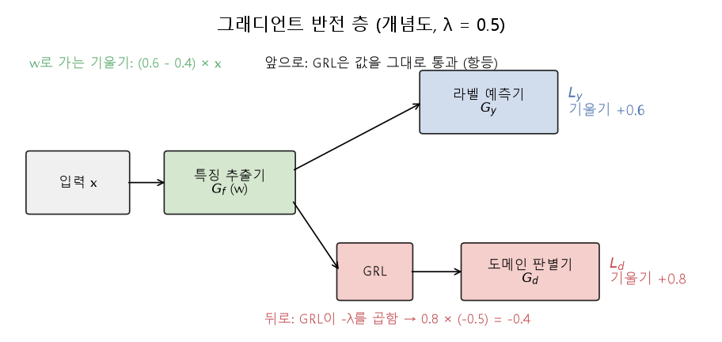

# 그래디언트 반전과 도메인 적대 학습 (Gradient reversal, Domain-adversarial training)

[목차로 돌아가기](../../00_MIT%EB%94%A5%EB%9F%AC%EB%8B%9D_%EB%AA%A9%EC%B0%A8.md) · 먼저 볼 것: [MM09_야코비안과_연쇄법칙](../../%EC%88%98%ED%95%99%EA%B0%9C%EB%85%90/05_%EC%8B%A0%EA%B2%BD%EB%A7%9D%EC%9D%98_%EA%B3%84%EC%82%B0/MM09_%EC%95%BC%EC%BD%94%EB%B9%84%EC%95%88%EA%B3%BC_%EC%97%B0%EC%87%84%EB%B2%95%EC%B9%99.md), [MM08_SGD와_모멘텀](../../%EC%88%98%ED%95%99%EA%B0%9C%EB%85%90/05_%EC%8B%A0%EA%B2%BD%EB%A7%9D%EC%9D%98_%EA%B3%84%EC%82%B0/MM08_SGD%EC%99%80_%EB%AA%A8%EB%A9%98%ED%85%80.md), [M10_엔트로피](../../%EC%88%98%ED%95%99%EA%B0%9C%EB%85%90/04_%ED%99%95%EB%A5%A0%EA%B3%BC_%EC%A0%95%EB%B3%B4/M10_%EC%97%94%ED%8A%B8%EB%A1%9C%ED%94%BC.md), [MM34_우연_수준_손실과_기준선](../../%EC%88%98%ED%95%99%EA%B0%9C%EB%85%90/04_%ED%99%95%EB%A5%A0%EA%B3%BC_%EC%A0%95%EB%B3%B4/MM34_%EC%9A%B0%EC%97%B0_%EC%88%98%EC%A4%80_%EC%86%90%EC%8B%A4%EA%B3%BC_%EA%B8%B0%EC%A4%80%EC%84%A0.md) · 쓰는 곳: [Lec18 4.1](../../Lec18_%EC%A0%84%EC%9D%B4_%ED%95%99%EC%8A%B5_%EB%AA%A8%EB%8D%B8.md#41-%EC%A0%81%EB%8C%80%EC%A0%81-%EB%8F%84%EB%A9%94%EC%9D%B8-%EC%A0%81%EC%9D%91)

📚 학습 순서 90/99 (12. 강건성과 전이): ← 이전: [MM65_온도_소프트맥스와_지식_증류](../../%EC%88%98%ED%95%99%EA%B0%9C%EB%85%90/12_%EA%B0%95%EA%B1%B4%EC%84%B1%EA%B3%BC_%EC%A0%84%EC%9D%B4/MM65_%EC%98%A8%EB%8F%84_%EC%86%8C%ED%94%84%ED%8A%B8%EB%A7%A5%EC%8A%A4%EC%99%80_%EC%A7%80%EC%8B%9D_%EC%A6%9D%EB%A5%98.md) · 다음: [MM68_가지치기와_양자화](../../%EC%88%98%ED%95%99%EA%B0%9C%EB%85%90/12_%EA%B0%95%EA%B1%B4%EC%84%B1%EA%B3%BC_%EC%A0%84%EC%9D%B4/MM68_%EA%B0%80%EC%A7%80%EC%B9%98%EA%B8%B0%EC%99%80_%EC%96%91%EC%9E%90%ED%99%94.md) →

> [!NOTE]
> **3줄 요약**
> - **도메인 적대 [학습](../../00_%EB%94%A5%EB%9F%AC%EB%8B%9D_%EC%9A%A9%EC%96%B4%EC%82%AC%EC%A0%84.md#training-%ED%95%99%EC%8A%B5)**(DANN)은 특징 추출기 하나에 두 머리를 단다. 라벨 예측기는 범주를 맞히고, 도메인 [판별기](../../00_%EB%94%A5%EB%9F%AC%EB%8B%9D_%EC%9A%A9%EC%96%B4%EC%82%AC%EC%A0%84.md#generator-discriminator-%EC%83%9D%EC%84%B1%EA%B8%B0%EC%99%80-%ED%8C%90%EB%B3%84%EA%B8%B0)는 "원천(source)인가 목표(target)인가"를 맞힌다. 특징 추출기는 범주는 **잘** 맞히고 도메인은 **못** 맞히게 하는 특징을 배운다. 목적은 $E = \mathcal{L}_y - \lambda \mathcal{L}_d$.
> - **[그래디언트 반전 층](../../00_%EB%94%A5%EB%9F%AC%EB%8B%9D_%EC%9A%A9%EC%96%B4%EC%82%AC%EC%A0%84.md#gradient-reversal-layer-%EA%B7%B8%EB%9E%98%EB%94%94%EC%96%B8%ED%8A%B8-%EB%B0%98%EC%A0%84-%EC%B8%B5)**(GRL)이 이 "반대 방향"을 한 번의 [역전파](../../00_%EB%94%A5%EB%9F%AC%EB%8B%9D_%EC%9A%A9%EC%96%B4%EC%82%AC%EC%A0%84.md#backpropagation-%EC%97%AD%EC%A0%84%ED%8C%8C)로 해 준다. 앞으로 갈 때는 값을 그대로 통과시키고, 뒤로 갈 때 [기울기](../../00_%EB%94%A5%EB%9F%AC%EB%8B%9D_%EC%9A%A9%EC%96%B4%EC%82%AC%EC%A0%84.md#gradient-%EA%B8%B0%EC%9A%B8%EA%B8%B0)에 $-\lambda$를 곱한다. 라벨 쪽 [기울기](../../00_%EB%94%A5%EB%9F%AC%EB%8B%9D_%EC%9A%A9%EC%96%B4%EC%82%AC%EC%A0%84.md#gradient-%EA%B8%B0%EC%9A%B8%EA%B8%B0) 0.6, 도메인 쪽 0.8, $\lambda = 0.5$면 특징으로 가는 [기울기](../../00_%EB%94%A5%EB%9F%AC%EB%8B%9D_%EC%9A%A9%EC%96%B4%EC%82%AC%EC%A0%84.md#gradient-%EA%B8%B0%EC%9A%B8%EA%B8%B0)는 $0.6 + 0.8 = 1.4$가 아니라 $0.6 - 0.4 = 0.2$다.
> - 두 도메인의 특징이 완전히 겹치면 [판별기](../../00_%EB%94%A5%EB%9F%AC%EB%8B%9D_%EC%9A%A9%EC%96%B4%EC%82%AC%EC%A0%84.md#generator-discriminator-%EC%83%9D%EC%84%B1%EA%B8%B0%EC%99%80-%ED%8C%90%EB%B3%84%EA%B8%B0)는 찍기밖에 못 해 도메인 [손실](../../00_%EB%94%A5%EB%9F%AC%EB%8B%9D_%EC%9A%A9%EC%96%B4%EC%82%AC%EC%A0%84.md#loss-function-%EC%86%90%EC%8B%A4-%ED%95%A8%EC%88%98)이 $\ln 2 = 0.6931$([우연 수준](../../00_%EB%94%A5%EB%9F%AC%EB%8B%9D_%EC%9A%A9%EC%96%B4%EC%82%AC%EC%A0%84.md#chance-level-%EC%9A%B0%EC%97%B0-%EC%88%98%EC%A4%80))이 된다. 특징이 떨어져 있으면 0.1269처럼 작다.

## 1. 개념 설명

비유: 아마존 사진(깨끗한 배경)과 이베이 사진(지저분한 책상)으로 노트북 종류를 가려내는 감별사를 키운다. 옆에는 "이 사진이 어느 사이트 것인지" 맞히는 심판이 있다. 감별사는 심판을 **속이도록**, 즉 배경처럼 사이트를 드러내는 단서는 버리고 노트북 자체만 보도록 훈련된다. 그러면 이베이 사진에서도 감별 실력이 유지된다.

- **세 부품**: 특징 추출기 $G_f$([파라미터](../../00_%EB%94%A5%EB%9F%AC%EB%8B%9D_%EC%9A%A9%EC%96%B4%EC%82%AC%EC%A0%84.md#parameter-%ED%8C%8C%EB%9D%BC%EB%AF%B8%ED%84%B0) $\theta_f$)가 입력을 특징 $h$로 바꾼다. 라벨 예측기 $G_y$가 $h$로 범주를, 도메인 [판별기](../../00_%EB%94%A5%EB%9F%AC%EB%8B%9D_%EC%9A%A9%EC%96%B4%EC%82%AC%EC%A0%84.md#generator-discriminator-%EC%83%9D%EC%84%B1%EA%B8%B0%EC%99%80-%ED%8C%90%EB%B3%84%EA%B8%B0) $G_d$가 $h$로 도메인 $d$(원천 0, 목표 1)를 예측한다.
- **줄다리기**: $G_d$는 도메인 [손실](../../00_%EB%94%A5%EB%9F%AC%EB%8B%9D_%EC%9A%A9%EC%96%B4%EC%82%AC%EC%A0%84.md#loss-function-%EC%86%90%EC%8B%A4-%ED%95%A8%EC%88%98) $\mathcal{L}_d$를 **줄이려** 하고, $G_f$는 $\mathcal{L}_d$를 **키우려** 한다(동시에 $\mathcal{L}_y$는 줄인다). 지금까지 본 "[손실](../../00_%EB%94%A5%EB%9F%AC%EB%8B%9D_%EC%9A%A9%EC%96%B4%EC%82%AC%EC%A0%84.md#loss-function-%EC%86%90%EC%8B%A4-%ED%95%A8%EC%88%98)을 줄이는" [학습](../../00_%EB%94%A5%EB%9F%AC%EB%8B%9D_%EC%9A%A9%EC%96%B4%EC%82%AC%EC%A0%84.md#training-%ED%95%99%EC%8A%B5)과 달리, 한 [손실](../../00_%EB%94%A5%EB%9F%AC%EB%8B%9D_%EC%9A%A9%EC%96%B4%EC%82%AC%EC%A0%84.md#loss-function-%EC%86%90%EC%8B%A4-%ED%95%A8%EC%88%98)을 두고 두 편이 반대로 움직인다(min-max).
- **GRL**: $G_f$와 $G_d$ 사이에 끼우는 [층](../../00_%EB%94%A5%EB%9F%AC%EB%8B%9D_%EC%9A%A9%EC%96%B4%EC%82%AC%EC%A0%84.md#layer-%EC%B8%B5). 앞으로는 항등 함수($R(h) = h$), 뒤로는 [기울기](../../00_%EB%94%A5%EB%9F%AC%EB%8B%9D_%EC%9A%A9%EC%96%B4%EC%82%AC%EC%A0%84.md#gradient-%EA%B8%B0%EC%9A%B8%EA%B8%B0)에 $-\lambda$를 곱한다. 그래서 보통의 [경사하강법](../../00_%EB%94%A5%EB%9F%AC%EB%8B%9D_%EC%9A%A9%EC%96%B4%EC%82%AC%EC%A0%84.md#gradient-descent-%EA%B2%BD%EC%82%AC%ED%95%98%EA%B0%95%EB%B2%95) 한 번으로 $G_d$는 내려가고 $G_f$는 올라간다.
- **비지도 [도메인 적응](../../00_%EB%94%A5%EB%9F%AC%EB%8B%9D_%EC%9A%A9%EC%96%B4%EC%82%AC%EC%A0%84.md#domain-adaptation-%EB%8F%84%EB%A9%94%EC%9D%B8-%EC%A0%81%EC%9D%91)**에도 쓸 수 있다. 목표 도메인에 범주 라벨이 없어도 "목표 도메인에서 왔다"는 도메인 라벨은 공짜로 있으므로 $\mathcal{L}_d$는 계산할 수 있다.


*▲ 직접 그린 그림: [그래디언트 반전 층](../../00_%EB%94%A5%EB%9F%AC%EB%8B%9D_%EC%9A%A9%EC%96%B4%EC%82%AC%EC%A0%84.md#gradient-reversal-layer-%EA%B7%B8%EB%9E%98%EB%94%94%EC%96%B8%ED%8A%B8-%EB%B0%98%EC%A0%84-%EC%B8%B5) (개념도). 아래 길로 돌아오는 도메인 [기울기](../../00_%EB%94%A5%EB%9F%AC%EB%8B%9D_%EC%9A%A9%EC%96%B4%EC%82%AC%EC%A0%84.md#gradient-%EA%B8%B0%EC%9A%B8%EA%B8%B0) 0.8에 $-\lambda = -0.5$가 곱해져 -0.4가 된다*

## 2. 필요한 이유

[Lec18 4.1](../../Lec18_%EC%A0%84%EC%9D%B4_%ED%95%99%EC%8A%B5_%EB%AA%A8%EB%8D%B8.md#41-%EC%A0%81%EB%8C%80%EC%A0%81-%EB%8F%84%EB%A9%94%EC%9D%B8-%EC%A0%81%EC%9D%91)에서 강사는 원천과 목표 도메인의 표현 공간을 맞추는 대표 방법으로 적대적 접근을 소개하고, "도메인 [판별기](../../00_%EB%94%A5%EB%9F%AC%EB%8B%9D_%EC%9A%A9%EC%96%B4%EC%82%AC%EC%A0%84.md#generator-discriminator-%EC%83%9D%EC%84%B1%EA%B8%B0%EC%99%80-%ED%8C%90%EB%B3%84%EA%B8%B0)의 [기울기](../../00_%EB%94%A5%EB%9F%AC%EB%8B%9D_%EC%9A%A9%EC%96%B4%EC%82%AC%EC%A0%84.md#gradient-%EA%B8%B0%EC%9A%B8%EA%B8%B0)를 뒤집는다(flip the gradient)"고 말한다. 이 노트는 그 한 문장이 식과 숫자로 무슨 뜻인지 보여 준다.

## 3. 숫자로 보기

**목적 함수** ($\mathcal{L}_y = 0.3$, $\mathcal{L}_d = 0.5$, $\lambda = 0.5$)
- $E = 0.3 - 0.5 \times 0.5 = 0.3 - 0.25 = 0.05$

**GRL을 지나는 [기울기](../../00_%EB%94%A5%EB%9F%AC%EB%8B%9D_%EC%9A%A9%EC%96%B4%EC%82%AC%EC%A0%84.md#gradient-%EA%B8%B0%EC%9A%B8%EA%B8%B0)** (특징 $h = w x$, $x = 2$, $w = 1$, [학습률](../../00_%EB%94%A5%EB%9F%AC%EB%8B%9D_%EC%9A%A9%EC%96%B4%EC%82%AC%EC%A0%84.md#learning-rate-%ED%95%99%EC%8A%B5%EB%A5%A0) $\eta = 0.1$)
- 라벨 [손실](../../00_%EB%94%A5%EB%9F%AC%EB%8B%9D_%EC%9A%A9%EC%96%B4%EC%82%AC%EC%A0%84.md#loss-function-%EC%86%90%EC%8B%A4-%ED%95%A8%EC%88%98)의 [기울기](../../00_%EB%94%A5%EB%9F%AC%EB%8B%9D_%EC%9A%A9%EC%96%B4%EC%82%AC%EC%A0%84.md#gradient-%EA%B8%B0%EC%9A%B8%EA%B8%B0) $\partial \mathcal{L}_y / \partial h = 0.6$, 도메인 [손실](../../00_%EB%94%A5%EB%9F%AC%EB%8B%9D_%EC%9A%A9%EC%96%B4%EC%82%AC%EC%A0%84.md#loss-function-%EC%86%90%EC%8B%A4-%ED%95%A8%EC%88%98)의 [기울기](../../00_%EB%94%A5%EB%9F%AC%EB%8B%9D_%EC%9A%A9%EC%96%B4%EC%82%AC%EC%A0%84.md#gradient-%EA%B8%B0%EC%9A%B8%EA%B8%B0) $\partial \mathcal{L}_d / \partial h = 0.8$
- 반전 없이 더하면: $0.6 + 0.8 = 1.4$
- GRL을 거치면: $0.6 + (-0.5) \times 0.8 = 0.6 - 0.4 = 0.2$
- $w$로 가는 [기울기](../../00_%EB%94%A5%EB%9F%AC%EB%8B%9D_%EC%9A%A9%EC%96%B4%EC%82%AC%EC%A0%84.md#gradient-%EA%B8%B0%EC%9A%B8%EA%B8%B0): $0.2 \times x = 0.2 \times 2 = 0.4$
- 갱신: $w = 1 - 0.1 \times 0.4 = 0.96$

**도메인 [손실](../../00_%EB%94%A5%EB%9F%AC%EB%8B%9D_%EC%9A%A9%EC%96%B4%EC%82%AC%EC%A0%84.md#loss-function-%EC%86%90%EC%8B%A4-%ED%95%A8%EC%88%98)** ([판별기](../../00_%EB%94%A5%EB%9F%AC%EB%8B%9D_%EC%9A%A9%EC%96%B4%EC%82%AC%EC%A0%84.md#generator-discriminator-%EC%83%9D%EC%84%B1%EA%B8%B0%EC%99%80-%ED%8C%90%EB%B3%84%EA%B8%B0) $\hat d = \sigma(2h - 4)$, 원천 특징 1개와 목표 특징 1개)

| 상태 | 원천 $h$ | 목표 $h$ | 원천을 목표라 볼 [확률](../../00_%EB%94%A5%EB%9F%AC%EB%8B%9D_%EC%9A%A9%EC%96%B4%EC%82%AC%EC%A0%84.md#probability-%ED%99%95%EB%A5%A0) | 목표를 목표라 볼 [확률](../../00_%EB%94%A5%EB%9F%AC%EB%8B%9D_%EC%9A%A9%EC%96%B4%EC%82%AC%EC%A0%84.md#probability-%ED%99%95%EB%A5%A0) | $\mathcal{L}_d$ |
|---|---|---|---|---|---|
| 떨어져 있음 | 1 | 3 | 0.1192 | 0.8808 | 0.1269 |
| 겹침 | 2 | 2 | 0.5 | 0.5 | 0.6931 |

[판별기](../../00_%EB%94%A5%EB%9F%AC%EB%8B%9D_%EC%9A%A9%EC%96%B4%EC%82%AC%EC%A0%84.md#generator-discriminator-%EC%83%9D%EC%84%B1%EA%B8%B0%EC%99%80-%ED%8C%90%EB%B3%84%EA%B8%B0)가 도메인을 잘 가려낼수록 $\mathcal{L}_d$가 작다. 특징 추출기는 $\mathcal{L}_d$를 키워 특징을 겹치게 만든다.

### 3.1 목적 함수

$$
E(\theta_f, \theta_y, \theta_d) = \mathcal{L}_y(\theta_f, \theta_y) - \lambda\, \mathcal{L}_d(\theta_f, \theta_d), \qquad
(\hat\theta_f, \hat\theta_y) = \arg\min_{\theta_f, \theta_y} E, \quad \hat\theta_d = \arg\max_{\theta_d} E
$$

<details><summary>기호 풀이</summary>

| 기호 | 읽는 법 | 뜻 | 예제 값 |
| --- | --- | --- | --- |
| $\theta_f, \theta_y, \theta_d$ | 세타 에프, 와이, 디 | 특징 추출기, 라벨 예측기, 도메인 [판별기](../../00_%EB%94%A5%EB%9F%AC%EB%8B%9D_%EC%9A%A9%EC%96%B4%EC%82%AC%EC%A0%84.md#generator-discriminator-%EC%83%9D%EC%84%B1%EA%B8%B0%EC%99%80-%ED%8C%90%EB%B3%84%EA%B8%B0)의 [파라미터](../../00_%EB%94%A5%EB%9F%AC%EB%8B%9D_%EC%9A%A9%EC%96%B4%EC%82%AC%EC%A0%84.md#parameter-%ED%8C%8C%EB%9D%BC%EB%AF%B8%ED%84%B0) | |
| $\mathcal{L}_y$ | 라벨 [손실](../../00_%EB%94%A5%EB%9F%AC%EB%8B%9D_%EC%9A%A9%EC%96%B4%EC%82%AC%EC%A0%84.md#loss-function-%EC%86%90%EC%8B%A4-%ED%95%A8%EC%88%98) | 원천 데이터의 범주 예측 [손실](../../00_%EB%94%A5%EB%9F%AC%EB%8B%9D_%EC%9A%A9%EC%96%B4%EC%82%AC%EC%A0%84.md#loss-function-%EC%86%90%EC%8B%A4-%ED%95%A8%EC%88%98) | 0.3 |
| $\mathcal{L}_d$ | 도메인 [손실](../../00_%EB%94%A5%EB%9F%AC%EB%8B%9D_%EC%9A%A9%EC%96%B4%EC%82%AC%EC%A0%84.md#loss-function-%EC%86%90%EC%8B%A4-%ED%95%A8%EC%88%98) | 원천·목표 데이터의 도메인 예측 [손실](../../00_%EB%94%A5%EB%9F%AC%EB%8B%9D_%EC%9A%A9%EC%96%B4%EC%82%AC%EC%A0%84.md#loss-function-%EC%86%90%EC%8B%A4-%ED%95%A8%EC%88%98) | 0.5 |
| $\lambda$ | 람다 | 도메인 항의 비중 | 0.5 |
| $E$ | 이 | 전체 목적 함수 | 0.05 |
| $\arg\min, \arg\max$ | 아그민, 아그맥스 | 그 값을 가장 작게/크게 만드는 [파라미터](../../00_%EB%94%A5%EB%9F%AC%EB%8B%9D_%EC%9A%A9%EC%96%B4%EC%82%AC%EC%A0%84.md#parameter-%ED%8C%8C%EB%9D%BC%EB%AF%B8%ED%84%B0) ([MM01_argmin과_argmax](../../%EC%88%98%ED%95%99%EA%B0%9C%EB%85%90/02_%EB%AF%B8%EB%B6%84/MM01_argmin%EA%B3%BC_argmax.md)) | |

</details>

<details><summary>예제와 풀이</summary>

**문제**: 어느 [학습](../../00_%EB%94%A5%EB%9F%AC%EB%8B%9D_%EC%9A%A9%EC%96%B4%EC%82%AC%EC%A0%84.md#training-%ED%95%99%EC%8A%B5) 단계에서 라벨 [손실](../../00_%EB%94%A5%EB%9F%AC%EB%8B%9D_%EC%9A%A9%EC%96%B4%EC%82%AC%EC%A0%84.md#loss-function-%EC%86%90%EC%8B%A4-%ED%95%A8%EC%88%98)이 0.3, 도메인 [손실](../../00_%EB%94%A5%EB%9F%AC%EB%8B%9D_%EC%9A%A9%EC%96%B4%EC%82%AC%EC%A0%84.md#loss-function-%EC%86%90%EC%8B%A4-%ED%95%A8%EC%88%98)이 0.5다. 도메인 항의 비중 $\lambda$가 0.5일 때 목적 함수 $E$는? [판별기](../../00_%EB%94%A5%EB%9F%AC%EB%8B%9D_%EC%9A%A9%EC%96%B4%EC%82%AC%EC%A0%84.md#generator-discriminator-%EC%83%9D%EC%84%B1%EA%B8%B0%EC%99%80-%ED%8C%90%EB%B3%84%EA%B8%B0)가 더 좋아져 $\mathcal{L}_d$가 0.2로 줄면 $E$는 어떻게 되나?

**주어진 값**
- $\mathcal{L}_y = 0.3$ (범주 예측 [손실](../../00_%EB%94%A5%EB%9F%AC%EB%8B%9D_%EC%9A%A9%EC%96%B4%EC%82%AC%EC%A0%84.md#loss-function-%EC%86%90%EC%8B%A4-%ED%95%A8%EC%88%98))
- $\mathcal{L}_d = 0.5$ (도메인 예측 [손실](../../00_%EB%94%A5%EB%9F%AC%EB%8B%9D_%EC%9A%A9%EC%96%B4%EC%82%AC%EC%A0%84.md#loss-function-%EC%86%90%EC%8B%A4-%ED%95%A8%EC%88%98))
- $\lambda = 0.5$ (도메인 항의 비중)

**풀이**
1. 식을 그대로 쓴다: $E = \mathcal{L}_y - \lambda\, \mathcal{L}_d$
2. 값을 대입한다: $E = 0.3 - 0.5 \times 0.5$
3. 곱셈을 먼저 한다: $0.5 \times 0.5 = 0.25$ 이므로 $E = 0.3 - 0.25$
4. 뺀다: $0.3 - 0.25 = 0.05$
5. $\mathcal{L}_d = 0.2$를 대입한다: $E = 0.3 - 0.5 \times 0.2$
6. 곱셈을 먼저 한다: $0.5 \times 0.2 = 0.1$ 이므로 $E = 0.3 - 0.1$
7. 뺀다: $0.3 - 0.1 = 0.2$

**답**: $E = $ **0.05**, [판별기](../../00_%EB%94%A5%EB%9F%AC%EB%8B%9D_%EC%9A%A9%EC%96%B4%EC%82%AC%EC%A0%84.md#generator-discriminator-%EC%83%9D%EC%84%B1%EA%B8%B0%EC%99%80-%ED%8C%90%EB%B3%84%EA%B8%B0)가 좋아지면 **0.2**로 커진다. [판별기](../../00_%EB%94%A5%EB%9F%AC%EB%8B%9D_%EC%9A%A9%EC%96%B4%EC%82%AC%EC%A0%84.md#generator-discriminator-%EC%83%9D%EC%84%B1%EA%B8%B0%EC%99%80-%ED%8C%90%EB%B3%84%EA%B8%B0)는 $E$를 키우는(= $\mathcal{L}_d$를 줄이는) 쪽, 특징 추출기는 $E$를 줄이는(= $\mathcal{L}_d$를 키우는) 쪽으로 움직인다.

</details>

<details><summary>내 이해</summary>


</details>

### 3.2 그래디언트 반전 층

$$
R(h) = h, \qquad \frac{\partial R}{\partial h} = -\lambda, \qquad
w \leftarrow w - \eta\left(\frac{\partial \mathcal{L}_y}{\partial h} - \lambda \frac{\partial \mathcal{L}_d}{\partial h}\right)\frac{\partial h}{\partial w}
$$

<details><summary>기호 풀이</summary>

| 기호 | 읽는 법 | 뜻 | 예제 값 |
| --- | --- | --- | --- |
| $R(h)$ | 알 | GRL. 앞으로는 값을 그대로 통과 | $h$ |
| $\partial R / \partial h$ | 알의 [미분](../../00_%EB%94%A5%EB%9F%AC%EB%8B%9D_%EC%9A%A9%EC%96%B4%EC%82%AC%EC%A0%84.md#derivative-%EB%AF%B8%EB%B6%84) | 뒤로 갈 때 [기울기](../../00_%EB%94%A5%EB%9F%AC%EB%8B%9D_%EC%9A%A9%EC%96%B4%EC%82%AC%EC%A0%84.md#gradient-%EA%B8%B0%EC%9A%B8%EA%B8%B0)에 곱하는 수 (원래 항등이면 1인데 일부러 $-\lambda$) | -0.5 |
| $\partial \mathcal{L}_y / \partial h$ | 라벨 [손실](../../00_%EB%94%A5%EB%9F%AC%EB%8B%9D_%EC%9A%A9%EC%96%B4%EC%82%AC%EC%A0%84.md#loss-function-%EC%86%90%EC%8B%A4-%ED%95%A8%EC%88%98)의 [기울기](../../00_%EB%94%A5%EB%9F%AC%EB%8B%9D_%EC%9A%A9%EC%96%B4%EC%82%AC%EC%A0%84.md#gradient-%EA%B8%B0%EC%9A%B8%EA%B8%B0) | 특징이 변할 때 라벨 [손실](../../00_%EB%94%A5%EB%9F%AC%EB%8B%9D_%EC%9A%A9%EC%96%B4%EC%82%AC%EC%A0%84.md#loss-function-%EC%86%90%EC%8B%A4-%ED%95%A8%EC%88%98)이 변하는 정도 | 0.6 |
| $\partial \mathcal{L}_d / \partial h$ | 도메인 [손실](../../00_%EB%94%A5%EB%9F%AC%EB%8B%9D_%EC%9A%A9%EC%96%B4%EC%82%AC%EC%A0%84.md#loss-function-%EC%86%90%EC%8B%A4-%ED%95%A8%EC%88%98)의 [기울기](../../00_%EB%94%A5%EB%9F%AC%EB%8B%9D_%EC%9A%A9%EC%96%B4%EC%82%AC%EC%A0%84.md#gradient-%EA%B8%B0%EC%9A%B8%EA%B8%B0) | 특징이 변할 때 도메인 [손실](../../00_%EB%94%A5%EB%9F%AC%EB%8B%9D_%EC%9A%A9%EC%96%B4%EC%82%AC%EC%A0%84.md#loss-function-%EC%86%90%EC%8B%A4-%ED%95%A8%EC%88%98)이 변하는 정도 | 0.8 |
| $\partial h / \partial w$ | 에이치의 [미분](../../00_%EB%94%A5%EB%9F%AC%EB%8B%9D_%EC%9A%A9%EC%96%B4%EC%82%AC%EC%A0%84.md#derivative-%EB%AF%B8%EB%B6%84) | $h = wx$이면 $x$ ([연쇄법칙](../../%EC%88%98%ED%95%99%EA%B0%9C%EB%85%90/05_%EC%8B%A0%EA%B2%BD%EB%A7%9D%EC%9D%98_%EA%B3%84%EC%82%B0/MM09_%EC%95%BC%EC%BD%94%EB%B9%84%EC%95%88%EA%B3%BC_%EC%97%B0%EC%87%84%EB%B2%95%EC%B9%99.md)) | 2 |
| $\eta$ | 에타 | [학습률](../../00_%EB%94%A5%EB%9F%AC%EB%8B%9D_%EC%9A%A9%EC%96%B4%EC%82%AC%EC%A0%84.md#learning-rate-%ED%95%99%EC%8A%B5%EB%A5%A0) | 0.1 |
| $w$ | 더블유 | 특징 추출기의 [가중치](../../00_%EB%94%A5%EB%9F%AC%EB%8B%9D_%EC%9A%A9%EC%96%B4%EC%82%AC%EC%A0%84.md#weight-%EA%B0%80%EC%A4%91%EC%B9%98) | 1 → 0.96 |

</details>

<details><summary>예제와 풀이</summary>

**문제**: 특징 추출기가 $h = w x$ 하나뿐이다. $w = 1$, 입력 $x = 2$, 라벨 [손실](../../00_%EB%94%A5%EB%9F%AC%EB%8B%9D_%EC%9A%A9%EC%96%B4%EC%82%AC%EC%A0%84.md#loss-function-%EC%86%90%EC%8B%A4-%ED%95%A8%EC%88%98)의 [기울기](../../00_%EB%94%A5%EB%9F%AC%EB%8B%9D_%EC%9A%A9%EC%96%B4%EC%82%AC%EC%A0%84.md#gradient-%EA%B8%B0%EC%9A%B8%EA%B8%B0) 0.6, 도메인 [손실](../../00_%EB%94%A5%EB%9F%AC%EB%8B%9D_%EC%9A%A9%EC%96%B4%EC%82%AC%EC%A0%84.md#loss-function-%EC%86%90%EC%8B%A4-%ED%95%A8%EC%88%98)의 [기울기](../../00_%EB%94%A5%EB%9F%AC%EB%8B%9D_%EC%9A%A9%EC%96%B4%EC%82%AC%EC%A0%84.md#gradient-%EA%B8%B0%EC%9A%B8%EA%B8%B0) 0.8, $\lambda = 0.5$, [학습률](../../00_%EB%94%A5%EB%9F%AC%EB%8B%9D_%EC%9A%A9%EC%96%B4%EC%82%AC%EC%A0%84.md#learning-rate-%ED%95%99%EC%8A%B5%EB%A5%A0) 0.1일 때 GRL을 거쳐 갱신한 $w$는?

**주어진 값**
- $w = 1$ (지금 [가중치](../../00_%EB%94%A5%EB%9F%AC%EB%8B%9D_%EC%9A%A9%EC%96%B4%EC%82%AC%EC%A0%84.md#weight-%EA%B0%80%EC%A4%91%EC%B9%98)), $x = 2$ (입력)
- $\partial \mathcal{L}_y / \partial h = 0.6$ (라벨 [손실](../../00_%EB%94%A5%EB%9F%AC%EB%8B%9D_%EC%9A%A9%EC%96%B4%EC%82%AC%EC%A0%84.md#loss-function-%EC%86%90%EC%8B%A4-%ED%95%A8%EC%88%98)의 [기울기](../../00_%EB%94%A5%EB%9F%AC%EB%8B%9D_%EC%9A%A9%EC%96%B4%EC%82%AC%EC%A0%84.md#gradient-%EA%B8%B0%EC%9A%B8%EA%B8%B0))
- $\partial \mathcal{L}_d / \partial h = 0.8$ (도메인 [손실](../../00_%EB%94%A5%EB%9F%AC%EB%8B%9D_%EC%9A%A9%EC%96%B4%EC%82%AC%EC%A0%84.md#loss-function-%EC%86%90%EC%8B%A4-%ED%95%A8%EC%88%98)의 [기울기](../../00_%EB%94%A5%EB%9F%AC%EB%8B%9D_%EC%9A%A9%EC%96%B4%EC%82%AC%EC%A0%84.md#gradient-%EA%B8%B0%EC%9A%B8%EA%B8%B0))
- $\lambda = 0.5$ (반전 세기), $\eta = 0.1$ ([학습률](../../00_%EB%94%A5%EB%9F%AC%EB%8B%9D_%EC%9A%A9%EC%96%B4%EC%82%AC%EC%A0%84.md#learning-rate-%ED%95%99%EC%8A%B5%EB%A5%A0))

**풀이**
1. 식을 그대로 쓴다: $w \leftarrow w - \eta\left(\dfrac{\partial \mathcal{L}_y}{\partial h} - \lambda \dfrac{\partial \mathcal{L}_d}{\partial h}\right)\dfrac{\partial h}{\partial w}$
2. 값을 대입한다 ($h = wx$라 $\partial h / \partial w = x = 2$): $w \leftarrow 1 - 0.1 \times (0.6 - 0.5 \times 0.8) \times 2$
3. 괄호 안 곱셈을 한다: $0.5 \times 0.8 = 0.4$ 이므로 $w \leftarrow 1 - 0.1 \times (0.6 - 0.4) \times 2$
4. 괄호 안 뺄셈을 한다: $0.6 - 0.4 = 0.2$ 이므로 $w \leftarrow 1 - 0.1 \times 0.2 \times 2$
5. 입력을 곱한다: $0.2 \times 2 = 0.4$ 이므로 $w \leftarrow 1 - 0.1 \times 0.4$
6. [학습률](../../00_%EB%94%A5%EB%9F%AC%EB%8B%9D_%EC%9A%A9%EC%96%B4%EC%82%AC%EC%A0%84.md#learning-rate-%ED%95%99%EC%8A%B5%EB%A5%A0)을 곱한다: $0.1 \times 0.4 = 0.04$ 이므로 $w \leftarrow 1 - 0.04$
7. 뺀다: $1 - 0.04 = 0.96$

**답**: $w = $ **0.96**. 반전이 없었다면 $1 - 0.1 \times 1.4 \times 2 = 0.72$로 훨씬 많이 움직였을 것이다. 도메인을 맞히는 데 도움 되는 방향은 오히려 거슬러 간다.

</details>

<details><summary>내 이해</summary>


</details>

### 3.3 도메인 손실

$$
\mathcal{L}_d = -\frac{1}{N}\sum_{n=1}^{N}\Big[d_n \ln \hat d_n + (1 - d_n)\ln(1 - \hat d_n)\Big], \qquad \hat d_n = \sigma(u\, h_n + c)
$$

<details><summary>기호 풀이</summary>

| 기호 | 읽는 법 | 뜻 | 예제 값 |
| --- | --- | --- | --- |
| $d_n$ | 디 엔 | $n$번 표본의 도메인 (원천 0, 목표 1) | 0, 1 |
| $\hat d_n$ | 디 햇 | [판별기](../../00_%EB%94%A5%EB%9F%AC%EB%8B%9D_%EC%9A%A9%EC%96%B4%EC%82%AC%EC%A0%84.md#generator-discriminator-%EC%83%9D%EC%84%B1%EA%B8%B0%EC%99%80-%ED%8C%90%EB%B3%84%EA%B8%B0)가 본 "목표일 [확률](../../00_%EB%94%A5%EB%9F%AC%EB%8B%9D_%EC%9A%A9%EC%96%B4%EC%82%AC%EC%A0%84.md#probability-%ED%99%95%EB%A5%A0)" | 0.1192, 0.8808 |
| $\sigma$ | 시그마 | [시그모이드](../../00_%EB%94%A5%EB%9F%AC%EB%8B%9D_%EC%9A%A9%EC%96%B4%EC%82%AC%EC%A0%84.md#sigmoid-%EC%8B%9C%EA%B7%B8%EB%AA%A8%EC%9D%B4%EB%93%9C) $1/(1 + e^{-z})$ | |
| $u, c$ | 유, 씨 | [판별기](../../00_%EB%94%A5%EB%9F%AC%EB%8B%9D_%EC%9A%A9%EC%96%B4%EC%82%AC%EC%A0%84.md#generator-discriminator-%EC%83%9D%EC%84%B1%EA%B8%B0%EC%99%80-%ED%8C%90%EB%B3%84%EA%B8%B0)의 [가중치](../../00_%EB%94%A5%EB%9F%AC%EB%8B%9D_%EC%9A%A9%EC%96%B4%EC%82%AC%EC%A0%84.md#weight-%EA%B0%80%EC%A4%91%EC%B9%98)와 [편향](../../00_%EB%94%A5%EB%9F%AC%EB%8B%9D_%EC%9A%A9%EC%96%B4%EC%82%AC%EC%A0%84.md#bias-%ED%8E%B8%ED%96%A5) | 2, -4 |
| $h_n$ | 에이치 엔 | 특징 | 1, 3 |
| $N$ | 엔 | 표본 수 | 2 |
| $\mathcal{L}_d$ | 도메인 [손실](../../00_%EB%94%A5%EB%9F%AC%EB%8B%9D_%EC%9A%A9%EC%96%B4%EC%82%AC%EC%A0%84.md#loss-function-%EC%86%90%EC%8B%A4-%ED%95%A8%EC%88%98) | [판별기](../../00_%EB%94%A5%EB%9F%AC%EB%8B%9D_%EC%9A%A9%EC%96%B4%EC%82%AC%EC%A0%84.md#generator-discriminator-%EC%83%9D%EC%84%B1%EA%B8%B0%EC%99%80-%ED%8C%90%EB%B3%84%EA%B8%B0)의 [이진 분류](../../00_%EB%94%A5%EB%9F%AC%EB%8B%9D_%EC%9A%A9%EC%96%B4%EC%82%AC%EC%A0%84.md#binary-classification-%EC%9D%B4%EC%A7%84-%EB%B6%84%EB%A5%98) [교차 엔트로피](../../00_%EB%94%A5%EB%9F%AC%EB%8B%9D_%EC%9A%A9%EC%96%B4%EC%82%AC%EC%A0%84.md#cross-entropy-%EA%B5%90%EC%B0%A8-%EC%97%94%ED%8A%B8%EB%A1%9C%ED%94%BC) | 0.1269 |

</details>

<details><summary>예제와 풀이</summary>

**문제**: 원천 표본의 특징이 1, 목표 표본의 특징이 3이다. [판별기](../../00_%EB%94%A5%EB%9F%AC%EB%8B%9D_%EC%9A%A9%EC%96%B4%EC%82%AC%EC%A0%84.md#generator-discriminator-%EC%83%9D%EC%84%B1%EA%B8%B0%EC%99%80-%ED%8C%90%EB%B3%84%EA%B8%B0) $\hat d = \sigma(2h - 4)$의 도메인 [손실](../../00_%EB%94%A5%EB%9F%AC%EB%8B%9D_%EC%9A%A9%EC%96%B4%EC%82%AC%EC%A0%84.md#loss-function-%EC%86%90%EC%8B%A4-%ED%95%A8%EC%88%98)은?

**주어진 값**
- $h_1 = 1$, $d_1 = 0$ (원천 표본)
- $h_2 = 3$, $d_2 = 1$ (목표 표본)
- $u = 2$, $c = -4$ ([판별기](../../00_%EB%94%A5%EB%9F%AC%EB%8B%9D_%EC%9A%A9%EC%96%B4%EC%82%AC%EC%A0%84.md#generator-discriminator-%EC%83%9D%EC%84%B1%EA%B8%B0%EC%99%80-%ED%8C%90%EB%B3%84%EA%B8%B0)), $N = 2$ (표본 수)

**풀이**
1. 식을 그대로 쓴다: $\mathcal{L}_d = -\dfrac{1}{N}\sum_{n=1}^{N}\big[d_n \ln \hat d_n + (1 - d_n)\ln(1 - \hat d_n)\big]$
2. 값을 대입한다 (Σ를 두 항으로 펼침): $\mathcal{L}_d = -\dfrac{1}{2}\big[0 \cdot \ln \hat d_1 + (1 - 0)\ln(1 - \hat d_1) + 1 \cdot \ln \hat d_2 + (1 - 1)\ln(1 - \hat d_2)\big]$
3. 0을 곱한 항을 지운다: $\mathcal{L}_d = -\dfrac{1}{2}\big[\ln(1 - \hat d_1) + \ln \hat d_2\big]$
4. [판별기](../../00_%EB%94%A5%EB%9F%AC%EB%8B%9D_%EC%9A%A9%EC%96%B4%EC%82%AC%EC%A0%84.md#generator-discriminator-%EC%83%9D%EC%84%B1%EA%B8%B0%EC%99%80-%ED%8C%90%EB%B3%84%EA%B8%B0) 입력을 계산한다: $2 \times 1 - 4 = -2$, $2 \times 3 - 4 = 2$
5. [시그모이드](../../00_%EB%94%A5%EB%9F%AC%EB%8B%9D_%EC%9A%A9%EC%96%B4%EC%82%AC%EC%A0%84.md#sigmoid-%EC%8B%9C%EA%B7%B8%EB%AA%A8%EC%9D%B4%EB%93%9C)를 계산한다. $\sigma(z) = 1/(1 + e^{-z})$이고 $e^{2} = 7.3891$: $\hat d_1 = 1/(1 + 7.3891) = 0.1192$, $\hat d_2 = 1/(1 + e^{-2}) = 0.8808$
6. 1에서 뺀다: $1 - 0.1192 = 0.8808$ 이므로 $\mathcal{L}_d = -\dfrac{1}{2}\big[\ln 0.8808 + \ln 0.8808\big]$
7. [로그](../../00_%EB%94%A5%EB%9F%AC%EB%8B%9D_%EC%9A%A9%EC%96%B4%EC%82%AC%EC%A0%84.md#log-ln-%EB%A1%9C%EA%B7%B8)를 계산한다($\ln$은 $e$를 몇 제곱해야 그 수가 되는지): $\ln 0.8808 = -0.1269$
8. 더한다: $-0.1269 + (-0.1269) = -0.2538$
9. $-\dfrac{1}{2}$을 곱한다: $-\dfrac{1}{2} \times (-0.2538) = 0.1269$

**답**: $\mathcal{L}_d = $ **0.1269**. 두 특징을 모두 2로 옮기면 $\hat d = 0.5$가 되어 $\mathcal{L}_d = -\ln 0.5 = 0.6931$로 커진다(찍기 수준).

</details>

<details><summary>내 이해</summary>


</details>

## 4. 코드로 확인

```python
# [함수] def sig(z): 시그모이드 1/(1+e^-z)
def sig(z):
    # [연결] 3.3절의 σ
    return 1 / (1 + np.exp(-z))
# [함수] def dom_loss(hs, ht): 원천 특징 hs, 목표 특징 ht에 대한 판별기 σ(2h-4)의 손실
def dom_loss(hs, ht):
    # [변수] ps, pt: 원천과 목표를 "목표"라고 볼 확률
    ps, pt = sig(2 * hs - 4), sig(2 * ht - 4)
    # [연결] 3.3절 식: 원천은 ln(1-ps), 목표는 ln pt의 평균에 - 부호
    return (-np.log(1 - ps) - np.log(pt)) / 2
# [연결] 3절 표: 떨어져 있으면 0.1269, 겹치면 0.6931 (= ln 2)
print(round(dom_loss(1, 3), 4), round(dom_loss(2, 2), 4), round(np.log(2), 4))
# [변수] gy, gd, lam: 라벨·도메인 손실의 기울기와 반전 세기
gy, gd, lam = 0.6, 0.8, 0.5
# [변수] g_plain: 반전 없이 더한 기울기 1.4, g_grl: GRL을 거친 기울기 0.2
g_plain, g_grl = gy + gd, gy - lam * gd
# [연결] 3.2절 예제: x = 2, η = 0.1, w = 1 → 반전 0.96, 반전 없음 0.72
print(round(g_plain, 4), round(g_grl, 4), round(1 - 0.1 * g_grl * 2, 4), round(1 - 0.1 * g_plain * 2, 4))
# [연결] 3.1절 예제: E = 0.3 - 0.5 × 0.5, 그리고 L_d = 0.2일 때
print(round(0.3 - 0.5 * 0.5, 4), round(0.3 - 0.5 * 0.2, 4))
```

**실행 결과**:

```text
0.1269 0.6931 0.6931
1.4 0.2 0.96 0.72
0.05 0.2
```

> [!WARNING]
> **⚠ 주의**
> - 도메인을 못 맞히게 했다고 범주끼리 제대로 맞춰졌다는 보장은 없다. 원천의 고양이가 목표의 개 쪽에 겹쳐도 [판별기](../../00_%EB%94%A5%EB%9F%AC%EB%8B%9D_%EC%9A%A9%EC%96%B4%EC%82%AC%EC%A0%84.md#generator-discriminator-%EC%83%9D%EC%84%B1%EA%B8%B0%EC%99%80-%ED%8C%90%EB%B3%84%EA%B8%B0)는 속는다. 그래서 라벨 [손실](../../00_%EB%94%A5%EB%9F%AC%EB%8B%9D_%EC%9A%A9%EC%96%B4%EC%82%AC%EC%A0%84.md#loss-function-%EC%86%90%EC%8B%A4-%ED%95%A8%EC%88%98) $\mathcal{L}_y$를 함께 줄인다.
> - $\lambda$를 처음부터 크게 두면 특징이 아직 쓸모없을 때 뒤섞기만 해서 [학습](../../00_%EB%94%A5%EB%9F%AC%EB%8B%9D_%EC%9A%A9%EC%96%B4%EC%82%AC%EC%A0%84.md#training-%ED%95%99%EC%8A%B5)이 불안정하다. DANN 논문은 $\lambda$를 0에서 1로 서서히 키운다.
> - [판별기](../../00_%EB%94%A5%EB%9F%AC%EB%8B%9D_%EC%9A%A9%EC%96%B4%EC%82%AC%EC%A0%84.md#generator-discriminator-%EC%83%9D%EC%84%B1%EA%B8%B0%EC%99%80-%ED%8C%90%EB%B3%84%EA%B8%B0)의 [손실](../../00_%EB%94%A5%EB%9F%AC%EB%8B%9D_%EC%9A%A9%EC%96%B4%EC%82%AC%EC%A0%84.md#loss-function-%EC%86%90%EC%8B%A4-%ED%95%A8%EC%88%98)은 겹칠수록 커지지만 $\ln 2$(두 도메인일 때)를 넘지 못한다. 그보다 크면 [판별기](../../00_%EB%94%A5%EB%9F%AC%EB%8B%9D_%EC%9A%A9%EC%96%B4%EC%82%AC%EC%A0%84.md#generator-discriminator-%EC%83%9D%EC%84%B1%EA%B8%B0%EC%99%80-%ED%8C%90%EB%B3%84%EA%B8%B0)가 거꾸로 맞히는 것이므로 출력을 뒤집으면 된다. [우연 수준](../../00_%EB%94%A5%EB%9F%AC%EB%8B%9D_%EC%9A%A9%EC%96%B4%EC%82%AC%EC%A0%84.md#chance-level-%EC%9A%B0%EC%97%B0-%EC%88%98%EC%A4%80)은 [MM34_우연_수준_손실과_기준선](../../%EC%88%98%ED%95%99%EA%B0%9C%EB%85%90/04_%ED%99%95%EB%A5%A0%EA%B3%BC_%EC%A0%95%EB%B3%B4/MM34_%EC%9A%B0%EC%97%B0_%EC%88%98%EC%A4%80_%EC%86%90%EC%8B%A4%EA%B3%BC_%EA%B8%B0%EC%A4%80%EC%84%A0.md).

## 5. 개념 재확인

<details><summary>1. 판별기가 $\hat d = \sigma(h)$이고 원천 특징 -1, 목표 특징 1이다. $\mathcal{L}_y = 0.2$, $\lambda = 0.5$일 때 $\mathcal{L}_d$와 $E$는?</summary>

| 단계 | 하는 일 | 계산 | 결과 |
|---|---|---|---|
| 1 | 원천을 목표로 볼 [확률](../../00_%EB%94%A5%EB%9F%AC%EB%8B%9D_%EC%9A%A9%EC%96%B4%EC%82%AC%EC%A0%84.md#probability-%ED%99%95%EB%A5%A0) | $\sigma(-1)$ | 0.2689 |
| 2 | 목표를 목표로 볼 [확률](../../00_%EB%94%A5%EB%9F%AC%EB%8B%9D_%EC%9A%A9%EC%96%B4%EC%82%AC%EC%A0%84.md#probability-%ED%99%95%EB%A5%A0) | $\sigma(1)$ | 0.7311 |
| 3 | 도메인 [손실](../../00_%EB%94%A5%EB%9F%AC%EB%8B%9D_%EC%9A%A9%EC%96%B4%EC%82%AC%EC%A0%84.md#loss-function-%EC%86%90%EC%8B%A4-%ED%95%A8%EC%88%98) | $-\frac{1}{2}[\ln(1 - 0.2689) + \ln 0.7311]$ | 0.3133 |
| 4 | 목적 함수 | $0.2 - 0.5 \times 0.3133$ | 0.0434 |

**① 쓰는 식**
$$\mathcal{L}_d = -\frac{1}{2}\big[\ln(1 - \hat d_{\text{원천}}) + \ln \hat d_{\text{목표}}\big], \qquad E = \mathcal{L}_y - \lambda \mathcal{L}_d$$
- 위 식 ← ② ([확률](../../00_%EB%94%A5%EB%9F%AC%EB%8B%9D_%EC%9A%A9%EC%96%B4%EC%82%AC%EC%A0%84.md#probability-%ED%99%95%EB%A5%A0)), ③ (도메인 [손실](../../00_%EB%94%A5%EB%9F%AC%EB%8B%9D_%EC%9A%A9%EC%96%B4%EC%82%AC%EC%A0%84.md#loss-function-%EC%86%90%EC%8B%A4-%ED%95%A8%EC%88%98)), ④ (목적 함수)에서 쓴다.
```python
# [함수] sig: 시그모이드
sig = lambda z: 1 / (1 + np.exp(-z))                      # ①
# [변수] ps = 0.2689, pt = 0.7311
ps, pt = sig(-1.0), sig(1.0)                              # ②
# [변수] Ld = 0.3133
Ld = (-np.log(1 - ps) - np.log(pt)) / 2                   # ③
# [연결] 0.2689 0.7311 0.3133 0.0434
print(round(ps, 4), round(pt, 4), round(Ld, 4), round(0.2 - 0.5 * Ld, 4))   # ④
```

**주어진 값**
- $h_{\text{원천}} = -1$, $h_{\text{목표}} = 1$ (두 표본의 특징)
- $\hat d = \sigma(h)$ ([판별기](../../00_%EB%94%A5%EB%9F%AC%EB%8B%9D_%EC%9A%A9%EC%96%B4%EC%82%AC%EC%A0%84.md#generator-discriminator-%EC%83%9D%EC%84%B1%EA%B8%B0%EC%99%80-%ED%8C%90%EB%B3%84%EA%B8%B0))
- $\mathcal{L}_y = 0.2$ (라벨 [손실](../../00_%EB%94%A5%EB%9F%AC%EB%8B%9D_%EC%9A%A9%EC%96%B4%EC%82%AC%EC%A0%84.md#loss-function-%EC%86%90%EC%8B%A4-%ED%95%A8%EC%88%98)), $\lambda = 0.5$ (도메인 항 비중)

**풀이**
1. 식을 그대로 쓴다: $\mathcal{L}_d = -\dfrac{1}{2}\big[\ln(1 - \hat d_{\text{원천}}) + \ln \hat d_{\text{목표}}\big]$
2. 값을 대입한다: $\mathcal{L}_d = -\dfrac{1}{2}\big[\ln(1 - \sigma(-1)) + \ln \sigma(1)\big]$
3. (②) [시그모이드](../../00_%EB%94%A5%EB%9F%AC%EB%8B%9D_%EC%9A%A9%EC%96%B4%EC%82%AC%EC%A0%84.md#sigmoid-%EC%8B%9C%EA%B7%B8%EB%AA%A8%EC%9D%B4%EB%93%9C)를 계산한다($e^{1} = 2.7183$, $e^{-1} = 0.3679$): $\sigma(1) = 1/(1 + 0.3679) = 0.7311$
4. (②) $\sigma(-1) = 1/(1 + 2.7183) = 0.2689$
5. (③) 1에서 뺀다: $1 - 0.2689 = 0.7311$ 이므로 $\mathcal{L}_d = -\dfrac{1}{2}\big[\ln 0.7311 + \ln 0.7311\big]$
6. (③) [로그](../../00_%EB%94%A5%EB%9F%AC%EB%8B%9D_%EC%9A%A9%EC%96%B4%EC%82%AC%EC%A0%84.md#log-ln-%EB%A1%9C%EA%B7%B8)를 계산한다: $\ln 0.7311 = -0.3133$
7. (③) 더한다: $-0.3133 + (-0.3133) = -0.6266$
8. (③) $-\dfrac{1}{2}$을 곱한다: $0.3133$
9. (④) 목적 함수에 대입한다: $E = 0.2 - 0.5 \times 0.3133$
10. (④) 곱셈을 먼저 한다: $0.5 \times 0.3133 = 0.1566$ (반올림 전 0.15663)
11. (④) 뺀다: $0.2 - 0.15663 = 0.04337$, 반올림하면 $0.0434$

**답**: $\mathcal{L}_d = $ **0.3133**, $E = $ **0.0434**.

</details>

<details><summary>2. $\lambda = 1$, 라벨 손실의 기울기 -0.2, 도메인 손실의 기울기 0.5, 입력 $x = 3$, $w = 0.5$, 학습률 0.1이다. GRL을 거쳐 갱신한 $w$는?</summary>

| 단계 | 하는 일 | 계산 | 결과 |
|---|---|---|---|
| 1 | 도메인 [기울기](../../00_%EB%94%A5%EB%9F%AC%EB%8B%9D_%EC%9A%A9%EC%96%B4%EC%82%AC%EC%A0%84.md#gradient-%EA%B8%B0%EC%9A%B8%EA%B8%B0) 반전 | $-1 \times 0.5$ | -0.5 |
| 2 | 특징으로 가는 [기울기](../../00_%EB%94%A5%EB%9F%AC%EB%8B%9D_%EC%9A%A9%EC%96%B4%EC%82%AC%EC%A0%84.md#gradient-%EA%B8%B0%EC%9A%B8%EA%B8%B0) | $-0.2 + (-0.5)$ | -0.7 |
| 3 | $w$로 가는 [기울기](../../00_%EB%94%A5%EB%9F%AC%EB%8B%9D_%EC%9A%A9%EC%96%B4%EC%82%AC%EC%A0%84.md#gradient-%EA%B8%B0%EC%9A%B8%EA%B8%B0) | $-0.7 \times 3$ | -2.1 |
| 4 | 갱신 | $0.5 - 0.1 \times (-2.1)$ | 0.71 |

**① 쓰는 식**
$$w \leftarrow w - \eta\left(\frac{\partial \mathcal{L}_y}{\partial h} - \lambda \frac{\partial \mathcal{L}_d}{\partial h}\right) x$$
- 위 식 ← ② (반전), ③ ($w$ [기울기](../../00_%EB%94%A5%EB%9F%AC%EB%8B%9D_%EC%9A%A9%EC%96%B4%EC%82%AC%EC%A0%84.md#gradient-%EA%B8%B0%EC%9A%B8%EA%B8%B0)), ④ (갱신)에서 쓴다.
```python
# [변수] 주어진 값: 기울기 -0.2, 0.5, λ = 1, x = 3, w = 0.5, η = 0.1
gy, gd, lam, x, w, eta = -0.2, 0.5, 1.0, 3.0, 0.5, 0.1     # ①
# [변수] g = -2.1: GRL을 거친 뒤 w로 가는 기울기
g = (gy - lam * gd) * x                                   # ②③
# [연결] -2.1 0.71
print(round(g, 4), round(w - eta * g, 4))                 # ④
```

**주어진 값**
- $\partial \mathcal{L}_y / \partial h = -0.2$ (라벨 [손실](../../00_%EB%94%A5%EB%9F%AC%EB%8B%9D_%EC%9A%A9%EC%96%B4%EC%82%AC%EC%A0%84.md#loss-function-%EC%86%90%EC%8B%A4-%ED%95%A8%EC%88%98)의 [기울기](../../00_%EB%94%A5%EB%9F%AC%EB%8B%9D_%EC%9A%A9%EC%96%B4%EC%82%AC%EC%A0%84.md#gradient-%EA%B8%B0%EC%9A%B8%EA%B8%B0))
- $\partial \mathcal{L}_d / \partial h = 0.5$ (도메인 [손실](../../00_%EB%94%A5%EB%9F%AC%EB%8B%9D_%EC%9A%A9%EC%96%B4%EC%82%AC%EC%A0%84.md#loss-function-%EC%86%90%EC%8B%A4-%ED%95%A8%EC%88%98)의 [기울기](../../00_%EB%94%A5%EB%9F%AC%EB%8B%9D_%EC%9A%A9%EC%96%B4%EC%82%AC%EC%A0%84.md#gradient-%EA%B8%B0%EC%9A%B8%EA%B8%B0))
- $\lambda = 1$, $x = 3$, $w = 0.5$, $\eta = 0.1$

**풀이**
1. 식을 그대로 쓴다: $w \leftarrow w - \eta\left(\dfrac{\partial \mathcal{L}_y}{\partial h} - \lambda \dfrac{\partial \mathcal{L}_d}{\partial h}\right) x$
2. 값을 대입한다: $w \leftarrow 0.5 - 0.1 \times (-0.2 - 1 \times 0.5) \times 3$
3. (②) 괄호 안 곱셈을 한다: $1 \times 0.5 = 0.5$ 이므로 $w \leftarrow 0.5 - 0.1 \times (-0.2 - 0.5) \times 3$
4. (②) 괄호 안 뺄셈을 한다: $-0.2 - 0.5 = -0.7$ 이므로 $w \leftarrow 0.5 - 0.1 \times (-0.7) \times 3$
5. (③) 입력을 곱한다: $-0.7 \times 3 = -2.1$ 이므로 $w \leftarrow 0.5 - 0.1 \times (-2.1)$
6. (④) [학습률](../../00_%EB%94%A5%EB%9F%AC%EB%8B%9D_%EC%9A%A9%EC%96%B4%EC%82%AC%EC%A0%84.md#learning-rate-%ED%95%99%EC%8A%B5%EB%A5%A0)을 곱한다: $0.1 \times (-2.1) = -0.21$ 이므로 $w \leftarrow 0.5 - (-0.21)$
7. (④) 뺀다(음수를 빼면 더하기): $0.5 + 0.21 = 0.71$

**답**: $w = $ **0.71**. 두 [기울기](../../00_%EB%94%A5%EB%9F%AC%EB%8B%9D_%EC%9A%A9%EC%96%B4%EC%82%AC%EC%A0%84.md#gradient-%EA%B8%B0%EC%9A%B8%EA%B8%B0)가 GRL 때문에 같은 방향(음수)이 되어 $w$가 커진다.

</details>

## 예제 풀기

[예제 10문제 풀기](../../%EC%98%88%EC%A0%9C/12_%EA%B0%95%EA%B1%B4%EC%84%B1%EA%B3%BC_%EC%A0%84%EC%9D%B4/%EC%98%88%EC%A0%9C_MM66_%EA%B7%B8%EB%9E%98%EB%94%94%EC%96%B8%ED%8A%B8_%EB%B0%98%EC%A0%84%EA%B3%BC_%EB%8F%84%EB%A9%94%EC%9D%B8_%EC%A0%81%EB%8C%80_%ED%95%99%EC%8A%B5.md)

<details><summary>내 이해</summary>


</details>
