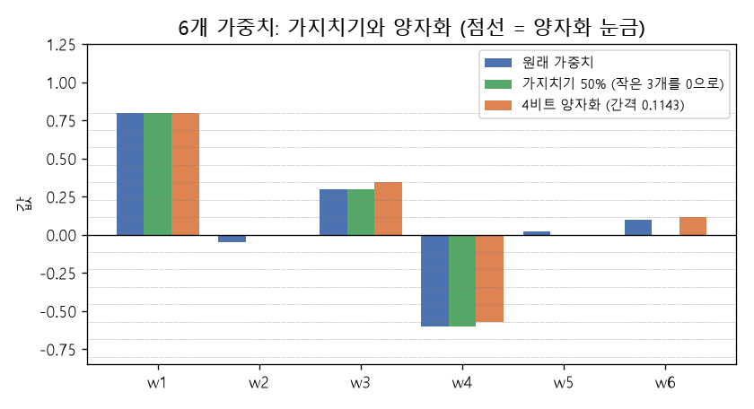

# 가지치기와 양자화 (Pruning, Quantization)

[목차로 돌아가기](../../00_MIT%EB%94%A5%EB%9F%AC%EB%8B%9D_%EB%AA%A9%EC%B0%A8.md) · 먼저 볼 것: [M05_벡터와_행렬](../../%EC%88%98%ED%95%99%EA%B0%9C%EB%85%90/03_%EC%84%A0%ED%98%95%EB%8C%80%EC%88%98/M05_%EB%B2%A1%ED%84%B0%EC%99%80_%ED%96%89%EB%A0%AC.md), [MM11_립시츠_연속과_노름](../../%EC%88%98%ED%95%99%EA%B0%9C%EB%85%90/03_%EC%84%A0%ED%98%95%EB%8C%80%EC%88%98/MM11_%EB%A6%BD%EC%8B%9C%EC%B8%A0_%EC%97%B0%EC%86%8D%EA%B3%BC_%EB%85%B8%EB%A6%84.md), [MM41_k평균과_평균](../../%EC%88%98%ED%95%99%EA%B0%9C%EB%85%90/10_%ED%91%9C%ED%98%84_%ED%95%99%EC%8A%B5/MM41_k%ED%8F%89%EA%B7%A0%EA%B3%BC_%ED%8F%89%EA%B7%A0.md) · 쓰는 곳: [Lec18 6](../../Lec18_%EC%A0%84%EC%9D%B4_%ED%95%99%EC%8A%B5_%EB%AA%A8%EB%8D%B8.md#6-%EC%95%95%EC%B6%95%EA%B3%BC-%EC%A6%9D%EB%A5%98)

📚 학습 순서 91/99 (12. 강건성과 전이): ← 이전: [MM66_그래디언트_반전과_도메인_적대_학습](../../%EC%88%98%ED%95%99%EA%B0%9C%EB%85%90/12_%EA%B0%95%EA%B1%B4%EC%84%B1%EA%B3%BC_%EC%A0%84%EC%9D%B4/MM66_%EA%B7%B8%EB%9E%98%EB%94%94%EC%96%B8%ED%8A%B8_%EB%B0%98%EC%A0%84%EA%B3%BC_%EB%8F%84%EB%A9%94%EC%9D%B8_%EC%A0%81%EB%8C%80_%ED%95%99%EC%8A%B5.md) · 다음: [MM70_MAML의_안쪽_바깥쪽_경사하강](../../%EC%88%98%ED%95%99%EA%B0%9C%EB%85%90/12_%EA%B0%95%EA%B1%B4%EC%84%B1%EA%B3%BC_%EC%A0%84%EC%9D%B4/MM70_MAML%EC%9D%98_%EC%95%88%EC%AA%BD_%EB%B0%94%EA%B9%A5%EC%AA%BD_%EA%B2%BD%EC%82%AC%ED%95%98%EA%B0%95.md) →

> [!NOTE]
> **3줄 요약**
> - **[가지치기](../../00_%EB%94%A5%EB%9F%AC%EB%8B%9D_%EC%9A%A9%EC%96%B4%EC%82%AC%EC%A0%84.md#pruning-%EA%B0%80%EC%A7%80%EC%B9%98%EA%B8%B0)**는 중요하지 않은 [가중치](../../00_%EB%94%A5%EB%9F%AC%EB%8B%9D_%EC%9A%A9%EC%96%B4%EC%82%AC%EC%A0%84.md#weight-%EA%B0%80%EC%A4%91%EC%B9%98)를 0으로 만들어 지운다. 가장 단순한 기준은 크기(절댓값)다. [가중치](../../00_%EB%94%A5%EB%9F%AC%EB%8B%9D_%EC%9A%A9%EC%96%B4%EC%82%AC%EC%A0%84.md#weight-%EA%B0%80%EC%A4%91%EC%B9%98) (0.8, -0.05, 0.3, -0.6, 0.02, 0.1)에서 50%를 지우면 (0.8, 0, 0.3, -0.6, 0, 0).
> - **[양자화](../../00_%EB%94%A5%EB%9F%AC%EB%8B%9D_%EC%9A%A9%EC%96%B4%EC%82%AC%EC%A0%84.md#quantization-%EC%96%91%EC%9E%90%ED%99%94)**는 [가중치](../../00_%EB%94%A5%EB%9F%AC%EB%8B%9D_%EC%9A%A9%EC%96%B4%EC%82%AC%EC%A0%84.md#weight-%EA%B0%80%EC%A4%91%EC%B9%98)를 적은 비트의 정수 눈금에 맞춘다. 4비트 대칭 [양자화](../../00_%EB%94%A5%EB%9F%AC%EB%8B%9D_%EC%9A%A9%EC%96%B4%EC%82%AC%EC%A0%84.md#quantization-%EC%96%91%EC%9E%90%ED%99%94)면 눈금 간격 $s = 0.8/7 = 0.1143$이고, 0.3은 눈금 3칸(0.3429)으로 바뀌어 [오차](../../00_%EB%94%A5%EB%9F%AC%EB%8B%9D_%EC%9A%A9%EC%96%B4%EC%82%AC%EC%A0%84.md#error-%EC%98%A4%EC%B0%A8) 0.0429가 생긴다.
> - 메모리는 "[파라미터](../../00_%EB%94%A5%EB%9F%AC%EB%8B%9D_%EC%9A%A9%EC%96%B4%EC%82%AC%EC%A0%84.md#parameter-%ED%8C%8C%EB%9D%BC%EB%AF%B8%ED%84%B0) 수 × 비트 수 / 8" 바이트다. 70억 [파라미터](../../00_%EB%94%A5%EB%9F%AC%EB%8B%9D_%EC%9A%A9%EC%96%B4%EC%82%AC%EC%A0%84.md#parameter-%ED%8C%8C%EB%9D%BC%EB%AF%B8%ED%84%B0)는 16비트로 14 GB, 4비트로 3.5 GB. 둘 다 다시 학습하지 않고(또는 조금만) 모델을 줄이므로, SGD로 새 모델을 학습하는 증류보다 계산이 싸다.

## 1. 개념 설명

비유: 이삿짐을 줄이는 두 방법. **[가지치기](../../00_%EB%94%A5%EB%9F%AC%EB%8B%9D_%EC%9A%A9%EC%96%B4%EC%82%AC%EC%A0%84.md#pruning-%EA%B0%80%EC%A7%80%EC%B9%98%EA%B8%B0)**는 거의 안 쓰는 물건을 버린다. **[양자화](../../00_%EB%94%A5%EB%9F%AC%EB%8B%9D_%EC%9A%A9%EC%96%B4%EC%82%AC%EC%A0%84.md#quantization-%EC%96%91%EC%9E%90%ED%99%94)**는 물건은 그대로 두되 상자 크기를 몇 가지 규격으로만 맞춘다(정확한 크기 대신 "소·중·대"). 둘 다 짐은 줄지만, 너무 많이 버리거나 규격을 너무 거칠게 하면 필요한 것이 사라진다.

- **크기 기준 [가지치기](../../00_%EB%94%A5%EB%9F%AC%EB%8B%9D_%EC%9A%A9%EC%96%B4%EC%82%AC%EC%A0%84.md#pruning-%EA%B0%80%EC%A7%80%EC%B9%98%EA%B8%B0)**(magnitude pruning): 절댓값이 작은 가중치일수록 출력에 주는 영향이 작다고 보고, 작은 순서로 정해진 비율만큼 0으로 만든다. 0이 된 [가중치](../../00_%EB%94%A5%EB%9F%AC%EB%8B%9D_%EC%9A%A9%EC%96%B4%EC%82%AC%EC%A0%84.md#weight-%EA%B0%80%EC%A4%91%EC%B9%98)는 저장하지 않거나 계산을 건너뛴다(희소 행렬).
- **대칭 균일 [양자화](../../00_%EB%94%A5%EB%9F%AC%EB%8B%9D_%EC%9A%A9%EC%96%B4%EC%82%AC%EC%A0%84.md#quantization-%EC%96%91%EC%9E%90%ED%99%94)**: 가장 큰 절댓값을 정수 눈금의 끝($2^{b-1} - 1$, 4비트면 7, 8비트면 127)에 맞추는 간격 $s$를 정한다. 각 [가중치](../../00_%EB%94%A5%EB%9F%AC%EB%8B%9D_%EC%9A%A9%EC%96%B4%EC%82%AC%EC%A0%84.md#weight-%EA%B0%80%EC%A4%91%EC%B9%98)를 $s$로 나눠 가장 가까운 정수 $q$로 반올림해 저장하고, 쓸 때는 $s \times q$로 되돌린다. [오차](../../00_%EB%94%A5%EB%9F%AC%EB%8B%9D_%EC%9A%A9%EC%96%B4%EC%82%AC%EC%A0%84.md#error-%EC%98%A4%EC%B0%A8)는 최대 $s/2$다.
- 강의의 Optimal Brain Compression처럼, 지우거나 반올림한 뒤 남은 [가중치](../../00_%EB%94%A5%EB%9F%AC%EB%8B%9D_%EC%9A%A9%EC%96%B4%EC%82%AC%EC%A0%84.md#weight-%EA%B0%80%EC%A4%91%EC%B9%98)를 조금 고쳐 [오차](../../00_%EB%94%A5%EB%9F%AC%EB%8B%9D_%EC%9A%A9%EC%96%B4%EC%82%AC%EC%A0%84.md#error-%EC%98%A4%EC%B0%A8)를 메우는 방법도 있다(이 노트는 가장 단순한 형태만 다룬다).


*▲ 직접 그린 그림: 6개 [가중치](../../00_%EB%94%A5%EB%9F%AC%EB%8B%9D_%EC%9A%A9%EC%96%B4%EC%82%AC%EC%A0%84.md#weight-%EA%B0%80%EC%A4%91%EC%B9%98). 파랑은 원래 값, 초록은 작은 3개를 지운 [가지치기](../../00_%EB%94%A5%EB%9F%AC%EB%8B%9D_%EC%9A%A9%EC%96%B4%EC%82%AC%EC%A0%84.md#pruning-%EA%B0%80%EC%A7%80%EC%B9%98%EA%B8%B0), 주황은 4비트 [양자화](../../00_%EB%94%A5%EB%9F%AC%EB%8B%9D_%EC%9A%A9%EC%96%B4%EC%82%AC%EC%A0%84.md#quantization-%EC%96%91%EC%9E%90%ED%99%94)(점선은 간격 0.1143의 눈금)*

## 2. 필요한 이유

[Lec18 6](../../Lec18_%EC%A0%84%EC%9D%B4_%ED%95%99%EC%8A%B5_%EB%AA%A8%EB%8D%B8.md#6-%EC%95%95%EC%B6%95%EA%B3%BC-%EC%A6%9D%EB%A5%98)에서 강사는 "압축([가지치기](../../00_%EB%94%A5%EB%9F%AC%EB%8B%9D_%EC%9A%A9%EC%96%B4%EC%82%AC%EC%A0%84.md#pruning-%EA%B0%80%EC%A7%80%EC%B9%98%EA%B8%B0), [양자화](../../00_%EB%94%A5%EB%9F%AC%EB%8B%9D_%EC%9A%A9%EC%96%B4%EC%82%AC%EC%A0%84.md#quantization-%EC%96%91%EC%9E%90%ED%99%94))과 증류는 둘 다 큰 모델과 비슷한 [정확도](../../00_%EB%94%A5%EB%9F%AC%EB%8B%9D_%EC%9A%A9%EC%96%B4%EC%82%AC%EC%A0%84.md#accuracy-%EC%A0%95%ED%99%95%EB%8F%84)의 작은 모델을 준다. 증류는 SGD로 작은 모델을 새로 학습하고, 압축은 큰 모델의 계산 비용을 직접 줄인다"고 비교한다. 휴대폰에 모델을 넣으려면 모델이 작아야 하고, 기기 위에서 바로 압축하려면 압축 자체도 싸야 한다는 점을 숫자로 본다.

## 3. 숫자로 보기

[가중치](../../00_%EB%94%A5%EB%9F%AC%EB%8B%9D_%EC%9A%A9%EC%96%B4%EC%82%AC%EC%A0%84.md#weight-%EA%B0%80%EC%A4%91%EC%B9%98) $w = (0.8, -0.05, 0.3, -0.6, 0.02, 0.1)$

**[가지치기](../../00_%EB%94%A5%EB%9F%AC%EB%8B%9D_%EC%9A%A9%EC%96%B4%EC%82%AC%EC%A0%84.md#pruning-%EA%B0%80%EC%A7%80%EC%B9%98%EA%B8%B0) 50%** (6개 중 3개 지우기)
- 절댓값을 작은 순으로 늘어놓는다: 0.02, 0.05, 0.1, 0.3, 0.6, 0.8
- 세 번째로 작은 값이 문턱 $\tau = 0.1$
- $|w| > 0.1$인 것만 남긴다: (0.8, 0, 0.3, -0.6, 0, 0)

**4비트 [양자화](../../00_%EB%94%A5%EB%9F%AC%EB%8B%9D_%EC%9A%A9%EC%96%B4%EC%82%AC%EC%A0%84.md#quantization-%EC%96%91%EC%9E%90%ED%99%94)** (정수 눈금 -7 ~ 7)

| | $w_1$ | $w_2$ | $w_3$ | $w_4$ | $w_5$ | $w_6$ |
|---|---|---|---|---|---|---|
| 원래 값 | 0.8 | -0.05 | 0.3 | -0.6 | 0.02 | 0.1 |
| $w / s$ ($s = 0.1143$) | 7 | -0.4375 | 2.625 | -5.25 | 0.175 | 0.875 |
| 정수 $q$ | 7 | 0 | 3 | -5 | 0 | 1 |
| 되돌린 값 $sq$ | 0.8 | 0 | 0.3429 | -0.5714 | 0 | 0.1143 |
| [오차](../../00_%EB%94%A5%EB%9F%AC%EB%8B%9D_%EC%9A%A9%EC%96%B4%EC%82%AC%EC%A0%84.md#error-%EC%98%A4%EC%B0%A8) | 0 | -0.05 | -0.0429 | -0.0286 | 0.02 | -0.0143 |

- 가장 큰 [오차](../../00_%EB%94%A5%EB%9F%AC%EB%8B%9D_%EC%9A%A9%EC%96%B4%EC%82%AC%EC%A0%84.md#error-%EC%98%A4%EC%B0%A8)는 0.05로, 간격의 절반 $0.1143 / 2 = 0.0571$을 넘지 않는다.
- 작은 [가중치](../../00_%EB%94%A5%EB%9F%AC%EB%8B%9D_%EC%9A%A9%EC%96%B4%EC%82%AC%EC%A0%84.md#weight-%EA%B0%80%EC%A4%91%EC%B9%98) $w_2$, $w_5$는 양자화만으로도 0이 된다. [양자화](../../00_%EB%94%A5%EB%9F%AC%EB%8B%9D_%EC%9A%A9%EC%96%B4%EC%82%AC%EC%A0%84.md#quantization-%EC%96%91%EC%9E%90%ED%99%94)가 [가지치기](../../00_%EB%94%A5%EB%9F%AC%EB%8B%9D_%EC%9A%A9%EC%96%B4%EC%82%AC%EC%A0%84.md#pruning-%EA%B0%80%EC%A7%80%EC%B9%98%EA%B8%B0) 효과를 조금 낸다.

**메모리** (70억 [파라미터](../../00_%EB%94%A5%EB%9F%AC%EB%8B%9D_%EC%9A%A9%EC%96%B4%EC%82%AC%EC%A0%84.md#parameter-%ED%8C%8C%EB%9D%BC%EB%AF%B8%ED%84%B0))
- 16비트: $7 \times 10^9 \times 16 / 8 = 14 \times 10^9$ 바이트 = 14 GB
- 8비트: 7 GB, 4비트: 3.5 GB

크기 기준 [가지치기](../../00_%EB%94%A5%EB%9F%AC%EB%8B%9D_%EC%9A%A9%EC%96%B4%EC%82%AC%EC%A0%84.md#pruning-%EA%B0%80%EC%A7%80%EC%B9%98%EA%B8%B0)는 다음과 같다.

$$
\tilde w_i = \begin{cases} w_i & |w_i| > \tau \\ 0 & |w_i| \le \tau \end{cases}, \qquad \tau = \text{절댓값을 작은 순으로 놓았을 때 } k\text{번째 값}
$$

<details><summary>기호 풀이</summary>

| 기호 | 읽는 법 | 뜻 | 예제 값 |
| --- | --- | --- | --- |
| $w_i$ | 더블유 아이 | $i$번 [가중치](../../00_%EB%94%A5%EB%9F%AC%EB%8B%9D_%EC%9A%A9%EC%96%B4%EC%82%AC%EC%A0%84.md#weight-%EA%B0%80%EC%A4%91%EC%B9%98) | 0.8, -0.05, ... |
| $\lvert w_i \rvert$ | 절댓값 | 부호를 뗀 크기 | 0.8, 0.05, ... |
| $k$ | 케이 | 지울 개수 (비율 × 전체) | 3 |
| $\tau$ | 타우 | 문턱. 이 값 이하는 지운다 | 0.1 |
| $\tilde w_i$ | 더블유 틸드 | [가지치기](../../00_%EB%94%A5%EB%9F%AC%EB%8B%9D_%EC%9A%A9%EC%96%B4%EC%82%AC%EC%A0%84.md#pruning-%EA%B0%80%EC%A7%80%EC%B9%98%EA%B8%B0) 뒤의 [가중치](../../00_%EB%94%A5%EB%9F%AC%EB%8B%9D_%EC%9A%A9%EC%96%B4%EC%82%AC%EC%A0%84.md#weight-%EA%B0%80%EC%A4%91%EC%B9%98) | (0.8, 0, 0.3, -0.6, 0, 0) |

</details>

<details><summary>예제와 풀이</summary>

**문제**: [가중치](../../00_%EB%94%A5%EB%9F%AC%EB%8B%9D_%EC%9A%A9%EC%96%B4%EC%82%AC%EC%A0%84.md#weight-%EA%B0%80%EC%A4%91%EC%B9%98) 4개 (0.5, -0.2, 0.05, -0.7)의 절반을 크기 기준으로 지우면?

**주어진 값**
- $w = (0.5, -0.2, 0.05, -0.7)$ ([가중치](../../00_%EB%94%A5%EB%9F%AC%EB%8B%9D_%EC%9A%A9%EC%96%B4%EC%82%AC%EC%A0%84.md#weight-%EA%B0%80%EC%A4%91%EC%B9%98))
- $k = 2$ (지울 개수, 4개의 50%)

**풀이**
1. 식을 그대로 쓴다: $\tilde w_i = w_i$ ($|w_i| > \tau$일 때), $0$ ($|w_i| \le \tau$일 때)
2. 값을 대입할 준비로 절댓값을 구한다: $|0.5| = 0.5$, $|-0.2| = 0.2$, $|0.05| = 0.05$, $|-0.7| = 0.7$
3. 작은 순으로 늘어놓는다: 0.05, 0.2, 0.5, 0.7
4. $k = 2$번째 값을 문턱으로 정한다: $\tau = 0.2$
5. 값을 대입한다: $\tilde w = \big(0.5\ (0.5 > 0.2),\ 0\ (0.2 \le 0.2),\ 0\ (0.05 \le 0.2),\ -0.7\ (0.7 > 0.2)\big)$

**답**: $\tilde w = $ **(0.5, 0, 0, -0.7)**. 크기가 큰 두 [가중치](../../00_%EB%94%A5%EB%9F%AC%EB%8B%9D_%EC%9A%A9%EC%96%B4%EC%82%AC%EC%A0%84.md#weight-%EA%B0%80%EC%A4%91%EC%B9%98)만 남는다.

</details>

<details><summary>내 이해</summary>


</details>

대칭 균일 [양자화](../../00_%EB%94%A5%EB%9F%AC%EB%8B%9D_%EC%9A%A9%EC%96%B4%EC%82%AC%EC%A0%84.md#quantization-%EC%96%91%EC%9E%90%ED%99%94)는 다음과 같다.

$$
s = \frac{\max_i |w_i|}{2^{b-1} - 1}, \qquad q_i = \operatorname{round}\!\left(\frac{w_i}{s}\right), \qquad \hat w_i = s\, q_i
$$

<details><summary>기호 풀이</summary>

| 기호 | 읽는 법 | 뜻 | 예제 값 |
| --- | --- | --- | --- |
| $b$ | 비 | 비트 수 | 4 |
| $2^{b-1} - 1$ | | 양수 쪽 정수 눈금의 끝 (4비트면 7) | 7 |
| $\max_i \lvert w_i \rvert$ | 맥스 | 가장 큰 절댓값 | 0.8 |
| $s$ | 에스 | 눈금 간격 (스케일) | 0.1143 |
| $\operatorname{round}$ | 라운드 | 가장 가까운 정수로 반올림 | 2.625 → 3 |
| $q_i$ | 큐 아이 | 저장하는 정수 | 3 |
| $\hat w_i$ | 더블유 햇 | 되돌린 [가중치](../../00_%EB%94%A5%EB%9F%AC%EB%8B%9D_%EC%9A%A9%EC%96%B4%EC%82%AC%EC%A0%84.md#weight-%EA%B0%80%EC%A4%91%EC%B9%98) | 0.3429 |

</details>

<details><summary>예제와 풀이</summary>

**문제**: 가장 큰 절댓값이 0.8인 [가중치](../../00_%EB%94%A5%EB%9F%AC%EB%8B%9D_%EC%9A%A9%EC%96%B4%EC%82%AC%EC%A0%84.md#weight-%EA%B0%80%EC%A4%91%EC%B9%98)들을 4비트로 양자화한다. 그중 0.3은 어떤 값으로 바뀌고 [오차](../../00_%EB%94%A5%EB%9F%AC%EB%8B%9D_%EC%9A%A9%EC%96%B4%EC%82%AC%EC%A0%84.md#error-%EC%98%A4%EC%B0%A8)는 얼마인가?

**주어진 값**
- $\max_i |w_i| = 0.8$ (가장 큰 절댓값)
- $b = 4$ (비트 수)
- $w_i = 0.3$ (바꿀 [가중치](../../00_%EB%94%A5%EB%9F%AC%EB%8B%9D_%EC%9A%A9%EC%96%B4%EC%82%AC%EC%A0%84.md#weight-%EA%B0%80%EC%A4%91%EC%B9%98))

**풀이**
1. 식을 그대로 쓴다: $s = \dfrac{\max_i |w_i|}{2^{b-1} - 1}$, $q_i = \operatorname{round}(w_i / s)$, $\hat w_i = s\, q_i$
2. 값을 대입한다: $s = \dfrac{0.8}{2^{4-1} - 1}$, $q_i = \operatorname{round}(0.3 / s)$, $\hat w_i = s\, q_i$
3. [지수](../../00_%EB%94%A5%EB%9F%AC%EB%8B%9D_%EC%9A%A9%EC%96%B4%EC%82%AC%EC%A0%84.md#e-exponent-e%EC%99%80-%EC%A7%80%EC%88%98)를 계산한다: $4 - 1 = 3$, $2^3 = 8$ 이므로 $s = \dfrac{0.8}{8 - 1}$
4. 뺀다: $8 - 1 = 7$ 이므로 $s = 0.8 / 7$
5. 나눈다: $0.8 / 7 = 0.1143$
6. [가중치](../../00_%EB%94%A5%EB%9F%AC%EB%8B%9D_%EC%9A%A9%EC%96%B4%EC%82%AC%EC%A0%84.md#weight-%EA%B0%80%EC%A4%91%EC%B9%98)를 간격으로 나눈다: $0.3 / 0.1143 = 2.625$
7. 반올림한다: $\operatorname{round}(2.625) = 3$ 이므로 $q_i = 3$
8. 되돌린다: $\hat w_i = 0.1143 \times 3 = 0.3429$
9. [오차](../../00_%EB%94%A5%EB%9F%AC%EB%8B%9D_%EC%9A%A9%EC%96%B4%EC%82%AC%EC%A0%84.md#error-%EC%98%A4%EC%B0%A8)를 뺀다: $0.3 - 0.3429 = -0.0429$

**답**: 0.3은 정수 **3**으로 저장되고 **0.3429**로 되돌아온다. [오차](../../00_%EB%94%A5%EB%9F%AC%EB%8B%9D_%EC%9A%A9%EC%96%B4%EC%82%AC%EC%A0%84.md#error-%EC%98%A4%EC%B0%A8)는 **-0.0429**.

</details>

<details><summary>내 이해</summary>


</details>

메모리는 [파라미터](../../00_%EB%94%A5%EB%9F%AC%EB%8B%9D_%EC%9A%A9%EC%96%B4%EC%82%AC%EC%A0%84.md#parameter-%ED%8C%8C%EB%9D%BC%EB%AF%B8%ED%84%B0) 수와 비트 수로 정해진다.

$$
\text{메모리(바이트)} = N \times \frac{b}{8}
$$

<details><summary>기호 풀이</summary>

| 기호 | 읽는 법 | 뜻 | 예제 값 |
| --- | --- | --- | --- |
| $N$ | 엔 | [파라미터](../../00_%EB%94%A5%EB%9F%AC%EB%8B%9D_%EC%9A%A9%EC%96%B4%EC%82%AC%EC%A0%84.md#parameter-%ED%8C%8C%EB%9D%BC%EB%AF%B8%ED%84%B0) 수 | $7 \times 10^9$ |
| $b$ | 비 | [파라미터](../../00_%EB%94%A5%EB%9F%AC%EB%8B%9D_%EC%9A%A9%EC%96%B4%EC%82%AC%EC%A0%84.md#parameter-%ED%8C%8C%EB%9D%BC%EB%AF%B8%ED%84%B0) 하나의 비트 수 | 16, 4 |
| $8$ | | 1바이트 = 8비트 | |

</details>

<details><summary>예제와 풀이</summary>

**문제**: [파라미터](../../00_%EB%94%A5%EB%9F%AC%EB%8B%9D_%EC%9A%A9%EC%96%B4%EC%82%AC%EC%A0%84.md#parameter-%ED%8C%8C%EB%9D%BC%EB%AF%B8%ED%84%B0) 70억 개짜리 모델을 16비트로 저장할 때와 4비트로 저장할 때 메모리는?

**주어진 값**
- $N = 7 \times 10^9$ ([파라미터](../../00_%EB%94%A5%EB%9F%AC%EB%8B%9D_%EC%9A%A9%EC%96%B4%EC%82%AC%EC%A0%84.md#parameter-%ED%8C%8C%EB%9D%BC%EB%AF%B8%ED%84%B0) 수)
- $b = 16$ 또는 $4$ (비트 수)

**풀이**
1. 식을 그대로 쓴다: $\text{메모리} = N \times \dfrac{b}{8}$
2. 값을 대입한다 (16비트): $\text{메모리} = 7 \times 10^9 \times \dfrac{16}{8}$
3. 나눈다: $16 / 8 = 2$ 이므로 $\text{메모리} = 7 \times 10^9 \times 2$
4. 곱한다: $14 \times 10^9$ 바이트 $= 14$ GB ($10^9$ 바이트 = 1 GB)
5. 값을 대입한다 (4비트): $\text{메모리} = 7 \times 10^9 \times \dfrac{4}{8}$
6. 나눈다: $4 / 8 = 0.5$ 이므로 $\text{메모리} = 7 \times 10^9 \times 0.5$
7. 곱한다: $3.5 \times 10^9$ 바이트 $= 3.5$ GB

**답**: 16비트 **14 GB**, 4비트 **3.5 GB**. 4비트면 휴대폰 메모리에도 들어갈 만해진다.

</details>

<details><summary>내 이해</summary>


</details>

## 4. 코드로 확인

```python
# [변수] w: 3절의 가중치 6개
w = np.array([0.8, -0.05, 0.3, -0.6, 0.02, 0.1])
# [함수] np.sort(np.abs(w))[2]: 절댓값을 작은 순으로 놓고 3번째(인덱스 2) 값
# [변수] tau = 0.1: 50% 가지치기의 문턱
tau = np.sort(np.abs(w))[2]
# [함수] np.where(조건, a, b): 조건이 참이면 a, 거짓이면 b
# [연결] 3절 가지치기: [0.8 0. 0.3 -0.6 0. 0.]
print(tau, np.where(np.abs(w) > tau, w, 0.0))
# [변수] s: 4비트 눈금 간격 0.8 / 7
s = np.abs(w).max() / (2 ** 3 - 1)
# [함수] np.round: 가장 가까운 정수로 반올림. + 0.0은 -0.을 0.으로 바꾸려고 더한다
# [변수] q: 저장할 정수
q = np.round(w / s) + 0.0
# [연결] 3절 표: 간격, 정수, 되돌린 값, 오차
print(round(s, 4), q, (s * q).round(4), (w - s * q).round(4))
# [연결] 3절: 가장 큰 오차 0.05, 간격의 절반 0.0571
print(round(np.abs(w - s * q).max(), 4), round(s / 2, 4))
# [연결] 3절 메모리: 7e9 파라미터의 16·8·4비트 GB
print([7e9 * b / 8 / 1e9 for b in (16, 8, 4)])
```

**실행 결과**:

```text
0.1 [ 0.8  0.   0.3 -0.6  0.   0. ]
0.1143 [ 7.  0.  3. -5.  0.  1.] [ 0.8     0.      0.3429 -0.5714  0.      0.1143] [ 0.     -0.05   -0.0429 -0.0286  0.02   -0.0143]
0.05 0.0571
[14.0, 7.0, 3.5]
```

> [!WARNING]
> **⚠ 주의**
> - [가중치](../../00_%EB%94%A5%EB%9F%AC%EB%8B%9D_%EC%9A%A9%EC%96%B4%EC%82%AC%EC%A0%84.md#weight-%EA%B0%80%EC%A4%91%EC%B9%98) 하나가 유난히 크면(이상값) 간격 $s$가 커져 나머지 [가중치](../../00_%EB%94%A5%EB%9F%AC%EB%8B%9D_%EC%9A%A9%EC%96%B4%EC%82%AC%EC%A0%84.md#weight-%EA%B0%80%EC%A4%91%EC%B9%98)가 모두 거칠게 양자화된다. 그래서 실제로는 층별, 채널별, 작은 묶음별로 따로 $s$를 정한다.
> - 크기가 작다고 늘 덜 중요한 것은 아니다. 입력이 큰 자리의 작은 [가중치](../../00_%EB%94%A5%EB%9F%AC%EB%8B%9D_%EC%9A%A9%EC%96%B4%EC%82%AC%EC%A0%84.md#weight-%EA%B0%80%EC%A4%91%EC%B9%98)는 출력에 큰 영향을 줄 수 있다. Optimal Brain Compression 같은 방법은 2차 정보([헤세 행렬](../../00_%EB%94%A5%EB%9F%AC%EB%8B%9D_%EC%9A%A9%EC%96%B4%EC%82%AC%EC%A0%84.md#hessian-%ED%97%A4%EC%84%B8-%ED%96%89%EB%A0%AC))로 "지웠을 때 [손실](../../00_%EB%94%A5%EB%9F%AC%EB%8B%9D_%EC%9A%A9%EC%96%B4%EC%82%AC%EC%A0%84.md#loss-function-%EC%86%90%EC%8B%A4-%ED%95%A8%EC%88%98)이 얼마나 느는가"를 본다.
> - 가지치기한 0들은 하드웨어가 희소 계산을 지원해야 실제로 빨라진다. 그렇지 않으면 메모리만 줄고 속도는 그대로일 수 있다.

## 5. 개념 재확인

<details><summary>1. 가중치 (1.4, -0.66, 0.25)를 4비트로 양자화하면 되돌린 값과 오차는?</summary>

| 단계 | 하는 일 | 계산 | 결과 |
|---|---|---|---|
| 1 | 간격 | $1.4 / 7$ | 0.2 |
| 2 | 간격으로 나누기 | $(1.4, -0.66, 0.25) / 0.2$ | (7, -3.3, 1.25) |
| 3 | 반올림 | | (7, -3, 1) |
| 4 | 되돌리기 | $0.2 \times (7, -3, 1)$ | (1.4, -0.6, 0.2) |
| 5 | [오차](../../00_%EB%94%A5%EB%9F%AC%EB%8B%9D_%EC%9A%A9%EC%96%B4%EC%82%AC%EC%A0%84.md#error-%EC%98%A4%EC%B0%A8) | 원래 - 되돌린 값 | (0, -0.06, 0.05) |

**① 쓰는 식**
$$s = \frac{\max_i |w_i|}{2^{b-1} - 1}, \qquad \hat w_i = s \cdot \operatorname{round}(w_i / s)$$
- 위 식 ← ② (간격), ③ (나누고 반올림), ④ (되돌리기), ⑤ ([오차](../../00_%EB%94%A5%EB%9F%AC%EB%8B%9D_%EC%9A%A9%EC%96%B4%EC%82%AC%EC%A0%84.md#error-%EC%98%A4%EC%B0%A8))에서 쓴다.
```python
# [변수] w: 가중치 3개
w = np.array([1.4, -0.66, 0.25])                          # ①
# [변수] s = 0.2: 1.4 / 7
s = np.abs(w).max() / 7                                   # ②
# [변수] q = [7. -3. 1.]
q = np.round(w / s)                                       # ③
# [연결] [1.4 -0.6 0.2] [0. -0.06 0.05]
print((s * q).round(4), (w - s * q).round(4))             # ④⑤
```

**주어진 값**
- $w = (1.4, -0.66, 0.25)$ ([가중치](../../00_%EB%94%A5%EB%9F%AC%EB%8B%9D_%EC%9A%A9%EC%96%B4%EC%82%AC%EC%A0%84.md#weight-%EA%B0%80%EC%A4%91%EC%B9%98))
- $b = 4$ (비트 수), 그래서 $2^{b-1} - 1 = 7$

**풀이**
1. 식을 그대로 쓴다: $s = \dfrac{\max_i |w_i|}{2^{b-1} - 1}$, $\hat w_i = s \cdot \operatorname{round}(w_i / s)$
2. 값을 대입한다: $s = \dfrac{\max(1.4, 0.66, 0.25)}{7}$
3. (②) 가장 큰 절댓값을 고른다: $1.4$ 이므로 $s = 1.4 / 7 = 0.2$
4. (③) 간격으로 나눈다: $1.4 / 0.2 = 7$, $-0.66 / 0.2 = -3.3$, $0.25 / 0.2 = 1.25$
5. (③) 반올림한다: $7 \to 7$, $-3.3 \to -3$, $1.25 \to 1$
6. (④) 간격을 곱한다: $0.2 \times 7 = 1.4$, $0.2 \times (-3) = -0.6$, $0.2 \times 1 = 0.2$
7. (⑤) [오차](../../00_%EB%94%A5%EB%9F%AC%EB%8B%9D_%EC%9A%A9%EC%96%B4%EC%82%AC%EC%A0%84.md#error-%EC%98%A4%EC%B0%A8)를 뺀다: $1.4 - 1.4 = 0$, $-0.66 - (-0.6) = -0.06$, $0.25 - 0.2 = 0.05$

**답**: 되돌린 값 **(1.4, -0.6, 0.2)**, [오차](../../00_%EB%94%A5%EB%9F%AC%EB%8B%9D_%EC%9A%A9%EC%96%B4%EC%82%AC%EC%A0%84.md#error-%EC%98%A4%EC%B0%A8) **(0, -0.06, 0.05)**. 모두 간격의 절반 0.1 이하다.

</details>

<details><summary>2. 가중치 8개 (0.4, -0.9, 0.05, 0.6, -0.1, 0.02, 0.7, -0.3)의 50%를 크기 기준으로 지우면?</summary>

| 단계 | 하는 일 | 계산 | 결과 |
|---|---|---|---|
| 1 | 절댓값 정렬 | | 0.02, 0.05, 0.1, 0.3, 0.4, 0.6, 0.7, 0.9 |
| 2 | 4번째 값 = 문턱 | | 0.3 |
| 3 | 문턱보다 큰 것만 남김 | | (0.4, -0.9, 0, 0.6, 0, 0, 0.7, 0) |

**① 쓰는 식**
$$\tilde w_i = w_i \ \text{if}\ |w_i| > \tau \ \text{else}\ 0$$
- 위 식 ← ② (정렬과 문턱), ③ (남기기)에서 쓴다.
```python
# [변수] w: 가중치 8개
w = np.array([0.4, -0.9, 0.05, 0.6, -0.1, 0.02, 0.7, -0.3])   # ①
# [변수] tau = 0.3: 절댓값 4번째로 작은 값
tau = np.sort(np.abs(w))[3]                                   # ②
# [연결] 0.3 [ 0.4 -0.9  0.   0.6  0.   0.   0.7  0. ]
print(tau, np.where(np.abs(w) > tau, w, 0.0))                 # ③
```

**주어진 값**
- $w = (0.4, -0.9, 0.05, 0.6, -0.1, 0.02, 0.7, -0.3)$ ([가중치](../../00_%EB%94%A5%EB%9F%AC%EB%8B%9D_%EC%9A%A9%EC%96%B4%EC%82%AC%EC%A0%84.md#weight-%EA%B0%80%EC%A4%91%EC%B9%98) 8개)
- $k = 4$ (지울 개수, 8개의 50%)

**풀이**
1. 식을 그대로 쓴다: $\tilde w_i = w_i$ ($|w_i| > \tau$), $0$ ($|w_i| \le \tau$)
2. 값을 대입할 준비로 절댓값을 구한다: 0.4, 0.9, 0.05, 0.6, 0.1, 0.02, 0.7, 0.3
3. (②) 작은 순으로 늘어놓는다: 0.02, 0.05, 0.1, 0.3, 0.4, 0.6, 0.7, 0.9
4. (②) 4번째 값을 문턱으로 정한다: $\tau = 0.3$
5. (③) 하나씩 비교한다: $0.4 > 0.3$ 남김, $0.9 > 0.3$ 남김, $0.05 \le 0.3$ 지움, $0.6 > 0.3$ 남김, $0.1 \le 0.3$ 지움, $0.02 \le 0.3$ 지움, $0.7 > 0.3$ 남김, $0.3 \le 0.3$ 지움

**답**: **(0.4, -0.9, 0, 0.6, 0, 0, 0.7, 0)**. 남은 4개는 모두 절댓값 0.4 이상이다.

</details>

## 예제 풀기

[예제 10문제 풀기](../../%EC%98%88%EC%A0%9C/12_%EA%B0%95%EA%B1%B4%EC%84%B1%EA%B3%BC_%EC%A0%84%EC%9D%B4/%EC%98%88%EC%A0%9C_MM68_%EA%B0%80%EC%A7%80%EC%B9%98%EA%B8%B0%EC%99%80_%EC%96%91%EC%9E%90%ED%99%94.md)

<details><summary>내 이해</summary>


</details>
