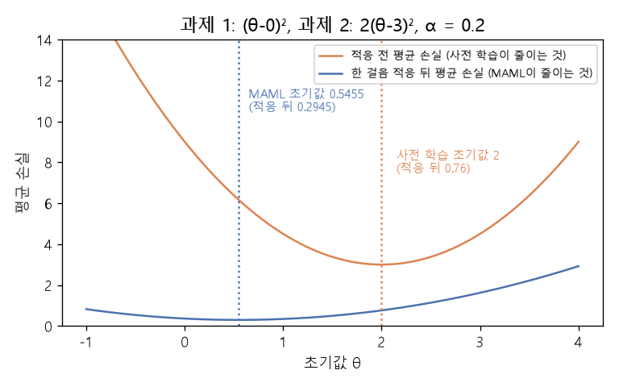

# MAML의 안쪽·바깥쪽 경사하강 (MAML inner and outer loop)

[목차로 돌아가기](../../00_MIT%EB%94%A5%EB%9F%AC%EB%8B%9D_%EB%AA%A9%EC%B0%A8.md) · 먼저 볼 것: [MM08_SGD와_모멘텀](../../%EC%88%98%ED%95%99%EA%B0%9C%EB%85%90/05_%EC%8B%A0%EA%B2%BD%EB%A7%9D%EC%9D%98_%EA%B3%84%EC%82%B0/MM08_SGD%EC%99%80_%EB%AA%A8%EB%A9%98%ED%85%80.md), [MM09_야코비안과_연쇄법칙](../../%EC%88%98%ED%95%99%EA%B0%9C%EB%85%90/05_%EC%8B%A0%EA%B2%BD%EB%A7%9D%EC%9D%98_%EA%B3%84%EC%82%B0/MM09_%EC%95%BC%EC%BD%94%EB%B9%84%EC%95%88%EA%B3%BC_%EC%97%B0%EC%87%84%EB%B2%95%EC%B9%99.md), [MM26_테일러_전개와_뉴턴_방법](../../%EC%88%98%ED%95%99%EA%B0%9C%EB%85%90/09_%EC%B5%9C%EC%A0%81%ED%99%94%EC%9D%98_%EA%B8%B0%ED%95%98/MM26_%ED%85%8C%EC%9D%BC%EB%9F%AC_%EC%A0%84%EA%B0%9C%EC%99%80_%EB%89%B4%ED%84%B4_%EB%B0%A9%EB%B2%95.md) · 쓰는 곳: [Lec19 9.1](../../Lec19_%EC%A0%84%EC%9D%B4_%ED%95%99%EC%8A%B5_%EB%8D%B0%EC%9D%B4%ED%84%B0.md#91-maml-%EC%9E%98-%EC%A0%81%EC%9D%91%ED%95%98%EB%8A%94-%EC%B4%88%EA%B8%B0%EA%B0%92-%EB%B0%B0%EC%9A%B0%EA%B8%B0)

📚 학습 순서 92/99 (12. 강건성과 전이): ← 이전: [MM68_가지치기와_양자화](../../%EC%88%98%ED%95%99%EA%B0%9C%EB%85%90/12_%EA%B0%95%EA%B1%B4%EC%84%B1%EA%B3%BC_%EC%A0%84%EC%9D%B4/MM68_%EA%B0%80%EC%A7%80%EC%B9%98%EA%B8%B0%EC%99%80_%EC%96%91%EC%9E%90%ED%99%94.md) · 다음: [MM71_반복_적합과_모델_붕괴](../../%EC%88%98%ED%95%99%EA%B0%9C%EB%85%90/12_%EA%B0%95%EA%B1%B4%EC%84%B1%EA%B3%BC_%EC%A0%84%EC%9D%B4/MM71_%EB%B0%98%EB%B3%B5_%EC%A0%81%ED%95%A9%EA%B3%BC_%EB%AA%A8%EB%8D%B8_%EB%B6%95%EA%B4%B4.md) →

> [!NOTE]
> **3줄 요약**
> - **[MAML](../../00_%EB%94%A5%EB%9F%AC%EB%8B%9D_%EC%9A%A9%EC%96%B4%EC%82%AC%EC%A0%84.md#maml-model-agnostic-meta-learning-%EB%AA%A8%EB%8D%B8-%EB%AC%B4%EA%B4%80-%EB%A9%94%ED%83%80-%ED%95%99%EC%8A%B5)**은 "몇 걸음만 [미세 조정](../../00_%EB%94%A5%EB%9F%AC%EB%8B%9D_%EC%9A%A9%EC%96%B4%EC%82%AC%EC%A0%84.md#fine-tuning-%EB%AF%B8%EC%84%B8-%EC%A1%B0%EC%A0%95)하면 어느 과제에서든 잘하는" 초기값 $\theta$를 배운다. 안쪽 고리에서 과제마다 $\theta'_i = \theta - \alpha \nabla \mathcal{L}_i(\theta)$로 한 걸음 적응하고, 바깥쪽 고리에서 **적응한 뒤의** [손실](../../00_%EB%94%A5%EB%9F%AC%EB%8B%9D_%EC%9A%A9%EC%96%B4%EC%82%AC%EC%A0%84.md#loss-function-%EC%86%90%EC%8B%A4-%ED%95%A8%EC%88%98) $\sum_i \mathcal{L}_i(\theta'_i)$을 줄이도록 $\theta$를 고친다.
> - 바깥쪽 [기울기](../../00_%EB%94%A5%EB%9F%AC%EB%8B%9D_%EC%9A%A9%EC%96%B4%EC%82%AC%EC%A0%84.md#gradient-%EA%B8%B0%EC%9A%B8%EA%B8%B0)에는 [연쇄법칙](../../00_%EB%94%A5%EB%9F%AC%EB%8B%9D_%EC%9A%A9%EC%96%B4%EC%82%AC%EC%A0%84.md#chain-rule-%EC%97%B0%EC%87%84%EB%B2%95%EC%B9%99)으로 $\frac{d\theta'}{d\theta} = 1 - \alpha \mathcal{L}''(\theta)$가 곱해진다. 2차 [미분](../../00_%EB%94%A5%EB%9F%AC%EB%8B%9D_%EC%9A%A9%EC%96%B4%EC%82%AC%EC%A0%84.md#derivative-%EB%AF%B8%EB%B6%84)([헤세 행렬](../../00_%EB%94%A5%EB%9F%AC%EB%8B%9D_%EC%9A%A9%EC%96%B4%EC%82%AC%EC%A0%84.md#hessian-%ED%97%A4%EC%84%B8-%ED%96%89%EB%A0%AC))이 들어가므로 "[역전파](../../00_%EB%94%A5%EB%9F%AC%EB%8B%9D_%EC%9A%A9%EC%96%B4%EC%82%AC%EC%A0%84.md#backpropagation-%EC%97%AD%EC%A0%84%ED%8C%8C)를 통과하는 [역전파](../../00_%EB%94%A5%EB%9F%AC%EB%8B%9D_%EC%9A%A9%EC%96%B4%EC%82%AC%EC%A0%84.md#backpropagation-%EC%97%AD%EC%A0%84%ED%8C%8C)"가 필요하고 비싸다. 예: $\mathcal{L} = (\theta - c)^2$, $\alpha = 0.25$면 이 값은 0.5.
> - 곡률이 다른 두 과제 $(\theta - 0)^2$, $2(\theta - 3)^2$에서 그냥 평균 [손실](../../00_%EB%94%A5%EB%9F%AC%EB%8B%9D_%EC%9A%A9%EC%96%B4%EC%82%AC%EC%A0%84.md#loss-function-%EC%86%90%EC%8B%A4-%ED%95%A8%EC%88%98)을 줄이는 [사전 학습](../../00_%EB%94%A5%EB%9F%AC%EB%8B%9D_%EC%9A%A9%EC%96%B4%EC%82%AC%EC%A0%84.md#pre-training-%EC%82%AC%EC%A0%84-%ED%95%99%EC%8A%B5) 초기값은 2, [MAML](../../00_%EB%94%A5%EB%9F%AC%EB%8B%9D_%EC%9A%A9%EC%96%B4%EC%82%AC%EC%A0%84.md#maml-model-agnostic-meta-learning-%EB%AA%A8%EB%8D%B8-%EB%AC%B4%EA%B4%80-%EB%A9%94%ED%83%80-%ED%95%99%EC%8A%B5) 초기값은 0.5455다. 한 걸음 적응한 뒤의 평균 [손실](../../00_%EB%94%A5%EB%9F%AC%EB%8B%9D_%EC%9A%A9%EC%96%B4%EC%82%AC%EC%A0%84.md#loss-function-%EC%86%90%EC%8B%A4-%ED%95%A8%EC%88%98)은 각각 0.76과 0.2945로 [MAML](../../00_%EB%94%A5%EB%9F%AC%EB%8B%9D_%EC%9A%A9%EC%96%B4%EC%82%AC%EC%A0%84.md#maml-model-agnostic-meta-learning-%EB%AA%A8%EB%8D%B8-%EB%AC%B4%EA%B4%80-%EB%A9%94%ED%83%80-%ED%95%99%EC%8A%B5)이 낫다.

## 1. 개념 설명

비유: 여러 도시로 출장을 다니는 사람이 짐을 쌀 숙소를 고른다. "모든 도시까지의 평균 거리가 가장 짧은 곳"([사전 학습](../../00_%EB%94%A5%EB%9F%AC%EB%8B%9D_%EC%9A%A9%EC%96%B4%EC%82%AC%EC%A0%84.md#pre-training-%EC%82%AC%EC%A0%84-%ED%95%99%EC%8A%B5))이 아니라 "어느 도시든 KTX 한 번이면 닿는 곳"([MAML](../../00_%EB%94%A5%EB%9F%AC%EB%8B%9D_%EC%9A%A9%EC%96%B4%EC%82%AC%EC%A0%84.md#maml-model-agnostic-meta-learning-%EB%AA%A8%EB%8D%B8-%EB%AC%B4%EA%B4%80-%EB%A9%94%ED%83%80-%ED%95%99%EC%8A%B5))을 고른다. 빠른 교통편(가파른 [손실](../../00_%EB%94%A5%EB%9F%AC%EB%8B%9D_%EC%9A%A9%EC%96%B4%EC%82%AC%EC%A0%84.md#loss-function-%EC%86%90%EC%8B%A4-%ED%95%A8%EC%88%98))이 있는 도시에서는 멀리 있어도 금방 닿으므로, 교통편이 느린 도시 가까이에 숙소를 잡는 게 낫다.

- **안쪽 고리(적응)**: 과제 $i$의 데이터 몇 개로 [경사하강법](../../00_%EB%94%A5%EB%9F%AC%EB%8B%9D_%EC%9A%A9%EC%96%B4%EC%82%AC%EC%A0%84.md#gradient-descent-%EA%B2%BD%EC%82%AC%ED%95%98%EA%B0%95%EB%B2%95)을 한두 걸음 한다. 결과 $\theta'_i$는 $\theta$의 함수다.
- **바깥쪽 고리(메타 [학습](../../00_%EB%94%A5%EB%9F%AC%EB%8B%9D_%EC%9A%A9%EC%96%B4%EC%82%AC%EC%A0%84.md#training-%ED%95%99%EC%8A%B5))**: 적응한 $\theta'_i$의 [손실](../../00_%EB%94%A5%EB%9F%AC%EB%8B%9D_%EC%9A%A9%EC%96%B4%EC%82%AC%EC%A0%84.md#loss-function-%EC%86%90%EC%8B%A4-%ED%95%A8%EC%88%98)을 모든 과제에 걸쳐 더하고, 그것을 $\theta$에 대해 미분해 $\theta$를 고친다. "적응한 뒤 얼마나 잘하나"가 목표다.
- **2차 항**: $\theta'_i$가 $\theta$에 의존하므로, 바깥쪽 [기울기](../../00_%EB%94%A5%EB%9F%AC%EB%8B%9D_%EC%9A%A9%EC%96%B4%EC%82%AC%EC%A0%84.md#gradient-%EA%B8%B0%EC%9A%B8%EA%B8%B0)는 [연쇄법칙](../../00_%EB%94%A5%EB%9F%AC%EB%8B%9D_%EC%9A%A9%EC%96%B4%EC%82%AC%EC%A0%84.md#chain-rule-%EC%97%B0%EC%87%84%EB%B2%95%EC%B9%99)으로 $\frac{d\theta'_i}{d\theta}$를 곱한다. 이 값에 2차 [미분](../../00_%EB%94%A5%EB%9F%AC%EB%8B%9D_%EC%9A%A9%EC%96%B4%EC%82%AC%EC%A0%84.md#derivative-%EB%AF%B8%EB%B6%84)이 들어간다. [계산 그래프](../../00_%EB%94%A5%EB%9F%AC%EB%8B%9D_%EC%9A%A9%EC%96%B4%EC%82%AC%EC%A0%84.md#computational-graph-%EA%B3%84%EC%82%B0-%EA%B7%B8%EB%9E%98%ED%94%84)로 보면 forward → backward → forward를 한 줄로 펼친 아주 깊은 망을 다시 역전파하는 셈이다.
- **1차 근사(FOMAML)**: $\frac{d\theta'}{d\theta} \approx 1$로 두고 2차 항을 버리면 계산이 싸진다.


*▲ 직접 그린 그림: 과제 1 $(\theta - 0)^2$, 과제 2 $2(\theta - 3)^2$, $\alpha = 0.2$. 주황은 적응 전 평균 [손실](../../00_%EB%94%A5%EB%9F%AC%EB%8B%9D_%EC%9A%A9%EC%96%B4%EC%82%AC%EC%A0%84.md#loss-function-%EC%86%90%EC%8B%A4-%ED%95%A8%EC%88%98)(최소 $\theta = 2$), 파랑은 한 걸음 적응한 뒤의 평균 [손실](../../00_%EB%94%A5%EB%9F%AC%EB%8B%9D_%EC%9A%A9%EC%96%B4%EC%82%AC%EC%A0%84.md#loss-function-%EC%86%90%EC%8B%A4-%ED%95%A8%EC%88%98)(최소 $\theta = 0.5455$). [MAML](../../00_%EB%94%A5%EB%9F%AC%EB%8B%9D_%EC%9A%A9%EC%96%B4%EC%82%AC%EC%A0%84.md#maml-model-agnostic-meta-learning-%EB%AA%A8%EB%8D%B8-%EB%AC%B4%EA%B4%80-%EB%A9%94%ED%83%80-%ED%95%99%EC%8A%B5) 초기값은 가파른 과제 2에서 멀어지고 완만한 과제 1 쪽으로 간다*

## 2. 필요한 이유

[Lec19 9.1](../../Lec19_%EC%A0%84%EC%9D%B4_%ED%95%99%EC%8A%B5_%EB%8D%B0%EC%9D%B4%ED%84%B0.md#91-maml-%EC%9E%98-%EC%A0%81%EC%9D%91%ED%95%98%EB%8A%94-%EC%B4%88%EA%B8%B0%EA%B0%92-%EB%B0%B0%EC%9A%B0%EA%B8%B0)에서 강사는 지금까지의 [전이 학습](../../00_%EB%94%A5%EB%9F%AC%EB%8B%9D_%EC%9A%A9%EC%96%B4%EC%82%AC%EC%A0%84.md#transfer-learning-%EC%A0%84%EC%9D%B4-%ED%95%99%EC%8A%B5)이 "주어진 모델을 어떻게 빨리 적응시키나"였다면, [MAML](../../00_%EB%94%A5%EB%9F%AC%EB%8B%9D_%EC%9A%A9%EC%96%B4%EC%82%AC%EC%A0%84.md#maml-model-agnostic-meta-learning-%EB%AA%A8%EB%8D%B8-%EB%AC%B4%EA%B4%80-%EB%A9%94%ED%83%80-%ED%95%99%EC%8A%B5)은 "적응을 잘하게 되는 초기값 자체를 배울 수 있나"를 처음 물은 연구라고 소개한다. 슬라이드의 알고리즘(안쪽 6행, 바깥쪽 8행)과 "[역전파](../../00_%EB%94%A5%EB%9F%AC%EB%8B%9D_%EC%9A%A9%EC%96%B4%EC%82%AC%EC%A0%84.md#backpropagation-%EC%97%AD%EC%A0%84%ED%8C%8C)를 통과해 역전파할 수 있다"는 말, 그리고 "가능하지만 비싸다"는 결론을 숫자로 확인한다.

## 3. 숫자로 보기

### 3.1 안쪽 고리

과제마다 [손실](../../00_%EB%94%A5%EB%9F%AC%EB%8B%9D_%EC%9A%A9%EC%96%B4%EC%82%AC%EC%A0%84.md#loss-function-%EC%86%90%EC%8B%A4-%ED%95%A8%EC%88%98)이 $\mathcal{L}_i(\theta) = (\theta - c_i)^2$이라 하자($c_i$는 과제 $i$의 [최적값](../../00_%EB%94%A5%EB%9F%AC%EB%8B%9D_%EC%9A%A9%EC%96%B4%EC%82%AC%EC%A0%84.md#optimal-value-%EC%B5%9C%EC%A0%81%EA%B0%92)). [기울기](../../00_%EB%94%A5%EB%9F%AC%EB%8B%9D_%EC%9A%A9%EC%96%B4%EC%82%AC%EC%A0%84.md#gradient-%EA%B8%B0%EC%9A%B8%EA%B8%B0)는 $2(\theta - c_i)$다. $\theta = 0$, $c_1 = 1$, $c_2 = 3$, $\alpha = 0.25$.

| 과제 | [기울기](../../00_%EB%94%A5%EB%9F%AC%EB%8B%9D_%EC%9A%A9%EC%96%B4%EC%82%AC%EC%A0%84.md#gradient-%EA%B8%B0%EC%9A%B8%EA%B8%B0) $2(0 - c_i)$ | $\theta'_i = 0 - 0.25 \times$ [기울기](../../00_%EB%94%A5%EB%9F%AC%EB%8B%9D_%EC%9A%A9%EC%96%B4%EC%82%AC%EC%A0%84.md#gradient-%EA%B8%B0%EC%9A%B8%EA%B8%B0) | 적응 전 [손실](../../00_%EB%94%A5%EB%9F%AC%EB%8B%9D_%EC%9A%A9%EC%96%B4%EC%82%AC%EC%A0%84.md#loss-function-%EC%86%90%EC%8B%A4-%ED%95%A8%EC%88%98) | 적응 뒤 [손실](../../00_%EB%94%A5%EB%9F%AC%EB%8B%9D_%EC%9A%A9%EC%96%B4%EC%82%AC%EC%A0%84.md#loss-function-%EC%86%90%EC%8B%A4-%ED%95%A8%EC%88%98) |
|---|---|---|---|---|
| 1 ($c = 1$) | -2 | 0.5 | 1 | 0.25 |
| 2 ($c = 3$) | -6 | 1.5 | 9 | 2.25 |

$$
\theta'_i = \theta - \alpha\, \nabla_\theta \mathcal{L}_i(\theta)
$$

<details><summary>기호 풀이</summary>

| 기호 | 읽는 법 | 뜻 | 예제 값 |
| --- | --- | --- | --- |
| $\theta$ | 세타 | 메타 학습하는 초기값 | 0 |
| $\mathcal{L}_i$ | 엘 아이 | 과제 $i$의 [손실](../../00_%EB%94%A5%EB%9F%AC%EB%8B%9D_%EC%9A%A9%EC%96%B4%EC%82%AC%EC%A0%84.md#loss-function-%EC%86%90%EC%8B%A4-%ED%95%A8%EC%88%98) (예: $(\theta - c_i)^2$) | $(\theta - 1)^2$ |
| $\nabla_\theta \mathcal{L}_i(\theta)$ | 나블라 | 그 [손실](../../00_%EB%94%A5%EB%9F%AC%EB%8B%9D_%EC%9A%A9%EC%96%B4%EC%82%AC%EC%A0%84.md#loss-function-%EC%86%90%EC%8B%A4-%ED%95%A8%EC%88%98)의 [기울기](../../00_%EB%94%A5%EB%9F%AC%EB%8B%9D_%EC%9A%A9%EC%96%B4%EC%82%AC%EC%A0%84.md#gradient-%EA%B8%B0%EC%9A%B8%EA%B8%B0) | -2 |
| $\alpha$ | 알파 | 안쪽(적응) [학습률](../../00_%EB%94%A5%EB%9F%AC%EB%8B%9D_%EC%9A%A9%EC%96%B4%EC%82%AC%EC%A0%84.md#learning-rate-%ED%95%99%EC%8A%B5%EB%A5%A0) | 0.25 |
| $\theta'_i$ | 세타 프라임 아이 | 과제 $i$에 한 걸음 적응한 [파라미터](../../00_%EB%94%A5%EB%9F%AC%EB%8B%9D_%EC%9A%A9%EC%96%B4%EC%82%AC%EC%A0%84.md#parameter-%ED%8C%8C%EB%9D%BC%EB%AF%B8%ED%84%B0) | 0.5 |

</details>

<details><summary>예제와 풀이</summary>

**문제**: 초기값이 0이고 과제 1의 [손실](../../00_%EB%94%A5%EB%9F%AC%EB%8B%9D_%EC%9A%A9%EC%96%B4%EC%82%AC%EC%A0%84.md#loss-function-%EC%86%90%EC%8B%A4-%ED%95%A8%EC%88%98)이 $(\theta - 1)^2$이다. [학습률](../../00_%EB%94%A5%EB%9F%AC%EB%8B%9D_%EC%9A%A9%EC%96%B4%EC%82%AC%EC%A0%84.md#learning-rate-%ED%95%99%EC%8A%B5%EB%A5%A0) 0.25로 한 걸음 적응하면 [파라미터](../../00_%EB%94%A5%EB%9F%AC%EB%8B%9D_%EC%9A%A9%EC%96%B4%EC%82%AC%EC%A0%84.md#parameter-%ED%8C%8C%EB%9D%BC%EB%AF%B8%ED%84%B0)는?

**주어진 값**
- $\theta = 0$ (초기값)
- $c_1 = 1$ (과제 1의 [최적값](../../00_%EB%94%A5%EB%9F%AC%EB%8B%9D_%EC%9A%A9%EC%96%B4%EC%82%AC%EC%A0%84.md#optimal-value-%EC%B5%9C%EC%A0%81%EA%B0%92)). [기울기](../../00_%EB%94%A5%EB%9F%AC%EB%8B%9D_%EC%9A%A9%EC%96%B4%EC%82%AC%EC%A0%84.md#gradient-%EA%B8%B0%EC%9A%B8%EA%B8%B0)는 $2(\theta - c_1)$
- $\alpha = 0.25$ (안쪽 [학습률](../../00_%EB%94%A5%EB%9F%AC%EB%8B%9D_%EC%9A%A9%EC%96%B4%EC%82%AC%EC%A0%84.md#learning-rate-%ED%95%99%EC%8A%B5%EB%A5%A0))

**풀이**
1. 식을 그대로 쓴다: $\theta'_1 = \theta - \alpha\, \nabla_\theta \mathcal{L}_1(\theta)$
2. 값을 대입한다: $\theta'_1 = 0 - 0.25 \times 2(0 - 1)$
3. 괄호를 계산한다: $0 - 1 = -1$ 이므로 $\theta'_1 = 0 - 0.25 \times 2 \times (-1)$
4. [기울기](../../00_%EB%94%A5%EB%9F%AC%EB%8B%9D_%EC%9A%A9%EC%96%B4%EC%82%AC%EC%A0%84.md#gradient-%EA%B8%B0%EC%9A%B8%EA%B8%B0)를 곱한다: $2 \times (-1) = -2$ 이므로 $\theta'_1 = 0 - 0.25 \times (-2)$
5. 곱한다: $0.25 \times (-2) = -0.5$ 이므로 $\theta'_1 = 0 - (-0.5)$
6. 뺀다: $0 + 0.5 = 0.5$

**답**: $\theta'_1 = $ **0.5**. [최적값](../../00_%EB%94%A5%EB%9F%AC%EB%8B%9D_%EC%9A%A9%EC%96%B4%EC%82%AC%EC%A0%84.md#optimal-value-%EC%B5%9C%EC%A0%81%EA%B0%92) 1 쪽으로 반을 왔고 [손실](../../00_%EB%94%A5%EB%9F%AC%EB%8B%9D_%EC%9A%A9%EC%96%B4%EC%82%AC%EC%A0%84.md#loss-function-%EC%86%90%EC%8B%A4-%ED%95%A8%EC%88%98)은 1에서 0.25가 되었다.

</details>

<details><summary>내 이해</summary>


</details>

### 3.2 연쇄법칙으로 생기는 2차 항

$\theta'_i$는 $\theta$의 함수이므로, $\theta$를 조금 바꾸면 $\theta'_i$가 얼마나 바뀌는지가 필요하다.

$$
\frac{d\theta'_i}{d\theta} = 1 - \alpha\, \mathcal{L}_i''(\theta)
$$

<details><summary>기호 풀이</summary>

| 기호 | 읽는 법 | 뜻 | 예제 값 |
| --- | --- | --- | --- |
| $\frac{d\theta'_i}{d\theta}$ | 디 세타 프라임 디 세타 | 초기값을 1 바꿀 때 적응 결과가 바뀌는 양 | 0.5 |
| $\mathcal{L}_i''(\theta)$ | 엘 투 프라임 | [손실](../../00_%EB%94%A5%EB%9F%AC%EB%8B%9D_%EC%9A%A9%EC%96%B4%EC%82%AC%EC%A0%84.md#loss-function-%EC%86%90%EC%8B%A4-%ED%95%A8%EC%88%98)의 2차 [미분](../../00_%EB%94%A5%EB%9F%AC%EB%8B%9D_%EC%9A%A9%EC%96%B4%EC%82%AC%EC%A0%84.md#derivative-%EB%AF%B8%EB%B6%84) (곡률, 여러 차원이면 [헤세 행렬](../../00_%EB%94%A5%EB%9F%AC%EB%8B%9D_%EC%9A%A9%EC%96%B4%EC%82%AC%EC%A0%84.md#hessian-%ED%97%A4%EC%84%B8-%ED%96%89%EB%A0%AC)) | 2 |
| $\alpha$ | 알파 | 안쪽 [학습률](../../00_%EB%94%A5%EB%9F%AC%EB%8B%9D_%EC%9A%A9%EC%96%B4%EC%82%AC%EC%A0%84.md#learning-rate-%ED%95%99%EC%8A%B5%EB%A5%A0) | 0.25 |

</details>

<details><summary>예제와 풀이</summary>

**문제**: [손실](../../00_%EB%94%A5%EB%9F%AC%EB%8B%9D_%EC%9A%A9%EC%96%B4%EC%82%AC%EC%A0%84.md#loss-function-%EC%86%90%EC%8B%A4-%ED%95%A8%EC%88%98)이 $(\theta - c)^2$이고 안쪽 [학습률](../../00_%EB%94%A5%EB%9F%AC%EB%8B%9D_%EC%9A%A9%EC%96%B4%EC%82%AC%EC%A0%84.md#learning-rate-%ED%95%99%EC%8A%B5%EB%A5%A0)이 0.25다. 초기값을 1 바꾸면 한 걸음 적응한 결과는 얼마나 바뀌나?

**주어진 값**
- $\mathcal{L}(\theta) = (\theta - c)^2$ ([손실](../../00_%EB%94%A5%EB%9F%AC%EB%8B%9D_%EC%9A%A9%EC%96%B4%EC%82%AC%EC%A0%84.md#loss-function-%EC%86%90%EC%8B%A4-%ED%95%A8%EC%88%98)). 1차 [미분](../../00_%EB%94%A5%EB%9F%AC%EB%8B%9D_%EC%9A%A9%EC%96%B4%EC%82%AC%EC%A0%84.md#derivative-%EB%AF%B8%EB%B6%84) $2(\theta - c)$, 2차 [미분](../../00_%EB%94%A5%EB%9F%AC%EB%8B%9D_%EC%9A%A9%EC%96%B4%EC%82%AC%EC%A0%84.md#derivative-%EB%AF%B8%EB%B6%84) $\mathcal{L}'' = 2$ (1차 [미분](../../00_%EB%94%A5%EB%9F%AC%EB%8B%9D_%EC%9A%A9%EC%96%B4%EC%82%AC%EC%A0%84.md#derivative-%EB%AF%B8%EB%B6%84)을 한 번 더 [미분](../../00_%EB%94%A5%EB%9F%AC%EB%8B%9D_%EC%9A%A9%EC%96%B4%EC%82%AC%EC%A0%84.md#derivative-%EB%AF%B8%EB%B6%84))
- $\alpha = 0.25$ (안쪽 [학습률](../../00_%EB%94%A5%EB%9F%AC%EB%8B%9D_%EC%9A%A9%EC%96%B4%EC%82%AC%EC%A0%84.md#learning-rate-%ED%95%99%EC%8A%B5%EB%A5%A0))

**풀이**
1. 식을 그대로 쓴다: $\dfrac{d\theta'}{d\theta} = 1 - \alpha\, \mathcal{L}''(\theta)$
2. 값을 대입한다: $\dfrac{d\theta'}{d\theta} = 1 - 0.25 \times 2$
3. 곱셈을 먼저 한다: $0.25 \times 2 = 0.5$ 이므로 $\dfrac{d\theta'}{d\theta} = 1 - 0.5$
4. 뺀다: $1 - 0.5 = 0.5$

**답**: **0.5**. 초기값을 1 옮기면 적응 결과는 0.5만 옮겨진다. 적응이 초기값의 차이를 절반 지워 주기 때문이다.

</details>

<details><summary>내 이해</summary>


</details>

### 3.3 바깥쪽 고리

바깥쪽 [기울기](../../00_%EB%94%A5%EB%9F%AC%EB%8B%9D_%EC%9A%A9%EC%96%B4%EC%82%AC%EC%A0%84.md#gradient-%EA%B8%B0%EC%9A%B8%EA%B8%B0)는 과제마다 $\mathcal{L}_i'(\theta'_i) \times \frac{d\theta'_i}{d\theta} = 2(\theta'_i - c_i) \times 0.5$다. 3.1의 숫자로: 과제 1은 $2(0.5 - 1) \times 0.5 = -0.5$, 과제 2는 $2(1.5 - 3) \times 0.5 = -1.5$.

$$
\theta \leftarrow \theta - \beta\, \nabla_\theta \sum_i \mathcal{L}_i(\theta'_i)
$$

<details><summary>기호 풀이</summary>

| 기호 | 읽는 법 | 뜻 | 예제 값 |
| --- | --- | --- | --- |
| $\beta$ | 베타 | 바깥쪽(메타) [학습률](../../00_%EB%94%A5%EB%9F%AC%EB%8B%9D_%EC%9A%A9%EC%96%B4%EC%82%AC%EC%A0%84.md#learning-rate-%ED%95%99%EC%8A%B5%EB%A5%A0) | 0.1 |
| $\sum_i$ | 시그마 | 과제마다 더한다 | 과제 1, 2 |
| $\mathcal{L}_i(\theta'_i)$ | | **적응한 뒤의** [손실](../../00_%EB%94%A5%EB%9F%AC%EB%8B%9D_%EC%9A%A9%EC%96%B4%EC%82%AC%EC%A0%84.md#loss-function-%EC%86%90%EC%8B%A4-%ED%95%A8%EC%88%98) | 0.25, 2.25 |
| $\nabla_\theta$ | 나블라 세타 | 초기값 $\theta$에 대한 [기울기](../../00_%EB%94%A5%EB%9F%AC%EB%8B%9D_%EC%9A%A9%EC%96%B4%EC%82%AC%EC%A0%84.md#gradient-%EA%B8%B0%EC%9A%B8%EA%B8%B0) ($\theta'_i$를 거쳐 [연쇄법칙](../../00_%EB%94%A5%EB%9F%AC%EB%8B%9D_%EC%9A%A9%EC%96%B4%EC%82%AC%EC%A0%84.md#chain-rule-%EC%97%B0%EC%87%84%EB%B2%95%EC%B9%99)) | -0.5, -1.5 |
| $\theta$ | 세타 | 갱신된 초기값 | 0.2 |

</details>

<details><summary>예제와 풀이</summary>

**문제**: 3.1의 두 과제($c_1 = 1$, $c_2 = 3$)에서 초기값 0을 메타 [학습률](../../00_%EB%94%A5%EB%9F%AC%EB%8B%9D_%EC%9A%A9%EC%96%B4%EC%82%AC%EC%A0%84.md#learning-rate-%ED%95%99%EC%8A%B5%EB%A5%A0) 0.1로 한 번 갱신하면?

**주어진 값**
- $\theta = 0$ (초기값), $\beta = 0.1$ (메타 [학습률](../../00_%EB%94%A5%EB%9F%AC%EB%8B%9D_%EC%9A%A9%EC%96%B4%EC%82%AC%EC%A0%84.md#learning-rate-%ED%95%99%EC%8A%B5%EB%A5%A0))
- $\theta'_1 = 0.5$, $\theta'_2 = 1.5$ (3.1에서 구한 적응 결과)
- $\frac{d\theta'_i}{d\theta} = 0.5$ (3.2에서 구한 값)

**풀이**
1. 식을 그대로 쓴다: $\theta \leftarrow \theta - \beta\, \nabla_\theta \sum_i \mathcal{L}_i(\theta'_i)$
2. Σ를 풀어 쓴다: $\theta \leftarrow \theta - \beta\,\big(\nabla_\theta \mathcal{L}_1(\theta'_1) + \nabla_\theta \mathcal{L}_2(\theta'_2)\big)$
3. 각 [기울기](../../00_%EB%94%A5%EB%9F%AC%EB%8B%9D_%EC%9A%A9%EC%96%B4%EC%82%AC%EC%A0%84.md#gradient-%EA%B8%B0%EC%9A%B8%EA%B8%B0)를 [연쇄법칙](../../00_%EB%94%A5%EB%9F%AC%EB%8B%9D_%EC%9A%A9%EC%96%B4%EC%82%AC%EC%A0%84.md#chain-rule-%EC%97%B0%EC%87%84%EB%B2%95%EC%B9%99)으로 바꾼다: $\nabla_\theta \mathcal{L}_i(\theta'_i) = 2(\theta'_i - c_i) \times 0.5$
4. 값을 대입한다: $\theta \leftarrow 0 - 0.1\,\big(2(0.5 - 1) \times 0.5 + 2(1.5 - 3) \times 0.5\big)$
5. 괄호 안 뺄셈: $0.5 - 1 = -0.5$, $1.5 - 3 = -1.5$ 이므로 $\theta \leftarrow 0 - 0.1\,\big(2 \times (-0.5) \times 0.5 + 2 \times (-1.5) \times 0.5\big)$
6. 첫 항을 곱한다: $2 \times (-0.5) \times 0.5 = -0.5$
7. 둘째 항을 곱한다: $2 \times (-1.5) \times 0.5 = -1.5$ 이므로 $\theta \leftarrow 0 - 0.1 \times (-0.5 + (-1.5))$
8. 더한다: $-0.5 + (-1.5) = -2$ 이므로 $\theta \leftarrow 0 - 0.1 \times (-2)$
9. 곱한다: $0.1 \times (-2) = -0.2$ 이므로 $\theta \leftarrow 0 - (-0.2)$
10. 뺀다: $0 + 0.2 = 0.2$

**답**: $\theta = $ **0.2**. 2차 항을 버린 1차 근사(FOMAML)라면 $\theta = 0 - 0.1 \times (-1 - 3) = 0.4$로 두 배를 간다.

</details>

<details><summary>내 이해</summary>


</details>

### 3.4 사전 학습 초기값과 MAML 초기값

곡률이 다른 두 과제 $\mathcal{L}_1 = (\theta - 0)^2$, $\mathcal{L}_2 = 2(\theta - 3)^2$, $\alpha = 0.2$.

| 초기값 | 고르는 기준 | 적응 전 평균 [손실](../../00_%EB%94%A5%EB%9F%AC%EB%8B%9D_%EC%9A%A9%EC%96%B4%EC%82%AC%EC%A0%84.md#loss-function-%EC%86%90%EC%8B%A4-%ED%95%A8%EC%88%98) | 한 걸음 적응 뒤 평균 [손실](../../00_%EB%94%A5%EB%9F%AC%EB%8B%9D_%EC%9A%A9%EC%96%B4%EC%82%AC%EC%A0%84.md#loss-function-%EC%86%90%EC%8B%A4-%ED%95%A8%EC%88%98) |
|---|---|---|---|
| 2 ([사전 학습](../../00_%EB%94%A5%EB%9F%AC%EB%8B%9D_%EC%9A%A9%EC%96%B4%EC%82%AC%EC%A0%84.md#pre-training-%EC%82%AC%EC%A0%84-%ED%95%99%EC%8A%B5)) | 적응 전 평균 [손실](../../00_%EB%94%A5%EB%9F%AC%EB%8B%9D_%EC%9A%A9%EC%96%B4%EC%82%AC%EC%A0%84.md#loss-function-%EC%86%90%EC%8B%A4-%ED%95%A8%EC%88%98) 최소 | 3 | 0.76 |
| 0.5455 ([MAML](../../00_%EB%94%A5%EB%9F%AC%EB%8B%9D_%EC%9A%A9%EC%96%B4%EC%82%AC%EC%A0%84.md#maml-model-agnostic-meta-learning-%EB%AA%A8%EB%8D%B8-%EB%AC%B4%EA%B4%80-%EB%A9%94%ED%83%80-%ED%95%99%EC%8A%B5)) | 적응 뒤 평균 [손실](../../00_%EB%94%A5%EB%9F%AC%EB%8B%9D_%EC%9A%A9%EC%96%B4%EC%82%AC%EC%A0%84.md#loss-function-%EC%86%90%EC%8B%A4-%ED%95%A8%EC%88%98) 최소 | 6.1736 | 0.2945 |

- 한 걸음 적응하면 과제마다 최적값까지의 거리가 $(1 - 2\alpha a_i)$배가 된다. 과제 1($a = 1$)은 0.6배, 과제 2($a = 2$)는 0.2배. 가파른 과제 2는 어차피 금방 닿으므로, [MAML](../../00_%EB%94%A5%EB%9F%AC%EB%8B%9D_%EC%9A%A9%EC%96%B4%EC%82%AC%EC%A0%84.md#maml-model-agnostic-meta-learning-%EB%AA%A8%EB%8D%B8-%EB%AC%B4%EA%B4%80-%EB%A9%94%ED%83%80-%ED%95%99%EC%8A%B5)은 완만한 과제 1 쪽에 초기값을 둔다.

## 4. 코드로 확인

```python
# [변수] th, al, be: 초기값 0, 안쪽 학습률 0.25, 메타 학습률 0.1
th, al, be = 0.0, 0.25, 0.1
# [변수] c: 두 과제의 최적값 1, 3 (손실 (θ - c)²)
c = np.array([1.0, 3.0])
# [변수] thp = [0.5, 1.5]: 안쪽 고리 한 걸음 (3.1절 표)
thp = th - al * 2 * (th - c)
# [변수] fac = 0.5: dθ'/dθ = 1 - α·2 (3.2절)
fac = 1 - al * 2
# [변수] g = [-0.5, -1.5]: 과제마다 바깥쪽 기울기 L'(θ') × dθ'/dθ
g = 2 * (thp - c) * fac
# [연결] 3.1절 표와 3.3절 예제: 0.2, FOMAML 0.4
print(thp.tolist(), ((thp - c) ** 2).tolist(), g.tolist(), round(th - be * g.sum(), 4), round(th - be * (2 * (thp - c)).sum(), 4))
# [변수] a, c2, al2: 3.4절의 곡률 1, 2와 최적값 0, 3, 안쪽 학습률 0.2
a, c2, al2 = np.array([1.0, 2.0]), np.array([0.0, 3.0]), 0.2
# [함수] pre(t): 적응 전 평균 손실, post(t): 한 걸음 적응 뒤 평균 손실 (거리가 1 - 2αa배)
pre = lambda t: (a * (t - c2) ** 2).mean()
post = lambda t: (a * (1 - 2 * al2 * a) ** 2 * (t - c2) ** 2).mean()
# [변수] w = [0.36, 0.08]: 적응 뒤 손실의 과제별 무게 a(1 - 2αa)²
w = a * (1 - 2 * al2 * a) ** 2
# [변수] t_pre = 2, t_maml = 0.5455: 각 기준의 최소점 (무게로 가중 평균한 최적값)
t_pre, t_maml = (a * c2).sum() / a.sum(), (w * c2).sum() / w.sum()
# [연결] 3.4절 표: 2, 0.5455, 적응 전 3과 6.1736, 적응 뒤 0.76과 0.2945
print(round(t_pre, 4), round(t_maml, 4), round(pre(t_pre), 4), round(pre(t_maml), 4), round(post(t_pre), 4), round(post(t_maml), 4))
```

**실행 결과**:

```text
[0.5, 1.5] [0.25, 2.25] [-0.5, -1.5] 0.2 0.4
2.0 0.5455 3.0 6.1736 0.76 0.2945
```

> [!WARNING]
> **⚠ 주의**
> - **비용**: 안쪽 고리를 $K$걸음 펼치면 바깥쪽 [역전파](../../00_%EB%94%A5%EB%9F%AC%EB%8B%9D_%EC%9A%A9%EC%96%B4%EC%82%AC%EC%A0%84.md#backpropagation-%EC%97%AD%EC%A0%84%ED%8C%8C)는 그 $K$걸음의 forward와 backward를 모두 저장하고 다시 거슬러 간다. 메모리와 시간이 $K$에 비례해 늘고, 망이 크면 2차 [미분](../../00_%EB%94%A5%EB%9F%AC%EB%8B%9D_%EC%9A%A9%EC%96%B4%EC%82%AC%EC%A0%84.md#derivative-%EB%AF%B8%EB%B6%84)([헤세 행렬](../../00_%EB%94%A5%EB%9F%AC%EB%8B%9D_%EC%9A%A9%EC%96%B4%EC%82%AC%EC%A0%84.md#hessian-%ED%97%A4%EC%84%B8-%ED%96%89%EB%A0%AC)과 벡터의 곱)도 비싸다. 강사 말처럼 실제로는 이득이 비용만큼 크지 않은 경우가 많다.
> - **[사전 학습](../../00_%EB%94%A5%EB%9F%AC%EB%8B%9D_%EC%9A%A9%EC%96%B4%EC%82%AC%EC%A0%84.md#pre-training-%EC%82%AC%EC%A0%84-%ED%95%99%EC%8A%B5)과 같아지는 경우**: 모든 과제의 곡률이 같으면(3.1절처럼 $a_i$가 모두 1) [MAML](../../00_%EB%94%A5%EB%9F%AC%EB%8B%9D_%EC%9A%A9%EC%96%B4%EC%82%AC%EC%A0%84.md#maml-model-agnostic-meta-learning-%EB%AA%A8%EB%8D%B8-%EB%AC%B4%EA%B4%80-%EB%A9%94%ED%83%80-%ED%95%99%EC%8A%B5) 초기값과 평균 [손실](../../00_%EB%94%A5%EB%9F%AC%EB%8B%9D_%EC%9A%A9%EC%96%B4%EC%82%AC%EC%A0%84.md#loss-function-%EC%86%90%EC%8B%A4-%ED%95%A8%EC%88%98) 초기값이 같아진다. 차이는 과제마다 적응 속도가 다를 때 생긴다.
> - $\alpha$가 너무 크면 $1 - 2\alpha a$가 음수가 되어 적응이 [최적값](../../00_%EB%94%A5%EB%9F%AC%EB%8B%9D_%EC%9A%A9%EC%96%B4%EC%82%AC%EC%A0%84.md#optimal-value-%EC%B5%9C%EC%A0%81%EA%B0%92)을 넘어간다(넘쳐 흐름). 안쪽 [학습률](../../00_%EB%94%A5%EB%9F%AC%EB%8B%9D_%EC%9A%A9%EC%96%B4%EC%82%AC%EC%A0%84.md#learning-rate-%ED%95%99%EC%8A%B5%EB%A5%A0)도 [하이퍼파라미터](../../00_%EB%94%A5%EB%9F%AC%EB%8B%9D_%EC%9A%A9%EC%96%B4%EC%82%AC%EC%A0%84.md#hyperparameter-%ED%95%98%EC%9D%B4%ED%8D%BC%ED%8C%8C%EB%9D%BC%EB%AF%B8%ED%84%B0)다.

## 5. 개념 재확인

<details><summary>1. 3.3절과 같은 설정($\theta = 0$, $c = 1, 3$, $\alpha = 0.25$, $\beta = 0.1$)에서 2차 항을 버린 1차 근사(FOMAML)로 갱신하면?</summary>

| 단계 | 하는 일 | 계산 | 결과 |
|---|---|---|---|
| 1 | 적응 | $0 - 0.25 \times 2(0 - c_i)$ | 0.5, 1.5 |
| 2 | 과제별 [기울기](../../00_%EB%94%A5%EB%9F%AC%EB%8B%9D_%EC%9A%A9%EC%96%B4%EC%82%AC%EC%A0%84.md#gradient-%EA%B8%B0%EC%9A%B8%EA%B8%B0) (2차 항 없이) | $2(\theta'_i - c_i)$ | -1, -3 |
| 3 | 합 | $-1 + (-3)$ | -4 |
| 4 | 갱신 | $0 - 0.1 \times (-4)$ | 0.4 |

**① 쓰는 식**
$$\theta \leftarrow \theta - \beta \sum_i \mathcal{L}_i'(\theta'_i)$$
- 위 식 ← ② (적응), ③ (과제별 [기울기](../../00_%EB%94%A5%EB%9F%AC%EB%8B%9D_%EC%9A%A9%EC%96%B4%EC%82%AC%EC%A0%84.md#gradient-%EA%B8%B0%EC%9A%B8%EA%B8%B0)), ④ (합과 갱신)에서 쓴다.
```python
# [변수] th, al, be, c: 초기값, 안쪽·메타 학습률, 과제 최적값
th, al, be, c = 0.0, 0.25, 0.1, np.array([1.0, 3.0])   # ①
# [변수] thp = [0.5, 1.5]: 한 걸음 적응
thp = th - al * 2 * (th - c)                            # ②
# [변수] g = [-1, -3]: dθ'/dθ를 1로 둔 기울기
g = 2 * (thp - c)                                       # ③
# [연결] [-1.0, -3.0] -4.0 0.4
print(g.tolist(), g.sum(), round(th - be * g.sum(), 4)) # ④
```

**주어진 값**
- $\theta = 0$ (초기값), $\beta = 0.1$ (메타 [학습률](../../00_%EB%94%A5%EB%9F%AC%EB%8B%9D_%EC%9A%A9%EC%96%B4%EC%82%AC%EC%A0%84.md#learning-rate-%ED%95%99%EC%8A%B5%EB%A5%A0))
- $\theta'_1 = 0.5$, $\theta'_2 = 1.5$ (적응 결과), $c_1 = 1$, $c_2 = 3$ (과제 [최적값](../../00_%EB%94%A5%EB%9F%AC%EB%8B%9D_%EC%9A%A9%EC%96%B4%EC%82%AC%EC%A0%84.md#optimal-value-%EC%B5%9C%EC%A0%81%EA%B0%92))

**풀이**
1. 식을 그대로 쓴다: $\theta \leftarrow \theta - \beta \sum_i \mathcal{L}_i'(\theta'_i)$
2. Σ를 풀고 값을 대입한다: $\theta \leftarrow 0 - 0.1\,\big(2(0.5 - 1) + 2(1.5 - 3)\big)$
3. (③) 괄호 안 뺄셈: $0.5 - 1 = -0.5$, $1.5 - 3 = -1.5$ 이므로 $\theta \leftarrow 0 - 0.1\,\big(2 \times (-0.5) + 2 \times (-1.5)\big)$
4. (③) 곱한다: $2 \times (-0.5) = -1$, $2 \times (-1.5) = -3$ 이므로 $\theta \leftarrow 0 - 0.1 \times (-1 + (-3))$
5. (④) 더한다: $-1 + (-3) = -4$ 이므로 $\theta \leftarrow 0 - 0.1 \times (-4)$
6. (④) 곱한다: $0.1 \times (-4) = -0.4$ 이므로 $\theta \leftarrow 0 + 0.4$
7. (④) 더한다: $0 + 0.4 = 0.4$

**답**: **0.4**. 2차 항 $0.5$를 곱하지 않아 정식 [MAML](../../00_%EB%94%A5%EB%9F%AC%EB%8B%9D_%EC%9A%A9%EC%96%B4%EC%82%AC%EC%A0%84.md#maml-model-agnostic-meta-learning-%EB%AA%A8%EB%8D%B8-%EB%AC%B4%EA%B4%80-%EB%A9%94%ED%83%80-%ED%95%99%EC%8A%B5)(0.2)보다 두 배 멀리 간다.

</details>

<details><summary>2. 3.4절의 두 과제($a = 1, 2$, $c = 0, 3$, $\alpha = 0.2$)에서 초기값 2로 한 걸음 적응한 뒤의 평균 손실은?</summary>

| 단계 | 하는 일 | 계산 | 결과 |
|---|---|---|---|
| 1 | 과제 1 적응 | $2 - 0.2 \times 2 \times 1 \times (2 - 0)$ | 1.2 |
| 2 | 과제 2 적응 | $2 - 0.2 \times 2 \times 2 \times (2 - 3)$ | 2.8 |
| 3 | 과제별 [손실](../../00_%EB%94%A5%EB%9F%AC%EB%8B%9D_%EC%9A%A9%EC%96%B4%EC%82%AC%EC%A0%84.md#loss-function-%EC%86%90%EC%8B%A4-%ED%95%A8%EC%88%98) | $1 \times 1.2^2$, $2 \times (2.8 - 3)^2$ | 1.44, 0.08 |
| 4 | 평균 | $(1.44 + 0.08) / 2$ | 0.76 |

**① 쓰는 식**
$$\theta'_i = \theta - \alpha \cdot 2a_i(\theta - c_i), \qquad \bar{\mathcal{L}} = \frac{1}{2}\sum_i a_i(\theta'_i - c_i)^2$$
- 위 식 ← ② (적응), ③ (과제별 [손실](../../00_%EB%94%A5%EB%9F%AC%EB%8B%9D_%EC%9A%A9%EC%96%B4%EC%82%AC%EC%A0%84.md#loss-function-%EC%86%90%EC%8B%A4-%ED%95%A8%EC%88%98)), ④ (평균)에서 쓴다.
```python
# [변수] th, al, a, c: 초기값 2, 안쪽 학습률 0.2, 곡률, 최적값
th, al, a, c = 2.0, 0.2, np.array([1.0, 2.0]), np.array([0.0, 3.0])   # ①
# [변수] thp = [1.2, 2.8]: 과제마다 한 걸음 적응
thp = th - al * 2 * a * (th - c)                                        # ②
# [변수] L = [1.44, 0.08]: 적응 뒤 과제별 손실
L = a * (thp - c) ** 2                                                  # ③
# [연결] [1.2, 2.8] [1.44, 0.08] 0.76
print(np.round(thp, 4).tolist(), np.round(L, 4).tolist(), round(L.mean(), 4))   # ④
```

**주어진 값**
- $\theta = 2$ (초기값), $\alpha = 0.2$ (안쪽 [학습률](../../00_%EB%94%A5%EB%9F%AC%EB%8B%9D_%EC%9A%A9%EC%96%B4%EC%82%AC%EC%A0%84.md#learning-rate-%ED%95%99%EC%8A%B5%EB%A5%A0))
- $a_1 = 1$, $c_1 = 0$ (과제 1의 곡률과 [최적값](../../00_%EB%94%A5%EB%9F%AC%EB%8B%9D_%EC%9A%A9%EC%96%B4%EC%82%AC%EC%A0%84.md#optimal-value-%EC%B5%9C%EC%A0%81%EA%B0%92)), $a_2 = 2$, $c_2 = 3$ (과제 2)

**풀이**
1. 식을 그대로 쓴다: $\theta'_i = \theta - \alpha \cdot 2a_i(\theta - c_i)$, $\bar{\mathcal{L}} = \frac{1}{2}\sum_i a_i(\theta'_i - c_i)^2$
2. 값을 대입한다: $\theta'_1 = 2 - 0.2 \times 2 \times 1 \times (2 - 0)$, $\theta'_2 = 2 - 0.2 \times 2 \times 2 \times (2 - 3)$
3. (②) 괄호를 계산한다: $2 - 0 = 2$, $2 - 3 = -1$
4. (②) 곱한다: $0.2 \times 2 \times 1 \times 2 = 0.8$, $0.2 \times 2 \times 2 \times (-1) = -0.8$ 이므로 $\theta'_1 = 2 - 0.8$, $\theta'_2 = 2 + 0.8$
5. (②) 계산한다: $\theta'_1 = 1.2$, $\theta'_2 = 2.8$
6. (③) 최적값과의 차: $1.2 - 0 = 1.2$, $2.8 - 3 = -0.2$
7. (③) 제곱한다: $1.2^2 = 1.44$, $(-0.2)^2 = 0.04$
8. (③) 곡률을 곱한다: $1 \times 1.44 = 1.44$, $2 \times 0.04 = 0.08$
9. (④) Σ를 풀어 더한다: $1.44 + 0.08 = 1.52$
10. (④) 2로 나눈다: $1.52 / 2 = 0.76$

**답**: **0.76**. [MAML](../../00_%EB%94%A5%EB%9F%AC%EB%8B%9D_%EC%9A%A9%EC%96%B4%EC%82%AC%EC%A0%84.md#maml-model-agnostic-meta-learning-%EB%AA%A8%EB%8D%B8-%EB%AC%B4%EA%B4%80-%EB%A9%94%ED%83%80-%ED%95%99%EC%8A%B5) 초기값 0.5455에서 출발하면 0.2945로, 적응 뒤 성능이 더 좋다(4절 코드).

</details>

## 예제 풀기

[예제 10문제 풀기](../../%EC%98%88%EC%A0%9C/12_%EA%B0%95%EA%B1%B4%EC%84%B1%EA%B3%BC_%EC%A0%84%EC%9D%B4/%EC%98%88%EC%A0%9C_MM70_MAML%EC%9D%98_%EC%95%88%EC%AA%BD_%EB%B0%94%EA%B9%A5%EC%AA%BD_%EA%B2%BD%EC%82%AC%ED%95%98%EA%B0%95.md)

<details><summary>내 이해</summary>


</details>
