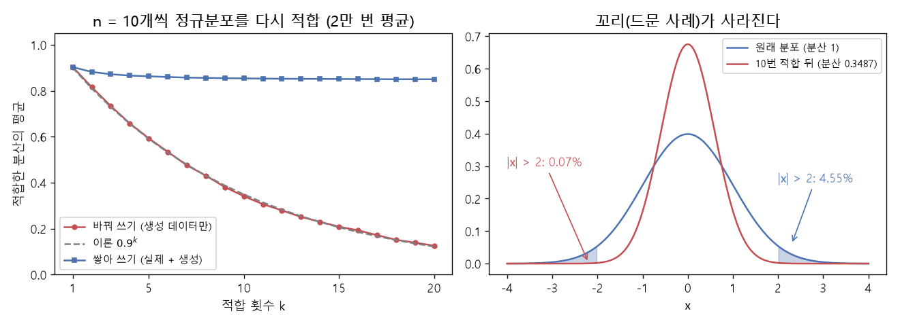

# 반복 적합과 모델 붕괴 (Recursive fitting, Model collapse)

[목차로 돌아가기](../../00_MIT%EB%94%A5%EB%9F%AC%EB%8B%9D_%EB%AA%A9%EC%B0%A8.md) · 먼저 볼 것: [M02_시그마와_평균](../../%EC%88%98%ED%95%99%EA%B0%9C%EB%85%90/01_%EC%88%98%EC%99%80_%ED%95%A8%EC%88%98/M02_%EC%8B%9C%EA%B7%B8%EB%A7%88%EC%99%80_%ED%8F%89%EA%B7%A0.md), [MM22_기댓값과_일반화_간극](../../%EC%88%98%ED%95%99%EA%B0%9C%EB%85%90/04_%ED%99%95%EB%A5%A0%EA%B3%BC_%EC%A0%95%EB%B3%B4/MM22_%EA%B8%B0%EB%8C%93%EA%B0%92%EA%B3%BC_%EC%9D%BC%EB%B0%98%ED%99%94_%EA%B0%84%EA%B7%B9.md), [MM50_확률_밀도와_정규분포](../../%EC%88%98%ED%95%99%EA%B0%9C%EB%85%90/04_%ED%99%95%EB%A5%A0%EA%B3%BC_%EC%A0%95%EB%B3%B4/MM50_%ED%99%95%EB%A5%A0_%EB%B0%80%EB%8F%84%EC%99%80_%EC%A0%95%EA%B7%9C%EB%B6%84%ED%8F%AC.md), [MM51_KL_발산과_최대_우도](../../%EC%88%98%ED%95%99%EA%B0%9C%EB%85%90/04_%ED%99%95%EB%A5%A0%EA%B3%BC_%EC%A0%95%EB%B3%B4/MM51_KL_%EB%B0%9C%EC%82%B0%EA%B3%BC_%EC%B5%9C%EB%8C%80_%EC%9A%B0%EB%8F%84.md) · 쓰는 곳: [Lec19 8](../../Lec19_%EC%A0%84%EC%9D%B4_%ED%95%99%EC%8A%B5_%EB%8D%B0%EC%9D%B4%ED%84%B0.md#8-%EC%83%9D%EC%84%B1-%EB%8D%B0%EC%9D%B4%ED%84%B0%EB%A1%9C-%ED%95%99%EC%8A%B5%ED%95%A0-%EB%95%8C%EC%9D%98-%EC%9C%84%ED%97%98-%EB%AA%A8%EB%8D%B8-%EB%B6%95%EA%B4%B4)

📚 학습 순서 93/99 (12. 강건성과 전이): ← 이전: [MM70_MAML의_안쪽_바깥쪽_경사하강](../../%EC%88%98%ED%95%99%EA%B0%9C%EB%85%90/12_%EA%B0%95%EA%B1%B4%EC%84%B1%EA%B3%BC_%EC%A0%84%EC%9D%B4/MM70_MAML%EC%9D%98_%EC%95%88%EC%AA%BD_%EB%B0%94%EA%B9%A5%EC%AA%BD_%EA%B2%BD%EC%82%AC%ED%95%98%EA%B0%95.md) · 다음: [MM74_n그램과_퍼플렉서티](../../%EC%88%98%ED%95%99%EA%B0%9C%EB%85%90/13_%EC%96%B8%EC%96%B4_%EB%AA%A8%EB%8D%B8%EA%B3%BC_%EC%B6%94%EB%A1%A0/MM74_n%EA%B7%B8%EB%9E%A8%EA%B3%BC_%ED%8D%BC%ED%94%8C%EB%A0%89%EC%84%9C%ED%8B%B0.md) →

> [!NOTE]
> **3줄 요약**
> - 데이터 $n$개에 [정규분포](../../00_%EB%94%A5%EB%9F%AC%EB%8B%9D_%EC%9A%A9%EC%96%B4%EC%82%AC%EC%A0%84.md#normal-distribution-%EC%A0%95%EA%B7%9C%EB%B6%84%ED%8F%AC)를 [최대 우도](../../00_%EB%94%A5%EB%9F%AC%EB%8B%9D_%EC%9A%A9%EC%96%B4%EC%82%AC%EC%A0%84.md#maximum-likelihood-%EC%B5%9C%EB%8C%80-%EC%9A%B0%EB%8F%84)로 맞추면, 표본 [분산](../../00_%EB%94%A5%EB%9F%AC%EB%8B%9D_%EC%9A%A9%EC%96%B4%EC%82%AC%EC%A0%84.md#variance-%EB%B6%84%EC%82%B0) $\hat\sigma^2 = \frac{1}{n}\sum(x_i - \bar x)^2$은 평균적으로 참 [분산](../../00_%EB%94%A5%EB%9F%AC%EB%8B%9D_%EC%9A%A9%EC%96%B4%EC%82%AC%EC%A0%84.md#variance-%EB%B6%84%EC%82%B0)의 $\frac{n-1}{n}$배로 조금 작게 나온다. $n = 10$이면 0.9배.
> - 맞춘 분포에서 새 데이터를 뽑아 다시 맞추기를 되풀이하면(생성 데이터로만 다음 모델을 [학습](../../00_%EB%94%A5%EB%9F%AC%EB%8B%9D_%EC%9A%A9%EC%96%B4%EC%82%AC%EC%A0%84.md#training-%ED%95%99%EC%8A%B5)) 이 줄어듦이 곱해져 쌓인다. $k$번 뒤 $0.9^k$: 10번이면 0.3487. 꼬리(드문 사례, $|x| > 2$)의 [확률](../../00_%EB%94%A5%EB%9F%AC%EB%8B%9D_%EC%9A%A9%EC%96%B4%EC%82%AC%EC%A0%84.md#probability-%ED%99%95%EB%A5%A0)은 4.55%에서 0.07%로 사라진다. 이것이 **[모델 붕괴](../../00_%EB%94%A5%EB%9F%AC%EB%8B%9D_%EC%9A%A9%EC%96%B4%EC%82%AC%EC%A0%84.md#model-collapse-%EB%AA%A8%EB%8D%B8-%EB%B6%95%EA%B4%B4)**의 가장 단순한 모형이다.
> - 실제 데이터를 버리지 않고 생성 데이터를 **쌓아 가며** 맞추면 [분산](../../00_%EB%94%A5%EB%9F%AC%EB%8B%9D_%EC%9A%A9%EC%96%B4%EC%82%AC%EC%A0%84.md#variance-%EB%B6%84%EC%82%B0)이 0.85 근처에서 멈춘다(시뮬레이션). 바꿔 쓰기와 쌓아 쓰기의 차이가 붕괴를 가른다.

## 1. 개념 설명

비유: 복사기로 복사본을 다시 복사하기를 되풀이하면 흐린 글자와 가장자리의 작은 글씨부터 사라진다. 한 번 복사할 때 잃는 것은 조금이지만, 원본을 버리고 복사본만 다시 복사하면 그 [손실](../../00_%EB%94%A5%EB%9F%AC%EB%8B%9D_%EC%9A%A9%EC%96%B4%EC%82%AC%EC%A0%84.md#loss-function-%EC%86%90%EC%8B%A4-%ED%95%A8%EC%88%98)이 곱으로 쌓인다. 원본을 옆에 두고 계속 같이 쓰면 그렇게 무너지지 않는다.

- **[최대 우도](../../00_%EB%94%A5%EB%9F%AC%EB%8B%9D_%EC%9A%A9%EC%96%B4%EC%82%AC%EC%A0%84.md#maximum-likelihood-%EC%B5%9C%EB%8C%80-%EC%9A%B0%EB%8F%84) [분산](../../00_%EB%94%A5%EB%9F%AC%EB%8B%9D_%EC%9A%A9%EC%96%B4%EC%82%AC%EC%A0%84.md#variance-%EB%B6%84%EC%82%B0)**: 표본 평균 $\bar x$에서 잰 거리의 제곱 평균이다. $\bar x$가 바로 그 표본으로 계산되어 표본 쪽에 붙어 있으므로, 참 평균에서 잰 것보다 거리가 조금 작게 나온다. 그 몫이 정확히 $\frac{n-1}{n}$배다.
- **되풀이**: 세대 1은 실제 데이터로 맞추고, 세대 2는 세대 1 모델이 만든 데이터로 맞추고, ... 매번 평균적으로 0.9배씩 줄어든다. 표본이 적을수록($n$이 작을수록) 빨리 줄어든다.
- **꼬리가 먼저 사라진다**: 분포가 좁아지면 드문 값(꼬리)의 [확률](../../00_%EB%94%A5%EB%9F%AC%EB%8B%9D_%EC%9A%A9%EC%96%B4%EC%82%AC%EC%A0%84.md#probability-%ED%99%95%EB%A5%A0)이 가장 빠르게 0으로 간다. [생성 모델](../../00_%EB%94%A5%EB%9F%AC%EB%8B%9D_%EC%9A%A9%EC%96%B4%EC%82%AC%EC%A0%84.md#generative-model-%EC%83%9D%EC%84%B1-%EB%AA%A8%EB%8D%B8)이 흔한 것을 더 흔하게, 드문 것을 더 드물게 만드는 것과 같은 방향이다.


*▲ 직접 그린 그림: 왼쪽은 $n = 10$개씩 [정규분포](../../00_%EB%94%A5%EB%9F%AC%EB%8B%9D_%EC%9A%A9%EC%96%B4%EC%82%AC%EC%A0%84.md#normal-distribution-%EC%A0%95%EA%B7%9C%EB%B6%84%ED%8F%AC)를 다시 맞추기를 2만 번 되풀이해 평균한 [분산](../../00_%EB%94%A5%EB%9F%AC%EB%8B%9D_%EC%9A%A9%EC%96%B4%EC%82%AC%EC%A0%84.md#variance-%EB%B6%84%EC%82%B0). 생성 데이터로 바꿔 쓰면(빨강) 이론 $0.9^k$(회색 점선)를 따라 0으로 가고, 실제 데이터에 쌓아 쓰면(파랑) 0.85 근처에서 멈춘다. 오른쪽은 [분산](../../00_%EB%94%A5%EB%9F%AC%EB%8B%9D_%EC%9A%A9%EC%96%B4%EC%82%AC%EC%A0%84.md#variance-%EB%B6%84%EC%82%B0) 1과 0.3487(10번 뒤)의 분포. 색칠한 꼬리 $|x| > 2$가 4.55%에서 0.07%로 줄어든다*

## 2. 필요한 이유

[Lec19 8](../../Lec19_%EC%A0%84%EC%9D%B4_%ED%95%99%EC%8A%B5_%EB%8D%B0%EC%9D%B4%ED%84%B0.md#8-%EC%83%9D%EC%84%B1-%EB%8D%B0%EC%9D%B4%ED%84%B0%EB%A1%9C-%ED%95%99%EC%8A%B5%ED%95%A0-%EB%95%8C%EC%9D%98-%EC%9C%84%ED%97%98-%EB%AA%A8%EB%8D%B8-%EB%B6%95%EA%B4%B4)에서 강사는 인터넷의 글이 점점 생성된 글로 채워지면서, 생성 데이터가 실제 데이터보다 많아지면 "악순환"이 되어 실제 데이터에 있던 분포의 일부를 잃는다는 [모델 붕괴](../../00_%EB%94%A5%EB%9F%AC%EB%8B%9D_%EC%9A%A9%EC%96%B4%EC%82%AC%EC%A0%84.md#model-collapse-%EB%AA%A8%EB%8D%B8-%EB%B6%95%EA%B4%B4)(manifold collapse) 논의를 소개한다. 그 원리를 가장 단순한 모델(평균과 [분산](../../00_%EB%94%A5%EB%9F%AC%EB%8B%9D_%EC%9A%A9%EC%96%B4%EC%82%AC%EC%A0%84.md#variance-%EB%B6%84%EC%82%B0)만 있는 [정규분포](../../00_%EB%94%A5%EB%9F%AC%EB%8B%9D_%EC%9A%A9%EC%96%B4%EC%82%AC%EC%A0%84.md#normal-distribution-%EC%A0%95%EA%B7%9C%EB%B6%84%ED%8F%AC))로 확인한다.

## 3. 숫자로 보기

**[최대 우도](../../00_%EB%94%A5%EB%9F%AC%EB%8B%9D_%EC%9A%A9%EC%96%B4%EC%82%AC%EC%A0%84.md#maximum-likelihood-%EC%B5%9C%EB%8C%80-%EC%9A%B0%EB%8F%84) [분산](../../00_%EB%94%A5%EB%9F%AC%EB%8B%9D_%EC%9A%A9%EC%96%B4%EC%82%AC%EC%A0%84.md#variance-%EB%B6%84%EC%82%B0)** ($x = 1, 3, 5$)
- 평균: $(1 + 3 + 5) / 3 = 3$
- 거리의 제곱: $(1-3)^2 = 4$, $(3-3)^2 = 0$, $(5-3)^2 = 4$
- 평균: $(4 + 0 + 4) / 3 = 2.6667$

$$
\hat\sigma^2 = \frac{1}{n}\sum_{i=1}^{n} (x_i - \bar x)^2
$$

<details><summary>기호 풀이</summary>

| 기호 | 읽는 법 | 뜻 | 예제 값 |
| --- | --- | --- | --- |
| $n$ | 엔 | 데이터 수 | 3 |
| $x_i$ | 엑스 아이 | $i$번째 데이터 | 1, 3, 5 |
| $\bar x$ | 엑스 바 | 표본 평균 | 3 |
| $\sum_{i=1}^{n}$ | 시그마 | $i = 1$부터 $n$까지 더한다 | 8 |
| $\hat\sigma^2$ | 시그마 햇 제곱 | [최대 우도](../../00_%EB%94%A5%EB%9F%AC%EB%8B%9D_%EC%9A%A9%EC%96%B4%EC%82%AC%EC%A0%84.md#maximum-likelihood-%EC%B5%9C%EB%8C%80-%EC%9A%B0%EB%8F%84)로 맞춘 [분산](../../00_%EB%94%A5%EB%9F%AC%EB%8B%9D_%EC%9A%A9%EC%96%B4%EC%82%AC%EC%A0%84.md#variance-%EB%B6%84%EC%82%B0) | 2.6667 |

</details>

<details><summary>예제와 풀이</summary>

**문제**: 데이터 1, 3, 5에 [정규분포](../../00_%EB%94%A5%EB%9F%AC%EB%8B%9D_%EC%9A%A9%EC%96%B4%EC%82%AC%EC%A0%84.md#normal-distribution-%EC%A0%95%EA%B7%9C%EB%B6%84%ED%8F%AC)를 맞춘다. [최대 우도](../../00_%EB%94%A5%EB%9F%AC%EB%8B%9D_%EC%9A%A9%EC%96%B4%EC%82%AC%EC%A0%84.md#maximum-likelihood-%EC%B5%9C%EB%8C%80-%EC%9A%B0%EB%8F%84) [분산](../../00_%EB%94%A5%EB%9F%AC%EB%8B%9D_%EC%9A%A9%EC%96%B4%EC%82%AC%EC%A0%84.md#variance-%EB%B6%84%EC%82%B0)은?

**주어진 값**
- $n = 3$ (데이터 수)
- $x_1 = 1$, $x_2 = 3$, $x_3 = 5$ (데이터)
- $\bar x = (1 + 3 + 5) / 3 = 3$ (표본 평균)

**풀이**
1. 식을 그대로 쓴다: $\hat\sigma^2 = \dfrac{1}{n}\sum_{i=1}^{n} (x_i - \bar x)^2$
2. 값을 대입한다: $\hat\sigma^2 = \dfrac{1}{3}\sum_{i=1}^{3} (x_i - 3)^2$
3. Σ를 풀어 쓴다: $\hat\sigma^2 = \dfrac{1}{3}\big((1 - 3)^2 + (3 - 3)^2 + (5 - 3)^2\big)$
4. 괄호 안을 뺀다: $1 - 3 = -2$, $3 - 3 = 0$, $5 - 3 = 2$ 이므로 $\hat\sigma^2 = \dfrac{1}{3}\big((-2)^2 + 0^2 + 2^2\big)$
5. 제곱한다: $(-2)^2 = 4$, $0^2 = 0$, $2^2 = 4$ 이므로 $\hat\sigma^2 = \dfrac{1}{3}(4 + 0 + 4)$
6. 더한다: $4 + 0 + 4 = 8$ 이므로 $\hat\sigma^2 = \dfrac{8}{3}$
7. 나눈다: $8 / 3 = 2.6667$

**답**: $\hat\sigma^2 = $ **2.6667**

</details>

<details><summary>내 이해</summary>


</details>

**한 세대의 줄어듦** ($n = 10$, 참 [분산](../../00_%EB%94%A5%EB%9F%AC%EB%8B%9D_%EC%9A%A9%EC%96%B4%EC%82%AC%EC%A0%84.md#variance-%EB%B6%84%EC%82%B0) 1): 평균적으로 $\frac{9}{10} \times 1 = 0.9$. 시뮬레이션(2만 번 평균)은 0.9029.

$$
\mathbb{E}\big[\hat\sigma^2\big] = \frac{n - 1}{n}\,\sigma^2
$$

<details><summary>기호 풀이</summary>

| 기호 | 읽는 법 | 뜻 | 예제 값 |
| --- | --- | --- | --- |
| $\sigma^2$ | 시그마 제곱 | 데이터를 만든 분포의 참 [분산](../../00_%EB%94%A5%EB%9F%AC%EB%8B%9D_%EC%9A%A9%EC%96%B4%EC%82%AC%EC%A0%84.md#variance-%EB%B6%84%EC%82%B0) | 1 |
| $n$ | 엔 | 한 번에 맞추는 데이터 수 | 10 |
| $\mathbb{E}[\cdot]$ | [기댓값](../../00_%EB%94%A5%EB%9F%AC%EB%8B%9D_%EC%9A%A9%EC%96%B4%EC%82%AC%EC%A0%84.md#expectation-%EA%B8%B0%EB%8C%93%EA%B0%92) | 같은 일을 무수히 되풀이했을 때의 평균 ([기댓값](../../00_%EB%94%A5%EB%9F%AC%EB%8B%9D_%EC%9A%A9%EC%96%B4%EC%82%AC%EC%A0%84.md#expectation-%EA%B8%B0%EB%8C%93%EA%B0%92)) | |
| $\mathbb{E}[\hat\sigma^2]$ | | 맞춘 [분산](../../00_%EB%94%A5%EB%9F%AC%EB%8B%9D_%EC%9A%A9%EC%96%B4%EC%82%AC%EC%A0%84.md#variance-%EB%B6%84%EC%82%B0)의 평균 | 0.9 |

</details>

<details><summary>예제와 풀이</summary>

**문제**: [분산](../../00_%EB%94%A5%EB%9F%AC%EB%8B%9D_%EC%9A%A9%EC%96%B4%EC%82%AC%EC%A0%84.md#variance-%EB%B6%84%EC%82%B0)이 1인 분포에서 데이터를 10개씩 뽑아 [최대 우도](../../00_%EB%94%A5%EB%9F%AC%EB%8B%9D_%EC%9A%A9%EC%96%B4%EC%82%AC%EC%A0%84.md#maximum-likelihood-%EC%B5%9C%EB%8C%80-%EC%9A%B0%EB%8F%84) [분산](../../00_%EB%94%A5%EB%9F%AC%EB%8B%9D_%EC%9A%A9%EC%96%B4%EC%82%AC%EC%A0%84.md#variance-%EB%B6%84%EC%82%B0)을 구하기를 여러 번 하면, 그 평균은?

**주어진 값**
- $\sigma^2 = 1$ (참 [분산](../../00_%EB%94%A5%EB%9F%AC%EB%8B%9D_%EC%9A%A9%EC%96%B4%EC%82%AC%EC%A0%84.md#variance-%EB%B6%84%EC%82%B0))
- $n = 10$ (한 번에 쓰는 데이터 수)

**풀이**
1. 식을 그대로 쓴다: $\mathbb{E}[\hat\sigma^2] = \dfrac{n - 1}{n}\,\sigma^2$
2. 값을 대입한다: $\mathbb{E}[\hat\sigma^2] = \dfrac{10 - 1}{10} \times 1$
3. 분자를 뺀다: $10 - 1 = 9$ 이므로 $\mathbb{E}[\hat\sigma^2] = \dfrac{9}{10} \times 1$
4. 나눈다: $9 / 10 = 0.9$ 이므로 $\mathbb{E}[\hat\sigma^2] = 0.9 \times 1$
5. 곱한다: $0.9 \times 1 = 0.9$

**답**: **0.9**. 한 번 맞출 때마다 평균적으로 10%씩 좁아진다.

</details>

<details><summary>내 이해</summary>


</details>

**$k$번 되풀이** ($n = 10$)

| 적합 횟수 $k$ | 이론 $0.9^k$ | 시뮬레이션 (바꿔 쓰기) | 시뮬레이션 (쌓아 쓰기) |
|---|---|---|---|
| 1 | 0.9 | 0.9029 | 0.9029 |
| 2 | 0.81 | 0.8157 | 0.8818 |
| 10 | 0.3487 | 0.3408 | 0.8537 |
| 20 | 0.1216 | 0.1261 | 0.8498 |

- 꼬리 [확률](../../00_%EB%94%A5%EB%9F%AC%EB%8B%9D_%EC%9A%A9%EC%96%B4%EC%82%AC%EC%A0%84.md#probability-%ED%99%95%EB%A5%A0) $P(|x| > 2)$: [분산](../../00_%EB%94%A5%EB%9F%AC%EB%8B%9D_%EC%9A%A9%EC%96%B4%EC%82%AC%EC%A0%84.md#variance-%EB%B6%84%EC%82%B0) 1이면 0.0455, 0.3487이면 0.0007, 0.1216이면 거의 0.

$$
\mathbb{E}\big[\hat\sigma_k^2\big] = \left(\frac{n - 1}{n}\right)^{k} \sigma_0^2
$$

<details><summary>기호 풀이</summary>

| 기호 | 읽는 법 | 뜻 | 예제 값 |
| --- | --- | --- | --- |
| $\sigma_0^2$ | 시그마 영 제곱 | 실제 데이터의 [분산](../../00_%EB%94%A5%EB%9F%AC%EB%8B%9D_%EC%9A%A9%EC%96%B4%EC%82%AC%EC%A0%84.md#variance-%EB%B6%84%EC%82%B0) | 1 |
| $k$ | 케이 | 맞추고 뽑기를 되풀이한 횟수 (세대 수) | 10 |
| $\left(\frac{n-1}{n}\right)^{k}$ | | 한 세대의 줄어듦을 $k$번 곱한 것 | 0.3487 |
| $\hat\sigma_k^2$ | 시그마 햇 케이 제곱 | $k$번째 모델의 [분산](../../00_%EB%94%A5%EB%9F%AC%EB%8B%9D_%EC%9A%A9%EC%96%B4%EC%82%AC%EC%A0%84.md#variance-%EB%B6%84%EC%82%B0) | 0.3487 |

</details>

<details><summary>예제와 풀이</summary>

**문제**: 실제 데이터의 [분산](../../00_%EB%94%A5%EB%9F%AC%EB%8B%9D_%EC%9A%A9%EC%96%B4%EC%82%AC%EC%A0%84.md#variance-%EB%B6%84%EC%82%B0)이 1이다. 10개씩 맞추고, 맞춘 모델에서 10개를 뽑아 다시 맞추기를 10번 하면 [분산](../../00_%EB%94%A5%EB%9F%AC%EB%8B%9D_%EC%9A%A9%EC%96%B4%EC%82%AC%EC%A0%84.md#variance-%EB%B6%84%EC%82%B0)은 평균적으로 얼마가 되나?

**주어진 값**
- $\sigma_0^2 = 1$ (실제 [분산](../../00_%EB%94%A5%EB%9F%AC%EB%8B%9D_%EC%9A%A9%EC%96%B4%EC%82%AC%EC%A0%84.md#variance-%EB%B6%84%EC%82%B0))
- $n = 10$ (한 번에 쓰는 데이터 수)
- $k = 10$ (되풀이 횟수)

**풀이**
1. 식을 그대로 쓴다: $\mathbb{E}[\hat\sigma_k^2] = \left(\dfrac{n - 1}{n}\right)^{k} \sigma_0^2$
2. 값을 대입한다: $\mathbb{E}[\hat\sigma_{10}^2] = \left(\dfrac{10 - 1}{10}\right)^{10} \times 1$
3. 괄호 안을 계산한다: $9 / 10 = 0.9$ 이므로 $\mathbb{E} = 0.9^{10} \times 1$
4. 거듭제곱을 두 번씩 묶어 계산한다: $0.9^2 = 0.81$, $0.9^4 = 0.81 \times 0.81 = 0.6561$
5. $0.9^8 = 0.6561 \times 0.6561 = 0.4305$
6. $0.9^{10} = 0.9^8 \times 0.9^2 = 0.4305 \times 0.81 = 0.3487$
7. 곱한다: $0.3487 \times 1 = 0.3487$

**답**: **0.3487**. 열 세대 만에 [분산](../../00_%EB%94%A5%EB%9F%AC%EB%8B%9D_%EC%9A%A9%EC%96%B4%EC%82%AC%EC%A0%84.md#variance-%EB%B6%84%EC%82%B0)이 3분의 1 남짓으로 줄었다.

</details>

<details><summary>내 이해</summary>


</details>

## 4. 코드로 확인

```python
# [함수] erf: 오차 함수. Φ(x) = (1 + erf(x/√2))/2 가 표준 정규분포의 누적 확률
from math import erf, sqrt
# [변수] x: 3절 예제 데이터
x = np.array([1.0, 3.0, 5.0])
# [연결] 3절: 평균 3, 최대 우도 분산 2.6667 (np.var는 1/n로 나눈다)
print(x.mean(), round(x.var(), 4))
# [연결] 3절 표 이론값: 0.9^1, 0.9^2, 0.9^10, 0.9^20
print([round(0.9 ** k, 4) for k in (1, 2, 10, 20)])
# [함수] tail(s2): 분산 s2인 정규분포에서 |x| > 2일 확률 = 2(1 - Φ(2/σ))
tail = lambda s2: 2 * (1 - 0.5 * (1 + erf(2 / sqrt(s2) / sqrt(2))))
# [연결] 3절 꼬리 확률: 0.0455, 0.0007, 0.0
print([round(tail(s2), 4) for s2 in (1.0, 0.9 ** 10, 0.9 ** 20)])
# [함수] collapse: 2만 번 따로 n = 10개씩 맞추고 뽑기를 20번. accumulate면 실제와 이전 생성 데이터를 모두 모아 맞춘다
def collapse(accumulate, n=10, T=20, runs=20000):
    # [변수] rng: 시드 0 난수 생성기 (본문 숫자 재현), data: 실제 데이터 (분산 1)
    rng = np.random.default_rng(0)
    data = rng.normal(0, 1, (runs, n))
    # [변수] pool: 지금까지 모은 데이터, res: 적합 횟수마다 분산의 평균
    pool, res = data.copy(), []
    for _ in range(T):
        # [변수] fit_on: 바꿔 쓰기면 직전 세대 데이터만, 쌓아 쓰기면 모은 전부
        fit_on = pool if accumulate else data
        # [변수] mu, var: 최대 우도로 맞춘 평균과 분산
        mu, var = fit_on.mean(1, keepdims=True), fit_on.var(1, keepdims=True)
        # [쓸모] 이번 세대 분산의 평균을 기록 (그림의 한 점)
        res.append(var.mean())
        # [변수] data: 맞춘 분포에서 새로 뽑은 생성 데이터 n개
        data = rng.normal(mu, np.sqrt(var), (runs, n))
        # [변수] pool: 생성 데이터를 덧붙인 모음
        pool = np.concatenate([pool, data], 1)
    return np.array(res)
# [변수] rep, acc: 바꿔 쓰기와 쌓아 쓰기의 결과 (k = 1..20)
rep, acc = collapse(False), collapse(True)
# [연결] 3절 표: k = 1, 2, 10, 20
print(np.round(rep[[0, 1, 9, 19]], 4).tolist(), np.round(acc[[0, 1, 9, 19]], 4).tolist())
```

**실행 결과**:

```text
3.0 2.6667
[0.9, 0.81, 0.3487, 0.1216]
[0.0455, 0.0007, 0.0]
[0.9029, 0.8157, 0.3408, 0.1261] [0.9029, 0.8818, 0.8537, 0.8498]
```

> [!WARNING]
> **⚠ 주의**
> - 이 모형은 아주 단순하다. 실제 [모델 붕괴](../../00_%EB%94%A5%EB%9F%AC%EB%8B%9D_%EC%9A%A9%EC%96%B4%EC%82%AC%EC%A0%84.md#model-collapse-%EB%AA%A8%EB%8D%B8-%EB%B6%95%EA%B4%B4)에는 표본 수의 한계 말고도 모델 [표현력](../../00_%EB%94%A5%EB%9F%AC%EB%8B%9D_%EC%9A%A9%EC%96%B4%EC%82%AC%EC%A0%84.md#representational-power-%ED%91%9C%ED%98%84%EB%A0%A5)의 한계, [샘플링](../../00_%EB%94%A5%EB%9F%AC%EB%8B%9D_%EC%9A%A9%EC%96%B4%EC%82%AC%EC%A0%84.md#sampling-%EC%83%98%ED%94%8C%EB%A7%81) 온도처럼 흔한 출력을 더 고르는 습관 등이 함께 작용한다. 그래도 "드문 것부터 사라진다"는 방향은 같다.
> - $\frac{1}{n-1}$로 나누는 불편 [분산](../../00_%EB%94%A5%EB%9F%AC%EB%8B%9D_%EC%9A%A9%EC%96%B4%EC%82%AC%EC%A0%84.md#variance-%EB%B6%84%EC%82%B0)을 쓰면 평균은 줄지 않는다. 하지만 추정의 흔들림이 세대마다 쌓여 결국 분포가 무너진다는 연구가 있다. 줄어듦만이 원인은 아니다.
> - 쌓아 쓰기에서 [분산](../../00_%EB%94%A5%EB%9F%AC%EB%8B%9D_%EC%9A%A9%EC%96%B4%EC%82%AC%EC%A0%84.md#variance-%EB%B6%84%EC%82%B0)이 1이 아니라 0.85 근처에 머무는 것은 처음 실제 데이터 10개가 표본 [분산](../../00_%EB%94%A5%EB%9F%AC%EB%8B%9D_%EC%9A%A9%EC%96%B4%EC%82%AC%EC%A0%84.md#variance-%EB%B6%84%EC%82%B0) 0.9로 시작했고 생성 데이터가 조금씩 더 좁기 때문이다. 핵심은 0으로 가지 않는다는 점이다.

## 5. 개념 재확인

<details><summary>1. $n = 5$개씩 맞추기를 3번 되풀이하면 분산은 처음의 몇 배가 되나?</summary>

| 단계 | 하는 일 | 계산 | 결과 |
|---|---|---|---|
| 1 | 한 세대의 비율 | $(5 - 1) / 5$ | 0.8 |
| 2 | 두 번 곱하기 | $0.8 \times 0.8$ | 0.64 |
| 3 | 세 번 곱하기 | $0.64 \times 0.8$ | 0.512 |

**① 쓰는 식**
$$\mathbb{E}\big[\hat\sigma_k^2\big] = \left(\frac{n - 1}{n}\right)^{k} \sigma_0^2$$
- 위 식 ← ② (한 세대 비율), ③ (거듭제곱)에서 쓴다.
```python
# [변수] n, k: 데이터 5개, 되풀이 3번
n, k = 5, 3                                       # ①
# [변수] r = 0.8: 한 세대의 줄어듦
r = (n - 1) / n                                   # ②
# [연결] 0.8 0.64 0.512
print(r, round(r ** 2, 4), round(r ** k, 4))      # ③
```

**주어진 값**
- $n = 5$ (한 번에 쓰는 데이터 수)
- $k = 3$ (되풀이 횟수)
- $\sigma_0^2 = 1$ (처음 [분산](../../00_%EB%94%A5%EB%9F%AC%EB%8B%9D_%EC%9A%A9%EC%96%B4%EC%82%AC%EC%A0%84.md#variance-%EB%B6%84%EC%82%B0)을 1로 두고 배수를 구함)

**풀이**
1. 식을 그대로 쓴다: $\mathbb{E}[\hat\sigma_k^2] = \left(\dfrac{n - 1}{n}\right)^{k} \sigma_0^2$
2. 값을 대입한다: $\mathbb{E}[\hat\sigma_3^2] = \left(\dfrac{5 - 1}{5}\right)^{3} \times 1$
3. (②) 괄호 안을 계산한다: $4 / 5 = 0.8$ 이므로 $\mathbb{E} = 0.8^3 \times 1$
4. (③) 두 번 곱한다: $0.8 \times 0.8 = 0.64$
5. (③) 한 번 더 곱한다: $0.64 \times 0.8 = 0.512$

**답**: **0.512배**. 데이터가 적으면($n = 5$) 세 세대 만에 절반 가까이 좁아진다.

</details>

<details><summary>2. 데이터 2, 4, 6, 8의 최대 우도 분산은?</summary>

| 단계 | 하는 일 | 계산 | 결과 |
|---|---|---|---|
| 1 | 평균 | $(2 + 4 + 6 + 8) / 4$ | 5 |
| 2 | 거리 제곱 | $9, 1, 1, 9$ | 합 20 |
| 3 | 나누기 | $20 / 4$ | 5 |

**① 쓰는 식**
$$\hat\sigma^2 = \frac{1}{n}\sum_{i=1}^{n} (x_i - \bar x)^2$$
- 위 식 ← ② (평균), ③ (거리 제곱), ④ (나누기)에서 쓴다.
```python
# [변수] x: 데이터 4개
x = np.array([2.0, 4.0, 6.0, 8.0])           # ①
# [변수] m = 5: 표본 평균
m = x.mean()                                  # ②
# [변수] sq = [9, 1, 1, 9]: 평균에서 잰 거리의 제곱
sq = (x - m) ** 2                             # ③
# [연결] 5.0 [9.0, 1.0, 1.0, 9.0] 5.0
print(m, sq.tolist(), sq.sum() / len(x))      # ④
```

**주어진 값**
- $n = 4$ (데이터 수)
- $x = 2, 4, 6, 8$ (데이터)

**풀이**
1. 식을 그대로 쓴다: $\hat\sigma^2 = \dfrac{1}{n}\sum_{i=1}^{n} (x_i - \bar x)^2$
2. (②) 평균을 먼저 구한다: $2 + 4 + 6 + 8 = 20$, $20 / 4 = 5$ 이므로 $\bar x = 5$
3. 값을 대입하고 Σ를 풀어 쓴다: $\hat\sigma^2 = \dfrac{1}{4}\big((2 - 5)^2 + (4 - 5)^2 + (6 - 5)^2 + (8 - 5)^2\big)$
4. (③) 괄호 안을 뺀다: $-3, -1, 1, 3$ 이므로 $\hat\sigma^2 = \dfrac{1}{4}\big((-3)^2 + (-1)^2 + 1^2 + 3^2\big)$
5. (③) 제곱한다: $9, 1, 1, 9$ 이므로 $\hat\sigma^2 = \dfrac{1}{4}(9 + 1 + 1 + 9)$
6. (④) 더한다: $9 + 1 + 1 + 9 = 20$ 이므로 $\hat\sigma^2 = \dfrac{20}{4}$
7. (④) 나눈다: $20 / 4 = 5$

**답**: **5**

</details>

## 예제 풀기

[예제 10문제 풀기](../../%EC%98%88%EC%A0%9C/12_%EA%B0%95%EA%B1%B4%EC%84%B1%EA%B3%BC_%EC%A0%84%EC%9D%B4/%EC%98%88%EC%A0%9C_MM71_%EB%B0%98%EB%B3%B5_%EC%A0%81%ED%95%A9%EA%B3%BC_%EB%AA%A8%EB%8D%B8_%EB%B6%95%EA%B4%B4.md)

<details><summary>내 이해</summary>


</details>
