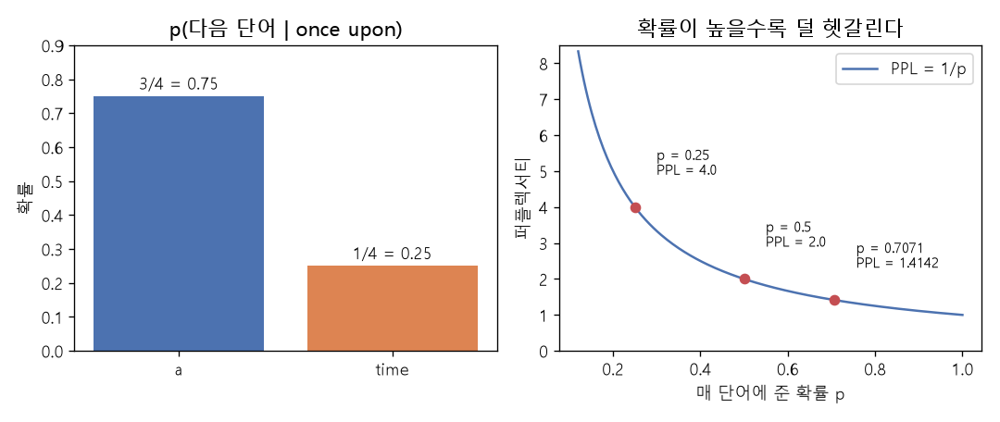

# n-그램 언어 모델과 퍼플렉서티 (N-gram language model, Perplexity)

[목차로 돌아가기](../../00_MIT%EB%94%A5%EB%9F%AC%EB%8B%9D_%EB%AA%A9%EC%B0%A8.md) · 먼저 볼 것: [M08_확률_기초](../../%EC%88%98%ED%95%99%EA%B0%9C%EB%85%90/04_%ED%99%95%EB%A5%A0%EA%B3%BC_%EC%A0%95%EB%B3%B4/M08_%ED%99%95%EB%A5%A0_%EA%B8%B0%EC%B4%88.md), [M07_로그](../../%EC%88%98%ED%95%99%EA%B0%9C%EB%85%90/01_%EC%88%98%EC%99%80_%ED%95%A8%EC%88%98/M07_%EB%A1%9C%EA%B7%B8.md), [M10_엔트로피](../../%EC%88%98%ED%95%99%EA%B0%9C%EB%85%90/04_%ED%99%95%EB%A5%A0%EA%B3%BC_%EC%A0%95%EB%B3%B4/M10_%EC%97%94%ED%8A%B8%EB%A1%9C%ED%94%BC.md), [MM39_확률의_연쇄법칙과_빔_서치](../../%EC%88%98%ED%95%99%EA%B0%9C%EB%85%90/04_%ED%99%95%EB%A5%A0%EA%B3%BC_%EC%A0%95%EB%B3%B4/MM39_%ED%99%95%EB%A5%A0%EC%9D%98_%EC%97%B0%EC%87%84%EB%B2%95%EC%B9%99%EA%B3%BC_%EB%B9%94_%EC%84%9C%EC%B9%98.md) · 쓰는 곳: [Lec21 2.1](../../Lec21_%EC%96%B8%EC%96%B4_%EB%AA%A8%EB%8D%B8.md#21-n-%EA%B7%B8%EB%9E%A8-%EC%84%B8%EA%B8%B0), [Lec21 2.2](../../Lec21_%EC%96%B8%EC%96%B4_%EB%AA%A8%EB%8D%B8.md#22-%ED%8D%BC%ED%94%8C%EB%A0%89%EC%84%9C%ED%8B%B0%EB%A1%9C-%EC%9E%B0-%EB%B0%9C%EC%A0%84)

📚 학습 순서 94/99 (13. 언어 모델과 추론): ← 이전: [MM71_반복_적합과_모델_붕괴](../../%EC%88%98%ED%95%99%EA%B0%9C%EB%85%90/12_%EA%B0%95%EA%B1%B4%EC%84%B1%EA%B3%BC_%EC%A0%84%EC%9D%B4/MM71_%EB%B0%98%EB%B3%B5_%EC%A0%81%ED%95%A9%EA%B3%BC_%EB%AA%A8%EB%8D%B8_%EB%B6%95%EA%B4%B4.md) · 다음: [MM75_선호_비교와_보상_모델](../../%EC%88%98%ED%95%99%EA%B0%9C%EB%85%90/13_%EC%96%B8%EC%96%B4_%EB%AA%A8%EB%8D%B8%EA%B3%BC_%EC%B6%94%EB%A1%A0/MM75_%EC%84%A0%ED%98%B8_%EB%B9%84%EA%B5%90%EC%99%80_%EB%B3%B4%EC%83%81_%EB%AA%A8%EB%8D%B8.md) →

> [!NOTE]
> **3줄 요약**
> - **[n-그램 모델](../../00_%EB%94%A5%EB%9F%AC%EB%8B%9D_%EC%9A%A9%EC%96%B4%EC%82%AC%EC%A0%84.md#n-gram-model-n-%EA%B7%B8%EB%9E%A8-%EB%AA%A8%EB%8D%B8)**은 앞 $n-1$개 단어가 같았던 경우를 말뭉치에서 세어 다음 단어의 [확률](../../00_%EB%94%A5%EB%9F%AC%EB%8B%9D_%EC%9A%A9%EC%96%B4%EC%82%AC%EC%A0%84.md#probability-%ED%99%95%EB%A5%A0)을 정한다. 장난감 말뭉치에서 $p(\text{a} \mid \text{once upon}) = 3/4 = 0.75$, $p(\text{time} \mid \text{once upon}) = 1/4 = 0.25$.
> - **[퍼플렉서티](../../00_%EB%94%A5%EB%9F%AC%EB%8B%9D_%EC%9A%A9%EC%96%B4%EC%82%AC%EC%A0%84.md#perplexity-%ED%8D%BC%ED%94%8C%EB%A0%89%EC%84%9C%ED%8B%B0)**는 시험 문장의 [토큰](../../00_%EB%94%A5%EB%9F%AC%EB%8B%9D_%EC%9A%A9%EC%96%B4%EC%82%AC%EC%A0%84.md#token-%ED%86%A0%ED%81%B0)당 평균 음의 [로그](../../00_%EB%94%A5%EB%9F%AC%EB%8B%9D_%EC%9A%A9%EC%96%B4%EC%82%AC%EC%A0%84.md#log-ln-%EB%A1%9C%EA%B7%B8) [확률](../../00_%EB%94%A5%EB%9F%AC%EB%8B%9D_%EC%9A%A9%EC%96%B4%EC%82%AC%EC%A0%84.md#probability-%ED%99%95%EB%A5%A0)([교차 엔트로피](../../00_%EB%94%A5%EB%9F%AC%EB%8B%9D_%EC%9A%A9%EC%96%B4%EC%82%AC%EC%A0%84.md#cross-entropy-%EA%B5%90%EC%B0%A8-%EC%97%94%ED%8A%B8%EB%A1%9C%ED%94%BC))에 $e$를 씌운 값이다. "매 단계 몇 개 중에서 고르는 것만큼 헷갈리나"로 읽는다. [확률](../../00_%EB%94%A5%EB%9F%AC%EB%8B%9D_%EC%9A%A9%EC%96%B4%EC%82%AC%EC%A0%84.md#probability-%ED%99%95%EB%A5%A0) 0.75, 0.6667을 받으면 1.4142, 4개 단어에 고르게 0.25씩 주면 4.
> - 말뭉치에 없던 조합은 [확률](../../00_%EB%94%A5%EB%9F%AC%EB%8B%9D_%EC%9A%A9%EC%96%B4%EC%82%AC%EC%A0%84.md#probability-%ED%99%95%EB%A5%A0)이 0이 되어 [퍼플렉서티](../../00_%EB%94%A5%EB%9F%AC%EB%8B%9D_%EC%9A%A9%EC%96%B4%EC%82%AC%EC%A0%84.md#perplexity-%ED%8D%BC%ED%94%8C%EB%A0%89%EC%84%9C%ED%8B%B0)가 무한대가 된다. 횟수에 1을 더하는 평활(add-one)로 막으면 "once upon a dragon"은 4.7434. 신경망 [언어 모델](../../00_%EB%94%A5%EB%9F%AC%EB%8B%9D_%EC%9A%A9%EC%96%B4%EC%82%AC%EC%A0%84.md#language-model-%EC%96%B8%EC%96%B4-%EB%AA%A8%EB%8D%B8)은 비슷한 맥락끼리 일반화해서 이 문제를 더 잘 푼다.

## 1. 개념 설명

비유: 끝말 맞히기 공책. "once upon" 다음에 무엇이 왔는지 책 수천 권을 넘기며 바를 정(正) 자로 센다. "a"가 820번, "time"이 150번이면 다음 단어는 "a"일 [확률](../../00_%EB%94%A5%EB%9F%AC%EB%8B%9D_%EC%9A%A9%EC%96%B4%EC%82%AC%EC%A0%84.md#probability-%ED%99%95%EB%A5%A0)이 0.82라고 적는다. 이 공책이 [n-그램 모델](../../00_%EB%94%A5%EB%9F%AC%EB%8B%9D_%EC%9A%A9%EC%96%B4%EC%82%AC%EC%A0%84.md#n-gram-model-n-%EA%B7%B8%EB%9E%A8-%EB%AA%A8%EB%8D%B8)이고, 공책이 시험 문장을 얼마나 덜 헷갈려하는지 재는 자가 [퍼플렉서티](../../00_%EB%94%A5%EB%9F%AC%EB%8B%9D_%EC%9A%A9%EC%96%B4%EC%82%AC%EC%A0%84.md#perplexity-%ED%8D%BC%ED%94%8C%EB%A0%89%EC%84%9C%ED%8B%B0)다.

- **[n-그램](../../00_%EB%94%A5%EB%9F%AC%EB%8B%9D_%EC%9A%A9%EC%96%B4%EC%82%AC%EC%A0%84.md#n-gram-model-n-%EA%B7%B8%EB%9E%A8-%EB%AA%A8%EB%8D%B8)**: 연속한 단어 $n$개 묶음. 3-그램(trigram)은 "once upon a"처럼 세 단어다. 3-그램 모델은 바로 앞 두 단어만 보고 다음 단어를 맞힌다. 그보다 앞은 잊는다는 가정이 [마르코프 가정](../../00_%EB%94%A5%EB%9F%AC%EB%8B%9D_%EC%9A%A9%EC%96%B4%EC%82%AC%EC%A0%84.md#markov-assumption-%EB%A7%88%EB%A5%B4%EC%BD%94%ED%94%84-%EA%B0%80%EC%A0%95)이다.
- **세어서 [확률](../../00_%EB%94%A5%EB%9F%AC%EB%8B%9D_%EC%9A%A9%EC%96%B4%EC%82%AC%EC%A0%84.md#probability-%ED%99%95%EB%A5%A0) 만들기**: "앞 두 단어가 once upon이었던 횟수" 중 "그다음이 a였던 횟수"의 비율. 이렇게 센 비율이 그 말뭉치에서 [우도](../../00_%EB%94%A5%EB%9F%AC%EB%8B%9D_%EC%9A%A9%EC%96%B4%EC%82%AC%EC%A0%84.md#likelihood-%EC%9A%B0%EB%8F%84)를 가장 크게 하는 값([최대 우도](../../00_%EB%94%A5%EB%9F%AC%EB%8B%9D_%EC%9A%A9%EC%96%B4%EC%82%AC%EC%A0%84.md#maximum-likelihood-%EC%B5%9C%EB%8C%80-%EC%9A%B0%EB%8F%84) 추정)이다.
- **[퍼플렉서티](../../00_%EB%94%A5%EB%9F%AC%EB%8B%9D_%EC%9A%A9%EC%96%B4%EC%82%AC%EC%A0%84.md#perplexity-%ED%8D%BC%ED%94%8C%EB%A0%89%EC%84%9C%ED%8B%B0)**: 모델이 시험 문장의 실제 단어마다 준 [확률](../../00_%EB%94%A5%EB%9F%AC%EB%8B%9D_%EC%9A%A9%EC%96%B4%EC%82%AC%EC%A0%84.md#probability-%ED%99%95%EB%A5%A0)을 모아서, "평균적으로 몇 지 선다 문제를 푸는 셈인가"로 바꾼 값. 매번 [정답](../../00_%EB%94%A5%EB%9F%AC%EB%8B%9D_%EC%9A%A9%EC%96%B4%EC%82%AC%EC%A0%84.md#label-%EC%A0%95%EB%8B%B5)에 0.25를 주는 모델은 4지 선다를 찍는 것과 같아서 4다. 낮을수록 좋고, 가장 좋으면 1(늘 확신하고 늘 맞힘)이다.

## 2. 필요한 이유

[Lec21 2.1](../../Lec21_%EC%96%B8%EC%96%B4_%EB%AA%A8%EB%8D%B8.md#21-n-%EA%B7%B8%EB%9E%A8-%EC%84%B8%EA%B8%B0)에서 강사는 1960년대부터 2000년대 초까지 [언어 모델](../../00_%EB%94%A5%EB%9F%AC%EB%8B%9D_%EC%9A%A9%EC%96%B4%EC%82%AC%EC%A0%84.md#language-model-%EC%96%B8%EC%96%B4-%EB%AA%A8%EB%8D%B8)이 "큰 말뭉치에서 세기"였다고 말한다. [2.2](../../Lec21_%EC%96%B8%EC%96%B4_%EB%AA%A8%EB%8D%B8.md#22-%ED%8D%BC%ED%94%8C%EB%A0%89%EC%84%9C%ED%8B%B0%EB%A1%9C-%EC%9E%B0-%EB%B0%9C%EC%A0%84)의 표는 세는 모델 → 신경망 → [트랜스포머](../../00_%EB%94%A5%EB%9F%AC%EB%8B%9D_%EC%9A%A9%EC%96%B4%EC%82%AC%EC%A0%84.md#transformer-%ED%8A%B8%EB%9E%9C%EC%8A%A4%ED%8F%AC%EB%A8%B8)로 오며 [퍼플렉서티](../../00_%EB%94%A5%EB%9F%AC%EB%8B%9D_%EC%9A%A9%EC%96%B4%EC%82%AC%EC%A0%84.md#perplexity-%ED%8D%BC%ED%94%8C%EB%A0%89%EC%84%9C%ED%8B%B0)가 내려간 역사를 보여 준다. 두 개념을 알아야 그 표를 읽고, [2.3](../../Lec21_%EC%96%B8%EC%96%B4_%EB%AA%A8%EB%8D%B8.md#23-%ED%81%AC%EA%B8%B0%EB%A7%8C%EC%9C%BC%EB%A1%9C%EB%8A%94-%EB%B6%80%EC%A1%B1%ED%95%98%EB%8B%A4)의 "3,000억 개 n-그램 횟수로 만든 대형 [언어 모델](../../00_%EB%94%A5%EB%9F%AC%EB%8B%9D_%EC%9A%A9%EC%96%B4%EC%82%AC%EC%A0%84.md#language-model-%EC%96%B8%EC%96%B4-%EB%AA%A8%EB%8D%B8)"이 왜 신경망만 못했는지 알 수 있다. [퍼플렉서티](../../00_%EB%94%A5%EB%9F%AC%EB%8B%9D_%EC%9A%A9%EC%96%B4%EC%82%AC%EC%A0%84.md#perplexity-%ED%8D%BC%ED%94%8C%EB%A0%89%EC%84%9C%ED%8B%B0)의 [로그](../../00_%EB%94%A5%EB%9F%AC%EB%8B%9D_%EC%9A%A9%EC%96%B4%EC%82%AC%EC%A0%84.md#log-ln-%EB%A1%9C%EA%B7%B8)는 [Lec10 8.1](../../Lec10_%EA%B8%B0%EC%96%B5%EA%B3%BC_%EC%8B%9C%ED%80%80%EC%8A%A4.md#81-%EC%B5%9C%EB%8C%80-%EC%9A%B0%EB%8F%84-%ED%95%99%EC%8A%B5%EA%B3%BC-%EA%B5%90%EC%82%AC-%EA%B0%95%EC%9A%94)의 [교차 엔트로피](../../00_%EB%94%A5%EB%9F%AC%EB%8B%9D_%EC%9A%A9%EC%96%B4%EC%82%AC%EC%A0%84.md#cross-entropy-%EA%B5%90%EC%B0%A8-%EC%97%94%ED%8A%B8%EB%A1%9C%ED%94%BC) [손실](../../00_%EB%94%A5%EB%9F%AC%EB%8B%9D_%EC%9A%A9%EC%96%B4%EC%82%AC%EC%A0%84.md#loss-function-%EC%86%90%EC%8B%A4-%ED%95%A8%EC%88%98)과 같은 값이다.

## 3. 숫자로 보기

장난감 말뭉치 4문장: "once upon a time", "once upon a hill", "once upon a time", "once upon time".

| 맥락(앞 두 단어) | 맥락 횟수 | 다음 단어 | 3-그램 횟수 | [확률](../../00_%EB%94%A5%EB%9F%AC%EB%8B%9D_%EC%9A%A9%EC%96%B4%EC%82%AC%EC%A0%84.md#probability-%ED%99%95%EB%A5%A0) |
|---|---|---|---|---|
| once upon | 4 | a | 3 | 3/4 = 0.75 |
| once upon | 4 | time | 1 | 1/4 = 0.25 |
| upon a | 3 | time | 2 | 2/3 = 0.6667 |
| upon a | 3 | hill | 1 | 1/3 = 0.3333 |
| upon a | 3 | dragon | 0 | 0/3 = 0 |

[n-그램](../../00_%EB%94%A5%EB%9F%AC%EB%8B%9D_%EC%9A%A9%EC%96%B4%EC%82%AC%EC%A0%84.md#n-gram-model-n-%EA%B7%B8%EB%9E%A8-%EB%AA%A8%EB%8D%B8) [확률](../../00_%EB%94%A5%EB%9F%AC%EB%8B%9D_%EC%9A%A9%EC%96%B4%EC%82%AC%EC%A0%84.md#probability-%ED%99%95%EB%A5%A0)은 횟수의 비율이다.

$$
p(w_t \mid w_{t-2}, w_{t-1}) = \frac{c(w_{t-2}\, w_{t-1}\, w_t)}{c(w_{t-2}\, w_{t-1})}
$$

<details><summary>기호 풀이</summary>

| 기호 | 읽는 법 | 뜻 | 예제 값 |
| --- | --- | --- | --- |
| $w_t$ | 더블유 티 | $t$번째(지금 맞힐) 단어 | time |
| $w_{t-2}, w_{t-1}$ | 더블유 티 빼기 이, 일 | 바로 앞 두 단어(맥락) | once, upon |
| $c(\cdot)$ | 씨 | 말뭉치에서 그 단어 묶음이 나온 횟수 | 1, 4 |
| $p(w_t \mid w_{t-2}, w_{t-1})$ | 피, 조건 | 앞 두 단어가 주어졌을 때 다음 단어의 [확률](../../00_%EB%94%A5%EB%9F%AC%EB%8B%9D_%EC%9A%A9%EC%96%B4%EC%82%AC%EC%A0%84.md#probability-%ED%99%95%EB%A5%A0) | 0.25 |

</details>

<details><summary>예제와 풀이</summary>

**문제**: 장난감 말뭉치에서 "once upon"은 4번, "once upon time"은 1번 나왔다. 3-그램 모델이 "once upon" 다음에 "time"을 낼 [확률](../../00_%EB%94%A5%EB%9F%AC%EB%8B%9D_%EC%9A%A9%EC%96%B4%EC%82%AC%EC%A0%84.md#probability-%ED%99%95%EB%A5%A0)은?

**주어진 값**
- $c(\text{once upon time}) = 1$ (세 단어 묶음이 나온 횟수)
- $c(\text{once upon}) = 4$ (맥락 두 단어가 나온 횟수)

**풀이**
1. 식을 그대로 쓴다: $p(w_t \mid w_{t-2}, w_{t-1}) = \dfrac{c(w_{t-2}\, w_{t-1}\, w_t)}{c(w_{t-2}\, w_{t-1})}$
2. 값을 대입한다: $p(\text{time} \mid \text{once}, \text{upon}) = \dfrac{1}{4}$
3. 나눈다: $1 / 4 = 0.25$

**답**: **0.25**. 같은 방법으로 "a"는 $3/4 = 0.75$이고, 둘을 더하면 1이 된다.

</details>

<details><summary>내 이해</summary>


</details>

**시험 문장 "once upon a time"의 [퍼플렉서티](../../00_%EB%94%A5%EB%9F%AC%EB%8B%9D_%EC%9A%A9%EC%96%B4%EC%82%AC%EC%A0%84.md#perplexity-%ED%8D%BC%ED%94%8C%EB%A0%89%EC%84%9C%ED%8B%B0)** (처음 두 단어는 맥락으로 주어진다고 보고 뒤 두 단어만 잰다)
- 각 단어의 [확률](../../00_%EB%94%A5%EB%9F%AC%EB%8B%9D_%EC%9A%A9%EC%96%B4%EC%82%AC%EC%A0%84.md#probability-%ED%99%95%EB%A5%A0): $p(\text{a} \mid \text{once upon}) = 0.75$, $p(\text{time} \mid \text{upon a}) = 0.6667$
- 음의 [로그](../../00_%EB%94%A5%EB%9F%AC%EB%8B%9D_%EC%9A%A9%EC%96%B4%EC%82%AC%EC%A0%84.md#log-ln-%EB%A1%9C%EA%B7%B8): $-\ln 0.75 = 0.2877$, $-\ln 0.6667 = 0.4055$
- 평균: $(0.2877 + 0.4055) / 2 = 0.3466$ (이것이 [토큰](../../00_%EB%94%A5%EB%9F%AC%EB%8B%9D_%EC%9A%A9%EC%96%B4%EC%82%AC%EC%A0%84.md#token-%ED%86%A0%ED%81%B0)당 [교차 엔트로피](../../00_%EB%94%A5%EB%9F%AC%EB%8B%9D_%EC%9A%A9%EC%96%B4%EC%82%AC%EC%A0%84.md#cross-entropy-%EA%B5%90%EC%B0%A8-%EC%97%94%ED%8A%B8%EB%A1%9C%ED%94%BC))
- $e$를 씌운다: $e^{0.3466} = 1.4142$

$$
\text{PPL} = \exp\Big(-\frac{1}{N}\sum_{t=1}^{N} \ln p(w_t \mid w_{<t})\Big) = \Big(\prod_{t=1}^{N} p(w_t \mid w_{<t})\Big)^{-1/N}
$$

<details><summary>기호 풀이</summary>

| 기호 | 읽는 법 | 뜻 | 예제 값 |
| --- | --- | --- | --- |
| $N$ | 엔 | 잰 [토큰](../../00_%EB%94%A5%EB%9F%AC%EB%8B%9D_%EC%9A%A9%EC%96%B4%EC%82%AC%EC%A0%84.md#token-%ED%86%A0%ED%81%B0) 수 | 2 |
| $w_{<t}$ | 더블유 티보다 앞 | $t$번째 앞의 단어들(맥락) | once upon |
| $p(w_t \mid w_{<t})$ | 피 | 모델이 실제 다음 단어에 준 [확률](../../00_%EB%94%A5%EB%9F%AC%EB%8B%9D_%EC%9A%A9%EC%96%B4%EC%82%AC%EC%A0%84.md#probability-%ED%99%95%EB%A5%A0) | 0.75, 0.6667 |
| $\ln$ | 엘엔 | 자연[로그](../../00_%EB%94%A5%EB%9F%AC%EB%8B%9D_%EC%9A%A9%EC%96%B4%EC%82%AC%EC%A0%84.md#log-ln-%EB%A1%9C%EA%B7%B8) | $\ln 0.75 = -0.2877$ |
| $\sum_{t=1}^{N}$ | 시그마 | $t = 1$부터 $N$까지 더한다 | 두 항 |
| $\exp(\cdot)$ | 익스포넨셜 | $e^{(\cdot)}$, [로그](../../00_%EB%94%A5%EB%9F%AC%EB%8B%9D_%EC%9A%A9%EC%96%B4%EC%82%AC%EC%A0%84.md#log-ln-%EB%A1%9C%EA%B7%B8)를 되돌린다 | $e^{0.3466} = 1.4142$ |
| $\prod_{t=1}^{N}$ | 파이 | $t = 1$부터 $N$까지 곱한다 | $0.75 \times 0.6667 = 0.5$ |
| $\text{PPL}$ | [퍼플렉서티](../../00_%EB%94%A5%EB%9F%AC%EB%8B%9D_%EC%9A%A9%EC%96%B4%EC%82%AC%EC%A0%84.md#perplexity-%ED%8D%BC%ED%94%8C%EB%A0%89%EC%84%9C%ED%8B%B0) | 평균 몇 지 선다만큼 헷갈리나 | 1.4142 |

</details>

<details><summary>예제와 풀이</summary>

**문제**: 3-그램 모델이 시험 문장 "once upon a time"의 뒤 두 단어에 [확률](../../00_%EB%94%A5%EB%9F%AC%EB%8B%9D_%EC%9A%A9%EC%96%B4%EC%82%AC%EC%A0%84.md#probability-%ED%99%95%EB%A5%A0) 0.75와 0.6667을 주었다. [퍼플렉서티](../../00_%EB%94%A5%EB%9F%AC%EB%8B%9D_%EC%9A%A9%EC%96%B4%EC%82%AC%EC%A0%84.md#perplexity-%ED%8D%BC%ED%94%8C%EB%A0%89%EC%84%9C%ED%8B%B0)는?

**주어진 값**
- $N = 2$ (잰 단어 수: a, time)
- $p(\text{a} \mid \text{once upon}) = 0.75$ (첫째 단어에 준 [확률](../../00_%EB%94%A5%EB%9F%AC%EB%8B%9D_%EC%9A%A9%EC%96%B4%EC%82%AC%EC%A0%84.md#probability-%ED%99%95%EB%A5%A0))
- $p(\text{time} \mid \text{upon a}) = 0.6667$ (둘째 단어에 준 [확률](../../00_%EB%94%A5%EB%9F%AC%EB%8B%9D_%EC%9A%A9%EC%96%B4%EC%82%AC%EC%A0%84.md#probability-%ED%99%95%EB%A5%A0), 정확히는 2/3)

**풀이**
1. 식을 그대로 쓴다: $\text{PPL} = \exp\Big(-\dfrac{1}{N}\sum_{t=1}^{N} \ln p(w_t \mid w_{<t})\Big)$
2. 값을 대입한다 (Σ를 두 항으로 펼침): $\text{PPL} = \exp\Big(-\dfrac{1}{2}\big(\ln 0.75 + \ln 0.6667\big)\Big)$
3. [로그](../../00_%EB%94%A5%EB%9F%AC%EB%8B%9D_%EC%9A%A9%EC%96%B4%EC%82%AC%EC%A0%84.md#log-ln-%EB%A1%9C%EA%B7%B8)를 계산한다. $\ln a$는 "$e$(약 2.718)를 몇 제곱해야 $a$가 되나"이고 계산기의 ln 키로 구한다: $\ln 0.75 = -0.2877$, $\ln 0.6667 = -0.4055$
4. 괄호 안을 더한다: $-0.2877 + (-0.4055) = -0.6932$
5. $-\frac{1}{2}$을 곱한다: $-\frac{1}{2} \times (-0.6932) = 0.3466$
6. $e$를 씌운다. $\exp(a) = e^{a}$이고 계산기의 exp 키로 구한다: $e^{0.3466} = 1.4142$

**답**: **1.4142**. 두 번째 식으로 보면 $(0.75 \times 0.6667)^{-1/2} = 0.5^{-1/2} = \sqrt{2} = 1.4142$로 같다. 매 단어 약 1.41지 선다를 푸는 만큼만 헷갈린다는 뜻이다.

</details>

<details><summary>내 이해</summary>


</details>


*▲ 직접 그린 그림: 왼쪽은 장난감 말뭉치에서 센 $p(\cdot \mid \text{once upon})$. 오른쪽은 매 단어에 같은 [확률](../../00_%EB%94%A5%EB%9F%AC%EB%8B%9D_%EC%9A%A9%EC%96%B4%EC%82%AC%EC%A0%84.md#probability-%ED%99%95%EB%A5%A0) $p$를 줄 때 [퍼플렉서티](../../00_%EB%94%A5%EB%9F%AC%EB%8B%9D_%EC%9A%A9%EC%96%B4%EC%82%AC%EC%A0%84.md#perplexity-%ED%8D%BC%ED%94%8C%EB%A0%89%EC%84%9C%ED%8B%B0) $= 1/p$. 점은 $p = 0.25$(4), $0.5$(2), $0.7071$(1.4142)*

**말뭉치에 없던 문장 "once upon a dragon"**
- 평활 없이: $p(\text{dragon} \mid \text{upon a}) = 0/3 = 0$, $\ln 0 = -\infty$라서 [퍼플렉서티](../../00_%EB%94%A5%EB%9F%AC%EB%8B%9D_%EC%9A%A9%EC%96%B4%EC%82%AC%EC%A0%84.md#perplexity-%ED%8D%BC%ED%94%8C%EB%A0%89%EC%84%9C%ED%8B%B0)가 무한대다.
- 더하기 1 평활(어휘 $V = 6$개: once, upon, a, time, hill, dragon): $p = \dfrac{c + 1}{c_{\text{맥락}} + V}$. $p(\text{a} \mid \text{once upon}) = 4/10 = 0.4$, $p(\text{dragon} \mid \text{upon a}) = 1/9 = 0.1111$, [퍼플렉서티](../../00_%EB%94%A5%EB%9F%AC%EB%8B%9D_%EC%9A%A9%EC%96%B4%EC%82%AC%EC%A0%84.md#perplexity-%ED%8D%BC%ED%94%8C%EB%A0%89%EC%84%9C%ED%8B%B0) $= (0.4 \times 0.1111)^{-1/2} = 4.7434$.

## 4. 코드로 확인

```python
# [함수] Counter: 항목마다 몇 번 나왔는지 세는 사전
from collections import Counter
# [변수] corpus: 3절의 장난감 말뭉치 4문장
corpus = ["once upon a time", "once upon a hill", "once upon a time", "once upon time"]
# [변수] tri: 3-그램 횟수, ctx: 그 3-그램의 앞 두 단어(맥락) 횟수
tri, ctx = Counter(), Counter()
# [함수] for s in corpus: 문장을 하나씩 본다
for s in corpus:
    # [함수] split: 빈칸으로 잘라 단어 목록을 만든다
    w = s.split()
    # [함수] range(len(w) - 2): 세 단어 창을 한 칸씩 민다
    for i in range(len(w) - 2):
        # [변수] tri: 세 단어 묶음 횟수를 1 늘린다
        tri[tuple(w[i:i + 3])] += 1
        # [변수] ctx: 그 묶음의 앞 두 단어 횟수를 1 늘린다
        ctx[tuple(w[i:i + 2])] += 1
# [함수] p: 맥락 a, b 다음에 w가 올 확률 = c(a b w) / c(a b)
# [연결] 3절 첫 식
p = lambda a, b, w: tri[(a, b, w)] / ctx[(a, b)]
# [연결] 3절 표: 0.75 0.25 0.6667 0.0
print(p("once", "upon", "a"), p("once", "upon", "time"), round(p("upon", "a", "time"), 4), p("upon", "a", "dragon"))
# [변수] probs: 시험 문장 "once upon a time"의 뒤 두 단어 확률
probs = np.array([p("once", "upon", "a"), p("upon", "a", "time")])
# [변수] ce: 토큰당 평균 음의 로그 확률 (교차 엔트로피)
ce = -np.log(probs).mean()
# [연결] 3절 둘째 식: 0.3466 → PPL 1.4142
print(round(ce, 4), round(np.exp(ce), 4))
# [연결] 개념 재확인 1: 네 단어에 고르게 0.25씩이면 PPL 4
print(round(np.exp(-np.log(np.full(3, 0.25)).mean()), 4))
# [변수] V: 어휘 크기 (once, upon, a, time, hill, dragon)
V = 6
# [함수] p1: 더하기 1 평활 확률 (c + 1) / (c_맥락 + V)
# [연결] 3절 마지막 문단, 개념 재확인 2
p1 = lambda a, b, w: (tri[(a, b, w)] + 1) / (ctx[(a, b)] + V)
# [변수] q: "once upon a dragon"의 뒤 두 단어 평활 확률
q = np.array([p1("once", "upon", "a"), p1("upon", "a", "dragon")])
# [연결] [0.4 0.1111] 4.7434
print(q.round(4), round(np.exp(-np.log(q).mean()), 4))
```

**실행 결과**:

```text
0.75 0.25 0.6667 0.0
0.3466 1.4142
4.0
[0.4    0.1111] 4.7434
```

> [!WARNING]
> **⚠ 주의**
> - [퍼플렉서티](../../00_%EB%94%A5%EB%9F%AC%EB%8B%9D_%EC%9A%A9%EC%96%B4%EC%82%AC%EC%A0%84.md#perplexity-%ED%8D%BC%ED%94%8C%EB%A0%89%EC%84%9C%ED%8B%B0)는 **같은 [토큰화](../../00_%EB%94%A5%EB%9F%AC%EB%8B%9D_%EC%9A%A9%EC%96%B4%EC%82%AC%EC%A0%84.md#tokenization-%ED%86%A0%ED%81%B0%ED%99%94), 같은 시험 말뭉치**에서만 비교할 수 있다. [토큰](../../00_%EB%94%A5%EB%9F%AC%EB%8B%9D_%EC%9A%A9%EC%96%B4%EC%82%AC%EC%A0%84.md#token-%ED%86%A0%ED%81%B0)을 잘게 자르면(글자 단위) [토큰](../../00_%EB%94%A5%EB%9F%AC%EB%8B%9D_%EC%9A%A9%EC%96%B4%EC%82%AC%EC%A0%84.md#token-%ED%86%A0%ED%81%B0)당 [퍼플렉서티](../../00_%EB%94%A5%EB%9F%AC%EB%8B%9D_%EC%9A%A9%EC%96%B4%EC%82%AC%EC%A0%84.md#perplexity-%ED%8D%BC%ED%94%8C%EB%A0%89%EC%84%9C%ED%8B%B0)는 낮아지지만 문장 전체를 더 잘 맞힌다는 뜻이 아니다.
> - [로그](../../00_%EB%94%A5%EB%9F%AC%EB%8B%9D_%EC%9A%A9%EC%96%B4%EC%82%AC%EC%A0%84.md#log-ln-%EB%A1%9C%EA%B7%B8) 밑이 2이면 $2^{(\cdot)}$로 되돌려야 한다. 밑만 맞추면 [퍼플렉서티](../../00_%EB%94%A5%EB%9F%AC%EB%8B%9D_%EC%9A%A9%EC%96%B4%EC%82%AC%EC%A0%84.md#perplexity-%ED%8D%BC%ED%94%8C%EB%A0%89%EC%84%9C%ED%8B%B0) 값은 같다($e^{0.3466} = 2^{0.5} = 1.4142$).
> - $n$을 키우면 맥락을 더 길게 보지만, 긴 묶음일수록 말뭉치에 없을 가능성이 커져 0 [확률](../../00_%EB%94%A5%EB%9F%AC%EB%8B%9D_%EC%9A%A9%EC%96%B4%EC%82%AC%EC%A0%84.md#probability-%ED%99%95%EB%A5%A0) 문제가 심해진다. 그래서 옛 [n-그램 모델](../../00_%EB%94%A5%EB%9F%AC%EB%8B%9D_%EC%9A%A9%EC%96%B4%EC%82%AC%EC%A0%84.md#n-gram-model-n-%EA%B7%B8%EB%9E%A8-%EB%AA%A8%EB%8D%B8)은 $n$을 3~5 정도로 두고 평활 기법을 공들여 썼다.
> - 낮은 [퍼플렉서티](../../00_%EB%94%A5%EB%9F%AC%EB%8B%9D_%EC%9A%A9%EC%96%B4%EC%82%AC%EC%A0%84.md#perplexity-%ED%8D%BC%ED%94%8C%EB%A0%89%EC%84%9C%ED%8B%B0)가 곧 쓸모 있는 모델은 아니다. [Lec21 9](../../Lec21_%EC%96%B8%EC%96%B4_%EB%AA%A8%EB%8D%B8.md#9-%EC%A7%80%EC%8B%9C-%ED%8A%9C%EB%8B%9D%EB%A7%8C%EC%9C%BC%EB%A1%9C%EB%8A%94-%EC%95%88-%EB%90%98%EB%8A%94-%EA%B2%83)처럼 [학습 데이터](../../00_%EB%94%A5%EB%9F%AC%EB%8B%9D_%EC%9A%A9%EC%96%B4%EC%82%AC%EC%A0%84.md#training-data-test-data-%ED%95%99%EC%8A%B5-%EB%8D%B0%EC%9D%B4%ED%84%B0%EC%99%80-%EC%8B%9C%ED%97%98-%EB%8D%B0%EC%9D%B4%ED%84%B0) 분포를 더 잘 흉내 내다가 미신을 답하는 모델도 있다.

## 5. 개념 재확인

<details><summary>1. 어휘가 4개뿐이고 모델이 시험 문장의 세 단어 모두에 0.25를 주었다. 퍼플렉서티는?</summary>

| 단계 | 하는 일 | 계산 | 결과 |
|---|---|---|---|
| 1 | 음의 [로그](../../00_%EB%94%A5%EB%9F%AC%EB%8B%9D_%EC%9A%A9%EC%96%B4%EC%82%AC%EC%A0%84.md#log-ln-%EB%A1%9C%EA%B7%B8) | $-\ln 0.25$ | 1.3863 |
| 2 | 세 항 더하기 | $1.3863 \times 3$ | 4.1589 |
| 3 | 평균 | $4.1589 / 3$ | 1.3863 |
| 4 | $e$ 씌우기 | $e^{1.3863}$ | 4 |

**① 쓰는 식**
$$\text{PPL} = \exp\Big(-\frac{1}{N}\sum_{t=1}^{N} \ln p(w_t \mid w_{<t})\Big)$$
- 위 식 ← ② (음의 [로그](../../00_%EB%94%A5%EB%9F%AC%EB%8B%9D_%EC%9A%A9%EC%96%B4%EC%82%AC%EC%A0%84.md#log-ln-%EB%A1%9C%EA%B7%B8)), ③ (평균), ④ ($e$)에서 쓴다.
```python
# [변수] probs: 세 단어에 준 확률, 모두 0.25
probs = np.full(3, 0.25)                                  # ①
# [변수] nll = [1.3863 1.3863 1.3863]: 단어마다 음의 로그 확률
nll = -np.log(probs)                                     # ②
# [연결] 1.3863 4.0
print(round(nll.mean(), 4), round(np.exp(nll.mean()), 4))   # ③④
```

**주어진 값**
- $N = 3$ (단어 수)
- $p(w_1) = p(w_2) = p(w_3) = 0.25$ (모델이 실제 단어마다 준 [확률](../../00_%EB%94%A5%EB%9F%AC%EB%8B%9D_%EC%9A%A9%EC%96%B4%EC%82%AC%EC%A0%84.md#probability-%ED%99%95%EB%A5%A0))

**풀이**
1. 식을 그대로 쓴다: $\text{PPL} = \exp\Big(-\dfrac{1}{N}\sum_{t=1}^{N} \ln p(w_t \mid w_{<t})\Big)$
2. 값을 대입한다 (Σ를 세 항으로 펼침): $\text{PPL} = \exp\Big(-\dfrac{1}{3}\big(\ln 0.25 + \ln 0.25 + \ln 0.25\big)\Big)$
3. (②) [로그](../../00_%EB%94%A5%EB%9F%AC%EB%8B%9D_%EC%9A%A9%EC%96%B4%EC%82%AC%EC%A0%84.md#log-ln-%EB%A1%9C%EA%B7%B8)를 계산한다: $\ln 0.25 = -1.3863$
4. (②) 세 항을 더한다: $-1.3863 + (-1.3863) + (-1.3863) = -4.1589$
5. (③) $-\frac{1}{3}$을 곱한다: $-\frac{1}{3} \times (-4.1589) = 1.3863$
6. (④) $e$를 씌운다: $e^{1.3863} = 4$

**답**: **4**. 4개 중 하나를 고르게 찍는 것과 같은 헷갈림이다. [확률](../../00_%EB%94%A5%EB%9F%AC%EB%8B%9D_%EC%9A%A9%EC%96%B4%EC%82%AC%EC%A0%84.md#probability-%ED%99%95%EB%A5%A0)을 고르게 $1/V$씩 주는 모델의 [퍼플렉서티](../../00_%EB%94%A5%EB%9F%AC%EB%8B%9D_%EC%9A%A9%EC%96%B4%EC%82%AC%EC%A0%84.md#perplexity-%ED%8D%BC%ED%94%8C%EB%A0%89%EC%84%9C%ED%8B%B0)는 언제나 어휘 크기 $V$다.

</details>

<details><summary>2. 더하기 1 평활($V = 6$)로 "once upon a dragon"의 퍼플렉서티를 구하라. ($c(\text{once upon a}) = 3$, $c(\text{once upon}) = 4$, $c(\text{upon a dragon}) = 0$, $c(\text{upon a}) = 3$)</summary>

| 단계 | 하는 일 | 계산 | 결과 |
|---|---|---|---|
| 1 | a의 평활 [확률](../../00_%EB%94%A5%EB%9F%AC%EB%8B%9D_%EC%9A%A9%EC%96%B4%EC%82%AC%EC%A0%84.md#probability-%ED%99%95%EB%A5%A0) | $(3 + 1)/(4 + 6)$ | 0.4 |
| 2 | dragon의 평활 [확률](../../00_%EB%94%A5%EB%9F%AC%EB%8B%9D_%EC%9A%A9%EC%96%B4%EC%82%AC%EC%A0%84.md#probability-%ED%99%95%EB%A5%A0) | $(0 + 1)/(3 + 6)$ | 0.1111 |
| 3 | 곱 | $0.4 \times 1/9$ | 0.04444 |
| 4 | $-1/2$ 제곱 | $\sqrt{1/0.04444} = \sqrt{22.5}$ | 4.7434 |

**① 쓰는 식**
$$p_{+1}(w \mid \text{맥락}) = \frac{c(\text{맥락}\; w) + 1}{c(\text{맥락}) + V}, \qquad \text{PPL} = \Big(\prod_{t=1}^{N} p(w_t \mid w_{<t})\Big)^{-1/N}$$
- 왼쪽 식 ← ② (평활 [확률](../../00_%EB%94%A5%EB%9F%AC%EB%8B%9D_%EC%9A%A9%EC%96%B4%EC%82%AC%EC%A0%84.md#probability-%ED%99%95%EB%A5%A0)), 오른쪽 식 ← ③ (곱), ④ (거듭제곱)에서 쓴다.
```python
# [변수] V: 어휘 크기, 평활 확률 두 개
V = 6                                                    # ①
# [변수] pa = 0.4, pd = 0.1111
pa, pd = (3 + 1) / (4 + V), (0 + 1) / (3 + V)            # ②
# [연결] 0.4 0.1111 0.0444 4.7434
print(pa, round(pd, 4), round(pa * pd, 4), round((pa * pd) ** -0.5, 4))   # ③④
```

**주어진 값**
- $c(\text{once upon a}) = 3$, $c(\text{once upon}) = 4$ (a 차례의 횟수)
- $c(\text{upon a dragon}) = 0$, $c(\text{upon a}) = 3$ (dragon 차례의 횟수)
- $V = 6$ (어휘 크기), $N = 2$ (잰 단어 수)

**풀이**
1. 식을 그대로 쓴다: $p_{+1} = \dfrac{c(\text{맥락}\; w) + 1}{c(\text{맥락}) + V}$, $\text{PPL} = \Big(\prod_{t=1}^{N} p(w_t \mid w_{<t})\Big)^{-1/N}$
2. 값을 대입한다: $p_{+1}(\text{a}) = \dfrac{3 + 1}{4 + 6}$, $p_{+1}(\text{dragon}) = \dfrac{0 + 1}{3 + 6}$, $\text{PPL} = \big(p_{+1}(\text{a}) \times p_{+1}(\text{dragon})\big)^{-1/2}$
3. (②) a의 분자와 분모를 더한다: $3 + 1 = 4$, $4 + 6 = 10$ 이므로 $p_{+1}(\text{a}) = 4/10 = 0.4$
4. (②) dragon의 분자와 분모를 더한다: $0 + 1 = 1$, $3 + 6 = 9$ 이므로 $p_{+1}(\text{dragon}) = 1/9 = 0.1111$
5. (③) 곱한다 (반올림 [오차](../../00_%EB%94%A5%EB%9F%AC%EB%8B%9D_%EC%9A%A9%EC%96%B4%EC%82%AC%EC%A0%84.md#error-%EC%98%A4%EC%B0%A8)를 줄이려고 분수로): $0.4 \times \frac{1}{9} = \frac{4}{90} = 0.04444$
6. (④) $-1/2$ 제곱의 앞부분, 뒤집기를 한다. $a^{-1/2} = \sqrt{1/a}$이다: $1 / 0.04444 = 22.5$
7. (④) 제곱근을 구한다. $\sqrt{a}$는 제곱해서 $a$가 되는 수다: $\sqrt{22.5} = 4.7434$

**답**: **4.7434**. 평활이 없으면 무한대였다. 대신 본 적 있는 "a"의 [확률](../../00_%EB%94%A5%EB%9F%AC%EB%8B%9D_%EC%9A%A9%EC%96%B4%EC%82%AC%EC%A0%84.md#probability-%ED%99%95%EB%A5%A0)이 0.75에서 0.4로 깎였다.

</details>

## 예제 풀기

[예제 10문제 풀기](../../%EC%98%88%EC%A0%9C/13_%EC%96%B8%EC%96%B4_%EB%AA%A8%EB%8D%B8%EA%B3%BC_%EC%B6%94%EB%A1%A0/%EC%98%88%EC%A0%9C_MM74_n%EA%B7%B8%EB%9E%A8%EA%B3%BC_%ED%8D%BC%ED%94%8C%EB%A0%89%EC%84%9C%ED%8B%B0.md)

<details><summary>내 이해</summary>


</details>
