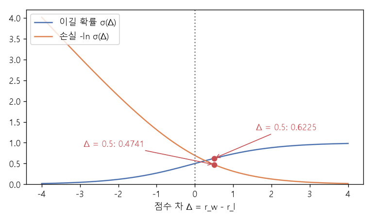

# 선호 비교와 보상 모델 (Bradley-Terry preference model, Reward model, DPO)

[목차로 돌아가기](../../00_MIT%EB%94%A5%EB%9F%AC%EB%8B%9D_%EB%AA%A9%EC%B0%A8.md) · 먼저 볼 것: [M07_로그](../../%EC%88%98%ED%95%99%EA%B0%9C%EB%85%90/01_%EC%88%98%EC%99%80_%ED%95%A8%EC%88%98/M07_%EB%A1%9C%EA%B7%B8.md), [M06_지수와_e](../../%EC%88%98%ED%95%99%EA%B0%9C%EB%85%90/01_%EC%88%98%EC%99%80_%ED%95%A8%EC%88%98/M06_%EC%A7%80%EC%88%98%EC%99%80_e.md), [MM51_KL_발산과_최대_우도](../../%EC%88%98%ED%95%99%EA%B0%9C%EB%85%90/04_%ED%99%95%EB%A5%A0%EA%B3%BC_%EC%A0%95%EB%B3%B4/MM51_KL_%EB%B0%9C%EC%82%B0%EA%B3%BC_%EC%B5%9C%EB%8C%80_%EC%9A%B0%EB%8F%84.md) · 쓰는 곳: [Lec21 10.2](../../Lec21_%EC%96%B8%EC%96%B4_%EB%AA%A8%EB%8D%B8.md#102-%EB%B3%B4%EC%83%81-%EB%AA%A8%EB%8D%B8), [Lec21 10.4](../../Lec21_%EC%96%B8%EC%96%B4_%EB%AA%A8%EB%8D%B8.md#104-%EB%B3%B4%EC%83%81-%EB%AA%A8%EB%8D%B8-%EC%97%86%EC%9D%B4-dpo)

📚 학습 순서 95/99 (13. 언어 모델과 추론): ← 이전: [MM74_n그램과_퍼플렉서티](../../%EC%88%98%ED%95%99%EA%B0%9C%EB%85%90/13_%EC%96%B8%EC%96%B4_%EB%AA%A8%EB%8D%B8%EA%B3%BC_%EC%B6%94%EB%A1%A0/MM74_n%EA%B7%B8%EB%9E%A8%EA%B3%BC_%ED%8D%BC%ED%94%8C%EB%A0%89%EC%84%9C%ED%8B%B0.md) · 다음: [MM76_정책_경사와_보상_가중_우도](../../%EC%88%98%ED%95%99%EA%B0%9C%EB%85%90/13_%EC%96%B8%EC%96%B4_%EB%AA%A8%EB%8D%B8%EA%B3%BC_%EC%B6%94%EB%A1%A0/MM76_%EC%A0%95%EC%B1%85_%EA%B2%BD%EC%82%AC%EC%99%80_%EB%B3%B4%EC%83%81_%EA%B0%80%EC%A4%91_%EC%9A%B0%EB%8F%84.md) →

> [!NOTE]
> **3줄 요약**
> - 사람은 "요약 1이 요약 2보다 낫다"처럼 **둘 중 고르기**는 쉽게 한다. 브래들리-테리(Bradley-Terry) 모형은 점수 차를 [시그모이드](../../00_%EB%94%A5%EB%9F%AC%EB%8B%9D_%EC%9A%A9%EC%96%B4%EC%82%AC%EC%A0%84.md#sigmoid-%EC%8B%9C%EA%B7%B8%EB%AA%A8%EC%9D%B4%EB%93%9C)에 넣어 "1이 이길 [확률](../../00_%EB%94%A5%EB%9F%AC%EB%8B%9D_%EC%9A%A9%EC%96%B4%EC%82%AC%EC%A0%84.md#probability-%ED%99%95%EB%A5%A0)"로 바꾼다. 강의 슬라이드의 점수 4.8과 4.3이면 $\sigma(0.5) = 0.6225$.
> - **[보상 모델](../../00_%EB%94%A5%EB%9F%AC%EB%8B%9D_%EC%9A%A9%EC%96%B4%EC%82%AC%EC%A0%84.md#reward-model-%EB%B3%B4%EC%83%81-%EB%AA%A8%EB%8D%B8)**은 사람이 고른 쪽($y_w$)의 이길 [확률](../../00_%EB%94%A5%EB%9F%AC%EB%8B%9D_%EC%9A%A9%EC%96%B4%EC%82%AC%EC%A0%84.md#probability-%ED%99%95%EB%A5%A0)을 키우도록 [학습](../../00_%EB%94%A5%EB%9F%AC%EB%8B%9D_%EC%9A%A9%EC%96%B4%EC%82%AC%EC%A0%84.md#training-%ED%95%99%EC%8A%B5)한다. [손실](../../00_%EB%94%A5%EB%9F%AC%EB%8B%9D_%EC%9A%A9%EC%96%B4%EC%82%AC%EC%A0%84.md#loss-function-%EC%86%90%EC%8B%A4-%ED%95%A8%EC%88%98) $-\ln \sigma(r_w - r_l)$은 위 예에서 0.4741이고, [학습률](../../00_%EB%94%A5%EB%9F%AC%EB%8B%9D_%EC%9A%A9%EC%96%B4%EC%82%AC%EC%A0%84.md#learning-rate-%ED%95%99%EC%8A%B5%EB%A5%A0) 1로 한 번 갱신하면 점수 차가 1.2551로 벌어져 [손실](../../00_%EB%94%A5%EB%9F%AC%EB%8B%9D_%EC%9A%A9%EC%96%B4%EC%82%AC%EC%A0%84.md#loss-function-%EC%86%90%EC%8B%A4-%ED%95%A8%EC%88%98)이 0.2508로 준다.
> - **[DPO](../../00_%EB%94%A5%EB%9F%AC%EB%8B%9D_%EC%9A%A9%EC%96%B4%EC%82%AC%EC%A0%84.md#dpo-direct-preference-optimization-%EC%A7%81%EC%A0%91-%EC%84%A0%ED%98%B8-%EC%B5%9C%EC%A0%81%ED%99%94)**는 [보상 모델](../../00_%EB%94%A5%EB%9F%AC%EB%8B%9D_%EC%9A%A9%EC%96%B4%EC%82%AC%EC%A0%84.md#reward-model-%EB%B3%B4%EC%83%81-%EB%AA%A8%EB%8D%B8)을 따로 두지 않고, [언어 모델](../../00_%EB%94%A5%EB%9F%AC%EB%8B%9D_%EC%9A%A9%EC%96%B4%EC%82%AC%EC%A0%84.md#language-model-%EC%96%B8%EC%96%B4-%EB%AA%A8%EB%8D%B8) 자신의 [로그](../../00_%EB%94%A5%EB%9F%AC%EB%8B%9D_%EC%9A%A9%EC%96%B4%EC%82%AC%EC%A0%84.md#log-ln-%EB%A1%9C%EA%B7%B8) [확률](../../00_%EB%94%A5%EB%9F%AC%EB%8B%9D_%EC%9A%A9%EC%96%B4%EC%82%AC%EC%A0%84.md#probability-%ED%99%95%EB%A5%A0) 비 $\beta \ln(\pi_\theta / \pi_{\text{ref}})$를 점수로 써서 같은 [손실](../../00_%EB%94%A5%EB%9F%AC%EB%8B%9D_%EC%9A%A9%EC%96%B4%EC%82%AC%EC%A0%84.md#loss-function-%EC%86%90%EC%8B%A4-%ED%95%A8%EC%88%98)을 바로 줄인다.

## 1. 개념 설명

비유: 맛 대결 프로그램. 심사위원에게 "이 짜장면은 몇 점?"이라고 물으면 사람마다 기준이 달라 4점, 8점이 뒤섞인다. "A와 B 중 어느 쪽이 더 맛있나?"라고 물으면 훨씬 일관되게 답한다. 이런 둘 중 고르기 결과를 많이 모아, 그 결과를 가장 잘 설명하는 **숨은 점수**를 거꾸로 찾아내는 것이 브래들리-테리 모형이다(체스의 Elo 점수와 같은 생각).

- **점수 차 → 이길 [확률](../../00_%EB%94%A5%EB%9F%AC%EB%8B%9D_%EC%9A%A9%EC%96%B4%EC%82%AC%EC%A0%84.md#probability-%ED%99%95%EB%A5%A0)**: 점수가 같으면 반반(0.5), 차이가 클수록 1에 가까워진다. 이 모양을 만드는 함수가 [시그모이드](../../00_%EB%94%A5%EB%9F%AC%EB%8B%9D_%EC%9A%A9%EC%96%B4%EC%82%AC%EC%A0%84.md#sigmoid-%EC%8B%9C%EA%B7%B8%EB%AA%A8%EC%9D%B4%EB%93%9C) $\sigma(z) = 1/(1 + e^{-z})$다.
- **[보상 모델](../../00_%EB%94%A5%EB%9F%AC%EB%8B%9D_%EC%9A%A9%EC%96%B4%EC%82%AC%EC%A0%84.md#reward-model-%EB%B3%B4%EC%83%81-%EB%AA%A8%EB%8D%B8)** $r_\phi(x, y)$: 질문(또는 기사) $x$와 답(요약) $y$를 받아 점수 하나를 내는 신경망. 보통 [언어 모델](../../00_%EB%94%A5%EB%9F%AC%EB%8B%9D_%EC%9A%A9%EC%96%B4%EC%82%AC%EC%A0%84.md#language-model-%EC%96%B8%EC%96%B4-%EB%AA%A8%EB%8D%B8)의 마지막 [층](../../00_%EB%94%A5%EB%9F%AC%EB%8B%9D_%EC%9A%A9%EC%96%B4%EC%82%AC%EC%A0%84.md#layer-%EC%B8%B5)을 숫자 하나를 내는 머리로 바꿔 만든다.
- **[학습](../../00_%EB%94%A5%EB%9F%AC%EB%8B%9D_%EC%9A%A9%EC%96%B4%EC%82%AC%EC%A0%84.md#training-%ED%95%99%EC%8A%B5)**: 사람이 이긴 쪽으로 고른 $y_w$(winner)와 진 쪽 $y_l$(loser) 쌍마다, "$y_w$가 이길 [확률](../../00_%EB%94%A5%EB%9F%AC%EB%8B%9D_%EC%9A%A9%EC%96%B4%EC%82%AC%EC%A0%84.md#probability-%ED%99%95%EB%A5%A0)"의 음의 [로그](../../00_%EB%94%A5%EB%9F%AC%EB%8B%9D_%EC%9A%A9%EC%96%B4%EC%82%AC%EC%A0%84.md#log-ln-%EB%A1%9C%EA%B7%B8)를 줄인다. [정답](../../00_%EB%94%A5%EB%9F%AC%EB%8B%9D_%EC%9A%A9%EC%96%B4%EC%82%AC%EC%A0%84.md#label-%EC%A0%95%EB%8B%B5)이 "이김"인 [이진 분류](../../00_%EB%94%A5%EB%9F%AC%EB%8B%9D_%EC%9A%A9%EC%96%B4%EC%82%AC%EC%A0%84.md#binary-classification-%EC%9D%B4%EC%A7%84-%EB%B6%84%EB%A5%98)의 [교차 엔트로피](../../00_%EB%94%A5%EB%9F%AC%EB%8B%9D_%EC%9A%A9%EC%96%B4%EC%82%AC%EC%A0%84.md#cross-entropy-%EA%B5%90%EC%B0%A8-%EC%97%94%ED%8A%B8%EB%A1%9C%ED%94%BC)와 같다.

## 2. 필요한 이유

[Lec21 10.2](../../Lec21_%EC%96%B8%EC%96%B4_%EB%AA%A8%EB%8D%B8.md#102-%EB%B3%B4%EC%83%81-%EB%AA%A8%EB%8D%B8)에서 강사는 "알아보기(recognition)가 만들어 내기(generation)보다 쉽다"는 점을 강조한다. 좋은 요약을 직접 쓰게 하는 것보다, 모델이 쓴 요약 두 개 중 나은 쪽을 고르게 하는 것이 사람에게 훨씬 싸다. 그 고르기 데이터로 점수 매기는 모델을 만들면, 사람 대신 무한히 점수를 매겨 줄 "마법의 상자"가 생긴다. [10.3](../../Lec21_%EC%96%B8%EC%96%B4_%EB%AA%A8%EB%8D%B8.md#103-%EC%A0%95%EC%B1%85-%EA%B2%BD%EC%82%AC)의 [정책 경사](../../00_%EB%94%A5%EB%9F%AC%EB%8B%9D_%EC%9A%A9%EC%96%B4%EC%82%AC%EC%A0%84.md#policy-gradient-%EC%A0%95%EC%B1%85-%EA%B2%BD%EC%82%AC)는 이 점수를 최대화하고, [10.4](../../Lec21_%EC%96%B8%EC%96%B4_%EB%AA%A8%EB%8D%B8.md#104-%EB%B3%B4%EC%83%81-%EB%AA%A8%EB%8D%B8-%EC%97%86%EC%9D%B4-dpo)의 [DPO](../../00_%EB%94%A5%EB%9F%AC%EB%8B%9D_%EC%9A%A9%EC%96%B4%EC%82%AC%EC%A0%84.md#dpo-direct-preference-optimization-%EC%A7%81%EC%A0%91-%EC%84%A0%ED%98%B8-%EC%B5%9C%EC%A0%81%ED%99%94)는 이 상자를 건너뛴다.

## 3. 숫자로 보기

강의 슬라이드의 두 요약: $r_\phi(x, s_1) = 4.8$, $r_\phi(x, s_2) = 4.3$. 사람이 $s_1$을 골랐다고 하자.

| 점수 차 $\Delta = r_w - r_l$ | $y_w$가 이길 [확률](../../00_%EB%94%A5%EB%9F%AC%EB%8B%9D_%EC%9A%A9%EC%96%B4%EC%82%AC%EC%A0%84.md#probability-%ED%99%95%EB%A5%A0) $\sigma(\Delta)$ | [손실](../../00_%EB%94%A5%EB%9F%AC%EB%8B%9D_%EC%9A%A9%EC%96%B4%EC%82%AC%EC%A0%84.md#loss-function-%EC%86%90%EC%8B%A4-%ED%95%A8%EC%88%98) $-\ln \sigma(\Delta)$ | [기울기](../../00_%EB%94%A5%EB%9F%AC%EB%8B%9D_%EC%9A%A9%EC%96%B4%EC%82%AC%EC%A0%84.md#gradient-%EA%B8%B0%EC%9A%B8%EA%B8%B0) $\sigma(\Delta) - 1$ |
|---|---|---|---|
| -1 ([보상 모델](../../00_%EB%94%A5%EB%9F%AC%EB%8B%9D_%EC%9A%A9%EC%96%B4%EC%82%AC%EC%A0%84.md#reward-model-%EB%B3%B4%EC%83%81-%EB%AA%A8%EB%8D%B8)이 반대로 믿음) | 0.2689 | 1.3133 | -0.7311 |
| 0 (구별 못 함) | 0.5 | 0.6931 | -0.5 |
| 0.5 (강의 예) | 0.6225 | 0.4741 | -0.3775 |
| 1.5 | 0.8176 | 0.2014 | -0.1824 |
| 2 | 0.8808 | 0.1269 | -0.1192 |

- 틀리게 믿을수록 [손실](../../00_%EB%94%A5%EB%9F%AC%EB%8B%9D_%EC%9A%A9%EC%96%B4%EC%82%AC%EC%A0%84.md#loss-function-%EC%86%90%EC%8B%A4-%ED%95%A8%EC%88%98)과 [기울기](../../00_%EB%94%A5%EB%9F%AC%EB%8B%9D_%EC%9A%A9%EC%96%B4%EC%82%AC%EC%A0%84.md#gradient-%EA%B8%B0%EC%9A%B8%EA%B8%B0)가 크다. 이미 확실히 맞히는 쌍은 거의 고치지 않는다.
- 한 번 갱신([학습률](../../00_%EB%94%A5%EB%9F%AC%EB%8B%9D_%EC%9A%A9%EC%96%B4%EC%82%AC%EC%A0%84.md#learning-rate-%ED%95%99%EC%8A%B5%EB%A5%A0) $\eta = 1$, 점수를 직접 [파라미터](../../00_%EB%94%A5%EB%9F%AC%EB%8B%9D_%EC%9A%A9%EC%96%B4%EC%82%AC%EC%A0%84.md#parameter-%ED%8C%8C%EB%9D%BC%EB%AF%B8%ED%84%B0)로 보는 단순화): $r_w$는 $-\eta \times (-0.3775)$만큼 올라 5.1775, $r_l$은 그만큼 내려 3.9225. 점수 차 1.2551, 이길 [확률](../../00_%EB%94%A5%EB%9F%AC%EB%8B%9D_%EC%9A%A9%EC%96%B4%EC%82%AC%EC%A0%84.md#probability-%ED%99%95%EB%A5%A0) 0.7782, [손실](../../00_%EB%94%A5%EB%9F%AC%EB%8B%9D_%EC%9A%A9%EC%96%B4%EC%82%AC%EC%A0%84.md#loss-function-%EC%86%90%EC%8B%A4-%ED%95%A8%EC%88%98) 0.2508.

$$
P(y_w \succ y_l \mid x) = \sigma\big(r_\phi(x, y_w) - r_\phi(x, y_l)\big), \qquad
\mathcal{L}_{\text{RM}} = -\ln \sigma\big(r_\phi(x, y_w) - r_\phi(x, y_l)\big)
$$

<details><summary>기호 풀이</summary>

| 기호 | 읽는 법 | 뜻 | 예제 값 |
| --- | --- | --- | --- |
| $x$ | 엑스 | 질문 또는 요약할 기사 | 기사 한 편 |
| $y_w, y_l$ | 와이 더블유, 와이 엘 | 사람이 고른 답(winner), 고르지 않은 답(loser) | $s_1$, $s_2$ |
| $r_\phi(x, y)$ | 알 파이 | [파라미터](../../00_%EB%94%A5%EB%9F%AC%EB%8B%9D_%EC%9A%A9%EC%96%B4%EC%82%AC%EC%A0%84.md#parameter-%ED%8C%8C%EB%9D%BC%EB%AF%B8%ED%84%B0) $\phi$인 [보상 모델](../../00_%EB%94%A5%EB%9F%AC%EB%8B%9D_%EC%9A%A9%EC%96%B4%EC%82%AC%EC%A0%84.md#reward-model-%EB%B3%B4%EC%83%81-%EB%AA%A8%EB%8D%B8)이 매긴 점수 | 4.8, 4.3 |
| $y_w \succ y_l$ | 와이 더블유가 와이 엘보다 낫다 | 사람이 $y_w$를 고르는 사건 | |
| $\sigma(z)$ | [시그모이드](../../00_%EB%94%A5%EB%9F%AC%EB%8B%9D_%EC%9A%A9%EC%96%B4%EC%82%AC%EC%A0%84.md#sigmoid-%EC%8B%9C%EA%B7%B8%EB%AA%A8%EC%9D%B4%EB%93%9C) | $1/(1 + e^{-z})$, 아무 수를 0과 1 사이로 | $\sigma(0.5) = 0.6225$ |
| $\mathcal{L}_{\text{RM}}$ | 엘 알엠 | [보상 모델](../../00_%EB%94%A5%EB%9F%AC%EB%8B%9D_%EC%9A%A9%EC%96%B4%EC%82%AC%EC%A0%84.md#reward-model-%EB%B3%B4%EC%83%81-%EB%AA%A8%EB%8D%B8)의 [손실](../../00_%EB%94%A5%EB%9F%AC%EB%8B%9D_%EC%9A%A9%EC%96%B4%EC%82%AC%EC%A0%84.md#loss-function-%EC%86%90%EC%8B%A4-%ED%95%A8%EC%88%98) | 0.4741 |

</details>

<details><summary>예제와 풀이</summary>

**문제**: [보상 모델](../../00_%EB%94%A5%EB%9F%AC%EB%8B%9D_%EC%9A%A9%EC%96%B4%EC%82%AC%EC%A0%84.md#reward-model-%EB%B3%B4%EC%83%81-%EB%AA%A8%EB%8D%B8)이 요약 $s_1$에 4.8점, $s_2$에 4.3점을 주었다. 사람은 $s_1$을 골랐다. 모델이 본 "$s_1$이 이길 [확률](../../00_%EB%94%A5%EB%9F%AC%EB%8B%9D_%EC%9A%A9%EC%96%B4%EC%82%AC%EC%A0%84.md#probability-%ED%99%95%EB%A5%A0)"과 이 쌍의 [손실](../../00_%EB%94%A5%EB%9F%AC%EB%8B%9D_%EC%9A%A9%EC%96%B4%EC%82%AC%EC%A0%84.md#loss-function-%EC%86%90%EC%8B%A4-%ED%95%A8%EC%88%98)은?

**주어진 값**
- $r_\phi(x, y_w) = 4.8$ (사람이 고른 요약 $s_1$의 점수)
- $r_\phi(x, y_l) = 4.3$ (고르지 않은 요약 $s_2$의 점수)

**풀이**
1. 식을 그대로 쓴다: $P = \sigma\big(r_\phi(x, y_w) - r_\phi(x, y_l)\big) = \dfrac{1}{1 + e^{-(r_w - r_l)}}$, $\mathcal{L}_{\text{RM}} = -\ln P$
2. 값을 대입한다: $P = \dfrac{1}{1 + e^{-(4.8 - 4.3)}}$
3. 점수 차를 뺀다: $4.8 - 4.3 = 0.5$ 이므로 $P = \dfrac{1}{1 + e^{-0.5}}$
4. [지수](../../00_%EB%94%A5%EB%9F%AC%EB%8B%9D_%EC%9A%A9%EC%96%B4%EC%82%AC%EC%A0%84.md#e-exponent-e%EC%99%80-%EC%A7%80%EC%88%98)를 계산한다. $e$는 약 2.718인 수이고 $e^{a}$는 그 $a$제곱이다(계산기의 exp): $e^{-0.5} = 0.6065$ 이므로 $P = \dfrac{1}{1 + 0.6065}$
5. 분모를 더한다: $1 + 0.6065 = 1.6065$
6. 나눈다: $1 / 1.6065 = 0.6225$
7. [손실](../../00_%EB%94%A5%EB%9F%AC%EB%8B%9D_%EC%9A%A9%EC%96%B4%EC%82%AC%EC%A0%84.md#loss-function-%EC%86%90%EC%8B%A4-%ED%95%A8%EC%88%98)을 구한다. $\ln a$는 "$e$를 몇 제곱해야 $a$가 되나"다: $\ln 0.6225 = -0.4741$ 이므로 $\mathcal{L}_{\text{RM}} = 0.4741$

**답**: 이길 [확률](../../00_%EB%94%A5%EB%9F%AC%EB%8B%9D_%EC%9A%A9%EC%96%B4%EC%82%AC%EC%A0%84.md#probability-%ED%99%95%EB%A5%A0) **0.6225**, [손실](../../00_%EB%94%A5%EB%9F%AC%EB%8B%9D_%EC%9A%A9%EC%96%B4%EC%82%AC%EC%A0%84.md#loss-function-%EC%86%90%EC%8B%A4-%ED%95%A8%EC%88%98) **0.4741**. 점수 차가 작아 모델이 아직 반반에 가깝게 헷갈린다.

</details>

<details><summary>내 이해</summary>


</details>


*▲ 직접 그린 그림: 점수 차 $\Delta$에 따른 이길 [확률](../../00_%EB%94%A5%EB%9F%AC%EB%8B%9D_%EC%9A%A9%EC%96%B4%EC%82%AC%EC%A0%84.md#probability-%ED%99%95%EB%A5%A0) $\sigma(\Delta)$(파랑)와 [손실](../../00_%EB%94%A5%EB%9F%AC%EB%8B%9D_%EC%9A%A9%EC%96%B4%EC%82%AC%EC%A0%84.md#loss-function-%EC%86%90%EC%8B%A4-%ED%95%A8%EC%88%98) $-\ln \sigma(\Delta)$(주황). 점은 강의 예 $\Delta = 0.5$(0.6225, 0.4741)*

**[DPO](../../00_%EB%94%A5%EB%9F%AC%EB%8B%9D_%EC%9A%A9%EC%96%B4%EC%82%AC%EC%A0%84.md#dpo-direct-preference-optimization-%EC%A7%81%EC%A0%91-%EC%84%A0%ED%98%B8-%EC%B5%9C%EC%A0%81%ED%99%94): [보상 모델](../../00_%EB%94%A5%EB%9F%AC%EB%8B%9D_%EC%9A%A9%EC%96%B4%EC%82%AC%EC%A0%84.md#reward-model-%EB%B3%B4%EC%83%81-%EB%AA%A8%EB%8D%B8) 없이** — 점수 자리에 "지금 모델이 기준 모델보다 그 답을 얼마나 더 좋아하나"를 넣는다.

- $y_w$: 지금 모델 $\pi_\theta = 0.3$, 기준 모델 $\pi_{\text{ref}} = 0.2$ → 비 1.5, $\ln 1.5 = 0.4055$
- $y_l$: $\pi_\theta = 0.1$, $\pi_{\text{ref}} = 0.2$ → 비 0.5, $\ln 0.5 = -0.6931$
- $\beta = 0.1$이면 점수 차 $0.1 \times (0.4055 + 0.6931) = 0.1099$, [손실](../../00_%EB%94%A5%EB%9F%AC%EB%8B%9D_%EC%9A%A9%EC%96%B4%EC%82%AC%EC%A0%84.md#loss-function-%EC%86%90%EC%8B%A4-%ED%95%A8%EC%88%98) $-\ln \sigma(0.1099) = 0.6397$

$$
\mathcal{L}_{\text{DPO}} = -\ln \sigma\Big(\beta \ln \frac{\pi_\theta(y_w \mid x)}{\pi_{\text{ref}}(y_w \mid x)} - \beta \ln \frac{\pi_\theta(y_l \mid x)}{\pi_{\text{ref}}(y_l \mid x)}\Big)
$$

<details><summary>기호 풀이</summary>

| 기호 | 읽는 법 | 뜻 | 예제 값 |
| --- | --- | --- | --- |
| $\pi_\theta(y \mid x)$ | 파이 세타 | 지금 [학습](../../00_%EB%94%A5%EB%9F%AC%EB%8B%9D_%EC%9A%A9%EC%96%B4%EC%82%AC%EC%A0%84.md#training-%ED%95%99%EC%8A%B5) 중인 [언어 모델](../../00_%EB%94%A5%EB%9F%AC%EB%8B%9D_%EC%9A%A9%EC%96%B4%EC%82%AC%EC%A0%84.md#language-model-%EC%96%B8%EC%96%B4-%EB%AA%A8%EB%8D%B8)이 답 $y$에 주는 [확률](../../00_%EB%94%A5%EB%9F%AC%EB%8B%9D_%EC%9A%A9%EC%96%B4%EC%82%AC%EC%A0%84.md#probability-%ED%99%95%EB%A5%A0) | 0.3, 0.1 |
| $\pi_{\text{ref}}(y \mid x)$ | 파이 레프 | 출발점([지시 튜닝](../../00_%EB%94%A5%EB%9F%AC%EB%8B%9D_%EC%9A%A9%EC%96%B4%EC%82%AC%EC%A0%84.md#instruction-tuning-%EC%A7%80%EC%8B%9C-%ED%8A%9C%EB%8B%9D) 뒤) 모델의 [확률](../../00_%EB%94%A5%EB%9F%AC%EB%8B%9D_%EC%9A%A9%EC%96%B4%EC%82%AC%EC%A0%84.md#probability-%ED%99%95%EB%A5%A0), 얼려 둠 | 0.2, 0.2 |
| $\beta$ | 베타 | 기준 모델에서 얼마나 멀어져도 되는지 정하는 세기 | 0.1 |
| $\beta \ln \frac{\pi_\theta}{\pi_{\text{ref}}}$ | 암묵적 보상 | [보상 모델](../../00_%EB%94%A5%EB%9F%AC%EB%8B%9D_%EC%9A%A9%EC%96%B4%EC%82%AC%EC%A0%84.md#reward-model-%EB%B3%B4%EC%83%81-%EB%AA%A8%EB%8D%B8) 점수 대신 쓰는 점수 | 0.0405, -0.0693 |
| $\mathcal{L}_{\text{DPO}}$ | 엘 디피오 | [DPO](../../00_%EB%94%A5%EB%9F%AC%EB%8B%9D_%EC%9A%A9%EC%96%B4%EC%82%AC%EC%A0%84.md#dpo-direct-preference-optimization-%EC%A7%81%EC%A0%91-%EC%84%A0%ED%98%B8-%EC%B5%9C%EC%A0%81%ED%99%94) [손실](../../00_%EB%94%A5%EB%9F%AC%EB%8B%9D_%EC%9A%A9%EC%96%B4%EC%82%AC%EC%A0%84.md#loss-function-%EC%86%90%EC%8B%A4-%ED%95%A8%EC%88%98) | 0.6397 |

</details>

<details><summary>예제와 풀이</summary>

**문제**: 사람이 고른 답 $y_w$에 지금 모델은 0.3, 기준 모델은 0.2를 준다. 고르지 않은 답 $y_l$에는 둘 다 각각 0.1과 0.2를 준다. $\beta = 0.1$일 때 [DPO](../../00_%EB%94%A5%EB%9F%AC%EB%8B%9D_%EC%9A%A9%EC%96%B4%EC%82%AC%EC%A0%84.md#dpo-direct-preference-optimization-%EC%A7%81%EC%A0%91-%EC%84%A0%ED%98%B8-%EC%B5%9C%EC%A0%81%ED%99%94) [손실](../../00_%EB%94%A5%EB%9F%AC%EB%8B%9D_%EC%9A%A9%EC%96%B4%EC%82%AC%EC%A0%84.md#loss-function-%EC%86%90%EC%8B%A4-%ED%95%A8%EC%88%98)은?

**주어진 값**
- $\pi_\theta(y_w \mid x) = 0.3$, $\pi_{\text{ref}}(y_w \mid x) = 0.2$ (고른 답의 [확률](../../00_%EB%94%A5%EB%9F%AC%EB%8B%9D_%EC%9A%A9%EC%96%B4%EC%82%AC%EC%A0%84.md#probability-%ED%99%95%EB%A5%A0): 지금 모델, 기준 모델)
- $\pi_\theta(y_l \mid x) = 0.1$, $\pi_{\text{ref}}(y_l \mid x) = 0.2$ (안 고른 답의 [확률](../../00_%EB%94%A5%EB%9F%AC%EB%8B%9D_%EC%9A%A9%EC%96%B4%EC%82%AC%EC%A0%84.md#probability-%ED%99%95%EB%A5%A0))
- $\beta = 0.1$ (세기)

**풀이**
1. 식을 그대로 쓴다: $\mathcal{L}_{\text{DPO}} = -\ln \sigma\Big(\beta \ln \dfrac{\pi_\theta(y_w \mid x)}{\pi_{\text{ref}}(y_w \mid x)} - \beta \ln \dfrac{\pi_\theta(y_l \mid x)}{\pi_{\text{ref}}(y_l \mid x)}\Big)$
2. 값을 대입한다: $\mathcal{L}_{\text{DPO}} = -\ln \sigma\Big(0.1 \ln \dfrac{0.3}{0.2} - 0.1 \ln \dfrac{0.1}{0.2}\Big)$
3. 나눗셈을 먼저 한다: $0.3 / 0.2 = 1.5$, $0.1 / 0.2 = 0.5$ 이므로 $-\ln \sigma(0.1 \ln 1.5 - 0.1 \ln 0.5)$
4. [로그](../../00_%EB%94%A5%EB%9F%AC%EB%8B%9D_%EC%9A%A9%EC%96%B4%EC%82%AC%EC%A0%84.md#log-ln-%EB%A1%9C%EA%B7%B8)를 계산한다: $\ln 1.5 = 0.4055$, $\ln 0.5 = -0.6931$ 이므로 $-\ln \sigma(0.1 \times 0.4055 - 0.1 \times (-0.6931))$
5. 곱한다: $0.1 \times 0.4055 = 0.0405$, $0.1 \times (-0.6931) = -0.0693$
6. 뺀다: $0.0405 - (-0.0693) = 0.1099$ (반올림 전 값으로) 이므로 $-\ln \sigma(0.1099)$
7. [시그모이드](../../00_%EB%94%A5%EB%9F%AC%EB%8B%9D_%EC%9A%A9%EC%96%B4%EC%82%AC%EC%A0%84.md#sigmoid-%EC%8B%9C%EA%B7%B8%EB%AA%A8%EC%9D%B4%EB%93%9C)를 계산한다: $e^{-0.1099} = 0.8959$, $1 + 0.8959 = 1.8959$, $1 / 1.8959 = 0.5274$
8. 음의 [로그](../../00_%EB%94%A5%EB%9F%AC%EB%8B%9D_%EC%9A%A9%EC%96%B4%EC%82%AC%EC%A0%84.md#log-ln-%EB%A1%9C%EA%B7%B8)를 씌운다: $-\ln 0.5274 = 0.6397$ (반올림한 0.5274로 하면 0.6398)

**답**: **0.6397**. 반반일 때의 0.6931보다 조금 작다. [학습](../../00_%EB%94%A5%EB%9F%AC%EB%8B%9D_%EC%9A%A9%EC%96%B4%EC%82%AC%EC%A0%84.md#training-%ED%95%99%EC%8A%B5)은 $\pi_\theta(y_w)$를 더 올리고 $\pi_\theta(y_l)$을 더 내려 이 값을 줄인다.

</details>

<details><summary>내 이해</summary>


</details>

## 4. 코드로 확인

```python
# [함수] sig: 시그모이드 1 / (1 + e^-z). 점수 차를 이길 확률로 바꾼다
sig = lambda z: 1 / (1 + np.exp(-z))
# [변수] d: 3절 표의 점수 차들. 0.5가 강의 예(4.8 - 4.3)
d = np.array([-1, 0, 0.5, 1.5, 2])
# [연결] 3절 표: 이길 확률, 손실 -ln σ, 기울기 σ - 1
print(sig(d).round(4), (-np.log(sig(d))).round(4), (sig(d) - 1).round(4))
# [변수] rw, rl: 강의 슬라이드의 두 요약 점수 (사람은 s1을 고름)
rw, rl = 4.8, 4.3
# [변수] g: 점수 차에 대한 손실의 기울기 σ(Δ) - 1 = -0.3775
g = sig(rw - rl) - 1
# [변수] rw, rl: 학습률 1로 한 번 내려간 뒤 점수. 이긴 쪽은 오르고 진 쪽은 내린다
rw, rl = rw - g, rl + g
# [연결] 3절 마지막 줄: 5.1775 3.9225 1.2551 0.7782 0.2508
print(round(rw, 4), round(rl, 4), round(rw - rl, 4), round(sig(rw - rl), 4), round(-np.log(sig(rw - rl)), 4))
# [변수] beta: DPO 세기, lw, ll: 고른 답과 안 고른 답의 로그 확률 비
beta, lw, ll = 0.1, np.log(0.3 / 0.2), np.log(0.1 / 0.2)
# [연결] DPO 예제: 점수 차 0.1099, 손실 0.6397
print(round(beta * (lw - ll), 4), round(-np.log(sig(beta * (lw - ll))), 4))
```

**실행 결과**:

```text
[0.2689 0.5    0.6225 0.8176 0.8808] [1.3133 0.6931 0.4741 0.2014 0.1269] [-0.7311 -0.5    -0.3775 -0.1824 -0.1192]
5.1775 3.9225 1.2551 0.7782 0.2508
0.1099 0.6397
```

> [!WARNING]
> **⚠ 주의**
> - 모든 점수에 같은 수를 더해도 $\sigma(r_w - r_l)$은 그대로다. 그래서 [보상 모델](../../00_%EB%94%A5%EB%9F%AC%EB%8B%9D_%EC%9A%A9%EC%96%B4%EC%82%AC%EC%A0%84.md#reward-model-%EB%B3%B4%EC%83%81-%EB%AA%A8%EB%8D%B8) 점수 4.8 자체에는 뜻이 없고, **같은 질문에 대한 답끼리의 차이**만 뜻이 있다.
> - [보상 모델](../../00_%EB%94%A5%EB%9F%AC%EB%8B%9D_%EC%9A%A9%EC%96%B4%EC%82%AC%EC%A0%84.md#reward-model-%EB%B3%B4%EC%83%81-%EB%AA%A8%EB%8D%B8)은 사람의 판단을 흉내 낸 근사일 뿐이다. [언어 모델](../../00_%EB%94%A5%EB%9F%AC%EB%8B%9D_%EC%9A%A9%EC%96%B4%EC%82%AC%EC%A0%84.md#language-model-%EC%96%B8%EC%96%B4-%EB%AA%A8%EB%8D%B8)이 그 점수만 끝없이 올리면 사람 눈에는 이상한데 점수만 높은 답(보상 해킹)이 나온다. 그래서 [RLHF](../../00_%EB%94%A5%EB%9F%AC%EB%8B%9D_%EC%9A%A9%EC%96%B4%EC%82%AC%EC%A0%84.md#rlhf-reinforcement-learning-from-human-feedback-%EC%82%AC%EB%9E%8C-%ED%94%BC%EB%93%9C%EB%B0%B1-%EA%B0%95%ED%99%94-%ED%95%99%EC%8A%B5)는 기준 모델과의 [KL 발산](../../00_%EB%94%A5%EB%9F%AC%EB%8B%9D_%EC%9A%A9%EC%96%B4%EC%82%AC%EC%A0%84.md#kl-divergence-kl-%EB%B0%9C%EC%82%B0) 벌점을 함께 쓰고, [DPO](../../00_%EB%94%A5%EB%9F%AC%EB%8B%9D_%EC%9A%A9%EC%96%B4%EC%82%AC%EC%A0%84.md#dpo-direct-preference-optimization-%EC%A7%81%EC%A0%91-%EC%84%A0%ED%98%B8-%EC%B5%9C%EC%A0%81%ED%99%94)에서는 $\beta$와 $\pi_{\text{ref}}$가 그 역할을 한다.
> - [DPO](../../00_%EB%94%A5%EB%9F%AC%EB%8B%9D_%EC%9A%A9%EC%96%B4%EC%82%AC%EC%A0%84.md#dpo-direct-preference-optimization-%EC%A7%81%EC%A0%91-%EC%84%A0%ED%98%B8-%EC%B5%9C%EC%A0%81%ED%99%94)의 "점수"는 [확률](../../00_%EB%94%A5%EB%9F%AC%EB%8B%9D_%EC%9A%A9%EC%96%B4%EC%82%AC%EC%A0%84.md#probability-%ED%99%95%EB%A5%A0) 자체가 아니라 **기준 모델 대비 비**다. 지금 모델이 $y_w$에 준 [확률](../../00_%EB%94%A5%EB%9F%AC%EB%8B%9D_%EC%9A%A9%EC%96%B4%EC%82%AC%EC%A0%84.md#probability-%ED%99%95%EB%A5%A0)이 낮아도 기준 모델보다 덜 낮으면 이긴 쪽 점수가 높다.
> - 사람끼리도 선호가 갈린다. 같은 쌍을 두 사람이 반대로 고르면 [손실](../../00_%EB%94%A5%EB%9F%AC%EB%8B%9D_%EC%9A%A9%EC%96%B4%EC%82%AC%EC%A0%84.md#loss-function-%EC%86%90%EC%8B%A4-%ED%95%A8%EC%88%98)이 가장 작은 점은 점수 차 0, 이길 [확률](../../00_%EB%94%A5%EB%9F%AC%EB%8B%9D_%EC%9A%A9%EC%96%B4%EC%82%AC%EC%A0%84.md#probability-%ED%99%95%EB%A5%A0) 0.5다.

## 5. 개념 재확인

<details><summary>1. 보상 모델 점수가 A = 1, B = 0, C = -1이다. A가 B를 이길 확률과 A가 C를 이길 확률은?</summary>

| 단계 | 하는 일 | 계산 | 결과 |
|---|---|---|---|
| 1 | 점수 차 | $1 - 0$, $1 - (-1)$ | 1, 2 |
| 2 | [지수](../../00_%EB%94%A5%EB%9F%AC%EB%8B%9D_%EC%9A%A9%EC%96%B4%EC%82%AC%EC%A0%84.md#e-exponent-e%EC%99%80-%EC%A7%80%EC%88%98) | $e^{-1}$, $e^{-2}$ | 0.3679, 0.1353 |
| 3 | 분모 | $1 + 0.3679$, $1 + 0.1353$ | 1.3679, 1.1353 |
| 4 | 나누기 | $1/1.3679$, $1/1.1353$ | 0.7311, 0.8808 |

**① 쓰는 식**
$$P(y_w \succ y_l) = \sigma(r_w - r_l) = \frac{1}{1 + e^{-(r_w - r_l)}}$$
- 위 식 ← ② (점수 차), ③ ([지수](../../00_%EB%94%A5%EB%9F%AC%EB%8B%9D_%EC%9A%A9%EC%96%B4%EC%82%AC%EC%A0%84.md#e-exponent-e%EC%99%80-%EC%A7%80%EC%88%98)와 분모), ④ (나누기)에서 쓴다.
```python
# [변수] r: 세 답의 점수 (A, B, C)
r = {"A": 1.0, "B": 0.0, "C": -1.0}                        # ①
# [변수] dAB = 1, dAC = 2: 점수 차
dAB, dAC = r["A"] - r["B"], r["A"] - r["C"]               # ②
# [연결] 0.3679 0.1353 / 0.7311 0.8808
print(round(np.exp(-dAB), 4), round(np.exp(-dAC), 4))     # ③
print(round(1 / (1 + np.exp(-dAB)), 4), round(1 / (1 + np.exp(-dAC)), 4))   # ④
```

**주어진 값**
- $r_A = 1$, $r_B = 0$, $r_C = -1$ (세 답의 점수)

**풀이**
1. 식을 그대로 쓴다: $P(y_w \succ y_l) = \dfrac{1}{1 + e^{-(r_w - r_l)}}$
2. 값을 대입한다 (A 대 B): $P(A \succ B) = \dfrac{1}{1 + e^{-(1 - 0)}}$
3. (②) 점수 차를 뺀다: $1 - 0 = 1$ 이므로 $\dfrac{1}{1 + e^{-1}}$
4. (③) [지수](../../00_%EB%94%A5%EB%9F%AC%EB%8B%9D_%EC%9A%A9%EC%96%B4%EC%82%AC%EC%A0%84.md#e-exponent-e%EC%99%80-%EC%A7%80%EC%88%98)를 계산한다: $e^{-1} = 0.3679$ 이므로 $\dfrac{1}{1 + 0.3679}$
5. (③) 분모를 더한다: $1 + 0.3679 = 1.3679$
6. (④) 나눈다: $1 / 1.3679 = 0.7311$
7. 값을 대입한다 (A 대 C): $P(A \succ C) = \dfrac{1}{1 + e^{-(1 - (-1))}}$
8. (②) 점수 차를 뺀다: $1 - (-1) = 2$ 이므로 $\dfrac{1}{1 + e^{-2}}$
9. (③) [지수](../../00_%EB%94%A5%EB%9F%AC%EB%8B%9D_%EC%9A%A9%EC%96%B4%EC%82%AC%EC%A0%84.md#e-exponent-e%EC%99%80-%EC%A7%80%EC%88%98)를 계산한다: $e^{-2} = 0.1353$ 이므로 $\dfrac{1}{1 + 0.1353}$
10. (③) 분모를 더한다: $1 + 0.1353 = 1.1353$
11. (④) 나눈다: $1 / 1.1353 = 0.8808$

**답**: A가 B를 이길 [확률](../../00_%EB%94%A5%EB%9F%AC%EB%8B%9D_%EC%9A%A9%EC%96%B4%EC%82%AC%EC%A0%84.md#probability-%ED%99%95%EB%A5%A0) **0.7311**, A가 C를 이길 [확률](../../00_%EB%94%A5%EB%9F%AC%EB%8B%9D_%EC%9A%A9%EC%96%B4%EC%82%AC%EC%A0%84.md#probability-%ED%99%95%EB%A5%A0) **0.8808**. 점수 차가 클수록 확신이 커진다.

</details>

<details><summary>2. 처음에 두 답의 점수가 똑같이 0이다. 사람은 $y_w$를 골랐다. 학습률 1로 점수를 한 번 갱신하면 손실은 얼마에서 얼마로 주나?</summary>

| 단계 | 하는 일 | 계산 | 결과 |
|---|---|---|---|
| 1 | 처음 [손실](../../00_%EB%94%A5%EB%9F%AC%EB%8B%9D_%EC%9A%A9%EC%96%B4%EC%82%AC%EC%A0%84.md#loss-function-%EC%86%90%EC%8B%A4-%ED%95%A8%EC%88%98) | $-\ln \sigma(0)$ | 0.6931 |
| 2 | [기울기](../../00_%EB%94%A5%EB%9F%AC%EB%8B%9D_%EC%9A%A9%EC%96%B4%EC%82%AC%EC%A0%84.md#gradient-%EA%B8%B0%EC%9A%B8%EA%B8%B0) | $\sigma(0) - 1$ | -0.5 |
| 3 | 갱신 | $r_w = 0 + 0.5$, $r_l = 0 - 0.5$ | 0.5, -0.5 |
| 4 | 새 [손실](../../00_%EB%94%A5%EB%9F%AC%EB%8B%9D_%EC%9A%A9%EC%96%B4%EC%82%AC%EC%A0%84.md#loss-function-%EC%86%90%EC%8B%A4-%ED%95%A8%EC%88%98) | $-\ln \sigma(1)$ | 0.3133 |

**① 쓰는 식**
$$\mathcal{L} = -\ln \sigma(r_w - r_l), \qquad \frac{\partial \mathcal{L}}{\partial r_w} = \sigma(r_w - r_l) - 1 = -\frac{\partial \mathcal{L}}{\partial r_l}$$
- 왼쪽 식 ← ② (처음 [손실](../../00_%EB%94%A5%EB%9F%AC%EB%8B%9D_%EC%9A%A9%EC%96%B4%EC%82%AC%EC%A0%84.md#loss-function-%EC%86%90%EC%8B%A4-%ED%95%A8%EC%88%98)), ⑤ (새 [손실](../../00_%EB%94%A5%EB%9F%AC%EB%8B%9D_%EC%9A%A9%EC%96%B4%EC%82%AC%EC%A0%84.md#loss-function-%EC%86%90%EC%8B%A4-%ED%95%A8%EC%88%98)), 오른쪽 식 ← ③ ([기울기](../../00_%EB%94%A5%EB%9F%AC%EB%8B%9D_%EC%9A%A9%EC%96%B4%EC%82%AC%EC%A0%84.md#gradient-%EA%B8%B0%EC%9A%B8%EA%B8%B0)), ④ (갱신)에서 쓴다.
```python
# [함수] sig: 시그모이드, [변수] rw, rl: 처음 점수 0, 0
sig, rw, rl = (lambda z: 1 / (1 + np.exp(-z))), 0.0, 0.0   # ①
# [변수] L0 = 0.6931: 처음 손실
L0 = -np.log(sig(rw - rl))                                # ②
# [변수] g = -0.5: r_w에 대한 기울기
g = sig(rw - rl) - 1                                      # ③
# [변수] rw = 0.5, rl = -0.5: 경사 하강 한 번 (r_l의 기울기는 -g)
rw, rl = rw - 1 * g, rl + 1 * g                           # ④
# [연결] 0.6931 -0.5 0.5 -0.5 0.3133
print(round(L0, 4), g, rw, rl, round(-np.log(sig(rw - rl)), 4))   # ⑤
```

**주어진 값**
- $r_w = 0$, $r_l = 0$ (처음 점수)
- $\eta = 1$ ([학습률](../../00_%EB%94%A5%EB%9F%AC%EB%8B%9D_%EC%9A%A9%EC%96%B4%EC%82%AC%EC%A0%84.md#learning-rate-%ED%95%99%EC%8A%B5%EB%A5%A0))

**풀이**
1. 식을 그대로 쓴다: $\mathcal{L} = -\ln \sigma(r_w - r_l)$, $\dfrac{\partial \mathcal{L}}{\partial r_w} = \sigma(r_w - r_l) - 1$
2. 값을 대입한다: $\mathcal{L} = -\ln \sigma(0 - 0)$, $\dfrac{\partial \mathcal{L}}{\partial r_w} = \sigma(0 - 0) - 1$
3. (②) 점수 차를 뺀다: $0 - 0 = 0$, $\sigma(0) = \dfrac{1}{1 + e^{0}} = \dfrac{1}{2} = 0.5$
4. (②) 처음 [손실](../../00_%EB%94%A5%EB%9F%AC%EB%8B%9D_%EC%9A%A9%EC%96%B4%EC%82%AC%EC%A0%84.md#loss-function-%EC%86%90%EC%8B%A4-%ED%95%A8%EC%88%98)을 구한다: $-\ln 0.5 = 0.6931$
5. (③) [기울기](../../00_%EB%94%A5%EB%9F%AC%EB%8B%9D_%EC%9A%A9%EC%96%B4%EC%82%AC%EC%A0%84.md#gradient-%EA%B8%B0%EC%9A%B8%EA%B8%B0)를 구한다: $0.5 - 1 = -0.5$
6. (④) $r_w$를 갱신한다. 경사 하강은 [기울기](../../00_%EB%94%A5%EB%9F%AC%EB%8B%9D_%EC%9A%A9%EC%96%B4%EC%82%AC%EC%A0%84.md#gradient-%EA%B8%B0%EC%9A%B8%EA%B8%B0)의 반대로 간다: $r_w = 0 - 1 \times (-0.5) = 0.5$
7. (④) $r_l$을 갱신한다. $r_l$의 [기울기](../../00_%EB%94%A5%EB%9F%AC%EB%8B%9D_%EC%9A%A9%EC%96%B4%EC%82%AC%EC%A0%84.md#gradient-%EA%B8%B0%EC%9A%B8%EA%B8%B0)는 부호가 반대(+0.5)다: $r_l = 0 - 1 \times 0.5 = -0.5$
8. (⑤) 새 점수 차를 뺀다: $0.5 - (-0.5) = 1$
9. (⑤) 새 [손실](../../00_%EB%94%A5%EB%9F%AC%EB%8B%9D_%EC%9A%A9%EC%96%B4%EC%82%AC%EC%A0%84.md#loss-function-%EC%86%90%EC%8B%A4-%ED%95%A8%EC%88%98)을 구한다: $\sigma(1) = 0.7311$, $-\ln 0.7311 = 0.3133$

**답**: [손실](../../00_%EB%94%A5%EB%9F%AC%EB%8B%9D_%EC%9A%A9%EC%96%B4%EC%82%AC%EC%A0%84.md#loss-function-%EC%86%90%EC%8B%A4-%ED%95%A8%EC%88%98)이 **0.6931**에서 **0.3133**으로 준다. 고른 쪽 점수는 오르고 안 고른 쪽 점수는 같은 만큼 내린다.

</details>

## 예제 풀기

[예제 10문제 풀기](../../%EC%98%88%EC%A0%9C/13_%EC%96%B8%EC%96%B4_%EB%AA%A8%EB%8D%B8%EA%B3%BC_%EC%B6%94%EB%A1%A0/%EC%98%88%EC%A0%9C_MM75_%EC%84%A0%ED%98%B8_%EB%B9%84%EA%B5%90%EC%99%80_%EB%B3%B4%EC%83%81_%EB%AA%A8%EB%8D%B8.md)

<details><summary>내 이해</summary>


</details>
