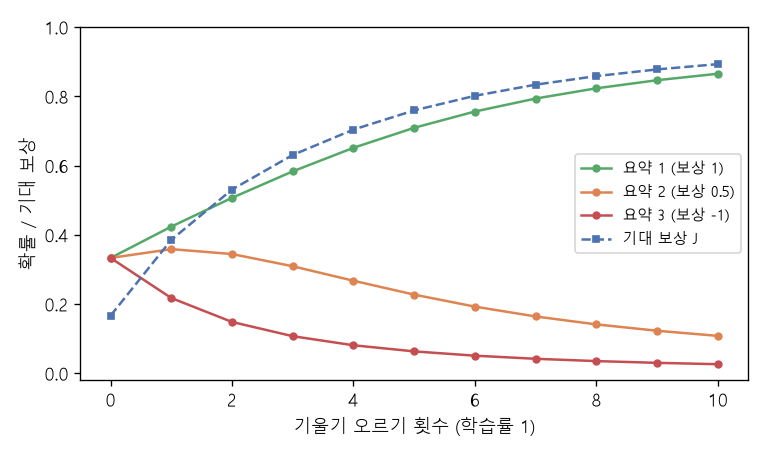

# 정책 경사와 보상 가중 우도 (Policy gradient, Reward-weighted likelihood)

[목차로 돌아가기](../../00_MIT%EB%94%A5%EB%9F%AC%EB%8B%9D_%EB%AA%A9%EC%B0%A8.md) · 먼저 볼 것: [MM75_선호_비교와_보상_모델](../../%EC%88%98%ED%95%99%EA%B0%9C%EB%85%90/13_%EC%96%B8%EC%96%B4_%EB%AA%A8%EB%8D%B8%EA%B3%BC_%EC%B6%94%EB%A1%A0/MM75_%EC%84%A0%ED%98%B8_%EB%B9%84%EA%B5%90%EC%99%80_%EB%B3%B4%EC%83%81_%EB%AA%A8%EB%8D%B8.md), [MM51_KL_발산과_최대_우도](../../%EC%88%98%ED%95%99%EA%B0%9C%EB%85%90/04_%ED%99%95%EB%A5%A0%EA%B3%BC_%EC%A0%95%EB%B3%B4/MM51_KL_%EB%B0%9C%EC%82%B0%EA%B3%BC_%EC%B5%9C%EB%8C%80_%EC%9A%B0%EB%8F%84.md), [MM55_몬테카를로와_중요도_샘플링](../../%EC%88%98%ED%95%99%EA%B0%9C%EB%85%90/11_%EC%83%9D%EC%84%B1_%EB%AA%A8%EB%8D%B8/MM55_%EB%AA%AC%ED%85%8C%EC%B9%B4%EB%A5%BC%EB%A1%9C%EC%99%80_%EC%A4%91%EC%9A%94%EB%8F%84_%EC%83%98%ED%94%8C%EB%A7%81.md) · 쓰는 곳: [Lec21 10.3](../../Lec21_%EC%96%B8%EC%96%B4_%EB%AA%A8%EB%8D%B8.md#103-%EC%A0%95%EC%B1%85-%EA%B2%BD%EC%82%AC)

📚 학습 순서 96/99 (13. 언어 모델과 추론): ← 이전: [MM75_선호_비교와_보상_모델](../../%EC%88%98%ED%95%99%EA%B0%9C%EB%85%90/13_%EC%96%B8%EC%96%B4_%EB%AA%A8%EB%8D%B8%EA%B3%BC_%EC%B6%94%EB%A1%A0/MM75_%EC%84%A0%ED%98%B8_%EB%B9%84%EA%B5%90%EC%99%80_%EB%B3%B4%EC%83%81_%EB%AA%A8%EB%8D%B8.md) · 다음: [MM80_Best-of-N과_적중_확률](../../%EC%88%98%ED%95%99%EA%B0%9C%EB%85%90/13_%EC%96%B8%EC%96%B4_%EB%AA%A8%EB%8D%B8%EA%B3%BC_%EC%B6%94%EB%A1%A0/MM80_Best-of-N%EA%B3%BC_%EC%A0%81%EC%A4%91_%ED%99%95%EB%A5%A0.md) →

> [!NOTE]
> **3줄 요약**
> - [언어 모델](../../00_%EB%94%A5%EB%9F%AC%EB%8B%9D_%EC%9A%A9%EC%96%B4%EC%82%AC%EC%A0%84.md#language-model-%EC%96%B8%EC%96%B4-%EB%AA%A8%EB%8D%B8)을 **[정책](../../00_%EB%94%A5%EB%9F%AC%EB%8B%9D_%EC%9A%A9%EC%96%B4%EC%82%AC%EC%A0%84.md#policy-%EC%A0%95%EC%B1%85)** $p_\theta$로 보고, 뽑은 답 $y$가 받는 보상 $r(y)$의 **[기댓값](../../00_%EB%94%A5%EB%9F%AC%EB%8B%9D_%EC%9A%A9%EC%96%B4%EC%82%AC%EC%A0%84.md#expectation-%EA%B8%B0%EB%8C%93%EA%B0%92)** $J(\theta) = \sum_y p_\theta(y)\, r(y)$를 키운다. 요약 3개에 [확률](../../00_%EB%94%A5%EB%9F%AC%EB%8B%9D_%EC%9A%A9%EC%96%B4%EC%82%AC%EC%A0%84.md#probability-%ED%99%95%EB%A5%A0)이 1/3씩이고 보상이 (1, 0.5, -1)이면 $J = 0.1667$.
> - [로그](../../00_%EB%94%A5%EB%9F%AC%EB%8B%9D_%EC%9A%A9%EC%96%B4%EC%82%AC%EC%A0%84.md#log-ln-%EB%A1%9C%EA%B7%B8) [미분](../../00_%EB%94%A5%EB%9F%AC%EB%8B%9D_%EC%9A%A9%EC%96%B4%EC%82%AC%EC%A0%84.md#derivative-%EB%AF%B8%EB%B6%84) 요령 $\nabla p = p\, \nabla \ln p$ 덕분에 $\nabla J = \mathbb{E}[\,r(y)\, \nabla \ln p_\theta(y)\,]$다. 뽑은 답마다 **보상을 [가중치](../../00_%EB%94%A5%EB%9F%AC%EB%8B%9D_%EC%9A%A9%EC%96%B4%EC%82%AC%EC%A0%84.md#weight-%EA%B0%80%EC%A4%91%EC%B9%98)로 곱한 [최대 우도](../../00_%EB%94%A5%EB%9F%AC%EB%8B%9D_%EC%9A%A9%EC%96%B4%EC%82%AC%EC%A0%84.md#maximum-likelihood-%EC%B5%9C%EB%8C%80-%EC%9A%B0%EB%8F%84)**의 [기울기](../../00_%EB%94%A5%EB%9F%AC%EB%8B%9D_%EC%9A%A9%EC%96%B4%EC%82%AC%EC%A0%84.md#gradient-%EA%B8%B0%EC%9A%B8%EA%B8%B0)와 같다(강의의 설명). [소프트맥스](../../00_%EB%94%A5%EB%9F%AC%EB%8B%9D_%EC%9A%A9%EC%96%B4%EC%82%AC%EC%A0%84.md#softmax-%EC%86%8C%ED%94%84%ED%8A%B8%EB%A7%A5%EC%8A%A4) [로짓](../../00_%EB%94%A5%EB%9F%AC%EB%8B%9D_%EC%9A%A9%EC%96%B4%EC%82%AC%EC%A0%84.md#logit-%EB%A1%9C%EC%A7%93)이면 칸마다 $p_k(r_k - J)$ = (0.2778, 0.1111, -0.3889).
> - [학습률](../../00_%EB%94%A5%EB%9F%AC%EB%8B%9D_%EC%9A%A9%EC%96%B4%EC%82%AC%EC%A0%84.md#learning-rate-%ED%95%99%EC%8A%B5%EB%A5%A0) 1로 세 번 오르면 [확률](../../00_%EB%94%A5%EB%9F%AC%EB%8B%9D_%EC%9A%A9%EC%96%B4%EC%82%AC%EC%A0%84.md#probability-%ED%99%95%EB%A5%A0)이 (0.5834, 0.3093, 0.1073)으로 옮겨 가고 $J$는 0.6308이 된다. 표본 몇 개로 잰 [기울기](../../00_%EB%94%A5%EB%9F%AC%EB%8B%9D_%EC%9A%A9%EC%96%B4%EC%82%AC%EC%A0%84.md#gradient-%EA%B8%B0%EC%9A%B8%EA%B8%B0)는 흔들리므로 평균 보상(기준선)을 빼서 흔들림을 줄인다.

## 1. 개념 설명

비유: 요리사가 같은 요리를 여러 번 만들어 손님에게 낸다. 손님 반응(보상)이 좋았던 조리법은 다음에 더 자주 쓰고, 나빴던 조리법은 덜 쓴다. 요리사는 "보상을 어떻게 미분하나"를 몰라도 된다. 자기가 **어떤 선택을 얼마나 자주 하는지**만 바꾸면 된다. 이것이 [정책 경사](../../00_%EB%94%A5%EB%9F%AC%EB%8B%9D_%EC%9A%A9%EC%96%B4%EC%82%AC%EC%A0%84.md#policy-gradient-%EC%A0%95%EC%B1%85-%EA%B2%BD%EC%82%AC)다.

- **[정책](../../00_%EB%94%A5%EB%9F%AC%EB%8B%9D_%EC%9A%A9%EC%96%B4%EC%82%AC%EC%A0%84.md#policy-%EC%A0%95%EC%B1%85)(policy)**: 강화 [학습](../../00_%EB%94%A5%EB%9F%AC%EB%8B%9D_%EC%9A%A9%EC%96%B4%EC%82%AC%EC%A0%84.md#training-%ED%95%99%EC%8A%B5)에서 "상황을 보고 행동을 고르는 규칙"을 부르는 말. [언어 모델](../../00_%EB%94%A5%EB%9F%AC%EB%8B%9D_%EC%9A%A9%EC%96%B4%EC%82%AC%EC%A0%84.md#language-model-%EC%96%B8%EC%96%B4-%EB%AA%A8%EB%8D%B8) $p_\theta(y \mid x)$는 글 $x$를 보고 답 $y$를 고르는 [정책](../../00_%EB%94%A5%EB%9F%AC%EB%8B%9D_%EC%9A%A9%EC%96%B4%EC%82%AC%EC%A0%84.md#policy-%EC%A0%95%EC%B1%85)이다.
- **기대 보상**: 모델이 답을 뽑을 때마다 보상이 달라지므로, 뽑힐 [확률](../../00_%EB%94%A5%EB%9F%AC%EB%8B%9D_%EC%9A%A9%EC%96%B4%EC%82%AC%EC%A0%84.md#probability-%ED%99%95%EB%A5%A0)로 가중 평균한 [기댓값](../../00_%EB%94%A5%EB%9F%AC%EB%8B%9D_%EC%9A%A9%EC%96%B4%EC%82%AC%EC%A0%84.md#expectation-%EA%B8%B0%EB%8C%93%EA%B0%92)을 키운다.
- **보상은 미분하지 않는다**: 보상 $r$은 사람이든 [보상 모델](../../00_%EB%94%A5%EB%9F%AC%EB%8B%9D_%EC%9A%A9%EC%96%B4%EC%82%AC%EC%A0%84.md#reward-model-%EB%B3%B4%EC%83%81-%EB%AA%A8%EB%8D%B8)이든 그냥 숫자로 받는다. 미분하는 것은 $\ln p_\theta(y)$, 곧 "그 답을 더 자주 뽑게 하려면 [파라미터](../../00_%EB%94%A5%EB%9F%AC%EB%8B%9D_%EC%9A%A9%EC%96%B4%EC%82%AC%EC%A0%84.md#parameter-%ED%8C%8C%EB%9D%BC%EB%AF%B8%ED%84%B0)를 어느 쪽으로 움직이나"뿐이다. 그래서 식이 [최대 우도](../../00_%EB%94%A5%EB%9F%AC%EB%8B%9D_%EC%9A%A9%EC%96%B4%EC%82%AC%EC%A0%84.md#maximum-likelihood-%EC%B5%9C%EB%8C%80-%EC%9A%B0%EB%8F%84) [학습](../../00_%EB%94%A5%EB%9F%AC%EB%8B%9D_%EC%9A%A9%EC%96%B4%EC%82%AC%EC%A0%84.md#training-%ED%95%99%EC%8A%B5)과 똑같은 모양에 보상 [가중치](../../00_%EB%94%A5%EB%9F%AC%EB%8B%9D_%EC%9A%A9%EC%96%B4%EC%82%AC%EC%A0%84.md#weight-%EA%B0%80%EC%A4%91%EC%B9%98)만 붙는다.

## 2. 필요한 이유

[Lec21 10.3](../../Lec21_%EC%96%B8%EC%96%B4_%EB%AA%A8%EB%8D%B8.md#103-%EC%A0%95%EC%B1%85-%EA%B2%BD%EC%82%AC)에서 강사는 [RLHF](../../00_%EB%94%A5%EB%9F%AC%EB%8B%9D_%EC%9A%A9%EC%96%B4%EC%82%AC%EC%A0%84.md#rlhf-reinforcement-learning-from-human-feedback-%EC%82%AC%EB%9E%8C-%ED%94%BC%EB%93%9C%EB%B0%B1-%EA%B0%95%ED%99%94-%ED%95%99%EC%8A%B5)의 둘째 단계를 "[보상 모델](../../00_%EB%94%A5%EB%9F%AC%EB%8B%9D_%EC%9A%A9%EC%96%B4%EC%82%AC%EC%A0%84.md#reward-model-%EB%B3%B4%EC%83%81-%EB%AA%A8%EB%8D%B8)이 매긴 점수의 [기댓값](../../00_%EB%94%A5%EB%9F%AC%EB%8B%9D_%EC%9A%A9%EC%96%B4%EC%82%AC%EC%A0%84.md#expectation-%EA%B8%B0%EB%8C%93%EA%B0%92)을 최대화하는 [파라미터](../../00_%EB%94%A5%EB%9F%AC%EB%8B%9D_%EC%9A%A9%EC%96%B4%EC%82%AC%EC%A0%84.md#parameter-%ED%8C%8C%EB%9D%BC%EB%AF%B8%ED%84%B0) 찾기"로 쓰고(슬라이드의 $\arg\max_\theta \mathbb{E}_{y \sim P_\theta(y \mid x)}[r_\phi(x, y)]$), 그 [기울기](../../00_%EB%94%A5%EB%9F%AC%EB%8B%9D_%EC%9A%A9%EC%96%B4%EC%82%AC%EC%A0%84.md#gradient-%EA%B8%B0%EC%9A%B8%EA%B8%B0)가 "표본마다 [보상 모델](../../00_%EB%94%A5%EB%9F%AC%EB%8B%9D_%EC%9A%A9%EC%96%B4%EC%82%AC%EC%A0%84.md#reward-model-%EB%B3%B4%EC%83%81-%EB%AA%A8%EB%8D%B8) 점수로 가중한 [최대 우도](../../00_%EB%94%A5%EB%9F%AC%EB%8B%9D_%EC%9A%A9%EC%96%B4%EC%82%AC%EC%A0%84.md#maximum-likelihood-%EC%B5%9C%EB%8C%80-%EC%9A%B0%EB%8F%84)"처럼 생겼다고만 말하고 넘어간다. 이 노트는 그 한 문장을 숫자로 풀어 본다. 보상 점수 자체는 [MM75_선호_비교와_보상_모델](../../%EC%88%98%ED%95%99%EA%B0%9C%EB%85%90/13_%EC%96%B8%EC%96%B4_%EB%AA%A8%EB%8D%B8%EA%B3%BC_%EC%B6%94%EB%A1%A0/MM75_%EC%84%A0%ED%98%B8_%EB%B9%84%EA%B5%90%EC%99%80_%EB%B3%B4%EC%83%81_%EB%AA%A8%EB%8D%B8.md)에서 만든다.

## 3. 숫자로 보기

기사 하나에 요약 후보 3개. 처음 모델의 [로짓](../../00_%EB%94%A5%EB%9F%AC%EB%8B%9D_%EC%9A%A9%EC%96%B4%EC%82%AC%EC%A0%84.md#logit-%EB%A1%9C%EC%A7%93) $\theta = (0, 0, 0)$이라 [확률](../../00_%EB%94%A5%EB%9F%AC%EB%8B%9D_%EC%9A%A9%EC%96%B4%EC%82%AC%EC%A0%84.md#probability-%ED%99%95%EB%A5%A0)은 (1/3, 1/3, 1/3). [보상 모델](../../00_%EB%94%A5%EB%9F%AC%EB%8B%9D_%EC%9A%A9%EC%96%B4%EC%82%AC%EC%A0%84.md#reward-model-%EB%B3%B4%EC%83%81-%EB%AA%A8%EB%8D%B8) 점수는 $r = (1, 0.5, -1)$.

$$
J(\theta) = \mathbb{E}_{y \sim p_\theta}\big[r(y)\big] = \sum_{y} p_\theta(y)\, r(y)
$$

<details><summary>기호 풀이</summary>

| 기호 | 읽는 법 | 뜻 | 예제 값 |
| --- | --- | --- | --- |
| $\theta$ | 세타 | [언어 모델](../../00_%EB%94%A5%EB%9F%AC%EB%8B%9D_%EC%9A%A9%EC%96%B4%EC%82%AC%EC%A0%84.md#language-model-%EC%96%B8%EC%96%B4-%EB%AA%A8%EB%8D%B8)([정책](../../00_%EB%94%A5%EB%9F%AC%EB%8B%9D_%EC%9A%A9%EC%96%B4%EC%82%AC%EC%A0%84.md#policy-%EC%A0%95%EC%B1%85))의 [파라미터](../../00_%EB%94%A5%EB%9F%AC%EB%8B%9D_%EC%9A%A9%EC%96%B4%EC%82%AC%EC%A0%84.md#parameter-%ED%8C%8C%EB%9D%BC%EB%AF%B8%ED%84%B0) | [로짓](../../00_%EB%94%A5%EB%9F%AC%EB%8B%9D_%EC%9A%A9%EC%96%B4%EC%82%AC%EC%A0%84.md#logit-%EB%A1%9C%EC%A7%93) (0, 0, 0) |
| $p_\theta(y)$ | 피 세타 | 모델이 답 $y$를 뽑을 [확률](../../00_%EB%94%A5%EB%9F%AC%EB%8B%9D_%EC%9A%A9%EC%96%B4%EC%82%AC%EC%A0%84.md#probability-%ED%99%95%EB%A5%A0) | 1/3씩 |
| $r(y)$ | 알 | 답 $y$의 보상([보상 모델](../../00_%EB%94%A5%EB%9F%AC%EB%8B%9D_%EC%9A%A9%EC%96%B4%EC%82%AC%EC%A0%84.md#reward-model-%EB%B3%B4%EC%83%81-%EB%AA%A8%EB%8D%B8) 점수) | 1, 0.5, -1 |
| $\mathbb{E}_{y \sim p_\theta}$ | [기댓값](../../00_%EB%94%A5%EB%9F%AC%EB%8B%9D_%EC%9A%A9%EC%96%B4%EC%82%AC%EC%A0%84.md#expectation-%EA%B8%B0%EB%8C%93%EA%B0%92), 와이는 피 세타에서 뽑음 | $p_\theta$로 뽑은 답에 대한 평균 | |
| $\sum_y$ | 시그마 | 가능한 모든 답에 대해 더한다 | 세 항 |
| $J(\theta)$ | 제이 | 기대 보상, 키우려는 목표 | 0.1667 |

</details>

<details><summary>예제와 풀이</summary>

**문제**: 요약 후보 3개를 모델이 1/3씩 고르게 뽑는다. 보상은 차례로 1, 0.5, -1이다. 모델이 얻는 기대 보상은?

**주어진 값**
- $p_\theta = (1/3, 1/3, 1/3)$ (세 요약을 뽑을 [확률](../../00_%EB%94%A5%EB%9F%AC%EB%8B%9D_%EC%9A%A9%EC%96%B4%EC%82%AC%EC%A0%84.md#probability-%ED%99%95%EB%A5%A0))
- $r = (1, 0.5, -1)$ (세 요약의 보상)

**풀이**
1. 식을 그대로 쓴다: $J(\theta) = \sum_{y} p_\theta(y)\, r(y)$
2. 값을 대입한다 (Σ를 세 항으로 펼침): $J = \frac{1}{3} \times 1 + \frac{1}{3} \times 0.5 + \frac{1}{3} \times (-1)$
3. 첫 항을 곱한다: $\frac{1}{3} \times 1 = 0.3333$
4. 둘째 항을 곱한다: $\frac{1}{3} \times 0.5 = 0.1667$
5. 셋째 항을 곱한다: $\frac{1}{3} \times (-1) = -0.3333$
6. 더한다: $0.3333 + 0.1667 + (-0.3333) = 0.1667$

**답**: **0.1667**. 가장 좋은 요약만 뽑으면 1까지 올라갈 수 있다.

</details>

<details><summary>내 이해</summary>


</details>

[기울기](../../00_%EB%94%A5%EB%9F%AC%EB%8B%9D_%EC%9A%A9%EC%96%B4%EC%82%AC%EC%A0%84.md#gradient-%EA%B8%B0%EC%9A%B8%EA%B8%B0)는 [로그](../../00_%EB%94%A5%EB%9F%AC%EB%8B%9D_%EC%9A%A9%EC%96%B4%EC%82%AC%EC%A0%84.md#log-ln-%EB%A1%9C%EA%B7%B8) [미분](../../00_%EB%94%A5%EB%9F%AC%EB%8B%9D_%EC%9A%A9%EC%96%B4%EC%82%AC%EC%A0%84.md#derivative-%EB%AF%B8%EB%B6%84) 요령으로 "뽑은 답의 $\ln p$ [기울기](../../00_%EB%94%A5%EB%9F%AC%EB%8B%9D_%EC%9A%A9%EC%96%B4%EC%82%AC%EC%A0%84.md#gradient-%EA%B8%B0%EC%9A%B8%EA%B8%B0)에 보상을 곱한 평균"이 된다. [소프트맥스](../../00_%EB%94%A5%EB%9F%AC%EB%8B%9D_%EC%9A%A9%EC%96%B4%EC%82%AC%EC%A0%84.md#softmax-%EC%86%8C%ED%94%84%ED%8A%B8%EB%A7%A5%EC%8A%A4) [로짓](../../00_%EB%94%A5%EB%9F%AC%EB%8B%9D_%EC%9A%A9%EC%96%B4%EC%82%AC%EC%A0%84.md#logit-%EB%A1%9C%EC%A7%93) $\theta_k$에 대해서는 $\nabla_\theta \ln p_\theta(y) = \mathbf{e}_y - \mathbf{p}$($\mathbf{e}_y$는 $y$ 칸만 1인 [원-핫](../../00_%EB%94%A5%EB%9F%AC%EB%8B%9D_%EC%9A%A9%EC%96%B4%EC%82%AC%EC%A0%84.md#one-hot-encoding-%EC%9B%90-%ED%95%AB-%EC%9D%B8%EC%BD%94%EB%94%A9) 벡터)이고, 정리하면 칸마다 $p_k (r_k - J)$다.

$$
\nabla_\theta J = \sum_y p_\theta(y)\, r(y)\, \nabla_\theta \ln p_\theta(y) \;\approx\; \frac{1}{N}\sum_{i=1}^{N} r(y_i)\, \nabla_\theta \ln p_\theta(y_i), \qquad y_i \sim p_\theta
$$

<details><summary>기호 풀이</summary>

| 기호 | 읽는 법 | 뜻 | 예제 값 |
| --- | --- | --- | --- |
| $\nabla_\theta J$ | 나블라 세타 제이 | 기대 보상의 [기울기](../../00_%EB%94%A5%EB%9F%AC%EB%8B%9D_%EC%9A%A9%EC%96%B4%EC%82%AC%EC%A0%84.md#gradient-%EA%B8%B0%EC%9A%B8%EA%B8%B0) | (0.25, -0.25) |
| $\nabla_\theta \ln p_\theta(y)$ | 나블라 [로그](../../00_%EB%94%A5%EB%9F%AC%EB%8B%9D_%EC%9A%A9%EC%96%B4%EC%82%AC%EC%A0%84.md#log-ln-%EB%A1%9C%EA%B7%B8) 피 | 답 $y$를 더 자주 뽑게 하는 방향. [소프트맥스](../../00_%EB%94%A5%EB%9F%AC%EB%8B%9D_%EC%9A%A9%EC%96%B4%EC%82%AC%EC%A0%84.md#softmax-%EC%86%8C%ED%94%84%ED%8A%B8%EB%A7%A5%EC%8A%A4)면 $\mathbf{e}_y - \mathbf{p}$ | (0.5, -0.5) |
| $y_i \sim p_\theta$ | 와이 아이는 피 세타에서 뽑음 | 모델이 실제로 생성한 $i$번째 답 | 1번, 1번, 2번 |
| $r(y_i)$ | 알 와이 아이 | 그 답의 보상 = 그 표본의 [가중치](../../00_%EB%94%A5%EB%9F%AC%EB%8B%9D_%EC%9A%A9%EC%96%B4%EC%82%AC%EC%A0%84.md#weight-%EA%B0%80%EC%A4%91%EC%B9%98) | 1, 1, 0 |
| $N$ | 엔 | 뽑은 표본 수 | 3 |
| $\approx$ | 근사 | 표본 평균으로 [기댓값](../../00_%EB%94%A5%EB%9F%AC%EB%8B%9D_%EC%9A%A9%EC%96%B4%EC%82%AC%EC%A0%84.md#expectation-%EA%B8%B0%EB%8C%93%EA%B0%92)을 어림한다([몬테카를로](../../00_%EB%94%A5%EB%9F%AC%EB%8B%9D_%EC%9A%A9%EC%96%B4%EC%82%AC%EC%A0%84.md#monte-carlo-estimation-%EB%AA%AC%ED%85%8C%EC%B9%B4%EB%A5%BC%EB%A1%9C-%EC%B6%94%EC%A0%95)) | (0.3333, -0.3333) |

</details>

<details><summary>예제와 풀이</summary>

**문제**: 답이 두 개뿐이고 모델은 반반(0.5, 0.5)으로 뽑는다. 보상은 1번 답 1, 2번 답 0이다. 표본 3개를 뽑았더니 1번, 1번, 2번이 나왔다. 표본으로 어림한 [기울기](../../00_%EB%94%A5%EB%9F%AC%EB%8B%9D_%EC%9A%A9%EC%96%B4%EC%82%AC%EC%A0%84.md#gradient-%EA%B8%B0%EC%9A%B8%EA%B8%B0)는? (정확한 값은 (0.25, -0.25))

**주어진 값**
- $\mathbf{p} = (0.5, 0.5)$ (두 답을 뽑을 [확률](../../00_%EB%94%A5%EB%9F%AC%EB%8B%9D_%EC%9A%A9%EC%96%B4%EC%82%AC%EC%A0%84.md#probability-%ED%99%95%EB%A5%A0))
- $y_1 = 1, y_2 = 1, y_3 = 2$ (뽑은 표본)
- $r(1) = 1$, $r(2) = 0$ (보상)
- $N = 3$ (표본 수)

**풀이**
1. 식을 그대로 쓴다: $\nabla_\theta J \approx \dfrac{1}{N}\sum_{i=1}^{N} r(y_i)\, \nabla_\theta \ln p_\theta(y_i)$, $\nabla_\theta \ln p_\theta(y) = \mathbf{e}_y - \mathbf{p}$
2. 값을 대입한다 (Σ를 세 항으로 펼침): $\nabla_\theta J \approx \dfrac{1}{3}\big[1 \times (\mathbf{e}_1 - \mathbf{p}) + 1 \times (\mathbf{e}_1 - \mathbf{p}) + 0 \times (\mathbf{e}_2 - \mathbf{p})\big]$
3. 1번 답의 방향을 뺀다: $\mathbf{e}_1 - \mathbf{p} = (1, 0) - (0.5, 0.5) = (0.5, -0.5)$
4. 2번 답의 방향을 뺀다: $\mathbf{e}_2 - \mathbf{p} = (0, 1) - (0.5, 0.5) = (-0.5, 0.5)$
5. 보상을 곱한다: $1 \times (0.5, -0.5) = (0.5, -0.5)$, 둘째도 $(0.5, -0.5)$, 셋째는 $0 \times (-0.5, 0.5) = (0, 0)$
6. 칸별로 더한다: $(0.5 + 0.5 + 0,\; -0.5 - 0.5 + 0) = (1, -1)$
7. $N$으로 나눈다: $(1/3, -1/3) = (0.3333, -0.3333)$

**답**: **(0.3333, -0.3333)**. 방향(1번 답을 더 자주)은 맞지만 크기는 정확한 (0.25, -0.25)와 다르다. 표본이 적으면 어림이 흔들린다.

</details>

<details><summary>내 이해</summary>


</details>

[소프트맥스](../../00_%EB%94%A5%EB%9F%AC%EB%8B%9D_%EC%9A%A9%EC%96%B4%EC%82%AC%EC%A0%84.md#softmax-%EC%86%8C%ED%94%84%ED%8A%B8%EB%A7%A5%EC%8A%A4) [로짓](../../00_%EB%94%A5%EB%9F%AC%EB%8B%9D_%EC%9A%A9%EC%96%B4%EC%82%AC%EC%A0%84.md#logit-%EB%A1%9C%EC%A7%93)이면 정확한 [기울기](../../00_%EB%94%A5%EB%9F%AC%EB%8B%9D_%EC%9A%A9%EC%96%B4%EC%82%AC%EC%A0%84.md#gradient-%EA%B8%B0%EC%9A%B8%EA%B8%B0)를 칸마다 바로 쓸 수 있다.

$$
\frac{\partial J}{\partial \theta_k} = p_k\,\big(r_k - J\big)
$$

<details><summary>기호 풀이</summary>

| 기호 | 읽는 법 | 뜻 | 예제 값 |
| --- | --- | --- | --- |
| $\theta_k$ | 세타 케이 | $k$번 답의 [로짓](../../00_%EB%94%A5%EB%9F%AC%EB%8B%9D_%EC%9A%A9%EC%96%B4%EC%82%AC%EC%A0%84.md#logit-%EB%A1%9C%EC%A7%93) | 0 |
| $p_k$ | 피 케이 | $k$번 답을 뽑을 [확률](../../00_%EB%94%A5%EB%9F%AC%EB%8B%9D_%EC%9A%A9%EC%96%B4%EC%82%AC%EC%A0%84.md#probability-%ED%99%95%EB%A5%A0) | 1/3 |
| $r_k$ | 알 케이 | $k$번 답의 보상 | 1 |
| $J$ | 제이 | 지금의 기대 보상(평균 보상) | 0.1667 |
| $\frac{\partial J}{\partial \theta_k}$ | [편미분](../../00_%EB%94%A5%EB%9F%AC%EB%8B%9D_%EC%9A%A9%EC%96%B4%EC%82%AC%EC%A0%84.md#partial-derivative-%ED%8E%B8%EB%AF%B8%EB%B6%84) | $\theta_k$를 조금 올리면 $J$가 느는 빠르기 | 0.2778 |

</details>

<details><summary>예제와 풀이</summary>

**문제**: 3절의 모델에서 첫 요약(보상 1)의 [로짓](../../00_%EB%94%A5%EB%9F%AC%EB%8B%9D_%EC%9A%A9%EC%96%B4%EC%82%AC%EC%A0%84.md#logit-%EB%A1%9C%EC%A7%93) [기울기](../../00_%EB%94%A5%EB%9F%AC%EB%8B%9D_%EC%9A%A9%EC%96%B4%EC%82%AC%EC%A0%84.md#gradient-%EA%B8%B0%EC%9A%B8%EA%B8%B0)는?

**주어진 값**
- $p_1 = 1/3$ (첫 요약을 뽑을 [확률](../../00_%EB%94%A5%EB%9F%AC%EB%8B%9D_%EC%9A%A9%EC%96%B4%EC%82%AC%EC%A0%84.md#probability-%ED%99%95%EB%A5%A0))
- $r_1 = 1$ (첫 요약의 보상)
- $J = 0.1667$ (지금의 기대 보상, 위 첫 예제)

**풀이**
1. 식을 그대로 쓴다: $\dfrac{\partial J}{\partial \theta_1} = p_1\,(r_1 - J)$
2. 값을 대입한다: $\dfrac{\partial J}{\partial \theta_1} = \dfrac{1}{3}\,(1 - 0.1667)$
3. 괄호 안을 뺀다: $1 - 0.1667 = 0.8333$ 이므로 $\dfrac{1}{3} \times 0.8333$
4. 곱한다: $0.8333 / 3 = 0.2778$

**답**: **0.2778**(양수: 첫 요약을 더 자주 뽑는 쪽으로). 같은 방법으로 둘째는 $\frac{1}{3}(0.5 - 0.1667) = 0.1111$, 셋째는 $\frac{1}{3}(-1 - 0.1667) = -0.3889$. 평균보다 나은 답은 오르고 못한 답은 내린다.

</details>

<details><summary>내 이해</summary>


</details>

**[학습률](../../00_%EB%94%A5%EB%9F%AC%EB%8B%9D_%EC%9A%A9%EC%96%B4%EC%82%AC%EC%A0%84.md#learning-rate-%ED%95%99%EC%8A%B5%EB%A5%A0) 1로 [기울기](../../00_%EB%94%A5%EB%9F%AC%EB%8B%9D_%EC%9A%A9%EC%96%B4%EC%82%AC%EC%A0%84.md#gradient-%EA%B8%B0%EC%9A%B8%EA%B8%B0) 오르기를 되풀이하면** ($\theta \leftarrow \theta + \nabla_\theta J$)

| 단계 | [로짓](../../00_%EB%94%A5%EB%9F%AC%EB%8B%9D_%EC%9A%A9%EC%96%B4%EC%82%AC%EC%A0%84.md#logit-%EB%A1%9C%EC%A7%93) $\theta$ | [확률](../../00_%EB%94%A5%EB%9F%AC%EB%8B%9D_%EC%9A%A9%EC%96%B4%EC%82%AC%EC%A0%84.md#probability-%ED%99%95%EB%A5%A0) $p$ | 기대 보상 $J$ |
|---|---|---|---|
| 0 | (0, 0, 0) | (0.3333, 0.3333, 0.3333) | 0.1667 |
| 1 | (0.2778, 0.1111, -0.3889) | (0.4237, 0.3587, 0.2176) | 0.3855 |
| 2 | (0.5382, 0.1522, -0.6903) | (0.507, 0.3446, 0.1484) | 0.5309 |
| 3 | (0.776, 0.1415, -0.9175) | (0.5834, 0.3093, 0.1073) | 0.6308 |

둘째 요약(보상 0.5)은 처음에는 평균(0.1667)보다 나아서 올랐다가, $J$가 0.5를 넘은 2단계부터는 평균보다 못해져 내려간다.


*▲ 직접 그린 그림: [학습률](../../00_%EB%94%A5%EB%9F%AC%EB%8B%9D_%EC%9A%A9%EC%96%B4%EC%82%AC%EC%A0%84.md#learning-rate-%ED%95%99%EC%8A%B5%EB%A5%A0) 1의 [정책 경사](../../00_%EB%94%A5%EB%9F%AC%EB%8B%9D_%EC%9A%A9%EC%96%B4%EC%82%AC%EC%A0%84.md#policy-gradient-%EC%A0%95%EC%B1%85-%EA%B2%BD%EC%82%AC)를 10번 되풀이할 때 세 요약의 [확률](../../00_%EB%94%A5%EB%9F%AC%EB%8B%9D_%EC%9A%A9%EC%96%B4%EC%82%AC%EC%A0%84.md#probability-%ED%99%95%EB%A5%A0)(실선)과 기대 보상 $J$(점선). 보상 1인 요약 쪽으로 [확률](../../00_%EB%94%A5%EB%9F%AC%EB%8B%9D_%EC%9A%A9%EC%96%B4%EC%82%AC%EC%A0%84.md#probability-%ED%99%95%EB%A5%A0)이 옮겨 간다*

## 4. 코드로 확인

```python
# [함수] sm: 로짓을 확률로 바꾸는 소프트맥스
sm = lambda z: np.exp(z) / np.exp(z).sum()
# [변수] th: 세 요약의 로짓, 처음엔 0이라 확률이 1/3씩
th = np.zeros(3)
# [변수] r: 보상 모델 점수 (3절)
r = np.array([1, 0.5, -1])
# [함수] for step in range(4): 기울기 오르기를 세 번 하며 0~3단계를 출력한다
for step in range(4):
    # [변수] p: 지금의 확률
    p = sm(th)
    # [변수] J: 기대 보상 Σ p r. 첫 식
    J = (p * r).sum()
    # [변수] g: 칸마다 p_k (r_k - J). 셋째 식
    g = p * (r - J)
    # [연결] 3절 표의 한 줄 (단계, θ, p, J), 0단계 g는 셋째 예제
    print(step, th.round(4), p.round(4), round(J, 4), g.round(4))
    # [변수] th: 학습률 1로 기울기 방향으로 한 걸음
    th = th + g
# [변수] p2, r2: 둘째 예제의 두 답 확률과 보상
p2, r2 = np.array([0.5, 0.5]), np.array([1.0, 0.0])
# [변수] dlog: 답마다 ∇ ln p = e_y - p (행 y가 답 y의 방향)
dlog = np.eye(2) - p2
# [변수] ys: 뽑은 표본 (0 = 1번 답, 1 = 2번 답)
ys = [0, 0, 1]
# [변수] est: 보상 가중 평균 (1/N) Σ r(y_i) ∇ ln p(y_i)
est = sum(r2[y] * dlog[y] for y in ys) / len(ys)
# [변수] exact: 정확한 기울기 p_k (r_k - J)
exact = p2 * (r2 - (p2 * r2).sum())
# [연결] 둘째 예제: 어림 (0.3333, -0.3333), 정확 (0.25, -0.25)
print(est.round(4), exact)
```

**실행 결과**:

```text
0 [0. 0. 0.] [0.3333 0.3333 0.3333] 0.1667 [ 0.2778  0.1111 -0.3889]
1 [ 0.2778  0.1111 -0.3889] [0.4237 0.3587 0.2176] 0.3855 [ 0.2604  0.0411 -0.3014]
2 [ 0.5382  0.1522 -0.6903] [0.507  0.3446 0.1484] 0.5309 [ 0.2378 -0.0106 -0.2272]
3 [ 0.776   0.1415 -0.9175] [0.5834 0.3093 0.1073] 0.6308 [ 0.2154 -0.0405 -0.1749]
[ 0.3333 -0.3333] [ 0.25 -0.25]
```

> [!WARNING]
> **⚠ 주의**
> - 실제 [언어 모델](../../00_%EB%94%A5%EB%9F%AC%EB%8B%9D_%EC%9A%A9%EC%96%B4%EC%82%AC%EC%A0%84.md#language-model-%EC%96%B8%EC%96%B4-%EB%AA%A8%EB%8D%B8)에서는 답(문장)이 셀 수 없이 많아 $\sum_y$를 다 할 수 없다. 그래서 늘 **표본 몇 개로 어림**하고, 그 어림은 흔들린다(둘째 예제의 0.3333 대 0.25).
> - 모든 보상이 양수면 뽑힌 답은 전부 [확률](../../00_%EB%94%A5%EB%9F%AC%EB%8B%9D_%EC%9A%A9%EC%96%B4%EC%82%AC%EC%A0%84.md#probability-%ED%99%95%EB%A5%A0)이 오르는 방향으로 밀린다(덜 좋은 답도). 보상에서 **기준선**(평균 보상 등)을 빼면 평균보다 나은 답만 오르고, 흔들림이 준다(개념 재확인 2). PPO, GRPO 같은 실제 알고리즘은 모두 이런 기준선을 쓴다.
> - [보상 모델](../../00_%EB%94%A5%EB%9F%AC%EB%8B%9D_%EC%9A%A9%EC%96%B4%EC%82%AC%EC%A0%84.md#reward-model-%EB%B3%B4%EC%83%81-%EB%AA%A8%EB%8D%B8) 점수만 최대화하면 모델이 [보상 모델](../../00_%EB%94%A5%EB%9F%AC%EB%8B%9D_%EC%9A%A9%EC%96%B4%EC%82%AC%EC%A0%84.md#reward-model-%EB%B3%B4%EC%83%81-%EB%AA%A8%EB%8D%B8)의 빈틈을 파고든다(보상 해킹). [RLHF](../../00_%EB%94%A5%EB%9F%AC%EB%8B%9D_%EC%9A%A9%EC%96%B4%EC%82%AC%EC%A0%84.md#rlhf-reinforcement-learning-from-human-feedback-%EC%82%AC%EB%9E%8C-%ED%94%BC%EB%93%9C%EB%B0%B1-%EA%B0%95%ED%99%94-%ED%95%99%EC%8A%B5)는 목표에 $-\beta\, D_{KL}(p_\theta \,\|\, p_{\text{ref}})$를 더해 원래 모델에서 너무 멀어지지 않게 한다([MM51_KL_발산과_최대_우도](../../%EC%88%98%ED%95%99%EA%B0%9C%EB%85%90/04_%ED%99%95%EB%A5%A0%EA%B3%BC_%EC%A0%95%EB%B3%B4/MM51_KL_%EB%B0%9C%EC%82%B0%EA%B3%BC_%EC%B5%9C%EB%8C%80_%EC%9A%B0%EB%8F%84.md)).
> - 보상 가중 [최대 우도](../../00_%EB%94%A5%EB%9F%AC%EB%8B%9D_%EC%9A%A9%EC%96%B4%EC%82%AC%EC%A0%84.md#maximum-likelihood-%EC%B5%9C%EB%8C%80-%EC%9A%B0%EB%8F%84)와 같아 보이는 것은 **[기울기](../../00_%EB%94%A5%EB%9F%AC%EB%8B%9D_%EC%9A%A9%EC%96%B4%EC%82%AC%EC%A0%84.md#gradient-%EA%B8%B0%EC%9A%B8%EA%B8%B0) 한 번**에 대한 이야기다. 표본은 지금 모델에서 새로 뽑아야 하므로, 고정된 데이터로 하는 보통 [최대 우도](../../00_%EB%94%A5%EB%9F%AC%EB%8B%9D_%EC%9A%A9%EC%96%B4%EC%82%AC%EC%A0%84.md#maximum-likelihood-%EC%B5%9C%EB%8C%80-%EC%9A%B0%EB%8F%84)와 달리 [학습](../../00_%EB%94%A5%EB%9F%AC%EB%8B%9D_%EC%9A%A9%EC%96%B4%EC%82%AC%EC%A0%84.md#training-%ED%95%99%EC%8A%B5) 중에 데이터가 계속 바뀐다.

## 5. 개념 재확인

<details><summary>1. 답이 두 개, 로짓 (0, 0), 보상 (1, 0)이다. 정확한 기울기로 한 번 오르면($\eta = 1$) 기대 보상은 얼마에서 얼마가 되나?</summary>

| 단계 | 하는 일 | 계산 | 결과 |
|---|---|---|---|
| 1 | 처음 [확률](../../00_%EB%94%A5%EB%9F%AC%EB%8B%9D_%EC%9A%A9%EC%96%B4%EC%82%AC%EC%A0%84.md#probability-%ED%99%95%EB%A5%A0)과 $J$ | $p = (0.5, 0.5)$, $0.5 \times 1 + 0.5 \times 0$ | 0.5 |
| 2 | [기울기](../../00_%EB%94%A5%EB%9F%AC%EB%8B%9D_%EC%9A%A9%EC%96%B4%EC%82%AC%EC%A0%84.md#gradient-%EA%B8%B0%EC%9A%B8%EA%B8%B0) | $0.5(1 - 0.5)$, $0.5(0 - 0.5)$ | (0.25, -0.25) |
| 3 | 갱신 | $(0, 0) + (0.25, -0.25)$ | (0.25, -0.25) |
| 4 | 새 [확률](../../00_%EB%94%A5%EB%9F%AC%EB%8B%9D_%EC%9A%A9%EC%96%B4%EC%82%AC%EC%A0%84.md#probability-%ED%99%95%EB%A5%A0)과 $J$ | $e^{0.25} / (e^{0.25} + e^{-0.25})$ | 0.6225 |

**① 쓰는 식**
$$J = \sum_y p_\theta(y)\, r(y), \qquad \frac{\partial J}{\partial \theta_k} = p_k (r_k - J)$$
- 왼쪽 식 ← ② (처음 $J$), ⑤ (새 $J$), 오른쪽 식 ← ③ ([기울기](../../00_%EB%94%A5%EB%9F%AC%EB%8B%9D_%EC%9A%A9%EC%96%B4%EC%82%AC%EC%A0%84.md#gradient-%EA%B8%B0%EC%9A%B8%EA%B8%B0)), ④ (갱신)에서 쓴다.
```python
# [함수] sm: 소프트맥스, [변수] th: 로짓 (0, 0), r: 보상 (1, 0)
sm, th, r = (lambda z: np.exp(z) / np.exp(z).sum()), np.zeros(2), np.array([1.0, 0.0])   # ①
# [변수] J0 = 0.5: 처음 기대 보상
J0 = (sm(th) * r).sum()                                   # ②
# [변수] g = [0.25 -0.25]: 칸마다 p_k (r_k - J)
g = sm(th) * (r - J0)                                     # ③
# [변수] th = [0.25 -0.25]: 한 걸음 오른 로짓
th = th + g                                               # ④
# [연결] 0.5 [ 0.25 -0.25] [0.6225 0.3775] 0.6225
print(J0, g, sm(th).round(4), round((sm(th) * r).sum(), 4))   # ⑤
```

**주어진 값**
- $\theta = (0, 0)$ (두 답의 처음 [로짓](../../00_%EB%94%A5%EB%9F%AC%EB%8B%9D_%EC%9A%A9%EC%96%B4%EC%82%AC%EC%A0%84.md#logit-%EB%A1%9C%EC%A7%93))
- $r = (1, 0)$ (보상)
- $\eta = 1$ ([학습률](../../00_%EB%94%A5%EB%9F%AC%EB%8B%9D_%EC%9A%A9%EC%96%B4%EC%82%AC%EC%A0%84.md#learning-rate-%ED%95%99%EC%8A%B5%EB%A5%A0))

**풀이**
1. 식을 그대로 쓴다: $J = \sum_y p_\theta(y)\, r(y)$, $\dfrac{\partial J}{\partial \theta_k} = p_k (r_k - J)$
2. (②) 처음 [확률](../../00_%EB%94%A5%EB%9F%AC%EB%8B%9D_%EC%9A%A9%EC%96%B4%EC%82%AC%EC%A0%84.md#probability-%ED%99%95%EB%A5%A0)을 구한다. [로짓](../../00_%EB%94%A5%EB%9F%AC%EB%8B%9D_%EC%9A%A9%EC%96%B4%EC%82%AC%EC%A0%84.md#logit-%EB%A1%9C%EC%A7%93)이 같으므로 반반: $p = (0.5, 0.5)$
3. (②) 값을 대입한다: $J = 0.5 \times 1 + 0.5 \times 0$
4. (②) 곱하고 더한다: $0.5 + 0 = 0.5$
5. (③) [기울기](../../00_%EB%94%A5%EB%9F%AC%EB%8B%9D_%EC%9A%A9%EC%96%B4%EC%82%AC%EC%A0%84.md#gradient-%EA%B8%B0%EC%9A%B8%EA%B8%B0)에 대입한다: $\dfrac{\partial J}{\partial \theta_1} = 0.5 \times (1 - 0.5)$, $\dfrac{\partial J}{\partial \theta_2} = 0.5 \times (0 - 0.5)$
6. (③) 괄호를 뺀 뒤 곱한다: $0.5 \times 0.5 = 0.25$, $0.5 \times (-0.5) = -0.25$
7. (④) [로짓](../../00_%EB%94%A5%EB%9F%AC%EB%8B%9D_%EC%9A%A9%EC%96%B4%EC%82%AC%EC%A0%84.md#logit-%EB%A1%9C%EC%A7%93)에 더한다: $\theta = (0 + 0.25, 0 - 0.25) = (0.25, -0.25)$
8. (⑤) 새 [확률](../../00_%EB%94%A5%EB%9F%AC%EB%8B%9D_%EC%9A%A9%EC%96%B4%EC%82%AC%EC%A0%84.md#probability-%ED%99%95%EB%A5%A0)을 구한다: $e^{0.25} = 1.284$, $e^{-0.25} = 0.7788$, 합 $2.0628$, $p_1 = 1.284 / 2.0628 = 0.6225$
9. (⑤) 새 $J$를 구한다: $0.6225 \times 1 + 0.3775 \times 0 = 0.6225$

**답**: 기대 보상이 **0.5**에서 **0.6225**로 오른다.

</details>

<details><summary>2. 둘째 예제와 같은 표본(1번, 1번, 2번, 보상 1, 1, 0)에서 표본 평균 보상 $b = 2/3$을 기준선으로 빼면 어림한 기울기는?</summary>

| 단계 | 하는 일 | 계산 | 결과 |
|---|---|---|---|
| 1 | 기준선 | $(1 + 1 + 0)/3$ | 0.6667 |
| 2 | 보상 빼기 | $1 - 0.6667$, $0 - 0.6667$ | 0.3333, -0.6667 |
| 3 | 방향 곱해 더하기 | $2 \times 0.3333(0.5, -0.5) + (-0.6667)(-0.5, 0.5)$ | (0.6667, -0.6667) |
| 4 | 평균 | $/3$ | (0.2222, -0.2222) |

**① 쓰는 식**
$$\nabla_\theta J \approx \frac{1}{N}\sum_{i=1}^{N} \big(r(y_i) - b\big)\, \nabla_\theta \ln p_\theta(y_i)$$
- 위 식 ← ② (기준선 빼기), ③ (방향 곱해 더하기), ④ (평균)에서 쓴다.
```python
# [변수] p: 두 답의 확률, r: 보상, ys: 뽑은 표본
p, r, ys = np.array([0.5, 0.5]), np.array([1.0, 0.0]), [0, 0, 1]   # ①
# [변수] b = 0.6667: 표본 평균 보상, adv: 기준선을 뺀 보상
b = r[ys].mean(); adv = r[ys] - b                          # ②
# [변수] tot: (r - b) ∇ ln p 를 표본마다 더한 값, ∇ ln p = e_y - p
tot = sum(a * (np.eye(2)[y] - p) for a, y in zip(adv, ys))   # ③
# [연결] 0.6667 [ 0.3333  0.3333 -0.6667] [ 0.2222 -0.2222]
print(round(b, 4), adv.round(4), (tot / 3).round(4))      # ④
```

**주어진 값**
- $y_1 = 1, y_2 = 1, y_3 = 2$ (뽑은 표본), $r = (1, 1, 0)$ (표본의 보상)
- $\mathbf{e}_1 - \mathbf{p} = (0.5, -0.5)$, $\mathbf{e}_2 - \mathbf{p} = (-0.5, 0.5)$ (둘째 예제의 방향)
- $N = 3$ (표본 수)

**풀이**
1. 식을 그대로 쓴다: $\nabla_\theta J \approx \dfrac{1}{N}\sum_{i=1}^{N} \big(r(y_i) - b\big)\, \nabla_\theta \ln p_\theta(y_i)$
2. (②) 기준선을 구한다: $b = (1 + 1 + 0)/3 = 0.6667$
3. 값을 대입한다 (Σ를 세 항으로 펼침): $\dfrac{1}{3}\big[(1 - 0.6667)(0.5, -0.5) + (1 - 0.6667)(0.5, -0.5) + (0 - 0.6667)(-0.5, 0.5)\big]$
4. (②) 괄호 안 뺄셈을 한다: $1 - 0.6667 = 0.3333$, $0 - 0.6667 = -0.6667$
5. (③) 첫 두 항을 곱한다: $0.3333 \times (0.5, -0.5) = (0.1667, -0.1667)$, 두 번이므로 합 $(0.3333, -0.3333)$
6. (③) 셋째 항을 곱한다: $-0.6667 \times (-0.5, 0.5) = (0.3333, -0.3333)$
7. (③) 칸별로 더한다: $(0.3333 + 0.3333, -0.3333 - 0.3333) = (0.6667, -0.6667)$
8. (④) 3으로 나눈다: $(0.2222, -0.2222)$

**답**: **(0.2222, -0.2222)**. 기준선 없이 어림한 (0.3333, -0.3333)보다 정확한 값 (0.25, -0.25)에 가깝다. 보상 0인 2번 답이 이제 "평균보다 못하다"는 신호를 실제로 준다.

</details>

## 예제 풀기

[예제 10문제 풀기](../../%EC%98%88%EC%A0%9C/13_%EC%96%B8%EC%96%B4_%EB%AA%A8%EB%8D%B8%EA%B3%BC_%EC%B6%94%EB%A1%A0/%EC%98%88%EC%A0%9C_MM76_%EC%A0%95%EC%B1%85_%EA%B2%BD%EC%82%AC%EC%99%80_%EB%B3%B4%EC%83%81_%EA%B0%80%EC%A4%91_%EC%9A%B0%EB%8F%84.md)

<details><summary>내 이해</summary>


</details>
