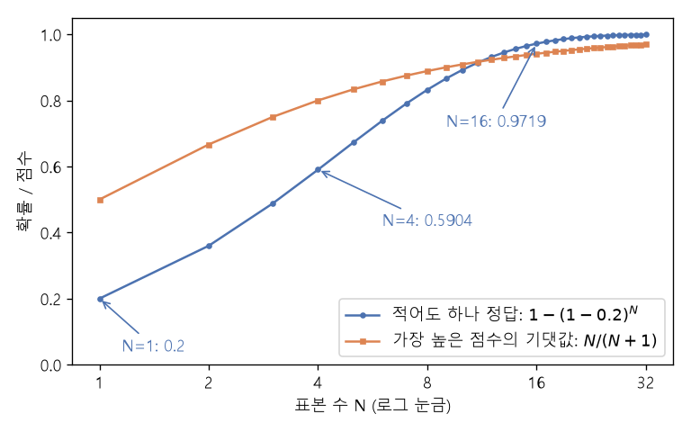

# Best-of-N과 적중 확률 (Best-of-N, Coverage)

[목차로 돌아가기](../../00_MIT%EB%94%A5%EB%9F%AC%EB%8B%9D_%EB%AA%A9%EC%B0%A8.md) · 먼저 볼 것: [M08_확률_기초](../../%EC%88%98%ED%95%99%EA%B0%9C%EB%85%90/04_%ED%99%95%EB%A5%A0%EA%B3%BC_%EC%A0%95%EB%B3%B4/M08_%ED%99%95%EB%A5%A0_%EA%B8%B0%EC%B4%88.md), [M07_로그](../../%EC%88%98%ED%95%99%EA%B0%9C%EB%85%90/01_%EC%88%98%EC%99%80_%ED%95%A8%EC%88%98/M07_%EB%A1%9C%EA%B7%B8.md), [MM39_확률의_연쇄법칙과_빔_서치](../../%EC%88%98%ED%95%99%EA%B0%9C%EB%85%90/04_%ED%99%95%EB%A5%A0%EA%B3%BC_%EC%A0%95%EB%B3%B4/MM39_%ED%99%95%EB%A5%A0%EC%9D%98_%EC%97%B0%EC%87%84%EB%B2%95%EC%B9%99%EA%B3%BC_%EB%B9%94_%EC%84%9C%EC%B9%98.md), [MM58_조건부_확률과_독립](../../%EC%88%98%ED%95%99%EA%B0%9C%EB%85%90/04_%ED%99%95%EB%A5%A0%EA%B3%BC_%EC%A0%95%EB%B3%B4/MM58_%EC%A1%B0%EA%B1%B4%EB%B6%80_%ED%99%95%EB%A5%A0%EA%B3%BC_%EB%8F%85%EB%A6%BD.md) · 쓰는 곳: [Lec24 5.1](../../Lec24_%EC%B6%94%EB%A1%A0_%EB%B0%A9%EB%B2%95.md#51-best-of-n), [Lec24 6.2](../../Lec24_%EC%B6%94%EB%A1%A0_%EB%B0%A9%EB%B2%95.md#62-%EA%B2%80%EC%A6%9D%EC%9D%B4-%EC%83%9D%EC%84%B1%EB%B3%B4%EB%8B%A4-%EC%89%BD%EB%8B%A4)

📚 학습 순서 97/99 (13. 언어 모델과 추론): ← 이전: [MM76_정책_경사와_보상_가중_우도](../../%EC%88%98%ED%95%99%EA%B0%9C%EB%85%90/13_%EC%96%B8%EC%96%B4_%EB%AA%A8%EB%8D%B8%EA%B3%BC_%EC%B6%94%EB%A1%A0/MM76_%EC%A0%95%EC%B1%85_%EA%B2%BD%EC%82%AC%EC%99%80_%EB%B3%B4%EC%83%81_%EA%B0%80%EC%A4%91_%EC%9A%B0%EB%8F%84.md) · 다음: [MM81_맥락_내_학습과_경사하강_한_걸음](../../%EC%88%98%ED%95%99%EA%B0%9C%EB%85%90/13_%EC%96%B8%EC%96%B4_%EB%AA%A8%EB%8D%B8%EA%B3%BC_%EC%B6%94%EB%A1%A0/MM81_%EB%A7%A5%EB%9D%BD_%EB%82%B4_%ED%95%99%EC%8A%B5%EA%B3%BC_%EA%B2%BD%EC%82%AC%ED%95%98%EA%B0%95_%ED%95%9C_%EA%B1%B8%EC%9D%8C.md) →

> [!NOTE]
> **3줄 요약**
> - **[Best-of-N](../../00_%EB%94%A5%EB%9F%AC%EB%8B%9D_%EC%9A%A9%EC%96%B4%EC%82%AC%EC%A0%84.md#best-of-n-sampling-best-of-n-%EC%83%98%ED%94%8C%EB%A7%81)**은 답을 N번 [독립](../../00_%EB%94%A5%EB%9F%AC%EB%8B%9D_%EC%9A%A9%EC%96%B4%EC%82%AC%EC%A0%84.md#independence-%EB%8F%85%EB%A6%BD)으로 뽑고 **점수가 가장 높은 하나**를 고른다. 점수는 모델의 [로그](../../00_%EB%94%A5%EB%9F%AC%EB%8B%9D_%EC%9A%A9%EC%96%B4%EC%82%AC%EC%A0%84.md#log-ln-%EB%A1%9C%EA%B7%B8) [우도](../../00_%EB%94%A5%EB%9F%AC%EB%8B%9D_%EC%9A%A9%EC%96%B4%EC%82%AC%EC%A0%84.md#likelihood-%EC%9A%B0%EB%8F%84), [보상 모델](../../00_%EB%94%A5%EB%9F%AC%EB%8B%9D_%EC%9A%A9%EC%96%B4%EC%82%AC%EC%A0%84.md#reward-model-%EB%B3%B4%EC%83%81-%EB%AA%A8%EB%8D%B8), [검증기](../../00_%EB%94%A5%EB%9F%AC%EB%8B%9D_%EC%9A%A9%EC%96%B4%EC%82%AC%EC%A0%84.md#verifier-%EA%B2%80%EC%A6%9D%EA%B8%B0) 무엇이든 된다. 세 문장의 [확률](../../00_%EB%94%A5%EB%9F%AC%EB%8B%9D_%EC%9A%A9%EC%96%B4%EC%82%AC%EC%A0%84.md#probability-%ED%99%95%EB%A5%A0)이 0.27, 0.144, 0.324면 0.324를 고른다.
> - 한 번 뽑아 맞힐 [확률](../../00_%EB%94%A5%EB%9F%AC%EB%8B%9D_%EC%9A%A9%EC%96%B4%EC%82%AC%EC%A0%84.md#probability-%ED%99%95%EB%A5%A0)이 $p$일 때 N번 중 **적어도 한 번 맞힐 [확률](../../00_%EB%94%A5%EB%9F%AC%EB%8B%9D_%EC%9A%A9%EC%96%B4%EC%82%AC%EC%A0%84.md#probability-%ED%99%95%EB%A5%A0)**은 $1 - (1-p)^N$이다. $p = 0.2$면 N = 1, 4, 16에서 0.2, 0.5904, 0.9719.
> - 목표 [확률](../../00_%EB%94%A5%EB%9F%AC%EB%8B%9D_%EC%9A%A9%EC%96%B4%EC%82%AC%EC%A0%84.md#probability-%ED%99%95%EB%A5%A0) $c$를 얻으려면 $N \ge \ln(1-c) / \ln(1-p)$. $p = 0.2$, $c = 0.95$면 13.43이므로 14번. N을 두 배씩 늘려도 오르는 폭은 점점 줄어든다.

## 1. 개념 설명

비유: 시험 문제 하나를 친구 16명에게 따로 풀게 하고, [정답](../../00_%EB%94%A5%EB%9F%AC%EB%8B%9D_%EC%9A%A9%EC%96%B4%EC%82%AC%EC%A0%84.md#label-%EC%A0%95%EB%8B%B5) 확인표([검증기](../../00_%EB%94%A5%EB%9F%AC%EB%8B%9D_%EC%9A%A9%EC%96%B4%EC%82%AC%EC%A0%84.md#verifier-%EA%B2%80%EC%A6%9D%EA%B8%B0))로 맞은 답이 하나라도 있으면 그것을 내는 것. 한 명이 맞힐 [확률](../../00_%EB%94%A5%EB%9F%AC%EB%8B%9D_%EC%9A%A9%EC%96%B4%EC%82%AC%EC%A0%84.md#probability-%ED%99%95%EB%A5%A0)이 20%뿐이어도, 16명 중 **아무도 못 맞힐** [확률](../../00_%EB%94%A5%EB%9F%AC%EB%8B%9D_%EC%9A%A9%EC%96%B4%EC%82%AC%EC%A0%84.md#probability-%ED%99%95%EB%A5%A0)은 $0.8^{16} = 0.0281$밖에 안 된다. 다만 [정답](../../00_%EB%94%A5%EB%9F%AC%EB%8B%9D_%EC%9A%A9%EC%96%B4%EC%82%AC%EC%A0%84.md#label-%EC%A0%95%EB%8B%B5) 확인표가 없으면 16개 답 중 무엇이 맞는지 골라야 하므로, 고르는 점수가 얼마나 믿을 만한지가 성패를 가른다.

- **뽑기**: [자기회귀 모델](../../00_%EB%94%A5%EB%9F%AC%EB%8B%9D_%EC%9A%A9%EC%96%B4%EC%82%AC%EC%A0%84.md#autoregressive-model-%EC%9E%90%EA%B8%B0%ED%9A%8C%EA%B7%80-%EB%AA%A8%EB%8D%B8)에서 [토큰](../../00_%EB%94%A5%EB%9F%AC%EB%8B%9D_%EC%9A%A9%EC%96%B4%EC%82%AC%EC%A0%84.md#token-%ED%86%A0%ED%81%B0)을 [온도](../../00_%EB%94%A5%EB%9F%AC%EB%8B%9D_%EC%9A%A9%EC%96%B4%EC%82%AC%EC%A0%84.md#softmax-temperature-%EC%86%8C%ED%94%84%ED%8A%B8%EB%A7%A5%EC%8A%A4-%EC%98%A8%EB%8F%84) 0보다 큰 값으로 하나씩 뽑으면 매번 다른 문장이 나온다. 이 문장 N개는 서로 [독립 동일 분포](../../00_%EB%94%A5%EB%9F%AC%EB%8B%9D_%EC%9A%A9%EC%96%B4%EC%82%AC%EC%A0%84.md#iid-independent-and-identically-distributed-%EB%8F%85%EB%A6%BD-%EB%8F%99%EC%9D%BC-%EB%B6%84%ED%8F%AC)다.
- **점수 매기기**: 뽑은 문장의 [확률](../../00_%EB%94%A5%EB%9F%AC%EB%8B%9D_%EC%9A%A9%EC%96%B4%EC%82%AC%EC%A0%84.md#probability-%ED%99%95%EB%A5%A0)은 [확률의 연쇄법칙](../../00_%EB%94%A5%EB%9F%AC%EB%8B%9D_%EC%9A%A9%EC%96%B4%EC%82%AC%EC%A0%84.md#chain-rule-of-probability-%ED%99%95%EB%A5%A0%EC%9D%98-%EC%97%B0%EC%87%84%EB%B2%95%EC%B9%99)으로 [조건부 확률](../../00_%EB%94%A5%EB%9F%AC%EB%8B%9D_%EC%9A%A9%EC%96%B4%EC%82%AC%EC%A0%84.md#conditional-probability-%EC%A1%B0%EA%B1%B4%EB%B6%80-%ED%99%95%EB%A5%A0)을 곱해 구한다([MM39_확률의_연쇄법칙과_빔_서치](../../%EC%88%98%ED%95%99%EA%B0%9C%EB%85%90/04_%ED%99%95%EB%A5%A0%EA%B3%BC_%EC%A0%95%EB%B3%B4/MM39_%ED%99%95%EB%A5%A0%EC%9D%98_%EC%97%B0%EC%87%84%EB%B2%95%EC%B9%99%EA%B3%BC_%EB%B9%94_%EC%84%9C%EC%B9%98.md)). 곱은 아주 작아지므로 보통 [로그](../../00_%EB%94%A5%EB%9F%AC%EB%8B%9D_%EC%9A%A9%EC%96%B4%EC%82%AC%EC%A0%84.md#log-ln-%EB%A1%9C%EA%B7%B8)를 더한다. [확률](../../00_%EB%94%A5%EB%9F%AC%EB%8B%9D_%EC%9A%A9%EC%96%B4%EC%82%AC%EC%A0%84.md#probability-%ED%99%95%EB%A5%A0) 말고 사람 선호를 흉내 낸 [보상 모델](../../00_%EB%94%A5%EB%9F%AC%EB%8B%9D_%EC%9A%A9%EC%96%B4%EC%82%AC%EC%A0%84.md#reward-model-%EB%B3%B4%EC%83%81-%EB%AA%A8%EB%8D%B8)이나, 코드를 실행해 보는 [검증기](../../00_%EB%94%A5%EB%9F%AC%EB%8B%9D_%EC%9A%A9%EC%96%B4%EC%82%AC%EC%A0%84.md#verifier-%EA%B2%80%EC%A6%9D%EA%B8%B0)를 점수로 써도 된다.
- **고르기**: 점수가 가장 큰 것을 [argmax](../../00_%EB%94%A5%EB%9F%AC%EB%8B%9D_%EC%9A%A9%EC%96%B4%EC%82%AC%EC%A0%84.md#argmax-%EC%B5%9C%EB%8C%93%EA%B0%92-%EC%9C%84%EC%B9%98)로 고르고 나머지는 버린다. 강의는 이것을 "사실상 [기각 샘플링](../../00_%EB%94%A5%EB%9F%AC%EB%8B%9D_%EC%9A%A9%EC%96%B4%EC%82%AC%EC%A0%84.md#rejection-sampling-%EA%B8%B0%EA%B0%81-%EC%83%98%ED%94%8C%EB%A7%81)"이라고 부른다.
- **적중 [확률](../../00_%EB%94%A5%EB%9F%AC%EB%8B%9D_%EC%9A%A9%EC%96%B4%EC%82%AC%EC%A0%84.md#probability-%ED%99%95%EB%A5%A0)**(coverage): 완벽한 [검증기](../../00_%EB%94%A5%EB%9F%AC%EB%8B%9D_%EC%9A%A9%EC%96%B4%EC%82%AC%EC%A0%84.md#verifier-%EA%B2%80%EC%A6%9D%EA%B8%B0)가 있으면 "적어도 하나 맞는가"가 곧 성공률이다. 각 시도가 [독립](../../00_%EB%94%A5%EB%9F%AC%EB%8B%9D_%EC%9A%A9%EC%96%B4%EC%82%AC%EC%A0%84.md#independence-%EB%8F%85%EB%A6%BD)이므로 "모두 틀릴 [확률](../../00_%EB%94%A5%EB%9F%AC%EB%8B%9D_%EC%9A%A9%EC%96%B4%EC%82%AC%EC%A0%84.md#probability-%ED%99%95%EB%A5%A0)"을 곱해 1에서 빼면 된다.


*▲ 직접 그린 그림: 한 번 적중 [확률](../../00_%EB%94%A5%EB%9F%AC%EB%8B%9D_%EC%9A%A9%EC%96%B4%EC%82%AC%EC%A0%84.md#probability-%ED%99%95%EB%A5%A0) 0.2일 때 표본 수 N에 따른 "적어도 하나 [정답](../../00_%EB%94%A5%EB%9F%AC%EB%8B%9D_%EC%9A%A9%EC%96%B4%EC%82%AC%EC%A0%84.md#label-%EC%A0%95%EB%8B%B5)" [확률](../../00_%EB%94%A5%EB%9F%AC%EB%8B%9D_%EC%9A%A9%EC%96%B4%EC%82%AC%EC%A0%84.md#probability-%ED%99%95%EB%A5%A0)(파랑)과, 점수가 0~1 균등분포일 때 가장 높은 점수의 [기댓값](../../00_%EB%94%A5%EB%9F%AC%EB%8B%9D_%EC%9A%A9%EC%96%B4%EC%82%AC%EC%A0%84.md#expectation-%EA%B8%B0%EB%8C%93%EA%B0%92) $N/(N+1)$(주황). 가로축이 [로그](../../00_%EB%94%A5%EB%9F%AC%EB%8B%9D_%EC%9A%A9%EC%96%B4%EC%82%AC%EC%A0%84.md#log-ln-%EB%A1%9C%EA%B7%B8) 눈금이라 N을 두 배씩 늘린 효과를 볼 수 있다*

## 2. 필요한 이유

[Lec24 5.1](../../Lec24_%EC%B6%94%EB%A1%A0_%EB%B0%A9%EB%B2%95.md#51-best-of-n)에서 강사는 "Best-of-N은 가장 단순하지만 지금 알려진 어떤 방법만큼이나 잘 된다"고 말한다. [Lec24 6.2](../../Lec24_%EC%B6%94%EB%A1%A0_%EB%B0%A9%EB%B2%95.md#62-%EA%B2%80%EC%A6%9D%EC%9D%B4-%EC%83%9D%EC%84%B1%EB%B3%B4%EB%8B%A4-%EC%89%BD%EB%8B%A4)에서는 [검증기](../../00_%EB%94%A5%EB%9F%AC%EB%8B%9D_%EC%9A%A9%EC%96%B4%EC%82%AC%EC%A0%84.md#verifier-%EA%B2%80%EC%A6%9D%EA%B8%B0)가 있으면 같은 Best-of-N으로 코드·수학 문제를 풀 수 있다고 한다. 표본을 더 뽑는 것이 곧 [테스트 시점 계산](../../00_%EB%94%A5%EB%9F%AC%EB%8B%9D_%EC%9A%A9%EC%96%B4%EC%82%AC%EC%A0%84.md#test-time-compute-%ED%85%8C%EC%8A%A4%ED%8A%B8-%EC%8B%9C%EC%A0%90-%EA%B3%84%EC%82%B0)을 더 쓰는 것이므로, "계산을 늘리면 얼마나 좋아지나"를 이 노트의 식으로 직접 계산해 볼 수 있다.

## 3. 숫자로 보기

**문장 세 개 중 고르기** (분자 설명 문장, [토큰](../../00_%EB%94%A5%EB%9F%AC%EB%8B%9D_%EC%9A%A9%EC%96%B4%EC%82%AC%EC%A0%84.md#token-%ED%86%A0%ED%81%B0) 3개짜리라고 하자)

| 문장 | 토큰별 [조건부 확률](../../00_%EB%94%A5%EB%9F%AC%EB%8B%9D_%EC%9A%A9%EC%96%B4%EC%82%AC%EC%A0%84.md#conditional-probability-%EC%A1%B0%EA%B1%B4%EB%B6%80-%ED%99%95%EB%A5%A0) | 곱 (문장 [확률](../../00_%EB%94%A5%EB%9F%AC%EB%8B%9D_%EC%9A%A9%EC%96%B4%EC%82%AC%EC%A0%84.md#probability-%ED%99%95%EB%A5%A0)) | [로그](../../00_%EB%94%A5%EB%9F%AC%EB%8B%9D_%EC%9A%A9%EC%96%B4%EC%82%AC%EC%A0%84.md#log-ln-%EB%A1%9C%EA%B7%B8) 합 |
|---|---|---|---|
| A | 0.6, 0.5, 0.9 | 0.27 | -1.3093 |
| B | 0.6, 0.3, 0.8 | 0.144 | -1.9379 |
| C | 0.4, 0.9, 0.9 | 0.324 | -1.127 |

- Best-of-3은 [확률](../../00_%EB%94%A5%EB%9F%AC%EB%8B%9D_%EC%9A%A9%EC%96%B4%EC%82%AC%EC%A0%84.md#probability-%ED%99%95%EB%A5%A0)이 가장 큰 **C**(0.324)를 고른다.
- 첫 [토큰](../../00_%EB%94%A5%EB%9F%AC%EB%8B%9D_%EC%9A%A9%EC%96%B4%EC%82%AC%EC%A0%84.md#token-%ED%86%A0%ED%81%B0)만 보면 A, B(0.6)가 C(0.4)보다 크다. 첫 [토큰](../../00_%EB%94%A5%EB%9F%AC%EB%8B%9D_%EC%9A%A9%EC%96%B4%EC%82%AC%EC%A0%84.md#token-%ED%86%A0%ED%81%B0)을 욕심껏 고르는 [탐욕 디코딩](../../00_%EB%94%A5%EB%9F%AC%EB%8B%9D_%EC%9A%A9%EC%96%B4%EC%82%AC%EC%A0%84.md#greedy-decoding-%ED%83%90%EC%9A%95-%EB%94%94%EC%BD%94%EB%94%A9)으로는 C에 닿지 못한다([Lec24 4.2](../../Lec24_%EC%B6%94%EB%A1%A0_%EB%B0%A9%EB%B2%95.md#42-%ED%83%90%EC%9A%95-%EC%83%98%ED%94%8C%EB%A7%81%EC%9D%80-%EC%9A%B0%EB%8F%84%EB%A5%BC-%EC%B5%9C%EB%8C%80%EB%A1%9C-%EB%A7%8C%EB%93%A4%EC%A7%80-%EC%95%8A%EB%8A%94%EB%8B%A4)).

**적어도 하나 맞힐 [확률](../../00_%EB%94%A5%EB%9F%AC%EB%8B%9D_%EC%9A%A9%EC%96%B4%EC%82%AC%EC%A0%84.md#probability-%ED%99%95%EB%A5%A0)** ($p = 0.2$)

| N | 1 | 2 | 4 | 8 | 16 | 32 |
|---|---|---|---|---|---|---|
| 모두 틀릴 [확률](../../00_%EB%94%A5%EB%9F%AC%EB%8B%9D_%EC%9A%A9%EC%96%B4%EC%82%AC%EC%A0%84.md#probability-%ED%99%95%EB%A5%A0) $0.8^N$ | 0.8 | 0.64 | 0.4096 | 0.1678 | 0.0281 | 0.0008 |
| 적어도 하나 맞음 | 0.2 | 0.36 | 0.5904 | 0.8322 | 0.9719 | 0.9992 |

- N을 1→4로 늘리면 0.39 오르지만, 16→32로 늘리면 0.03만 오른다. 계산을 두 배로 늘릴 때마다 얻는 이득이 줄어든다.

Best-of-N은 점수가 가장 큰 표본을 고른다. [로그](../../00_%EB%94%A5%EB%9F%AC%EB%8B%9D_%EC%9A%A9%EC%96%B4%EC%82%AC%EC%A0%84.md#log-ln-%EB%A1%9C%EA%B7%B8) [우도](../../00_%EB%94%A5%EB%9F%AC%EB%8B%9D_%EC%9A%A9%EC%96%B4%EC%82%AC%EC%A0%84.md#likelihood-%EC%9A%B0%EB%8F%84)를 점수로 쓰면 다음과 같다.

$$
\hat y = \arg\max_{i \in \{1, \dots, N\}} s(y_i), \qquad s(y) = \log p_\theta(y) = \sum_{t=1}^{T} \log p_\theta(y_t \mid y_1, \dots, y_{t-1})
$$

<details><summary>기호 풀이</summary>

| 기호 | 읽는 법 | 뜻 | 예제 값 |
| --- | --- | --- | --- |
| $N$ | 엔 | 뽑은 표본(답) 수 | 2 |
| $y_i$ | 와이 아이 | $i$번째로 뽑은 문장 | 문장 1, 문장 2 |
| $s(y)$ | 에스 | 문장의 점수 | -0.9163, -1.0217 |
| $\arg\max$ | 아그맥스 | 점수를 가장 크게 만드는 $i$ | 1 |
| $\hat y$ | 와이 햇 | 고른 답 | 문장 1 |
| $p_\theta(y_t \mid \dots)$ | 피 세타 | 앞 [토큰](../../00_%EB%94%A5%EB%9F%AC%EB%8B%9D_%EC%9A%A9%EC%96%B4%EC%82%AC%EC%A0%84.md#token-%ED%86%A0%ED%81%B0)이 주어졌을 때 $t$번째 [토큰](../../00_%EB%94%A5%EB%9F%AC%EB%8B%9D_%EC%9A%A9%EC%96%B4%EC%82%AC%EC%A0%84.md#token-%ED%86%A0%ED%81%B0)의 [확률](../../00_%EB%94%A5%EB%9F%AC%EB%8B%9D_%EC%9A%A9%EC%96%B4%EC%82%AC%EC%A0%84.md#probability-%ED%99%95%EB%A5%A0) | 0.5, 0.8 |
| $T$ | 티 | 문장의 [토큰](../../00_%EB%94%A5%EB%9F%AC%EB%8B%9D_%EC%9A%A9%EC%96%B4%EC%82%AC%EC%A0%84.md#token-%ED%86%A0%ED%81%B0) 수 | 2 |
| $\log$ | [로그](../../00_%EB%94%A5%EB%9F%AC%EB%8B%9D_%EC%9A%A9%EC%96%B4%EC%82%AC%EC%A0%84.md#log-ln-%EB%A1%9C%EA%B7%B8) | 자연로그 $\ln$. 곱을 합으로 바꾼다 | $\ln 0.5 = -0.6931$ |

</details>

<details><summary>예제와 풀이</summary>

**문제**: [토큰](../../00_%EB%94%A5%EB%9F%AC%EB%8B%9D_%EC%9A%A9%EC%96%B4%EC%82%AC%EC%A0%84.md#token-%ED%86%A0%ED%81%B0) 2개짜리 답 두 개를 뽑았다. 답 1의 [토큰](../../00_%EB%94%A5%EB%9F%AC%EB%8B%9D_%EC%9A%A9%EC%96%B4%EC%82%AC%EC%A0%84.md#token-%ED%86%A0%ED%81%B0) [확률](../../00_%EB%94%A5%EB%9F%AC%EB%8B%9D_%EC%9A%A9%EC%96%B4%EC%82%AC%EC%A0%84.md#probability-%ED%99%95%EB%A5%A0)은 0.5, 0.8이고 답 2는 0.9, 0.4다. [로그](../../00_%EB%94%A5%EB%9F%AC%EB%8B%9D_%EC%9A%A9%EC%96%B4%EC%82%AC%EC%A0%84.md#log-ln-%EB%A1%9C%EA%B7%B8) [우도](../../00_%EB%94%A5%EB%9F%AC%EB%8B%9D_%EC%9A%A9%EC%96%B4%EC%82%AC%EC%A0%84.md#likelihood-%EC%9A%B0%EB%8F%84)를 점수로 쓰면 어느 답을 고르나?

**주어진 값**
- $N = 2$ (뽑은 답의 수)
- 답 1: $p(y_1) = 0.5$, $p(y_2 \mid y_1) = 0.8$ (토큰별 [조건부 확률](../../00_%EB%94%A5%EB%9F%AC%EB%8B%9D_%EC%9A%A9%EC%96%B4%EC%82%AC%EC%A0%84.md#conditional-probability-%EC%A1%B0%EA%B1%B4%EB%B6%80-%ED%99%95%EB%A5%A0))
- 답 2: $p(y_1) = 0.9$, $p(y_2 \mid y_1) = 0.4$ (토큰별 [조건부 확률](../../00_%EB%94%A5%EB%9F%AC%EB%8B%9D_%EC%9A%A9%EC%96%B4%EC%82%AC%EC%A0%84.md#conditional-probability-%EC%A1%B0%EA%B1%B4%EB%B6%80-%ED%99%95%EB%A5%A0))

**풀이**
1. 식을 그대로 쓴다: $s(y) = \sum_{t=1}^{T} \log p_\theta(y_t \mid y_1, \dots, y_{t-1})$, $\hat y = \arg\max_i s(y_i)$
2. 값을 대입한다: $s(\text{답 1}) = \ln 0.5 + \ln 0.8$, $s(\text{답 2}) = \ln 0.9 + \ln 0.4$
3. $\ln$은 "e를 몇 번 곱하면 그 수가 되나"를 묻는 자연로그다. 1보다 작은 수의 [로그](../../00_%EB%94%A5%EB%9F%AC%EB%8B%9D_%EC%9A%A9%EC%96%B4%EC%82%AC%EC%A0%84.md#log-ln-%EB%A1%9C%EA%B7%B8)는 음수이고, 계산기(또는 `math.log`)로 구한다: $\ln 0.5 = -0.6931$ 이므로 $s(\text{답 1}) = -0.6931 + \ln 0.8$
4. 다음 [로그](../../00_%EB%94%A5%EB%9F%AC%EB%8B%9D_%EC%9A%A9%EC%96%B4%EC%82%AC%EC%A0%84.md#log-ln-%EB%A1%9C%EA%B7%B8)를 구한다: $\ln 0.8 = -0.2231$ 이므로 $s(\text{답 1}) = -0.6931 + (-0.2231)$
5. 더한다: $-0.6931 - 0.2231 = -0.9163$
6. 답 2의 첫 [로그](../../00_%EB%94%A5%EB%9F%AC%EB%8B%9D_%EC%9A%A9%EC%96%B4%EC%82%AC%EC%A0%84.md#log-ln-%EB%A1%9C%EA%B7%B8)를 구한다: $\ln 0.9 = -0.1054$ 이므로 $s(\text{답 2}) = -0.1054 + \ln 0.4$
7. 다음 [로그](../../00_%EB%94%A5%EB%9F%AC%EB%8B%9D_%EC%9A%A9%EC%96%B4%EC%82%AC%EC%A0%84.md#log-ln-%EB%A1%9C%EA%B7%B8)를 구한다: $\ln 0.4 = -0.9163$ 이므로 $s(\text{답 2}) = -0.1054 + (-0.9163)$
8. 더한다: $-0.1054 - 0.9163 = -1.0217$
9. 큰 쪽을 고른다: $-0.9163 > -1.0217$ 이므로 $\hat y = \text{답 1}$

**답**: **답 1**(점수 -0.9163, [확률](../../00_%EB%94%A5%EB%9F%AC%EB%8B%9D_%EC%9A%A9%EC%96%B4%EC%82%AC%EC%A0%84.md#probability-%ED%99%95%EB%A5%A0)로는 $0.5 \times 0.8 = 0.4$)을 고른다. 첫 [토큰](../../00_%EB%94%A5%EB%9F%AC%EB%8B%9D_%EC%9A%A9%EC%96%B4%EC%82%AC%EC%A0%84.md#token-%ED%86%A0%ED%81%B0) [확률](../../00_%EB%94%A5%EB%9F%AC%EB%8B%9D_%EC%9A%A9%EC%96%B4%EC%82%AC%EC%A0%84.md#probability-%ED%99%95%EB%A5%A0)은 답 2(0.9)가 더 컸지만 문장 전체로는 답 1(0.4 > 0.36)이 낫다.

</details>

<details><summary>내 이해</summary>


</details>

[검증기](../../00_%EB%94%A5%EB%9F%AC%EB%8B%9D_%EC%9A%A9%EC%96%B4%EC%82%AC%EC%A0%84.md#verifier-%EA%B2%80%EC%A6%9D%EA%B8%B0)로 [정답](../../00_%EB%94%A5%EB%9F%AC%EB%8B%9D_%EC%9A%A9%EC%96%B4%EC%82%AC%EC%A0%84.md#label-%EC%A0%95%EB%8B%B5)을 알아볼 수 있으면, N번 중 적어도 한 번 맞힐 [확률](../../00_%EB%94%A5%EB%9F%AC%EB%8B%9D_%EC%9A%A9%EC%96%B4%EC%82%AC%EC%A0%84.md#probability-%ED%99%95%EB%A5%A0)은 다음과 같다.

$$
P(\text{적어도 하나 정답}) = 1 - (1 - p)^N
$$

<details><summary>기호 풀이</summary>

| 기호 | 읽는 법 | 뜻 | 예제 값 |
| --- | --- | --- | --- |
| $p$ | 피 | 한 번 뽑아 맞힐 [확률](../../00_%EB%94%A5%EB%9F%AC%EB%8B%9D_%EC%9A%A9%EC%96%B4%EC%82%AC%EC%A0%84.md#probability-%ED%99%95%EB%A5%A0) | 0.5 |
| $1 - p$ | 일 빼기 피 | 한 번 뽑아 틀릴 [확률](../../00_%EB%94%A5%EB%9F%AC%EB%8B%9D_%EC%9A%A9%EC%96%B4%EC%82%AC%EC%A0%84.md#probability-%ED%99%95%EB%A5%A0) | 0.5 |
| $N$ | 엔 | 뽑는 횟수 | 3 |
| $(1-p)^N$ | | N번 모두 틀릴 [확률](../../00_%EB%94%A5%EB%9F%AC%EB%8B%9D_%EC%9A%A9%EC%96%B4%EC%82%AC%EC%A0%84.md#probability-%ED%99%95%EB%A5%A0) ([독립](../../00_%EB%94%A5%EB%9F%AC%EB%8B%9D_%EC%9A%A9%EC%96%B4%EC%82%AC%EC%A0%84.md#independence-%EB%8F%85%EB%A6%BD)이라 곱한다) | 0.125 |
| $P(\cdot)$ | 피 | 적어도 한 번 맞힐 [확률](../../00_%EB%94%A5%EB%9F%AC%EB%8B%9D_%EC%9A%A9%EC%96%B4%EC%82%AC%EC%A0%84.md#probability-%ED%99%95%EB%A5%A0) | 0.875 |

</details>

<details><summary>예제와 풀이</summary>

**문제**: 동전 던지기처럼 한 번에 맞힐 [확률](../../00_%EB%94%A5%EB%9F%AC%EB%8B%9D_%EC%9A%A9%EC%96%B4%EC%82%AC%EC%A0%84.md#probability-%ED%99%95%EB%A5%A0)이 0.5인 문제를 3번 풀게 하고 [검증기](../../00_%EB%94%A5%EB%9F%AC%EB%8B%9D_%EC%9A%A9%EC%96%B4%EC%82%AC%EC%A0%84.md#verifier-%EA%B2%80%EC%A6%9D%EA%B8%B0)로 확인한다. 적어도 한 번 맞을 [확률](../../00_%EB%94%A5%EB%9F%AC%EB%8B%9D_%EC%9A%A9%EC%96%B4%EC%82%AC%EC%A0%84.md#probability-%ED%99%95%EB%A5%A0)은?

**주어진 값**
- $p = 0.5$ (한 번 맞힐 [확률](../../00_%EB%94%A5%EB%9F%AC%EB%8B%9D_%EC%9A%A9%EC%96%B4%EC%82%AC%EC%A0%84.md#probability-%ED%99%95%EB%A5%A0))
- $N = 3$ (시도 횟수)

**풀이**
1. 식을 그대로 쓴다: $P = 1 - (1 - p)^N$
2. 값을 대입한다: $P = 1 - (1 - 0.5)^3$
3. 괄호 안을 뺀다: $1 - 0.5 = 0.5$ 이므로 $P = 1 - 0.5^3$
4. 거듭제곱을 한다 ($0.5^3 = 0.5 \times 0.5 \times 0.5$): $0.5^3 = 0.125$ 이므로 $P = 1 - 0.125$
5. 뺀다: $1 - 0.125 = 0.875$

**답**: **0.875**. 세 번 모두 틀릴 [확률](../../00_%EB%94%A5%EB%9F%AC%EB%8B%9D_%EC%9A%A9%EC%96%B4%EC%82%AC%EC%A0%84.md#probability-%ED%99%95%EB%A5%A0) 0.125만 빼면 된다.

</details>

<details><summary>내 이해</summary>


</details>

목표 [확률](../../00_%EB%94%A5%EB%9F%AC%EB%8B%9D_%EC%9A%A9%EC%96%B4%EC%82%AC%EC%A0%84.md#probability-%ED%99%95%EB%A5%A0) $c$에 닿으려면 몇 번 뽑아야 하는지는 위 식을 $N$에 대해 풀면 나온다.

$$
1 - (1-p)^N \ge c \iff N \ge \frac{\ln(1 - c)}{\ln(1 - p)}
$$

<details><summary>기호 풀이</summary>

| 기호 | 읽는 법 | 뜻 | 예제 값 |
| --- | --- | --- | --- |
| $c$ | 시 | 얻고 싶은 성공 [확률](../../00_%EB%94%A5%EB%9F%AC%EB%8B%9D_%EC%9A%A9%EC%96%B4%EC%82%AC%EC%A0%84.md#probability-%ED%99%95%EB%A5%A0) | 0.99 |
| $p$ | 피 | 한 번 맞힐 [확률](../../00_%EB%94%A5%EB%9F%AC%EB%8B%9D_%EC%9A%A9%EC%96%B4%EC%82%AC%EC%A0%84.md#probability-%ED%99%95%EB%A5%A0) | 0.5 |
| $\ln$ | 엘엔 | 자연로그. 거듭제곱의 [지수](../../00_%EB%94%A5%EB%9F%AC%EB%8B%9D_%EC%9A%A9%EC%96%B4%EC%82%AC%EC%A0%84.md#e-exponent-e%EC%99%80-%EC%A7%80%EC%88%98)를 끌어내린다 | $\ln 0.5 = -0.6931$ |
| $\iff$ | 동치 | 왼쪽과 오른쪽이 같은 조건 | |
| $N$ | 엔 | 필요한 시도 횟수 (올림한 정수) | 7 |

</details>

<details><summary>예제와 풀이</summary>

**문제**: 한 번 맞힐 [확률](../../00_%EB%94%A5%EB%9F%AC%EB%8B%9D_%EC%9A%A9%EC%96%B4%EC%82%AC%EC%A0%84.md#probability-%ED%99%95%EB%A5%A0)이 0.5일 때 성공 [확률](../../00_%EB%94%A5%EB%9F%AC%EB%8B%9D_%EC%9A%A9%EC%96%B4%EC%82%AC%EC%A0%84.md#probability-%ED%99%95%EB%A5%A0) 0.99 이상을 얻으려면 최소 몇 번 뽑아야 하나?

**주어진 값**
- $p = 0.5$ (한 번 맞힐 [확률](../../00_%EB%94%A5%EB%9F%AC%EB%8B%9D_%EC%9A%A9%EC%96%B4%EC%82%AC%EC%A0%84.md#probability-%ED%99%95%EB%A5%A0))
- $c = 0.99$ (목표 성공 [확률](../../00_%EB%94%A5%EB%9F%AC%EB%8B%9D_%EC%9A%A9%EC%96%B4%EC%82%AC%EC%A0%84.md#probability-%ED%99%95%EB%A5%A0))

**풀이**
1. 식을 그대로 쓴다: $N \ge \dfrac{\ln(1 - c)}{\ln(1 - p)}$
2. 값을 대입한다: $N \ge \dfrac{\ln(1 - 0.99)}{\ln(1 - 0.5)}$
3. 괄호 안을 뺀다: $1 - 0.99 = 0.01$, $1 - 0.5 = 0.5$ 이므로 $N \ge \dfrac{\ln 0.01}{\ln 0.5}$
4. 분자의 [로그](../../00_%EB%94%A5%EB%9F%AC%EB%8B%9D_%EC%9A%A9%EC%96%B4%EC%82%AC%EC%A0%84.md#log-ln-%EB%A1%9C%EA%B7%B8)를 구한다: $\ln 0.01 = -4.6052$ 이므로 $N \ge \dfrac{-4.6052}{\ln 0.5}$
5. 분모의 [로그](../../00_%EB%94%A5%EB%9F%AC%EB%8B%9D_%EC%9A%A9%EC%96%B4%EC%82%AC%EC%A0%84.md#log-ln-%EB%A1%9C%EA%B7%B8)를 구한다: $\ln 0.5 = -0.6931$ 이므로 $N \ge \dfrac{-4.6052}{-0.6931}$
6. 나눈다 (음수 ÷ 음수 = 양수): $4.6052 / 0.6931 = 6.6439$ 이므로 $N \ge 6.6439$
7. 횟수는 정수이므로 올린다: $N = 7$

**답**: **7번**. 확인: $1 - 0.5^7 = 1 - 0.0078 = 0.9922 \ge 0.99$.

</details>

<details><summary>내 이해</summary>


</details>

## 4. 코드로 확인

```python
# [함수] math.log: 자연로그 ln
import math
# [변수] caps: 3절 표의 세 문장과 토큰별 조건부 확률
caps = {"A": [0.6, 0.5, 0.9], "B": [0.6, 0.3, 0.8], "C": [0.4, 0.9, 0.9]}
# [함수] np.prod: 곱 (문장 확률), np.log 합: 로그 우도
# [변수] score: 문장마다 로그 우도
score = {k: round(float(np.sum(np.log(v))), 4) for k, v in caps.items()}
# [연결] 3절 표의 곱과 로그 합: 0.27, 0.144, 0.324
print({k: round(float(np.prod(v)), 4) for k, v in caps.items()}, score)
# [함수] max(..., key=): 점수가 가장 큰 키 (argmax)
# [연결] Best-of-3이 고르는 문장 C
print(max(score, key=score.get))
# [변수] p = 0.2: 한 번 맞힐 확률
p = 0.2
# [연결] 3절 둘째 표: N마다 적어도 하나 정답일 확률
print([round(1 - (1 - p) ** N, 4) for N in (1, 2, 4, 8, 16, 32)])
# [변수] need: 95%에 필요한 N (올림 전)
need = math.log(1 - 0.95) / math.log(1 - p)
# [함수] math.ceil: 올림
# [연결] 3줄 요약: 13.43이므로 14번
print(round(need, 2), math.ceil(need))
```

**실행 결과**:

```text
{'A': 0.27, 'B': 0.144, 'C': 0.324} {'A': -1.3093, 'B': -1.9379, 'C': -1.127}
C
[0.2, 0.36, 0.5904, 0.8322, 0.9719, 0.9992]
13.43 14
```

> [!WARNING]
> **⚠ 주의**
> - $1 - (1-p)^N$은 **완벽한 [검증기](../../00_%EB%94%A5%EB%9F%AC%EB%8B%9D_%EC%9A%A9%EC%96%B4%EC%82%AC%EC%A0%84.md#verifier-%EA%B2%80%EC%A6%9D%EA%B8%B0)**가 있을 때의 성공률이다. 점수가 [로그](../../00_%EB%94%A5%EB%9F%AC%EB%8B%9D_%EC%9A%A9%EC%96%B4%EC%82%AC%EC%A0%84.md#log-ln-%EB%A1%9C%EA%B7%B8) [우도](../../00_%EB%94%A5%EB%9F%AC%EB%8B%9D_%EC%9A%A9%EC%96%B4%EC%82%AC%EC%A0%84.md#likelihood-%EC%9A%B0%EB%8F%84)나 학습된 [보상 모델](../../00_%EB%94%A5%EB%9F%AC%EB%8B%9D_%EC%9A%A9%EC%96%B4%EC%82%AC%EC%A0%84.md#reward-model-%EB%B3%B4%EC%83%81-%EB%AA%A8%EB%8D%B8)이면, 맞는 답이 N개 안에 있어도 틀린 답에 더 높은 점수를 줄 수 있다. [보상 모델](../../00_%EB%94%A5%EB%9F%AC%EB%8B%9D_%EC%9A%A9%EC%96%B4%EC%82%AC%EC%A0%84.md#reward-model-%EB%B3%B4%EC%83%81-%EB%AA%A8%EB%8D%B8)의 빈틈을 파고드는 답이 뽑히는 것을 "보상 해킹"이라 한다.
> - [독립](../../00_%EB%94%A5%EB%9F%AC%EB%8B%9D_%EC%9A%A9%EC%96%B4%EC%82%AC%EC%A0%84.md#independence-%EB%8F%85%EB%A6%BD) 가정이 중요하다. 같은 실수를 반복하는 모델이면(표본끼리 상관이 크면) N을 늘려도 이 식만큼 오르지 않는다. 온도를 0으로 두면 N개가 모두 같은 답이 되어 N = 1과 같다.
> - 높은 [확률](../../00_%EB%94%A5%EB%9F%AC%EB%8B%9D_%EC%9A%A9%EC%96%B4%EC%82%AC%EC%A0%84.md#probability-%ED%99%95%EB%A5%A0)의 문장이 늘 좋은 답은 아니다. 강의도 "[확률](../../00_%EB%94%A5%EB%9F%AC%EB%8B%9D_%EC%9A%A9%EC%96%B4%EC%82%AC%EC%A0%84.md#probability-%ED%99%95%EB%A5%A0)이 실제 [정확도](../../00_%EB%94%A5%EB%9F%AC%EB%8B%9D_%EC%9A%A9%EC%96%B4%EC%82%AC%EC%A0%84.md#accuracy-%EC%A0%95%ED%99%95%EB%8F%84)와 관련이 있을 때만" 더 나은 답이라고 단서를 단다.

## 5. 개념 재확인

<details><summary>1. 한 번 맞힐 확률이 0.3인 문제를 3번 뽑아 검증기로 확인하면, 적어도 한 번 맞힐 확률은?</summary>

| 단계 | 하는 일 | 계산 | 결과 |
|---|---|---|---|
| 1 | 한 번 틀릴 [확률](../../00_%EB%94%A5%EB%9F%AC%EB%8B%9D_%EC%9A%A9%EC%96%B4%EC%82%AC%EC%A0%84.md#probability-%ED%99%95%EB%A5%A0) | $1 - 0.3$ | 0.7 |
| 2 | 세 번 모두 틀릴 [확률](../../00_%EB%94%A5%EB%9F%AC%EB%8B%9D_%EC%9A%A9%EC%96%B4%EC%82%AC%EC%A0%84.md#probability-%ED%99%95%EB%A5%A0) | $0.7^3$ | 0.343 |
| 3 | 적어도 한 번 맞음 | $1 - 0.343$ | 0.657 |

**① 쓰는 식**
$$P = 1 - (1 - p)^N$$
- 위 식 ← ② (틀릴 [확률](../../00_%EB%94%A5%EB%9F%AC%EB%8B%9D_%EC%9A%A9%EC%96%B4%EC%82%AC%EC%A0%84.md#probability-%ED%99%95%EB%A5%A0)), ③ (모두 틀릴 [확률](../../00_%EB%94%A5%EB%9F%AC%EB%8B%9D_%EC%9A%A9%EC%96%B4%EC%82%AC%EC%A0%84.md#probability-%ED%99%95%EB%A5%A0)), ④ (1에서 빼기)에서 쓴다.
```python
# [변수] p, N: 한 번 맞힐 확률과 시도 횟수
p, N = 0.3, 3                               # ①
# [변수] miss = 0.7: 한 번 틀릴 확률
miss = 1 - p                                # ②
# [변수] all_miss = 0.343: 세 번 모두 틀릴 확률
all_miss = miss ** N                        # ③
# [연결] 0.343 0.657
print(round(all_miss, 4), round(1 - all_miss, 4))   # ④
```

**주어진 값**
- $p = 0.3$ (한 번 맞힐 [확률](../../00_%EB%94%A5%EB%9F%AC%EB%8B%9D_%EC%9A%A9%EC%96%B4%EC%82%AC%EC%A0%84.md#probability-%ED%99%95%EB%A5%A0))
- $N = 3$ (뽑는 횟수)

**풀이**
1. 식을 그대로 쓴다: $P = 1 - (1 - p)^N$
2. 값을 대입한다: $P = 1 - (1 - 0.3)^3$
3. (②) 괄호 안을 뺀다: $1 - 0.3 = 0.7$ 이므로 $P = 1 - 0.7^3$
4. (③) 거듭제곱을 한다: $0.7 \times 0.7 = 0.49$, $0.49 \times 0.7 = 0.343$ 이므로 $P = 1 - 0.343$
5. (④) 뺀다: $1 - 0.343 = 0.657$

**답**: **0.657**. 한 번(0.3)보다 두 배 넘게 높다.

</details>

<details><summary>2. 한 번 맞힐 확률이 0.1일 때 성공 확률 0.9 이상을 얻으려면 최소 몇 번 뽑아야 하나?</summary>

| 단계 | 하는 일 | 계산 | 결과 |
|---|---|---|---|
| 1 | 분자 [로그](../../00_%EB%94%A5%EB%9F%AC%EB%8B%9D_%EC%9A%A9%EC%96%B4%EC%82%AC%EC%A0%84.md#log-ln-%EB%A1%9C%EA%B7%B8) | $\ln(1 - 0.9) = \ln 0.1$ | -2.3026 |
| 2 | 분모 [로그](../../00_%EB%94%A5%EB%9F%AC%EB%8B%9D_%EC%9A%A9%EC%96%B4%EC%82%AC%EC%A0%84.md#log-ln-%EB%A1%9C%EA%B7%B8) | $\ln(1 - 0.1) = \ln 0.9$ | -0.1054 |
| 3 | 나누기 | $-2.3026 / -0.1054$ | 21.85 |
| 4 | 올림 | | 22 |

**① 쓰는 식**
$$N \ge \frac{\ln(1 - c)}{\ln(1 - p)}$$
- 위 식 ← ② (분자), ③ (분모), ④ (나누고 올리기)에서 쓴다.
```python
# [함수] math.log, math.ceil: 자연로그, 올림
import math
# [변수] top = -2.3026: ln(1 - 0.9)
top = math.log(1 - 0.9)                     # ②
# [변수] bottom = -0.1054: ln(1 - 0.1)
bottom = math.log(1 - 0.1)                  # ③
# [연결] -2.3026 -0.1054 21.85 22
print(round(top, 4), round(bottom, 4), round(top / bottom, 2), math.ceil(top / bottom))   # ④
```

**주어진 값**
- $p = 0.1$ (한 번 맞힐 [확률](../../00_%EB%94%A5%EB%9F%AC%EB%8B%9D_%EC%9A%A9%EC%96%B4%EC%82%AC%EC%A0%84.md#probability-%ED%99%95%EB%A5%A0))
- $c = 0.9$ (목표 성공 [확률](../../00_%EB%94%A5%EB%9F%AC%EB%8B%9D_%EC%9A%A9%EC%96%B4%EC%82%AC%EC%A0%84.md#probability-%ED%99%95%EB%A5%A0))

**풀이**
1. 식을 그대로 쓴다: $N \ge \dfrac{\ln(1 - c)}{\ln(1 - p)}$
2. 값을 대입한다: $N \ge \dfrac{\ln(1 - 0.9)}{\ln(1 - 0.1)}$
3. (②) 분자 괄호를 빼고 [로그](../../00_%EB%94%A5%EB%9F%AC%EB%8B%9D_%EC%9A%A9%EC%96%B4%EC%82%AC%EC%A0%84.md#log-ln-%EB%A1%9C%EA%B7%B8)를 구한다: $1 - 0.9 = 0.1$, $\ln 0.1 = -2.3026$ 이므로 $N \ge \dfrac{-2.3026}{\ln(1 - 0.1)}$
4. (③) 분모 괄호를 빼고 [로그](../../00_%EB%94%A5%EB%9F%AC%EB%8B%9D_%EC%9A%A9%EC%96%B4%EC%82%AC%EC%A0%84.md#log-ln-%EB%A1%9C%EA%B7%B8)를 구한다: $1 - 0.1 = 0.9$, $\ln 0.9 = -0.1054$ 이므로 $N \ge \dfrac{-2.3026}{-0.1054}$
5. (④) 나눈다: $2.3026 / 0.1054 = 21.85$ 이므로 $N \ge 21.85$
6. (④) 정수로 올린다: $N = 22$

**답**: **22번**. 한 번 맞힐 [확률](../../00_%EB%94%A5%EB%9F%AC%EB%8B%9D_%EC%9A%A9%EC%96%B4%EC%82%AC%EC%A0%84.md#probability-%ED%99%95%EB%A5%A0)이 낮을수록 필요한 표본이 빠르게 늘어난다.

</details>

## 예제 풀기

[예제 10문제 풀기](../../%EC%98%88%EC%A0%9C/13_%EC%96%B8%EC%96%B4_%EB%AA%A8%EB%8D%B8%EA%B3%BC_%EC%B6%94%EB%A1%A0/%EC%98%88%EC%A0%9C_MM80_Best-of-N%EA%B3%BC_%EC%A0%81%EC%A4%91_%ED%99%95%EB%A5%A0.md)

<details><summary>내 이해</summary>


</details>
