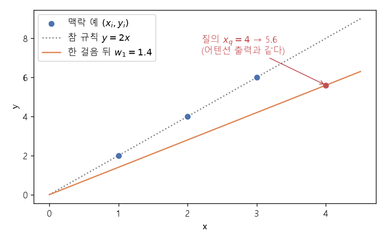

# 맥락 내 학습과 경사하강 한 걸음 (In-context learning as one gradient step)

[목차로 돌아가기](../../00_MIT%EB%94%A5%EB%9F%AC%EB%8B%9D_%EB%AA%A9%EC%B0%A8.md) · 먼저 볼 것: [MM02_그래디언트_벡터](../../%EC%88%98%ED%95%99%EA%B0%9C%EB%85%90/02_%EB%AF%B8%EB%B6%84/MM02_%EA%B7%B8%EB%9E%98%EB%94%94%EC%96%B8%ED%8A%B8_%EB%B2%A1%ED%84%B0.md), [MM08_SGD와_모멘텀](../../%EC%88%98%ED%95%99%EA%B0%9C%EB%85%90/05_%EC%8B%A0%EA%B2%BD%EB%A7%9D%EC%9D%98_%EA%B3%84%EC%82%B0/MM08_SGD%EC%99%80_%EB%AA%A8%EB%A9%98%ED%85%80.md), [MM30_스케일드_내적_어텐션](../../%EC%88%98%ED%95%99%EA%B0%9C%EB%85%90/07_%EA%B5%AC%EC%A1%B0_%EC%95%84%ED%82%A4%ED%85%8D%EC%B2%98/MM30_%EC%8A%A4%EC%BC%80%EC%9D%BC%EB%93%9C_%EB%82%B4%EC%A0%81_%EC%96%B4%ED%85%90%EC%85%98.md), [M05_벡터와_행렬](../../%EC%88%98%ED%95%99%EA%B0%9C%EB%85%90/03_%EC%84%A0%ED%98%95%EB%8C%80%EC%88%98/M05_%EB%B2%A1%ED%84%B0%EC%99%80_%ED%96%89%EB%A0%AC.md) · 쓰는 곳: [Lec24 9](../../Lec24_%EC%B6%94%EB%A1%A0_%EB%B0%A9%EB%B2%95.md#9-%EB%A7%A5%EB%9D%BD-%EB%82%B4-%ED%95%99%EC%8A%B5%EA%B3%BC-%EA%B2%BD%EC%82%AC%ED%95%98%EA%B0%95%EB%B2%95), [Lec24 10](../../Lec24_%EC%B6%94%EB%A1%A0_%EB%B0%A9%EB%B2%95.md#10-%ED%85%8C%EC%8A%A4%ED%8A%B8-%EC%8B%9C%EC%A0%90-%ED%95%99%EC%8A%B5)

📚 학습 순서 98/99 (13. 언어 모델과 추론): ← 이전: [MM80_Best-of-N과_적중_확률](../../%EC%88%98%ED%95%99%EA%B0%9C%EB%85%90/13_%EC%96%B8%EC%96%B4_%EB%AA%A8%EB%8D%B8%EA%B3%BC_%EC%B6%94%EB%A1%A0/MM80_Best-of-N%EA%B3%BC_%EC%A0%81%EC%A4%91_%ED%99%95%EB%A5%A0.md) · 다음: [MM82_정답_거르기와_반복_자기_개선](../../%EC%88%98%ED%95%99%EA%B0%9C%EB%85%90/13_%EC%96%B8%EC%96%B4_%EB%AA%A8%EB%8D%B8%EA%B3%BC_%EC%B6%94%EB%A1%A0/MM82_%EC%A0%95%EB%8B%B5_%EA%B1%B0%EB%A5%B4%EA%B8%B0%EC%99%80_%EB%B0%98%EB%B3%B5_%EC%9E%90%EA%B8%B0_%EA%B0%9C%EC%84%A0.md) →

> [!NOTE]
> **3줄 요약**
> - 프롬프트 안의 예 $(x_i, y_i)$로 [선형 회귀](../../00_%EB%94%A5%EB%9F%AC%EB%8B%9D_%EC%9A%A9%EC%96%B4%EC%82%AC%EC%A0%84.md#linear-regression-%EC%84%A0%ED%98%95-%ED%9A%8C%EA%B7%80) $\hat y = w x$를 풀 때, $w_0 = 0$에서 [경사하강](../../00_%EB%94%A5%EB%9F%AC%EB%8B%9D_%EC%9A%A9%EC%96%B4%EC%82%AC%EC%A0%84.md#gradient-descent-%EA%B2%BD%EC%82%AC%ED%95%98%EA%B0%95%EB%B2%95)을 **한 걸음** 가면 $w_1 = \eta \sum_i y_i x_i$가 된다.
> - [소프트맥스](../../00_%EB%94%A5%EB%9F%AC%EB%8B%9D_%EC%9A%A9%EC%96%B4%EC%82%AC%EC%A0%84.md#softmax-%EC%86%8C%ED%94%84%ED%8A%B8%EB%A7%A5%EC%8A%A4) 없는 **선형 [어텐션](../../00_%EB%94%A5%EB%9F%AC%EB%8B%9D_%EC%9A%A9%EC%96%B4%EC%82%AC%EC%A0%84.md#attention-%EC%96%B4%ED%85%90%EC%85%98)**에서 키 = $x_i$, 값 = $y_i$, 쿼리 = $x_q$로 두면 출력 $\eta \sum_i y_i (x_i \cdot x_q)$가 **똑같은 수**다. 예 (1,2), (2,4), (3,6), $\eta = 0.05$, $x_q = 4$면 둘 다 5.6.
> - 그래서 "[맥락 내 학습](../../00_%EB%94%A5%EB%9F%AC%EB%8B%9D_%EC%9A%A9%EC%96%B4%EC%82%AC%EC%A0%84.md#in-context-learning-%EB%A7%A5%EB%9D%BD-%EB%82%B4-%ED%95%99%EC%8A%B5)은 맥락에 대한 경사하강"이라는 해석이 나온다(von Oswald 외 2023, 1층 선형 [셀프 어텐션](../../00_%EB%94%A5%EB%9F%AC%EB%8B%9D_%EC%9A%A9%EC%96%B4%EC%82%AC%EC%A0%84.md#self-attention-%EC%85%80%ED%94%84-%EC%96%B4%ED%85%90%EC%85%98)에서 보인 결과). 이 해석이 [테스트 시점 학습](../../00_%EB%94%A5%EB%9F%AC%EB%8B%9D_%EC%9A%A9%EC%96%B4%EC%82%AC%EC%A0%84.md#test-time-training-%ED%85%8C%EC%8A%A4%ED%8A%B8-%EC%8B%9C%EC%A0%90-%ED%95%99%EC%8A%B5)의 동기가 된다.

## 1. 개념 설명

비유: 요리사에게 "이 손님들은 이렇게 간을 했더라"는 예 세 개를 보여 주고 새 손님 접시의 간을 맞추게 하는 두 방법. (1) 요리사가 예를 보며 자기 손맛([가중치](../../00_%EB%94%A5%EB%9F%AC%EB%8B%9D_%EC%9A%A9%EC%96%B4%EC%82%AC%EC%A0%84.md#weight-%EA%B0%80%EC%A4%91%EC%B9%98))을 **고쳐 놓은 뒤** 새 접시를 만든다. (2) 손맛은 그대로 두고, 새 손님이 **예의 손님들과 얼마나 닮았나**를 재서 그 손님들의 간을 닮은 만큼 섞는다. 단순한 경우에는 두 방법이 정확히 같은 간을 낸다.

- **(1) 경사하강 한 걸음**: 맥락 예로 [손실](../../00_%EB%94%A5%EB%9F%AC%EB%8B%9D_%EC%9A%A9%EC%96%B4%EC%82%AC%EC%A0%84.md#loss-function-%EC%86%90%EC%8B%A4-%ED%95%A8%EC%88%98) $\mathcal{L}(w) = \frac{1}{2}\sum_i (w x_i - y_i)^2$를 만들고, $w_0 = 0$에서 한 걸음 내려간다. 0에서의 [기울기](../../00_%EB%94%A5%EB%9F%AC%EB%8B%9D_%EC%9A%A9%EC%96%B4%EC%82%AC%EC%A0%84.md#gradient-%EA%B8%B0%EC%9A%B8%EA%B8%B0)는 $-\sum_i y_i x_i$이므로 $w_1 = \eta \sum_i y_i x_i$. 질의 $x_q$의 예측은 $w_1 x_q$다.
- **(2) 선형 [어텐션](../../00_%EB%94%A5%EB%9F%AC%EB%8B%9D_%EC%9A%A9%EC%96%B4%EC%82%AC%EC%A0%84.md#attention-%EC%96%B4%ED%85%90%EC%85%98)**: 쿼리 $q = x_q$와 각 키 $k_i = x_i$의 [내적](../../00_%EB%94%A5%EB%9F%AC%EB%8B%9D_%EC%9A%A9%EC%96%B4%EC%82%AC%EC%A0%84.md#dot-product-%EB%82%B4%EC%A0%81)으로 "닮은 정도"를 재고, 값 $v_i = y_i$를 그만큼 더한다. [소프트맥스](../../00_%EB%94%A5%EB%9F%AC%EB%8B%9D_%EC%9A%A9%EC%96%B4%EC%82%AC%EC%A0%84.md#softmax-%EC%86%8C%ED%94%84%ED%8A%B8%EB%A7%A5%EC%8A%A4)로 정규화하지 않는 것이 보통 [어텐션](../../00_%EB%94%A5%EB%9F%AC%EB%8B%9D_%EC%9A%A9%EC%96%B4%EC%82%AC%EC%A0%84.md#attention-%EC%96%B4%ED%85%90%EC%85%98)([MM30_스케일드_내적_어텐션](../../%EC%88%98%ED%95%99%EA%B0%9C%EB%85%90/07_%EA%B5%AC%EC%A1%B0_%EC%95%84%ED%82%A4%ED%85%8D%EC%B2%98/MM30_%EC%8A%A4%EC%BC%80%EC%9D%BC%EB%93%9C_%EB%82%B4%EC%A0%81_%EC%96%B4%ED%85%90%EC%85%98.md))과 다른 점이다.
- 두 식을 펼치면 $\eta \sum_i y_i x_i x_q$로 같다. 곱셈 순서만 다르다: (1)은 $\sum_i y_i x_i$를 먼저 모아 $w$를 만들고, (2)는 $x_i x_q$를 먼저 재고 더한다.


*▲ 직접 그린 그림: 맥락 예 (1,2), (2,4), (3,6)(파랑)에서 $w_0 = 0$으로 경사하강 한 걸음($\eta = 0.05$) 간 직선 $y = 1.4x$(주황). 질의 $x_q = 4$의 예측 5.6은 선형 [어텐션](../../00_%EB%94%A5%EB%9F%AC%EB%8B%9D_%EC%9A%A9%EC%96%B4%EC%82%AC%EC%A0%84.md#attention-%EC%96%B4%ED%85%90%EC%85%98) 출력과 같다. 참 규칙 $y = 2x$(점선)에는 아직 못 미친다*

## 2. 필요한 이유

[Lec24 9](../../Lec24_%EC%B6%94%EB%A1%A0_%EB%B0%A9%EB%B2%95.md#9-%EB%A7%A5%EB%9D%BD-%EB%82%B4-%ED%95%99%EC%8A%B5%EA%B3%BC-%EA%B2%BD%EC%82%AC%ED%95%98%EA%B0%95%EB%B2%95)에서 강사는 "[트랜스포머](../../00_%EB%94%A5%EB%9F%AC%EB%8B%9D_%EC%9A%A9%EC%96%B4%EC%82%AC%EC%A0%84.md#transformer-%ED%8A%B8%EB%9E%9C%EC%8A%A4%ED%8F%AC%EB%A8%B8) $f_\theta$에 맥락 $c$를 붙인 출력 $f_\theta(x, c)$가, 맥락 없이 [파라미터](../../00_%EB%94%A5%EB%9F%AC%EB%8B%9D_%EC%9A%A9%EC%96%B4%EC%82%AC%EC%A0%84.md#parameter-%ED%8C%8C%EB%9D%BC%EB%AF%B8%ED%84%B0)만 경사하강으로 고친 $f_{\theta'}(x)$와 같아지는 경우가 있다"는 논문을 소개한다. 이 노트는 그 "경우"가 무엇인지, 가장 작은 예에서 숫자로 확인한다. 이 결과에서 "그렇다면 맥락에 대해 진짜로 경사하강을 하면 어떨까?"라는 [테스트 시점 학습](../../00_%EB%94%A5%EB%9F%AC%EB%8B%9D_%EC%9A%A9%EC%96%B4%EC%82%AC%EC%A0%84.md#test-time-training-%ED%85%8C%EC%8A%A4%ED%8A%B8-%EC%8B%9C%EC%A0%90-%ED%95%99%EC%8A%B5)([Lec24 10](../../Lec24_%EC%B6%94%EB%A1%A0_%EB%B0%A9%EB%B2%95.md#10-%ED%85%8C%EC%8A%A4%ED%8A%B8-%EC%8B%9C%EC%A0%90-%ED%95%99%EC%8A%B5))으로 이어진다.

## 3. 숫자로 보기

맥락: $(x_1, y_1) = (1, 2)$, $(x_2, y_2) = (2, 4)$, $(x_3, y_3) = (3, 6)$ (참 규칙 $y = 2x$), 질의 $x_q = 4$, $\eta = 0.05$

**(1) 경사하강 한 걸음**
- $\sum_i y_i x_i = 2 \times 1 + 4 \times 2 + 6 \times 3 = 2 + 8 + 18 = 28$
- $w_1 = 0.05 \times 28 = 1.4$
- 예측 $w_1 x_q = 1.4 \times 4 = 5.6$

**(2) 선형 [어텐션](../../00_%EB%94%A5%EB%9F%AC%EB%8B%9D_%EC%9A%A9%EC%96%B4%EC%82%AC%EC%A0%84.md#attention-%EC%96%B4%ED%85%90%EC%85%98)**

| $i$ | 키 $x_i$ | 값 $y_i$ | 닮은 정도 $x_i x_q$ | $y_i \times x_i x_q$ |
|---|---|---|---|---|
| 1 | 1 | 2 | 4 | 8 |
| 2 | 2 | 4 | 8 | 32 |
| 3 | 3 | 6 | 12 | 72 |
| 합 | | | | 112 |

- 출력 $\eta \times 112 = 0.05 \times 112 = 5.6$. (1)과 같다.
- 참값은 $2 \times 4 = 8$이다. 한 걸음으로는 다 못 가지만, 걸음을 더 가거나 $\eta$를 맞추면 가까워진다(개념 재확인 1).

경사하강 한 걸음은 다음과 같다.

$$
\mathcal{L}(w) = \frac{1}{2}\sum_{i=1}^{n} (w x_i - y_i)^2, \qquad w_1 = w_0 - \eta \nabla \mathcal{L}(w_0) \;\overset{w_0 = 0}{=}\; \eta \sum_{i=1}^{n} y_i x_i
$$

<details><summary>기호 풀이</summary>

| 기호 | 읽는 법 | 뜻 | 예제 값 |
| --- | --- | --- | --- |
| $(x_i, y_i)$ | 엑스 아이, 와이 아이 | 맥락(프롬프트)에 든 $i$번째 입력·출력 예 | (1, 3), (2, 5) |
| $n$ | 엔 | 맥락 예의 수 | 2 |
| $w$ | 더블유 | 선형 모델 $\hat y = w x$의 [가중치](../../00_%EB%94%A5%EB%9F%AC%EB%8B%9D_%EC%9A%A9%EC%96%B4%EC%82%AC%EC%A0%84.md#weight-%EA%B0%80%EC%A4%91%EC%B9%98) | |
| $\mathcal{L}(w)$ | 엘 | 맥락 예에 대한 제곱 [손실](../../00_%EB%94%A5%EB%9F%AC%EB%8B%9D_%EC%9A%A9%EC%96%B4%EC%82%AC%EC%A0%84.md#loss-function-%EC%86%90%EC%8B%A4-%ED%95%A8%EC%88%98) | |
| $w_0$ | 더블유 영 | 시작 [가중치](../../00_%EB%94%A5%EB%9F%AC%EB%8B%9D_%EC%9A%A9%EC%96%B4%EC%82%AC%EC%A0%84.md#weight-%EA%B0%80%EC%A4%91%EC%B9%98) | 0 |
| $\nabla \mathcal{L}(w_0)$ | 나블라 엘 | $w_0$에서의 [기울기](../../00_%EB%94%A5%EB%9F%AC%EB%8B%9D_%EC%9A%A9%EC%96%B4%EC%82%AC%EC%A0%84.md#gradient-%EA%B8%B0%EC%9A%B8%EA%B8%B0) $\sum_i (w_0 x_i - y_i) x_i$ | -13 |
| $\eta$ | 에타 | [학습률](../../00_%EB%94%A5%EB%9F%AC%EB%8B%9D_%EC%9A%A9%EC%96%B4%EC%82%AC%EC%A0%84.md#learning-rate-%ED%95%99%EC%8A%B5%EB%A5%A0) | 0.1 |
| $w_1$ | 더블유 일 | 한 걸음 뒤 [가중치](../../00_%EB%94%A5%EB%9F%AC%EB%8B%9D_%EC%9A%A9%EC%96%B4%EC%82%AC%EC%A0%84.md#weight-%EA%B0%80%EC%A4%91%EC%B9%98) | 1.3 |

</details>

<details><summary>예제와 풀이</summary>

**문제**: 프롬프트에 예 (1, 3), (2, 5)가 있다. $w_0 = 0$에서 [학습률](../../00_%EB%94%A5%EB%9F%AC%EB%8B%9D_%EC%9A%A9%EC%96%B4%EC%82%AC%EC%A0%84.md#learning-rate-%ED%95%99%EC%8A%B5%EB%A5%A0) 0.1로 경사하강을 한 걸음 가면 $w_1$은? 그 $w_1$로 질의 $x_q = 3$을 예측하면?

**주어진 값**
- $(x_1, y_1) = (1, 3)$, $(x_2, y_2) = (2, 5)$ (맥락 예)
- $w_0 = 0$ (시작 [가중치](../../00_%EB%94%A5%EB%9F%AC%EB%8B%9D_%EC%9A%A9%EC%96%B4%EC%82%AC%EC%A0%84.md#weight-%EA%B0%80%EC%A4%91%EC%B9%98))
- $\eta = 0.1$ ([학습률](../../00_%EB%94%A5%EB%9F%AC%EB%8B%9D_%EC%9A%A9%EC%96%B4%EC%82%AC%EC%A0%84.md#learning-rate-%ED%95%99%EC%8A%B5%EB%A5%A0))
- $x_q = 3$ (질의 입력)

**풀이**
1. 식을 그대로 쓴다: $w_1 = \eta \sum_{i=1}^{n} y_i x_i$
2. 값을 대입한다 (Σ를 두 항으로 펼친다): $w_1 = 0.1 \times (3 \times 1 + 5 \times 2)$
3. 첫 곱셈을 한다: $3 \times 1 = 3$ 이므로 $w_1 = 0.1 \times (3 + 5 \times 2)$
4. 둘째 곱셈을 한다: $5 \times 2 = 10$ 이므로 $w_1 = 0.1 \times (3 + 10)$
5. 괄호 안을 더한다: $3 + 10 = 13$ 이므로 $w_1 = 0.1 \times 13$
6. 곱한다: $0.1 \times 13 = 1.3$
7. 질의를 예측한다: $\hat y_q = w_1 x_q = 1.3 \times 3 = 3.9$

**답**: $w_1 =$ **1.3**, 예측 **3.9**.

</details>

<details><summary>내 이해</summary>


</details>

선형 [어텐션](../../00_%EB%94%A5%EB%9F%AC%EB%8B%9D_%EC%9A%A9%EC%96%B4%EC%82%AC%EC%A0%84.md#attention-%EC%96%B4%ED%85%90%EC%85%98)의 출력은 다음과 같다.

$$
\hat y_q = \eta \sum_{i=1}^{n} v_i \,(k_i^\top q), \qquad k_i = x_i,\; v_i = y_i,\; q = x_q
$$

<details><summary>기호 풀이</summary>

| 기호 | 읽는 법 | 뜻 | 예제 값 |
| --- | --- | --- | --- |
| $q$ | 큐 | 쿼리. 답을 원하는 질의 입력 | 3 |
| $k_i$ | 케이 아이 | 키. $i$번째 맥락 입력 | 1, 2 |
| $v_i$ | 브이 아이 | 값. $i$번째 맥락 출력 | 3, 5 |
| $k_i^\top q$ | 케이 [전치](../../00_%EB%94%A5%EB%9F%AC%EB%8B%9D_%EC%9A%A9%EC%96%B4%EC%82%AC%EC%A0%84.md#transpose-%EC%A0%84%EC%B9%98) 큐 | 키와 쿼리의 [내적](../../00_%EB%94%A5%EB%9F%AC%EB%8B%9D_%EC%9A%A9%EC%96%B4%EC%82%AC%EC%A0%84.md#dot-product-%EB%82%B4%EC%A0%81) (닮은 정도). 숫자 하나면 그냥 곱 | 3, 6 |
| $\eta$ | 에타 | 출력 배율 ([어텐션](../../00_%EB%94%A5%EB%9F%AC%EB%8B%9D_%EC%9A%A9%EC%96%B4%EC%82%AC%EC%A0%84.md#attention-%EC%96%B4%ED%85%90%EC%85%98) [가중치](../../00_%EB%94%A5%EB%9F%AC%EB%8B%9D_%EC%9A%A9%EC%96%B4%EC%82%AC%EC%A0%84.md#weight-%EA%B0%80%EC%A4%91%EC%B9%98) 행렬이 배울 수 있는 값) | 0.1 |
| $\hat y_q$ | 와이 햇 큐 | 질의의 예측 | 3.9 |

</details>

<details><summary>예제와 풀이</summary>

**문제**: 위 예제와 같은 맥락 (1, 3), (2, 5), 질의 $x_q = 3$, $\eta = 0.1$을 선형 [어텐션](../../00_%EB%94%A5%EB%9F%AC%EB%8B%9D_%EC%9A%A9%EC%96%B4%EC%82%AC%EC%A0%84.md#attention-%EC%96%B4%ED%85%90%EC%85%98)에 넣으면 출력은? 경사하강 예측 3.9와 같은가?

**주어진 값**
- $k_1 = 1$, $k_2 = 2$ (키 = 맥락 입력)
- $v_1 = 3$, $v_2 = 5$ (값 = 맥락 출력)
- $q = 3$ (쿼리 = 질의 입력)
- $\eta = 0.1$ (출력 배율)

**풀이**
1. 식을 그대로 쓴다: $\hat y_q = \eta \sum_{i=1}^{n} v_i (k_i^\top q)$
2. 값을 대입한다 (Σ를 두 항으로 펼친다): $\hat y_q = 0.1 \times \big(3 \times (1 \times 3) + 5 \times (2 \times 3)\big)$
3. 첫 닮은 정도를 곱한다: $1 \times 3 = 3$ 이므로 $\hat y_q = 0.1 \times \big(3 \times 3 + 5 \times (2 \times 3)\big)$
4. 둘째 닮은 정도를 곱한다: $2 \times 3 = 6$ 이므로 $\hat y_q = 0.1 \times (3 \times 3 + 5 \times 6)$
5. 첫 항을 곱한다: $3 \times 3 = 9$ 이므로 $\hat y_q = 0.1 \times (9 + 5 \times 6)$
6. 둘째 항을 곱한다: $5 \times 6 = 30$ 이므로 $\hat y_q = 0.1 \times (9 + 30)$
7. 괄호 안을 더한다: $9 + 30 = 39$ 이므로 $\hat y_q = 0.1 \times 39$
8. 곱한다: $0.1 \times 39 = 3.9$

**답**: **3.9**. 경사하강 한 걸음의 예측과 정확히 같다.

</details>

<details><summary>내 이해</summary>


</details>

## 4. 코드로 확인

```python
# [변수] x, y: 3절의 맥락 예 (참 규칙 y = 2x)
x, y = np.array([1., 2., 3.]), np.array([2., 4., 6.])
# [변수] xq, eta: 질의 입력 4와 학습률 0.05
xq, eta = 4.0, 0.05
# [변수] w1 = 1.4: w0 = 0에서 경사하강 한 걸음 (기울기 = -sum(y*x))
w1 = 0.0 - eta * np.sum((0.0 * x - y) * x)
# [변수] attn = 5.6: 선형 어텐션 출력 (키 x, 값 y, 쿼리 xq)
attn = eta * np.sum(y * (x * xq))
# [연결] 3절: w1 = 1.4, 예측 5.6, 어텐션 표의 합 112, 출력 5.6
print(round(w1, 4), round(w1 * xq, 4), np.sum(y * x * xq), round(attn, 4))
# [함수] np.random.default_rng(0): 재현 가능한 난수 생성기
rng = np.random.default_rng(0)
# [변수] X, Y, q: 3차원 입력 5개와 출력, 질의 하나 (벡터인 경우)
X, Y, q = rng.normal(size=(5, 3)), rng.normal(size=5), rng.normal(size=3)
# [변수] W1: 벡터 가중치의 경사하강 한 걸음 eta * sum(y_i * x_i)
W1 = eta * (Y @ X)
# [함수] np.allclose: 두 값이 (부동소수점 오차 안에서) 같은가
# [연결] 벡터에서도 W1·q = eta * sum(y_i * (x_i·q)) 이다
print(np.allclose(W1 @ q, eta * np.sum(Y * (X @ q))))
```

**실행 결과**:

```text
1.4 5.6 112.0 5.6
True
```

> [!WARNING]
> **⚠ 주의**
> - 정확히 같아지는 것은 **[소프트맥스](../../00_%EB%94%A5%EB%9F%AC%EB%8B%9D_%EC%9A%A9%EC%96%B4%EC%82%AC%EC%A0%84.md#softmax-%EC%86%8C%ED%94%84%ED%8A%B8%EB%A7%A5%EC%8A%A4) 없는 1층 선형 [셀프 어텐션](../../00_%EB%94%A5%EB%9F%AC%EB%8B%9D_%EC%9A%A9%EC%96%B4%EC%82%AC%EC%A0%84.md#self-attention-%EC%85%80%ED%94%84-%EC%96%B4%ED%85%90%EC%85%98)**과 [선형 회귀](../../00_%EB%94%A5%EB%9F%AC%EB%8B%9D_%EC%9A%A9%EC%96%B4%EC%82%AC%EC%A0%84.md#linear-regression-%EC%84%A0%ED%98%95-%ED%9A%8C%EA%B7%80) 같은 단순한 경우다(von Oswald 외, ICML 2023). 실제 대형 [언어 모델](../../00_%EB%94%A5%EB%9F%AC%EB%8B%9D_%EC%9A%A9%EC%96%B4%EC%82%AC%EC%A0%84.md#language-model-%EC%96%B8%EC%96%B4-%EB%AA%A8%EB%8D%B8)의 [소프트맥스](../../00_%EB%94%A5%EB%9F%AC%EB%8B%9D_%EC%9A%A9%EC%96%B4%EC%82%AC%EC%A0%84.md#softmax-%EC%86%8C%ED%94%84%ED%8A%B8%EB%A7%A5%EC%8A%A4) [어텐션](../../00_%EB%94%A5%EB%9F%AC%EB%8B%9D_%EC%9A%A9%EC%96%B4%EC%82%AC%EC%A0%84.md#attention-%EC%96%B4%ED%85%90%EC%85%98)이 경사하강을 한다고 증명된 것은 아니다. 강사도 "단순한 장난감 사례"라고 단서를 단다.
> - 걸음 하나로는 보통 참값에 못 닿는다(5.6 vs 8). 여러 [층](../../00_%EB%94%A5%EB%9F%AC%EB%8B%9D_%EC%9A%A9%EC%96%B4%EC%82%AC%EC%A0%84.md#layer-%EC%B8%B5)이 여러 걸음을 흉내 낼 수 있다는 후속 연구가 있지만, 진짜 경사하강처럼 "계산을 더 하면 더 좋아진다"는 보장은 없다. 진짜 경사하강을 쓰는 [테스트 시점 학습](../../00_%EB%94%A5%EB%9F%AC%EB%8B%9D_%EC%9A%A9%EC%96%B4%EC%82%AC%EC%A0%84.md#test-time-training-%ED%85%8C%EC%8A%A4%ED%8A%B8-%EC%8B%9C%EC%A0%90-%ED%95%99%EC%8A%B5)은 반복을 늘려 계산을 더 쓸 수 있다.
> - $\eta$가 너무 크면 한 걸음이 참값을 지나친다. 1차원에서는 $\eta = 1 / \sum_i x_i^2$일 때 한 걸음으로 정확히 최솟값에 닿는다(개념 재확인 1).

## 5. 개념 재확인

<details><summary>1. 맥락 (2, 1), (4, 2), 질의 $x_q = 6$, $\eta = 0.05$일 때 경사하강 한 걸음의 예측은?</summary>

| 단계 | 하는 일 | 계산 | 결과 |
|---|---|---|---|
| 1 | 곱의 합 | $1 \times 2 + 2 \times 4$ | 10 |
| 2 | 한 걸음 | $0.05 \times 10$ | 0.5 |
| 3 | 질의 예측 | $0.5 \times 6$ | 3 |

**① 쓰는 식**
$$w_1 = \eta \sum_{i} y_i x_i, \qquad \hat y_q = w_1 x_q$$
- 위 식 ← ② (곱의 합), ③ (한 걸음), ④ (예측)에서 쓴다.
```python
# [변수] x, y: 맥락 예 (참 규칙 y = x / 2)
x, y = np.array([2., 4.]), np.array([1., 2.])          # ①
# [변수] s = 10: y_i * x_i의 합
s = np.sum(y * x)                                      # ②
# [변수] w1 = 0.5: 한 걸음 뒤 가중치
w1 = 0.05 * s                                          # ③
# [연결] 10.0 0.5 3.0
print(s, round(w1, 4), round(w1 * 6, 4))               # ④
```

**주어진 값**
- $(x_1, y_1) = (2, 1)$, $(x_2, y_2) = (4, 2)$ (맥락 예)
- $\eta = 0.05$ ([학습률](../../00_%EB%94%A5%EB%9F%AC%EB%8B%9D_%EC%9A%A9%EC%96%B4%EC%82%AC%EC%A0%84.md#learning-rate-%ED%95%99%EC%8A%B5%EB%A5%A0))
- $x_q = 6$ (질의 입력)

**풀이**
1. 식을 그대로 쓴다: $w_1 = \eta \sum_i y_i x_i$, $\hat y_q = w_1 x_q$
2. 값을 대입한다: $w_1 = 0.05 \times (1 \times 2 + 2 \times 4)$, $\hat y_q = w_1 \times 6$
3. (②) 첫 곱셈을 한다: $1 \times 2 = 2$ 이므로 $w_1 = 0.05 \times (2 + 2 \times 4)$
4. (②) 둘째 곱셈을 한다: $2 \times 4 = 8$ 이므로 $w_1 = 0.05 \times (2 + 8)$
5. (②) 더한다: $2 + 8 = 10$ 이므로 $w_1 = 0.05 \times 10$
6. (③) 곱한다: $0.05 \times 10 = 0.5$
7. (④) 예측한다: $\hat y_q = 0.5 \times 6 = 3$

**답**: **3**. 참 규칙 $y = x/2$의 값 $6/2 = 3$과 같다. $\eta = 0.05 = 1/(2^2 + 4^2) = 1/20$이라 한 걸음으로 최솟값에 닿았다.

</details>

<details><summary>2. 입력이 벡터일 때: 맥락 $x_1 = (1, 0)$, $y_1 = 2$, $x_2 = (0, 1)$, $y_2 = 3$, 질의 $q = (1, 1)$, $\eta = 1$이면 선형 어텐션 출력과 경사하강 예측은?</summary>

| 단계 | 하는 일 | 계산 | 결과 |
|---|---|---|---|
| 1 | 키·쿼리 [내적](../../00_%EB%94%A5%EB%9F%AC%EB%8B%9D_%EC%9A%A9%EC%96%B4%EC%82%AC%EC%A0%84.md#dot-product-%EB%82%B4%EC%A0%81) | $x_1 \cdot q$, $x_2 \cdot q$ | 1, 1 |
| 2 | [어텐션](../../00_%EB%94%A5%EB%9F%AC%EB%8B%9D_%EC%9A%A9%EC%96%B4%EC%82%AC%EC%A0%84.md#attention-%EC%96%B4%ED%85%90%EC%85%98) 출력 | $2 \times 1 + 3 \times 1$ | 5 |
| 3 | 한 걸음 [가중치](../../00_%EB%94%A5%EB%9F%AC%EB%8B%9D_%EC%9A%A9%EC%96%B4%EC%82%AC%EC%A0%84.md#weight-%EA%B0%80%EC%A4%91%EC%B9%98) | $2 (1, 0) + 3 (0, 1)$ | (2, 3) |
| 4 | 경사하강 예측 | $(2, 3) \cdot (1, 1)$ | 5 |

**① 쓰는 식**
$$\hat y_q = \eta \sum_i y_i (x_i^\top q) = \Big(\eta \sum_i y_i x_i\Big)^\top q$$
- 위 식 ← ② ([내적](../../00_%EB%94%A5%EB%9F%AC%EB%8B%9D_%EC%9A%A9%EC%96%B4%EC%82%AC%EC%A0%84.md#dot-product-%EB%82%B4%EC%A0%81)), ③ ([어텐션](../../00_%EB%94%A5%EB%9F%AC%EB%8B%9D_%EC%9A%A9%EC%96%B4%EC%82%AC%EC%A0%84.md#attention-%EC%96%B4%ED%85%90%EC%85%98) 출력), ④ ([가중치](../../00_%EB%94%A5%EB%9F%AC%EB%8B%9D_%EC%9A%A9%EC%96%B4%EC%82%AC%EC%A0%84.md#weight-%EA%B0%80%EC%A4%91%EC%B9%98)와 예측)에서 쓴다.
```python
# [변수] X, Y, q: 2차원 맥락 입력 2개, 출력, 질의
X, Y, q = np.array([[1., 0.], [0., 1.]]), np.array([2., 3.]), np.array([1., 1.])   # ①
# [변수] sim = [1. 1.]: 키와 쿼리의 내적
sim = X @ q                                                                        # ②
# [변수] attn = 5: 값을 닮은 정도만큼 더한 것
attn = np.sum(Y * sim)                                                             # ③
# [변수] w1 = [2. 3.]: 경사하강 한 걸음 (eta = 1)
w1 = Y @ X                                                                         # ④
# [연결] [1. 1.] 5.0 [2. 3.] 5.0
print(sim, attn, w1, w1 @ q)                                                       # ④
```

**주어진 값**
- $x_1 = (1, 0)$, $y_1 = 2$ (첫 맥락 예)
- $x_2 = (0, 1)$, $y_2 = 3$ (둘째 맥락 예)
- $q = (1, 1)$ (질의 입력)
- $\eta = 1$ (배율)

**풀이**
1. 식을 그대로 쓴다: $\hat y_q = \eta \sum_i y_i (x_i^\top q)$
2. 값을 대입한다 (Σ를 두 항으로 펼친다): $\hat y_q = 1 \times \big(2 \times ((1,0) \cdot (1,1)) + 3 \times ((0,1) \cdot (1,1))\big)$
3. (②) 첫 [내적](../../00_%EB%94%A5%EB%9F%AC%EB%8B%9D_%EC%9A%A9%EC%96%B4%EC%82%AC%EC%A0%84.md#dot-product-%EB%82%B4%EC%A0%81)을 칸별로 곱해 더한다: $1 \times 1 + 0 \times 1 = 1$ 이므로 $\hat y_q = 2 \times 1 + 3 \times ((0,1) \cdot (1,1))$
4. (②) 둘째 [내적](../../00_%EB%94%A5%EB%9F%AC%EB%8B%9D_%EC%9A%A9%EC%96%B4%EC%82%AC%EC%A0%84.md#dot-product-%EB%82%B4%EC%A0%81)을 구한다: $0 \times 1 + 1 \times 1 = 1$ 이므로 $\hat y_q = 2 \times 1 + 3 \times 1$
5. (③) 곱한다: $2 \times 1 = 2$, $3 \times 1 = 3$ 이므로 $\hat y_q = 2 + 3$
6. (③) 더한다: $2 + 3 = 5$
7. (④) 경사하강 쪽 [가중치](../../00_%EB%94%A5%EB%9F%AC%EB%8B%9D_%EC%9A%A9%EC%96%B4%EC%82%AC%EC%A0%84.md#weight-%EA%B0%80%EC%A4%91%EC%B9%98)를 칸별로 구한다: $w_1 = 2 \times (1, 0) + 3 \times (0, 1) = (2, 0) + (0, 3) = (2, 3)$
8. (④) 질의와 내적한다: $(2, 3) \cdot (1, 1) = 2 \times 1 + 3 \times 1 = 5$

**답**: 둘 다 **5**. 벡터에서도 "[가중치](../../00_%EB%94%A5%EB%9F%AC%EB%8B%9D_%EC%9A%A9%EC%96%B4%EC%82%AC%EC%A0%84.md#weight-%EA%B0%80%EC%A4%91%EC%B9%98)를 먼저 모으기"와 "닮은 정도를 먼저 재기"가 같은 답을 준다.

</details>

## 예제 풀기

[예제 10문제 풀기](../../%EC%98%88%EC%A0%9C/13_%EC%96%B8%EC%96%B4_%EB%AA%A8%EB%8D%B8%EA%B3%BC_%EC%B6%94%EB%A1%A0/%EC%98%88%EC%A0%9C_MM81_%EB%A7%A5%EB%9D%BD_%EB%82%B4_%ED%95%99%EC%8A%B5%EA%B3%BC_%EA%B2%BD%EC%82%AC%ED%95%98%EA%B0%95_%ED%95%9C_%EA%B1%B8%EC%9D%8C.md)

<details><summary>내 이해</summary>


</details>
