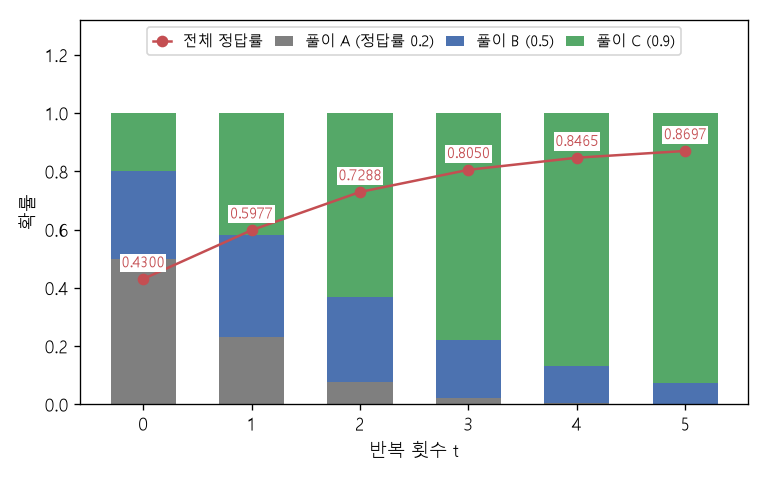

# 정답 거르기와 반복 자기 개선 (Filtering correct answers, iterated self-improvement)

[목차로 돌아가기](../../00_MIT%EB%94%A5%EB%9F%AC%EB%8B%9D_%EB%AA%A9%EC%B0%A8.md) · 먼저 볼 것: [M08_확률_기초](../../%EC%88%98%ED%95%99%EA%B0%9C%EB%85%90/04_%ED%99%95%EB%A5%A0%EA%B3%BC_%EC%A0%95%EB%B3%B4/M08_%ED%99%95%EB%A5%A0_%EA%B8%B0%EC%B4%88.md), [M02_시그마와_평균](../../%EC%88%98%ED%95%99%EA%B0%9C%EB%85%90/01_%EC%88%98%EC%99%80_%ED%95%A8%EC%88%98/M02_%EC%8B%9C%EA%B7%B8%EB%A7%88%EC%99%80_%ED%8F%89%EA%B7%A0.md), [MM58_조건부_확률과_독립](../../%EC%88%98%ED%95%99%EA%B0%9C%EB%85%90/04_%ED%99%95%EB%A5%A0%EA%B3%BC_%EC%A0%95%EB%B3%B4/MM58_%EC%A1%B0%EA%B1%B4%EB%B6%80_%ED%99%95%EB%A5%A0%EA%B3%BC_%EB%8F%85%EB%A6%BD.md), [MM64_베이즈_규칙과_사전_확률_보정](../../%EC%88%98%ED%95%99%EA%B0%9C%EB%85%90/04_%ED%99%95%EB%A5%A0%EA%B3%BC_%EC%A0%95%EB%B3%B4/MM64_%EB%B2%A0%EC%9D%B4%EC%A6%88_%EA%B7%9C%EC%B9%99%EA%B3%BC_%EC%82%AC%EC%A0%84_%ED%99%95%EB%A5%A0_%EB%B3%B4%EC%A0%95.md), [MM80_Best-of-N과_적중_확률](../../%EC%88%98%ED%95%99%EA%B0%9C%EB%85%90/13_%EC%96%B8%EC%96%B4_%EB%AA%A8%EB%8D%B8%EA%B3%BC_%EC%B6%94%EB%A1%A0/MM80_Best-of-N%EA%B3%BC_%EC%A0%81%EC%A4%91_%ED%99%95%EB%A5%A0.md) · 쓰는 곳: [Lec24 11](../../Lec24_%EC%B6%94%EB%A1%A0_%EB%B0%A9%EB%B2%95.md#11-%ED%83%90%EC%83%89%EC%9C%BC%EB%A1%9C-%ED%95%99%EC%8A%B5%ED%95%98%EA%B8%B0)

📚 학습 순서 99/99 (13. 언어 모델과 추론): ← 이전: [MM81_맥락_내_학습과_경사하강_한_걸음](../../%EC%88%98%ED%95%99%EA%B0%9C%EB%85%90/13_%EC%96%B8%EC%96%B4_%EB%AA%A8%EB%8D%B8%EA%B3%BC_%EC%B6%94%EB%A1%A0/MM81_%EB%A7%A5%EB%9D%BD_%EB%82%B4_%ED%95%99%EC%8A%B5%EA%B3%BC_%EA%B2%BD%EC%82%AC%ED%95%98%EA%B0%95_%ED%95%9C_%EA%B1%B8%EC%9D%8C.md) · 다음: 없음 (끝) →

> [!NOTE]
> **3줄 요약**
> - 모델이 풀이 방식 $s$를 [확률](../../00_%EB%94%A5%EB%9F%AC%EB%8B%9D_%EC%9A%A9%EC%96%B4%EC%82%AC%EC%A0%84.md#probability-%ED%99%95%EB%A5%A0) $p(s)$로 고르고, 방식마다 정답률이 $q(s)$이면 전체 정답률은 $\sum_s p(s) q(s)$다. $p = (0.5, 0.3, 0.2)$, $q = (0.2, 0.5, 0.9)$면 0.43.
> - **정답인 풀이만 걸러 그대로 따라 배우면**([STaR](../../00_%EB%94%A5%EB%9F%AC%EB%8B%9D_%EC%9A%A9%EC%96%B4%EC%82%AC%EC%A0%84.md#star-self-taught-reasoner-%EC%8A%A4%EC%8A%A4%EB%A1%9C-%EB%B0%B0%EC%9A%B0%EB%8A%94-%EC%B6%94%EB%A1%A0%EA%B8%B0)) 새 분포는 [베이즈 정리](../../00_%EB%94%A5%EB%9F%AC%EB%8B%9D_%EC%9A%A9%EC%96%B4%EC%82%AC%EC%A0%84.md#bayes-rule-%EB%B2%A0%EC%9D%B4%EC%A6%88-%EC%A0%95%EB%A6%AC)의 [사후 분포](../../00_%EB%94%A5%EB%9F%AC%EB%8B%9D_%EC%9A%A9%EC%96%B4%EC%82%AC%EC%A0%84.md#prior-posterior-%EC%82%AC%EC%A0%84-%EB%B6%84%ED%8F%AC%EC%99%80-%EC%82%AC%ED%9B%84-%EB%B6%84%ED%8F%AC) $p(s \mid \text{정답}) \propto p(s) q(s)$가 된다. 위 예에서 (0.2326, 0.3488, 0.4186), 정답률 0.5977.
> - 이것을 $t$번 반복하면 $p_t(s) \propto p_0(s)\, q(s)^t$. 정답률이 가장 높은 방식으로 [확률](../../00_%EB%94%A5%EB%9F%AC%EB%8B%9D_%EC%9A%A9%EC%96%B4%EC%82%AC%EC%A0%84.md#probability-%ED%99%95%EB%A5%A0)이 몰려 정답률이 0.43 → 0.5977 → 0.7288 → ... → 0.8697(5번)로 오른다. 정답률 0인 방식은 영영 0이다.

## 1. 개념 설명

비유: 학생이 문제집을 풀 때 여러 풀이 습관(방식 A, B, C)을 섞어 쓴다. 채점해서 **맞은 풀이만 오려 내 공책에 옮겨 적고**, 다음엔 그 공책을 보고 연습한다. 잘 맞는 습관일수록 공책에 많이 남으므로 다음 번에 더 자주 쓰게 된다. 이것을 되풀이하면 가장 잘 맞는 습관이 거의 전부가 된다.

- **탐색**: 모델이 같은 질문에 여러 [생각의 사슬](../../00_%EB%94%A5%EB%9F%AC%EB%8B%9D_%EC%9A%A9%EC%96%B4%EC%82%AC%EC%A0%84.md#chain-of-thought-prompting-%EC%83%9D%EA%B0%81%EC%9D%98-%EC%82%AC%EC%8A%AC-%ED%94%84%EB%A1%AC%ED%94%84%ED%8C%85)을 뽑는다([Best-of-N](../../%EC%88%98%ED%95%99%EA%B0%9C%EB%85%90/13_%EC%96%B8%EC%96%B4_%EB%AA%A8%EB%8D%B8%EA%B3%BC_%EC%B6%94%EB%A1%A0/MM80_Best-of-N%EA%B3%BC_%EC%A0%81%EC%A4%91_%ED%99%95%EB%A5%A0.md)처럼).
- **거르기**: [검증기](../../00_%EB%94%A5%EB%9F%AC%EB%8B%9D_%EC%9A%A9%EC%96%B4%EC%82%AC%EC%A0%84.md#verifier-%EA%B2%80%EC%A6%9D%EA%B8%B0)가 정답인 것만 남긴다. 방식 $s$의 풀이가 남을 [확률](../../00_%EB%94%A5%EB%9F%AC%EB%8B%9D_%EC%9A%A9%EC%96%B4%EC%82%AC%EC%A0%84.md#probability-%ED%99%95%EB%A5%A0)은 "그 방식을 고를 [확률](../../00_%EB%94%A5%EB%9F%AC%EB%8B%9D_%EC%9A%A9%EC%96%B4%EC%82%AC%EC%A0%84.md#probability-%ED%99%95%EB%A5%A0) × 그 방식이 맞을 [확률](../../00_%EB%94%A5%EB%9F%AC%EB%8B%9D_%EC%9A%A9%EC%96%B4%EC%82%AC%EC%A0%84.md#probability-%ED%99%95%EB%A5%A0)" $= p(s) q(s)$다.
- **[학습](../../00_%EB%94%A5%EB%9F%AC%EB%8B%9D_%EC%9A%A9%EC%96%B4%EC%82%AC%EC%A0%84.md#training-%ED%95%99%EC%8A%B5)**: 남은 풀이로 [미세 조정](../../00_%EB%94%A5%EB%9F%AC%EB%8B%9D_%EC%9A%A9%EC%96%B4%EC%82%AC%EC%A0%84.md#fine-tuning-%EB%AF%B8%EC%84%B8-%EC%A1%B0%EC%A0%95)한다. 모델이 남은 풀이의 분포를 완벽히 따라 배운다고 하면, 새 분포는 남은 비율을 합이 1이 되게 나눈 것, 곧 [조건부 확률](../../00_%EB%94%A5%EB%9F%AC%EB%8B%9D_%EC%9A%A9%EC%96%B4%EC%82%AC%EC%A0%84.md#conditional-probability-%EC%A1%B0%EA%B1%B4%EB%B6%80-%ED%99%95%EB%A5%A0) $p(s \mid \text{정답})$이다([MM58_조건부_확률과_독립](../../%EC%88%98%ED%95%99%EA%B0%9C%EB%85%90/04_%ED%99%95%EB%A5%A0%EA%B3%BC_%EC%A0%95%EB%B3%B4/MM58_%EC%A1%B0%EA%B1%B4%EB%B6%80_%ED%99%95%EB%A5%A0%EA%B3%BC_%EB%8F%85%EB%A6%BD.md)).
- **반복**: 새 모델로 다시 탐색한다. 한 번 거를 때마다 $q(s)$가 한 번 더 곱해지므로 $t$번 뒤에는 $q(s)^t$가 곱해진다.


*▲ 직접 그린 그림: 풀이 방식 A(정답률 0.2), B(0.5), C(0.9)를 처음 0.5, 0.3, 0.2의 [확률](../../00_%EB%94%A5%EB%9F%AC%EB%8B%9D_%EC%9A%A9%EC%96%B4%EC%82%AC%EC%A0%84.md#probability-%ED%99%95%EB%A5%A0)로 쓰는 모델. [정답](../../00_%EB%94%A5%EB%9F%AC%EB%8B%9D_%EC%9A%A9%EC%96%B4%EC%82%AC%EC%A0%84.md#label-%EC%A0%95%EB%8B%B5)만 걸러 다시 배우기를 반복할수록 C의 몫(초록)이 커지고 전체 정답률(빨강)이 0.43에서 0.8697로 오른다*

## 2. 필요한 이유

[Lec24 11](../../Lec24_%EC%B6%94%EB%A1%A0_%EB%B0%A9%EB%B2%95.md#11-%ED%83%90%EC%83%89%EC%9C%BC%EB%A1%9C-%ED%95%99%EC%8A%B5%ED%95%98%EA%B8%B0)에서 강사는 "탐색으로 더 나은 답을 찾고, 그 답을 다시 학습해 모델이 바로 내놓게 하고, 이를 되풀이한다"는 고리를 [강화 학습](../../00_%EB%94%A5%EB%9F%AC%EB%8B%9D_%EC%9A%A9%EC%96%B4%EC%82%AC%EC%A0%84.md#reinforcement-learning-%EA%B0%95%ED%99%94-%ED%95%99%EC%8A%B5), AlphaGo, [STaR](../../00_%EB%94%A5%EB%9F%AC%EB%8B%9D_%EC%9A%A9%EC%96%B4%EC%82%AC%EC%A0%84.md#star-self-taught-reasoner-%EC%8A%A4%EC%8A%A4%EB%A1%9C-%EB%B0%B0%EC%9A%B0%EB%8A%94-%EC%B6%94%EB%A1%A0%EA%B8%B0), 그리고 OpenAI o1에 대한 추측의 공통 뼈대로 소개한다. 이 노트는 그 고리가 왜 정답률을 올리는지, 어디까지 올릴 수 있는지를 가장 작은 모형으로 계산한다.

## 3. 숫자로 보기

풀이 방식 세 개, 처음 [확률](../../00_%EB%94%A5%EB%9F%AC%EB%8B%9D_%EC%9A%A9%EC%96%B4%EC%82%AC%EC%A0%84.md#probability-%ED%99%95%EB%A5%A0) $p_0 = (0.5, 0.3, 0.2)$, 정답률 $q = (0.2, 0.5, 0.9)$

**한 번 거르기**

| 방식 | $p_0(s)$ | $q(s)$ | 남는 몫 $p_0 q$ | 새 [확률](../../00_%EB%94%A5%EB%9F%AC%EB%8B%9D_%EC%9A%A9%EC%96%B4%EC%82%AC%EC%A0%84.md#probability-%ED%99%95%EB%A5%A0) $p_1 = p_0 q / 0.43$ |
|---|---|---|---|---|
| A | 0.5 | 0.2 | 0.1 | 0.2326 |
| B | 0.3 | 0.5 | 0.15 | 0.3488 |
| C | 0.2 | 0.9 | 0.18 | 0.4186 |
| 합 | 1 | | 0.43 | 1 |

- 처음 정답률은 남는 몫의 합 0.43이다.
- 새 정답률: $0.2326 \times 0.2 + 0.3488 \times 0.5 + 0.4186 \times 0.9 = 0.5977$

**여러 번 반복**

| $t$ | 0 | 1 | 2 | 3 | 4 | 5 |
|---|---|---|---|---|---|---|
| C의 [확률](../../00_%EB%94%A5%EB%9F%AC%EB%8B%9D_%EC%9A%A9%EC%96%B4%EC%82%AC%EC%A0%84.md#probability-%ED%99%95%EB%A5%A0) | 0.2 | 0.4186 | 0.6304 | 0.7784 | 0.8703 | 0.9253 |
| 전체 정답률 | 0.43 | 0.5977 | 0.7288 | 0.805 | 0.8465 | 0.8697 |

- 정답률은 C의 정답률 0.9에 가까워지지만 넘지는 못한다. 모델이 이미 할 줄 아는 방식들 사이에서 **고르는 것**이기 때문이다.

전체 정답률은 방식별 "고를 [확률](../../00_%EB%94%A5%EB%9F%AC%EB%8B%9D_%EC%9A%A9%EC%96%B4%EC%82%AC%EC%A0%84.md#probability-%ED%99%95%EB%A5%A0) × 맞을 [확률](../../00_%EB%94%A5%EB%9F%AC%EB%8B%9D_%EC%9A%A9%EC%96%B4%EC%82%AC%EC%A0%84.md#probability-%ED%99%95%EB%A5%A0)"의 합이다.

$$
P(\text{정답}) = \sum_{s} p(s)\, q(s)
$$

<details><summary>기호 풀이</summary>

| 기호 | 읽는 법 | 뜻 | 예제 값 |
| --- | --- | --- | --- |
| $s$ | 에스 | 풀이 방식 (생각의 사슬 종류) | A, B |
| $p(s)$ | 피 에스 | 모델이 방식 $s$를 고를 [확률](../../00_%EB%94%A5%EB%9F%AC%EB%8B%9D_%EC%9A%A9%EC%96%B4%EC%82%AC%EC%A0%84.md#probability-%ED%99%95%EB%A5%A0) | 0.6, 0.4 |
| $q(s)$ | 큐 에스 | 방식 $s$로 풀었을 때 정답일 [확률](../../00_%EB%94%A5%EB%9F%AC%EB%8B%9D_%EC%9A%A9%EC%96%B4%EC%82%AC%EC%A0%84.md#probability-%ED%99%95%EB%A5%A0) | 0.3, 0.8 |
| $\sum_s$ | 시그마 | 모든 방식에 대해 더한다 | |
| $P(\text{정답})$ | 피 | 모델 전체의 정답률 | 0.5 |

</details>

<details><summary>예제와 풀이</summary>

**문제**: 모델이 방식 A를 0.6, 방식 B를 0.4의 [확률](../../00_%EB%94%A5%EB%9F%AC%EB%8B%9D_%EC%9A%A9%EC%96%B4%EC%82%AC%EC%A0%84.md#probability-%ED%99%95%EB%A5%A0)로 쓴다. A로 풀면 0.3, B로 풀면 0.8의 [확률](../../00_%EB%94%A5%EB%9F%AC%EB%8B%9D_%EC%9A%A9%EC%96%B4%EC%82%AC%EC%A0%84.md#probability-%ED%99%95%EB%A5%A0)로 맞는다. 전체 정답률은?

**주어진 값**
- $p(A) = 0.6$, $p(B) = 0.4$ (방식을 고를 [확률](../../00_%EB%94%A5%EB%9F%AC%EB%8B%9D_%EC%9A%A9%EC%96%B4%EC%82%AC%EC%A0%84.md#probability-%ED%99%95%EB%A5%A0))
- $q(A) = 0.3$, $q(B) = 0.8$ (방식별 정답률)

**풀이**
1. 식을 그대로 쓴다: $P(\text{정답}) = \sum_s p(s)\, q(s)$
2. 값을 대입한다 (Σ를 두 항으로 펼친다): $P = 0.6 \times 0.3 + 0.4 \times 0.8$
3. 첫 곱셈을 한다: $0.6 \times 0.3 = 0.18$ 이므로 $P = 0.18 + 0.4 \times 0.8$
4. 둘째 곱셈을 한다: $0.4 \times 0.8 = 0.32$ 이므로 $P = 0.18 + 0.32$
5. 더한다: $0.18 + 0.32 = 0.5$

**답**: **0.5**. 문제 둘 중 하나를 맞힌다.

</details>

<details><summary>내 이해</summary>


</details>

[정답](../../00_%EB%94%A5%EB%9F%AC%EB%8B%9D_%EC%9A%A9%EC%96%B4%EC%82%AC%EC%A0%84.md#label-%EC%A0%95%EB%8B%B5)만 걸러 따라 배운 새 분포는 [베이즈 정리](../../00_%EB%94%A5%EB%9F%AC%EB%8B%9D_%EC%9A%A9%EC%96%B4%EC%82%AC%EC%A0%84.md#bayes-rule-%EB%B2%A0%EC%9D%B4%EC%A6%88-%EC%A0%95%EB%A6%AC)로 쓴 [사후 분포](../../00_%EB%94%A5%EB%9F%AC%EB%8B%9D_%EC%9A%A9%EC%96%B4%EC%82%AC%EC%A0%84.md#prior-posterior-%EC%82%AC%EC%A0%84-%EB%B6%84%ED%8F%AC%EC%99%80-%EC%82%AC%ED%9B%84-%EB%B6%84%ED%8F%AC)다.

$$
p_{\text{new}}(s) = p(s \mid \text{정답}) = \frac{p(s)\, q(s)}{\sum_{s'} p(s')\, q(s')}
$$

<details><summary>기호 풀이</summary>

| 기호 | 읽는 법 | 뜻 | 예제 값 |
| --- | --- | --- | --- |
| $p(s)$ | 피 에스 | 거르기 전 방식 $s$의 [확률](../../00_%EB%94%A5%EB%9F%AC%EB%8B%9D_%EC%9A%A9%EC%96%B4%EC%82%AC%EC%A0%84.md#probability-%ED%99%95%EB%A5%A0) ([사전 분포](../../00_%EB%94%A5%EB%9F%AC%EB%8B%9D_%EC%9A%A9%EC%96%B4%EC%82%AC%EC%A0%84.md#prior-posterior-%EC%82%AC%EC%A0%84-%EB%B6%84%ED%8F%AC%EC%99%80-%EC%82%AC%ED%9B%84-%EB%B6%84%ED%8F%AC)) | 0.6, 0.4 |
| $q(s)$ | 큐 에스 | 방식 $s$의 정답률 (거르기에서 살아남을 [확률](../../00_%EB%94%A5%EB%9F%AC%EB%8B%9D_%EC%9A%A9%EC%96%B4%EC%82%AC%EC%A0%84.md#probability-%ED%99%95%EB%A5%A0)) | 0.3, 0.8 |
| $p(s)\,q(s)$ | | 방식 $s$이면서 정답일 [확률](../../00_%EB%94%A5%EB%9F%AC%EB%8B%9D_%EC%9A%A9%EC%96%B4%EC%82%AC%EC%A0%84.md#probability-%ED%99%95%EB%A5%A0) (남는 몫) | 0.18, 0.32 |
| $\sum_{s'} p(s') q(s')$ | 시그마 | 남는 몫의 합 = 전체 정답률 (나누는 수) | 0.5 |
| $p(s \mid \text{정답})$ | 피 에스 바 [정답](../../00_%EB%94%A5%EB%9F%AC%EB%8B%9D_%EC%9A%A9%EC%96%B4%EC%82%AC%EC%A0%84.md#label-%EC%A0%95%EB%8B%B5) | 정답인 풀이 중 방식 $s$의 비율 ([사후 분포](../../00_%EB%94%A5%EB%9F%AC%EB%8B%9D_%EC%9A%A9%EC%96%B4%EC%82%AC%EC%A0%84.md#prior-posterior-%EC%82%AC%EC%A0%84-%EB%B6%84%ED%8F%AC%EC%99%80-%EC%82%AC%ED%9B%84-%EB%B6%84%ED%8F%AC)) | 0.36, 0.64 |

</details>

<details><summary>예제와 풀이</summary>

**문제**: 위 예제의 모델(A 0.6, B 0.4, 정답률 0.3, 0.8)로 문제를 잔뜩 풀고, 맞은 풀이만 모아 다시 배웠다. 새 모델이 B를 쓸 [확률](../../00_%EB%94%A5%EB%9F%AC%EB%8B%9D_%EC%9A%A9%EC%96%B4%EC%82%AC%EC%A0%84.md#probability-%ED%99%95%EB%A5%A0)과 새 정답률은?

**주어진 값**
- $p(A) = 0.6$, $p(B) = 0.4$ (거르기 전 [확률](../../00_%EB%94%A5%EB%9F%AC%EB%8B%9D_%EC%9A%A9%EC%96%B4%EC%82%AC%EC%A0%84.md#probability-%ED%99%95%EB%A5%A0))
- $q(A) = 0.3$, $q(B) = 0.8$ (정답률)

**풀이**
1. 식을 그대로 쓴다: $p_{\text{new}}(B) = \dfrac{p(B)\, q(B)}{p(A)\, q(A) + p(B)\, q(B)}$
2. 값을 대입한다: $p_{\text{new}}(B) = \dfrac{0.4 \times 0.8}{0.6 \times 0.3 + 0.4 \times 0.8}$
3. 분자를 곱한다: $0.4 \times 0.8 = 0.32$ 이므로 $p_{\text{new}}(B) = \dfrac{0.32}{0.6 \times 0.3 + 0.4 \times 0.8}$
4. 분모의 첫 항을 곱한다: $0.6 \times 0.3 = 0.18$ 이므로 분모 $= 0.18 + 0.4 \times 0.8$
5. 분모의 둘째 항을 곱한다: $0.4 \times 0.8 = 0.32$ 이므로 분모 $= 0.18 + 0.32$
6. 분모를 더한다: $0.18 + 0.32 = 0.5$ 이므로 $p_{\text{new}}(B) = 0.32 / 0.5$
7. 나눈다: $0.32 / 0.5 = 0.64$. 남은 A는 $1 - 0.64 = 0.36$
8. 새 정답률을 구한다: $0.36 \times 0.3 + 0.64 \times 0.8 = 0.108 + 0.512 = 0.62$

**답**: B를 쓸 [확률](../../00_%EB%94%A5%EB%9F%AC%EB%8B%9D_%EC%9A%A9%EC%96%B4%EC%82%AC%EC%A0%84.md#probability-%ED%99%95%EB%A5%A0) **0.64**(0.4에서 오름), 새 정답률 **0.62**(0.5에서 오름).

</details>

<details><summary>내 이해</summary>


</details>

거르고 배우기를 $t$번 되풀이하면 정답률이 $t$번 곱해진다.

$$
p_t(s) = \frac{p_0(s)\, q(s)^t}{\sum_{s'} p_0(s')\, q(s')^t}
$$

<details><summary>기호 풀이</summary>

| 기호 | 읽는 법 | 뜻 | 예제 값 |
| --- | --- | --- | --- |
| $p_0(s)$ | 피 영 | 처음 모델이 방식 $s$를 고를 [확률](../../00_%EB%94%A5%EB%9F%AC%EB%8B%9D_%EC%9A%A9%EC%96%B4%EC%82%AC%EC%A0%84.md#probability-%ED%99%95%EB%A5%A0) | 0.6, 0.4 |
| $q(s)^t$ | 큐의 티제곱 | 정답률을 $t$번 곱한 것 ($t$번 거르기를 모두 통과할 몫) | 0.09, 0.64 |
| $t$ | 티 | 거르고 배우기를 되풀이한 횟수 | 2 |
| $p_t(s)$ | 피 티 | $t$번 뒤 방식 $s$의 [확률](../../00_%EB%94%A5%EB%9F%AC%EB%8B%9D_%EC%9A%A9%EC%96%B4%EC%82%AC%EC%A0%84.md#probability-%ED%99%95%EB%A5%A0) | 0.1742, 0.8258 |

</details>

<details><summary>예제와 풀이</summary>

**문제**: 같은 모델(A 0.6, B 0.4, 정답률 0.3, 0.8)에서 거르고 배우기를 2번 하면 B의 [확률](../../00_%EB%94%A5%EB%9F%AC%EB%8B%9D_%EC%9A%A9%EC%96%B4%EC%82%AC%EC%A0%84.md#probability-%ED%99%95%EB%A5%A0)은?

**주어진 값**
- $p_0(A) = 0.6$, $p_0(B) = 0.4$ (처음 [확률](../../00_%EB%94%A5%EB%9F%AC%EB%8B%9D_%EC%9A%A9%EC%96%B4%EC%82%AC%EC%A0%84.md#probability-%ED%99%95%EB%A5%A0))
- $q(A) = 0.3$, $q(B) = 0.8$ (정답률)
- $t = 2$ (반복 횟수)

**풀이**
1. 식을 그대로 쓴다: $p_t(B) = \dfrac{p_0(B)\, q(B)^t}{p_0(A)\, q(A)^t + p_0(B)\, q(B)^t}$
2. 값을 대입한다: $p_2(B) = \dfrac{0.4 \times 0.8^2}{0.6 \times 0.3^2 + 0.4 \times 0.8^2}$
3. 거듭제곱을 한다: $0.8^2 = 0.64$, $0.3^2 = 0.09$ 이므로 $p_2(B) = \dfrac{0.4 \times 0.64}{0.6 \times 0.09 + 0.4 \times 0.64}$
4. 분자를 곱한다: $0.4 \times 0.64 = 0.256$ 이므로 $p_2(B) = \dfrac{0.256}{0.6 \times 0.09 + 0.256}$
5. 분모의 첫 항을 곱한다: $0.6 \times 0.09 = 0.054$ 이므로 $p_2(B) = \dfrac{0.256}{0.054 + 0.256}$
6. 분모를 더한다: $0.054 + 0.256 = 0.31$ 이므로 $p_2(B) = 0.256 / 0.31$
7. 나눈다: $0.256 / 0.31 = 0.8258$

**답**: **0.8258**. 처음 0.4 → 한 번 0.64 → 두 번 0.8258로 B가 빠르게 늘어난다.

</details>

<details><summary>내 이해</summary>


</details>

## 4. 코드로 확인

```python
# [변수] p, q: 3절의 처음 확률과 방식별 정답률
p, q = np.array([0.5, 0.3, 0.2]), np.array([0.2, 0.5, 0.9])
# [변수] rows: 반복마다 (C의 확률, 전체 정답률)을 모을 목록
rows = []
# [함수] range(6): t = 0, 1, ..., 5
for t in range(6):
    # [함수] p @ q: 내적 = sum p(s) q(s) (전체 정답률)
    # [연결] 3절 둘째 표의 한 열
    rows.append((round(float(p[2]), 4), round(float(p @ q), 4)))
    # [변수] p: 정답만 거른 사후 분포 p(s)q(s) / 합 (다음 반복의 모델)
    p = p * q / (p @ q)
# [연결] 3절 둘째 표: C의 확률 0.2 → 0.9253, 정답률 0.43 → 0.8697
print(rows)
# [변수] p1: 한 번 거른 분포 (3절 첫 표)
p1 = np.array([0.1, 0.15, 0.18]) / 0.43
# [연결] 3절 첫 표의 새 확률과 새 정답률 0.5977
print(p1.round(4), round(float(p1 @ q), 4))
```

**실행 결과**:

```text
[(0.2, 0.43), (0.4186, 0.5977), (0.6304, 0.7288), (0.7784, 0.805), (0.8703, 0.8465), (0.9253, 0.8697)]
[0.2326 0.3488 0.4186] 0.5977
```

> [!WARNING]
> **⚠ 주의**
> - 이 모형은 "모델이 이미 가끔은 맞히는 방식"만 키운다. 처음부터 쓰지 않는 방식($p_0 = 0$)이나 한 번도 못 맞히는 방식($q = 0$)은 아무리 반복해도 0이다. 그래서 [STaR](../../00_%EB%94%A5%EB%9F%AC%EB%8B%9D_%EC%9A%A9%EC%96%B4%EC%82%AC%EC%A0%84.md#star-self-taught-reasoner-%EC%8A%A4%EC%8A%A4%EB%A1%9C-%EB%B0%B0%EC%9A%B0%EB%8A%94-%EC%B6%94%EB%A1%A0%EA%B8%B0)는 틀린 문제에 [정답](../../00_%EB%94%A5%EB%9F%AC%EB%8B%9D_%EC%9A%A9%EC%96%B4%EC%82%AC%EC%A0%84.md#label-%EC%A0%95%EB%8B%B5) 힌트를 주고 풀이를 다시 쓰게 하는 "합리화(rationalization)" 단계를 더한다([Lec24 11.3](../../Lec24_%EC%B6%94%EB%A1%A0_%EB%B0%A9%EB%B2%95.md#113-star%EC%99%80-o1-%EC%B6%94%EC%B8%A1)의 아래쪽 가지).
> - [검증기](../../00_%EB%94%A5%EB%9F%AC%EB%8B%9D_%EC%9A%A9%EC%96%B4%EC%82%AC%EC%A0%84.md#verifier-%EA%B2%80%EC%A6%9D%EA%B8%B0)가 틀리면(틀린 답을 [정답](../../00_%EB%94%A5%EB%9F%AC%EB%8B%9D_%EC%9A%A9%EC%96%B4%EC%82%AC%EC%A0%84.md#label-%EC%A0%95%EB%8B%B5)으로 통과시키면) $q$ 대신 "통과율"이 곱해져, [검증기](../../00_%EB%94%A5%EB%9F%AC%EB%8B%9D_%EC%9A%A9%EC%96%B4%EC%82%AC%EC%A0%84.md#verifier-%EA%B2%80%EC%A6%9D%EA%B8%B0)를 속이는 방식이 커진다. 학습된 [보상 모델](../../00_%EB%94%A5%EB%9F%AC%EB%8B%9D_%EC%9A%A9%EC%96%B4%EC%82%AC%EC%A0%84.md#reward-model-%EB%B3%B4%EC%83%81-%EB%AA%A8%EB%8D%B8)을 쓸 때의 보상 해킹이 이것이다.
> - 실제 [미세 조정](../../00_%EB%94%A5%EB%9F%AC%EB%8B%9D_%EC%9A%A9%EC%96%B4%EC%82%AC%EC%A0%84.md#fine-tuning-%EB%AF%B8%EC%84%B8-%EC%A1%B0%EC%A0%95)은 걸러진 분포를 완벽히 따라 배우지 못하고, 다양성이 줄어드는 대가도 있다. 표의 숫자는 "완벽히 따라 배운다"는 가정 아래의 상한에 가깝다.

## 5. 개념 재확인

<details><summary>1. 3절의 모델($p_0 = (0.5, 0.3, 0.2)$, $q = (0.2, 0.5, 0.9)$)에서 한 번 걸렀을 때 새 정답률은?</summary>

| 단계 | 하는 일 | 계산 | 결과 |
|---|---|---|---|
| 1 | 남는 몫 | $0.5 \times 0.2$, $0.3 \times 0.5$, $0.2 \times 0.9$ | 0.1, 0.15, 0.18 |
| 2 | 처음 정답률 (나누는 수) | $0.1 + 0.15 + 0.18$ | 0.43 |
| 3 | 남는 몫 × 정답률의 합 | $0.1 \times 0.2 + 0.15 \times 0.5 + 0.18 \times 0.9$ | 0.257 |
| 4 | 새 정답률 | $0.257 / 0.43$ | 0.5977 |

**① 쓰는 식**
$$P_{\text{new}}(\text{정답}) = \sum_s p_{\text{new}}(s)\, q(s) = \frac{\sum_s p(s)\, q(s)\, q(s)}{\sum_s p(s)\, q(s)}$$
- 위 식 ← ② (남는 몫), ③ (나누는 수), ④ (분자), ⑤ (나누기)에서 쓴다.
```python
# [변수] p, q: 처음 확률과 정답률
p, q = np.array([0.5, 0.3, 0.2]), np.array([0.2, 0.5, 0.9])   # ①
# [변수] keep = [0.1 0.15 0.18]: 정답으로 남는 몫
keep = p * q                                                # ②
# [변수] z = 0.43: 처음 정답률
z = keep.sum()                                              # ③
# [변수] top = 0.257: 남는 몫에 정답률을 한 번 더 곱해 더한 것
top = keep @ q                                              # ④
# [연결] 0.43 0.257 0.5977
print(round(z, 4), round(top, 4), round(top / z, 4))        # ⑤
```

**주어진 값**
- $p = (0.5, 0.3, 0.2)$ (방식 A, B, C를 고를 [확률](../../00_%EB%94%A5%EB%9F%AC%EB%8B%9D_%EC%9A%A9%EC%96%B4%EC%82%AC%EC%A0%84.md#probability-%ED%99%95%EB%A5%A0))
- $q = (0.2, 0.5, 0.9)$ (방식별 정답률)

**풀이**
1. 식을 그대로 쓴다: $P_{\text{new}} = \dfrac{\sum_s p(s)\, q(s)\, q(s)}{\sum_s p(s)\, q(s)}$
2. 값을 대입한다 (Σ를 세 항으로 펼친다): $P_{\text{new}} = \dfrac{0.5 \times 0.2 \times 0.2 + 0.3 \times 0.5 \times 0.5 + 0.2 \times 0.9 \times 0.9}{0.5 \times 0.2 + 0.3 \times 0.5 + 0.2 \times 0.9}$
3. (②) 남는 몫을 곱한다: $0.5 \times 0.2 = 0.1$, $0.3 \times 0.5 = 0.15$, $0.2 \times 0.9 = 0.18$ 이므로 $P_{\text{new}} = \dfrac{0.1 \times 0.2 + 0.15 \times 0.5 + 0.18 \times 0.9}{0.1 + 0.15 + 0.18}$
4. (③) 분모를 더한다: $0.1 + 0.15 + 0.18 = 0.43$
5. (④) 분자의 곱을 한다: $0.1 \times 0.2 = 0.02$, $0.15 \times 0.5 = 0.075$, $0.18 \times 0.9 = 0.162$
6. (④) 분자를 더한다: $0.02 + 0.075 + 0.162 = 0.257$ 이므로 $P_{\text{new}} = 0.257 / 0.43$
7. (⑤) 나눈다: $0.257 / 0.43 = 0.5977$

**답**: **0.5977**. 한 번 걸러 배우는 것만으로 정답률이 0.43에서 약 0.6으로 오른다.

</details>

<details><summary>2. 처음 모델이 좋은 방식 B(정답률 1.0)를 0.1, 나쁜 방식 A(정답률 0.1)를 0.9의 확률로 쓴다. 1번, 2번 거른 뒤 B의 확률은?</summary>

| 단계 | 하는 일 | 계산 | 결과 |
|---|---|---|---|
| 1 | 1번: 남는 몫 | $0.9 \times 0.1$, $0.1 \times 1$ | 0.09, 0.1 |
| 2 | 1번: B의 [확률](../../00_%EB%94%A5%EB%9F%AC%EB%8B%9D_%EC%9A%A9%EC%96%B4%EC%82%AC%EC%A0%84.md#probability-%ED%99%95%EB%A5%A0) | $0.1 / (0.09 + 0.1)$ | 0.5263 |
| 3 | 2번: 남는 몫 | $0.9 \times 0.1^2$, $0.1 \times 1^2$ | 0.009, 0.1 |
| 4 | 2번: B의 [확률](../../00_%EB%94%A5%EB%9F%AC%EB%8B%9D_%EC%9A%A9%EC%96%B4%EC%82%AC%EC%A0%84.md#probability-%ED%99%95%EB%A5%A0) | $0.1 / (0.009 + 0.1)$ | 0.9174 |

**① 쓰는 식**
$$p_t(B) = \frac{p_0(B)\, q(B)^t}{p_0(A)\, q(A)^t + p_0(B)\, q(B)^t}$$
- 위 식 ← ② ($t = 1$), ③ ($t = 2$)에서 쓴다.
```python
# [변수] p0, q: 처음 확률 (A, B)과 정답률
p0, q = np.array([0.9, 0.1]), np.array([0.1, 1.0])     # ①
# [변수] n1: t = 1의 남는 몫 [0.09 0.1]
n1 = p0 * q ** 1                                     # ②
# [변수] n2: t = 2의 남는 몫 [0.009 0.1]
n2 = p0 * q ** 2                                     # ③
# [연결] 0.5263 0.9174
print(round(n1[1] / n1.sum(), 4), round(n2[1] / n2.sum(), 4))   # ②③
```

**주어진 값**
- $p_0(A) = 0.9$, $p_0(B) = 0.1$ (처음 [확률](../../00_%EB%94%A5%EB%9F%AC%EB%8B%9D_%EC%9A%A9%EC%96%B4%EC%82%AC%EC%A0%84.md#probability-%ED%99%95%EB%A5%A0))
- $q(A) = 0.1$, $q(B) = 1.0$ (정답률)
- $t = 1, 2$ (반복 횟수)

**풀이**
1. 식을 그대로 쓴다: $p_t(B) = \dfrac{p_0(B)\, q(B)^t}{p_0(A)\, q(A)^t + p_0(B)\, q(B)^t}$
2. 값을 대입한다 ($t = 1$): $p_1(B) = \dfrac{0.1 \times 1.0^1}{0.9 \times 0.1^1 + 0.1 \times 1.0^1}$
3. (②) 곱한다: $0.1 \times 1.0 = 0.1$, $0.9 \times 0.1 = 0.09$ 이므로 $p_1(B) = \dfrac{0.1}{0.09 + 0.1}$
4. (②) 분모를 더한다: $0.09 + 0.1 = 0.19$ 이므로 $p_1(B) = 0.1 / 0.19$
5. (②) 나눈다: $0.1 / 0.19 = 0.5263$
6. 값을 대입한다 ($t = 2$): $p_2(B) = \dfrac{0.1 \times 1.0^2}{0.9 \times 0.1^2 + 0.1 \times 1.0^2}$
7. (③) 거듭제곱을 한다: $1.0^2 = 1$, $0.1^2 = 0.01$ 이므로 $p_2(B) = \dfrac{0.1 \times 1}{0.9 \times 0.01 + 0.1 \times 1}$
8. (③) 곱한다: $0.1 \times 1 = 0.1$, $0.9 \times 0.01 = 0.009$ 이므로 $p_2(B) = \dfrac{0.1}{0.009 + 0.1}$
9. (③) 분모를 더한다: $0.009 + 0.1 = 0.109$ 이므로 $p_2(B) = 0.1 / 0.109$
10. (③) 나눈다: $0.1 / 0.109 = 0.9174$

**답**: 1번 뒤 **0.5263**, 2번 뒤 **0.9174**. 처음엔 드물게 쓰던 방식도 정답률이 높으면 몇 번 만에 주류가 된다.

</details>

## 예제 풀기

[예제 10문제 풀기](../../%EC%98%88%EC%A0%9C/13_%EC%96%B8%EC%96%B4_%EB%AA%A8%EB%8D%B8%EA%B3%BC_%EC%B6%94%EB%A1%A0/%EC%98%88%EC%A0%9C_MM82_%EC%A0%95%EB%8B%B5_%EA%B1%B0%EB%A5%B4%EA%B8%B0%EC%99%80_%EB%B0%98%EB%B3%B5_%EC%9E%90%EA%B8%B0_%EA%B0%9C%EC%84%A0.md)

<details><summary>내 이해</summary>


</details>
